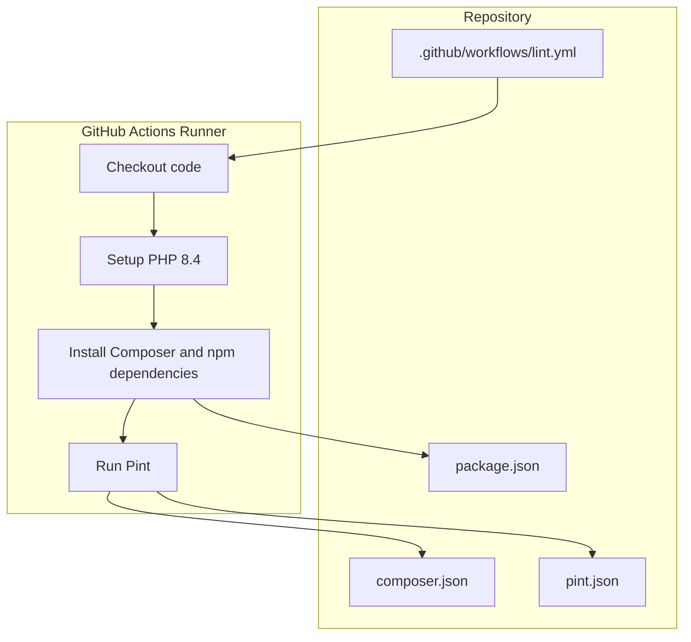
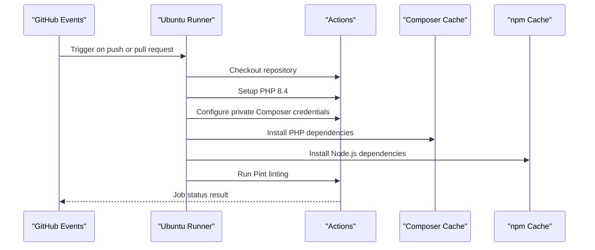
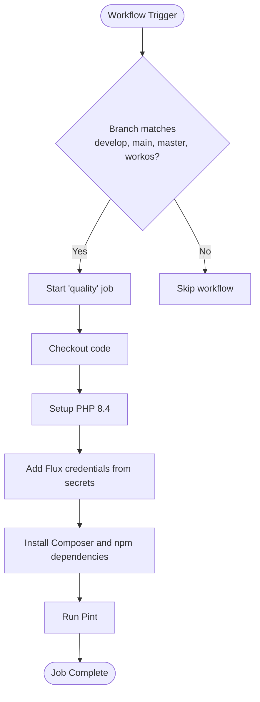
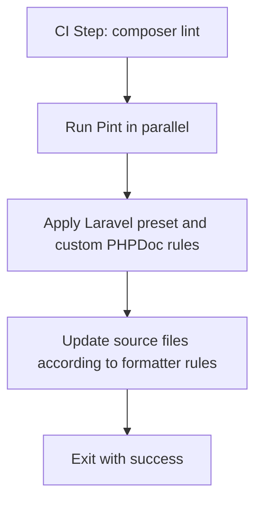
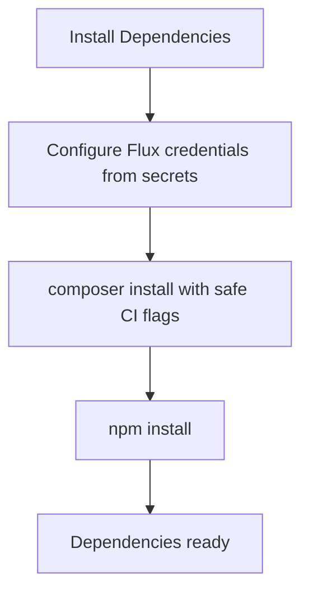
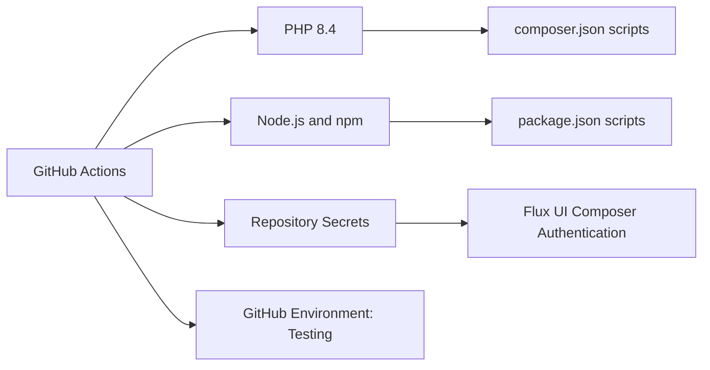
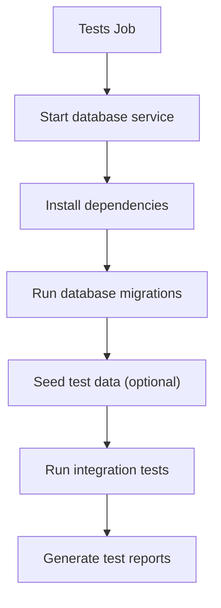

# CI/CD Pipeline Configuration

<cite>
**Referenced Files in This Document**
- [lint.yml](file://.github/workflows/lint.yml)
- [composer.json](file://composer.json)
- [pint.json](file://pint.json)
- [package.json](file://package.json)
</cite>

## Table of Contents
1. [Introduction](#introduction)
2. [Project Structure](#project-structure)
3. [Core Components](#core-components)
4. [Architecture Overview](#architecture-overview)
5. [Detailed Component Analysis](#detailed-component-analysis)
6. [Dependency Analysis](#dependency-analysis)
7. [Performance Considerations](#performance-considerations)
8. [Troubleshooting Guide](#troubleshooting-guide)
9. [Conclusion](#conclusion)
10. [Appendices](#appendices)

## Introduction
This document explains the Highblossom application’s continuous integration and delivery setup. It focuses on the existing GitHub Actions linting pipeline, how PHP code style checks with Pint are executed, how dependencies are installed, and how to extend the workflow with testing, asset building, security scanning, and deployment automation. It also covers environment variables, secrets handling, conditional execution based on branch triggers, and practical examples for adding database migration validation, integration tests, and artifact generation.

The repository is a Laravel + Livewire application that uses Composer for PHP dependencies, Pint for PHP code formatting, Vite for frontend assets, and PHPUnit for unit and integration tests. The current automated quality check runs only through a dedicated linter workflow.

## Project Structure
The CI/CD-related configuration is primarily located under `.github/workflows`, while build and tooling commands live in `composer.json` and `package.json`. Code style rules for Pint are defined in `pint.json`.

**Diagram sources**
- [lint.yml:1-50](file://.github/workflows/lint.yml#L1-L50)
- [composer.json:80-115](file://composer.json#L80-L115)
- [pint.json:1-22](file://pint.json#L1-L22)
- [package.json:1-35](file://package.json#L1-L35)

**Section sources**
- [lint.yml:1-50](file://.github/workflows/lint.yml#L1-L50)
- [composer.json:1-138](file://composer.json#L1-L138)
- [pint.json:1-22](file://pint.json#L1-L22)
- [package.json:1-35](file://package.json#L1-L35)

## Core Components
- GitHub Actions workflow: `.github/workflows/lint.yml` defines the linter job, branch triggers, environment usage, and step sequence.
- PHP tooling: `composer.json` contains scripts for dependency installation, Pint execution, test orchestration, and development tasks.
- Code style configuration: `pint.json` configures Pint presets and PHPDoc rules.
- Frontend tooling: `package.json` defines Vite build and development scripts used by the application.

Key responsibilities:
- Branch-based triggering for push and pull request events.
- PHP 8.4 runtime provisioning.
- Conditional authentication for private Composer repositories using repository secrets.
- Installation of PHP and Node.js dependencies.
- Running Pint in parallel mode as a quality gate.

**Section sources**
- [lint.yml:1-50](file://.github/workflows/lint.yml#L1-L50)
- [composer.json:80-115](file://composer.json#L80-L115)
- [pint.json:1-22](file://pint.json#L1-L22)
- [package.json:1-35](file://package.json#L1-L35)

## Architecture Overview
The current CI architecture is intentionally minimal. A single job performs repository checkout, PHP environment setup, dependency installation, and code style enforcement. Secrets are used only to authenticate access to the Flux UI Composer repository.

**Diagram sources**
- [lint.yml:1-50](file://.github/workflows/lint.yml#L1-L50)

## Detailed Component Analysis

### Existing Linter Workflow
The workflow is named `linter` and is triggered by pushes and pull requests targeting specific branches: `develop`, `main`, `master`, and `workos`. The `quality` job runs on an Ubuntu runner, uses the `Testing` GitHub environment, and executes four main steps:

1. Checkout the repository.
2. Set up PHP 8.4.
3. Add credentials for the Flux UI Composer repository using repository secrets.
4. Install dependencies via Composer and npm.
5. Execute Pint through the Composer script.

Branch trigger behavior:
- Pushes to any of the configured branches run the workflow.
- Pull requests targeting any of the configured branches run the workflow.

Environment usage:
- The job references `environment: Testing`, which allows repository-scoped environment protection rules and environment-specific variables/secrets.

Permissions:
- The workflow declares `contents: write`, enabling Git operations such as commits if needed. In the current file, commit auto-fix is commented out, so no changes are pushed.

Secrets usage:
- `secrets.FLUX_USERNAME` and `secrets.FLUX_LICENSE_KEY` are consumed to configure HTTP basic authentication for the Flux UI Composer repository before dependency installation.

**Diagram sources**
- [lint.yml:1-50](file://.github/workflows/lint.yml#L1-L50)

**Section sources**
- [lint.yml:1-50](file://.github/workflows/lint.yml#L1-L50)

### PHP Linting with Pint
Pint is configured through `pint.json` and invoked via Composer scripts:

- `composer lint`: Runs Pint in parallel mode.
- `composer lint:check`: Runs Pint in test mode, failing the build when formatting issues are found.
- `composer test`: Clears configuration, runs Pint checks, then executes tests.

The workflow currently runs `composer lint`, which formats code rather than strictly validating it. If strict validation is required, use the `lint:check` script in future workflow jobs.

Pint configuration highlights:
- Uses the Laravel preset.
- Enforces several PHPDoc rules, including alignment, separation, summary presence, trimming, scalar type annotations, tag casing, and return self-reference consistency.

**Diagram sources**
- [lint.yml:30-45](file://.github/workflows/lint.yml#L30-L45)
- [composer.json:88-93](file://composer.json#L88-L93)
- [pint.json:1-22](file://pint.json#L1-L22)

**Section sources**
- [composer.json:88-101](file://composer.json#L88-L101)
- [pint.json:1-22](file://pint.json#L1-L22)
- [lint.yml:30-45](file://.github/workflows/lint.yml#L30-L45)

### Dependency Installation
The workflow installs both PHP and Node.js dependencies:

- Composer installation uses quiet mode, disables ANSI output, interactions, scripts, progress indicators, and prefers prebuilt distributions.
- npm installation is performed after Composer.
- Private package access for Flux UI is enabled through Composer HTTP basic authentication using repository secrets.

Important notes:
- Composer scripts are disabled during dependency installation to avoid side effects in CI.
- The `Testing` environment can be used to scope environment variables and secrets.
- Caching Composer and npm artifacts can improve performance in later workflow versions.

**Diagram sources**
- [lint.yml:20-45](file://.github/workflows/lint.yml#L20-L45)
- [composer.json:12-23](file://composer.json#L12-L23)

**Section sources**
- [lint.yml:20-45](file://.github/workflows/lint.yml#L20-L45)
- [composer.json:12-23](file://composer.json#L12-L23)

### Frontend Asset Building
Frontend assets are built using Vite through `package.json`. The current linter workflow does not build assets; it only installs them. To add asset building to CI:

- Add a dedicated job or step that runs the Vite build command.
- Use the same node version strategy as your local development or Docker environment.
- Cache npm dependencies to speed up repeated builds.
- Optionally generate build artifacts for later deployment stages.

Recommended addition:
- Introduce a `build-assets` job that runs `npm ci` followed by `npm run build`.
- Publish compiled assets as workflow artifacts if they are needed by downstream jobs.

**Section sources**
- [package.json:1-35](file://package.json#L1-L35)

### Environment Variables and Secrets Handling
Current secret usage:
- `FLUX_USERNAME` and `FLUX_LICENSE_KEY` are read from GitHub repository secrets and passed into Composer configuration for accessing the Flux UI private repository.

Environment usage:
- The job sets `environment: Testing`, allowing environment-scoped variables and secrets.
- For additional needs such as database URLs, mail settings, cache drivers, or third-party API keys, define those variables under the `Testing` environment in GitHub Settings.

Best practices:
- Keep sensitive values in GitHub Secrets or environment-scoped secrets.
- Avoid printing secrets in logs.
- Restrict access to protected environments where necessary.
- Use distinct environments for staging and production deployments.

**Section sources**
- [lint.yml:18-45](file://.github/workflows/lint.yml#L18-L45)

### Conditional Execution Based on Branch Triggers
The workflow is explicitly configured to run only for:
- Push events on `develop`, `main`, `master`, and `workos`.
- Pull request events targeting the same branches.

If you need different behavior per branch:
- Use `if` conditions on jobs or steps.
- Example patterns include skipping linting on documentation-only changes, running deployment jobs only on `main` or `master`, or gating security scans to pull requests.

Example concepts:
- Deploy only on push to `main` or `master`.
- Skip expensive jobs for small pull requests or non-code changes.
- Run different test suites depending on changed directories.

**Section sources**
- [lint.yml:3-16](file://.github/workflows/lint.yml#L3-L16)

## Dependency Analysis
The CI pipeline depends on:
- GitHub Actions infrastructure.
- PHP 8.4 runtime provided by the PHP setup action.
- Composer-managed PHP packages.
- npm-managed frontend packages.
- Repository secrets for private Composer authentication.
- The `Testing` GitHub environment for scoped variables and secrets.

**Diagram sources**
- [lint.yml:1-50](file://.github/workflows/lint.yml#L1-L50)
- [composer.json:1-138](file://composer.json#L1-L138)
- [package.json:1-35](file://package.json#L1-L35)

**Section sources**
- [lint.yml:1-50](file://.github/workflows/lint.yml#L1-L50)
- [composer.json:1-138](file://composer.json#L1-L138)
- [package.json:1-35](file://package.json#L1-L35)

## Performance Considerations
- Prefer `composer install --no-scripts` in CI, as already implemented, to avoid unnecessary post-install hooks.
- Enable Composer and npm dependency caching in expanded workflows to reduce install time.
- Run Pint in parallel mode, as configured in the Composer script.
- Separate linting, testing, and building into parallel jobs where possible.
- Use matrix strategies for testing across multiple PHP or Node.js versions if required.
- Cache compiled assets separately from dependencies to minimize rebuild costs.

[No sources needed since this section provides general guidance]

## Troubleshooting Guide
Common issues and resolutions:

- Private Composer repository authentication fails:
  - Ensure `FLUX_USERNAME` and `FLUX_LICENSE_KEY` are set in GitHub Secrets.
  - Verify the `Testing` environment has access to these secrets.
  - Confirm the Composer repository URL matches the authenticated endpoint.

- Lint job passes but code style still differs locally:
  - The workflow runs `composer lint`, which formats code. If strict validation is desired, switch to `composer lint:check`.
  - Run `composer lint` locally to apply fixes automatically.

- Dependency installation is slow:
  - Add Composer and npm caching steps.
  - Use `npm ci` instead of `npm install` for deterministic installs.
  - Pin Node.js and PHP versions consistently across local, CI, and production environments.

- Tests fail due to missing environment configuration:
  - Create a `.env.testing` file or configure environment variables in the `Testing` environment.
  - Provide database credentials, cache configuration, and mailer settings as needed.

- Database migrations cannot run in CI:
  - Provision a MySQL or SQLite service container.
  - Run migrations before executing tests.
  - Seed test data only when required by integration tests.

**Section sources**
- [lint.yml:18-45](file://.github/workflows/lint.yml#L18-L45)
- [composer.json:88-101](file://composer.json#L88-L101)

## Conclusion
The Highblossom application currently has a focused linter workflow that enforces PHP code style using Pint on push and pull request events for selected branches. It installs Composer and npm dependencies, authenticates to a private Composer repository using secrets, and runs Pint in parallel. Extending this pipeline requires adding jobs for unit and integration testing, asset building, security scanning, and deployment automation. The recommended approach is to preserve the existing linter job, introduce separate jobs for testing and building, and use GitHub environments and secrets to manage sensitive configuration safely.

[No sources needed since this section summarizes without analyzing specific files]

## Appendices

### Extending the Pipeline: Recommended Jobs
- Unit and integration tests:
  - Add a `tests` job that provisions a database service, installs dependencies, runs migrations, seeds fixtures if needed, and executes PHPUnit.
  - Use `composer test` or `php artisan test` as appropriate.
  - Generate JUnit-style test reports for better visibility in pull requests.

- Asset building:
  - Add a `build-assets` job that runs `npm ci` and `npm run build`.
  - Cache npm dependencies and generated assets.
  - Publish compiled assets as workflow artifacts for deployment jobs.

- Security scanning:
  - Add a `security` job that runs static analysis, dependency vulnerability scanning, and container image scanning if applicable.
  - Fail the pipeline on critical vulnerabilities.

- Deployment automation:
  - Add a `deploy-staging` job triggered by push to `main` or `master`.
  - Add a `deploy-production` job gated by manual approval and protected branches.
  - Use GitHub environments for deployment approvals and environment-specific secrets.

### Adding Database Migration Testing
Recommended flow:
1. Start a MySQL or SQLite service container.
2. Install dependencies.
3. Copy `.env.testing` or export required variables.
4. Run database migrations.
5. Run seeders only for tests that require seeded data.
6. Execute integration tests.

### Adding Integration Tests
Integration tests should exercise endpoints, queues, mail sending, storage access, and external integrations. Recommended steps:
- Isolate tests from production state.
- Use in-memory or temporary databases where possible.
- Mock third-party services unless real integration is required.
- Capture logs and screenshots for failed UI tests.

### Artifact Generation
Useful CI artifacts include:
- Compiled frontend assets.
- Test report XML files.
- Coverage reports.
- Build metadata such as commit SHA and timestamp.
- Deployment bundles or Docker images.

Publishing artifacts:
- Use GitHub Actions upload/download actions.
- Restrict artifact retention policies.
- Avoid uploading large binary files unnecessarily.

### Example Workflow Extensions
Conceptual additions you can implement in a new workflow file:
- A `ci-full` workflow that orchestrates linting, testing, building, security scanning, and deployment.
- A `deploy` workflow that runs only on protected branches and requires manual approval.
- A `nightly` scheduled workflow for long-running tests and security audits.

[No sources needed since this section provides conceptual guidance]