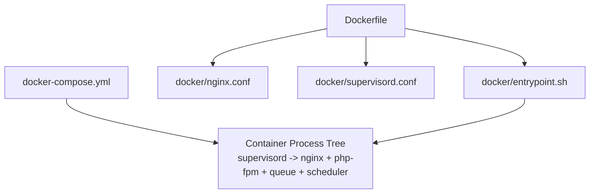
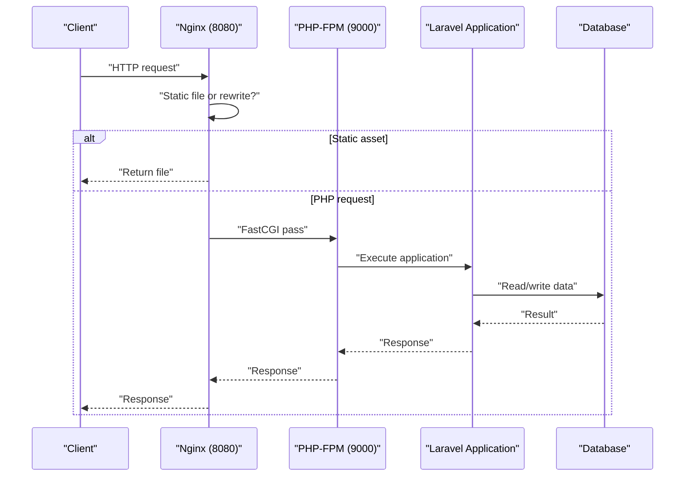
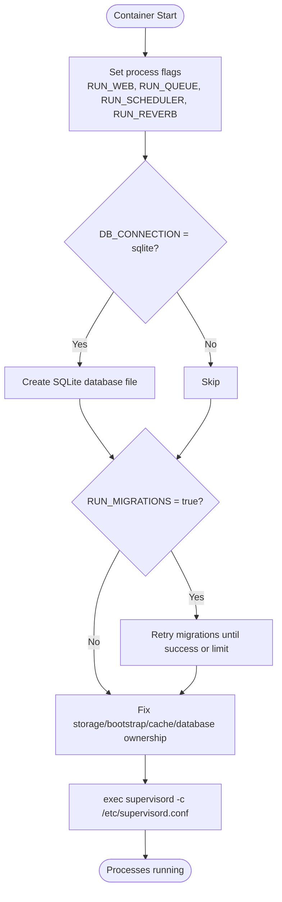
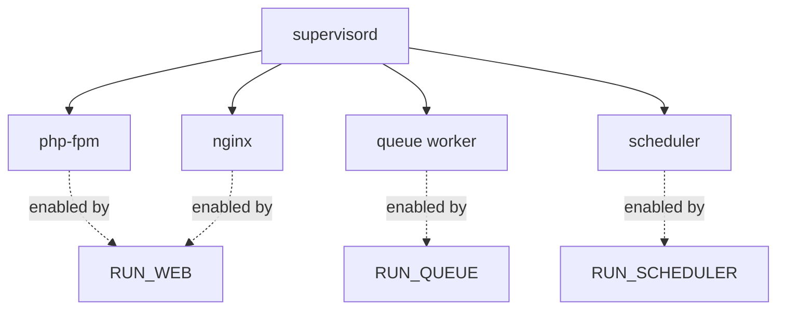
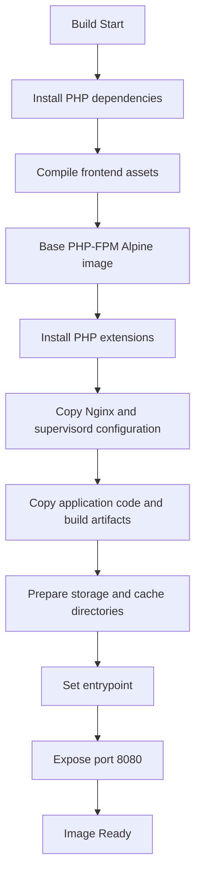
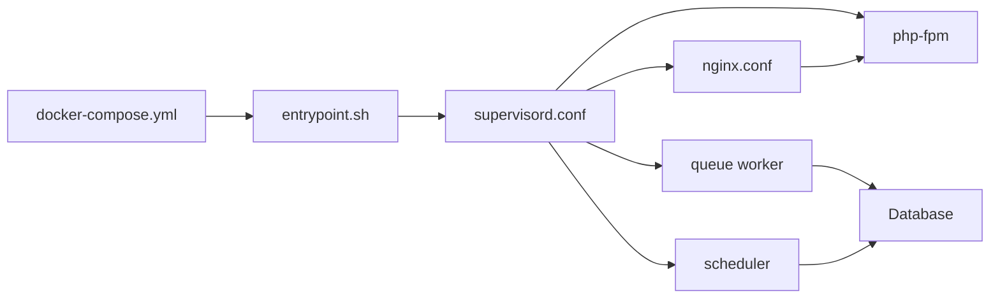

# Container Runtime Configuration

<cite>
**Referenced Files in This Document**
- [entrypoint.sh](file://docker/entrypoint.sh)
- [nginx.conf](file://docker/nginx.conf)
- [supervisord.conf](file://docker/supervisord.conf)
- [Dockerfile](file://Dockerfile)
- [docker-compose.yml](file://docker-compose.yml)
</cite>

## Table of Contents
1. [Introduction](#introduction)
2. [Project Structure](#project-structure)
3. [Core Components](#core-components)
4. [Architecture Overview](#architecture-overview)
5. [Detailed Component Analysis](#detailed-component-analysis)
6. [Dependency Analysis](#dependency-analysis)
7. [Performance Considerations](#performance-considerations)
8. [Troubleshooting Guide](#troubleshooting-guide)
9. [Conclusion](#conclusion)
10. [Appendices](#appendices)

## Introduction
This document explains the container runtime configuration for a Laravel application packaged as a single image. The container runs Nginx, PHP-FPM, a queue worker, and a scheduler under supervisord. The entrypoint script bootstraps the application, validates environment conditions, performs optional database migrations, and then hands control to supervisord.

The goal is to help operators understand how the container starts, how requests flow through Nginx and PHP-FPM, which processes are managed, and how to customize or debug the runtime across environments.

## Project Structure
The container runtime is defined by four key files:

- Dockerfile: builds the image, installs system packages, copies runtime configuration, and sets the container entrypoint.
- docker/entrypoint.sh: orchestrates startup tasks before launching supervisord.
- docker/nginx.conf: configures Nginx as the reverse proxy and static asset server.
- docker/supervisord.conf: manages lifecycle of all long-running processes.
- docker-compose.yml: defines local services and default environment variables.

**Diagram sources**
- [Dockerfile:1-32](file://Dockerfile#L1-L32)
- [docker/entrypoint.sh:1-20](file://docker/entrypoint.sh#L1-L20)
- [docker/nginx.conf:1-20](file://docker/nginx.conf#L1-L20)
- [docker/supervisord.conf:1-66](file://docker/supervisord.conf#L1-L66)
- [docker-compose.yml:1-31](file://docker-compose.yml#L1-L31)

**Section sources**
- [Dockerfile:1-32](file://Dockerfile#L1-L32)
- [docker-compose.yml:1-31](file://docker-compose.yml#L1-L31)

## Core Components
- Entrypoint bootstrap: Validates environment, prepares SQLite when needed, retries database migrations, fixes ownership, and launches supervisord.
- Nginx: Serves static assets, proxies PHP requests to PHP-FPM, denies access to hidden files, and enforces body size limits.
- Supervisord: Starts and monitors nginx, php-fpm, queue worker, and scheduler; supports selective process enablement via environment variables.
- Dockerfile: Assembles dependencies, extensions, compiled frontend assets, and runtime configurations into a single image.
- Compose: Provides local defaults for database connection, ports, and environment flags.

Key behaviors:
- All processes run inside one container.
- HTTP traffic enters on port 8080.
- Database migrations can be skipped via an environment flag.
- Web-only, queue-only, or scheduler-only modes are supported by toggling flags.

**Section sources**
- [docker/entrypoint.sh:1-20](file://docker/entrypoint.sh#L1-L20)
- [docker/nginx.conf:1-20](file://docker/nginx.conf#L1-L20)
- [docker/supervisord.conf:1-66](file://docker/supervisord.conf#L1-L66)
- [Dockerfile:1-32](file://Dockerfile#L1-L32)
- [docker-compose.yml:1-31](file://docker-compose.yml#L1-L31)

## Architecture Overview
The container runs a small process tree controlled by supervisord. Nginx listens on 8080, serves static files directly, and forwards PHP requests to PHP-FPM on localhost. Queue workers and scheduler tasks run as background jobs.

**Diagram sources**
- [docker/nginx.conf:1-20](file://docker/nginx.conf#L1-L20)
- [docker/supervisord.conf:1-66](file://docker/supervisord.conf#L1-L66)

## Detailed Component Analysis

### Entrypoint Bootstrap Behavior
The entrypoint script performs these steps:
- Exits immediately on errors.
- Changes working directory to the application root.
- Normalizes process flags with defaults: RUN_WEB, RUN_QUEUE, RUN_SCHEDULER, RUN_REVERB.
- Creates an empty SQLite database file when using the SQLite driver.
- Retries database migrations up to a fixed number of attempts with short delays.
- Fixes ownership of writable directories and cache folders.
- Executes supervisord with its configuration.

Operational notes:
- The migration loop retries approximately 20 times with a two-second interval, allowing about 40 seconds for the database service to become ready.
- If migrations cannot connect, the script logs that migrations were skipped and continues startup.
- Ownership changes ensure web processes can write to storage and cache directories.

Customization examples:
- Disable migrations: set RUN_MIGRATIONS=false at container runtime.
- Run only web server: set RUN_QUEUE=false and RUN_SCHEDULER=false.
- Run only queue worker: set RUN_WEB=false and RUN_SCHEDULER=false.
- Use SQLite locally: set DB_CONNECTION=sqlite and mount a persistent volume for database/database.sqlite.

**Diagram sources**
- [docker/entrypoint.sh:1-20](file://docker/entrypoint.sh#L1-L20)

**Section sources**
- [docker/entrypoint.sh:1-20](file://docker/entrypoint.sh#L1-L20)

### Nginx Configuration for PHP, Static Assets, SSL, and Security
Current behavior:
- Listens on port 8080.
- Document root is the public directory.
- Index file is index.php.
- Maximum upload body size is 64 MB.
- Requests are rewritten to index.php when not matching existing files or directories.
- PHP files are proxied to PHP-FPM on 127.0.0.1:9000.
- Hidden files are denied except well-known paths such as certificate challenge endpoints.

Request routing summary:
- Static assets served directly from public.
- Other URIs forwarded to the application entry point.
- PHP requests handled by PHP-FPM via FastCGI.

Security considerations:
- Hidden file access is blocked to reduce information disclosure.
- There is no built-in SSL termination inside this container image.
- No explicit security headers such as Content-Security-Policy, Strict-Transport-Security, X-Frame-Options, or Referrer-Policy are configured in the provided Nginx configuration.

Recommendations for production:
- Place this container behind a reverse proxy or ingress controller that terminates TLS.
- Add security headers in a site-specific Nginx include if you extend the configuration.
- Tune client_max_body_size according to your upload requirements.
- Enable gzip or brotli compression for text-based assets if desired.

SSL termination guidance:
- Because the container exposes HTTP only on 8080, configure your edge load balancer or Kubernetes Ingress to terminate TLS and forward HTTP to the container.
- If you add custom Nginx includes, place HTTPS listeners there while keeping the container’s internal listener as plain HTTP.

**Section sources**
- [docker/nginx.conf:1-20](file://docker/nginx.conf#L1-L20)

### Supervisord Configuration and Process Management
Supervisord manages four processes:

- php-fpm: Runs PHP-FPM in foreground mode. Enabled by RUN_WEB. Restarts automatically on failure.
- nginx: Runs Nginx in foreground mode. Enabled by RUN_WEB. Restarts automatically on failure.
- queue: Runs Laravel queue worker with retry, sleep, and max-time settings. Enabled by RUN_QUEUE. Runs as www-data.
- scheduler: Runs Laravel schedule work command. Enabled by RUN_SCHEDULER. Runs as www-data.

Process controls:
- autostart uses environment variable values so you can selectively disable components without changing configuration.
- autorestart ensures resilience against crashes.
- stopasgroup and killasgroup allow clean shutdown of child processes.
- stdout and stderr are forwarded to container logs for centralized observability.

**Diagram sources**
- [docker/supervisord.conf:1-66](file://docker/supervisord.conf#L1-L66)

Operational customization examples:
- Web-only container: RUN_WEB=true, RUN_QUEUE=false, RUN_SCHEDULER=false.
- Worker-only container: RUN_WEB=false, RUN_QUEUE=true, RUN_SCHEDULER=false.
- Scheduler-only container: RUN_WEB=false, RUN_QUEUE=false, RUN_SCHEDULER=true.
- Adjust queue worker behavior by overriding the command in a custom supervisord include or by wrapping the command to pass additional options.

Runtime tuning notes:
- The queue worker uses --sleep, --tries, and --max-time to limit job execution time and retries.
- The scheduler runs continuously and dispatches scheduled tasks.
- PHP-FPM and Nginx share the same process group for orderly shutdowns.

**Section sources**
- [docker/supervisord.conf:1-66](file://docker/supervisord.conf#L1-L66)

### Image Build and Dependencies
The Dockerfile constructs a multi-stage image:
- Composer stage installs PHP dependencies without development packages.
- Node stage compiles frontend assets.
- Final PHP-FPM Alpine image installs Nginx, supervisord, and required PHP extensions including PDO, MySQL, PostgreSQL, GD, intl, zip, opcache, pcntl, and exif.
- Configuration files are copied into standard locations.
- Application code and compiled build output are placed under /var/www/html.
- Storage and cache directories are created and owned by www-data.
- Port 8080 is exposed, and the entrypoint is set to the bootstrap script.

**Diagram sources**
- [Dockerfile:1-32](file://Dockerfile#L1-L32)

**Section sources**
- [Dockerfile:1-32](file://Dockerfile#L1-L32)

### Local Environment Defaults
The compose file defines:
- An app service built from the current directory.
- Port mapping from host port APP_PORT to container port 8080.
- Default environment variables including application environment, debug mode, database connection, credentials, and log channel.
- A MySQL database service with persistent volume.

Usage example:
- Start both services: docker compose up --build.
- Override the host port by setting APP_PORT before starting.
- Change database credentials by overriding environment variables.

**Section sources**
- [docker-compose.yml:1-31](file://docker-compose.yml#L1-L31)

## Dependency Analysis
The container runtime has clear separation of concerns:

- Entrypoint depends on shell utilities and the presence of PHP and supervisord.
- Nginx depends on the public directory and PHP-FPM availability.
- PHP-FPM depends on PHP extensions installed by the Dockerfile.
- Queue worker and scheduler depend on Laravel artisan commands and a reachable database.
- Compose depends on the Dockerfile and the database service.

**Diagram sources**
- [docker/entrypoint.sh:1-20](file://docker/entrypoint.sh#L1-L20)
- [docker/supervisord.conf:1-66](file://docker/supervisord.conf#L1-L66)
- [docker/nginx.conf:1-20](file://docker/nginx.conf#L1-L20)
- [docker-compose.yml:1-31](file://docker-compose.yml#L1-L31)

**Section sources**
- [docker/entrypoint.sh:1-20](file://docker/entrypoint.sh#L1-L20)
- [docker/supervisord.conf:1-66](file://docker/supervisord.conf#L1-L66)
- [docker/nginx.conf:1-20](file://docker/nginx.conf#L1-L20)
- [docker-compose.yml:1-31](file://docker-compose.yml#L1-L31)

## Performance Considerations
- Single-container simplicity reduces networking overhead but couples all processes. For large-scale deployments, consider splitting Nginx, PHP-FPM, queue workers, and scheduler into separate containers or pods.
- PHP extensions already include opcache, pcntl, and intl, which improve performance for typical Laravel workloads.
- The queue worker limits execution time per process, which helps avoid long-running jobs blocking restarts.
- Static assets are served by Nginx, reducing PHP-FPM load.
- Increase client_max_body_size only if uploads require larger payloads.
- Monitor memory usage of PHP-FPM and adjust pool settings externally if you extend the configuration.

[No sources needed since this section provides general guidance]

## Troubleshooting Guide
Common symptoms and checks:

- Container exits immediately:
  - Check whether RUN_MIGRATIONS is causing failures because the database is unreachable.
  - Inspect logs for migration retry messages.
  - Verify database connectivity and credentials.

- HTTP 502 or PHP not processing:
  - Confirm PHP-FPM is running and listening on 127.0.0.1:9000.
  - Ensure Nginx is enabled via RUN_WEB=true.
  - Verify that PHP files are routed to FastCGI and that the document root points to public.

- Permission errors writing to storage or cache:
  - Entrypoint changes ownership of storage, bootstrap/cache, and database directories.
  - If you override the entrypoint, ensure those directories are writable by www-data.

- Queues not processing jobs:
  - Ensure RUN_QUEUE=true.
  - Check that the queue worker is running as www-data and that backend queues are configured correctly.
  - Inspect worker logs for exceptions and job failures.

- Scheduled tasks not running:
  - Ensure RUN_SCHEDULER=true.
  - Confirm the scheduler process is active and that scheduled tasks are registered.

- SQLite not available:
  - When DB_CONNECTION=sqlite, verify that the SQLite database file exists and is writable.
  - Mount a persistent volume for the database path if persistence is required.

- Debugging process state:
  - Inspect supervisord status and logs from container stdout/stderr.
  - Restart individual processes using supervisorctl when extending the configuration.

- Customizing behavior:
  - Override RUN_WEB, RUN_QUEUE, RUN_SCHEDULER to select roles.
  - Override RUN_MIGRATIONS to skip automatic migrations.
  - Extend Nginx or supervisord configuration by mounting overrides into the container filesystem.

**Section sources**
- [docker/entrypoint.sh:1-20](file://docker/entrypoint.sh#L1-L20)
- [docker/nginx.conf:1-20](file://docker/nginx.conf#L1-L20)
- [docker/supervisord.conf:1-66](file://docker/supervisord.conf#L1-L66)

## Conclusion
The container runtime combines Nginx, PHP-FPM, a queue worker, and a scheduler into one reproducible unit. The entrypoint ensures the environment is prepared and migrations can complete before handing control to supervisord. Nginx handles static assets and PHP routing, while supervisord guarantees process resilience and role-based enablement. For production, terminate SSL at the edge, add security headers, and tune process pools and resource limits to match workload characteristics.

[No sources needed since this section summarizes without analyzing specific files]

## Appendices

### Quick Customization Reference
- Web-only: set RUN_WEB=true, RUN_QUEUE=false, RUN_SCHEDULER=false.
- Worker-only: set RUN_WEB=false, RUN_QUEUE=true, RUN_SCHEDULER=false.
- Scheduler-only: set RUN_WEB=false, RUN_QUEUE=false, RUN_SCHEDULER=true.
- Skip migrations: set RUN_MIGRATIONS=false.
- Use SQLite: set DB_CONNECTION=sqlite and persist database/database.sqlite.
- Change host port: set APP_PORT before running docker compose.

**Section sources**
- [docker/entrypoint.sh:1-20](file://docker/entrypoint.sh#L1-L20)
- [docker-compose.yml:1-31](file://docker-compose.yml#L1-L31)