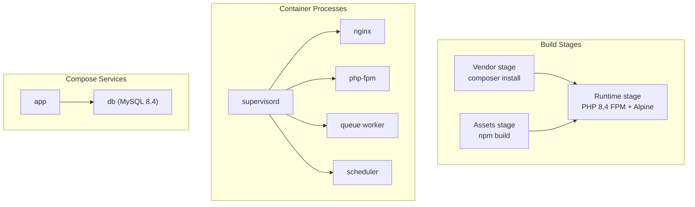
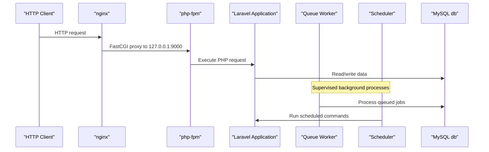
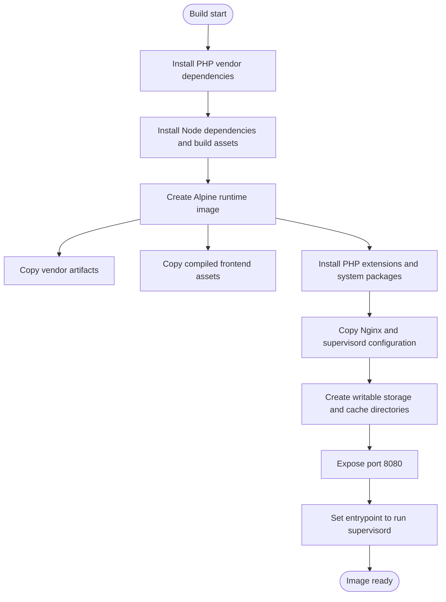
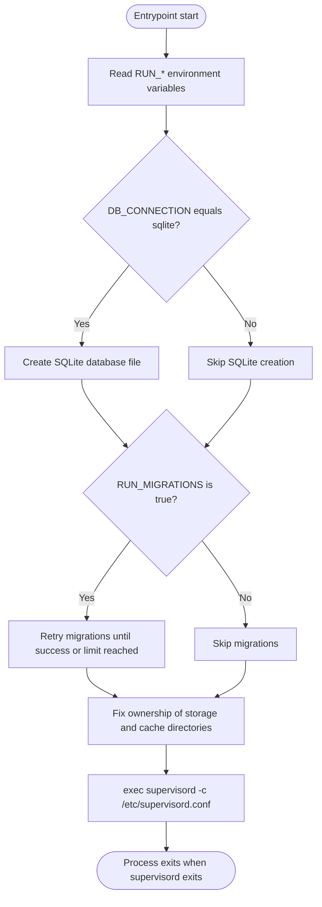
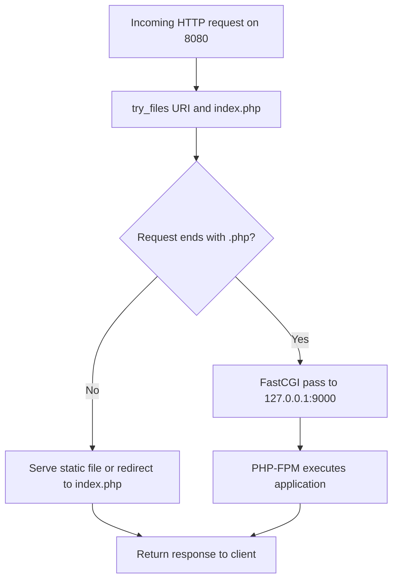
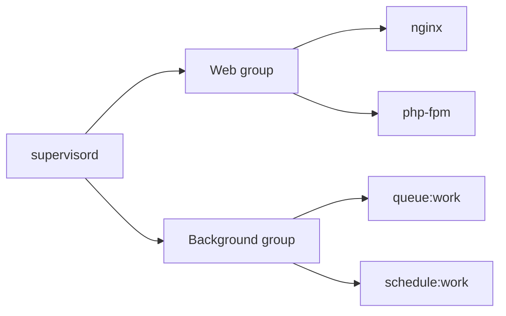
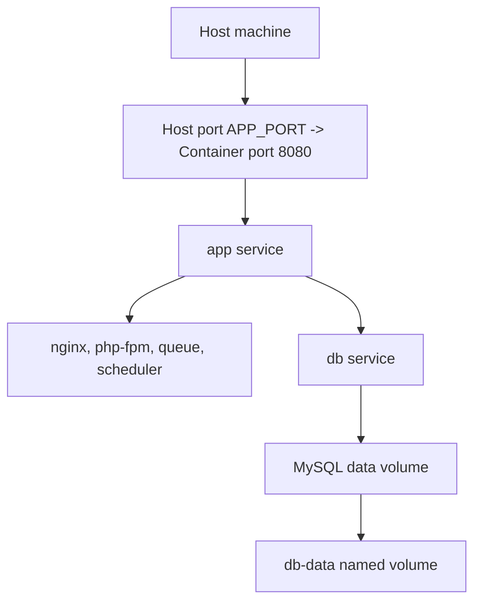
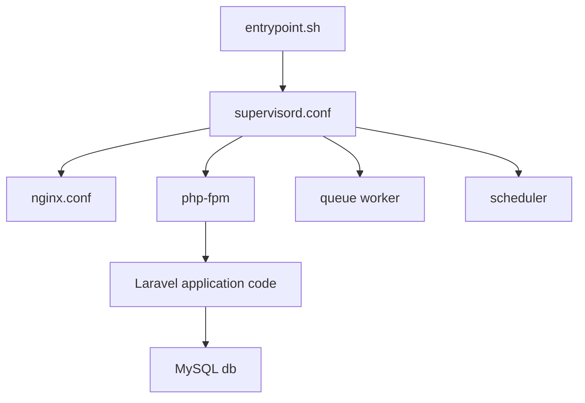

# Containerization & Docker

<cite>
**Referenced Files in This Document**   
- [Dockerfile](file://Dockerfile)
- [docker-compose.yml](file://docker-compose.yml)
- [docker/entrypoint.sh](file://docker/entrypoint.sh)
- [docker/nginx.conf](file://docker/nginx.conf)
- [docker/supervisord.conf](file://docker/supervisord.conf)
- [.dockerignore](file://.dockerignore)
</cite>

## Table of Contents
1. [Introduction](#introduction)
2. [Project Structure](#project-structure)
3. [Core Components](#core-components)
4. [Architecture Overview](#architecture-overview)
5. [Detailed Component Analysis](#detailed-component-analysis)
6. [Dependency Analysis](#dependency-analysis)
7. [Performance Considerations](#performance-considerations)
8. [Troubleshooting Guide](#troubleshooting-guide)
9. [Conclusion](#conclusion)

## Introduction
This document explains how the Highblossom application is containerized with Docker and docker-compose. The image uses a multi-stage build to produce a small Alpine-based runtime that runs nginx, PHP-FPM, a Laravel queue worker, and the scheduler under supervisord. docker-compose provisions an additional MySQL service and configures persistent storage.

## Project Structure
The containerization configuration is concentrated in five files:

| File | Responsibility |
|---|---|
| `Dockerfile` | Multi-stage build for vendor dependencies, Node.js assets, and final Alpine runtime |
| `docker-compose.yml` | Local service composition, ports, environment variables, and database volume |
| `docker/entrypoint.sh` | Database migration retry, storage ownership fix, and supervisord launch |
| `docker/nginx.conf` | Static file server, Laravel front controller routing, and PHP-FPM proxy |
| `docker/supervisord.conf` | Process supervisor for web, queue, and scheduler tasks |
| `.dockerignore` | Build context filtering to keep images small and avoid leaking secrets |

**Diagram sources**
- [Dockerfile:1-32](file://Dockerfile#L1-L32)
- [docker/supervisord.conf:1-66](file://docker/supervisord.conf#L1-L66)
- [docker-compose.yml:1-31](file://docker-compose.yml#L1-L31)

**Section sources**
- [Dockerfile:1-32](file://Dockerfile#L1-L32)
- [docker-compose.yml:1-31](file://docker-compose.yml#L1-L31)
- [.dockerignore:1-21](file://.dockerignore#L1-L21)

## Core Components
- Multi-stage Docker image with separate vendor and asset builds.
- Single-container runtime using supervisord to manage four processes.
- Nginx serving static assets and forwarding PHP requests to PHP-FPM on localhost.
- Entrypoint script that prepares migrations and fixes file ownership before starting supervisord.
- docker-compose definition for the app and MySQL services with named volume persistence.

**Section sources**
- [Dockerfile:1-32](file://Dockerfile#L1-L32)
- [docker/entrypoint.sh:1-20](file://docker/entrypoint.sh#L1-L20)
- [docker/nginx.conf:1-20](file://docker/nginx.conf#L1-L20)
- [docker/supervisord.conf:1-66](file://docker/supervisord.conf#L1-L66)
- [docker-compose.yml:1-31](file://docker-compose.yml#L1-L31)

## Architecture Overview
The container architecture is a single-process orchestrator model. supervisord starts nginx and php-fpm together, while also managing the queue worker and scheduler. Nginx proxies PHP requests through FastCGI to php-fpm listening on `127.0.0.1:9000`. The application connects to MySQL through the `db` hostname provided by docker-compose.

**Diagram sources**
- [docker/nginx.conf:1-20](file://docker/nginx.conf#L1-L20)
- [docker/supervisord.conf:1-66](file://docker/supervisord.conf#L1-L66)
- [docker-compose.yml:1-31](file://docker-compose.yml#L1-L31)

## Detailed Component Analysis

### Multi-Stage Docker Build
The build has three stages:

1. **Vendor stage**  
   Uses the Composer image to install production PHP dependencies without development packages or scripts. It then generates an optimized autoloader after copying the full source tree.

2. **Assets stage**  
   Uses Node.js 22 Alpine to install frontend dependencies and run the build command. The resulting compiled assets are copied into the runtime image under `/var/www/html/public/build`.

3. **Runtime stage**  
   Starts from `php:8.4-fpm-alpine`, installs nginx, supervisord, and required PHP extensions including PDO, MySQL, PostgreSQL, GD, intl, zip, opcache, pcntl, and exif. It copies the built vendor directory and frontend assets, creates writable directories, sets ownership to `www-data`, exposes port `8080`, and sets the entrypoint.

**Diagram sources**
- [Dockerfile:1-32](file://Dockerfile#L1-L32)

**Section sources**
- [Dockerfile:1-32](file://Dockerfile#L1-L32)

### Entrypoint Script Behavior
The entrypoint performs startup preparation before launching supervisord:

- Changes working directory to `/var/www/html`.
- Reads process control flags from environment variables: `RUN_WEB`, `RUN_QUEUE`, `RUN_SCHEDULER`, and `RUN_REVERB`.
- Creates a SQLite database file when `DB_CONNECTION=sqlite`.
- Retries database migrations up to 20 times with two-second intervals if `RUN_MIGRATIONS=true`.
- Fixes ownership of `storage`, `bootstrap/cache`, and `database` so the `www-data` user can write runtime files.
- Executes supervisord with its configuration file.

**Diagram sources**
- [docker/entrypoint.sh:1-20](file://docker/entrypoint.sh#L1-L20)

**Section sources**
- [docker/entrypoint.sh:1-20](file://docker/entrypoint.sh#L1-L20)

### Nginx Configuration
Nginx is configured inside the same container as PHP-FPM:

- Listens on port `8080`.
- Serves files from `/var/www/html/public`.
- Routes unknown paths to Laravel’s front controller at `index.php`.
- Proxies `.php` requests to `127.0.0.1:9000` using FastCGI.
- Blocks access to dotfiles except `well-known`.
- Sets a maximum upload body size of `64m`.

**Diagram sources**
- [docker/nginx.conf:1-20](file://docker/nginx.conf#L1-L20)

**Section sources**
- [docker/nginx.conf:1-20](file://docker/nginx.conf#L1-L20)

### Supervisor Process Management
supervisord manages four programs:

| Program | Command | User | Control Flags | Restart Policy |
|---|---|---|---|---|
| `php-fpm` | `php-fpm -F` | root | `RUN_WEB` | autorestart enabled |
| `nginx` | `nginx -g "daemon off;"` | root | `RUN_WEB` | autorestart enabled |
| `queue` | `php artisan queue:work --sleep=3 --tries=3 --max-time=3600` | `www-data` | `RUN_QUEUE` | autorestart enabled |
| `scheduler` | `php artisan schedule:work` | `www-data` | `RUN_SCHEDULER` | autorestart enabled |

All child processes log to stdout and stderr, which makes container logging straightforward. The web processes run as root because they bind to the container’s network stack, while the queue and scheduler run as `www-data` for safer application execution.

**Diagram sources**
- [docker/supervisord.conf:1-66](file://docker/supervisord.conf#L1-L66)

**Section sources**
- [docker/supervisord.conf:1-66](file://docker/supervisord.conf#L1-L66)

### Docker Compose Setup
The compose file defines two services:

- **app**
  - Builds the image from the project root.
  - Publishes host port `APP_PORT` defaulting to `8080` mapped to container port `8080`.
  - Configures Laravel environment variables for production mode, error reporting, database connection, and logging to stderr.
  - Depends on the MySQL service.

- **db**
  - Uses `mysql:8.4`.
  - Initializes the `app` database, user, password, and root password.
  - Persists MySQL data through the named volume `db-data`.

Volumes section declares `db-data` for database persistence.

**Diagram sources**
- [docker-compose.yml:1-31](file://docker-compose.yml#L1-L31)

**Section sources**
- [docker-compose.yml:1-31](file://docker-compose.yml#L1-L31)

## Dependency Analysis
The runtime depends on several internal and external components:

- **Internal dependencies**
  - Entrypoint depends on supervisord being installed and configured.
  - Nginx depends on php-fpm running on loopback port `9000`.
  - Queue and scheduler depend on Laravel artisan commands and database connectivity.
  - All PHP processes depend on writable `storage`, `bootstrap/cache`, and `database` directories.

- **External dependencies**
  - MySQL service accessed through the `db` hostname.
  - System packages installed by apk: nginx, supervisord.
  - PHP extensions installed by `install-php-extensions`: PDO drivers, MySQLi, bcmath, gd, intl, zip, opcache, pcntl, exif.

**Diagram sources**
- [docker/entrypoint.sh:1-20](file://docker/entrypoint.sh#L1-L20)
- [docker/supervisord.conf:1-66](file://docker/supervisord.conf#L1-L66)
- [docker/nginx.conf:1-20](file://docker/nginx.conf#L1-L20)
- [docker-compose.yml:1-31](file://docker-compose.yml#L1-L31)

**Section sources**
- [Dockerfile:1-32](file://Dockerfile#L1-L32)
- [docker/entrypoint.sh:1-20](file://docker/entrypoint.sh#L1-L20)
- [docker/supervisord.conf:1-66](file://docker/supervisord.conf#L1-L66)
- [docker-compose.yml:1-31](file://docker-compose.yml#L1-L31)

## Performance Considerations
- **Image size**: Using Alpine-based base images and separating vendor and asset builds reduces unnecessary content in the final image.
- **Asset compilation**: Frontend assets are built once during the assets stage and copied into the runtime image, avoiding runtime dependency installation.
- **PHP extensions**: Only needed extensions are installed; opcache is included for request caching.
- **File permissions**: Ownership is fixed to `www-data` for runtime directories to reduce permission-related overhead.
- **Queues**: The queue worker limits runtime to one hour per process and retries failed jobs, improving resilience under restarts.
- **Upload size**: Nginx allows uploads up to `64m`; adjust this value if larger media handling is required.
- **Logging**: Logging to stdout/stderr avoids filling disk space inside containers and integrates cleanly with container log collectors.

[No sources needed since this section provides general guidance]

## Troubleshooting Guide

### Common Startup Issues
- **Database not reachable during migration**  
  The entrypoint retries migrations up to 20 times with two-second pauses. If the database is still unavailable, it logs that migrations were skipped. Verify the `db` service is healthy and reachable before relying on automatic migrations.

- **Permission denied writing to storage**  
  Ensure the entrypoint ran successfully and that `storage`, `bootstrap/cache`, and `database` are owned by `www-data`. When mounting volumes, confirm that the container user can write to those paths.

- **Web page returns 502 or cannot connect to PHP**  
  Confirm php-fpm is running and listening on `127.0.0.1:9000`. Check nginx logs and verify that the FastCGI pass directive points to the correct address.

- **Frontend assets missing**  
  Make sure the assets build completed successfully and that `/var/www/html/public/build` exists. In development, ensure the build step is executed and that mounted volumes do not overwrite compiled output.

- **Environment variable problems**  
  The compose file requires `APP_KEY`. If it is missing, the compose setup will fail early. Generate the key using the documented command and export it before running the stack.

### Health Checks
There is no explicit health check defined in the provided compose file. For production readiness, consider adding:

- A container-level health check that tests HTTP availability on port `8080`.
- An application-level health endpoint returning a simple success response.
- Database connectivity verification through a lightweight command or probe.

These should be added to the compose file rather than relying only on `depends_on`, because dependency order does not guarantee service readiness.

### Storage Mounting
- **Database persistence**  
  The MySQL data directory is mounted to the named volume `db-data`. Do not remove this volume unless you intentionally want to lose all stored records.

- **Application storage**  
  Writable directories include `storage`, `bootstrap/cache`, and `database`. If you mount these paths from the host, ensure consistent ownership and permissions across environments.

- **Uploaded files**  
  Uploaded media may live under application storage. If using local filesystem storage, mount the corresponding path to persist uploads outside the container.

### Logging Configuration
- The entrypoint and supervisord send logs to stdout and stderr.
- The compose file sets `LOG_CHANNEL=stderr`, making Laravel logs appear in container logs.
- Avoid mounting large log directories directly into the container filesystem in high-volume environments; rely on container logging drivers instead.

### Scaling Considerations
- **Horizontal scaling**  
  Because sessions, caches, and uploaded files are written to the filesystem, horizontal scaling requires shared storage such as a network filesystem or object storage, and a shared session and cache backend backed by MySQL or another distributed store.

- **Stateless web nodes**  
  Scale the `app` service horizontally while keeping stateful data in MySQL and external storage.

- **Queue scaling**  
  Add more workers by increasing replicas or adjusting queue concurrency settings. The current supervisor program runs one queue worker per container.

- **Scheduler placement**  
  Running the scheduler on every replica can cause duplicate scheduling. Use a single instance for scheduling or implement leader election to ensure only one scheduler runs globally.

- **Resource limits**  
  Apply CPU and memory limits in the orchestration layer to prevent one replica from starving others.

**Section sources**
- [docker/entrypoint.sh:1-20](file://docker/entrypoint.sh#L1-L20)
- [docker-compose.yml:1-31](file://docker-compose.yml#L1-L31)
- [docker/supervisord.conf:1-66](file://docker/supervisord.conf#L1-L66)

## Conclusion
Highblossom’s containerization uses a clean multi-stage build to separate dependency installation and asset compilation from the final runtime image. A single container managed by supervisord runs nginx, php-fpm, the queue worker, and the scheduler, simplifying deployment while keeping process isolation. docker-compose provides a complete local stack with MySQL and persistent storage. For production, add explicit health checks, secure environment configuration, shared storage for state, and orchestration-level resource controls to support reliable scaling.