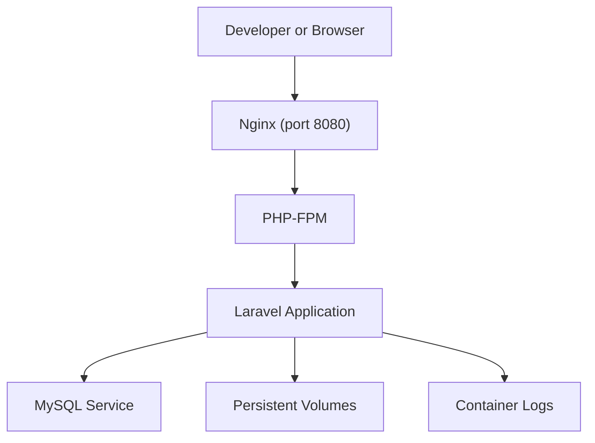
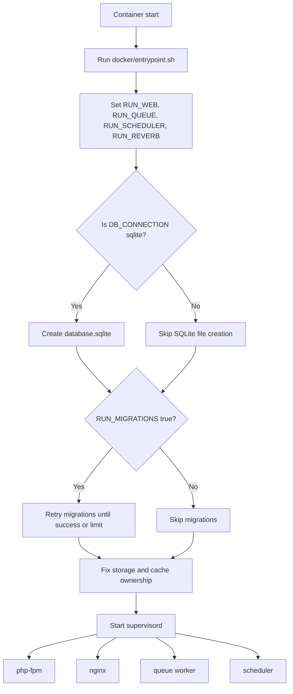
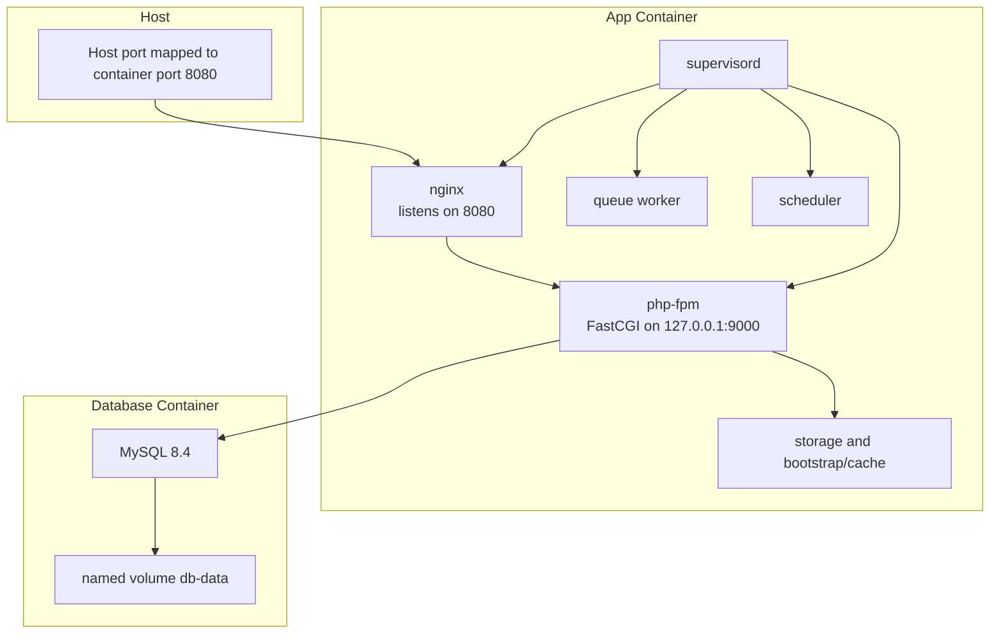
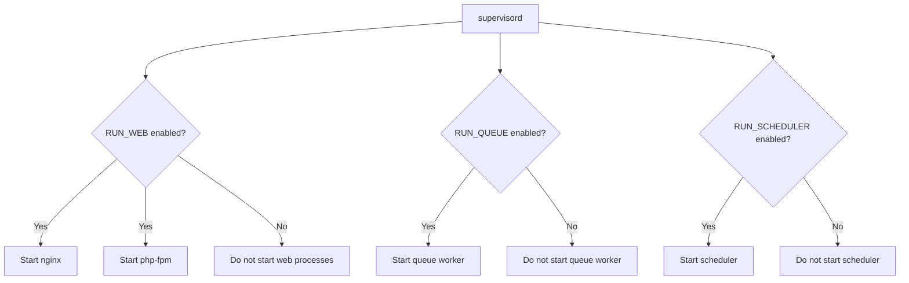
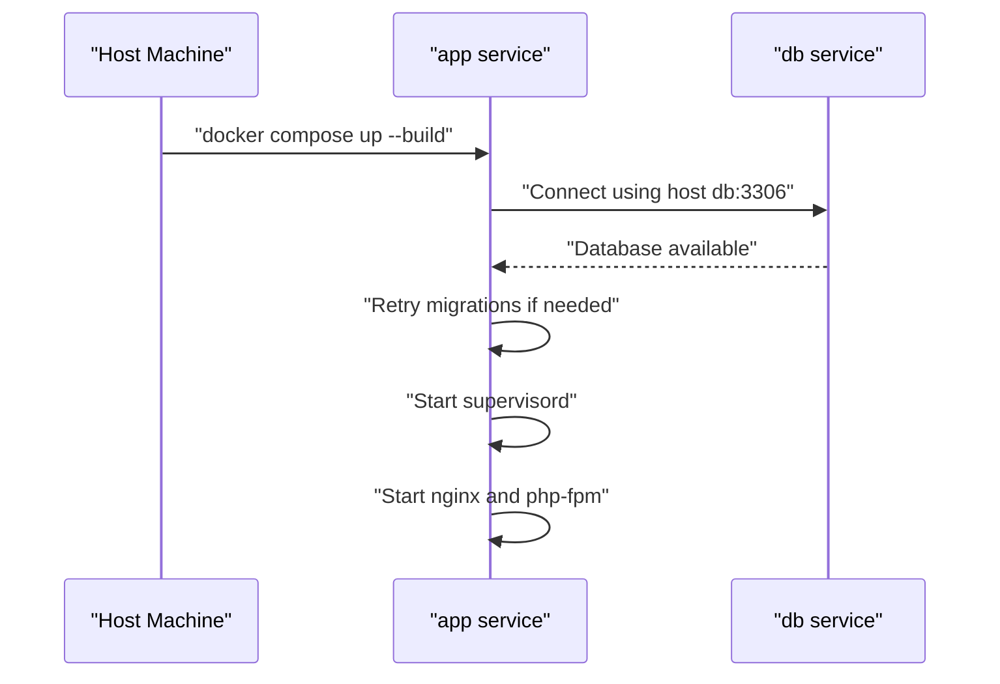
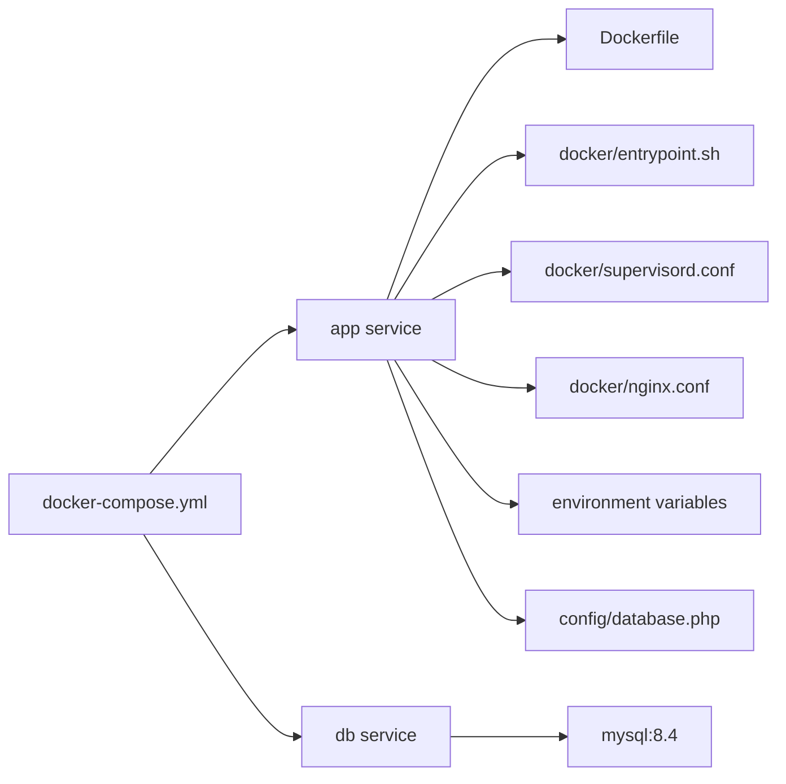

# Docker Compose Configuration

<cite>
**Referenced Files in This Document**   
- [docker-compose.yml](file://docker-compose.yml)
- [Dockerfile](file://Dockerfile)
- [docker/entrypoint.sh](file://docker/entrypoint.sh)
- [docker/nginx.conf](file://docker/nginx.conf)
- [docker/supervisord.conf](file://docker/supervisord.conf)
- [.env.example](file://.env.example)
- [config/database.php](file://config/database.php)
- [.dockerignore](file://.dockerignore)
</cite>

## Table of Contents
1. Introduction
2. Project Structure
3. Core Components
4. Architecture Overview
5. Detailed Component Analysis
6. Dependency Analysis
7. Performance Considerations
8. Troubleshooting Guide
9. Conclusion
10. Appendices

## Introduction
This document explains the container orchestration for the application, focusing on `docker-compose.yml` and its supporting files. It covers:

- The MySQL service configuration, including initialization, credentials, and persistent storage.
- The web service that runs nginx and php-fpm inside a single PHP container under supervisord.
- Environment variables, networking, service dependencies, and startup behavior.
- How to extend the setup with additional services such as Redis or mailcatcher.
- Volume mounting for local development, logging behavior, and resource limits.
- Common compose commands and troubleshooting tips.

The application is a Laravel project packaged into one image that starts nginx, php-fpm, queue workers, and the scheduler through supervisord.

## Project Structure
At the top level, the Docker-related configuration consists of:

| File | Purpose |
| --- | --- |
| `docker-compose.yml` | Defines the `app` and `db` services, ports, environment variables, volumes, and dependencies. |
| `Dockerfile` | Builds a multi-stage image containing composer dependencies, frontend assets, nginx, php-fpm, and supervisord. |
| `docker/entrypoint.sh` | Prepares the application, optionally runs migrations, fixes ownership, then starts supervisord. |
| `docker/nginx.conf` | Configures nginx to serve static files and proxy PHP requests to php-fpm on port 8080. |
| `docker/supervisord.conf` | Starts php-fpm, nginx, queue worker, and scheduler processes. |
| `.env.example` | Reference for environment variables used by Laravel and related components. |
| `config/database.php` | Laravel database configuration, including MySQL and Redis connection defaults. |
| `.dockerignore` | Excludes large or host-specific files from the Docker build context. |

**Diagram sources**
- [docker-compose.yml:1-31](file://docker-compose.yml#L1-L31)
- [docker/nginx.conf:1-20](file://docker/nginx.conf#L1-L20)
- [docker/supervisord.conf:1-66](file://docker/supervisord.conf#L1-L66)
- [docker/entrypoint.sh:1-20](file://docker/entrypoint.sh#L1-L20)

**Section sources**
- [docker-compose.yml:1-31](file://docker-compose.yml#L1-L31)
- [Dockerfile:1-32](file://Dockerfile#L1-L32)
- [docker/entrypoint.sh:1-20](file://docker/entrypoint.sh#L1-L20)
- [docker/nginx.conf:1-20](file://docker/nginx.conf#L1-L20)
- [docker/supervisord.conf:1-66](file://docker/supervisord.conf#L1-L66)
- [.env.example:1-83](file://.env.example#L1-L83)
- [config/database.php:1-184](file://config/database.php#L1-L184)
- [.dockerignore:1-21](file://.dockerignore#L1-L21)

## Core Components

### MySQL Service
The `db` service uses the official MySQL image and initializes a dedicated database and user.

- Image: MySQL 8.4.
- Database name: `app`.
- Application user: `app` with password `secret`.
- Root password: `secret`.
- Persistent volume: `db-data` mounted at `/var/lib/mysql`.

Important characteristics:

- The compose file does not provide an explicit health check or wait-for dependency for MySQL; the app’s entrypoint retries migrations until they succeed or give up after several attempts.
- All MySQL data is persisted through the named volume `db-data`.
- The MySQL service listens on the default internal port 3306 within the Docker network.

Connection settings consumed by the app:

- `DB_CONNECTION=mysql`
- `DB_HOST=db`
- `DB_PORT=3306`
- `DB_DATABASE=app`
- `DB_USERNAME=app`
- `DB_PASSWORD=secret`

These values are injected directly into the `app` service environment.

**Section sources**
- [docker-compose.yml:1-31](file://docker-compose.yml#L1-L31)
- [config/database.php:24-74](file://config/database.php#L24-L74)

### Web Service Orchestration
The `app` service builds the application image and exposes port 8080. Inside the container:

- nginx listens on port 8080.
- php-fpm listens on the loopback interface at port 9000.
- supervisord manages both web processes and background workers.

Key behaviors:

- The container exposes only port 8080 to the host.
- nginx proxies PHP requests to php-fpm via FastCGI.
- supervisord controls four programs: php-fpm, nginx, queue worker, and scheduler.
- Background processes can be disabled through environment variables.

Supervisord process roles:

| Process | Command | Purpose |
| --- | --- | --- |
| php-fpm | `php-fpm -F` | Handles PHP execution for HTTP requests. |
| nginx | `nginx -g "daemon off;"` | Serves static content and forwards PHP requests. |
| queue | `php artisan queue:work ...` | Processes queued jobs. |
| scheduler | `php artisan schedule:work` | Runs scheduled tasks. |

Process control flags include autostart, autorestart, group termination, and log redirection to stdout/stderr.

**Section sources**
- [docker-compose.yml:1-22](file://docker-compose.yml#L1-L22)
- [Dockerfile:1-32](file://Dockerfile#L1-L32)
- [docker/nginx.conf:1-20](file://docker/nginx.conf#L1-L20)
- [docker/supervisord.conf:1-66](file://docker/supervisord.conf#L1-L66)

### Startup Flow
The container startup sequence coordinates environment preparation, database readiness, and process supervision.

**Diagram sources**
- [docker/entrypoint.sh:1-20](file://docker/entrypoint.sh#L1-L20)
- [docker/supervisord.conf:1-66](file://docker/supervisord.conf#L1-L66)

**Section sources**
- [docker/entrypoint.sh:1-20](file://docker/entrypoint.sh#L1-L20)

## Architecture Overview
The runtime architecture separates concerns across containers while keeping the application image self-contained.

**Diagram sources**
- [docker-compose.yml:1-31](file://docker-compose.yml#L1-L31)
- [Dockerfile:1-32](file://Dockerfile#L1-L32)
- [docker/nginx.conf:1-20](file://docker/nginx.conf#L1-L20)
- [docker/supervisord.conf:1-66](file://docker/supervisord.conf#L1-L66)

## Detailed Component Analysis

### MySQL Configuration Details
The MySQL service is configured entirely through environment variables and a persistent volume.

| Setting | Value | Meaning |
| --- | --- | --- |
| `MYSQL_DATABASE` | `app` | Default database created on first run. |
| `MYSQL_USER` | `app` | Application database user. |
| `MYSQL_PASSWORD` | `secret` | Password for the application user. |
| `MYSQL_ROOT_PASSWORD` | `secret` | Administrative root password. |
| Volume mount | `db-data:/var/lib/mysql` | Persists MySQL data across container restarts. |

The application connects to MySQL using the hostname `db`, which Docker resolves through its internal networking. No custom network name is declared, so services communicate over the default Compose network.

For production hardening, consider:

- Using stronger passwords through `.env` rather than hardcoded values.
- Adding a MySQL health check and making the app depend on database readiness.
- Restricting MySQL access to the Compose network.
- Using secrets management for sensitive credentials.

**Section sources**
- [docker-compose.yml:15-31](file://docker-compose.yml#L15-L31)
- [config/database.php:44-74](file://config/database.php#L44-L74)

### Web Service and Request Processing
nginx acts as the reverse proxy and static file server. PHP requests are forwarded to php-fpm running inside the same container.

Processing flow:

1. A client request arrives at the host-mapped port 8080.
2. nginx receives the request and serves static files when possible.
3. For PHP routes, nginx forwards the request to php-fpm on the loopback interface.
4. php-fpm executes Laravel application code.
5. Laravel reads environment variables and configuration, then communicates with MySQL.

Security-related nginx behavior includes denying access to hidden files except well-known paths.

**Section sources**
- [docker/nginx.conf:1-20](file://docker/nginx.conf#L1-L20)
- [Dockerfile:16-32](file://Dockerfile#L16-L32)

### Entry Point and Migration Behavior
The entrypoint script prepares the application before starting supervisord.

Behavior summary:

- Sets feature flags for web, queue, scheduler, and optional Reverb processes.
- Creates an SQLite file if the database connection is SQLite.
- Retries Laravel migrations when `RUN_MIGRATIONS=true`.
- Stops retrying after approximately 40 seconds if the database is unavailable.
- Fixes ownership of writable directories.
- Executes supervisord as the final command.

This design allows the app to tolerate slow database startup during local development without requiring an external healthcheck wrapper.

**Section sources**
- [docker/entrypoint.sh:1-20](file://docker/entrypoint.sh#L1-L20)

### Supervisor Configuration
Supervisord manages multiple long-running processes.

Key configuration points:

- `nodaemon=true` keeps supervisord in the foreground so Docker can track its lifecycle.
- Logs are sent to stdout/stderr, making them visible through Docker logs.
- php-fpm and nginx share the same autostart flag controlled by `RUN_WEB`.
- Queue and scheduler share the same autostart flag controlled by `RUN_QUEUE` and `RUN_SCHEDULER`.
- Worker processes run as `www-data` where appropriate.
- Graceful shutdown waits for child processes to terminate.

**Diagram sources**
- [docker/supervisord.conf:1-66](file://docker/supervisord.conf#L1-L66)

**Section sources**
- [docker/supervisord.conf:1-66](file://docker/supervisord.conf#L1-L66)

### Environment Variables
Environment variables come from two places:

1. Explicit variables defined in `docker-compose.yml`.
2. Variables resolved from `.env` through Docker Compose substitution.

Compose-defined variables:

| Variable | Value or Source | Purpose |
| --- | --- | --- |
| `APP_ENV` | `production` | Application environment label. |
| `APP_DEBUG` | `false` | Disables debug output in this compose configuration. |
| `APP_KEY` | `${APP_KEY:?...}` | Required Laravel encryption key, sourced from `.env`. |
| `LOG_CHANNEL` | `stderr` | Sends application logs to standard error. |
| `DB_*` | Hardcoded MySQL connection values | Connects the app to the `db` service. |
| `RUN_WEB` | `true` by default | Controls whether nginx and php-fpm start. |
| `RUN_QUEUE` | `true` by default | Controls whether the queue worker starts. |
| `RUN_SCHEDULER` | `true` by default | Controls whether the scheduler starts. |
| `RUN_REVERB` | `true` by default | Controls whether Reverb starts. |
| `RUN_MIGRATIONS` | `true` by default | Enables automatic migration retries. |

Reference variables in `.env.example`:

- Application identity and URL.
- Logging channel and stack.
- Database defaults for local SQLite usage.
- Session driver and cookie security.
- Cache and Redis defaults.
- Mail configuration.
- Object storage configuration.

Recommended practice:

- Copy `.env.example` to `.env` for local development.
- Override compose variables in a separate override file or shell environment for different environments.
- Keep secrets out of version control.

**Section sources**
- [docker-compose.yml:1-22](file://docker-compose.yml#L1-L22)
- [docker/entrypoint.sh:1-20](file://docker/entrypoint.sh#L1-L20)
- [.env.example:1-83](file://.env.example#L1-L83)

### Networking and Dependencies
Networking is implicit unless overridden:

- The `app` and `db` services share the default Compose network.
- The app connects to MySQL using the service name `db`.
- Only port 8080 is exposed to the host machine.

Dependencies:

- The `app` service declares `depends_on: db`.
- There is no explicit readiness or health check for MySQL, so startup may fail briefly if the database is not ready yet.
- Migration retries reduce startup failures but do not replace proper health checks.

**Diagram sources**
- [docker-compose.yml:1-31](file://docker-compose.yml#L1-L31)
- [docker/entrypoint.sh:1-20](file://docker/entrypoint.sh#L1-L20)

**Section sources**
- [docker-compose.yml:1-22](file://docker-compose.yml#L1-L22)
- [docker/entrypoint.sh:1-20](file://docker/entrypoint.sh#L1-L20)

### Volume Mounting for Local Development
By default, the compose file defines only the MySQL data volume. It does not mount the application source directory into the container.

Implications:

- Code changes require rebuilding the image to take effect.
- Compiled assets and vendor dependencies are baked into the image during the build stage.
- Writable application directories are owned by `www-data`.

To enable live code reloading in development, add a bind mount for the application source and exclude heavy generated directories. Example guidance:

- Mount the project root to `/var/www/html`.
- Exclude `vendor`, `node_modules`, `public/build`, `storage`, and `bootstrap/cache` from the mount.
- Use `.dockerignore` to avoid sending unnecessary files to the Docker daemon.

Current `.dockerignore` already excludes common development artifacts such as `.env`, `vendor`, `node_modules`, `public/build`, and cached storage files.

**Section sources**
- [docker-compose.yml:1-31](file://docker-compose.yml#L1-L31)
- [.dockerignore:1-21](file://.docker.ignore#L1-L21)

### Logging Configuration
Application logging:

- The compose file sets `LOG_CHANNEL=stderr`.
- supervisord sends program logs to stdout and stderr.
- Docker captures these streams, so `docker compose logs` shows application output.

MySQL logging:

- MySQL writes logs to its own container log path by default.
- Use `docker compose logs db` to inspect database logs.

For centralized or structured logging, consider:

- Changing the logging driver in Docker or Compose.
- Writing logs to a shared volume.
- Routing stdout/stderr to a logging agent.

**Section sources**
- [docker-compose.yml:8-13](file://docker-compose.yml#L8-L13)
- [docker/supervisord.conf:1-66](file://docker/supervisord.conf#L1-L66)

### Resource Limits
The current compose file does not define CPU or memory limits. For production or constrained environments, add resource constraints per service.

Example guidance:

- Set memory limits for MySQL to prevent host memory exhaustion.
- Limit CPU shares for background workers.
- Separate high-memory services such as MySQL from short-lived web processes.

Resource limits should be tuned based on workload, available host resources, and testing results.

[No sources needed since this section provides general guidance]

### Extending the Compose File
You can extend the setup by adding new services to `docker-compose.yml` or creating an override file.

#### Adding Redis
Add a Redis service and connect the application to it.

Recommended steps:

1. Add a `redis` service using the official Redis image.
2. Persist Redis data through a named volume.
3. Update the application environment to use Redis for cache, sessions, or queues.
4. Ensure the `app` service depends on `redis` if Redis is required at startup.
5. Verify `config/database.php` Redis defaults align with your environment.

Relevant reference:

- The database configuration includes Redis defaults for host, port, username, password, and database selection.

#### Adding Mailcatcher
Add a mailcatcher service for local email inspection.

Recommended steps:

1. Add a `mailcatcher` service.
2. Map mailcatcher to a host port.
3. Configure the application mailer to point to the mailcatcher hostname and port.
4. Optionally disable SMTP authentication for local development.

Use `.env.example` as a reference for mail variables such as mailer, host, port, username, password, and sender address.

**Section sources**
- [config/database.php:122-184](file://config/database.php#L122-L184)
- [.env.example:37-83](file://.env.example#L37-L83)

## Dependency Analysis
The following diagram summarizes runtime dependencies.

**Diagram sources**
- [docker-compose.yml:1-31](file://docker-compose.yml#L1-L31)
- [Dockerfile:1-32](file://Dockerfile#L1-L32)
- [docker/entrypoint.sh:1-20](file://docker/entrypoint.sh#L1-L20)
- [docker/supervisord.conf:1-66](file://docker/supervisord.conf#L1-L66)
- [docker/nginx.conf:1-20](file://docker/nginx.conf#L1-L20)
- [.env.example:1-83](file://.env.example#L1-L83)
- [config/database.php:1-184](file://config/database.php#L1-L184)

**Section sources**
- [docker-compose.yml:1-31](file://docker-compose.yml#L1-L31)
- [Dockerfile:1-32](file://Dockerfile#L1-L32)
- [docker/entrypoint.sh:1-20](file://docker/entrypoint.sh#L1-L20)
- [docker/supervisord.conf:1-66](file://docker/supervisord.conf#L1-L66)
- [docker/nginx.conf:1-20](file://docker/nginx.conf#L1-L20)
- [.env.example:1-83](file://.env.example#L1-L83)
- [config/database.php:1-184](file://config/database.php#L1-L184)

## Performance Considerations
Recommendations for improving performance and reliability:

- **Health checks**: Add MySQL health checks and make the app wait for database readiness instead of relying solely on migration retries.
- **Caching**: Enable application caching and opcache in production images.
- **Queues**: Scale queue workers independently by adding more replicas or workers.
- **Static assets**: Serve compiled assets efficiently and consider CDN integration for production.
- **Database tuning**: Tune MySQL buffer sizes and connection limits according to workload.
- **Resource limits**: Apply CPU and memory constraints to prevent noisy-neighbor problems.
- **Logging**: Rotate logs and avoid excessive debug logging in production.

[No sources needed since this section provides general guidance]

## Troubleshooting Guide

### Common Commands
| Task | Command |
| --- | --- |
| Build and start services | `docker compose up --build` |
| Start services in detached mode | `docker compose up -d --build` |
| Stop services | `docker compose down` |
| Remove volumes and recreate | `docker compose down -v && docker compose up --build` |
| View logs | `docker compose logs -f` |
| View app logs only | `docker compose logs -f app` |
| View database logs only | `docker compose logs -f db` |
| Execute commands in app container | `docker compose exec app sh` |
| Run migrations manually | `docker compose exec app php artisan migrate --force` |
| Restart supervisor-managed processes | `docker compose exec app supervisorctl restart all` |

### Database Connection Failures
Symptoms:

- Migration retries eventually stop with a message indicating the database is not reachable.
- Application errors indicate MySQL connection failure.

Checks:

- Confirm the `db` service is running.
- Verify `DB_HOST=db` and `DB_PORT=3306`.
- Check that the `app` and `db` services are on the same Compose network.
- Inspect MySQL logs for authentication or initialization errors.
- Confirm `MYSQL_DATABASE`, `MYSQL_USER`, and `MYSQL_PASSWORD` match the application connection values.

### Missing APP_KEY
Symptoms:

- Laravel refuses to start because `APP_KEY` is missing.

Resolution:

- Generate a key locally: `php artisan key:generate --show`.
- Save it in `.env` as `APP_KEY`.
- Restart the containers.

### Port Conflicts
Symptoms:

- Compose fails to bind port 8080.

Resolution:

- Change `APP_PORT` in `.env` or override the port mapping in Compose.
- Free port 8080 on the host.

### Code Changes Not Applied
Cause:

- The compose file does not mount the application source directory.

Resolution:

- Add a bind mount for the project directory in a development override.
- Exclude `vendor`, `node_modules`, `public/build`, and cached storage files.
- Rebuild the image when dependencies or compiled assets change.

### Background Workers Not Running
Checks:

- Verify `RUN_QUEUE=true`.
- Verify `RUN_SCHEDULER=true`.
- Check supervisord status inside the container.
- Review container logs for queue or scheduler errors.

**Section sources**
- [docker-compose.yml:1-31](file://docker-compose.yml#L1-L31)
- [docker/entrypoint.sh:1-20](file://docker/entrypoint.sh#L1-L20)
- [.env.example:1-20](file://.env.example#L1-L20)

## Conclusion
The current Docker Compose setup provides a minimal but functional environment:

- A MySQL service with persistent storage.
- An application service that runs nginx, php-fpm, queue processing, and scheduling under supervisord.
- Environment-driven configuration with migration retries for startup resilience.

For production readiness, strengthen the setup with health checks, secrets management, resource limits, proper logging, and explicit networking. Use `.env.example` and `config/database.php` as references when extending the environment with Redis, mailcatcher, object storage, or other backend services.

[No sources needed since this section summarizes without analyzing specific files]

## Appendices

### Environment Variable Quick Reference
| Category | Variables |
| --- | --- |
| Application | `APP_NAME`, `APP_ENV`, `APP_KEY`, `APP_URL`, `APP_LOCALE`, `APP_DEBUG` |
| Logging | `LOG_CHANNEL`, `LOG_STACK`, `LOG_LEVEL` |
| Database | `DB_CONNECTION`, `DB_HOST`, `DB_PORT`, `DB_DATABASE`, `DB_USERNAME`, `DB_PASSWORD` |
| Sessions | `SESSION_DRIVER`, `SESSION_LIFETIME`, `SESSION_SECURE_COOKIE` |
| Queues | `QUEUE_CONNECTION` |
| Cache | `CACHE_STORE` |
| Redis | `REDIS_CLIENT`, `REDIS_HOST`, `REDIS_PASSWORD`, `REDIS_PORT` |
| Mail | `MAIL_MAILER`, `MAIL_HOST`, `MAIL_PORT`, `MAIL_USERNAME`, `MAIL_PASSWORD`, `MAIL_FROM_ADDRESS`, `MAIL_FROM_NAME` |
| Storage | `PUBLIC_DISK_DRIVER`, AWS credentials and bucket settings |

**Section sources**
- [.env.example:1-83](file://.env.example#L1-L83)
- [config/database.php:122-184](file://config/database.php#L122-L184)