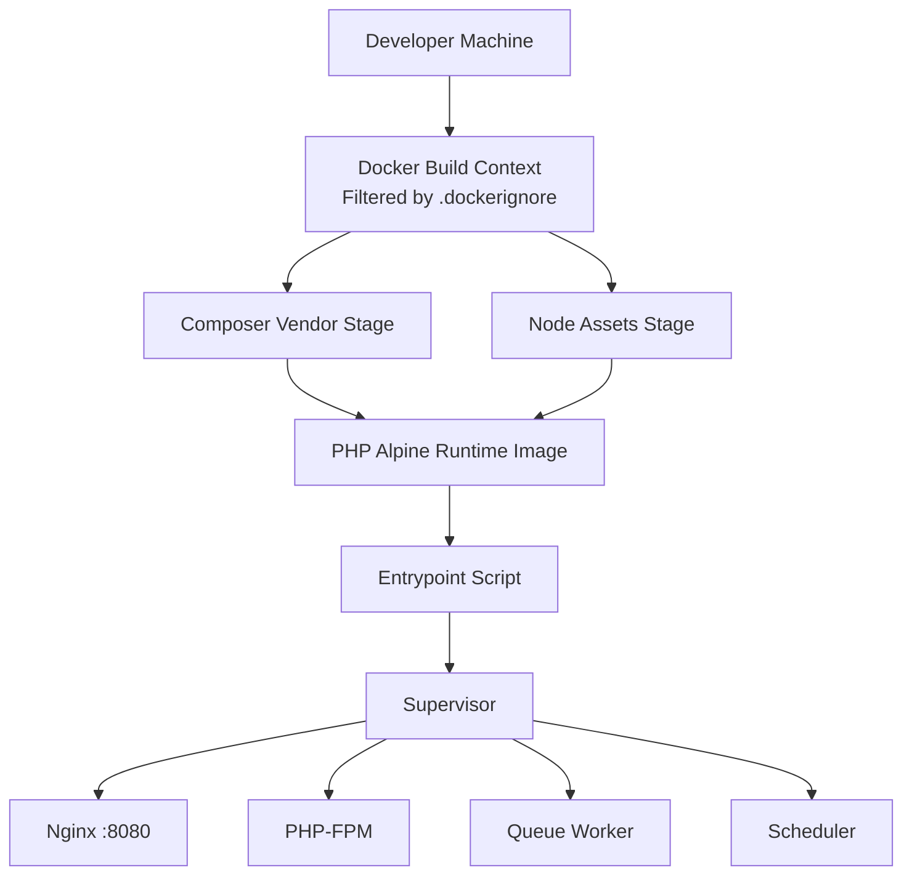
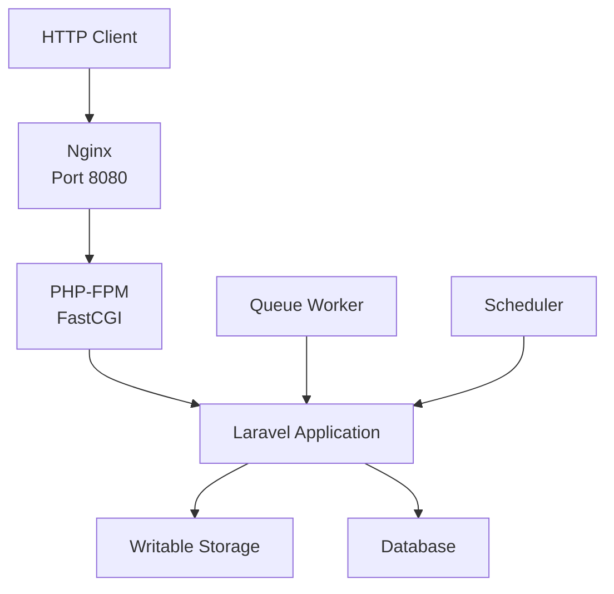
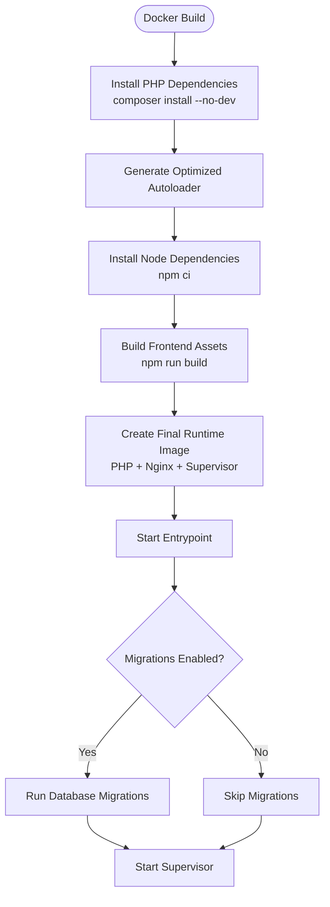
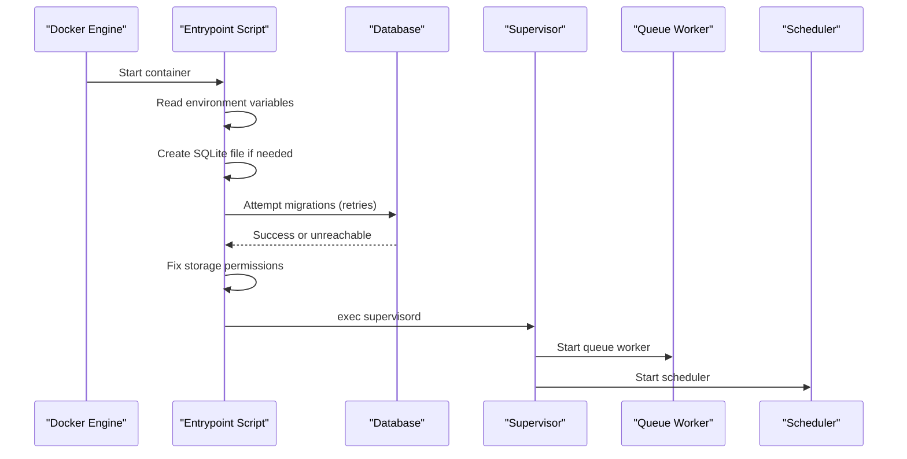
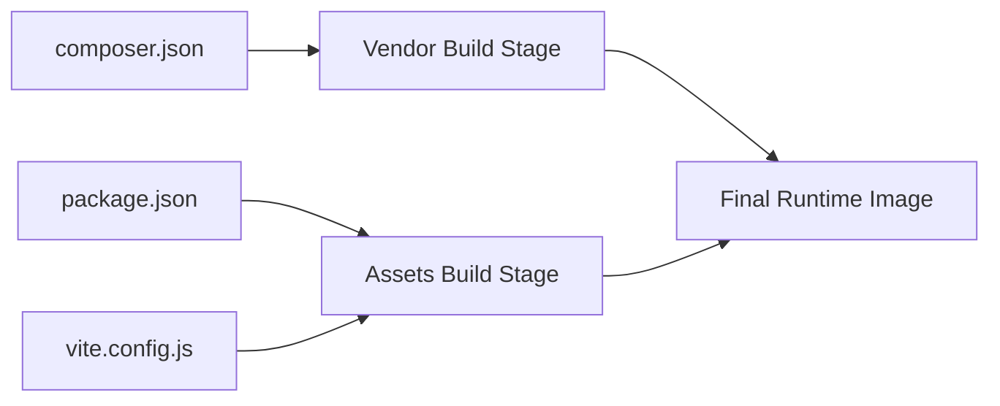

# Dockerfile & Build Process

<cite>
**Referenced Files in This Document**   
- [Dockerfile](file://Dockerfile)
- [docker/entrypoint.sh](file://docker/entrypoint.sh)
- [docker/nginx.conf](file://docker/nginx.conf)
- [docker/supervisord.conf](file://docker/supervisord.conf)
- [.dockerignore](file://.dockerignore)
- [composer.json](file://composer.json)
- [package.json](file://package.json)
- [vite.config.js](file://vite.config.js)
</cite>

## Table of Contents
1. [Introduction](#introduction)
2. [Project Structure](#project-structure)
3. [Core Components](#core-components)
4. [Architecture Overview](#architecture-overview)
5. [Detailed Component Analysis](#detailed-component-analysis)
6. [Dependency Analysis](#dependency-analysis)
7. [Performance Considerations](#performance-considerations)
8. [Troubleshooting Guide](#troubleshooting-guide)
9. [Conclusion](#conclusion)

## Introduction
This document explains the Highblossom application’s multi-stage Docker build and runtime image. The container combines a web server, PHP-FPM, queue workers, and the scheduler into one process tree managed by Supervisor. It uses separate build stages for Composer dependency resolution, Node/Vite asset compilation, and a minimal Alpine-based production runtime.

The intended audience includes developers who want to understand how the image is built, how to customize it for different environments, and how to optimize build speed, security, and image size.

## Project Structure
The Docker-related configuration is concentrated in three places:

| Area | Purpose |
|---|---|
| `Dockerfile` | Defines all build stages, base images, installed extensions, copied artifacts, exposed port, and default entrypoint. |
| `docker/entrypoint.sh` | Prepares the application at startup, optionally runs migrations, fixes permissions, and launches Supervisor. |
| `docker/nginx.conf` | Configures Nginx on port 8080 with Laravel routing rules and hidden-file protection. |
| `docker/supervisord.conf` | Starts and manages PHP-FPM, Nginx, queue worker, and scheduler processes. |
| `.dockerignore` | Excludes unnecessary files from the Docker build context to reduce build time and avoid leaking secrets or generated assets. |
| `composer.json` | Declares PHP dependencies, autoload paths, and Composer scripts. |
| `package.json` | Declares frontend dependencies and Vite build scripts. |
| `vite.config.js` | Declares Vite input entries and plugins used during asset compilation. |

**Diagram sources**
- [Dockerfile:1-32](file://Dockerfile#L1-L32)
- [docker/entrypoint.sh:1-20](file://docker/entrypoint.sh#L1-L20)
- [docker/supervisord.conf:1-66](file://docker/supervisord.conf#L1-L66)
- [.dockerignore:1-21](file://.dockerignore#L1-L21)

**Section sources**
- [Dockerfile:1-32](file://Dockerfile#L1-L32)
- [docker/entrypoint.sh:1-20](file://docker/entrypoint.sh#L1-L20)
- [docker/nginx.conf:1-20](file://docker/nginx.conf#L1-L20)
- [docker/supervisord.conf:1-66](file://docker/supervisord.conf#L1-L66)
- [.dockerignore:1-21](file://.dockerignore#L1-L21)

## Core Components
This section summarizes the major parts of the build and runtime.

### Base Images
| Stage | Base Image | Reason |
|---|---|---|
| Vendor stage | `composer:2` | Provides Composer 2 with PHP tooling for installing PHP packages. |
| Assets stage | `node:22-alpine` | Provides Node.js 22 on an Alpine Linux base for building frontend assets. |
| Runtime stage | `php:8.4-fpm-alpine` | Minimal PHP 8.4 FPM runtime on Alpine, extended with required PHP extensions and system packages. |

**Section sources**
- [Dockerfile:1-32](file://Dockerfile#L1-L32)

### Environment Variables
| Variable | Default Value | Meaning |
|---|---:|---|
| `RUN_WEB` | `true` | Controls whether Nginx and PHP-FPM are started. |
| `RUN_QUEUE` | `true` | Controls whether the queue worker is started. |
| `RUN_SCHEDULER` | `true` | Controls whether the scheduler process is started. |
| `RUN_REVERB` | `true` | Reserved control variable; currently not referenced by any Supervisor program. |
| `DB_CONNECTION` | `mysql` | Used by the entrypoint to decide whether to create a SQLite database file. |
| `RUN_MIGRATIONS` | `true` | Enables automatic migration execution at container start. |

These variables allow running subsets of services inside the same image, which is useful for separating web and background workloads.

**Section sources**
- [docker/entrypoint.sh:1-20](file://docker/entrypoint.sh#L1-L20)
- [docker/supervisord.conf:1-66](file://docker/supervisord.conf#L1-L66)

### User Permissions
The runtime image copies vendor and build artifacts as root and then changes ownership of writable directories to `www-data`. Supervisor starts PHP-FPM and Nginx as root but delegates the queue worker and scheduler to the unprivileged `www-data` user.

Key implications:
- Writable storage and cache directories must remain owned by `www-data`.
- Database files should be prepared before the container starts when using SQLite.
- Running migrations at startup requires write access to the database directory.

**Section sources**
- [Dockerfile:1-32](file://Dockerfile#L1-L32)
- [docker/entrypoint.sh:1-20](file://docker/entrypoint.sh#L1-L20)
- [docker/supervisord.conf:1-66](file://docker/supervisord.conf#L1-L66)

### Security Considerations
- **Minimal runtime:** The final image only installs Nginx, Supervisor, and necessary PHP extensions. Development tools such as debugging libraries are excluded.
- **No development dependencies:** Composer installs production-only packages.
- **Hidden file protection:** Nginx denies access to dotfiles except well-known endpoints.
- **Unprivileged workers:** Queue and scheduler run as `www-data`, reducing risk if those processes are compromised.
- **Context filtering:** `.dockerignore` excludes environment files, logs, node modules, vendor directories, and generated build outputs from the build context.
- **Database preparation:** The entrypoint conditionally creates a SQLite database file based on `DB_CONNECTION`.

**Section sources**
- [docker/nginx.conf:1-20](file://docker/nginx.conf#L1-L20)
- [.dockerignore:1-21](file://.dockerignore#L1-L21)
- [docker/supervisord.conf:1-66](file://docker/supervisord.conf#L1-L66)

## Architecture Overview
The final container runs four main components under Supervisor:

**Diagram sources**
- [docker/nginx.conf:1-20](file://docker/nginx.conf#L1-L20)
- [docker/supervisord.conf:1-66](file://docker/supervisord.conf#L1-L66)
- [Dockerfile:1-32](file://Dockerfile#L1-L32)

The request path is:
1. Nginx receives HTTP requests on port 8080.
2. Static files under `public` are served directly.
3. PHP routes are forwarded to PHP-FPM via FastCGI.
4. PHP-FPM executes the Laravel application.
5. Background jobs are handled by the queue worker.
6. Scheduled tasks are handled by the scheduler.

**Section sources**
- [docker/nginx.conf:1-20](file://docker/nginx.conf#L1-L20)
- [docker/supervisord.conf:1-66](file://docker/supervisord.conf#L1-L66)

## Detailed Component Analysis

### Multi-Stage Build Pipeline
The Dockerfile defines three stages:

1. **Vendor stage:** Installs Composer dependencies without dev packages and generates optimized autoloaders.
2. **Assets stage:** Installs Node dependencies and runs the Vite production build.
3. **Runtime stage:** Sets up the PHP/FPM/Alpine environment, copies built artifacts, exposes port 8080, and starts the entrypoint.

**Diagram sources**
- [Dockerfile:1-32](file://Dockerfile#L1-L32)
- [docker/entrypoint.sh:1-20](file://docker/entrypoint.sh#L1-L20)

#### Vendor Stage
- Uses `composer:2`.
- Copies only `composer.json` and lock files first to leverage Docker layer caching.
- Runs `composer install` with flags that exclude development dependencies, scripts, and autoloader generation during installation.
- Copies the rest of the source tree.
- Generates an optimized autoloader for production.

This separation improves cache reuse because dependency changes trigger fewer layers than full-source rebuilds.

**Section sources**
- [Dockerfile:1-32](file://Dockerfile#L1-L32)
- [composer.json:1-138](file://composer.json#L1-L138)

#### Assets Stage
- Uses `node:22-alpine`.
- Copies package manifests and lock files before copying the full source tree.
- Runs `npm ci` for deterministic dependency installation.
- Runs `npm run build`, which invokes Vite.

Vite compiles CSS and JavaScript inputs defined in its configuration and writes output to `public/build`.

**Section sources**
- [Dockerfile:1-32](file://Dockerfile#L1-L32)
- [package.json:1-35](file://package.json#L1-L35)
- [vite.config.js:1-33](file://vite.config.js#L1-L33)

#### Runtime Stage
- Uses `php:8.4-fpm-alpine`.
- Downloads and registers the PHP extension installer.
- Installs Nginx, Supervisor, and required PHP extensions such as PDO MySQL, PDO PostgreSQL, GD, intl, zip, opcache, pcntl, and exif.
- Copies Nginx and Supervisor configuration files.
- Copies the entrypoint script.
- Copies vendor code from the vendor stage and compiled assets from the assets stage.
- Creates writable storage directories and sets ownership to `www-data`.
- Exposes port 8080.
- Defaults to executing the entrypoint script.

**Section sources**
- [Dockerfile:1-32](file://Dockerfile#L1-L32)

### Entrypoint and Runtime Lifecycle
At container start, the entrypoint:
1. Changes working directory to `/var/www/html`.
2. Reads service enablement variables.
3. Creates a SQLite database file when `DB_CONNECTION=sqlite`.
4. Optionally retries database migrations for about 40 seconds if enabled.
5. Fixes ownership of storage, bootstrap cache, and database directories.
6. Executes Supervisor.

**Diagram sources**
- [docker/entrypoint.sh:1-20](file://docker/entrypoint.sh#L1-L20)
- [docker/supervisord.conf:1-66](file://docker/supervisord.conf#L1-L66)

**Section sources**
- [docker/entrypoint.sh:1-20](file://docker/entrypoint.sh#L1-L20)
- [docker/supervisord.conf:1-66](file://docker/supervisord.conf#L1-L66)

### Web Server Configuration
Nginx serves static content from `/var/www/html/public` and forwards PHP requests to PHP-FPM on localhost port 9000. It also blocks direct access to hidden files while allowing well-known endpoints.

Important details:
- Listen address: port 8080.
- Maximum upload size: 64 MB.
- Laravel-style fallback to `index.php`.
- FastCGI parameter uses `realpath_root` to resolve script paths safely.

**Section sources**
- [docker/nginx.conf:1-20](file://docker/nginx.conf#L1-L20)

### Supervisor Process Management
Supervisor runs four programs:

| Program | Command | User | Notes |
|---|---|---|---|
| `php-fpm` | `php-fpm -F` | Root | Controlled by `RUN_WEB`. |
| `nginx` | `nginx -g "daemon off;"` | Root | Controlled by `RUN_WEB`. |
| `queue` | `php artisan queue:work` | `www-data` | Controlled by `RUN_QUEUE`. |
| `scheduler` | `php artisan schedule:work` | `www-data` | Controlled by `RUN_SCHEDULER`. |

All processes log to stdout/stderr so container orchestration systems can capture logs.

**Section sources**
- [docker/supervisord.conf:1-66](file://docker/supervisord.conf#L1-L66)

## Dependency Analysis
The build depends on both PHP and Node ecosystems.

**Diagram sources**
- [composer.json:1-138](file://composer.json#L1-L138)
- [package.json:1-35](file://package.json#L1-L35)
- [vite.config.js:1-33](file://vite.config.js#L1-L33)
- [Dockerfile:1-32](file://Dockerfile#L1-L32)

### PHP Dependencies
- Production dependencies include Laravel framework, Livewire, authentication packages, media handling, email integration, permission management, and related integrations.
- Development dependencies such as testing, linting, debugging, and local tooling are excluded from the production image through Composer flags.
- Autoload configuration maps `App\` to the `app/` directory and includes helper functions.

**Section sources**
- [composer.json:1-138](file://composer.json#L1-L138)
- [Dockerfile:1-32](file://Dockerfile#L1-L32)

### Frontend Dependencies
- Vite builds multiple entry points for site styles and scripts, auth styles and scripts, and admin panel assets.
- Tailwind CSS v4 and Bootstrap are used alongside Alpine.js and other frontend libraries.
- Optional platform-specific binaries are declared for Linux x64 environments.

**Section sources**
- [package.json:1-35](file://package.json#L1-L35)
- [vite.config.js:1-33](file://vite.config.js#L1-L33)

## Performance Considerations

### Faster Builds Through Caching
- **Layered dependency installation:** Both Composer and npm copy only manifest and lock files before copying the full source tree. This allows Docker to reuse cached layers when only source code changes.
- **Deterministic installation:** `npm ci` avoids extra package discovery and ensures reproducible installs.
- **Production-only PHP dependencies:** Using `--no-dev` reduces the number of installed packages and speeds up autoloader generation.
- **Optimized autoloader:** The vendor stage generates an optimized autoloader for production use.

Recommended practices:
- Keep `composer.lock` and `package-lock.json` (or equivalent lock file) committed.
- Avoid changing frequently updated files such as `.env` or large generated outputs in the build context.
- Use `.dockerignore` to exclude `vendor`, `node_modules`, `public/build`, logs, and IDE metadata.

**Section sources**
- [Dockerfile:1-32](file://Dockerfile#L1-L32)
- [.dockerignore:1-21](file://.dockerignore#L1-L21)
- [composer.json:1-138](file://composer.json#L1-L138)
- [package.json:1-35](file://package.json#L1-L35)

### Image Size Optimization
- **Multi-stage isolation:** Only the final image contains what is needed at runtime.
- **Alpine bases:** All stages use Alpine variants where possible.
- **No dev dependencies:** Composer excludes development packages.
- **Only built assets:** Only `public/build` is copied from the assets stage.
- **Targeted PHP extensions:** Only required extensions are installed rather than enabling all available ones.
- **No-cache APK installs:** System packages are installed with `--no-cache` to avoid keeping package manager caches.

Potential improvements:
- Evaluate whether all PHP extensions are required in every deployment target.
- Consider a shared intermediate image if multiple applications share the same PHP extension set.
- Remove unused optional Node dependencies if they are not needed at runtime.

**Section sources**
- [Dockerfile:1-32](file://Dockerfile#L1-L32)

### Dependency Isolation
Each build stage has its own isolated filesystem:
- The vendor stage isolates Composer operations.
- The assets stage isolates Node/Vite operations.
- The runtime stage only inherits explicitly copied artifacts.

This prevents development tools, build caches, and temporary files from leaking into the production image.

**Section sources**
- [Dockerfile:1-32](file://Dockerfile#L1-L32)

## Troubleshooting Guide

### Container Starts But No Web Response
Check these items:
- Confirm the container exposes port 8080 and that the host mapping forwards the correct port.
- Verify Nginx is listening on port 8080.
- Ensure `public/index.php` exists and is readable by the web server.
- Check that `storage/framework/views`, `storage/logs`, and other writable directories exist and belong to `www-data`.

**Section sources**
- [Dockerfile:1-32](file://Dockerfile#L1-L32)
- [docker/nginx.conf:1-20](file://docker/nginx.conf#L1-L20)

### Migrations Fail at Startup
Symptoms:
- Migration retries stop after approximately 40 seconds.
- Logs indicate the database is not reachable.

Causes and fixes:
- Set `RUN_MIGRATIONS=false` if migrations are executed outside the container lifecycle.
- Ensure the database container is ready before starting the application container.
- For SQLite, ensure the `database` directory is mounted as a writable volume.
- Increase retry logic if the database takes longer than expected to become available.

**Section sources**
- [docker/entrypoint.sh:1-20](file://docker/entrypoint.sh#L1-L20)

### Queue Worker or Scheduler Not Running
Possible causes:
- `RUN_QUEUE=false` disables the queue worker.
- `RUN_SCHEDULER=false` disables the scheduler.
- Missing database credentials or connection settings.
- Permission errors preventing job processing.

Actions:
- Inspect container logs for queue and scheduler output.
- Confirm Supervisor program status.
- Verify that writable directories are owned by `www-data`.

**Section sources**
- [docker/supervisord.conf:1-66](file://docker/supervisord.conf#L1-L66)
- [docker/entrypoint.sh:1-20](file://docker/entrypoint.sh#L1-L20)

### Asset Build Fails
Possible causes:
- Missing or mismatched lock files.
- Incompatible Node version.
- Missing frontend entry files.

Actions:
- Verify Node.js 22 compatibility.
- Reinstall dependencies with `npm ci`.
- Check that Vite input files exist in `resources/css` and `resources/js`.
- Review `vite.config.js` for incorrect input paths.

**Section sources**
- [Dockerfile:1-32](file://Dockerfile#L1-L32)
- [package.json:1-35](file://package.json#L1-L35)
- [vite.config.js:1-33](file://vite.config.js#L1-L33)

### Secrets or Large Files Are Included in the Image
If environment files, logs, `vendor`, or `node_modules` appear in the image:
- Confirm `.dockerignore` is applied.
- Avoid mounting sensitive files into the build context.
- Rebuild without caching if previous layers contain unwanted files.

**Section sources**
- [.dockerignore:1-21](file://.dockerignore#L1-L21)

## Conclusion
The Highblossom Dockerfile implements a clean multi-stage build:
- Composer resolves PHP dependencies in an isolated stage.
- Node/Vite compiles frontend assets in another isolated stage.
- A minimal Alpine runtime image contains only production-required software, configured services, and prebuilt artifacts.

The design supports flexible runtime behavior through environment variables, provides reasonable defaults for Laravel, and emphasizes security and performance through dependency isolation, minimal base images, and targeted extensions. Customization is straightforward by adjusting build flags, environment variables, and Supervisor configuration to suit development, staging, and production needs.