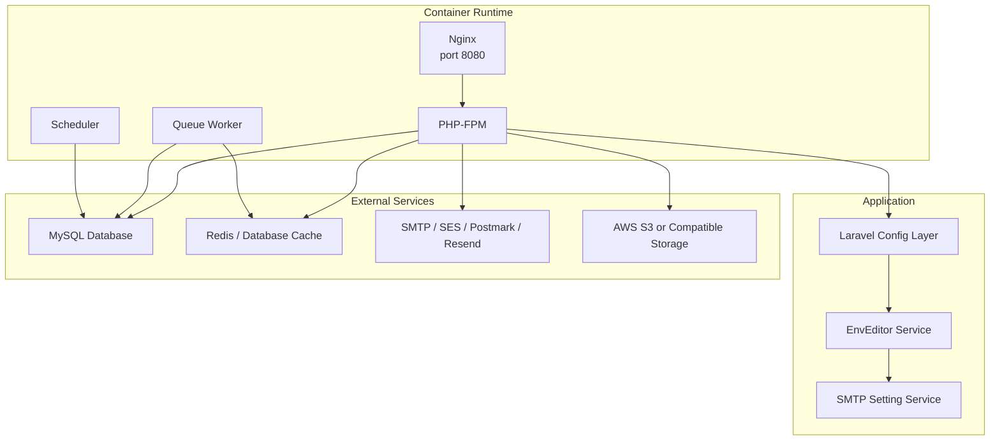
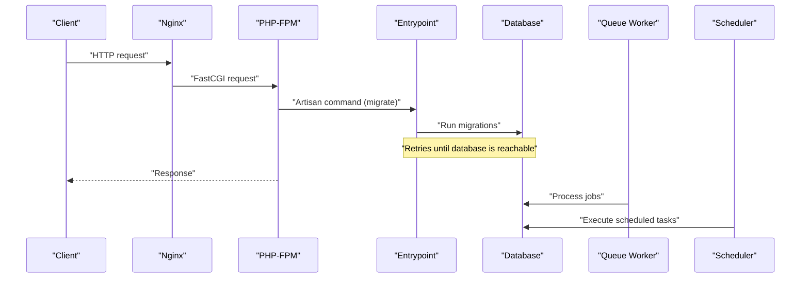
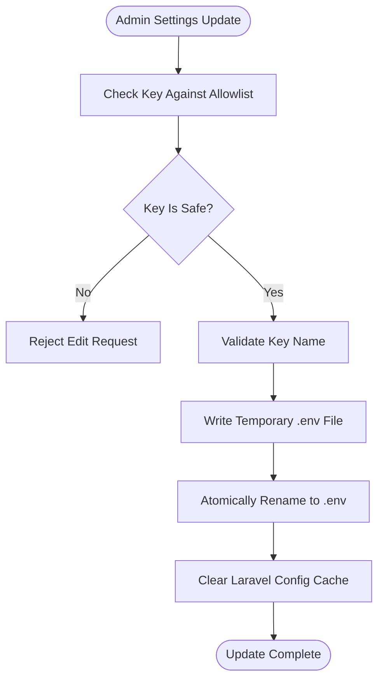
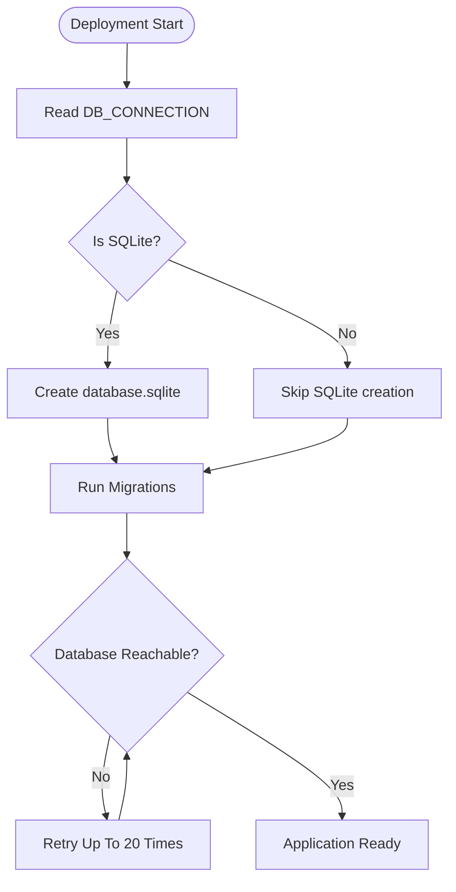
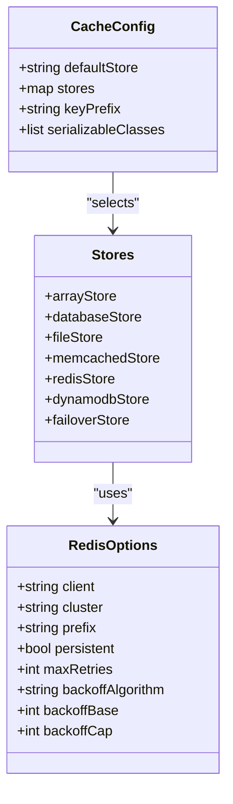
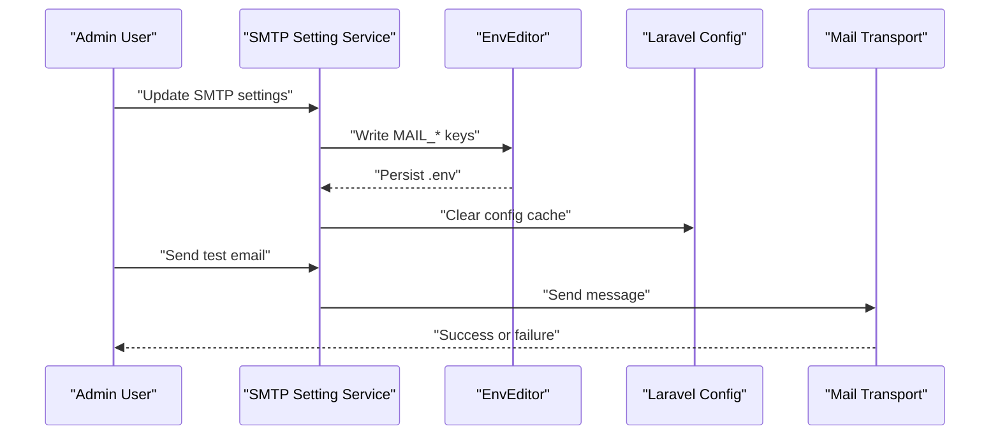
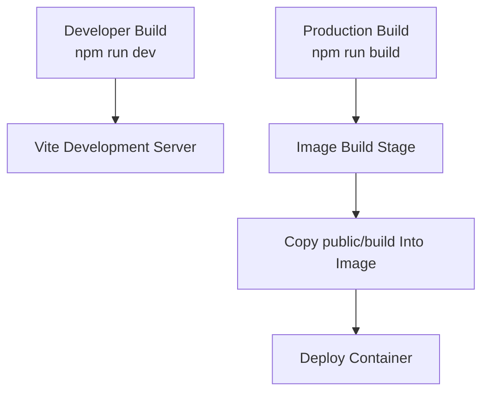
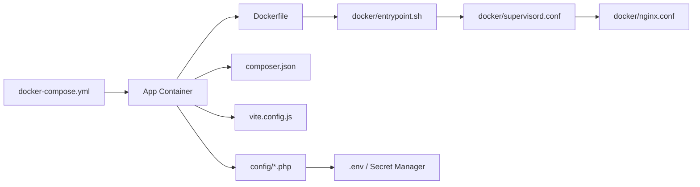
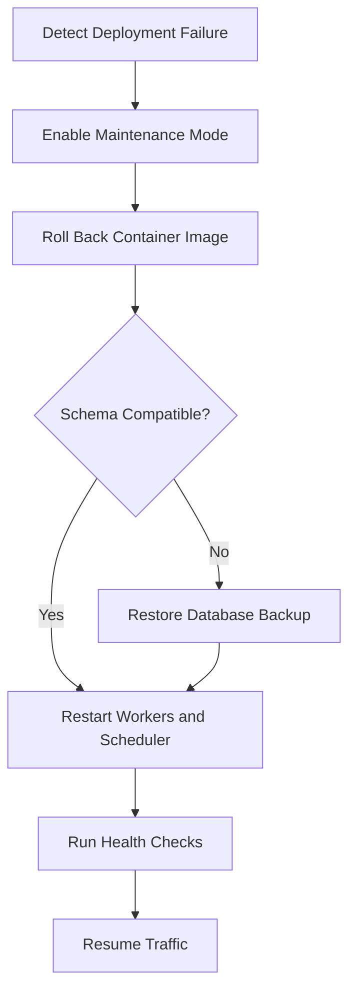

# Deployment Environments & Configuration

<cite>
**Referenced Files in This Document**   
- [config/app.php](file://config/app.php)
- [config/database.php](file://config/database.php)
- [config/cache.php](file://config/cache.php)
- [config/mail.php](file://config/mail.php)
- [config/services.php](file://config/services.php)
- [config/session.php](file://config/session.php)
- [config/queue.php](file://config/queue.php)
- [config/filesystems.php](file://config/filesystems.php)
- [config/logging.php](file://config/logging.php)
- [config/debugbar.php](file://config/debugbar.php)
- [app/Services/EnvEditor.php](file://app/Services/EnvEditor.php)
- [app/Services/SmtpSettingService.php](file://app/Services/SmtpSettingService.php)
- [database/migrations/0001_01_01_000001_create_cache_table.php](file://database/migrations/0001_01_01_000001_create_cache_table.php)
- [database/migrations/0001_01_01_000002_create_jobs_table.php](file://database/migrations/0001_01_000002_create_jobs_table.php)
- [database/seeders/DatabaseSeeder.php](file://database/seeders/DatabaseSeeder.php)
- [composer.json](file://composer.json)
- [Dockerfile](file://Dockerfile)
- [docker-compose.yml](file://docker-compose.yml)
- [docker/entrypoint.sh](file://docker/entrypoint.sh)
- [docker/nginx.conf](file://docker/nginx.conf)
- [docker/supervisord.conf](file://docker/supervisord.conf)
- [vite.config.js](file://vite.config.js)
</cite>

## Table of Contents
1. [Introduction](#introduction)
2. [Project Structure](#project-structure)
3. [Core Components](#core-components)
4. [Architecture Overview](#architecture-overview)
5. [Detailed Component Analysis](#detailed-component-analysis)
6. [Environment-Specific Configuration](#environment-specific-configuration)
7. [Dependency Analysis](#dependency-analysis)
8. [Performance Considerations](#performance-considerations)
9. [Troubleshooting Guide](#troubleshooting-guide)
10. [Conclusion](#conclusion)

## Introduction
This document explains how the application is deployed and configured across development, staging, and production environments. It covers environment variables, configuration files, database connections, caching, email services, third-party integrations, asset compilation, migrations, secrets handling, performance tuning, validation, auditing, and rollback strategies. The application is a Laravel project with PHP-FPM, Nginx, queue workers, and a scheduler running under Supervisor inside a Docker container.

## Project Structure
The deployment-relevant structure centers on:

- **Configuration**: `config/*.php` files read values from environment variables through `env()`.
- **Runtime container**: `Dockerfile`, `docker-compose.yml`, `docker/entrypoint.sh`, `docker/nginx.conf`, `docker/supervisord.conf`.
- **Asset build**: `vite.config.js` defines frontend entry points; assets are built during image build.
- **Composer scripts**: `composer.json` provides setup, development, linting, testing, and post-install automation.
- **Data layer**: Migrations for cache, jobs, and application tables live under `database/migrations`; seeders populate initial data.

**Diagram sources**
- [docker/nginx.conf:1-20](file://docker/nginx.conf#L1-L20)
- [docker/supervisord.conf:1-66](file://docker/supervisord.conf#L1-L66)
- [Dockerfile:1-32](file://Dockerfile#L1-L32)
- [config/app.php:1-126](file://config/app.php#L1-L126)
- [app/Services/EnvEditor.php:1-200](file://app/Services/EnvEditor.php#L1-L200)
- [app/Services/SmtpSettingService.php:1-85](file://app/Services/SmtpSettingService.php#L1-L85)

**Section sources**
- [Dockerfile:1-32](file://Dockerfile#L1-L32)
- [docker-compose.yml:1-31](file://docker-compose.yml#L1-L31)
- [docker/entrypoint.sh:1-20](file://docker/entrypoint.sh#L1-L20)
- [composer.json:1-138](file://composer.json#L1-L138)
- [vite.config.js:1-33](file://vite.config.js#L1-L33)

## Core Components
- **Application identity and runtime flags**: Application name, environment, debug mode, URL, timezone, locale, encryption key, maintenance mode driver, and previous keys are loaded from environment variables.
- **Database connectivity**: Default connection and multiple drivers are supported, including MySQL, MariaDB, PostgreSQL, SQL Server, and SQLite. Redis clients and connection groups are also defined.
- **Caching strategy**: Default store, per-store backends (array, database, file, memcached, redis, dynamodb, octane, failover), prefixing, and serializable classes are configurable.
- **Email delivery**: Default mailer and multiple transports are available, including SMTP, SES, Postmark, Resend, Sendmail, log, array, failover, and round-robin. Global reply-to and from addresses are configurable.
- **Third-party services**: Postmark, Resend, AWS SES, and Slack credentials are exposed through service configuration.
- **Session management**: Driver, lifetime, encryption, cookie settings, secure and HTTP-only behavior, and SameSite policy are configurable.
- **Queues and jobs**: Default connection, database-backed jobs, SQS, Redis, Beanstalkd, deferred/background, failover, batching, and failed job storage are configurable.
- **Filesystem storage**: Local and S3-compatible disks, public disk switching between local and S3, temporary storage, and symlink configuration.
- **Logging**: Stack-based logging with single, daily, Slack, Papertrail, stderr, syslog, errorlog, and null channels.
- **Debug tooling**: Debugbar is controlled by environment variables and can be selectively enabled or disabled.

**Section sources**
- [config/app.php:1-126](file://config/app.php#L1-L126)
- [config/database.php:1-184](file://config/database.php#L1-L184)
- [config/cache.php:1-146](file://config/cache.php#L1-L146)
- [config/mail.php:1-123](file://config/mail.php#L1-L123)
- [config/services.php:1-38](file://config/services.php#L1-L38)
- [config/session.php:1-233](file://config/session.php#L1-L233)
- [config/queue.php:1-128](file://config/queue.php#L1-L128)
- [config/filesystems.php:1-109](file://config/filesystems.php#L1-L109)
- [config/logging.php:1-132](file://config/logging.php#L1-L132)
- [config/debugbar.php:1-389](file://config/debugbar.php#L1-L389)

## Architecture Overview
The container image builds vendor dependencies and frontend assets once, then runs four processes under Supervisor:

1. **Nginx** serves static assets and proxies PHP requests to PHP-FPM.
2. **PHP-FPM** handles web requests and executes Artisan commands when invoked.
3. **Queue worker** consumes background jobs using the configured queue backend.
4. **Scheduler** runs scheduled tasks.

At startup, the entrypoint optionally creates a SQLite file if SQLite is selected, retries database migrations until the database is reachable, fixes ownership of writable directories, and then starts Supervisor.

**Diagram sources**
- [docker/entrypoint.sh:1-20](file://docker/entrypoint.sh#L1-L20)
- [docker/supervisord.conf:1-66](file://docker/supervisord.conf#L1-L66)
- [docker/nginx.conf:1-20](file://docker/nginx.conf#L1-L20)

**Section sources**
- [Dockerfile:1-32](file://Dockerfile#L1-L32)
- [docker/entrypoint.sh:1-20](file://docker/entrypoint.sh#L1-L20)
- [docker/supervisord.conf:1-66](file://docker/supervisord.conf#L1-L66)

## Detailed Component Analysis

### Environment Variable Management and Secrets Handling
The application reads configuration from environment variables through framework configuration files. An internal `EnvEditor` service manages `.env` contents safely:

- Safe editable keys are limited to non-secret application settings such as app name, URL, timezone, and locales.
- Keys beginning with `FEATURES_` are also treated as safe editable keys.
- Writing arbitrary keys from untrusted input is prevented; only validated keys are allowed.
- The `.env` file is updated atomically using a temporary file and rename.
- A separate SMTP setting service writes mail-related environment keys and clears configuration after updates. It deliberately avoids returning passwords to views.

**Diagram sources**
- [app/Services/EnvEditor.php:1-200](file://app/Services/EnvEditor.php#L1-L200)
- [app/Services/SmtpSettingService.php:1-85](file://app/Services/SmtpSettingService.php#L1-L85)

Recommended secret handling practices derived from the codebase:

- Never commit secrets into version control.
- Use deployment-target secret managers for `APP_KEY`, database credentials, Redis credentials, API keys, and mailer credentials.
- Avoid exposing sensitive environment values through the admin settings UI.
- Rotate `APP_PREVIOUS_KEYS` when changing encryption keys to preserve access to already encrypted data.
- Keep mail passwords write-only in the settings UI and avoid logging them.

**Section sources**
- [app/Services/EnvEditor.php:1-200](file://app/Services/EnvEditor.php#L1-L200)
- [app/Services/SmtpSettingService.php:1-85](file://app/Services/SmtpSettingService.php#L1-L85)
- [config/app.php:1-126](file://config/app.php#L1-L126)

### Database Connections and Migration Strategy
Database configuration supports multiple drivers and uses environment variables for host, port, database name, username, password, charset, collation, SSL options, and Redis client behavior.

- **Development**: SQLite is supported and automatically created by the entrypoint when `DB_CONNECTION=sqlite`.
- **Staging and Production**: MySQL or PostgreSQL connections are typical, with Redis used for cache and sessions.
- **Migrations**: The entrypoint retries migrations at startup until the database becomes reachable.
- **Cache and Job Tables**: Dedicated migrations create cache tables, job queues, job batches, and failed jobs.
- **Seeders**: A default seeder creates an administrative user and calls domain seeders.

**Diagram sources**
- [docker/entrypoint.sh:1-20](file://docker/entrypoint.sh#L1-L20)
- [config/database.php:1-184](file://config/database.php#L1-L184)
- [database/migrations/0001_01_01_000001_create_cache_table.php:1-35](file://database/migrations/0001_01_01_000001_create_cache_table.php#L1-L35)
- [database/migrations/0001_01_01_000002_create_jobs_table.php:1-57](file://database/migrations/0001_01_01_000002_create_jobs_table.php#L1-L57)
- [database/seeders/DatabaseSeeder.php:1-37](file://database/seeders/DatabaseSeeder.php#L1-L37)

Per-environment migration recommendations:

- **Development**: Run migrations locally with SQLite or a local MySQL instance. Seeders may run freely.
- **Staging**: Apply migrations before deploying new code; use a dedicated staging database with representative data.
- **Production**: Apply migrations as part of a zero-downtime deployment pipeline. Test schema changes in staging first. Back up databases before destructive changes.

**Section sources**
- [docker/entrypoint.sh:1-20](file://docker/entrypoint.sh#L1-L20)
- [config/database.php:1-184](file://config/database.php#L1-L184)
- [database/migrations/0001_01_01_000001_create_cache_table.php:1-35](file://database/migrations/0001_01_01_000001_create_cache_table.php#L1-L35)
- [database/migrations/0001_01_01_000002_create_jobs_table.php:1-57](file://database/migrations/0001_01_01_000002_create_jobs_table.php#L1-L57)
- [database/seeders/DatabaseSeeder.php:1-37](file://database/seeders/DatabaseSeeder.php#L1-L37)

### Caching Strategies
The default cache store is configurable and defaults to database-backed caching. Multiple stores are available:

- **Array**: In-memory only, suitable for tests.
- **Database**: Uses cache and lock tables.
- **File**: Writes cache to the filesystem.
- **Memcached**: Distributed memory caching.
- **Redis**: Shared distributed cache with separate cache and default connections.
- **DynamoDB**: Cloud table-backed cache.
- **Failover**: Falls back from primary to secondary store.

Key behaviors:

- Cache keys are prefixed based on the application name.
- Serializable classes include pagination objects, collections, and domain models.
- Redis connections support retry policies, backoff algorithms, and persistent connections.

**Diagram sources**
- [config/cache.php:1-146](file://config/cache.php#L1-L146)
- [config/database.php:120-184](file://config/database.php#L120-L184)

Recommended cache strategy per environment:

- **Development**: Database or file cache is acceptable; array cache is useful in tests.
- **Staging**: Use Redis or Memcached to match production-like behavior.
- **Production**: Prefer Redis with failover to database cache, or DynamoDB in cloud-native deployments.

**Section sources**
- [config/cache.php:1-146](file://config/cache.php#L1-L146)
- [config/database.php:120-184](file://config/database.php#L120-L184)

### Email Services
The default mailer is configurable and defaults to logging. Supported mailers include SMTP, SES, Postmark, Resend, Sendmail, log, array, failover, and round-robin. Global sender addresses and reply-to addresses are configurable.

- **Development**: Log mailer is useful for inspecting outgoing emails without sending real messages.
- **Staging**: Use SMTP or a sandboxed provider such as SES or Postmark.
- **Production**: Use a reliable provider like SES, Postmark, or Resend. Failover and round-robin configurations are available for resilience.

The SMTP setting service allows updating mailer settings in `.env` and clearing the config cache. It sends test emails and logs missing mailer configuration while never exposing stored passwords.

**Diagram sources**
- [app/Services/SmtpSettingService.php:1-85](file://app/Services/SmtpSettingService.php#L1-L85)
- [app/Services/EnvEditor.php:1-200](file://app/Services/EnvEditor.php#L1-L200)
- [config/mail.php:1-123](file://config/mail.php#L1-L123)

**Section sources**
- [config/mail.php:1-123](file://config/mail.php#L1-L123)
- [config/services.php:1-38](file://config/services.php#L1-L38)
- [app/Services/SmtpSettingService.php:1-85](file://app/Services/SmtpSettingService.php#L1-L85)

### Third-Party Integrations
Third-party service credentials are centralized under service configuration:

- **Postmark**: API key.
- **Resend**: API key.
- **AWS SES**: Access key, secret, and region.
- **Slack notifications**: Bot OAuth token and default channel.

These values should be supplied through environment variables and secret management tools rather than hard-coded configuration.

**Section sources**
- [config/services.php:1-38](file://config/services.php#L1-L38)

### Session Management
Sessions are backed by a configurable driver. Defaults include database-backed sessions, a session lifetime, optional encryption, cookie path and domain, HTTPS-only cookies, HTTP-only access, and SameSite policy.

Recommended settings:

- **Development**: Database or file sessions are fine.
- **Staging and Production**: Use Redis or database sessions with consistent session cookie security settings, especially `secure`, `http_only`, and `same_site`.

**Section sources**
- [config/session.php:1-233](file://config/session.php#L1-L233)

### Queues and Background Jobs
The default queue connection is database-backed. Alternative backends include sync, SQS, Redis, Beanstalkd, deferred, background, and failover. Failed jobs are persisted to a database table by default.

Recommendations:

- **Development**: Sync or database queue is acceptable.
- **Staging**: Use database or Redis queue to mirror production behavior.
- **Production**: Use Redis or SQS for scalable job processing. Configure retry policies, timeouts, and monitoring.

**Section sources**
- [config/queue.php:1-128](file://config/queue.php#L1-L128)
- [docker/supervisord.conf:34-66](file://docker/supervisord.conf#L34-L66)

### Filesystem Storage and Assets
The default filesystem disk is local, but the public disk can switch between local and S3 based on an environment variable. S3 configuration supports bucket, region, endpoint, URL, path-style endpoints, visibility, and strict error reporting.

Asset compilation is handled by Vite. Frontend entries include site styles and scripts, auth styles and scripts, and admin panel assets. The Docker image builds assets during the image build stage and copies the compiled output into `public/build`.

**Diagram sources**
- [vite.config.js:1-33](file://vite.config.js#L1-L33)
- [Dockerfile:1-32](file://Dockerfile#L1-L32)
- [config/filesystems.php:1-109](file://config/filesystems.php#L1-L109)

**Section sources**
- [config/filesystems.php:1-109](file://config/filesystems.php#L1-L109)
- [vite.config.js:1-33](file://vite.config.js#L1-L33)
- [Dockerfile:1-32](file://Dockerfile#L1-L32)

## Environment-Specific Configuration

### Development
Typical development characteristics:

- Debug mode is often enabled.
- Logging may write to files or console.
- Mailer may use log transport.
- Cache may use database, file, or array stores.
- SQLite is supported and auto-created by the entrypoint.
- Composer scripts provide a local development server, queue listener, log streamer, and Vite development server.

Recommended variables:

- Enable debugging carefully.
- Use log or array mailer unless testing real email flows.
- Use SQLite for fast local iteration or a local MySQL instance for compatibility.
- Keep Debugbar enabled only during active debugging.

**Section sources**
- [config/app.php:1-126](file://config/app.php#L1-L126)
- [config/logging.php:1-132](file://config/logging.php#L1-L132)
- [config/mail.php:1-123](file://config/mail.php#L1-L123)
- [config/cache.php:1-146](file://config/cache.php#L1-L146)
- [docker/entrypoint.sh:1-20](file://docker/entrypoint.sh#L1-L20)
- [composer.json:1-138](file://composer.json#L1-L138)

### Staging
Staging should closely mirror production:

- Disable debug mode.
- Use external database and Redis.
- Use a real or sandboxed email provider.
- Use Redis or Memcached cache.
- Prebuild assets in CI.
- Run migrations before traffic arrives.
- Use feature flags cautiously.

Recommended variables:

- Set application environment to staging.
- Configure database and Redis endpoints.
- Provide provider credentials securely.
- Enable structured logging and alerting where possible.

**Section sources**
- [config/app.php:1-126](file://config/app.php#L1-L126)
- [config/database.php:1-184](file://config/database.php#L1-L184)
- [config/cache.php:1-146](file://config/cache.php#L1-L146)
- [config/mail.php:1-123](file://config/mail.php#L1-L123)
- [config/services.php:1-38](file://config/services.php#L1-L38)

### Production
Production characteristics:

- Debug mode must be disabled.
- Encryption key must be set and rotated safely.
- Database and cache should be highly available.
- Email providers should be reliable and monitored.
- Asset bundles should be prebuilt and immutable.
- Logging should be centralized and retention policies applied.
- Maintenance mode should use a distributed store when multiple instances are present.

Recommended variables:

- Force production environment and disable debug.
- Set strong `APP_KEY` and manage `APP_PREVIOUS_KEYS`.
- Point filesystem public disk to S3 or compatible object storage.
- Configure Redis cache, sessions, and queues.
- Use production-grade mailer and notification services.
- Set logging channel to stderr or centralized logging destination.

**Section sources**
- [config/app.php:1-126](file://config/app.php#L1-L126)
- [config/filesystems.php:1-109](file://config/filesystems.php#L1-L109)
- [config/logging.php:1-132](file://config/logging.php#L1-L132)
- [config/cache.php:1-146](file://config/cache.php#L1-L146)
- [config/mail.php:1-123](file://config/mail.php#L1-L123)

## Dependency Analysis
The following diagram shows how deployment components depend on each other:

**Diagram sources**
- [docker-compose.yml:1-31](file://docker-compose.yml#L1-L31)
- [Dockerfile:1-32](file://Dockerfile#L1-L32)
- [docker/entrypoint.sh:1-20](file://docker/entrypoint.sh#L1-L20)
- [docker/supervisord.conf:1-66](file://docker/supervisord.conf#L1-L66)
- [docker/nginx.conf:1-20](file://docker/nginx.conf#L1-L20)
- [composer.json:1-138](file://composer.json#L1-L138)
- [vite.config.js:1-33](file://vite.config.js#L1-L33)
- [config/app.php:1-126](file://config/app.php#L1-L126)

**Section sources**
- [docker-compose.yml:1-31](file://docker-compose.yml#L1-L31)
- [Dockerfile:1-32](file://Dockerfile#L1-L32)
- [composer.json:1-138](file://composer.json#L1-L138)

## Performance Considerations
Performance tuning should align with environment capabilities:

- **Database**: Choose appropriate drivers and connection pooling. Use dedicated managed databases in production.
- **Cache**: Prefer Redis or Memcached in production. Use failover stores for resilience.
- **Sessions**: Use Redis or database-backed sessions instead of file sessions in multi-instance deployments.
- **Queues**: Use Redis or SQS in production. Tune retry counts, timeouts, and concurrency.
- **Storage**: Use S3-compatible object storage for public assets in production.
- **Assets**: Prebuild assets and serve them statically through Nginx.
- **Logging**: Avoid verbose logging in production; use structured logging and centralized aggregation.
- **Debugging**: Disable Debugbar and debug mode in production.

[No sources needed since this section provides general guidance]

## Troubleshooting Guide

### Environment Validation Procedures
Before deploying, validate:

1. **Required variables**: Confirm `APP_ENV`, `APP_DEBUG`, `APP_URL`, `APP_KEY`, database credentials, Redis credentials, and mailer settings exist.
2. **Encryption key**: Ensure `APP_KEY` is set and not empty.
3. **Previous encryption keys**: When rotating keys, configure `APP_PREVIOUS_KEYS` to retain access to existing encrypted data.
4. **Maintenance mode driver**: If running multiple instances, ensure maintenance mode uses a shared store such as database.
5. **File permissions**: Verify writable directories for storage, bootstrap cache, and database when applicable.
6. **Database reachability**: Confirm migrations can connect and complete.
7. **Email configuration**: Use the SMTP test function to verify mailer settings.
8. **Asset availability**: Confirm `public/build` exists and is readable.

**Section sources**
- [config/app.php:1-126](file://config/app.php#L1-L126)
- [config/cache.php:1-146](file://config/cache.php#L1-L146)
- [docker/entrypoint.sh:1-20](file://docker/entrypoint.sh#L1-L20)
- [app/Services/SmtpSettingService.php:1-85](file://app/Services/SmtpSettingService.php#L1-L85)

### Configuration Auditing
Audit configuration by checking:

- Which environment variables are exposed through the admin settings UI. Only non-secret keys should be visible.
- Whether mail passwords are written but never displayed.
- Whether configuration cache is cleared after `.env` updates.
- Whether third-party credentials are isolated in service configuration and not echoed in logs.
- Whether logging includes sensitive information.

**Section sources**
- [app/Services/EnvEditor.php:1-200](file://app/Services/EnvEditor.php#L1-L200)
- [app/Services/SmtpSettingService.php:1-85](file://app/Services/SmtpSettingService.php#L1-L85)
- [config/logging.php:1-132](file://config/logging.php#L1-L132)

### Rollback Strategies for Failed Deployments
Recommended rollback procedure:

1. **Stop traffic** if necessary, or enable maintenance mode using a shared store.
2. **Roll back the container image** to the last known-good version.
3. **Do not downgrade database schemas**. Instead, ensure the rolled-back application version is compatible with the current schema.
4. **Restore database backups** only if data corruption occurred.
5. **Restore cached state** if cache was poisoned by incompatible code.
6. **Restart queue workers and scheduler** after rollback.
7. **Verify health checks**, login, email delivery, asset loading, and core business flows.

**Diagram sources**
- [config/app.php:1-126](file://config/app.php#L1-L126)
- [docker/supervisord.conf:1-66](file://docker/supervisord.conf#L1-L66)

**Section sources**
- [config/app.php:1-126](file://config/app.php#L1-L126)
- [docker/supervisord.conf:1-66](file://docker/supervisord.conf#L1-L66)

## Conclusion
This application’s deployment model relies on environment-driven configuration, containerized runtime processes, and explicit separation between development convenience and production safety. Security-sensitive values are kept out of the admin UI, mail passwords are write-only, and the filesystem and cache layers support both local and cloud backends. For reliable operations, treat environment variables and secrets as deployment artifacts, validate configuration before rollout, keep database migrations forward-only, prebuild assets, and define clear rollback procedures that avoid schema downgrades.