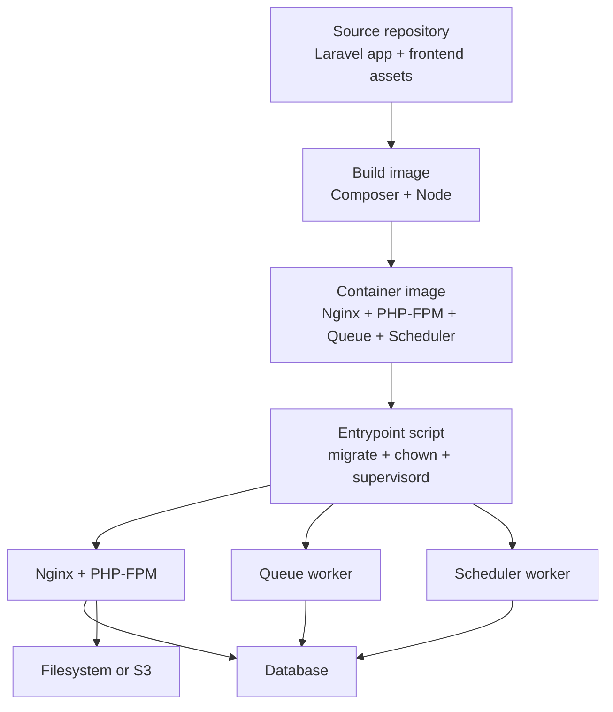
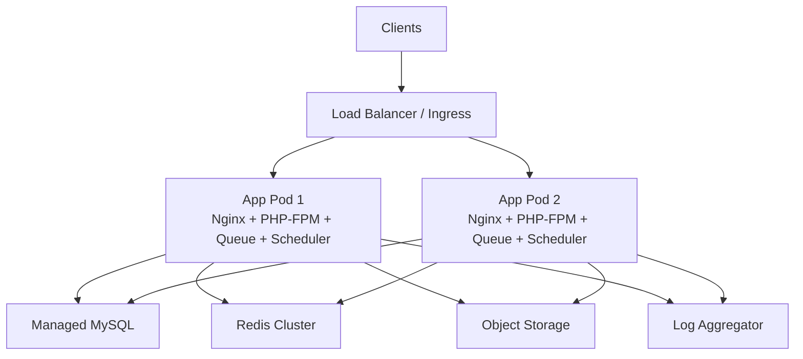
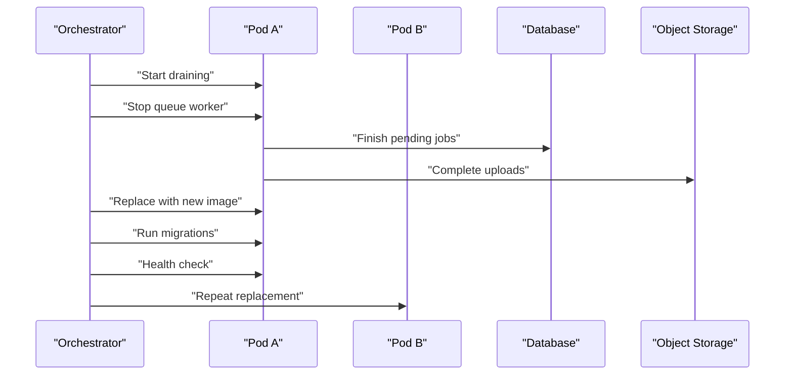
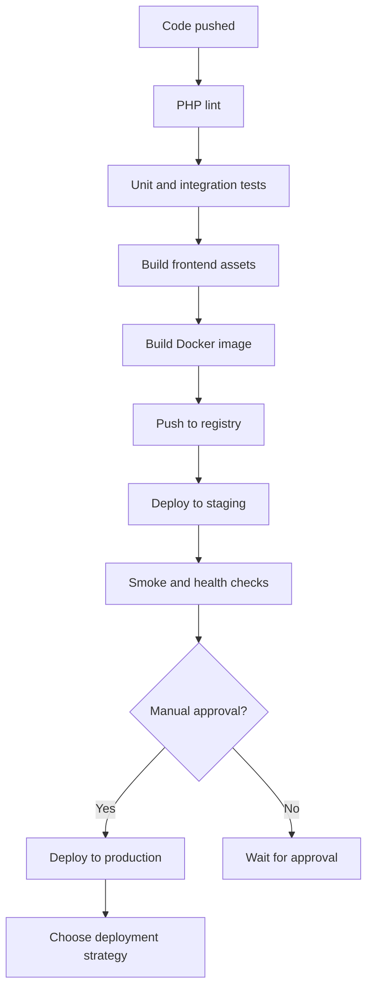
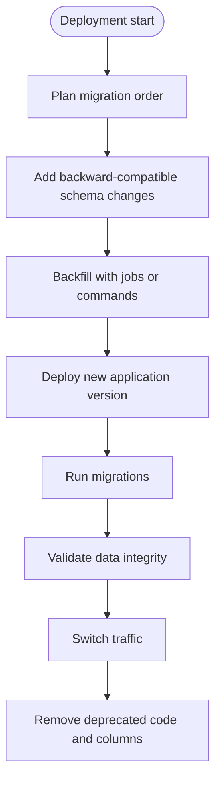
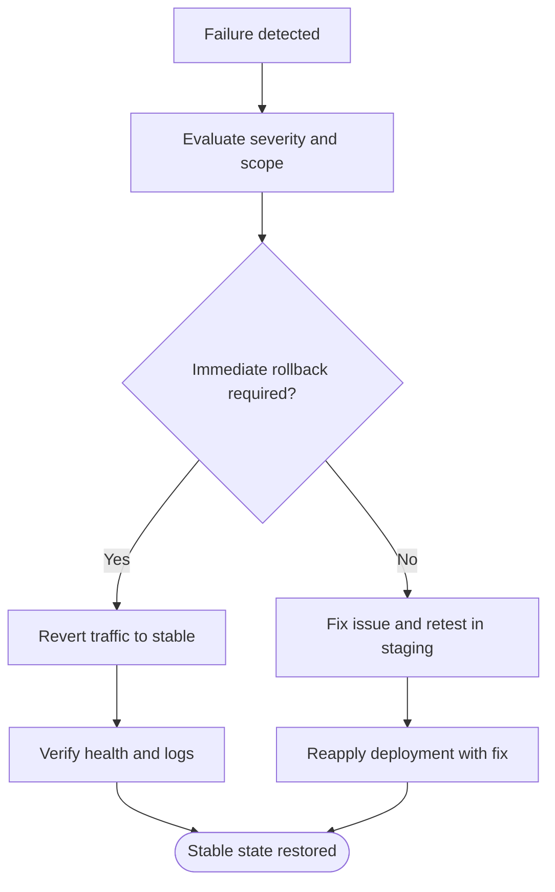
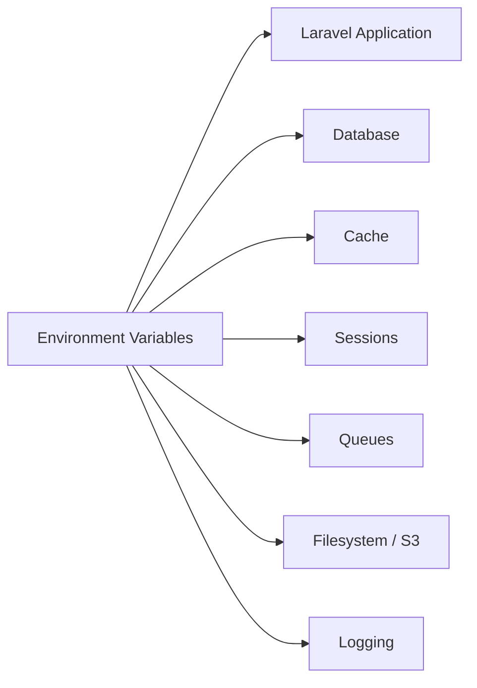

# Deployment Strategies & CI/CD

<cite>
**Referenced Files in This Document**   
- [Dockerfile](file://Dockerfile)
- [docker-compose.yml](file://docker-compose.yml)
- [composer.json](file://composer.json)
- [package.json](file://package.json)
- [vite.config.js](file://vite.config.js)
- [bootstrap/app.php](file://bootstrap/app.php)
- [config/app.php](file://config/app.php)
- [config/database.php](file://config/database.php)
- [config/cache.php](file://config/cache.php)
- [config/session.php](file://config/session.php)
- [config/logging.php](file://config/logging.php)
- [config/queue.php](file://config/queue.php)
- [config/filesystems.php](file://config/filesystems.php)
- [docker/entrypoint.sh](file://docker/entrypoint.sh)
- [docker/nginx.conf](file://docker/nginx.conf)
- [docker/supervisord.conf](file://docker/supervisord.conf)
</cite>

## Table of Contents
1. [Introduction](#introduction)
2. [Project Structure](#project-structure)
3. [Core Components](#core-components)
4. [Architecture Overview](#architecture-overview)
5. [Detailed Component Analysis](#detailed-component-analysis)
6. [Dependency Analysis](#dependency-analysis)
7. [Performance Considerations](#performance-considerations)
8. [Troubleshooting Guide](#troubleshooting-guide)
9. [Conclusion](#conclusion)
10. [Appendices](#appendices)

## Introduction
This document defines deployment strategies and operational guidance for the Highblossom application, a Laravel-based web application with Livewire, AdminLTE, queues, scheduled tasks, and optional S3-backed media storage. It covers blue-green deployments, rolling updates, canary releases, CI/CD pipeline design, zero-downtime database migrations, dependency management, rollback procedures, environment configuration, deployment validation, monitoring, logging, incident response, scaling, load balancing, and infrastructure provisioning.

The application ships as a single container image that runs Nginx, PHP-FPM, a queue worker, and a scheduler under Supervisor. Environment variables drive configuration, while Docker Compose provides a local development stack with MySQL.

## Project Structure
At deployment time, the build produces one immutable artifact: a Docker image containing compiled assets, vendor dependencies, and application code. The runtime process starts an entrypoint script that migrates the database (when enabled), prepares writable directories, and launches services via Supervisor.

**Diagram sources**
- [Dockerfile:1-32](file://Dockerfile#L1-L32)
- [docker/entrypoint.sh:1-20](file://docker/entrypoint.sh#L1-L20)
- [docker/supervisord.conf:1-66](file://docker/supervisord.conf#L1-L66)
- [docker/nginx.conf:1-20](file://docker/nginx.conf#L1-L20)

**Section sources**
- [Dockerfile:1-32](file://Dockerfile#L1-L32)
- [docker-compose.yml:1-31](file://docker-compose.yml#L1-L31)
- [docker/entrypoint.sh:1-20](file://docker/entrypoint.sh#L1-L20)

## Core Components
- **Runtime image**: Built from Composer and Node stages, producing an Alpine PHP 8.4 FPM image with Nginx and Supervisor. Exposes port 8080.
- **Entry point**: Runs migrations with retries, fixes ownership, then executes Supervisor.
- **Supervisor processes**: PHP-FPM, Nginx, queue worker (`artisan queue:work`), and scheduler (`artisan schedule:work`).
- **Web server**: Nginx proxies PHP requests to PHP-FPM on loopback and serves static files from `/var/www/html/public`.
- **Configuration**: Laravel config files read environment variables for app settings, database, cache, session, logging, queues, and filesystems.
- **Frontend build**: Vite compiles Tailwind CSS and JavaScript into `public/build`, copied into the final image.

Key operational characteristics:
- Zero-downtime requires stateless workers and shared persistent storage for sessions, cache, queues, and uploaded media.
- Health checking is supported through the framework health route `/up`.
- Logs default to `stderr` in the compose example, which integrates well with container log collectors.

**Section sources**
- [Dockerfile:1-32](file://Dockerfile#L1-L32)
- [docker/entrypoint.sh:1-20](file://docker/entrypoint.sh#L1-L20)
- [docker/supervisord.conf:1-66](file://docker/supervisord.conf#L1-L66)
- [docker/nginx.conf:1-20](file://docker/nginx.conf#L1-L20)
- [bootstrap/app.php:1-71](file://bootstrap/app.php#L1-L71)

## Architecture Overview
The production architecture should separate compute from state:
- Stateless application pods behind a load balancer.
- Managed relational database with failover.
- Shared Redis for cache, sessions, and queues.
- Object storage for public media.
- Centralized logging and metrics collection.

[No sources needed since this diagram shows conceptual production architecture]

## Detailed Component Analysis

### Blue-Green Deployments
Blue-green deployment keeps two identical environments active:
- **Blue**: current production.
- **Green**: new version deployed and tested.
- Traffic is switched at the load balancer or DNS layer after health checks pass.

Recommended steps:
1. Build and push a new image tagged with a commit identifier.
2. Provision a green environment with the same database connection and shared services.
3. Run database migrations ahead of traffic cutover if they are backward compatible.
4. Warm caches and run smoke tests against green.
5. Switch load balancer traffic from blue to green.
6. Monitor error rates, latency, and job success.
7. Keep blue available for immediate rollback.

Zero-downtime requirements:
- Migrations must be additive and idempotent where possible.
- Queues and jobs must tolerate both old and new code during rollout.
- Sessions and cache must be externalized so requests can move between environments.
- Media storage must be shared via object storage.

Validation checklist:
- HTTP 200 responses on `/up`.
- Authentication flows succeed.
- Background jobs complete successfully.
- Scheduled tasks execute.
- File uploads resolve from object storage.

Rollback procedure:
- Revert load balancer to blue.
- If necessary, roll back migrations only when safe; otherwise keep the new schema and redeploy the previous application version.

**Section sources**
- [config/session.php:1-233](file://config/session.php#L1-L233)
- [config/cache.php:1-146](file://config/cache.php#L1-L146)
- [config/queue.php:1-128](file://config/queue.php#L1-L128)
- [config/filesystems.php:1-109](file://config/filesystems.php#L1-L109)
- [bootstrap/app.php:1-71](file://bootstrap/app.php#L1-L71)

### Rolling Updates
Rolling updates gradually replace instances of the current version:
1. Drain connections from one pod.
2. Stop the queue worker gracefully.
3. Restart the pod with the new image.
4. Verify health and logs.
5. Repeat across all pods.

Operational notes:
- Use a minimum number of replicas greater than one to maintain capacity during updates.
- Set appropriate readiness probes before accepting traffic and liveness probes to restart unhealthy pods.
- Configure graceful shutdown timeouts so existing requests finish before termination.
- Ensure the queue worker finishes its current job before exiting by tuning `--max-time` and supervisor stopwaitsecs.

**Diagram sources**
- [docker/supervisord.conf:1-66](file://docker/supervisord.conf#L1-L66)
- [docker/entrypoint.sh:1-20](file://docker/entrypoint.sh#L1-L20)
- [config/filesystems.php:1-109](file://config/filesystems.php#L1-L109)

**Section sources**
- [docker/supervisord.conf:1-66](file://docker/supervisord.conf#L1-L66)
- [docker/entrypoint.sh:1-20](file://docker/entrypoint.sh#L1-L20)

### Canary Releases
Canary releases expose a small percentage of traffic to the new version:
- Route a small fraction of users to the new image using header, cookie, or path rules.
- Compare key metrics: error rate, latency, job failures, and business KPIs.
- Gradually increase traffic if the canary is healthy.
- Automatically roll back when thresholds are exceeded.

Suggested thresholds:
- Error rate below the baseline plus a tolerance margin.
- P95 latency not significantly worse than the stable version.
- Job retry and failure counts within expected ranges.
- No regressions in authentication, bookings, quotes, or media uploads.

**Section sources**
- [bootstrap/app.php:1-71](file://bootstrap/app.php#L1-L71)
- [config/logging.php:1-132](file://config/logging.php#L1-L132)

### CI/CD Pipeline Design
A recommended pipeline includes these stages:

| Stage | Purpose | Key Actions |
|---|---|---|
| Lint | Enforce code style | Run Pint for PHP formatting checks |
| Test | Validate behavior | Clear config, run tests |
| Build Frontend | Compile assets | Install Node dependencies and run Vite build |
| Build Image | Create immutable artifact | Build Composer vendor, copy source, build assets, create final image |
| Security Scan | Detect vulnerabilities | Scan base images, dependencies, and secrets |
| Push Registry | Share artifact | Tag image with branch, commit, and semantic tags |
| Deploy Staging | Validate integration | Deploy to staging with automated smoke tests |
| Approve Production | Manual gate | Require approval for production |
| Deploy Production | Release strategy | Blue-green, rolling, or canary depending on risk |

Pipeline commands derived from the project:
- PHP linting: `composer lint:check`
- Testing: `composer test`
- Frontend build: `npm run build`
- Application setup scripts include installation, migration, and asset building.

**Diagram sources**
- [composer.json:1-138](file://composer.json#L1-L138)
- [package.json:1-35](file://package.json#L1-L35)
- [vite.config.js:1-33](file://vite.config.js#L1-L33)
- [Dockerfile:1-32](file://Dockerfile#L1-L32)

**Section sources**
- [composer.json:1-138](file://composer.json#L1-L138)
- [package.json:1-35](file://package.json#L1-L35)
- [vite.config.js:1-33](file://vite.config.js#L1-L33)

### Database Migration Strategy During Zero-Downtime Deployments
Migrations are the most sensitive part of zero-downtime releases. Follow these principles:
- Make schema changes backward compatible with the old application version.
- Add columns, tables, and nullable fields first.
- Backfill data using queued jobs or Artisan commands rather than blocking migrations.
- Add dual writes if changing data formats consumed by multiple versions.
- Remove deprecated columns and constraints in later releases.
- Run migrations before switching traffic when possible.
- Use idempotent operations and avoid destructive changes during live traffic.

The entrypoint automatically runs migrations with retries, making it suitable for container orchestration. For advanced cases, prefer running migrations as a separate pre-deployment step controlled by the orchestrator or CI/CD pipeline.

**Diagram sources**
- [docker/entrypoint.sh:1-20](file://docker/entrypoint.sh#L1-L20)
- [config/database.php:1-184](file://config/database.php#L1-L184)

**Section sources**
- [docker/entrypoint.sh:1-20](file://docker/entrypoint.sh#L1-L20)
- [config/database.php:1-184](file://config/database.php#L1-L184)

### Dependency Management
Application dependencies are managed through Composer and npm:
- PHP dependencies are installed in a dedicated stage and optimized for production.
- Frontend assets are built using Vite and copied into the final image.
- Local package resolution is configured for the internal ContentBlocks package.

Recommendations:
- Pin major versions and use lockfiles in CI.
- Separate dev and production dependencies.
- Scan dependencies for known vulnerabilities.
- Prefer immutable artifacts over rebuilding dependencies at deploy time.

**Section sources**
- [Dockerfile:1-32](file://Dockerfile#L1-L32)
- [composer.json:1-138](file://composer.json#L1-L138)
- [package.json:1-35](file://package.json#L1-L35)
- [vite.config.js:1-33](file://vite.config.js#L1-L33)

### Rollback Procedures
A reliable rollback plan includes:
- Preserve the previous image tag and environment configuration.
- Revert traffic routing immediately for blue-green or canary failures.
- Avoid rolling back database schemas unless you have a tested reverse migration.
- Restore snapshots for data corruption incidents.
- Verify health endpoints, authentication, background jobs, scheduled tasks, and file uploads after rollback.

[No sources needed since this diagram shows conceptual rollback workflow]

## Dependency Analysis
The runtime depends on several external services and configuration points:

| Category | Configuration | Operational Impact |
|---|---|---|
| Application | `APP_ENV`, `APP_DEBUG`, `APP_KEY`, `APP_PREVIOUS_KEYS`, `APP_URL`, timezone, locale | Controls debug mode, encryption, URL generation, and maintenance mode |
| Database | `DB_CONNECTION`, host, port, credentials, charset, collation | Determines primary data store and replication compatibility |
| Cache | `CACHE_STORE`, Redis or database backend, key prefix | Impacts performance and cache invalidation during rollouts |
| Session | `SESSION_DRIVER`, Redis or database backend, serialization | Must be externalized for stateless deployments |
| Logging | `LOG_CHANNEL`, stack channels, Slack, Papertrail, stderr | Enables centralized observability |
| Queue | `QUEUE_CONNECTION`, database or Redis backend, retry policy | Controls background job reliability |
| Filesystem | `FILESYSTEM_DISK`, `PUBLIC_DISK_DRIVER`, S3 credentials | Controls upload destination and media access |

**Diagram sources**
- [config/app.php:1-126](file://config/app.php#L1-L126)
- [config/database.php:1-184](file://config/database.php#L1-L184)
- [config/cache.php:1-146](file://config/cache.php#L1-L146)
- [config/session.php:1-233](file://config/session.php#L1-L233)
- [config/queue.php:1-128](file://config/queue.php#L1-L128)
- [config/filesystems.php:1-109](file://config/filesystems.php#L1-L109)
- [config/logging.php:1-132](file://config/logging.php#L1-L132)

**Section sources**
- [config/app.php:1-126](file://config/app.php#L1-L126)
- [config/database.php:1-184](file://config/database.php#L1-L184)
- [config/cache.php:1-146](file://config/cache.php#L1-L146)
- [config/session.php:1-233](file://config/session.php#L1-L233)
- [config/queue.php:1-128](file://config/queue.php#L1-L128)
- [config/filesystems.php:1-109](file://config/filesystems.php#L1-L109)
- [config/logging.php:1-132](file://config/logging.php#L1-L132)

## Performance Considerations
- **Caching**: Use Redis for cache and sessions in production to support horizontal scaling and fast reads.
- **Queues**: Prefer Redis or SQS for high-throughput workloads; tune retry policies and concurrency per worker.
- **Storage**: Move public media to object storage to decouple uploads from ephemeral containers.
- **Asset caching**: Vite builds produce versioned assets under `public/build`; ensure CDN caching headers are set.
- **Framework optimization**: Warm configuration, routes, events, and views during deployment or through admin cache tools when safe.
- **Worker lifecycle**: Limit worker runtime with `--max-time` to allow graceful restarts during rolling updates.

**Section sources**
- [config/cache.php:1-146](file://config/cache.php#L1-L146)
- [config/session.php:1-233](file://config/session.php#L1-L233)
- [config/queue.php:1-128](file://config/queue.php#L1-L128)
- [config/filesystems.php:1-109](file://config/filesystems.php#L1-L109)
- [docker/supervisord.conf:1-66](file://docker/supervisord.conf#L1-L66)

## Troubleshooting Guide
Common deployment issues and resolutions:

| Symptom | Likely Cause | Resolution |
|---|---|---|
| Application returns errors after deploy | Missing environment variables or wrong driver | Verify `APP_ENV`, `APP_KEY`, `DB_*`, `REDIS_*`, `QUEUE_CONNECTION`, `SESSION_DRIVER`, `FILESYSTEM_DISK`, `PUBLIC_DISK_DRIVER` |
| Migrations fail because database is unavailable | Database not ready when entrypoint runs | Increase retry window or run migrations as a separate pre-deploy step |
| Uploads disappear after pod restart | Public disk uses local filesystem inside ephemeral container | Set `PUBLIC_DISK_DRIVER=s3` and configure AWS credentials |
| Jobs are not processed | Queue worker not started or backend misconfigured | Check Supervisor status, `QUEUE_CONNECTION`, and queue backend connectivity |
| Sessions lost between requests | Session driver points to local file storage | Use Redis or database session driver |
| High memory usage | Too many workers or large job payloads | Tune worker concurrency and job size |
| Slow page loads | Cache or view not warmed | Warm framework caches and consider CDN for static assets |
| Logs missing | Logging channel not configured for container output | Ensure `LOG_CHANNEL=stderr` or centralize logs via Stackdriver, CloudWatch, or similar |

Operational checks:
- Confirm `/up` returns healthy.
- Inspect container logs for PHP, Nginx, queue worker, and scheduler output.
- Review failed jobs table and queue metrics.
- Validate database connectivity and replication lag.
- Check object storage permissions and bucket accessibility.

**Section sources**
- [docker/entrypoint.sh:1-20](file://docker/entrypoint.sh#L1-L20)
- [docker/supervisord.conf:1-66](file://docker/supervisord.conf#L1-L66)
- [config/logging.php:1-132](file://config/logging.php#L1-L132)
- [config/queue.php:1-128](file://config/queue.php#L1-L128)
- [config/filesystems.php:1-109](file://config/filesystems.php#L1-L109)

## Conclusion
Highblossom is designed for containerized deployment with a single image running web, queue, and scheduler processes. Reliable deployments depend on externalizing state to databases, Redis, and object storage, using backward-compatible migrations, and following structured release strategies. Blue-green deployments provide the safest rollback path, rolling updates improve resource efficiency, and canary releases reduce risk by validating changes with real traffic. A disciplined CI/CD pipeline, strong environment configuration, comprehensive logging, and clear incident response procedures are essential for high availability.

## Appendices

### Environment-Specific Configuration Guidance

| Environment | Recommended Settings | Notes |
|---|---|---|
| Development | `APP_ENV=development`, `APP_DEBUG=true`, `LOG_CHANNEL=stack`, `QUEUE_CONNECTION=database` | Use Docker Compose defaults for quick local runs |
| Staging | `APP_ENV=staging`, `APP_DEBUG=false`, `LOG_CHANNEL=stderr`, `CACHE_STORE=redis`, `SESSION_DRIVER=redis`, `QUEUE_CONNECTION=redis` | Mirror production configuration and services |
| Production | `APP_ENV=production`, `APP_DEBUG=false`, `LOG_CHANNEL=stderr`, `CACHE_STORE=redis`, `SESSION_DRIVER=redis`, `QUEUE_CONNECTION=redis`, `PUBLIC_DISK_DRIVER=s3` | Enable TLS, monitoring, alerting, and backups |

**Section sources**
- [docker-compose.yml:1-31](file://docker-compose.yml#L1-L31)
- [config/app.php:1-126](file://config/app.php#L1-L126)
- [config/logging.php:1-132](file://config/logging.php#L1-L132)
- [config/cache.php:1-146](file://config/cache.php#L1-L146)
- [config/session.php:1-233](file://config/session.php#L1-L233)
- [config/queue.php:1-128](file://config/queue.php#L1-L128)
- [config/filesystems.php:1-109](file://config/filesystems.php#L1-L109)

### Deployment Validation Checklist
- [ ] Image built from latest approved source.
- [ ] Dependencies resolved from lockfiles.
- [ ] Frontend assets compiled.
- [ ] All unit and integration tests passed.
- [ ] Security scan completed with no critical findings.
- [ ] Staging smoke tests passed.
- [ ] Health endpoint responds successfully.
- [ ] Authentication and authorization flow verified.
- [ ] Background jobs process successfully.
- [ ] Scheduled tasks execute.
- [ ] File uploads resolve from object storage.
- [ ] Logs are collected centrally.
- [ ] Metrics and alerts are configured.
- [ ] Rollback procedure tested.

### Monitoring and Incident Response
Monitoring should cover:
- Request rate, error rate, latency percentiles.
- Container CPU, memory, disk, and restart count.
- Database connections, queries, replication lag, and disk usage.
- Redis hit ratio, memory, and persistence.
- Queue depth, processing time, and failed jobs.
- Object storage request errors and bandwidth.
- Application logs and audit trails.

Incident response steps:
1. Identify affected service and scope.
2. Check health endpoints, recent deployments, and error logs.
3. Enable maintenance mode if user-facing errors are widespread.
4. Scale out horizontally if capacity-related.
5. Roll back the last change if a deployment regression is confirmed.
6. Isolate failing components and collect diagnostics.
7. Communicate status and ETA to stakeholders.
8. Perform postmortem and update runbooks.

[No sources needed since this section provides general operational guidance]