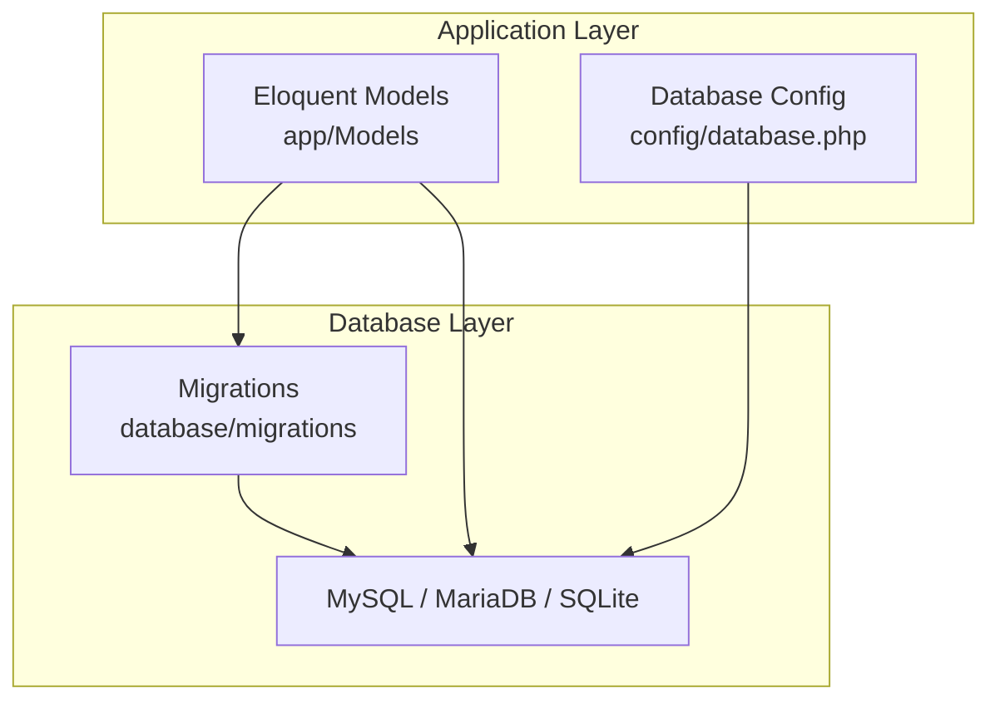
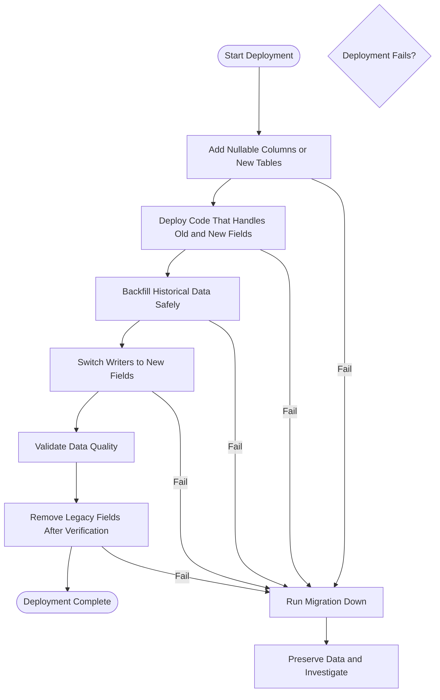
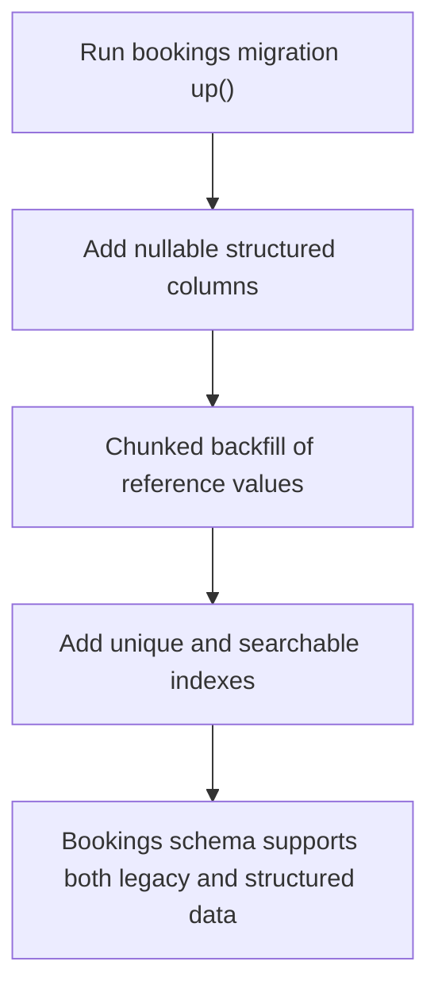
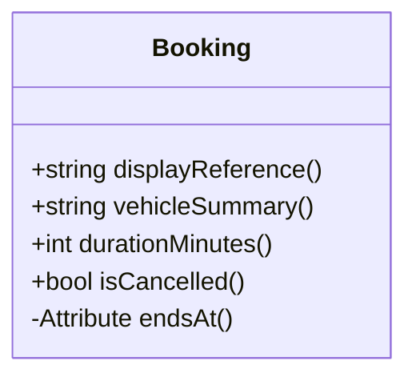
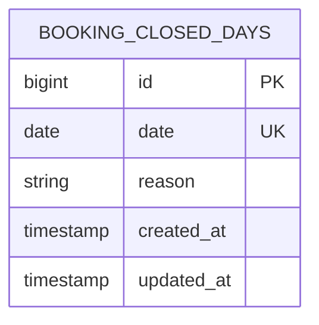
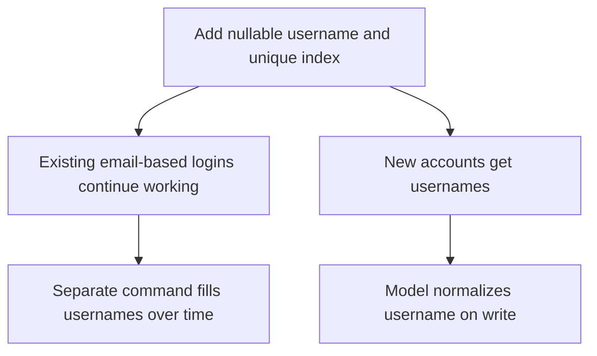
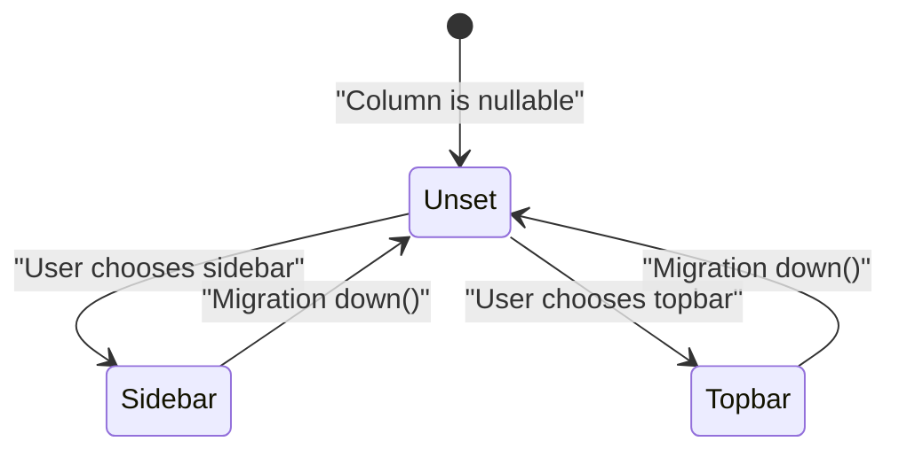
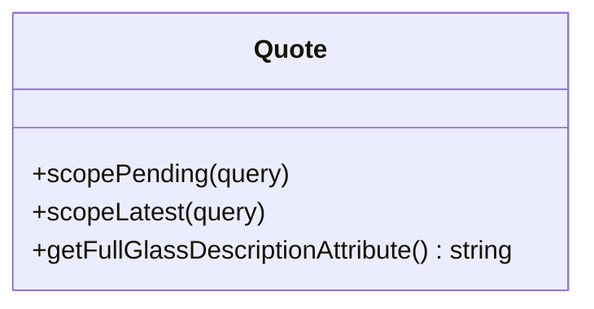
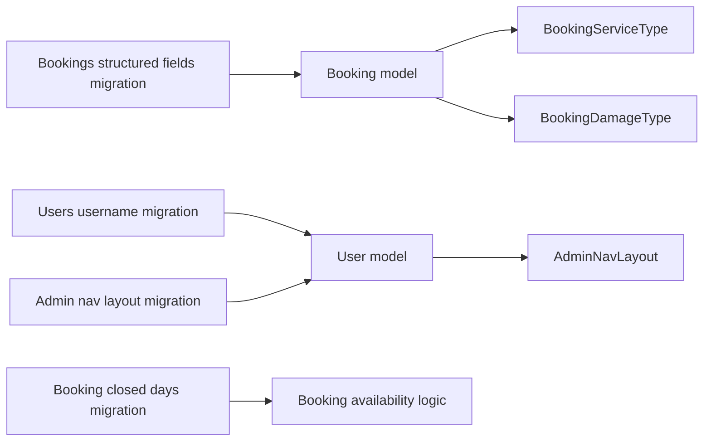

# Database Migration Strategies

<cite>
**Referenced Files in This Document**   
- [2026_10_18_000000_add_structured_fields_to_bookings_table.php](file://database/migrations/2026_10_18_000000_add_structured_fields_to_bookings_table.php)
- [2026_10_18_000001_create_booking_closed_days_table.php](file://database/migrations/2026_10_18_000001_create_booking_closed_days_table.php)
- [2026_10_18_000002_add_prefers_whatsapp_to_bookings_table.php](file://database/migrations/2026_10_18_000002_add_prefers_whatsapp_to_bookings_table.php)
- [2026_10_18_000003_make_vehicle_details_nullable_on_bookings_table.php](file://database/migrations/2026_10_18_000003_make_vehicle_details_nullable_on_bookings_table.php)
- [2026_10_20_000100_add_username_to_users_table.php](file://database/migrations/2026_10_20_000100_add_username_to_users_table.php)
- [2026_10_24_000100_add_admin_nav_layout_to_users_table.php](file://database/migrations/2026_10_24_000100_add_admin_nav_layout_to_users_table.php)
- [Booking.php](file://app/Models/Booking.php)
- [Quote.php](file://app/Models/Quote.php)
- [User.php](file://app/Models/User.php)
- [database.php](file://config/database.php)
</cite>

## Table of Contents
1. [Introduction](#introduction)
2. [Project Structure](#project-structure)
3. [Core Components](#core-components)
4. [Architecture Overview](#architecture-overview)
5. [Detailed Component Analysis](#detailed-component-analysis)
6. [Dependency Analysis](#dependency-analysis)
7. [Performance Considerations](#performance-considerations)
8. [Troubleshooting Guide](#troubleshooting-guide)
9. [Conclusion](#conclusion)

## Introduction
This document explains Highblossom’s database migration strategies for zero-downtime deployments. It focuses on forward-compatible schema changes, backward-compatible data transformations, safe rollback procedures, and practical examples drawn from the actual migrations for the bookings, quotes, and user tables.

The guiding principle is that a deployment should not require downtime: the application must continue accepting reads and writes while the schema evolves, even if an older version of the code is still running during a rolling rollout.

## Project Structure
Migration-related artifacts relevant to this document live under `database/migrations`. Application behavior against those schemas lives in Eloquent models under `app/Models`, and database connection configuration lives under `config/database.php`.

**Diagram sources**
- [database.php:1-184](file://config/database.php#L1-L184)

**Section sources**
- [database.php:1-184](file://config/database.php#L1-L184)

## Core Components
The core components are:

| Component | Responsibility | Zero-Downtime Role |
|---|---|---|
| Schema migrations | Add nullable columns, new tables, indexes, and reversible changes | Make the database accept both old and new data shapes |
| Data backfills | Transform or populate existing rows without blocking the application | Run outside hot paths, often as Artisan commands |
| Eloquent models | Read/write with defaults and fallbacks | Handle missing or transitional fields gracefully |
| Configuration | Define database connections and migration repository settings | Ensure predictable execution across environments |

Key patterns already used in this project include:
- Adding nullable columns before making them required elsewhere.
- Creating new tables alongside existing ones.
- Backfilling historical data with chunked updates.
- Keeping `down()` methods fully reversible.
- Using model attributes to derive legacy values when new structured fields are absent.

**Section sources**
- [2026_10_18_000000_add_structured_fields_to_bookings_table.php:1-74](file://database/migrations/2026_10_18_000000_add_structured_fields_to_bookings_table.php#L1-L74)
- [2026_10_18_000001_create_booking_closed_days_table.php:1-39](file://database/migrations/2026_10_18_000001_create_booking_closed_days_table.php#L1-L39)
- [2026_10_18_000002_add_prefers_whatsapp_to_bookings_table.php:1-37](file://database/migrations/2026_10_18_000002_add_prefers_whatsapp_to_bookings_table.php#L1-L37)
- [2026_10_18_000003_make_vehicle_details_nullable_on_bookings_table.php:1-38](file://database/migrations/2026_10_18_000003_make_vehicle_details_nullable_on_bookings_table.php#L1-L38)
- [2026_10_20_000100_add_username_to_users_table.php:1-43](file://database/migrations/2026_10_20_000100_add_username_to_users_table.php#L1-L43)
- [2026_10_24_000100_add_admin_nav_layout_to_users_table.php:1-46](file://database/migrations/2026_10_24_000100_add_admin_nav_layout_to_users_table.php#L1-L46)
- [Booking.php:1-134](file://app/Models/Booking.php#L1-L134)
- [Quote.php:1-76](file://app/Models/Quote.php#L1-L76)
- [User.php:1-141](file://app/Models/User.php#L1-L141)

## Architecture Overview
The zero-downtime migration lifecycle in Highblossom follows these stages:

1. **Schema evolution**: Add nullable columns or new tables so both old and new application versions can read and write safely.
2. **Dual-write preparation**: If necessary, support both old and new fields until all writers have been deployed.
3. **Data backfill**: Populate or normalize historical data using chunked operations or background commands.
4. **Behavioral switch**: Update application logic to prefer the new fields while falling back to legacy fields.
5. **Cleanup**: Remove legacy fields only after verifying that no older code path depends on them.
6. **Rollback readiness**: Keep each migration reversible so a failed deployment can be undone without manual database surgery.

[No sources needed since this diagram shows conceptual workflow, not actual code structure]

## Detailed Component Analysis

### Forward-Compatible Schema Changes for Bookings
The bookings table received several structural improvements while preserving its original free-form vehicle description column. The strategy was to add nullable structured fields rather than replace the legacy field immediately.

| Field | Purpose | Backward Compatibility Behavior |
|---|---|---|
| `service_type` | Structured service category | Nullable; old bookings remain valid |
| `damage_type` | Structured damage category | Nullable; old bookings remain valid |
| `vehicle_make` | Vehicle make | Nullable |
| `vehicle_model` | Vehicle model | Nullable |
| `vehicle_year` | Registration year | Nullable integer |
| `damage_photo_path` | Damage image reference | Nullable |
| `duration_minutes` | Snapshot of job duration | Defaults to 60 minutes |
| `reference` | Customer-visible booking ID | Backfilled and made unique |
| `prefers_whatsapp` | Preferred follow-up channel | Boolean default false |
| `vehicle_details` | Free-form notes | Made nullable once structured fields existed |

The migration adds these columns as nullable, then backfills `reference` in chunks to avoid long-running transactions. A unique index on `reference` and an index on `service_type` improve query performance.

**Diagram sources**
- [2026_10_18_000000_add_structured_fields_to_bookings_table.php:25-66](file://database/migrations/2026_10_18_000000_add_structured_fields_to_bookings_table.php#L25-L66)

The model complements the migration by deriving customer-facing behavior from either the new structured fields or the legacy `vehicle_details` column. For example, `displayReference()` falls back to a generated value when the stored reference is missing, and `vehicleSummary()` prefers structured fields but returns the free-form notes when they are empty.

**Diagram sources**
- [Booking.php:35-105](file://app/Models/Booking.php#L35-L105)

**Section sources**
- [2026_10_18_000000_add_structured_fields_to_bookings_table.php:1-74](file://database/migrations/2026_10_18_000000_add_structured_fields_to_bookings_table.php#L1-L74)
- [2026_10_18_000002_add_prefers_whatsapp_to_bookings_table.php:1-37](file://database/migrations/2026_10_18_000002_add_prefers_whatsapp_to_bookings_table.php#L1-L37)
- [2026_10_18_000003_make_vehicle_details_nullable_on_bookings_table.php:1-38](file://database/migrations/2026_10_18_000003_make_vehicle_details_nullable_on_bookings_table.php#L1-L38)
- [Booking.php:1-134](file://app/Models/Booking.php#L1-L134)

### Creating a New Table Alongside Existing Ones
The shop needs to represent days when it is completely closed, such as public holidays or stock takes. The migration creates `booking_closed_days` as a separate table rather than trying to reuse `staff_absences`, which is per-person and does not express shop-wide closures.

Design choices:
- The primary key is auto-incrementing.
- The date column is unique so one closure rule applies per day.
- The reason is optional but human-readable.
- Timestamps track creation and updates.
- The down method drops the entire table cleanly.

**Diagram sources**
- [2026_10_18_000001_create_booking_closed_days_table.php:20-30](file://database/migrations/2026_10_18_000001_create_booking_closed_days_table.php#L20-L30)

**Section sources**
- [2026_10_18_000001_create_booking_closed_days_table.php:1-39](file://database/migrations/2026_10_18_000001_create_booking_closed_days_table.php#L1-L39)

### Backward-Compatible Data Transformations for Users
Adding a username to users required special care because uniqueness constraints interact differently with NULL values across databases. The migration adds a nullable `username` column and a unique index at the same time. This allows existing accounts without usernames to keep signing in via email while new accounts receive usernames.

Important behaviors:
- The column is nullable so older code paths do not fail.
- The unique index permits multiple NULL values, avoiding conflicts among legacy accounts.
- The backfill is intentionally outside the migration file to avoid failing production deployments on data that has not yet been prepared.
- The model normalizes usernames on write, keeping stored values consistent with the unique index.

**Diagram sources**
- [2026_10_20_000100_add_username_to_users_table.php:17-35](file://database/migrations/2026_10_20_000100_add_username_to_users_table.php#L17-L35)
- [User.php:55-74](file://app/Models/User.php#L55-L74)

**Section sources**
- [2026_10_20_000100_add_username_to_users_table.php:1-43](file://database/migrations/2026_10_20_000100_add_username_to_users_table.php#L1-L43)
- [User.php:1-141](file://app/Models/User.php#L1-L141)

### Safe Column Reversibility for Preferences
The admin navigation layout preference is added as a nullable string rather than a native enum with a database default. This preserves the semantic difference between “the user never chose” and “the user explicitly selected a layout.” It also avoids freezing legacy accounts onto whatever site-wide default existed at the time their row was created.

Key points:
- Nullable means old rows fall back to the application’s site-wide default.
- A string with application-level casting keeps future layouts as data changes instead of requiring another schema change.
- The down method removes the column, returning every account to the site-wide default.

**Diagram sources**
- [2026_10_24_000100_add_admin_nav_layout_to_users_table.php:10-46](file://database/migrations/2026_10_24_000100_add_admin_nav_layout_to_users_table.php#L10-L46)
- [User.php:45-53](file://app/Models/User.php#L45-L53)

**Section sources**
- [2026_10_24_000100_add_admin_nav_layout_to_users_table.php:1-46](file://database/migrations/2026_10_24_000100_add_admin_nav_layout_to_users_table.php#L1-L46)
- [User.php:1-141](file://app/Models/User.php#L1-L141)

### Quotes Schema and Backward Compatibility
The quotes model already supports nullable and optional fields such as glass type, glass sub-category, service type, year, and mobile service. This makes it easier to evolve the schema gradually:

- New optional columns can be added as nullable.
- Existing relationships can be introduced without breaking records that lack foreign keys.
- Display helpers can fall back to less precise information when related entities are missing.

For example, the full glass description prefers a sub-category, falls back to the glass type, and finally returns a placeholder when neither is available.

**Diagram sources**
- [Quote.php:1-76](file://app/Models/Quote.php#L1-L76)

**Section sources**
- [Quote.php:1-76](file://app/Models/Quote.php#L1-L76)

## Dependency Analysis
The migrations depend on Laravel’s schema builder and, where needed, direct database access for bulk updates. The models depend on the resulting schema and on application enums and helper classes.

**Diagram sources**
- [2026_10_18_000000_add_structured_fields_to_bookings_table.php:1-74](file://database/migrations/2026_10_18_000000_add_structured_fields_to_bookings_table.php#L1-L74)
- [2026_10_18_000001_create_booking_closed_days_table.php:1-39](file://database/migrations/2026_10_18_000001_create_booking_closed_days_table.php#L1-L39)
- [2026_10_20_000100_add_username_to_users_table.php:1-43](file://database/migrations/2026_10_20_000100_add_username_to_users_table.php#L1-L43)
- [2026_10_24_000100_add_admin_nav_layout_to_users_table.php:1-46](file://database/migrations/2026_10_24_000100_add_admin_nav_layout_to_users_table.php#L1-L46)
- [Booking.php:1-134](file://app/Models/Booking.php#L1-L134)
- [User.php:1-141](file://app/Models/User.php#L1-L141)

**Section sources**
- [2026_10_18_000000_add_structured_fields_to_bookings_table.php:1-74](file://database/migrations/2026_10_18_000000_add_structured_fields_to_bookings_table.php#L1-L74)
- [2026_10_20_000100_add_username_to_users_table.php:1-43](file://database/migrations/2026_10_20_000100_add_username_to_users_table.php#L1-L43)
- [2026_10_24_000100_add_admin_nav_layout_to_users_table.php:1-46](file://database/migrations/2026_10_24_000100_add_admin_nav_layout_to_users_table.php#L1-L46)
- [Booking.php:1-134](file://app/Models/Booking.php#L1-L134)
- [User.php:1-141](file://app/Models/User.php#L1-L141)

## Performance Considerations
- Use nullable columns and defaults to avoid expensive NOT NULL constraints during large backfills.
- Chunk large data updates instead of loading everything into memory. The bookings reference backfill uses `chunkById` with a batch size of 500.
- Add indexes after the initial schema change if the migration contains heavy data work; this avoids locking the table while building indexes on large datasets.
- Prefer derived attributes in models to avoid costly denormalization or repeated database queries.
- Be cautious with unique indexes on nullable columns across different database engines. In this project, MySQL and SQLite allow multiple NULL values, which is why the username unique index is safe during gradual adoption.

**Section sources**
- [2026_10_18_000000_add_structured_fields_to_bookings_table.php:44-66](file://database/migrations/2026_10_18_000000_add_structured_fields_to_bookings_table.php#L44-L66)
- [2026_10_20_000100_add_username_to_users_table.php:17-35](file://database/migrations/2026_10_20_000100_add_username_to_users_table.php#L17-L35)
- [Booking.php:76-105](file://app/Models/Booking.php#L76-L105)

## Troubleshooting Guide

### Migration Fails During Deployment
**Likely causes:**
- A non-reversible schema change blocks rollback.
- A backfill inside the migration fails on unexpected data.
- A unique constraint collides with legacy data.

**Recommended response:**
1. Check the migration output to identify the failing step.
2. If the migration is reversible, run the corresponding `down()` operation.
3. Preserve the failing dataset through logs or backups before attempting repair.
4. Move complex data transformations out of migrations and into background commands.
5. Redeploy only the compatible application code first, then rerun the data fix separately.

**Section sources**
- [2026_10_18_000000_add_structured_fields_to_bookings_table.php:68-74](file://database/migrations/2026_10_18_000000_add_structured_fields_to_bookings_table.php#L68-L74)
- [2026_10_20_000100_add_username_to_users_table.php:17-35](file://database/migrations/2026_10_20_000100_add_username_to_users_table.php#L17-L35)

### Unique Index Conflict on Username
**Cause:**
Existing legacy accounts may have duplicate or inconsistent usernames, or a previous deployment partially applied a required-username change.

**Mitigation:**
- Keep the column nullable during the transition period.
- Use a separate backfill command to resolve duplicates.
- Apply strict validation and normalization at the application layer.
- Only make the column required after confirming all legacy accounts are cleaned.

**Section sources**
- [2026_10_20_000100_add_username_to_users_table.php:17-35](file://database/migrations/2026_10_20_000100_add_username_to_users_table.php#L17-L35)
- [User.php:55-74](file://app/Models/User.php#L55-L74)

### Booking Reference Collisions
**Cause:**
Historical bookings did not have a stored reference, and the migration generates one from the booking ID.

**Mitigation:**
- The migration backfills references in chunks.
- The model still derives a fallback reference if the column is null.
- Do not assume every legacy record has a persisted reference until the backfill completes.

**Section sources**
- [2026_10_18_000000_add_structured_fields_to_bookings_table.php:44-66](file://database/migrations/2026_10_18_000000_add_structured_fields_to_bookings_table.php#L44-L66)
- [Booking.php:87-97](file://app/Models/Booking.php#L87-L97)

### Admin Navigation Layout Not Applying
**Cause:**
A user’s `admin_nav_layout` is unset, which should fall back to the site-wide default.

**Mitigation:**
- Verify the column is nullable.
- Confirm the application reads the company setting when the user value is unset.
- Avoid giving the column a database default that would freeze legacy accounts.

**Section sources**
- [2026_10_24_000100_add_admin_nav_layout_to_users_table.php:10-46](file://database/migrations/2026_10_24_000100_add_admin_nav_layout_to_users_table.php#L10-L46)
- [User.php:45-53](file://app/Models/User.php#L45-L53)

## Conclusion
Highblossom’s migration strategy prioritizes safety over speed:

- Schema changes add nullable columns and new tables first.
- Data transformations use chunked updates or separate commands.
- Application code handles both old and new data formats.
- Migrations remain reversible.
- Legacy fields coexist with structured fields until verification is complete.

This approach supports zero-downtime rollouts, reduces the risk of broken sign-ins, protects historical booking data, and makes emergency recovery safer. When extending the system, follow the same pattern: evolve the schema compatibly, migrate data carefully, update behavior gradually, and keep rollback paths clean.