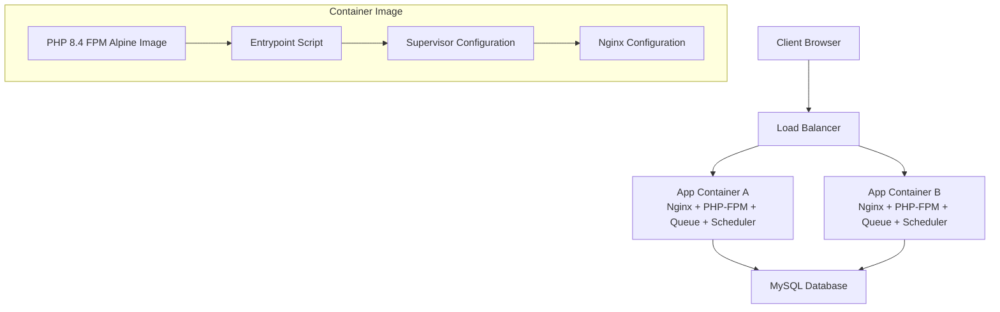
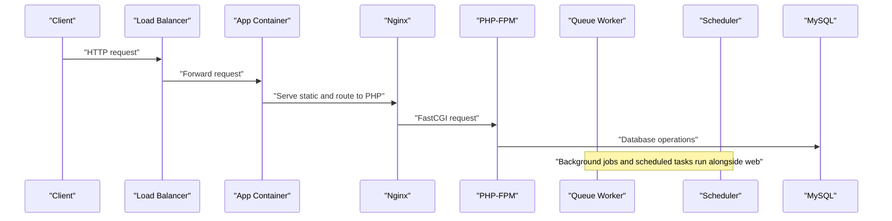
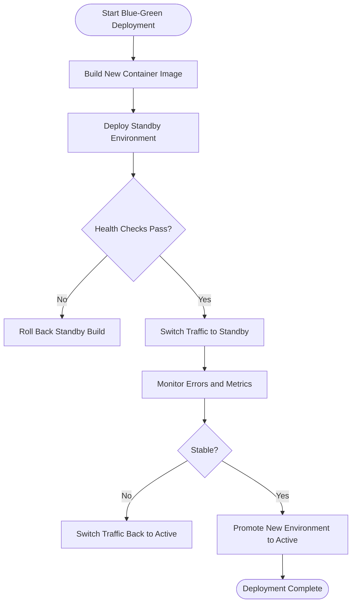
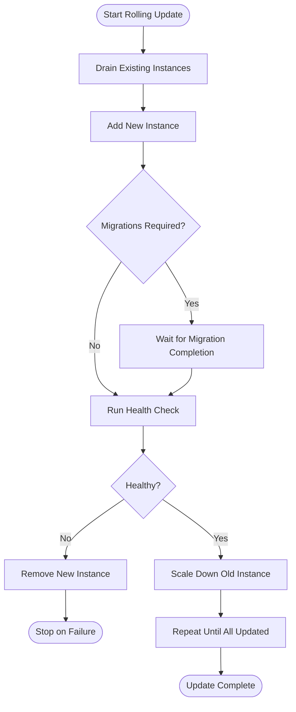
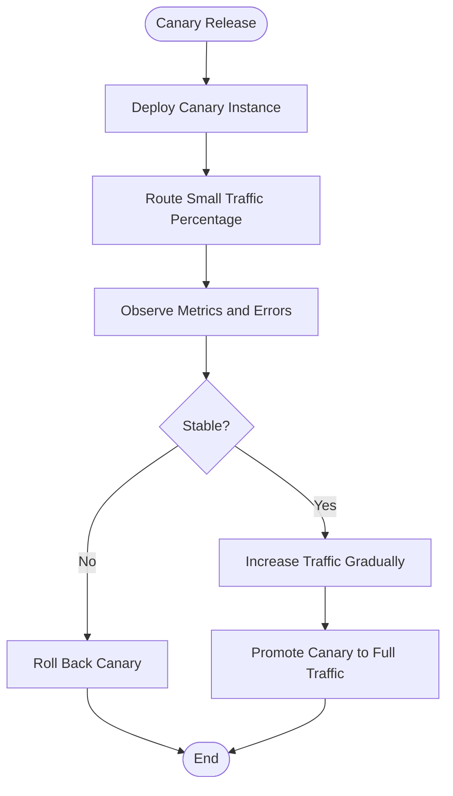
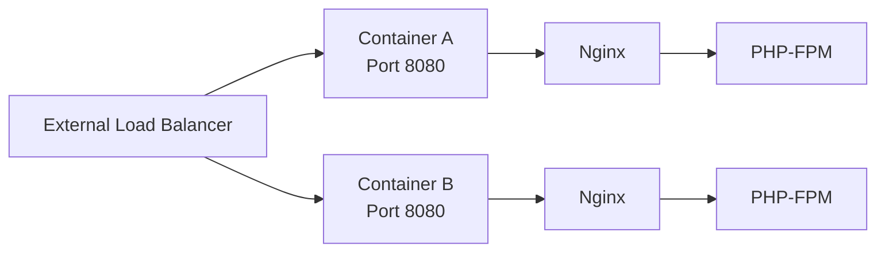
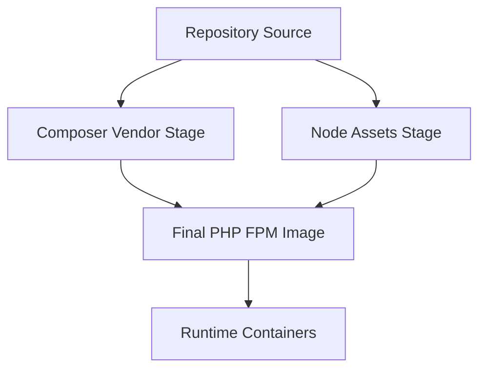
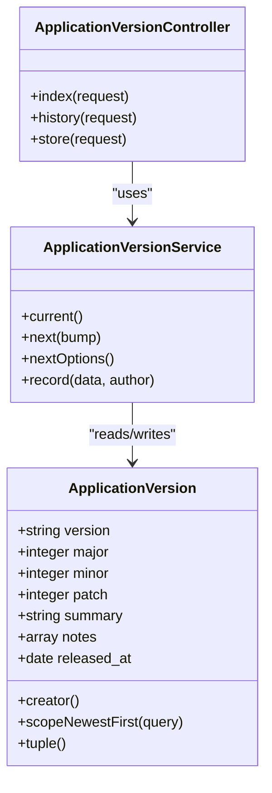
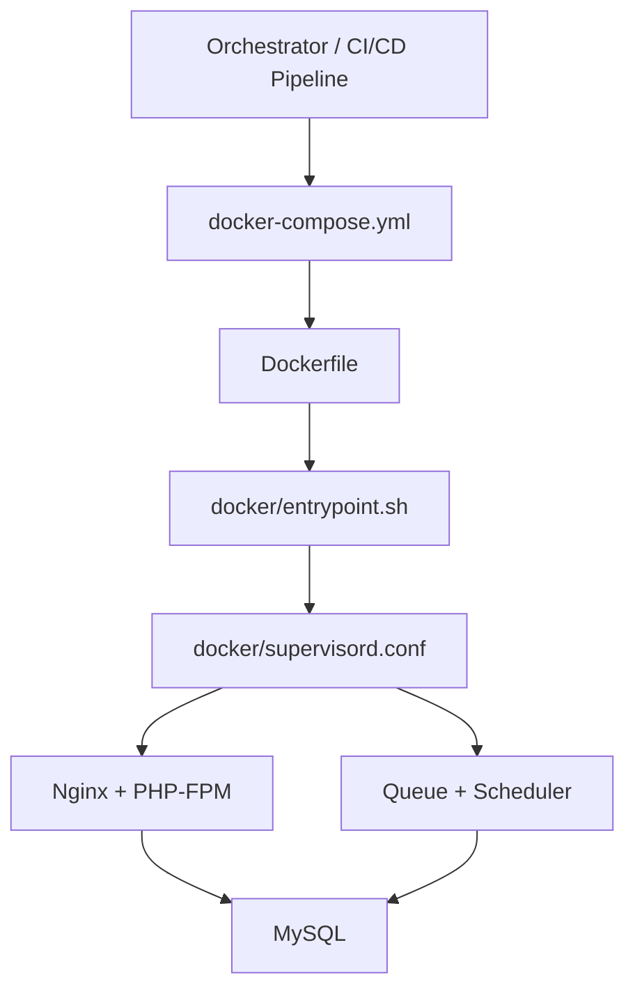

# Deployment Orchestration Patterns

<cite>
**Referenced Files in This Document**   
- [docker-compose.yml](file://docker-compose.yml)
- [Dockerfile](file://Dockerfile)
- [docker/entrypoint.sh](file://docker/entrypoint.sh)
- [docker/nginx.conf](file://docker/nginx.conf)
- [docker/supervisord.conf](file://docker/supervisord.conf)
- [app/Models/ApplicationVersion.php](file://app/Models/ApplicationVersion.php)
- [database/migrations/2026_10_01_120000_create_application_versions_table.php](file://database/migrations/2026_10_01_120000_create_application_versions_table.php)
- [app/Services/ApplicationVersionService.php](file://app/Services/ApplicationVersionService.php)
- [app/Http/Controllers/Admin/ApplicationVersionController.php](file://app/Http/Controllers/Admin/ApplicationVersionController.php)
</cite>

## Table of Contents
1. [Introduction](#introduction)
2. [Project Structure](#project-structure)
3. [Core Components](#core-components)
4. [Architecture Overview](#architecture-overview)
5. [Detailed Component Analysis](#detailed-component-analysis)
6. [Dependency Analysis](#dependency-analysis)
7. [Performance Considerations](#performance-considerations)
8. [Troubleshooting Guide](#troubleshooting-guide)
9. [Conclusion](#conclusion)

## Introduction
This document describes deployment orchestration patterns for Highblossom with a focus on Docker-based deployments. The application is packaged as one PHP 8.4 FPM image that runs Nginx, PHP-FPM, a queue worker, and the Laravel scheduler under Supervisor. It uses MySQL for persistence and supports database migrations at startup.

The repository does not contain built-in blue-green or canary traffic routers, but it provides the building blocks to implement those strategies:
- Immutable container images enable swapping active environments.
- Application version tracking enables safe rollback decisions.
- Environment variables and Supervisor process controls allow selective feature toggling during rolling updates.
- Database migration retries make deployments resilient when the database is still starting.

## Project Structure
The deployment-relevant parts of the repository are concentrated around Docker configuration and the application’s release registry:

**Diagram sources**
- [docker-compose.yml:1-31](file://docker-compose.yml#L1-L31)
- [Dockerfile:1-32](file://Dockerfile#L1-L32)
- [docker/entrypoint.sh:1-20](file://docker/entrypoint.sh#L1-L20)
- [docker/supervisord.conf:1-66](file://docker/supervisord.conf#L1-L66)
- [docker/nginx.conf:1-20](file://docker/nginx.conf#L1-L20)

The project follows a conventional Laravel layout:
- `app/` contains models, services, controllers, jobs, and system probes.
- `config/` holds runtime configuration.
- `database/` contains migrations and seeders.
- `docker/` contains container runtime configuration.
- `routes/` defines web, API, admin, console, and settings routes.

**Section sources**
- [docker-compose.yml:1-31](file://docker-compose.yml#L1-L31)
- [Dockerfile:1-32](file://Dockerfile#L1-L32)

## Core Components
The deployment surface consists of five key components:

| Component | Responsibility | Deployment Relevance |
|---|---|---|
| `Dockerfile` | Builds an immutable image with vendor dependencies, frontend assets, Nginx, PHP-FPM, Supervisor, and extensions. | Ensures identical containers across environments. |
| `docker-compose.yml` | Defines local `app` and `db` services, ports, environment, and volumes. | Serves as a reference for service topology and port exposure. |
| `docker/entrypoint.sh` | Prepares the application, optionally migrates the database, fixes permissions, and starts Supervisor. | Controls migration behavior and startup resilience. |
| `docker/supervisord.conf` | Manages PHP-FPM, Nginx, queue worker, and scheduler processes. | Enables process-level control during rolling updates. |
| `docker/nginx.conf` | Routes requests to PHP-FPM and protects hidden paths. | Provides the HTTP entry point inside each container. |

Additionally, the application tracks released versions through:
- `ApplicationVersion` model
- Version table migration
- `ApplicationVersionService`
- Admin controller for recording releases

These pieces support rollback planning by preserving a semantic version history.

**Section sources**
- [Dockerfile:1-32](file://Dockerfile#L1-L32)
- [docker-compose.yml:1-31](file://docker-compose.yml#L1-L31)
- [docker/entrypoint.sh:1-20](file://docker/entrypoint.sh#L1-L20)
- [docker/supervisord.conf:1-66](file://docker/supervisord.conf#L1-L66)
- [docker/nginx.conf:1-20](file://docker/nginx.conf#L1-L20)
- [app/Models/ApplicationVersion.php:1-56](file://app/Models/ApplicationVersion.php#L1-L56)
- [database/migrations/2026_10_01_120000_create_application_versions_table.php:1-55](file://database/migrations/2026_10_01_120000_create_application_versions_table.php#L1-L55)
- [app/Services/ApplicationVersionService.php:1-157](file://app/Services/ApplicationVersionService.php#L1-L157)
- [app/Http/Controllers/Admin/ApplicationVersionController.php:1-87](file://app/Http/Controllers/Admin/ApplicationVersionController.php#L1-L87)

## Architecture Overview
Highblossom’s deployment architecture centers on a single Docker image running multiple processes per container. Each container exposes port `8080` internally and is mapped to `APP_PORT`, defaulting to `8080`.

**Diagram sources**
- [docker-compose.yml:1-31](file://docker-compose.yml#L1-L31)
- [docker/nginx.conf:1-20](file://docker/nginx.conf#L1-L20)
- [docker/supervisord.conf:1-66](file://docker/supervisord.conf#L1-L66)
- [docker/entrypoint.sh:1-20](file://docker/entrypoint.sh#L1-L20)

The current setup is suitable for:
- Running a single active instance behind an external load balancer.
- Scaling horizontally by running multiple app containers sharing the same database.
- Implementing blue-green or rolling deployments at the orchestrator layer, since all containers run the same image and port.

It does not implement traffic splitting itself; that must be provided by the surrounding infrastructure (reverse proxy, service mesh, Kubernetes Ingress, or platform load balancer).

**Section sources**
- [docker-compose.yml:1-31](file://docker-compose.yml#L1-L31)
- [docker/nginx.conf:1-20](file://docker/nginx.conf#L1-L20)
- [docker/supervisord.conf:1-66](file://docker/supervisord.conf#L1-L66)

## Detailed Component Analysis

### Blue-Green Deployment Pattern
Blue-green deployment uses two identical environments:
- **Active environment**: receives production traffic.
- **Standby environment**: receives no traffic until promoted.

In Highblossom, this is achieved by deploying two sets of containers built from the same image, then switching traffic at the load balancer.

Implementation guidance based on the repository:
- Use the existing image build pipeline so both environments are identical.
- Run both environments against the same database schema after migrations complete.
- Keep environment variables consistent except where environment-specific values are required.
- Switch traffic using the external load balancer rather than changing internal routing.

The image exposes only port `8080`, which simplifies load-balancer configuration because every container has the same listening interface.

**Section sources**
- [Dockerfile:1-32](file://Dockerfile#L1-L32)
- [docker-compose.yml:1-31](file://docker-compose.yml#L1-L31)
- [docker/nginx.conf:1-20](file://docker/nginx.conf#L1-L20)

### Rolling Updates Across Container Instances
Rolling updates replace instances gradually instead of swapping entire environments. For Highblossom, this means:
- Adding new containers built from the updated image.
- Removing old containers after they pass health checks.
- Optionally disabling non-web processes during replacement if zero-downtime background processing is critical.

Key implementation notes:
- The entrypoint retries migrations for approximately 40 seconds, which helps when the database is still starting.
- Supervisor manages four processes: PHP-FPM, Nginx, queue worker, and scheduler.
- Process toggles such as `RUN_WEB`, `RUN_QUEUE`, `RUN_SCHEDULER`, and `RUN_REVERB` can be used to control which roles run in a container.
- Because the image is immutable, replacing instances guarantees consistency across nodes.

**Section sources**
- [docker/entrypoint.sh:1-20](file://docker/entrypoint.sh#L1-L20)
- [docker/supervisord.conf:1-66](file://docker/supervisord.conf#L1-L66)
- [Dockerfile:1-32](file://Dockerfile#L1-L32)

### Canary Release Strategy
A canary release gradually exposes a new version to a small subset of users. The application itself does not split traffic, but its version registry supports observability and rollback reasoning.

Recommended pattern:
1. Deploy the canary container alongside the stable container.
2. Route a small percentage of traffic to the canary through the load balancer.
3. Monitor error rates, latency, queue performance, and database health.
4. Gradually increase canary traffic if metrics remain healthy.
5. Roll back immediately if errors exceed thresholds.

The repository’s version tracking is useful here because operators can record the exact release being tested and correlate incidents with semantic versions.

**Section sources**
- [app/Services/ApplicationVersionService.php:1-157](file://app/Services/ApplicationVersionService.php#L1-L157)
- [app/Models/ApplicationVersion.php:1-56](file://app/Models/ApplicationVersion.php#L1-L56)

### Traffic Routing and Load Balancer Configuration
Highblossom exposes a single HTTP endpoint inside each container:
- Protocol: HTTP
- Port: `8080`
- Entry path: `/index.php` via Nginx `try_files`
- Static assets: served directly from `/var/www/html/public`
- Hidden files are denied unless explicitly allowed by `well-known`

**Diagram sources**
- [docker/nginx.conf:1-20](file://docker/nginx.conf#L1-L20)
- [docker-compose.yml:1-31](file://docker-compose.yml#L1-L31)

Configuration recommendations:
- Configure the load balancer to forward HTTP to port `8080`.
- Enable sticky sessions only if session storage cannot be shared across containers.
- Set health check endpoints externally; the application does not define a dedicated health endpoint in the analyzed code.
- Use connection timeouts appropriate for PHP-FPM request handling.

**Section sources**
- [docker/nginx.conf:1-20](file://docker/nginx.conf#L1-L20)
- [docker-compose.yml:1-31](file://docker-compose.yml#L1-L31)

### Environment Synchronization
Environment synchronization should ensure that both blue and green environments share:
- Database schema
- Cache configuration
- Session configuration
- Filesystem and storage drivers
- Feature flags controlled by environment variables

The entrypoint handles some synchronization automatically:
- It creates SQLite databases when `DB_CONNECTION=sqlite`.
- It retries migrations until the database becomes reachable.
- It adjusts ownership for writable directories.

For MySQL deployments:
- Run migrations before or early during deployment.
- Ensure backward-compatible schema changes for rolling updates.
- Avoid destructive schema changes while old containers are still running.

**Section sources**
- [docker/entrypoint.sh:1-20](file://docker/entrypoint.sh#L1-L20)
- [docker-compose.yml:1-31](file://docker-compose.yml#L1-L31)

### Dependency Management During Deployment
Dependencies are managed at build time:
- Composer installs PHP dependencies without development packages.
- Frontend assets are built using Node tooling.
- PHP extensions are installed at image build time.

**Diagram sources**
- [Dockerfile:1-32](file://Dockerfile#L1-L32)

This design reduces runtime dependency resolution and makes deployments deterministic.

**Section sources**
- [Dockerfile:1-32](file://Dockerfile#L1-L32)

### Rollback Automation During Failed Deployments
The repository includes a semantic version registry that supports structured rollback reasoning:

**Diagram sources**
- [app/Models/ApplicationVersion.php:1-56](file://app/Models/ApplicationVersion.php#L1-L56)
- [app/Services/ApplicationVersionService.php:1-157](file://app/Services/ApplicationVersionService.php#L1-L157)
- [app/Http/Controllers/Admin/ApplicationVersionController.php:1-87](file://app/Http/Controllers/Admin/ApplicationVersionController.php#L1-L87)

Operational rollback flow:
1. Detect failure during deployment or canary rollout.
2. Stop routing traffic to the failing container set.
3. Record or identify the last known good semantic version.
4. Redeploy the previous image.
5. Verify database compatibility; avoid downgrading schema if possible.
6. Restore traffic and monitor stability.

The version service enforces semantic versioning and prevents older versions from being recorded after newer ones, keeping the release timeline forward-only.

**Section sources**
- [app/Models/ApplicationVersion.php:1-56](file://app/Models/ApplicationVersion.php#L1-L56)
- [database/migrations/2026_10_01_120000_create_application_versions_table.php:1-55](file://database/migrations/2026_10_01_120000_create_application_versions_table.php#L1-L55)
- [app/Services/ApplicationVersionService.php:1-157](file://app/Services/ApplicationVersionService.php#L1-L157)
- [app/Http/Controllers/Admin/ApplicationVersionController.php:1-87](file://app/Http/Controllers/Admin/ApplicationVersionController.php#L1-L87)

## Dependency Analysis
The deployment stack has clear boundaries:

**Diagram sources**
- [docker-compose.yml:1-31](file://docker-compose.yml#L1-L31)
- [Dockerfile:1-32](file://Dockerfile#L1-L32)
- [docker/entrypoint.sh:1-20](file://docker/entrypoint.sh#L1-L20)
- [docker/supervisord.conf:1-66](file://docker/supervisord.conf#L1-L66)

Coupling observations:
- The container image is tightly coupled to Supervisor because it expects `supervisord` as the entry process.
- The application is loosely coupled to the database driver through configuration, although the compose file uses MySQL.
- Traffic routing is decoupled from the application because Nginx is internal and the load balancer is external.

Potential risks:
- If migrations are destructive, rolling updates may fail while old containers are still running.
- If sessions or cache are stored locally inside containers, scaling or swapping instances can break user state.
- Lack of a dedicated health endpoint requires external checks to validate readiness beyond TCP connectivity.

**Section sources**
- [docker-compose.yml:1-31](file://docker-compose.yml#L1-L31)
- [docker/entrypoint.sh:1-20](file://docker/entrypoint.sh#L1-L20)
- [docker/supervisord.conf:1-66](file://docker/supervisord.conf#L1-L66)
- [docker/nginx.conf:1-20](file://docker/nginx.conf#L1-L20)

## Performance Considerations
- One container per node keeps process management simple but increases overhead compared to a single-process-per-container design.
- Composer dependencies and frontend assets are prebuilt, reducing cold-start workloads.
- Supervisor restarts failed processes automatically, improving resilience.
- Queues use a bounded retry count and maximum runtime, preventing long-running workers from blocking deployments.
- External caching, session stores, and queues should be shared across instances for horizontal scaling.

[No sources needed since this section provides general guidance]

## Troubleshooting Guide
Common deployment issues and their likely causes:

| Symptom | Likely Cause | Recommended Action |
|---|---|---|
| Migrations fail at startup | Database is not ready | Allow the entrypoint retry loop to complete; verify MySQL availability. |
| Web requests return 502 or timeout | PHP-FPM or Nginx is not running | Check Supervisor status and container logs. |
| Queue jobs are not processed | Queue worker disabled or misconfigured | Inspect `RUN_QUEUE` and Supervisor queue process. |
| Scheduled jobs do not run | Scheduler disabled | Inspect `RUN_SCHEDULER` and Supervisor scheduler process. |
| Sessions lost after swap | Local session storage used | Move sessions to a shared store. |
| Canaries show errors | New version has bugs or incompatible changes | Roll back to previous image and inspect application version records. |
| Storage upload fails | Writable storage directory missing or wrong permissions | Verify volume mounts and `storage` directory permissions. |

Startup behavior to remember:
- The entrypoint retries migrations up to about 40 seconds.
- It then fixes ownership for `storage`, `bootstrap/cache`, and `database`.
- Finally, it starts Supervisor with configured programs.

**Section sources**
- [docker/entrypoint.sh:1-20](file://docker/entrypoint.sh#L1-L20)
- [docker/supervisord.conf:1-66](file://docker/supervisord.conf#L1-L66)

## Conclusion
Highblossom’s deployment model is Docker-first and image-driven. The repository provides strong foundations for blue-green, rolling, and canary deployments, but traffic routing and orchestration are intentionally left to the surrounding infrastructure. Operators should:
- Treat containers as immutable.
- Manage traffic splitting externally.
- Keep database migrations backward compatible.
- Use the semantic version registry to track releases and plan rollbacks.
- Share stateful resources like caches, sessions, and queues across instances.

With these practices, Highblossom can support safe, repeatable deployments that minimize downtime and risk.