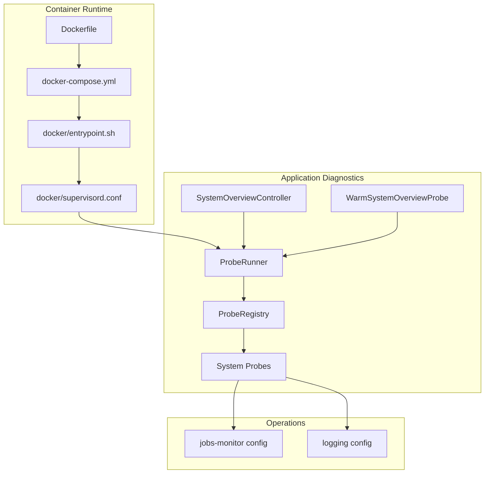
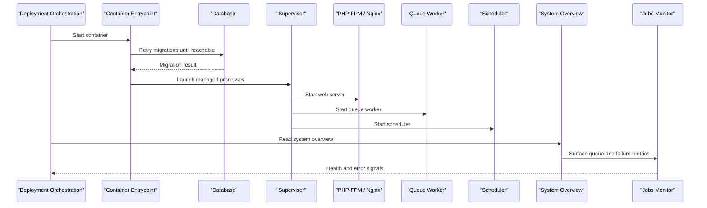
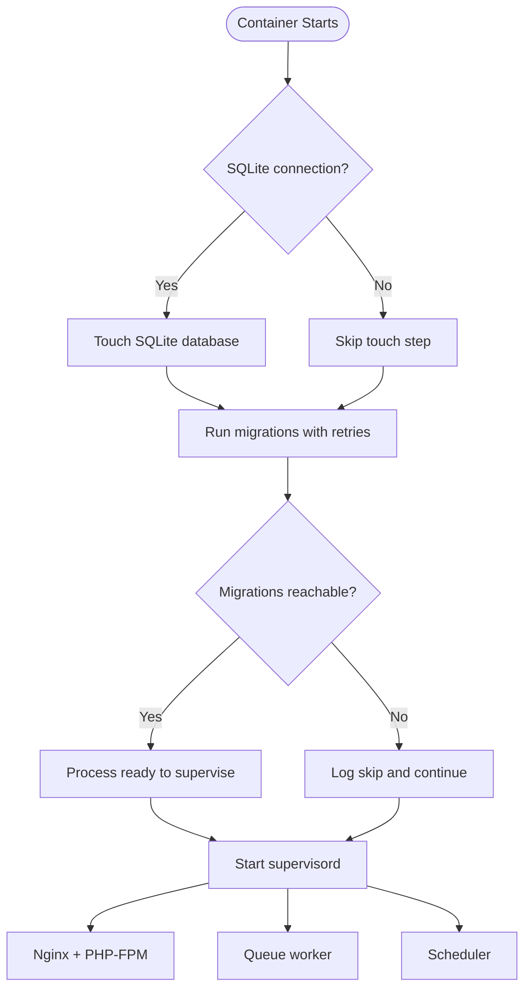
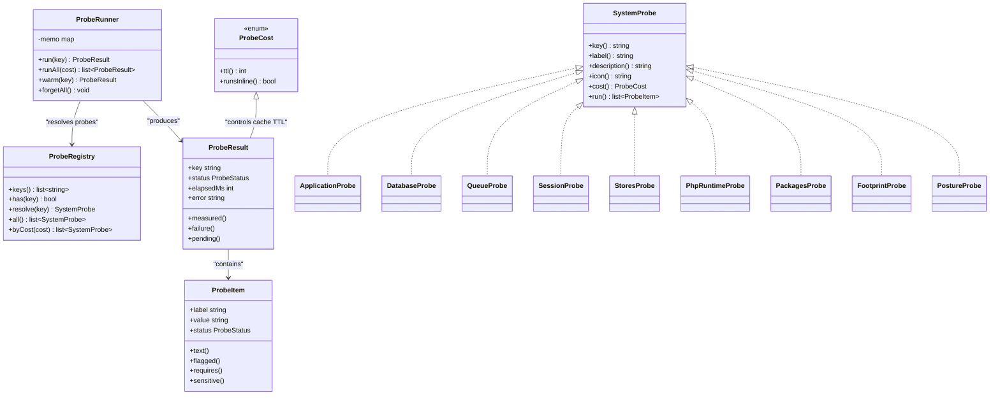
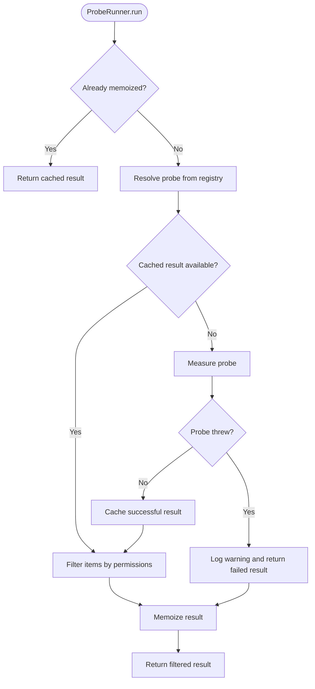
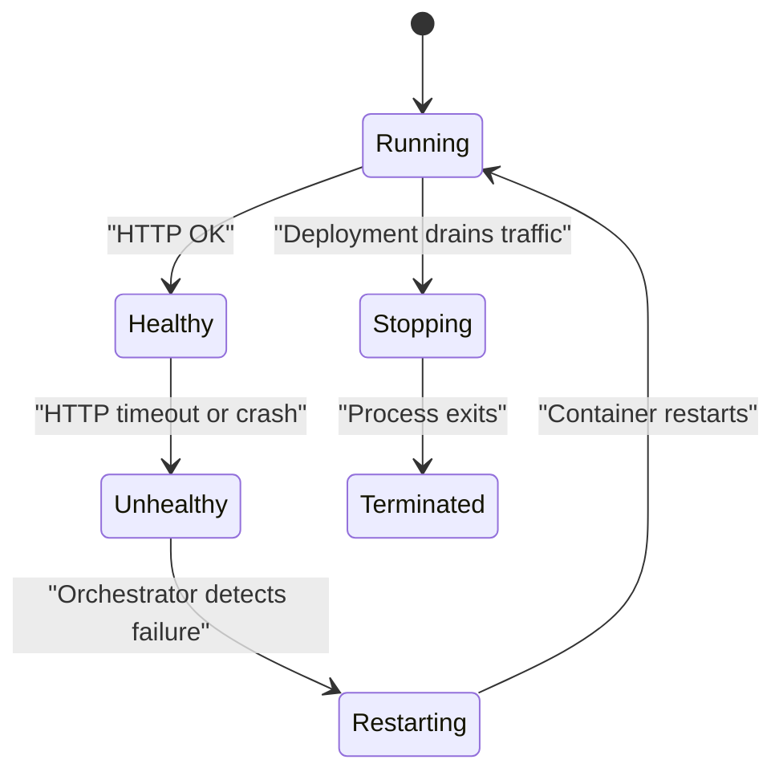
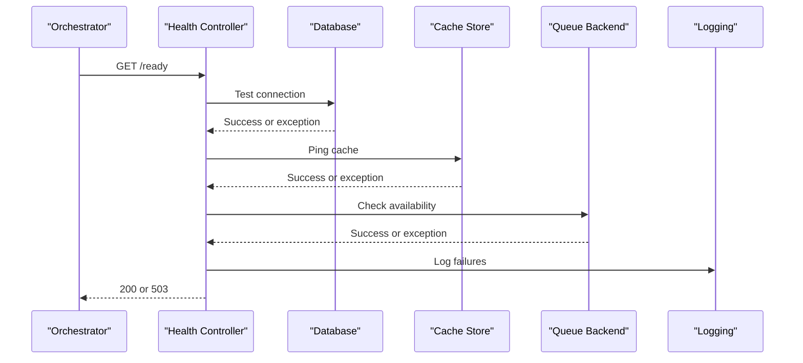
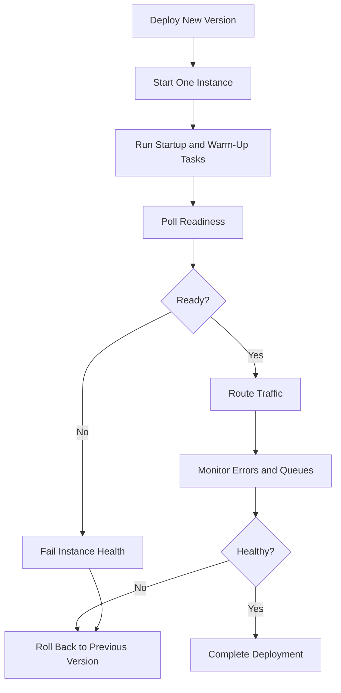
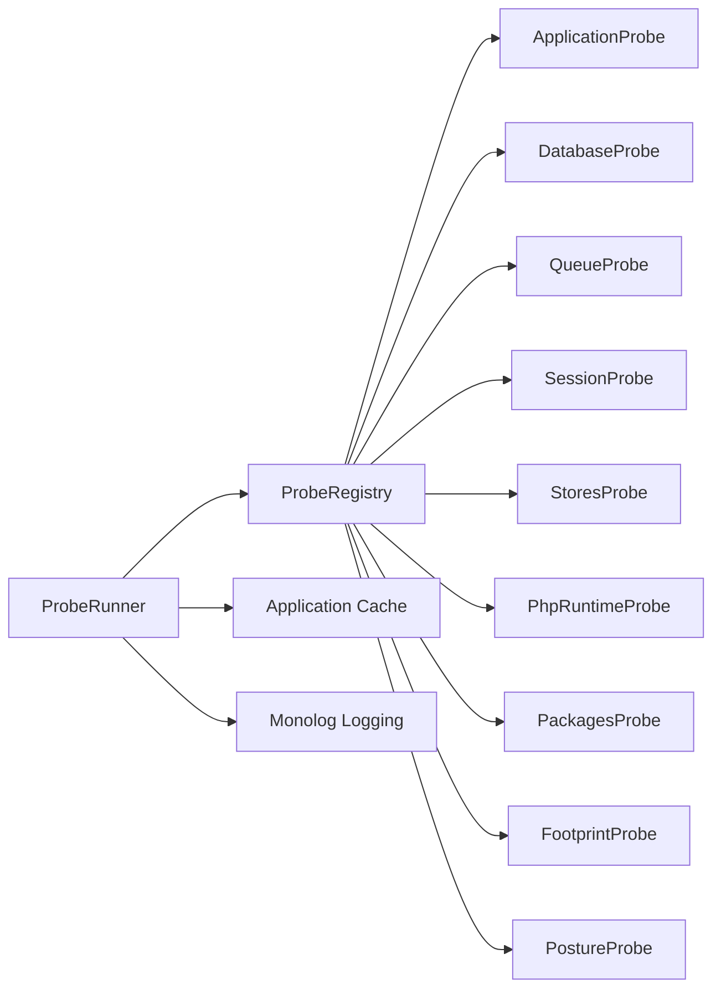

# Health Checks & Monitoring

<cite>
**Referenced Files in This Document**
- [Dockerfile](file://Dockerfile)
- [docker-compose.yml](file://docker-compose.yml)
- [docker/entrypoint.sh](file://docker/entrypoint.sh)
- [docker/supervisord.conf](file://docker/supervisord.conf)
- [composer.json](file://composer.json)
- [app/Support/SystemOverview/ProbeRunner.php](file://app/Support/SystemOverview/ProbeRunner.php)
- [app/Support/SystemOverview/ProbeResult.php](file://app/Support/SystemOverview/ProbeResult.php)
- [app/Support/SystemOverview/ProbeStatus.php](file://app/Support/SystemOverview/ProbeStatus.php)
- [app/Support/SystemOverview/ProbeItem.php](file://app/Support/SystemOverview/ProbeItem.php)
- [app/Support/SystemOverview/ProbeRegistry.php](file://app/Support/SystemOverview/ProbeRegistry.php)
- [app/Support/SystemOverview/SystemProbe.php](file://app/Support/SystemOverview/SystemProbe.php)
- [app/Support/SystemOverview/ProbeCost.php](file://app/Support/SystemOverview/ProbeCost.php)
- [app/Support/SystemOverview/Probes/ApplicationProbe.php](file://app/Support/SystemOverview/Probes/ApplicationProbe.php)
- [app/Support/SystemOverview/Probes/DatabaseProbe.php](file://app/Support/SystemOverview/Probes/DatabaseProbe.php)
- [app/Support/SystemOverview/Probes/QueueProbe.php](file://app/Support/SystemOverview/Probes/QueueProbe.php)
- [app/Support/SystemOverview/Probes/SessionProbe.php](file://app/Support/SystemOverview/Probes/SessionProbe.php)
- [app/Support/SystemOverview/Probes/StoresProbe.php](file://app/Support/SystemOverview/Probes/StoresProbe.php)
- [app/Support/SystemOverview/Probes/PhpRuntimeProbe.php](file://app/Support/SystemOverview/Probes/PhpRuntimeProbe.php)
- [app/Support/SystemOverview/Probes/PackagesProbe.php](file://app/Support/SystemOverview/Probes/PackagesProbe.php)
- [app/Support/SystemOverview/Probes/FootprintProbe.php](file://app/Support/SystemOverview/Probes/FootprintProbe.php)
- [app/Support/SystemOverview/Probes/PostureProbe.php](file://app/Support/SystemOverview/Probes/PostureProbe.php)
- [app/Jobs/WarmSystemOverviewProbe.php](file://app/Jobs/WarmSystemOverviewProbe.php)
- [app/Http/Controllers/Admin/SystemOverviewController.php](file://app/Http/Controllers/Admin/SystemOverviewController.php)
- [config/jobs-monitor.php](file://config/jobs-monitor.php)
- [config/logging.php](file://config/logging.php)
</cite>

## Table of Contents
1. [Introduction](#introduction)
2. [Project Structure](#project-structure)
3. [Core Components](#core-components)
4. [Architecture Overview](#architecture-overview)
5. [Detailed Component Analysis](#detailed-component-analysis)
6. [Dependency Analysis](#dependency-analysis)
7. [Performance Considerations](#performance-considerations)
8. [Troubleshooting Guide](#troubleshooting-guide)
9. [Conclusion](#conclusion)
10. [Appendices](#appendices)

## Introduction
This document explains how the application should be monitored and validated during zero-downtime deployments. It focuses on three layers:

1. **Container-level health checks**: process supervision, migration retries, and service orchestration.
2. **Application-level readiness and liveness probes**: what can be exposed to Kubernetes, load balancers, or deployment automation.
3. **Operational monitoring and alerting**: job monitoring, logging, security posture checks, and deployment diagnostics.

The codebase already provides a rich system overview and probe framework. However, it does not currently expose dedicated HTTP endpoints for container orchestrators. The guidance below defines how to turn existing components into production-ready readiness and liveness probes, while also documenting current monitoring capabilities and recommended alerting strategies.

## Project Structure
The relevant runtime and monitoring surface is split across container configuration, process supervision, an internal diagnostic dashboard, and operational packages.

**Diagram sources**
- [Dockerfile:1-32](file://Dockerfile#L1-L32)
- [docker-compose.yml:1-31](file://docker-compose.yml#L1-L31)
- [docker/entrypoint.sh:1-20](file://docker/entrypoint.sh#L1-L20)
- [docker/supervisord.conf:1-66](file://docker/supervisord.conf#L1-L66)
- [app/Support/SystemOverview/ProbeRunner.php:1-194](file://app/Support/SystemOverview/ProbeRunner.php#L1-L194)
- [app/Support/SystemOverview/ProbeRegistry.php:1-118](file://app/Support/SystemOverview/ProbeRegistry.php#L1-L118)
- [app/Http/Controllers/Admin/SystemOverviewController.php:1-84](file://app/Http/Controllers/Admin/SystemOverviewController.php#L1-L84)
- [app/Jobs/WarmSystemOverviewProbe.php:1-76](file://app/Jobs/WarmSystemOverviewProbe.php#L1-L76)
- [config/jobs-monitor.php:1-200](file://config/jobs-monitor.php#L1-L200)
- [config/logging.php:1-132](file://config/logging.php#L1-L132)

**Section sources**
- [Dockerfile:1-32](file://Dockerfile#L1-L32)
- [docker-compose.yml:1-31](file://docker-compose.yml#L1-L31)
- [docker/entrypoint.sh:1-20](file://docker/entrypoint.sh#L1-L20)
- [docker/supervisord.conf:1-66](file://docker/supervisord.conf#L1-L66)

## Core Components
The application’s internal health surface is built around a probe framework rather than raw controller endpoints.

| Layer | Responsibility | Current Implementation | Deployment Use |
|---|---|---|---|
| Container startup | Prepare environment, run migrations with retries, start processes | Entry point touches SQLite when needed, retries database migrations, then starts supervisord | Startup validation and early failure detection |
| Process supervision | Run web server, PHP-FPM, queue worker, and scheduler | Supervisord manages all four processes with autorestart enabled | Liveness proxy target; restarts crashed workers automatically |
| Application diagnostics | Measure application state, dependencies, storage, queues, sessions, and security posture | System overview probes executed by `ProbeRunner` | Readiness-style business validation |
| Job monitoring | Track queued jobs, failures, throughput, and workers | External package with UI, API, and alert channels | Error-rate detection and alerting |
| Logging | Centralize application logs | Monolog stack with multiple channels including stderr, Slack, and file-based sinks | Metrics collection, error tracking, and alert pipelines |

Key observations for zero-downtime deployments:

- There is no explicit `/health`, `/ready`, or `/live` route.
- Database connectivity is verified at startup through migration retries.
- Queue workers and scheduler are supervised and restarted automatically.
- A comprehensive system overview exists but is admin-facing, not designed as an orchestrator health endpoint.
- Job monitoring includes alert channels such as Slack, email, and PagerDuty.

**Section sources**
- [docker/entrypoint.sh:1-20](file://docker/entrypoint.sh#L1-L20)
- [docker/supervisord.conf:1-66](file://docker/supervisord.conf#L1-L66)
- [app/Support/SystemOverview/ProbeRunner.php:1-194](file://app/Support/SystemOverview/ProbeRunner.php#L1-L194)
- [config/jobs-monitor.php:1-200](file://config/jobs-monitor.php#L1-L200)
- [config/logging.php:1-132](file://config/logging.php#L1-L132)

## Architecture Overview
The health and monitoring architecture has two complementary paths:

1. **Deployment path**: container entrypoint → migrations → supervisor → web, queue, and scheduler processes.
2. **Observability path**: system overview probes → cached results → admin dashboard, export, and job monitoring.

**Diagram sources**
- [docker/entrypoint.sh:1-20](file://docker/entrypoint.sh#L1-L20)
- [docker/supervisord.conf:1-66](file://docker/supervisord.conf#L1-L66)
- [app/Support/SystemOverview/ProbeRunner.php:1-194](file://app/Support/SystemOverview/ProbeRunner.php#L1-L194)
- [app/Support/SystemOverview/Probes/QueueProbe.php:1-190](file://app/Support/SystemOverview/Probes/QueueProbe.php#L1-L190)
- [config/jobs-monitor.php:1-200](file://config/jobs-monitor.php#L1-L200)

**Section sources**
- [docker/entrypoint.sh:1-20](file://docker/entrypoint.sh#L1-L20)
- [docker/supervisord.conf:1-66](file://docker/supervisord.conf#L1-L66)
- [app/Support/SystemOverview/ProbeRunner.php:1-194](file://app/Support/SystemOverview/ProbeRunner.php#L1-L194)

## Detailed Component Analysis

### Container-Level Readiness and Liveness Behavior
The container prepares the application before serving traffic and supervises its long-running processes.

- The entry point runs migrations with retry logic. If the database is unavailable, it stops retrying after a bounded number of attempts and continues, which means the container may start even if the database is temporarily unreachable.
- After preparation, it delegates process management to supervisord.
- Supervisord starts Nginx and PHP-FPM for web requests, plus a queue worker and scheduler.
- All processes have autorestart enabled, so crashes are recovered automatically.

For deployment:

- **Readiness probe**: Should verify that the web server responds, migrations have completed successfully, and key dependencies are reachable.
- **Liveness probe**: Can target the HTTP server because supervisord will restart failed processes.
- **Startup probe**: Useful to delay readiness while migrations and warm-up jobs complete.

**Diagram sources**
- [docker/entrypoint.sh:1-20](file://docker/entrypoint.sh#L1-L20)
- [docker/supervisord.conf:1-66](file://docker/supervisord.conf#L1-L66)

**Section sources**
- [docker/entrypoint.sh:1-20](file://docker/entrypoint.sh#L1-L20)
- [docker/supervisord.conf:1-66](file://docker/supervisord.conf#L1-L66)

### Application Health Probe Framework
The application uses a strongly typed probe framework for diagnostics. This is the foundation for custom readiness checks, but it is currently presented as an admin dashboard rather than a machine-readable health API.

**Diagram sources**
- [app/Support/SystemOverview/SystemProbe.php:1-47](file://app/Support/SystemOverview/SystemProbe.php#L1-L47)
- [app/Support/SystemOverview/ProbeRunner.php:1-194](file://app/Support/SystemOverview/ProbeRunner.php#L1-L194)
- [app/Support/SystemOverview/ProbeRegistry.php:1-118](file://app/Support/SystemOverview/ProbeRegistry.php#L1-L118)
- [app/Support/SystemOverview/ProbeResult.php:1-205](file://app/Support/SystemOverview/ProbeResult.php#L1-L205)
- [app/Support/SystemOverview/ProbeItem.php:1-127](file://app/Support/SystemOverview/ProbeItem.php#L1-L127)
- [app/Support/SystemOverview/ProbeCost.php:1-36](file://app/Support/SystemOverview/ProbeCost.php#L1-L36)
- [app/Support/SystemOverview/Probes/ApplicationProbe.php:1-115](file://app/Support/SystemOverview/Probes/ApplicationProbe.php#L1-L115)
- [app/Support/SystemOverview/Probes/DatabaseProbe.php:1-205](file://app/Support/SystemOverview/Probes/DatabaseProbe.php#L1-L205)
- [app/Support/SystemOverview/Probes/QueueProbe.php:1-190](file://app/Support/SystemOverview/Probes/QueueProbe.php#L1-L190)
- [app/Support/SystemOverview/Probes/SessionProbe.php:1-146](file://app/Support/SystemOverview/Probes/SessionProbe.php#L1-L146)
- [app/Support/SystemOverview/Probes/StoresProbe.php:1-155](file://app/Support/SystemOverview/Probes/StoresProbe.php#L1-L155)
- [app/Support/SystemOverview/Probes/PhpRuntimeProbe.php:1-157](file://app/Support/SystemOverview/Probes/PhpRuntimeProbe.php#L1-L157)
- [app/Support/SystemOverview/Probes/PackagesProbe.php:1-83](file://app/Support/SystemOverview/Probes/PackagesProbe.php#L1-L83)
- [app/Support/SystemOverview/Probes/FootprintProbe.php:1-213](file://app/Support/SystemOverview/Probes/FootprintProbe.php#L1-L213)
- [app/Support/SystemOverview/Probes/PostureProbe.php:1-384](file://app/Support/SystemOverview/Probes/PostureProbe.php#L1-L384)

#### Probe Execution Flow
The runner resolves a probe, checks cache, measures when needed, filters sensitive data by permissions, and caches successful results.

**Diagram sources**
- [app/Support/SystemOverview/ProbeRunner.php:1-194](file://app/Support/SystemOverview/ProbeRunner.php#L1-L194)
- [app/Support/SystemOverview/ProbeRegistry.php:1-118](file://app/Support/SystemOverview/ProbeRegistry.php#L1-L118)

**Section sources**
- [app/Support/SystemOverview/ProbeRunner.php:1-194](file://app/Support/SystemOverview/ProbeRunner.php#L1-L194)
- [app/Support/SystemOverview/ProbeResult.php:1-205](file://app/Support/SystemOverview/ProbeResult.php#L1-L205)
- [app/Support/SystemOverview/ProbeStatus.php:1-58](file://app/Support/SystemOverview/ProbeStatus.php#L1-L58)
- [app/Support/SystemOverview/ProbeItem.php:1-127](file://app/Support/SystemOverview/ProbeItem.php#L1-L127)

### Readiness Probes: Dependency Verification
The existing probes cover most dependency categories useful for readiness validation.

| Dependency | Existing Probe | What It Verifies | Readiness Recommendation |
|---|---|---|---|
| Database | `DatabaseProbe` | Default connection reachability, driver, version, table count, migration drift | Expose a lightweight readiness endpoint that queries the default connection and reports fail if the connection throws |
| Cache store | `StoresProbe` | Configuration of cache, session, queue, mail, filesystem drivers | Validate configured cache backend is reachable using the application cache layer |
| Queue backend | `QueueProbe` | Connection, backlog, failures, worker heartbeats, scheduled commands | Verify queue connection and worker heartbeat availability |
| Sessions | `SessionProbe` | Live session rows, sign-in ledger, pruning state | Validate session store accessibility |
| Filesystem / object storage | `StoresProbe`, `FootprintProbe` | Disk links, public disk driver, media registry | Validate writable directories or object storage bucket access |
| PHP runtime | `PhpRuntimeProbe` | Version, extensions, PDO drivers, INI settings | Validate required extensions and memory limits |
| Application state | `ApplicationProbe` | Environment, debug mode, maintenance mode, cache status, release | Fail readiness if debug mode is unexpectedly on or maintenance mode is active |
| Security posture | `PostureProbe` | Registration, verification, second factors, app key, proxy trust, audit trail | Use as deployment approval signal rather than hard readiness blocker |

Recommended readiness endpoint behavior:

- Return success only when the database, cache, session store, and queue backend are reachable.
- Include a version identifier for deployment correlation.
- Keep response time under one second.
- Do not perform heavy directory scans or large JSON reads.
- Mark missing migrations as failed readiness if your deployment strategy requires them to run before traffic.

**Section sources**
- [app/Support/SystemOverview/Probes/DatabaseProbe.php:1-205](file://app/Support/SystemOverview/Probes/DatabaseProbe.php#L1-L205)
- [app/Support/SystemOverview/Probes/StoresProbe.php:1-155](file://app/Support/SystemOverview/Probes/StoresProbe.php#L1-L155)
- [app/Support/SystemOverview/Probes/QueueProbe.php:1-190](file://app/Support/SystemOverview/Probes/QueueProbe.php#L1-L190)
- [app/Support/SystemOverview/Probes/SessionProbe.php:1-146](file://app/Support/SystemOverview/Probes/SessionProbe.php#L1-L146)
- [app/Support/SystemOverview/Probes/PhpRuntimeProbe.php:1-157](file://app/Support/SystemOverview/Probes/PhpRuntimeProbe.php#L1-L157)
- [app/Support/SystemOverview/Probes/ApplicationProbe.php:1-115](file://app/Support/SystemOverview/Probes/ApplicationProbe.php#L1-L115)
- [app/Support/SystemOverview/Probes/PostureProbe.php:1-384](file://app/Support/SystemOverview/Probes/PostureProbe.php#L1-L384)

### Liveness Probes: Crash Detection and Automatic Restarts
Liveness should answer whether the process is alive and able to participate in request handling.

Current automatic restart behavior:

- Supervisord manages Nginx, PHP-FPM, queue worker, and scheduler.
- Each program has `autorestart=true`.
- Stop wait times are configured per process.
- Queues and scheduler are separate supervised programs, so a stuck web request does not prevent queue recovery.

Recommended liveness behavior:

- Target the HTTP server port.
- Accept a simple 200 response as healthy.
- Fail the liveness probe if the process becomes unresponsive for repeated intervals.
- Let the orchestrator restart the container when liveness fails.
- Avoid making liveness expensive; use readiness for dependency checks.

**Diagram sources**
- [docker/supervisord.conf:1-66](file://docker/supervisord.conf#L1-L66)

**Section sources**
- [docker/supervisord.conf:1-66](file://docker/supervisord.conf#L1-L66)

### Custom Health Check Endpoints for Business Logic
The system overview controller is read-only and admin-focused. It exposes an index view, a refresh action, and a redacted JSON export. It is not intended as a machine-readable health endpoint.

To implement custom business-health endpoints, reuse the same patterns used by the probe framework:

- Create a lightweight controller method that performs only fast dependency checks.
- Use the same status model: ok, info, warn, fail, pending.
- Avoid writing secrets into responses.
- Keep endpoints idempotent and fast.
- Prefer querying the application cache layer rather than walking files.
- Record failures through the logging stack instead of returning stack traces.

A suitable structure would follow the existing `SystemProbe` contract, but the implementation should return a machine-readable response rather than building Blade-visible items.

[No sources needed since this diagram shows conceptual workflow, not actual code structure]

### Monitoring Strategies for Deployment Progress, Error Rates, and Performance Metrics
The repository provides several operational observability surfaces.

| Area | Current Capability | Usage During Deployment |
|---|---|---|
| Deployment progress | Application version recording and system overview release line | Correlate running version with deployed artifact |
| Queue performance | Job monitor tracks processed, failed, processing counts and worker heartbeats | Detect stalled deployments caused by queued work |
| Error rates | Job monitor stores failures; logs go through Monolog channels | Alert on spikes in failed jobs or critical log volume |
| Application diagnostics | System overview shows environment, caches, runtime, database, and posture | Manual inspection and exported redacted diagnostics |
| Logs | Multiple channels including stderr, file, Slack, syslog, and Papertrail | Feed centralized logging and alert systems |

Recommended monitoring practices:

- Track the current application version from the release registry and compare it with the expected deployment version.
- Watch queue backlog age and failure counts during rolling updates.
- Collect error rates from structured logs.
- Export system overview diagnostics periodically for compliance and rollback analysis.
- Avoid exposing sensitive values in exports or alerts.

**Section sources**
- [app/Support/SystemOverview/Probes/ApplicationProbe.php:1-115](file://app/Support/SystemOverview/Probes/ApplicationProbe.php#L1-L115)
- [app/Support/SystemOverview/Probes/QueueProbe.php:1-190](file://app/Support/SystemOverview/Probes/QueueProbe.php#L1-L190)
- [app/Http/Controllers/Admin/SystemOverviewController.php:1-84](file://app/Http/Controllers/Admin/SystemOverviewController.php#L1-L84)
- [config/logging.php:1-132](file://config/logging.php#L1-L132)

### Alerting Mechanisms for Failed Deployments
The job monitoring configuration includes alert channels:

- Slack webhook and signing secret.
- Email recipients.
- PagerDuty routing key.

These are primarily oriented toward job monitoring, but they can be extended to deployment alerts by:

- Sending a deployment-started event when the first healthy instance becomes ready.
- Sending a deployment-completed event after all instances pass readiness.
- Sending a deployment-failed event when readiness or liveness fails repeatedly.
- Using the same alert channels already configured for job failures.

Alert rules should distinguish between:

- Startup failure: database migrations cannot connect.
- Readiness failure: dependencies are unavailable.
- Liveness failure: process is crashing or unresponsive.
- Deployment stall: new version is not passing readiness within the expected window.
- Error rate spike: failed jobs or critical logs exceed thresholds.

**Section sources**
- [config/jobs-monitor.php:1-200](file://config/jobs-monitor.php#L1-L200)

### Automated Rollback Triggers Based on Health Check Failures
Automated rollback should be driven by deployment orchestration, not by the Laravel application itself. The application should remain passive: it reports health; the orchestrator decides rollout or rollback.

Recommended policy:

1. Start one instance of the new version.
2. Wait for startup and warm-up.
3. Confirm readiness over multiple polls.
4. Gradually increase traffic if using blue/green or canary deployment.
5. Monitor error rates, queue failures, and latency.
6. Roll back immediately if:
   - Liveness fails.
   - Readiness remains failing beyond a timeout.
   - Error rate exceeds a threshold.
   - Queue backlog grows without draining.
   - Critical log volume spikes.
7. Preserve logs, exports, and version metadata before rollback.

The warm-up job pattern already demonstrates safe background measurement:

- Heavy probes are warmed off the request path.
- Concurrent warm-ups coalesce through uniqueness.
- Failures leave sections pending rather than blocking the page.
- Admins can manually refresh measurements.

This pattern can be adapted for deployment warm-up: run migration-dependent tasks, clear stale caches, and pre-warm expensive diagnostics before marking the instance ready.

[No sources needed since this diagram shows conceptual workflow, not actual code structure]

**Section sources**
- [app/Jobs/WarmSystemOverviewProbe.php:1-76](file://app/Jobs/WarmSystemOverviewProbe.php#L1-L76)
- [app/Support/SystemOverview/ProbeRunner.php:1-194](file://app/Support/SystemOverview/ProbeRunner.php#L1-L194)

## Dependency Analysis
The probe framework is intentionally decoupled:

- `ProbeRunner` depends on `ProbeRegistry` and the cache layer.
- `ProbeRegistry` contains an allowlisted mapping of keys to concrete probe classes.
- Concrete probes depend on application services, database, filesystem, and configuration.
- Results are serialized as plain arrays, avoiding model revival from cache payloads.
- Sensitive data is filtered at read time based on authorization gates.

**Diagram sources**
- [app/Support/SystemOverview/ProbeRunner.php:1-194](file://app/Support/SystemOverview/ProbeRunner.php#L1-L194)
- [app/Support/SystemOverview/ProbeRegistry.php:1-118](file://app/Support/SystemOverview/ProbeRegistry.php#L1-L118)
- [app/Support/SystemOverview/Probes/ApplicationProbe.php:1-115](file://app/Support/SystemOverview/Probes/ApplicationProbe.php#L1-L115)
- [app/Support/SystemOverview/Probes/DatabaseProbe.php:1-205](file://app/Support/SystemOverview/Probes/DatabaseProbe.php#L1-L205)
- [app/Support/SystemOverview/Probes/QueueProbe.php:1-190](file://app/Support/SystemOverview/Probes/QueueProbe.php#L1-L190)
- [app/Support/SystemOverview/Probes/SessionProbe.php:1-146](file://app/Support/SystemOverview/Probes/SessionProbe.php#L1-L146)
- [app/Support/SystemOverview/Probes/StoresProbe.php:1-155](file://app/Support/SystemOverview/Probes/StoresProbe.php#L1-L155)
- [app/Support/SystemOverview/Probes/PhpRuntimeProbe.php:1-157](file://app/Support/SystemOverview/Probes/PhpRuntimeProbe.php#L1-L157)
- [app/Support/SystemOverview/Probes/PackagesProbe.php:1-83](file://app/Support/SystemOverview/Probes/PackagesProbe.php#L1-L83)
- [app/Support/SystemOverview/Probes/FootprintProbe.php:1-213](file://app/Support/SystemOverview/Probes/FootprintProbe.php#L1-L213)
- [app/Support/SystemOverview/Probes/PostureProbe.php:1-384](file://app/Support/SystemOverview/Probes/PostureProbe.php#L1-L384)

**Section sources**
- [app/Support/SystemOverview/ProbeRunner.php:1-194](file://app/Support/SystemOverview/ProbeRunner.php#L1-L194)
- [app/Support/SystemOverview/ProbeRegistry.php:1-118](file://app/Support/SystemOverview/ProbeRegistry.php#L1-L118)
- [app/Support/SystemOverview/ProbeResult.php:1-205](file://app/Support/SystemOverview/ProbeResult.php#L1-L205)

## Performance Considerations
The probe framework already separates light and heavy operations:

- Light probes run inline and are cached briefly.
- Heavy probes are warmed off the request path and cached longer.
- The warm-up job coalesces concurrent warm-ups and has a bounded timeout.
- Failed probes do not bring down the rest of the system overview.

For deployment health endpoints:

- Do not reuse heavy probes like footprint scanning or package parsing for readiness.
- Reuse lightweight probes such as database connectivity, cache ping, queue availability, and runtime extension checks.
- Avoid loading full job payloads or walking large directories.
- Keep readiness responses under one second.
- Use caching only for expensive diagnostics, never for transient dependency checks.

**Section sources**
- [app/Support/SystemOverview/ProbeCost.php:1-36](file://app/Support/SystemOverview/ProbeCost.php#L1-L36)
- [app/Jobs/WarmSystemOverviewProbe.php:1-76](file://app/Jobs/WarmSystemOverviewProbe.php#L1-L76)
- [app/Support/SystemOverview/ProbeRunner.php:1-194](file://app/Support/SystemOverview/ProbeRunner.php#L1-L194)

## Troubleshooting Guide
Common deployment issues and where to investigate:

| Symptom | Likely Area | Investigation Steps |
|---|---|---|
| Container starts but web requests fail | Migration retry or dependency readiness | Check entrypoint migration behavior and add readiness checks for database, cache, and queue |
| Workers restart frequently | Supervisored process crash | Inspect stderr logs and queue worker logs |
| Queue backs up during deployment | Queue backend or worker availability | Use queue probe and job monitor to inspect backlog, failures, and worker heartbeats |
| Storage link missing | Filesystem configuration | Use stores probe to detect missing local storage link |
| Missing PHP extensions | Runtime environment | Use PHP runtime probe to list required vs loaded extensions |
| Debug mode left on | Application configuration | Use application and posture probes to detect debug and maintenance state |
| Logs not reaching external systems | Logging channel configuration | Review Monolog channels and environment variables |
| Alerts not firing | Job monitor alert channels | Verify Slack, email, and PagerDuty configuration |

Operational recommendations:

- Treat failed migrations as a startup warning that may still allow the container to run, and guard against that assumption with readiness checks.
- Export the system overview before rollback to preserve diagnostics.
- Enable structured logging to stderr so container orchestrators can forward logs to centralized systems.
- Configure log retention appropriately for daily and single-file sinks.
- Restrict access to job monitoring and system overview endpoints.

**Section sources**
- [docker/entrypoint.sh:1-20](file://docker/entrypoint.sh#L1-L20)
- [docker/supervisord.conf:1-66](file://docker/supervisord.conf#L1-L66)
- [app/Support/SystemOverview/Probes/StoresProbe.php:1-155](file://app/Support/SystemOverview/Probes/StoresProbe.php#L1-L155)
- [app/Support/SystemOverview/Probes/PhpRuntimeProbe.php:1-157](file://app/Support/SystemOverview/Probes/PhpRuntimeProbe.php#L1-L157)
- [app/Support/SystemOverview/Probes/ApplicationProbe.php:1-115](file://app/Support/SystemOverview/Probes/ApplicationProbe.php#L1-L115)
- [app/Support/SystemOverview/Probes/PostureProbe.php:1-384](file://app/Support/SystemOverview/Probes/PostureProbe.php#L1-L384)
- [config/logging.php:1-132](file://config/logging.php#L1-L132)
- [config/jobs-monitor.php:1-200](file://config/jobs-monitor.php#L1-L200)

## Conclusion
The application already provides strong foundations for health and monitoring:

- Container startup validates the environment and retries migrations.
- Supervisord ensures automatic restart of web, queue, and scheduler processes.
- A well-structured probe framework measures application state, dependencies, storage, runtime, and security posture.
- Job monitoring provides queue metrics, failure history, and alert channels.
- Logging supports multiple channels suitable for centralized observability.

For production zero-downtime deployments, the next steps are:

1. Implement lightweight readiness and liveness HTTP endpoints.
2. Map readiness checks to existing database, cache, session, queue, and runtime probes.
3. Use liveness probes for process responsiveness and rely on supervisord for restarts.
4. Integrate deployment orchestration with readiness, error-rate, and queue-health signals.
5. Automate rollback on liveness failure, prolonged readiness failure, or error-rate spikes.
6. Extend alerting to cover deployment lifecycle events using the existing job monitoring channels.