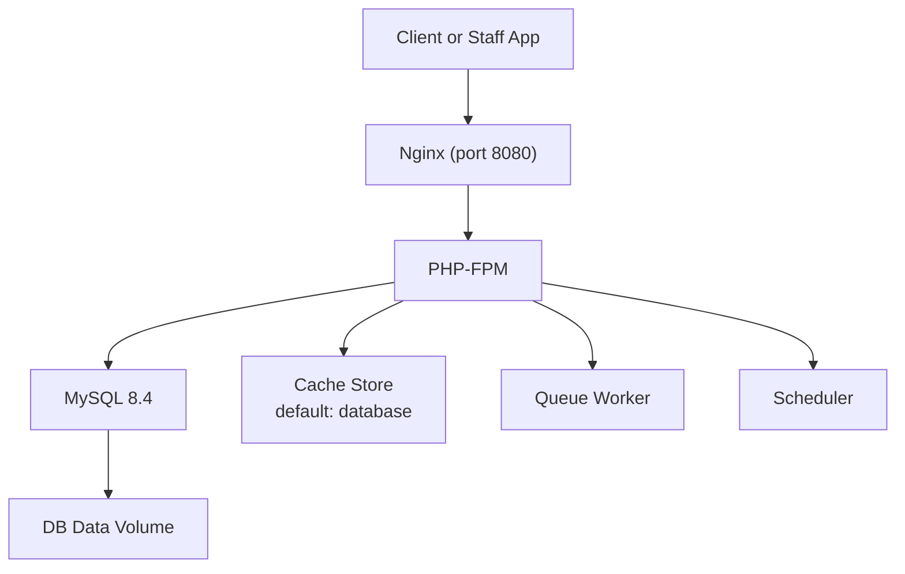
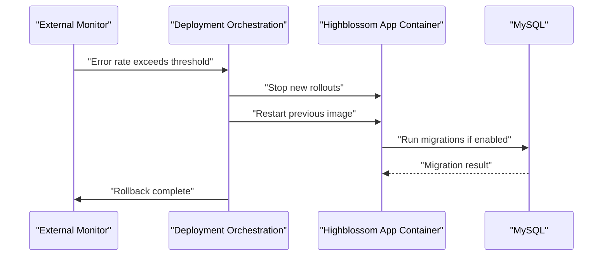
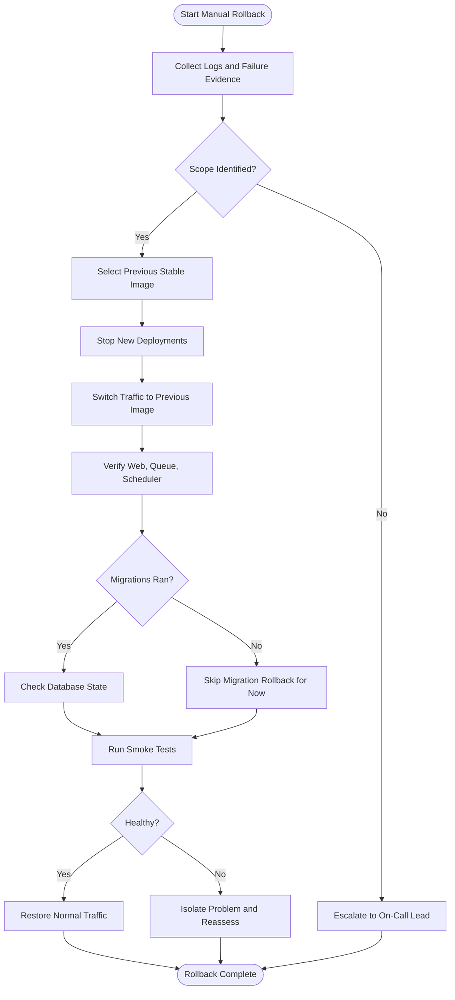
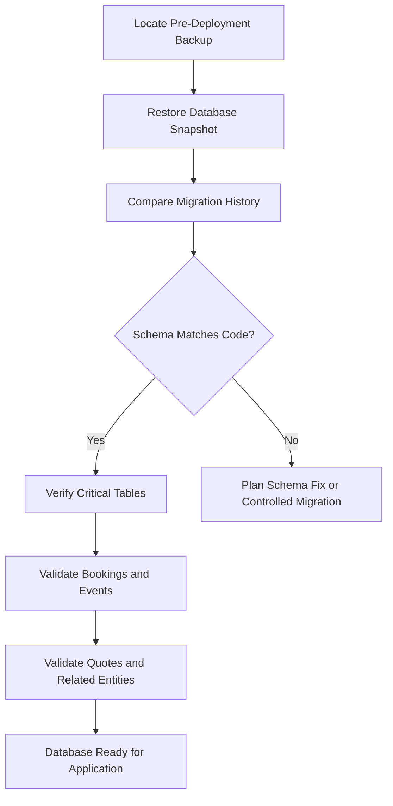
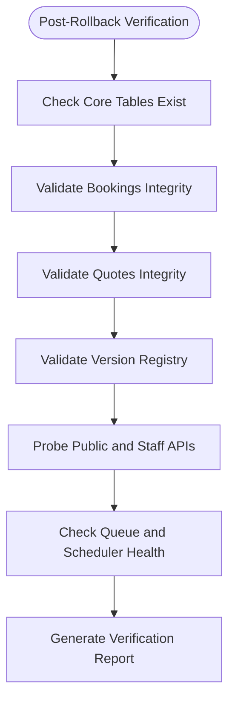
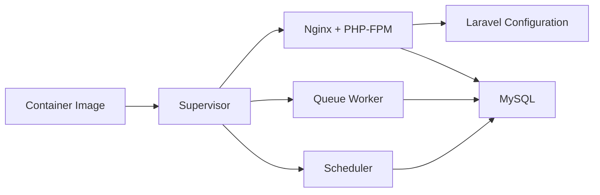
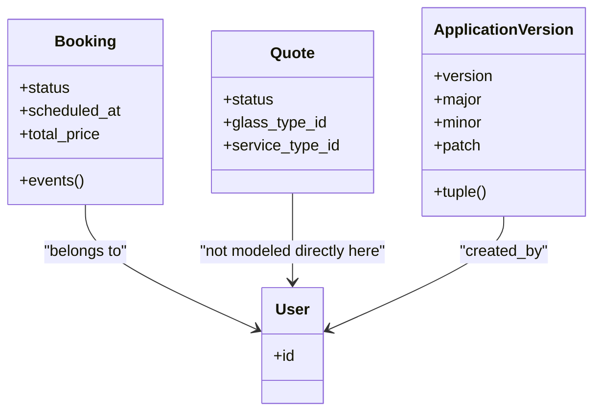

# Rollback & Recovery Procedures

<cite>
**Referenced Files in This Document**   
- [docker-compose.yml](file://docker-compose.yml)
- [Dockerfile](file://Dockerfile)
- [docker/entrypoint.sh](file://docker/entrypoint.sh)
- [docker/supervisord.conf](file://docker/supervisord.conf)
- [config/app.php](file://config/app.php)
- [config/database.php](file://config/database.php)
- [config/cache.php](file://config/cache.php)
- [config/session.php](file://config/session.php)
- [config/logging.php](file://config/logging.php)
- [routes/api.php](file://routes/api.php)
- [app/Models/ApplicationVersion.php](file://app/Models/ApplicationVersion.php)
- [app/Services/ApplicationVersionService.php](file://app/Services/ApplicationVersionService.php)
- [database/migrations/2026_10_01_120000_create_application_versions_table.php](file://database/migrations/2026_10_01_120000_create_application_versions_table.php)
- [app/Models/Booking.php](file://app/Models/Booking.php)
- [app/Models/Quote.php](file://app/Models/Quote.php)
- [database/migrations/2026_04_17_093356_create_bookings_table.php](file://database/migrations/2026_04_17_093356_create_bookings_table.php)
- [database/migrations/2026_04_20_080002_create_quotes_table.php](file://database/migrations/2026_04_20_080002_create_quotes_table.php)
- [app/Services/IdempotencyService.php](file://app/Services/IdempotencyService.php)
</cite>

## Table of Contents
1. [Introduction](#introduction)
2. [Project Structure](#project-structure)
3. [Core Components](#core-components)
4. [Architecture Overview](#architecture-overview)
5. [Detailed Component Analysis](#detailed-component-analysis)
6. [Dependency Analysis](#dependency-analysis)
7. [Performance Considerations](#performance-considerations)
8. [Troubleshooting Guide](#troubleshooting-guide)
9. [Conclusion](#conclusion)

## Introduction
This document defines rollback and recovery procedures for Highblossom’s zero-downtime deployments. It covers automated rollback triggers, manual rollback steps, incident response workflows, data consistency verification, backup restoration, and disaster recovery scenarios focused on the booking and quote management systems.

The application is a Laravel 13 PHP service running inside a container with Nginx, PHP-FPM, queue workers, and a scheduler managed by Supervisor. The database is MySQL 8.4, configured through environment variables and Laravel configuration files. Bookings and quotes are core business entities with status-driven lifecycles, while an application version registry supports release tracking.

## Project Structure
The deployment stack is containerized:
- One image runs web, queue, and scheduler processes under Supervisor.
- Migrations run at startup when enabled.
- Logs go to standard error in the default compose configuration, with additional channels available through logging configuration.
- Database state is persisted to a named Docker volume.

**Diagram sources**
- [docker-compose.yml:1-31](file://docker-compose.yml#L1-L31)
- [Dockerfile:1-32](file://Dockerfile#L1-L32)
- [docker/supervisord.conf:1-66](file://docker/supervisord.conf#L1-L66)
- [config/cache.php:1-146](file://config/cache.php#L1-L146)

**Section sources**
- [docker-compose.yml:1-31](file://docker-compose.yml#L1-L31)
- [Dockerfile:1-32](file://Dockerfile#L1-L32)
- [docker/entrypoint.sh:1-20](file://docker/entrypoint.sh#L1-L20)
- [docker/supervisord.conf:1-66](file://docker/supervisord.conf#L1-L66)

## Core Components
- Application runtime: Laravel app served by Nginx and PHP-FPM.
- Background processing: queue worker and scheduler.
- Database: MySQL with migrations tracked in a `migrations` table.
- Version registry: `application_versions` table records immutable semantic versions.
- Business models: `Booking` and `Quote` drive customer-facing workflows.
- Idempotency: cache-backed token deduplication protects against duplicate submissions.

Key operational properties:
- Container restart policies and Supervisor autorestart keep services alive.
- Migration retries during startup tolerate slow database readiness.
- Logging supports multiple channels, including stderr, daily files, Slack, and Papertrail.
- Maintenance mode is configurable via file or database driver.

**Section sources**
- [docker/entrypoint.sh:1-20](file://docker/entrypoint.sh#L1-L20)
- [config/logging.php:1-132](file://config/logging.php#L1-L132)
- [config/app.php:1-126](file://config/app.php#L1-L126)
- [app/Models/ApplicationVersion.php:1-56](file://app/Models/ApplicationVersion.php#L1-L56)
- [database/migrations/2026_10_01_120000_create_application_versions_table.php:1-55](file://database/migrations/2026_10_01_120000_create_application_versions_table.php#L1-L55)
- [app/Models/Booking.php:1-134](file://app/Models/Booking.php#L1-L134)
- [app/Models/Quote.php:1-76](file://app/Models/Quote.php#L1-L76)
- [app/Services/IdempotencyService.php:1-95](file://app/Services/IdempotencyService.php#L1-L95)

## Architecture Overview
Rollback decisions should combine application health signals, external monitoring, and operational checks. The current codebase does not implement automatic rollback logic; it provides the primitives needed to build such automation:
- Process supervision for quick restarts.
- Startup migration retries.
- Version registry for release identification.
- Logging channels suitable for alerting.
- API routes that can be probed for health and performance.

**Diagram sources**
- [docker-compose.yml:1-31](file://docker-compose.yml#L1-L31)
- [docker/entrypoint.sh:1-20](file://docker/entrypoint.sh#L1-L20)
- [docker/supervisord.conf:1-66](file://docker/supervisord.conf#L1-L66)

## Detailed Component Analysis

### Automated Rollback Triggers
Recommended trigger categories:

| Trigger | Meaning | Suggested Action |
|---|---|---|
| HTTP 5xx error rate above threshold | Application errors exceed acceptable levels | Pause rollout, stop traffic to new version, restart previous image |
| Health endpoint failures | Web server or application bootstrap fails | Fail fast, do not route traffic to unhealthy instance |
| Database connection or migration failures | Startup cannot reach DB or migrations fail | Abort deployment, retain previous stable image |
| Queue worker crashes | Background jobs repeatedly failing | Restart worker, isolate failing jobs, consider partial rollback |
| Performance degradation | Latency or throughput falls below SLA | Canary pause, investigate, then rollback if no fix |
| Booking or quote write failures | Critical business writes fail | Stop accepting new bookings/quotes, switch to maintenance mode, rollback |

Implementation guidance based on existing components:
- Use Supervisor’s process state to detect repeated restarts of PHP-FPM, queue, or scheduler.
- Parse logs from stderr or configured log channels to compute error-rate metrics.
- Probe staff API endpoints defined under `/api/staff/*` for availability and response quality.
- Record releases using the application version service so rollback targets are auditable.

**Section sources**
- [docker/supervisord.conf:1-66](file://docker/supervisord.conf#L1-L66)
- [config/logging.php:1-132](file://config/logging.php#L1-L132)
- [routes/api.php:1-117](file://routes/api.php#L1-L117)
- [app/Services/ApplicationVersionService.php:1-157](file://app/Services/ApplicationVersionService.php#L1-L157)

### Manual Rollback Procedure

#### Pre-Rollback Checks
1. Identify the last known good release using the version registry.
2. Confirm whether the failure is application-level, database-level, or infrastructure-level.
3. Preserve evidence: capture recent logs, failed request IDs, and affected booking or quote identifiers.
4. Decide between full rollback and targeted mitigation such as maintenance mode or feature disablement.

#### Service Rollback Sequence
1. Stop deploying new containers to the production pool.
2. Switch traffic back to the previous container image.
3. Verify container processes started successfully:
   - Web process (Nginx and PHP-FPM).
   - Queue worker.
   - Scheduler.
4. If migrations were part of the failed deployment, confirm whether they ran or were skipped.
5. Run targeted smoke tests against public and staff API endpoints.
6. Gradually restore normal traffic after confirming stability.

**Diagram sources**
- [docker/entrypoint.sh:1-20](file://docker/entrypoint.sh#L1-L20)
- [docker/supervisord.conf:1-66](file://docker/supervisord.conf#L1-L66)
- [config/database.php:1-184](file://config/database.php#L1-L184)

#### Database State Restoration
- Use the database connection configuration to identify host, port, database name, credentials, and charset.
- Prefer restoring from a validated backup taken before the deployment window.
- After restoration, verify that the migration repository table reflects the expected state.
- Do not run arbitrary migrations against a restored database unless you understand their direction and idempotency.
- For Highblossom, confirm that `bookings`, `quotes`, `application_versions`, and related tables exist and contain consistent data.

**Diagram sources**
- [config/database.php:1-184](file://config/database.php#L1-L184)
- [database/migrations/2026_04_17_093356_create_bookings_table.php:1-36](file://database/migrations/2026_04_17_093356_create_bookings_table.php#L1-L36)
- [database/migrations/2026_04_20_080002_create_quotes_table.php:1-33](file://database/migrations/2026_04_20_080002_create_quotes_table.php#L1-L33)
- [database/migrations/2026_10_01_120000_create_application_versions_table.php:1-55](file://database/migrations/2026_10_01_120000_create_application_versions_table.php#L1-L55)

#### Configuration Rollback
- Roll back environment variables, `.env` values, and any configuration changes introduced by the deployment.
- Pay special attention to:
  - `APP_ENV`, `APP_DEBUG`, `APP_KEY`, and `APP_PREVIOUS_KEYS`.
  - Database URL or connection parameters.
  - Logging channel settings, Slack webhook, and Papertrail settings.
  - Cache store and Redis configuration.
  - Session driver and cookie settings.
- Clear caches after configuration rollback because cached configuration may otherwise hide the change.

**Section sources**
- [config/app.php:1-126](file://config/app.php#L1-L126)
- [config/database.php:1-184](file://config/database.php#L1-L184)
- [config/logging.php:1-132](file://config/logging.php#L1-L132)
- [config/cache.php:1-146](file://config/cache.php#L1-L146)
- [config/session.php:1-200](file://config/session.php#L1-L200)

#### Service Restart Sequence
1. Stop the failing deployment gracefully where possible.
2. Restart only the affected Supervisor-managed processes if the issue is isolated:
   - PHP-FPM for web issues.
   - Queue worker for job-processing issues.
   - Scheduler for scheduled-task issues.
3. If the whole container is unstable, replace it with the previous image rather than repeatedly restarting.
4. Confirm that all three main processes are healthy before declaring recovery.

**Section sources**
- [docker/supervisord.conf:1-66](file://docker/supervisord.conf#L1-L66)

### Incident Response Workflow

#### Detection
- External monitors report error spikes, health check failures, or latency regressions.
- Internal logs captured via stderr or configured channels indicate exceptions, migration failures, or repeated process restarts.
- Operational dashboards show queue backlog growth or scheduler stalls.

#### Triage
- Classify the incident as application, database, configuration, or infrastructure.
- Determine whether bookings, quotes, or both are affected.
- Identify the affected release using the version registry.

#### Containment
- Stop further deployments.
- Enable maintenance mode if the application is serving broken user flows.
- Drain or remove unhealthy instances.
- Redirect traffic to a known-good instance or previous image.

#### Resolution
- Apply rollback if the problem is tied to a recent code or configuration change.
- Apply a targeted fix if the scope is narrow and reversible.
- Restore database state only when data corruption or unsafe schema changes are confirmed.

#### Communication
- Notify stakeholders within predefined timeframes:
  - Immediate notification for data loss risk or complete outage.
  - Short update for degraded but partially functional service.
- Provide clear status updates including impact, action taken, and next steps.
- Close the incident after verification and post-mortem scheduling.

#### Post-Mortem
- Document timeline, root cause, detection gap, containment actions, resolution steps, and preventive measures.
- Link relevant logs, version records, and affected booking or quote samples.
- Assign follow-up tasks for improved monitoring, safer migrations, or better rollback automation.

[No sources needed since this section describes general workflow without analyzing specific files]

### Data Consistency Verification for Bookings and Quotes

#### Bookings
After rollback or database restoration, verify:
- `bookings` table exists and contains rows with valid statuses: pending, confirmed, cancelled, completed.
- Required fields such as client email and phone are present where expected.
- Scheduled dates, durations, prices, and references are sensible.
- Associated inspection events and milestones remain coherent.
- No orphaned relationships violate referential integrity.

#### Quotes
After rollback or database restoration, verify:
- `quotes` table exists and contains rows with expected statuses.
- Referenced glass types and service types still exist.
- Mobile service flags and vehicle information are reasonable.
- Quote lifecycle transitions are logical and uncorrupted.

#### Version Registry
After rollback, verify:
- The newest recorded version matches the deployed release.
- Semantic version tuples are ordered correctly.
- Release notes and timestamps are intact.

**Diagram sources**
- [app/Models/Booking.php:1-134](file://app/Models/Booking.php#L1-L134)
- [app/Models/Quote.php:1-76](file://app/Models/Quote.php#L1-L76)
- [app/Models/ApplicationVersion.php:1-56](file://app/Models/ApplicationVersion.php#L1-L56)
- [routes/api.php:1-117](file://routes/api.php#L1-L117)
- [docker/supervisord.conf:1-66](file://docker/supervisord.conf#L1-L66)

### Backup Restoration Procedures

#### Backup Sources
- Database snapshots from the MySQL instance.
- File-based backups for storage volumes used by the application, if applicable.
- Log archives from configured channels such as daily files, Slack, or Papertrail.

#### Restoration Steps
1. Freeze new writes to the affected system.
2. Identify the correct pre-deployment snapshot.
3. Restore the database to the target environment.
4. Confirm database connectivity and permissions.
5. Compare migration history against application code.
6. Restart the application and background processes.
7. Run consistency checks for bookings, quotes, and version metadata.
8. Resume normal operations gradually.

**Section sources**
- [docker-compose.yml:1-31](file://docker-compose.yml#L1-L31)
- [config/database.php:1-184](file://config/database.php#L1-L184)
- [config/logging.php:1-132](file://config/logging.php#L1-L132)

### Disaster Recovery Scenarios

#### Full Database Loss
- Restore the latest validated backup.
- Reapply only approved migrations that are backward-compatible and safe.
- Re-seed reference data if seeders are trusted and idempotent.
- Verify critical business tables and foreign keys.
- Restore application configuration and encryption keys.
- Test booking creation, quote submission, and status transitions.

#### Application Image Corruption
- Replace the corrupted image with the previous stable image.
- Ensure Supervisor starts all required processes.
- Confirm migration behavior: either skip or apply only safe migrations.
- Validate API endpoints and background job processing.

#### Configuration Poisoning
- Roll environment variables and configuration files to the last known good state.
- Clear caches and reload configuration.
- Retest authentication, database connectivity, logging, and mail delivery.

**Section sources**
- [docker/entrypoint.sh:1-20](file://docker/entrypoint.sh#L1-L20)
- [docker/supervisord.conf:1-66](file://docker/supervisord.conf#L1-L66)
- [config/app.php:1-126](file://config/app.php#L1-L126)
- [config/database.php:1-184](file://config/database.php#L1-L184)

## Dependency Analysis

### Deployment and Runtime Dependencies
- The container image installs dependencies, builds assets, and exposes port 8080.
- Supervisor manages four main concerns: web server, PHP-FPM, queue worker, and scheduler.
- Migrations retry at startup until the database becomes reachable or the retry limit is reached.

**Diagram sources**
- [Dockerfile:1-32](file://Dockerfile#L1-L32)
- [docker/supervisord.conf:1-66](file://docker/supervisord.conf#L1-L66)
- [docker/entrypoint.sh:1-20](file://docker/entrypoint.sh#L1-L20)
- [config/database.php:1-184](file://config/database.php#L1-L184)

### Business Domain Dependencies
- Bookings depend on users, inspections, and booking events.
- Quotes depend on glass types, glass sub-categories, and service types.
- Application versions are independent audit records linked to users.

**Diagram sources**
- [app/Models/Booking.php:1-134](file://app/Models/Booking.php#L1-L134)
- [app/Models/Quote.php:1-76](file://app/Models/Quote.php#L1-L76)
- [app/Models/ApplicationVersion.php:1-56](file://app/Models/ApplicationVersion.php#L1-L56)

**Section sources**
- [docker-compose.yml:1-31](file://docker-compose.yml#L1-L31)
- [Dockerfile:1-32](file://Dockerfile#L1-L32)
- [docker/supervisord.conf:1-66](file://docker/supervisord.conf#L1-L66)
- [app/Models/Booking.php:1-134](file://app/Models/Booking.php#L1-L134)
- [app/Models/Quote.php:1-76](file://app/Models/Quote.php#L1-L76)
- [app/Models/ApplicationVersion.php:1-56](file://app/Models/ApplicationVersion.php#L1-L56)

## Performance Considerations
- Keep database connections healthy; connection failures should trigger immediate rollback or isolation.
- Monitor queue depth and job duration; repeated worker restarts indicate instability.
- Avoid long-running migrations during peak hours; prefer backward-compatible schema changes with deferred work.
- Use maintenance mode to prevent inconsistent user input when the backend is degraded.
- Review cache and session drivers before rollback because stale cache entries can mask configuration problems.

[No sources needed since this section provides general guidance]

## Troubleshooting Guide

### Common Rollback Indicators
- Repeated process restarts in Supervisor logs.
- High error rates logged to stderr or configured channels.
- Failed migration attempts during container startup.
- Unhealthy API responses on staff endpoints.
- Missing or inconsistent business data after deployment.

### Diagnostic Checklist
1. Inspect container logs for PHP errors, database connection failures, and migration output.
2. Verify database connectivity using the configured connection settings.
3. Check whether migrations ran or were skipped.
4. Confirm Supervisor is managing web, queue, and scheduler processes.
5. Validate application version registry against the deployed image.
6. Test booking and quote endpoints end-to-end.
7. Clear application cache and configuration cache if configuration was rolled back.

**Section sources**
- [docker/entrypoint.sh:1-20](file://docker/entrypoint.sh#L1-L20)
- [docker/supervisord.conf:1-66](file://docker/supervisord.conf#L1-L66)
- [config/logging.php:1-132](file://config/logging.php#L1-L132)
- [config/database.php:1-184](file://config/database.php#L1-L184)
- [app/Services/ApplicationVersionService.php:1-157](file://app/Services/ApplicationVersionService.php#L1-L157)
- [routes/api.php:1-117](file://routes/api.php#L1-L117)

### Idempotency and Duplicate Submissions
- The idempotency service uses cache-backed tokens to prevent duplicate form submissions.
- During rollback, verify that cache stores are available and consistent; otherwise, duplicate submissions may behave unexpectedly.
- If the cache is cleared or replaced, existing idempotency tokens expire according to their TTL.

**Section sources**
- [app/Services/IdempotencyService.php:1-95](file://app/Services/IdempotencyService.php#L1-L95)
- [config/cache.php:1-146](file://config/cache.php#L1-L146)

## Conclusion
Highblossom’s deployment stack provides strong operational primitives: containerized processes, Supervisor-managed services, migration retries, structured logging, and a version registry. Automated rollback logic is not implemented in the repository, so orchestration should use these primitives to detect failures and restore the previous stable state.

For zero-downtime safety:
- Treat database changes carefully and validate them before rollout.
- Use the version registry to make rollbacks auditable.
- Verify bookings, quotes, and related data after every rollback.
- Communicate clearly during incidents and perform thorough post-mortems.
- Extend this repository with explicit health probes, metrics, and automated rollback rules tailored to Highblossom’s SLAs.

[No sources needed since this section summarizes without analyzing specific files]