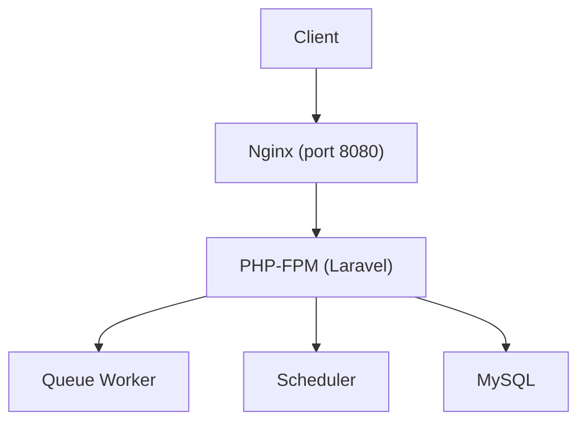
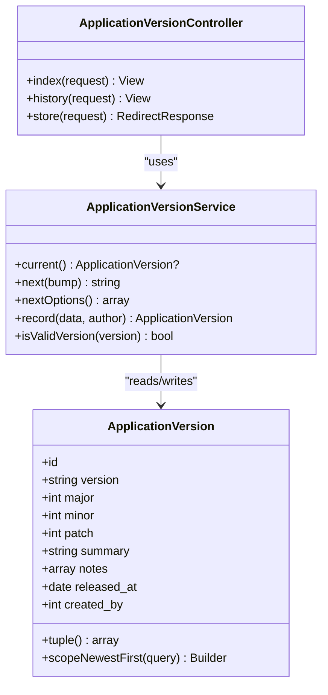
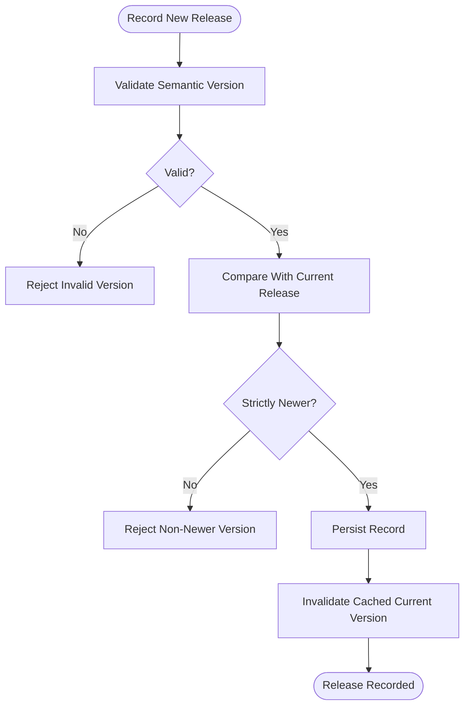
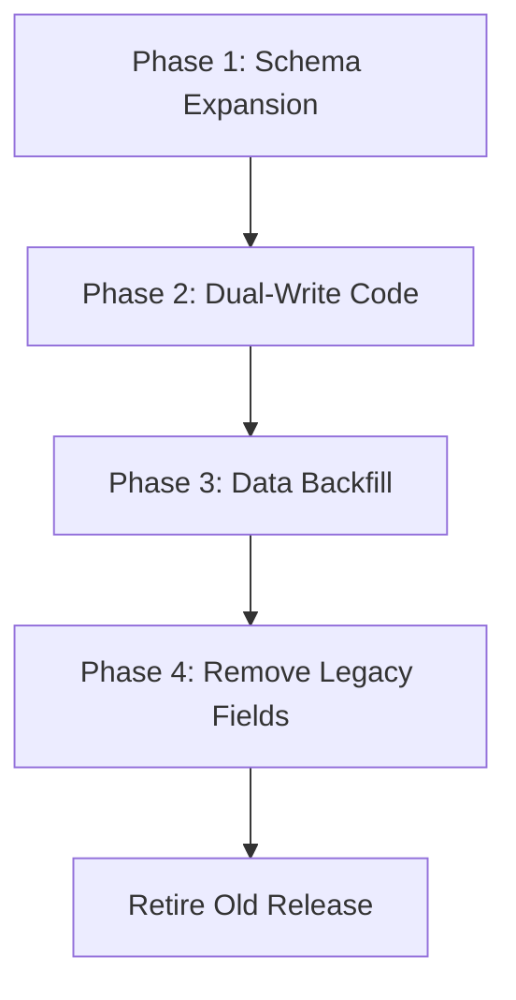
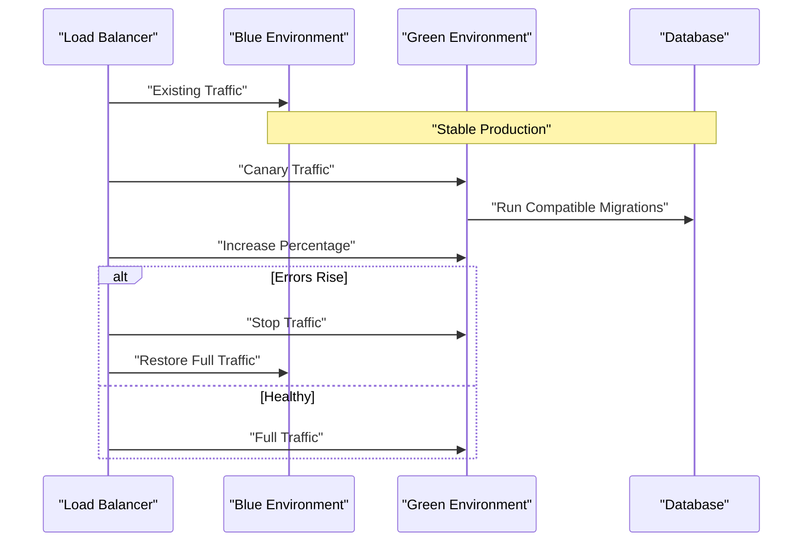
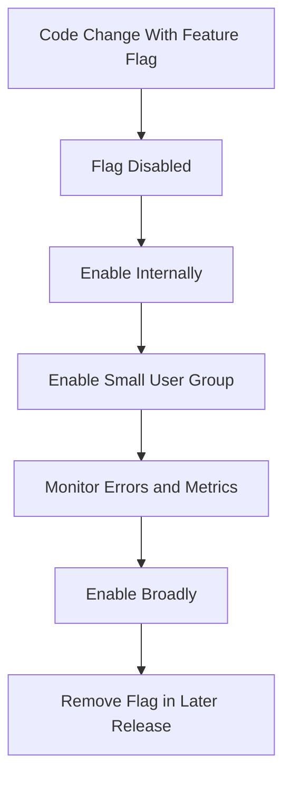
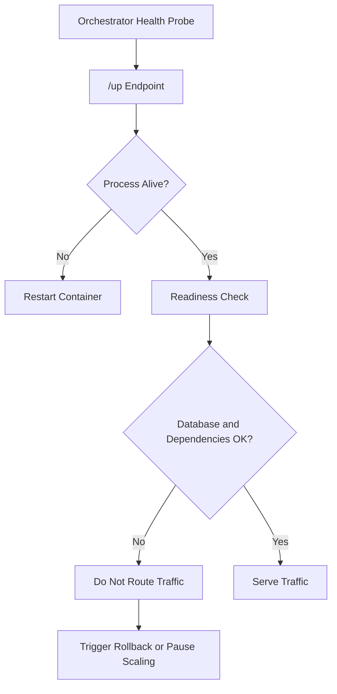
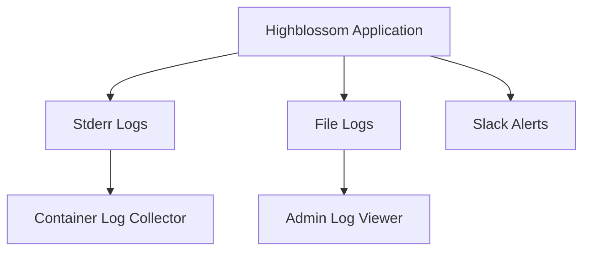
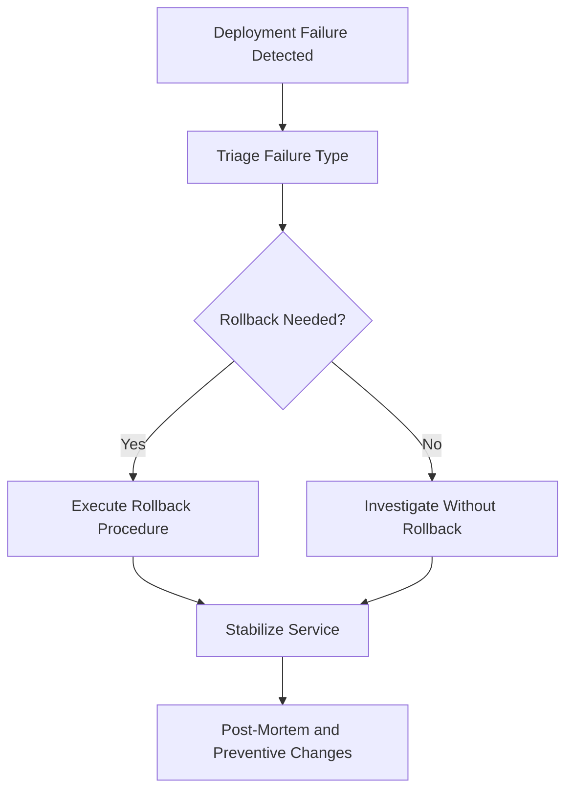

# Zero-Downtime Deployment Strategies

<cite>
**Referenced Files in This Document**
- [bootstrap/app.php](file://bootstrap/app.php)
- [Dockerfile](file://Dockerfile)
- [docker-compose.yml](file://docker-compose.yml)
- [docker/entrypoint.sh](file://docker/entrypoint.sh)
- [docker/supervisord.conf](file://docker/supervisord.conf)
- [composer.json](file://composer.json)
- [config/app.php](file://config/app.php)
- [config/logging.php](file://config/logging.php)
- [config/log-viewer.php](file://config/log-viewer.php)
- [routes/api.php](file://routes/api.php)
- [app/Models/ApplicationVersion.php](file://app/Models/ApplicationVersion.php)
- [app/Services/ApplicationVersionService.php](file://app/Services/ApplicationVersionService.php)
- [app/Http/Controllers/Admin/ApplicationVersionController.php](file://app/Http/Controllers/Admin/ApplicationVersionController.php)
- [database/migrations/2026_10_01_120000_create_application_versions_table.php](file://database/migrations/2026_10_01_120000_create_application_versions_table.php)
- [database/seeders/ApplicationVersionSeeder.php](file://database/seeders/ApplicationVersionSeeder.php)
- [app/Services/EnvEditor.php](file://app/Services/EnvEditor.php)
</cite>

## Table of Contents
1. [Introduction](#introduction)
2. [Deployment Environment](#deployment-environment)
3. [Application Versioning Model](#application-versioning-model)
4. [Zero-Downtime Database Migration Strategy](#zero-downtime-database-migration-strategy)
5. [Rollout Patterns: Blue-Green, Rolling Updates, and Canary Releases](#rollout-patterns-blue-green-rolling-updates-and-canary-releases)
6. [Feature Flags and Gradual Rollouts](#feature-flags-and-gradual-rollouts)
7. [Health Checks, Readiness Probes, and Automated Rollback Triggers](#health-checks-readiness-probes-and-automated-rollback-triggers)
8. [Monitoring Deployment Progress and Error Tracking](#monitoring-deployment-progress-and-error-tracking)
9. [Incident Response for Failed Deployments](#incident-response-for-failed-deployments)
10. [Operational Runbook Summary](#operational-runbook-summary)

## Introduction
This document defines the zero-downtime deployment strategy for the Highblossom application. It covers how to deploy safely without interrupting live users, how to evolve the database schema, how version releases are recorded, how feature flags enable gradual rollouts, which rollout patterns should be used, and how health checks, monitoring, and rollback procedures protect production.

The application is a Laravel 13 PHP service packaged as a single Docker image that runs Nginx, PHP-FPM, queue workers, and the scheduler under Supervisor. It exposes HTTP routes through Nginx on port 8080, uses MySQL in development via `docker-compose`, and supports both web and API clients. The repository already includes an application version registry, environment editing with safety constraints, structured logging, and an admin log viewer.

## Deployment Environment
Highblossom is containerized into one image containing:
- Nginx as the HTTP server.
- PHP-FPM running the Laravel application.
- A queue worker.
- The scheduled command runner.
- An entrypoint that optionally runs migrations before starting Supervisor.

**Diagram sources**
- [Dockerfile:1-32](file://Dockerfile#L1-L32)
- [docker/supervisord.conf:1-66](file://docker/supervisord.conf#L1-L66)
- [docker/entrypoint.sh:1-20](file://docker/entrypoint.sh#L1-L20)

Key deployment characteristics:
- The image exposes port 8080.
- Migrations can run automatically during container startup when `RUN_MIGRATIONS=true`.
- Web, queue, and scheduler processes are controlled by environment variables.
- Logs go to stderr or configured channels.
- Development compose configuration binds the app to port 8080 and depends on a MySQL service.

**Section sources**
- [Dockerfile:1-32](file://Dockerfile#L1-L32)
- [docker-compose.yml:1-31](file://docker-compose.yml#L1-L31)
- [docker/entrypoint.sh:1-20](file://docker/entrypoint.sh#L1-L20)
- [docker/supervisord.conf:1-66](file://docker/supervisord.conf#L1-L66)

## Application Versioning Model
Highblossom records releases as immutable semantic versions. The model stores major, minor, patch numbers, summary text, structured notes, release date, and creator. The service:
- Reads the current release from an append-only database table.
- Caches only the latest release primary key for one hour.
- Suggests next versions for major, minor, and patch bumps.
- Validates new versions against semantic version rules.
- Rejects versions that are not strictly newer than the current release.
- Clears the cache after recording a new release.

**Diagram sources**
- [app/Models/ApplicationVersion.php:1-56](file://app/Models/ApplicationVersion.php#L1-L56)
- [app/Services/ApplicationVersionService.php:1-157](file://app/Services/ApplicationVersionService.php#L1-L157)
- [app/Http/Controllers/Admin/ApplicationVersionController.php:1-87](file://app/Http/Controllers/Admin/ApplicationVersionController.php#L1-L87)

The version registry is backed by a migration that creates the `application_versions` table, indexes the semantic version tuple, grants a `manage versions` permission, and assigns it to Super Admin and Admin roles. The seeder seeds historical releases starting at baseline `1.2.0` and is idempotent.

**Diagram sources**
- [app/Services/ApplicationVersionService.php:69-122](file://app/Services/ApplicationVersionService.php#L69-L122)
- [database/migrations/2026_10_01_120000_create_application_versions_table.php:1-55](file://database/migrations/2026_10_01_120000_create_application_versions_table.php#L1-L55)
- [database/seeders/ApplicationVersionSeeder.php:1-140](file://database/seeders/ApplicationVersionSeeder.php#L1-L140)

For deployment, treat the application version as metadata rather than a runtime compatibility gate. Record a version when code and migrations are ready, but do not assume every deployed container reports it until the database migration has run successfully.

**Section sources**
- [app/Models/ApplicationVersion.php:1-56](file://app/Models/ApplicationVersion.php#L1-L56)
- [app/Services/ApplicationVersionService.php:1-157](file://app/Services/ApplicationVersionService.php#L1-L157)
- [app/Http/Controllers/Admin/ApplicationVersionController.php:1-87](file://app/Http/Controllers/Admin/ApplicationVersionController.php#L1-L87)
- [database/migrations/2026_10_01_120000_create_application_versions_table.php:1-55](file://database/migrations/2026_10_01_120000_create_application_versions_table.php#L1-L55)
- [database/seeders/ApplicationVersionSeeder.php:1-140](file://database/seeders/ApplicationVersionSeeder.php#L1-L140)

## Zero-Downtime Database Migration Strategy
Use forward-compatible schema changes first, then backward-compatible data transformations, and finally cleanup in later releases.

### Forward-Compatible Changes
Add nullable columns, new tables, and optional JSON fields before changing application logic to require them. Existing rows remain compatible because old code ignores new optional fields. Examples in this repository include nullable fields on bookings and inspections, new audit tables, session tracking, and additional user profile fields.

Recommended steps:
1. Add the new column or table with a safe default or nullability.
2. Add any required index separately if needed.
3. Deploy the code change so it writes to both old and new fields where applicable.
4. Keep the code able to read legacy fields while preferring new fields.

### Backward-Compatible Data Transformations
Run background jobs or Artisan commands to backfill data after both old and new code paths are deployed. Avoid long-running single transactions on large tables. Use chunked updates, job queues, and idempotent operations.

Examples from this repository demonstrate this pattern:
- Media path normalization.
- Admin sort-order normalization.
- Unique-index creation after data cleanup.
- Background work through queue workers managed by Supervisor.

### Safe Rollback Procedures
Database rollbacks must preserve older application versions. Follow these rules:
- Never drop a column or table that the previous release still reads.
- Keep dual-write fields during transition releases.
- Make destructive changes such as drops, renames, or NOT NULL conversions only after the older release is fully retired.
- If you must revert, test the rollback migration against the exact production schema snapshot.
- Prefer redeploying the old container image instead of trying to reverse complex state changes.

**Diagram sources**
- [database/migrations/2026_10_11_000000_normalise_persisted_media_paths.php](file://database/migrations/2026_10_11_000000_normalise_persisted_media_paths.php)
- [database/migrations/2026_10_19_000100_normalize_admin_sort_orders.php](file://database/migrations/2026_10_19_000100_normalize_admin_sort_orders.php)
- [database/migrations/2026_10_19_000200_add_sort_order_unique_indexes.php](file://database/migrations/2026_10_19_000200_add_sort_order_unique_indexes.php)
- [docker/supervisord.conf:33-45](file://docker/supervisord.conf#L33-L45)

Because the entrypoint retries migrations while the database starts, deployments can fail fast if the database is unavailable. For zero-downtime deployments, prefer running migrations explicitly in your orchestration layer before swapping traffic to the new container group.

**Section sources**
- [docker/entrypoint.sh:1-20](file://docker/entrypoint.sh#L1-L20)
- [docker/supervisord.conf:33-45](file://docker/supervisord.conf#L33-L45)

## Rollout Patterns: Blue-Green, Rolling Updates, and Canary Releases
Highblossom’s container design fits multiple rollout strategies. Choose the pattern based on risk tolerance, database compatibility, and operational maturity.

### Blue-Green Deployment
Deploy a complete blue environment and a complete green environment behind a load balancer or ingress controller. Switch traffic between them.

Best fit:
- Full-stack changes including database migrations.
- When you need instant rollback by switching traffic back.
- When testing the entire stack before going live.

Procedure:
1. Build the new image.
2. Deploy it to the inactive environment.
3. Run migrations against the active database using the new image.
4. Verify health and smoke tests.
5. Switch traffic to the new environment.
6. Monitor errors, latency, and business metrics.
7. Keep the old environment available for quick rollback.

### Rolling Update
Gradually replace instances with the new image while keeping some old instances serving traffic.

Best fit:
- Stateless application changes.
- Backward-compatible database changes.
- Environments with enough capacity to serve two versions temporarily.

Procedure:
1. Increase instance count temporarily if needed.
2. Replace instances one batch at a time.
3. Drain connections before stopping old instances.
4. Wait for readiness probes to pass.
5. Monitor error rates per instance version.
6. Roll back the newest batch if problems appear.

### Canary Release
Route a small percentage of traffic to the new version and increase gradually.

Best fit:
- High-risk features.
- Performance-sensitive endpoints.
- API clients such as the staff app.

Procedure:
1. Tag a subset of containers or route a small percentage of requests.
2. Compare error rates, latency, and queue backlog between versions.
3. Promote canary traffic slowly.
4. Roll back immediately if thresholds are breached.

**Diagram sources**
- [Dockerfile:1-32](file://Dockerfile#L1-L32)
- [docker/entrypoint.sh:1-20](file://docker/entrypoint.sh#L1-L20)
- [docker-compose.yml:1-31](file://docker-compose.yml#L1-L31)

## Feature Flags and Gradual Rollouts
The application supports feature flags through environment variables prefixed with `FEATURES_`. The environment editor exposes keys matching that prefix to administrators and validates key names. This allows enabling or disabling features without redeploying code, provided the code already checks those flags.

Recommended approach:
- Wrap risky UI or behavior in a feature flag check.
- Ship code with the flag disabled by default.
- Enable the flag for internal users first.
- Enable it for a small customer segment.
- Promote it broadly after monitoring confirms stability.
- Remove the flag in a future cleanup release.

Safety rules:
- Treat `FEATURES_*` values as configuration, not secrets.
- Do not expose secret environment variables through the settings UI.
- Log feature-flag decisions for auditability.
- Combine feature flags with version records so you know which release introduced each flag.

**Diagram sources**
- [app/Services/EnvEditor.php:1-200](file://app/Services/EnvEditor.php#L1-L200)
- [config/app.php:1-126](file://config/app.php#L1-L126)

## Health Checks, Readiness Probes, and Automated Rollback Triggers
Laravel registers a built-in health endpoint at `/up`. The bootstrap configuration declares the health route, so orchestrators can use it for liveness checks.

Important distinction:
- Liveness: Is the process alive and responding?
- Readiness: Can the process serve real requests successfully, including database connectivity and required configuration?

Recommended probe strategy:
- Use `/up` as the liveness probe.
- Implement a readiness probe that also verifies database connectivity, cache availability, and critical external dependencies.
- Fail readiness without killing the container so the orchestrator stops routing traffic to it.
- Avoid failing liveness for transient issues; restarting a broken process repeatedly makes outages worse.

Automated rollback triggers should monitor:
- HTTP error rate above a threshold.
- Latency percentile increases.
- Database connection failures.
- Queue job failure spikes.
- Business KPI drops such as booking or quote submission failures.
- Health or readiness probe failures sustained over a time window.

**Diagram sources**
- [bootstrap/app.php:1-71](file://bootstrap/app.php#L1-L71)

**Section sources**
- [bootstrap/app.php:1-71](file://bootstrap/app.php#L1-L71)

## Monitoring Deployment Progress and Error Tracking
Logs are configured through Monolog with multiple channels:
- Stack channel aggregates configured channels.
- Single file logging writes to `storage/logs/laravel.log`.
- Daily rotation is supported.
- Slack integration is available for critical logs.
- Stderr logging is useful for container environments.
- Papertrail and syslog handlers are available.

The application includes Opcodes Log Viewer, accessible under an admin route with authorization enabled in production. This helps operators review logs during rollouts.

Operational recommendations:
- Centralize container logs to stdout/stderr for collection by your platform.
- Route critical deployment errors to Slack or an alerting system.
- Track the application version associated with each request or log line.
- Correlate deployment events with error-rate spikes.
- Use the staff API and admin routes to verify functionality during rollout.
- Monitor queue worker restarts, job failures, and scheduler execution.

**Diagram sources**
- [config/logging.php:1-132](file://config/logging.php#L1-L132)
- [config/log-viewer.php:1-200](file://config/log-viewer.php#L1-L200)

**Section sources**
- [config/logging.php:1-132](file://config/logging.php#L1-L132)
- [config/log-viewer.php:1-200](file://config/log-viewer.php#L1-L200)

## Incident Response for Failed Deployments
Use a clear escalation path when a deployment fails.

### Immediate Actions
1. Stop rolling out new instances.
2. Preserve evidence: logs, metrics, deployment ID, image tag, and database migration status.
3. Determine whether the failure is:
   - Migration-related.
   - Application crash.
   - External dependency failure.
   - Configuration or feature-flag issue.
4. Decide between rollback, pause, or hotfix.

### Rollback Procedures
- Blue-green: switch traffic back to the previous environment.
- Rolling update: stop replacing remaining instances and drain the failed ones.
- Canary: remove canary traffic immediately.
- Database rollback: only if the migration is reversible and the old application version can still read the new schema.
- Version record: document the incident and any reverted release in the application version registry.

### Post-Incident Steps
- Identify root cause.
- Review logs around the deployment window.
- Check queue failures and scheduled job outcomes.
- Validate feature flags and environment configuration.
- Update runbooks and add safeguards if needed.
- Record lessons learned.

**Diagram sources**
- [app/Services/ApplicationVersionService.php:1-157](file://app/Services/ApplicationVersionService.php#L1-L157)
- [config/logging.php:1-132](file://config/logging.php#L1-L132)

## Operational Runbook Summary

### Pre-Deployment Checklist
- Confirm database migration is forward-compatible.
- Ensure old and new application versions can coexist.
- Freeze feature flags unless they are part of the rollout plan.
- Prepare rollback instructions for database, application, and configuration changes.
- Verify monitoring, alerts, and log access.

### Deployment Sequence
1. Build a tagged Docker image.
2. Run migrations in a controlled step.
3. Deploy the new image to the target environment.
4. Wait for readiness probes.
5. Route a small percentage of traffic if using canary.
6. Monitor errors, latency, queue health, and business metrics.
7. Promote or rollback based on observed behavior.
8. Record the release version if the deployment succeeds.

### Rollback Sequence
1. Stop routing traffic to the new version.
2. Restore previous traffic target.
3. Assess whether database state requires rollback.
4. Revert configuration or feature flags only if necessary.
5. Inspect logs and queue state.
6. Communicate status to stakeholders.
7. Schedule post-mortem and preventive improvements.

**Section sources**
- [composer.json:1-138](file://composer.json#L1-L138)
- [config/app.php:1-126](file://config/app.php#L1-L126)
- [routes/api.php:1-117](file://routes/api.php#L1-L117)
- [app/Services/EnvEditor.php:1-200](file://app/Services/EnvEditor.php#L1-L200)