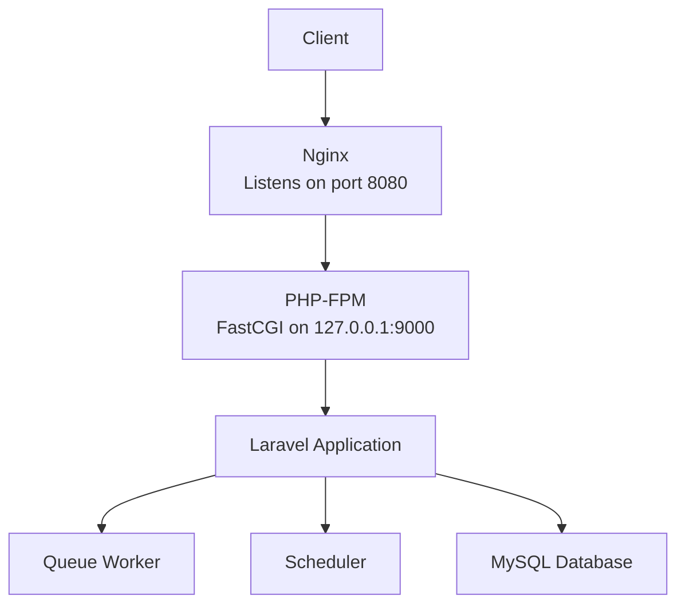
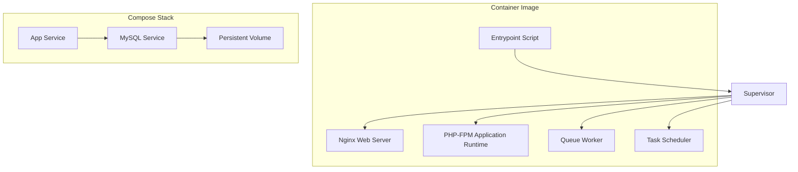
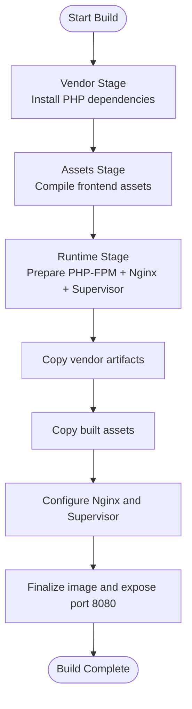
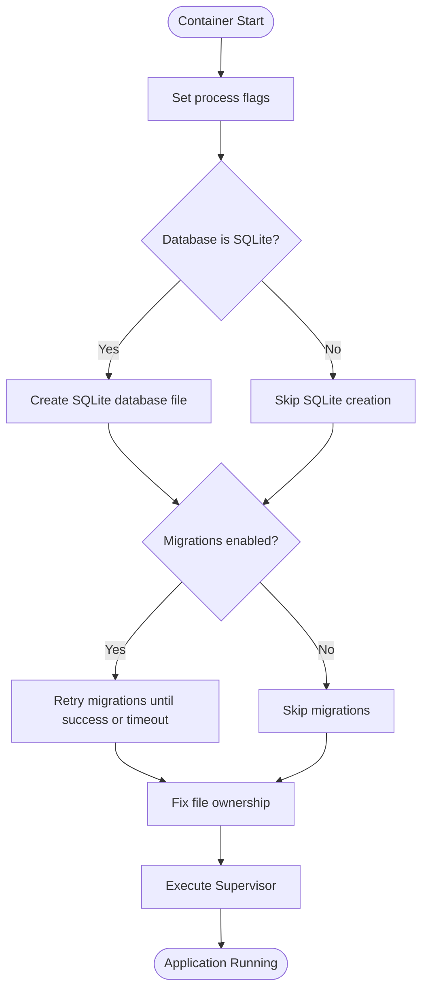
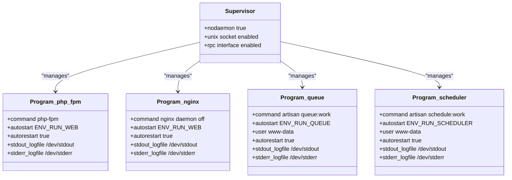
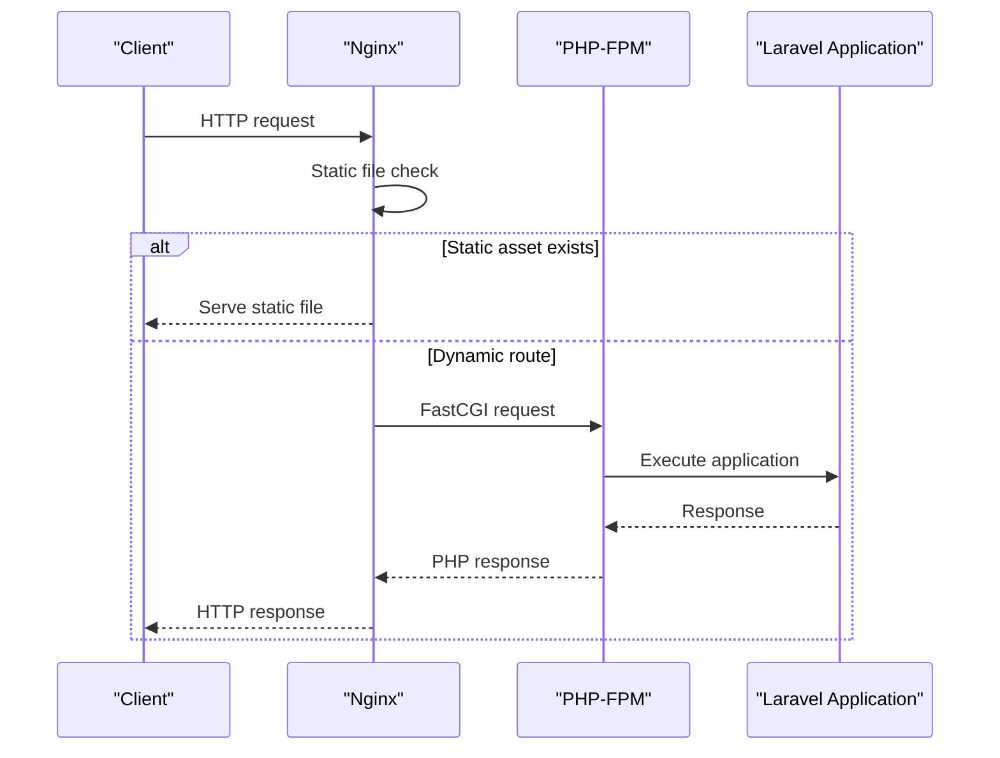
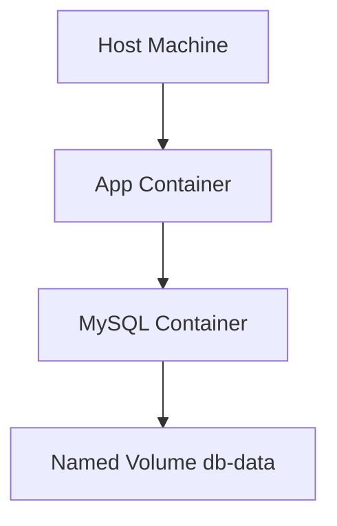
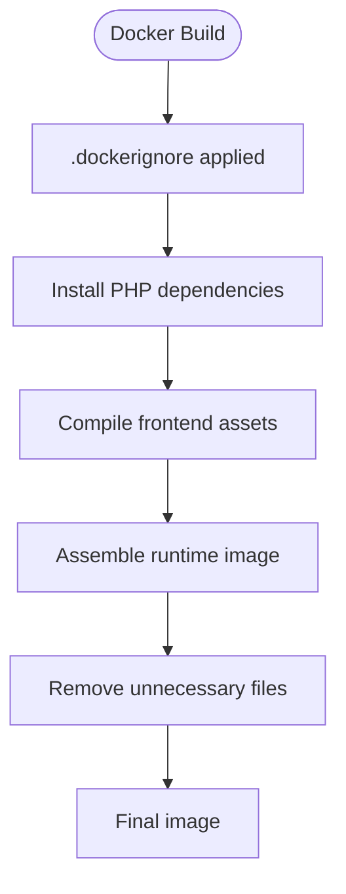
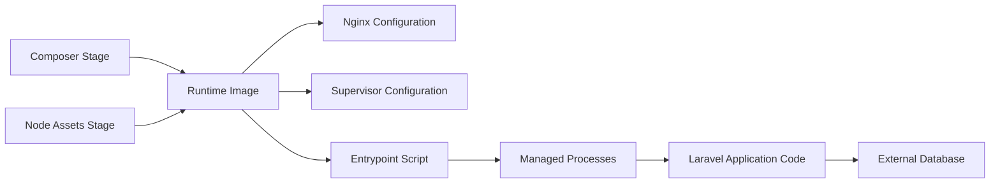

# Docker & Containerization

<cite>
**Referenced Files in This Document**   
- [Dockerfile](file://Dockerfile)
- [docker-compose.yml](file://docker-compose.yml)
- [.dockerignore](file://.dockerignore)
- [gitignore](file://.gitignore)
- [storage/framework/.gitignore](file://storage/framework/.gitignore)
- [docker/entrypoint.sh](file://docker/entrypoint.sh)
- [docker/nginx.conf](file://docker/nginx.conf)
- [docker/supervisord.conf](file://docker/supervisord.conf)
</cite>

## Update Summary
**Changes Made**   
- Updated the Data Persistence Strategies section to reflect centralized Livewire view cache management through root `.gitignore` and `storage/framework/.gitignore`
- Revised Development Versus Production Container Configuration to address containerized development behavior for Livewire view cache files
- Enhanced Build Optimization Strategies with specific guidance on Livewire view cache handling
- Added targeted troubleshooting information for Livewire view cache issues in containers

## Table of Contents
1. [Introduction](#introduction)
2. [Project Structure](#project-structure)
3. [Core Components](#core-components)
4. [Architecture Overview](#architecture-overview)
5. [Detailed Component Analysis](#detailed-component-analysis)
6. [Dependency Analysis](#dependency-analysis)
7. [Performance Considerations](#performance-considerations)
8. [Troubleshooting Guide](#troubleshooting-guide)
9. [Conclusion](#conclusion)
10. [Appendices](#appendices)

## Introduction
This document explains how the Highblossom application is containerized and orchestrated using Docker. It covers the multi-stage build, base images, build optimizations, Nginx reverse proxy configuration, PHP-FPM integration, Supervisor-based process management, docker-compose orchestration, networking, volumes, environment variables, development versus production behavior, debugging techniques, security best practices, deployment scenarios, and troubleshooting guidance.

The container image runs a single PHP-FPM application with Nginx as the web server, queue workers, and a Laravel scheduler under Supervisor. The compose stack includes an optional MySQL service for persistent data.

## Project Structure
The containerization artifacts are located at the repository root and under `docker/`:

| Path | Purpose |
|---|---|
| [Dockerfile](file://Dockerfile) | Multi-stage image definition for vendor dependencies, frontend assets, and the runtime image |
| [docker-compose.yml](file://docker-compose.yml) | Service definitions for the app and MySQL database |
| [.dockerignore](file://.dockerignore) | Files excluded from Docker builds to reduce image size and avoid leaking secrets |
| [docker/entrypoint.sh](file://docker/entrypoint.sh) | Container startup script that prepares the application and launches Supervisor |
| [docker/nginx.conf](file://docker/nginx.conf) | Nginx web server configuration for the Laravel public directory |
| [docker/supervisord.conf](file://docker/supervisord.conf) | Supervisor configuration managing PHP-FPM, Nginx, queue worker, and scheduler processes |

**Diagram sources**
- [docker/nginx.conf:1-20](file://docker/nginx.conf#L1-L20)
- [docker/supervisord.conf:1-66](file://docker/supervisord.conf#L1-L66)
- [docker-compose.yml:1-31](file://docker-compose.yml#L1-L31)

**Section sources**
- [Dockerfile:1-32](file://Dockerfile#L1-L32)
- [docker-compose.yml:1-31](file://docker-compose.yml#L1-L31)
- [.dockerignore:1-21](file://.dockerignore#L1-L21)
- [docker/entrypoint.sh:1-20](file://docker/entrypoint.sh#L1-L20)
- [docker/nginx.conf:1-20](file://docker/nginx.conf#L1-L20)
- [docker/supervisord.conf:1-66](file://docker/supervisord.conf#L1-L66)

## Core Components
This section summarizes the responsibilities of each containerization artifact.

- **Multi-stage Dockerfile**: Builds vendor dependencies using Composer, compiles frontend assets using Node, then creates a lean runtime image based on Alpine PHP FPM with Nginx and Supervisor installed.
- **Entrypoint script**: Initializes the application, optionally runs migrations with retries, fixes ownership for writable directories, and starts Supervisor.
- **Supervisor configuration**: Manages four long-running processes: PHP-FPM, Nginx, queue worker, and scheduler. Process startup can be toggled via environment variables.
- **Nginx configuration**: Serves static files from the Laravel public directory and proxies PHP requests to PHP-FPM over FastCGI.
- **docker-compose**: Defines the app service and a MySQL database service with environment-driven configuration and a named volume for persistence.
- **.dockerignore**: Excludes unnecessary or sensitive files during builds to improve performance and security.

**Section sources**
- [Dockerfile:1-32](file://Dockerfile#L1-L32)
- [docker/entrypoint.sh:1-20](file://docker/entrypoint.sh#L1-L20)
- [docker/supervisord.conf:1-66](file://docker/supervisord.conf#L1-L66)
- [docker/nginx.conf:1-20](file://docker/nginx.conf#L1-L20)
- [docker-compose.yml:1-31](file://docker-compose.yml#L1-L31)
- [.dockerignore:1-21](file://.dockerignore#L1-L21)

## Architecture Overview
The Highblossom container architecture follows a single-container process model managed by Supervisor, with optional external services such as MySQL.

**Diagram sources**
- [docker/entrypoint.sh:1-20](file://docker/entrypoint.sh#L1-L20)
- [docker/supervisord.conf:1-66](file://docker/supervisord.conf#L1-L66)
- [docker-compose.yml:1-31](file://docker-compose.yml#L1-L31)

### Build Flow
The Dockerfile defines three stages:

1. Vendor stage: Installs PHP dependencies without development packages.
2. Assets stage: Compiles frontend assets using Node.
3. Runtime stage: Starts from a minimal Alpine PHP FPM image, installs system packages and extensions, copies compiled assets and vendor code, configures Nginx and Supervisor, and exposes port 8080.

**Diagram sources**
- [Dockerfile:1-32](file://Dockerfile#L1-L32)

**Section sources**
- [Dockerfile:1-32](file://Dockerfile#L1-L32)

## Detailed Component Analysis

### Multi-Stage Dockerfile
The Dockerfile separates dependency installation, asset compilation, and runtime concerns into distinct stages.

- Base images:
  - `composer:2` for installing PHP dependencies.
  - `node:22-alpine` for building frontend assets.
  - `php:8.4-fpm-alpine` for the production runtime.
- Extensions installed include PDO drivers for MySQL and PostgreSQL, MySQLi, Bcmath, GD, Intl, Zip, OPcache, PCNTL, and EXIF.
- System packages added are Nginx and Supervisor.
- The entrypoint script and configuration files are copied into the runtime image.
- Writable directories are created and assigned to the `www-data` user.
- Port 8080 is exposed.

Optimization highlights:
- Dependency-only layer caching through separate `composer.json` and lock file copy before copying the full source tree.
- Frontend asset cache optimization through package manager install commands.
- Minimal Alpine base image reduces attack surface and image size.
- Production-oriented flags disable development dependencies and scripts.

**Section sources**
- [Dockerfile:1-32](file://Dockerfile#L1-L32)

### Entrypoint Script
The entrypoint script prepares the application before handing control to Supervisor.

Startup logic:
- Sets process enablement flags for web, queue, scheduler, and an additional Reverb flag.
- Creates an SQLite database file when SQLite is selected as the database connection.
- Optionally runs database migrations with retry logic until the database becomes reachable or a maximum attempt count is reached.
- Fixes ownership of storage, bootstrap cache, and database directories.
- Executes Supervisor with its configuration file.

**Diagram sources**
- [docker/entrypoint.sh:1-20](file://docker/entrypoint.sh#L1-L20)

Operational notes:
- Use environment variables to disable specific processes inside the same container.
- Migration retries protect against early container startup before the database service is ready.
- Ownership correction ensures writable paths for logs, sessions, views, and cache.

**Section sources**
- [docker/entrypoint.sh:1-20](file://docker/entrypoint.sh#L1-L20)

### Supervisor Configuration
Supervisor manages four processes within the container:

| Process | Command | Behavior |
|---|---|---|
| PHP-FPM | Runs PHP-FPM in foreground mode | Controlled by the web process flag |
| Nginx | Runs Nginx in foreground mode | Controlled by the web process flag |
| Queue | Runs Laravel queue worker with retries and time limits | Runs as `www-data` |
| Scheduler | Runs Laravel scheduler | Runs as `www-data` |

Key behaviors:
- All processes log to standard output and error streams for container logging.
- Auto-restart is enabled for resilience.
- Group stop settings ensure child processes are terminated together.
- Process enablement is controlled by environment variables injected by the entrypoint.

**Diagram sources**
- [docker/supervisord.conf:1-66](file://docker/supervisord.conf#L1-L66)

Process control options:
- Disable web processes by setting `RUN_WEB=false`.
- Disable queue processing by setting `RUN_QUEUE=false`.
- Disable scheduling by setting `RUN_SCHEDULER=false`.
- The additional `RUN_REVERB` variable is set by the entrypoint but not defined as a Supervisor program; it can be used by application logic if needed.

**Section sources**
- [docker/supervisord.conf:1-66](file://docker/supervisord.conf#L1-L66)

### Nginx Web Server Configuration
Nginx serves the Laravel application from the public directory.

Configuration highlights:
- Listens on port 8080.
- Uses `/var/www/html/public` as the document root.
- Enables PHP routing through FastCGI to PHP-FPM on `127.0.0.1:9000`.
- Applies a general request rewrite rule for Laravel-style routing.
- Limits upload body size to 64 MB.
- Denies access to hidden paths except well-known endpoints.

**Diagram sources**
- [docker/nginx.conf:1-20](file://docker/nginx.conf#L1-L20)

Security considerations:
- Hidden files and directories are denied by default.
- Only the public directory is exposed to Nginx.
- File path resolution uses real paths to prevent traversal issues.

**Section sources**
- [docker/nginx.conf:1-20](file://docker/nginx.conf#L1-L20)

### Docker Compose Orchestration
The compose file defines two services: the application and MySQL.

Service summary:

| Service | Image or Build | Ports | Environment | Volumes | Notes |
|---|---|---|---|---|---|
| app | Built from `.` | Maps host port `${APP_PORT:-8080}` to container port `8080` | Application and database connection variables | None defined | Depends on MySQL |
| db | `mysql:8.4` | Not published | MySQL credentials and database name | Named volume `db-data` | Persistent database storage |

Networking:
- Both services share a default Compose network.
- The app service connects to MySQL using the service name `db`.
- The database port is not exposed to the host, reducing exposure.

Environment variables:
- Application environment variables are provided directly in the compose file.
- Host-level `.env` values can override ports and keys through variable interpolation.
- Required variables include application key and database credentials.

Persistence:
- A named volume persists MySQL data across container restarts.
- Application storage directories are not mounted in this compose example; they remain ephemeral unless explicitly bound.

**Diagram sources**
- [docker-compose.yml:1-31](file://docker-compose.yml#L1-L31)

**Section sources**
- [docker-compose.yml:1-31](file://docker-compose.yml#L1-L31)

### Development Versus Production Container Configuration
The current configuration targets production behavior:

- Application environment is set to production.
- Debugging is disabled.
- Logging goes to standard error.
- Dependencies are installed without development packages.
- Frontend assets are prebuilt.

**Updated** Livewire view cache management has been centralized through the root `.gitignore` and `storage/framework/.gitignore`, eliminating the need for per-directory ignore rules under `storage/framework/views/livewire/`. This change simplifies containerized development setup and ensures consistent treatment of Livewire view cache files across all environments.

Development recommendations:
- Override `APP_ENV` and `APP_DEBUG` through a local `.env` or compose override file.
- Mount source code for live reload during development.
- Mount development caches separately.
- Publish development ports selectively.
- Enable verbose logging temporarily while diagnosing issues.
- Be aware that Livewire view cache files in `storage/framework/views/` are now governed by the root `.gitignore` and `storage/framework/.gitignore` rules rather than per-directory ignore files.

Production recommendations:
- Keep debug mode disabled.
- Use environment-specific secrets instead of hard-coded values.
- Avoid mounting source code into production containers.
- Use read-only root filesystem where possible.
- Restrict resource limits and capabilities.

**Section sources**
- [gitignore:1-78](file://.gitignore#L1-L78)
- [storage/framework/.gitignore:1-10](file://storage/framework/.gitignore#L1-L10)

### Container Networking Patterns
- Internal service-to-service communication uses Compose DNS names.
- The app container communicates with MySQL via the `db` hostname.
- Nginx communicates with PHP-FPM over loopback because both run in the same container.
- Only the required host-facing port is exposed.

Best practices:
- Do not publish internal service ports unless needed for debugging.
- Use explicit networks for isolation when running multiple stacks.
- Apply firewall rules at the host or platform level.

[No sources needed since this section provides general guidance]

### Data Persistence Strategies
Current persistence:
- MySQL data is persisted through a named volume.

**Updated** Livewire view cache files are now managed centrally through the root `.gitignore` and `storage/framework/.gitignore`, replacing the previous per-directory approach under `storage/framework/views/livewire/`. The `storage/framework/.gitignore` file specifically excludes the entire `framework/views` directory, which encompasses Livewire view cache files along with other compiled view templates.

Application data considerations:
- Uploaded media, cache, sessions, and logs reside inside the container filesystem by default.
- For stateless deployments, move uploads to object storage and configure Laravel accordingly.
- For shared cache or session backends, use Redis or another external service.
- When binding application storage directories to host volumes, ensure consistent permissions.
- Livewire view cache files in `storage/framework/views/` should be treated as ephemeral container artifacts that are regenerated as needed by the application.

**Section sources**
- [docker-compose.yml:1-31](file://docker-compose.yml#L1-L31)
- [storage/framework/.gitignore:1-10](file://storage/framework/.gitignore#L1-L10)

### Inter-Service Communication
- The app service depends on MySQL availability.
- The entrypoint retries migrations until the database is reachable or attempts exceed the configured limit.
- Connection details come from environment variables.

Operational advice:
- Monitor database readiness before scaling replicas.
- Use health checks at the orchestrator level for more robust startup ordering.
- Separate database migration execution from application rollout when deploying zero-downtime releases.

**Section sources**
- [docker/entrypoint.sh:1-20](file://docker/entrypoint.sh#L1-L20)
- [docker-compose.yml:1-31](file://docker-compose.yml#L1-L31)

### Build Optimization Strategies
The Dockerfile and ignore list optimize builds through:

- Layer separation:
  - Vendor installation in one stage.
  - Asset compilation in another stage.
  - Runtime image contains only what is needed.
- Cache-friendly ordering:
  - Package manifests are copied before full source trees.
- Dependency pruning:
  - No dev dependencies in production builds.
- Ignore rules:
  - Excludes `.git`, `node_modules`, `.env`, logs, IDE files, generated build outputs, and cached framework artifacts.

**Updated** Livewire view cache management is now handled through centralized `.gitignore` rules rather than per-directory ignore files, simplifying the build process and ensuring consistent behavior across development and production environments.

**Diagram sources**
- [Dockerfile:1-32](file://Dockerfile#L1-L32)
- [.dockerignore:1-21](file://.dockerignore#L1-L21)

**Section sources**
- [Dockerfile:1-32](file://Dockerfile#L1-L32)
- [.dockerignore:1-21](file://.dockerignore#L1-L21)
- [gitignore:1-78](file://.gitignore#L1-L78)
- [storage/framework/.gitignore:1-10](file://storage/framework/.gitignore#L1-L10)

### Security Best Practices
- Use minimal Alpine-based images.
- Run non-root processes where possible; Supervisor currently runs as root but delegates queue and scheduler processes to `www-data`.
- Deny access to hidden paths in Nginx.
- Avoid committing secrets; use environment variables or secret managers.
- Restrict container capabilities and resource limits at the platform level.
- Scan images for vulnerabilities.
- Prefer read-only filesystems for application code in production.
- Rotate database credentials regularly.

**Section sources**
- [docker/nginx.conf:1-20](file://docker/nginx.conf#L1-L20)
- [docker/supervisord.conf:1-66](file://docker/supervisord.conf#L1-L66)
- [.dockerignore:1-21](file://.dockerignore#L1-L21)

## Dependency Analysis
The container stack has clear boundaries between build-time and runtime dependencies.

**Diagram sources**
- [Dockerfile:1-32](file://Dockerfile#L1-L32)
- [docker/entrypoint.sh:1-20](file://docker/entrypoint.sh#L1-L20)
- [docker/nginx.conf:1-20](file://docker/nginx.conf#L1-L20)
- [docker/supervisord.conf:1-66](file://docker/supervisord.conf#L1-L66)

Coupling and cohesion:
- The entrypoint script coordinates application preparation and Supervisor lifecycle.
- Supervisor encapsulates all long-running processes, improving cohesion.
- Nginx configuration is isolated and only responsible for web serving and FastCGI forwarding.
- Compose configuration isolates infrastructure concerns from application logic.

Potential risks:
- Single-container design simplifies operations but increases process management complexity.
- Hard-coded database credentials in the compose file should be replaced with secrets management in production.
- Lack of explicit health checks means restart policies must rely on process exit codes rather than application readiness.

**Section sources**
- [Dockerfile:1-32](file://Dockerfile#L1-L32)
- [docker/entrypoint.sh:1-20](file://docker/entrypoint.sh#L1-L20)
- [docker/nginx.conf:1-20](file://docker/nginx.conf#L1-L20)
- [docker/supervisord.conf:1-66](file://docker/supervisord.conf#L1-L66)
- [docker-compose.yml:1-31](file://docker-compose.yml#L1-L31)

## Performance Considerations
- Use multi-stage builds to keep production images small.
- Prebuild frontend assets outside the runtime environment.
- Install only production dependencies.
- Enable OPcache through PHP extensions already installed in the runtime image.
- Tune PHP-FPM pool settings according to workload.
- Adjust Nginx client body size and worker processes based on expected traffic.
- Scale horizontally by running multiple app containers behind a load balancer.
- Offload queues and scheduling to dedicated workers when load increases.
- Use external cache and session backends for stateless scaling.

[No sources needed since this section provides general guidance]

## Troubleshooting Guide

### Common Issues and Resolutions

| Symptom | Likely Cause | Resolution |
|---|---|---|
| Container exits immediately after start | Supervisor or a managed process fails to start | Inspect container logs via standard output and error streams |
| Web requests return 502 or 504 | PHP-FPM not running or FastCGI misconfigured | Verify Nginx forwards to `127.0.0.1:9000` and PHP-FPM is enabled |
| PHP files are downloaded instead of executed | Nginx is not proxying PHP correctly | Confirm FastCGI pass directive and PHP location block |
| Migrations fail on startup | Database not ready | Allow entrypoint retries or add readiness checks |
| Permission denied writing logs or uploads | Incorrect file ownership | Ensure entrypoint ownership fix runs and `www-data` owns writable paths |
| Secrets missing at runtime | Environment variables not passed | Provide required variables through `.env` or orchestrator secrets |
| Frontend assets missing | Assets not built | Run asset build stage or mount built assets |
| Database connection refused | MySQL service not available | Check compose service status and network connectivity |
| Queue jobs not processed | Queue worker disabled or failed | Verify `RUN_QUEUE=true` and inspect queue worker logs |
| Scheduled tasks not running | Scheduler disabled | Verify `RUN_SCHEDULER=true` and inspect scheduler logs |
| Livewire components not rendering properly | View cache corruption or permission issues | Clear `storage/framework/views/` cache and verify `www-data` ownership |

**Updated** Added Livewire component rendering issue to address view cache problems that may occur due to the centralized cache management approach.

### Debugging Techniques
- View container logs:
  - Use the orchestrator's log viewer or stream stdout/stderr.
- Inspect running processes:
  - Use Supervisor's RPC interface or shell access to check process states.
- Test database connectivity:
  - Connect from the app container to the database service using the configured hostname and credentials.
- Validate Nginx routing:
  - Request a known route and confirm PHP-FPM receives the request.
- Temporary shell access:
  - Open a shell inside the running container to inspect configuration and logs.
- Livewire view cache debugging:
  - Check `storage/framework/views/` directory permissions and ownership.
  - Verify that view cache files are being generated correctly.
  - Clear view cache if components fail to render after deployment.

**Section sources**
- [docker/entrypoint.sh:1-20](file://docker/entrypoint.sh#L1-L20)
- [docker/nginx.conf:1-20](file://docker/nginx.conf#L1-L20)
- [docker/supervisord.conf:1-66](file://docker/supervisord.conf#L1-L66)

### Health Checks and Readiness
Recommended improvements:
- Add health checks for MySQL and application readiness.
- Fail fast when required environment variables are missing.
- Use orchestrator restart policies with backoff.
- Separate migration execution into a job or init container to decouple deployment from schema changes.

[No sources needed since this section provides general guidance]

## Conclusion
Highblossom's containerization centers around a single production-ready image that runs Nginx, PHP-FPM, a queue worker, and a scheduler under Supervisor. The compose stack adds MySQL with persistent storage. The design emphasizes simplicity, predictable process management, and clean separation between build-time and runtime concerns. Recent changes to Livewire view cache management through centralized `.gitignore` rules simplify containerized development while maintaining consistent behavior across environments. For production, replace hard-coded secrets, add health checks, externalize stateful data, and apply platform-level security controls.

[No sources needed since this section summarizes without analyzing specific files]

## Appendices

### Environment Variables Reference

| Variable | Scope | Description | Default or Example |
|---|---|---|---|
| `APP_PORT` | Host/compose | Host port mapped to container port 8080 | `8080` |
| `APP_ENV` | App container | Application environment | `production` |
| `APP_DEBUG` | App container | Enable or disable debug mode | `false` |
| `APP_KEY` | App container | Laravel application key | Required |
| `LOG_CHANNEL` | App container | Logging destination | `stderr` |
| `DB_CONNECTION` | App container | Database driver | `mysql` |
| `DB_HOST` | App container | Database hostname | `db` |
| `DB_PORT` | App container | Database port | `3306` |
| `DB_DATABASE` | App container | Database name | `app` |
| `DB_USERNAME` | App container | Database username | `app` |
| `DB_PASSWORD` | App container | Database password | `secret` |
| `MYSQL_DATABASE` | MySQL container | Initial database name | `app` |
| `MYSQL_USER` | MySQL container | Non-root database user | `app` |
| `MYSQL_PASSWORD` | MySQL container | Non-root database password | `secret` |
| `MYSQL_ROOT_PASSWORD` | MySQL container | Root database password | `secret` |
| `RUN_WEB` | App container | Enable web processes | `true` |
| `RUN_QUEUE` | App container | Enable queue worker | `true` |
| `RUN_SCHEDULER` | App container | Enable scheduler | `true` |
| `RUN_MIGRATIONS` | App container | Enable automatic migrations | `true` |

**Section sources**
- [docker-compose.yml:1-31](file://docker-compose.yml#L1-L31)
- [docker/entrypoint.sh:1-20](file://docker/entrypoint.sh#L1-L20)

### Deployment Scenarios

| Scenario | Recommended Changes |
|---|---|
| Local development | Override `APP_ENV=local`, `APP_DEBUG=true`, mount source code, and use local `.env` |
| Staging | Use staging database credentials, enable limited debugging, and run migrations in CI |
| Production | Remove debug mode, use secrets management, externalize uploads and cache, add health checks, and scale horizontally |
| Microservices split | Extract queue and scheduler into separate containers while keeping Nginx and PHP-FPM together or splitting further based on load |
| Kubernetes | Convert compose services to Deployments and Services, use ConfigMaps and Secrets, and add probes |

[No sources needed since this section provides general guidance]

### Livewire View Cache Management
**Updated** The repository has moved from per-directory `.gitignore` files under `storage/framework/views/livewire/` to centralized ignore rules. This affects containerized development in the following ways:

- **Centralized Control**: Livewire view cache files are now governed by the root `.gitignore` and `storage/framework/.gitignore` rules.
- **Simplified Setup**: Containerized development no longer requires special handling for Livewire view cache directories.
- **Consistent Behavior**: All environments treat Livewire view cache files uniformly, whether in development containers, production deployments, or CI/CD pipelines.
- **Cache Directory Structure**: The `storage/framework/views/` directory (excluding the `livewire` subdirectory from version control) contains compiled view templates including Livewire component views.

**Section sources**
- [gitignore:1-78](file://.gitignore#L1-L78)
- [storage/framework/.gitignore:1-10](file://storage/framework/.gitignore#L1-L10)