# Environment Configuration

<cite>
**Referenced Files in This Document**
- [.env.example](file://.env.example)
- [config/app.php](file://config/app.php)
- [config/database.php](file://config/database.php)
- [config/cache.php](file://config/cache.php)
- [config/queue.php](file://config/queue.php)
- [config/mail.php](file://config/mail.php)
- [config/filesystems.php](file://config/filesystems.php)
- [config/services.php](file://config/services.php)
- [config/session.php](file://config/session.php)
- [config/logging.php](file://config/logging.php)
- [config/passkeys.php](file://config/passkeys.php)
- [config/sanctum.php](file://config/sanctum.php)
- [docker-compose.yml](file://docker-compose.yml)
- [Dockerfile](file://Dockerfile)
- [docker/entrypoint.sh](file://docker/entrypoint.sh)
- [app/Services/EnvEditor.php](file://app/Services/EnvEditor.php)
- [app/Services/SmtpSettingService.php](file://app/Services/SmtpSettingService.php)
- [app/Models/CompanySetting.php](file://app/Models/CompanySetting.php)
</cite>

## Table of Contents
1. [Introduction](#introduction)
2. [Configuration Hierarchy and Loading Order](#configuration-hierarchy-and-loading-order)
3. [Environment Variables Reference](#environment-variables-reference)
4. [Deployment-Specific Configuration](#deployment-specific-configuration)
5. [Database Configuration](#database-configuration)
6. [Cache and Redis Configuration](#cache-and-redis-configuration)
7. [Queue Worker Configuration](#queue-worker-configuration)
8. [Email Service Configuration](#email-service-configuration)
9. [Storage Backend Configuration](#storage-backend-configuration)
10. [External Services and Third-Party Integrations](#external-services-and-third-party-integrations)
11. [Security and Secret Management](#security-and-secret-management)
12. [Runtime Settings and Operational Behavior](#runtime-settings-and-operational-behavior)
13. [Configuration Testing Strategy](#configuration-testing-strategy)
14. [Migration and Auditing Procedures](#migration-and-auditing-procedures)
15. [Troubleshooting Guide](#troubleshooting-guide)
16. [Conclusion](#conclusion)

## Introduction
This document describes the Highblossom application environment configuration model. It explains how `.env` variables, framework configuration files, Docker settings, and runtime services combine to control database connections, caching, queues, email delivery, storage backends, authentication behavior, logging, and third-party integrations. It also provides security guidance for secrets, deployment-stage recommendations, and procedures for testing, migrating, and auditing configuration changes.

The project is a Laravel application with Docker Compose and supervisord running web, queue, and scheduler processes. The authoritative example for environment variables is `.env.example`, while production container defaults are defined in `docker-compose.yml`.

**Section sources**
- [.env.example:1-83](file://.env.example#L1-L83)
- [docker-compose.yml:1-31](file://docker-compose.yml#L1-L31)
- [Dockerfile:1-32](file://Dockerfile#L1-L32)

## Configuration Hierarchy and Loading Order
Highblossom uses a layered configuration approach:

| Layer | Purpose | Example Source |
|---|---|---|
| Application defaults | Safe default values when no environment variable is set | `config/*.php` |
| `.env` file | Local or container environment overrides | `.env.example` |
| Process environment variables | Container orchestration and platform secrets | `docker-compose.yml` |
| Runtime services | Database, Redis, object storage, mail provider | External infrastructure |
| Persistent application settings | Non-secret operational preferences stored in the database | `app/Models/CompanySetting.php` |
| In-memory request memoization | Per-request setting cache to avoid repeated lookups | `app/Models/CompanySetting.php` |

The loading order is effectively:

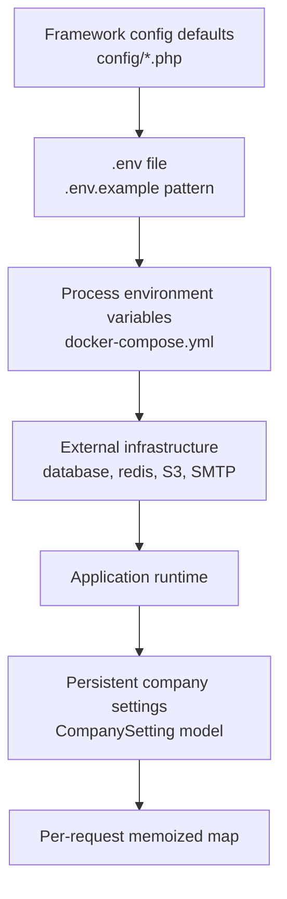

**Diagram sources**
- [config/app.php:1-126](file://config/app.php#L1-L126)
- [.env.example:1-83](file://.env.example#L1-L83)
- [docker-compose.yml:1-31](file://docker-compose.yml#L1-L31)
- [app/Models/CompanySetting.php:1-196](file://app/Models/CompanySetting.php#L1-L196)

Key rules:

- Framework configuration files read environment variables using `env()` with safe defaults.
- `.env.example` documents the complete expected variable surface.
- `docker-compose.yml` supplies required production-style defaults for local container development.
- Secrets such as `APP_KEY` must be supplied by the deployment system; the compose file requires it explicitly.
- Some settings can be changed at runtime through the admin-facing SMTP editor, but sensitive keys are intentionally restricted from general UI editing.

**Section sources**
- [config/app.php:1-126](file://config/app.php#L1-L126)
- [.env.example:1-83](file://.env.example#L1-L83)
- [docker-compose.yml:1-31](file://docker-compose.yml#L1-L31)
- [app/Services/EnvEditor.php:1-231](file://app/Services/EnvEditor.php#L1-L231)
- [app/Models/CompanySetting.php:1-196](file://app/Models/CompanySetting.php#L1-L196)

## Environment Variables Reference

### Application Core
| Variable | Required | Default | Meaning |
|---|---:|---|---|
| `APP_NAME` | No | `Laravel` | Application name used in emails, UI labels, and logs. |
| `APP_ENV` | No | `production` | Environment label consumed by the application. |
| `APP_KEY` | Yes | None | Encryption key for encrypted cookies, sessions, and framework encryption. Must be generated before first use. |
| `APP_DEBUG` | No | `false` | Enables detailed error output; should remain disabled in production. |
| `APP_URL` | No | `http://localhost` | Root URL used for generating links and host-based features. |
| `APP_TIMEZONE` | No | `UTC` | Application timezone. |
| `APP_LOCALE` | No | `en` | Default application locale. |
| `APP_FALLBACK_LOCALE` | No | `en` | Fallback locale when a translation string is missing. |
| `APP_FAKER_LOCALE` | No | `en_US` | Locale used by Faker during seeding and test data generation. |
| `APP_MAINTENANCE_DRIVER` | No | `file` | Maintenance mode driver. |
| `APP_MAINTENANCE_STORE` | No | `database` | Maintenance mode store when using the cache-backed driver. |
| `BCRYPT_ROUNDS` | No | `12` | Bcrypt cost factor for password hashing. |
| `VITE_APP_NAME` | No | `${APP_NAME}` | Frontend build-time application name. |

**Section sources**
- [.env.example:1-83](file://.env.example#L1-L83)
- [config/app.php:1-126](file://config/app.php#L1-L126)
- [config/passkeys.php:1-117](file://config/passkeys.php#L1-L117)

### Logging
| Variable | Required | Default | Meaning |
|---|---|---|---|
| `LOG_CHANNEL` | No | `stack` | Default Monolog channel. |
| `LOG_STACK` | No | `single` | Comma-separated channels included in the stack. |
| `LOG_LEVEL` | No | `debug` | Minimum log level written. |
| `LOG_DEPRECATIONS_CHANNEL` | No | `null` | Channel for deprecation warnings. |
| `LOG_DAILY_DAYS` | No | `14` | Retention days for daily log rotation. |
| `SLACK_WEBHOOK_URL` | Optional | None | Slack webhook URL when using the Slack log channel. |
| `LOG_SLACK_USERNAME` | No | `Laravel` | Username shown in Slack notifications. |
| `LOG_SLACK_EMOJI` | No | `:boom:` | Emoji shown in Slack log notifications. |
| `LOG_SLACK_LEVEL` | No | `critical` | Minimum level sent to Slack. |
| `PAPERTRAIL_URL` | Optional | None | Papertrail endpoint URL. |
| `PAPERTRAIL_PORT` | Optional | None | Papertrail endpoint port. |
| `LOG_STDERR_FORMATTER` | Optional | None | Custom formatter for stderr logging. |
| `LOG_SYSLOG_FACILITY` | No | System default | Syslog facility. |

**Section sources**
- [.env.example:1-83](file://.env.example#L1-L83)
- [config/logging.php:1-132](file://config/logging.php#L1-L132)

### Database
| Variable | Required | Default | Meaning |
|---|---|---|---|
| `DB_CONNECTION` | No | `mysql` | Active database connection. |
| `DB_URL` | Optional | None | Unified database URL alternative to individual fields. |
| `DB_HOST` | No | `127.0.0.1` | Database server hostname. |
| `DB_PORT` | No | Driver-specific | Database server port. |
| `DB_DATABASE` | No | `laravel` | Database name. |
| `DB_USERNAME` | No | `root` | Database username. |
| `DB_PASSWORD` | No | Empty | Database password. |
| `DB_SOCKET` | No | Empty | Unix socket path for MySQL/MariaDB. |
| `DB_CHARSET` | No | `utf8mb4` | Connection charset. |
| `DB_COLLATION` | No | `utf8mb4_unicode_ci` | Connection collation. |
| `DB_FOREIGN_KEYS` | No | `true` | Enable foreign key constraints for SQLite. |
| `DB_SSLMODE` | No | `prefer` | PostgreSQL SSL mode. |
| `MYSQL_ATTR_SSL_CA` | Optional | None | MySQL/MariaDB SSL CA certificate path. |

Connection-specific notes:

- SQLite uses an in-process database file unless `DB_URL` is provided.
- MySQL and MariaDB share similar configuration options and support optional SSL CA configuration.
- PostgreSQL uses `DB_SSLMODE` rather than the MySQL SSL CA option.
- SQL Server configuration is present but commented out.

**Section sources**
- [.env.example:1-83](file://.env.example#L1-L83)
- [config/database.php:1-184](file://config/database.php#L1-L184)

### Session
| Variable | Required | Default | Meaning |
|---|---|---|---|
| `SESSION_DRIVER` | No | `database` | Session storage backend. |
| `SESSION_LIFETIME` | No | `120` | Session lifetime in minutes. |
| `SESSION_ENCRYPT` | No | `false` | Encrypt session cookie payload. |
| `SESSION_PATH` | No | `/` | Cookie path. |
| `SESSION_DOMAIN` | No | `null` | Cookie domain. |
| `SESSION_SECURE_COOKIE` | No | `true` | Require HTTPS for session cookies. |
| `SESSION_HTTP_ONLY` | No | `true` | Disable JavaScript access to session cookie. |
| `SESSION_TABLE` | No | `sessions` | Database table for database session driver. |
| `SESSION_CONNECTION` | Optional | None | Dedicated database connection for sessions. |
| `SESSION_STORE` | Optional | None | Cache store used by cache-driven sessions. |

Important security note: the `.env.example` comment warns that absent secure cookie flags may leave cookies unflagged on HTTPS hosts. Production deployments should ensure `SESSION_SECURE_COOKIE` is enabled.

**Section sources**
- [.env.example:1-83](file://.env.example#L1-L83)
- [config/session.php:1-233](file://config/session.php#L1-L233)

### Filesystem Storage
| Variable | Required | Default | Meaning |
|---|---|---|---|
| `FILESYSTEM_DISK` | No | `local` | Default filesystem disk. |
| `PUBLIC_DISK_DRIVER` | No | `local` | Switches the public disk between local and S3-compatible storage. |
| `AWS_ACCESS_KEY_ID` | Conditional | None | Object storage access key. Required when using S3 or related drivers. |
| `AWS_SECRET_ACCESS_KEY` | Conditional | None | Object storage secret key. |
| `AWS_DEFAULT_REGION` | No | `auto` | Region for S3-compatible storage. |
| `AWS_BUCKET` | Conditional | None | Bucket name for public uploads. |
| `AWS_ENDPOINT` | Optional | None | Custom S3-compatible endpoint URL. |
| `AWS_URL` | Optional | None | Public bucket base URL. |
| `AWS_USE_PATH_STYLE_ENDPOINT` | No | `false` | Use path-style bucket URLs. |

The public disk is intentionally driver-switchable. Development typically uses `local`; production should use `s3` so uploaded media survives instance restarts.

**Section sources**
- [.env.example:1-83](file://.env.example#L1-L83)
- [config/filesystems.php:1-109](file://config/filesystems.php#L1-L109)

### Cache
| Variable | Required | Default | Meaning |
|---|---|---|---|
| `CACHE_STORE` | No | `database` | Default cache store. |
| `CACHE_PREFIX` | No | Derived from app name | Prefix used to avoid cache collisions across applications. |
| `DB_CACHE_CONNECTION` | Optional | None | Dedicated connection for database cache store. |
| `DB_CACHE_TABLE` | No | `cache` | Cache table name. |
| `DB_CACHE_LOCK_CONNECTION` | Optional | None | Lock connection for database cache. |
| `DB_CACHE_LOCK_TABLE` | Optional | None | Lock table for database cache. |
| `MEMCACHED_HOST` | No | `127.0.0.1` | Memcached server host. |
| `MEMCACHED_PORT` | No | `11211` | Memcached server port. |
| `MEMCACHED_PERSISTENT_ID` | Optional | None | Memcached persistent connection ID. |
| `MEMCACHED_USERNAME` | Optional | None | SASL username for Memcached. |
| `MEMCACHED_PASSWORD` | Optional | None | SASL password for Memcached. |
| `REDIS_CACHE_CONNECTION` | No | `cache` | Redis connection used by cache store. |
| `REDIS_CACHE_LOCK_CONNECTION` | No | `default` | Redis lock connection used by cache store. |
| `DYNAMODB_CACHE_TABLE` | Optional | `cache` | DynamoDB cache table. |
| `DYNAMODB_ENDPOINT` | Optional | None | DynamoDB custom endpoint. |

Serializable classes are explicitly whitelisted to reduce gadget-chain risks if the application key is compromised.

**Section sources**
- [.env.example:1-83](file://.env.example#L1-L83)
- [config/cache.php:1-146](file://config/cache.php#L1-L146)

### Queue
| Variable | Required | Default | Meaning |
|---|---|---|---|
| `QUEUE_CONNECTION` | No | `database` | Default queue backend. |
| `DB_QUEUE_CONNECTION` | Optional | None | Dedicated connection for queue jobs. |
| `DB_QUEUE_TABLE` | No | `jobs` | Jobs table name. |
| `DB_QUEUE` | No | `default` | Default queue name for database driver. |
| `DB_QUEUE_RETRY_AFTER` | No | `90` | Job retry timeout for database queue. |
| `BEANSTALKD_QUEUE_HOST` | Optional | `localhost` | Beanstalkd host. |
| `BEANSTALKD_QUEUE` | No | `default` | Beanstalkd queue name. |
| `BEANSTALKD_QUEUE_RETRY_AFTER` | No | `90` | Beanstalkd job retry timeout. |
| `SQS_PREFIX` | Optional | AWS SQS default prefix | SQS queue URL prefix. |
| `SQS_QUEUE` | No | `default` | SQS queue name. |
| `SQS_SUFFIX` | Optional | None | SQS queue suffix. |
| `REDIS_QUEUE_CONNECTION` | No | `default` | Redis connection for queue. |
| `REDIS_QUEUE` | No | `default` | Redis queue name. |
| `REDIS_QUEUE_RETRY_AFTER` | No | `90` | Redis job retry timeout. |
| `QUEUE_FAILED_DRIVER` | No | `database-uuids` | Failed job storage driver. |

**Section sources**
- [.env.example:1-83](file://.env.example#L1-L83)
- [config/queue.php:1-128](file://config/queue.php#L1-L128)

### Mail
| Variable | Required | Default | Meaning |
|---|---|---|---|
| `MAIL_MAILER` | No | `log` | Default mailer transport. |
| `MAIL_SCHEME` | Optional | None | SMTP scheme. |
| `MAIL_URL` | Optional | None | Complete SMTP URL alternative. |
| `MAIL_HOST` | No | `127.0.0.1` | SMTP host. |
| `MAIL_PORT` | No | `2525` | SMTP port. |
| `MAIL_USERNAME` | Optional | None | SMTP username. |
| `MAIL_PASSWORD` | Optional | None | SMTP password. |
| `MAIL_FROM_ADDRESS` | No | `hello@example.com` | Global sender address. |
| `MAIL_FROM_NAME` | No | App name | Global sender name. |
| `MAIL_REPLY_TO` | Optional | `example@example.com` | Global reply-to address. |
| `MAIL_LOG_CHANNEL` | Optional | None | Log channel used by the log mailer. |

SMTP settings can also be edited at runtime through `SmtpSettingService`, which writes selected `MAIL_*` variables into `.env` and clears the configuration cache.

**Section sources**
- [.env.example:1-83](file://.env.example#L1-L83)
- [config/mail.php:1-123](file://config/mail.php#L1-L123)
- [app/Services/SmtpSettingService.php:1-85](file://app/Services/SmtpSettingService.php#L1-L85)

### Redis
| Variable | Required | Default | Meaning |
|---|---|---|---|
| `REDIS_CLIENT` | No | `phpredis` | Redis client library. |
| `REDIS_URL` | Optional | None | Unified Redis URL. |
| `REDIS_HOST` | No | `127.0.0.1` | Redis host. |
| `REDIS_USERNAME` | Optional | None | Redis username. |
| `REDIS_PASSWORD` | No | `null` | Redis password. |
| `REDIS_PORT` | No | `6379` | Redis port. |
| `REDIS_DB` | No | `0` | Default Redis database index. |
| `REDIS_CACHE_DB` | No | `1` | Redis database index for cache. |
| `REDIS_CLUSTER` | No | `redis` | Redis cluster mode. |
| `REDIS_PREFIX` | No | Derived from app name | Redis key prefix. |
| `REDIS_PERSISTENT` | No | `false` | Enable persistent connections. |
| `REDIS_MAX_RETRIES` | No | `3` | Redis retry count. |
| `REDIS_BACKOFF_ALGORITHM` | No | `decorrelated_jitter` | Backoff algorithm for retries. |
| `REDIS_BACKOFF_BASE` | No | `100` | Base backoff delay. |
| `REDIS_BACKOFF_CAP` | No | `1000` | Maximum backoff delay. |

Redis is used by both the database configuration layer and cache/queue layers. Separate logical databases (`REDIS_DB` and `REDIS_CACHE_DB`) help isolate concerns.

**Section sources**
- [.env.example:1-83](file://.env.example#L1-L83)
- [config/database.php:1-184](file://config/database.php#L1-L184)

### Authentication and API Tokens
| Variable | Required | Default | Meaning |
|---|---|---|---|
| `SANCTUM_STATEFUL_DOMAINS` | No | Local development domains plus current application URL | Domains allowed to receive stateful Sanctum cookies. |
| `SANCTUM_TOKEN_PREFIX` | No | Empty | Prefix applied to new personal access tokens. |
| `PASSKEYS_USER_HANDLE_SECRET` | No | Falls back to `APP_KEY` | Secret used to derive stable WebAuthn user handles. |

Passkeys rely on `APP_URL` for relying party identity and origin validation.

**Section sources**
- [.env.example:1-83](file://.env.example#L1-L83)
- [config/sanctum.php:1-87](file://config/sanctum.php#L1-L87)
- [config/passkeys.php:1-117](file://config/passkeys.php#L1-L117)

### External Services
| Variable | Required | Default | Meaning |
|---|---|---|---|
| `POSTMARK_API_KEY` | Optional | None | Postmark API key. |
| `RESEND_API_KEY` | Optional | None | Resend API key. |
| `SLACK_BOT_USER_OAUTH_TOKEN` | Optional | None | Slack bot OAuth token. |
| `SLACK_BOT_USER_DEFAULT_CHANNEL` | Optional | None | Default Slack notification channel. |

These are loaded through `config/services.php` and are not directly referenced by every feature.

**Section sources**
- [.env.example:1-83](file://.env.example#L1-L83)
- [config/services.php:1-38](file://config/services.php#L1-L38)

## Deployment-Specific Configuration

### Development
Recommended development characteristics:

- Use SQLite or a local MySQL/MariaDB container.
- Keep `APP_DEBUG=true` for developer feedback.
- Use `QUEUE_CONNECTION=database` or `sync` during simple local work.
- Use `CACHE_STORE=database` or `array` for fast local iteration.
- Use `MAIL_MAILER=log` until SMTP credentials are ready.
- Use `PUBLIC_DISK_DRIVER=local`.
- Use `SESSION_DRIVER=database`.

Development convenience is prioritized over distributed performance.

### Staging
Staging should mirror production as closely as possible:

- Use a managed relational database.
- Use Redis for cache, sessions, and queues.
- Set `PUBLIC_DISK_DRIVER=s3` to simulate persistent cloud storage.
- Configure real SMTP or transactional email provider credentials.
- Set `APP_ENV=staging` (or another explicit non-local value).
- Disable debug mode.
- Use structured logging and external log aggregation where available.
- Validate rate limiting, session security, and CSRF behavior under realistic traffic.

### Production
Production requirements:

- Generate and protect `APP_KEY`.
- Never commit secrets to version control.
- Set `APP_DEBUG=false`.
- Use a managed database with strong credentials.
- Use Redis or another performant cache and session backend.
- Use a queue worker process separate from the web process.
- Use S3-compatible storage for the public disk.
- Enable secure session cookies and restrict `SESSION_DOMAIN` appropriately.
- Restrict `SANCTUM_STATEFUL_DOMAINS` to trusted front-end origins.
- Limit `APP_URL` to the public HTTPS root.
- Rotate previous keys using `APP_PREVIOUS_KEYS` when rotating `APP_KEY`.
- Use failover mailers only after validating provider availability.

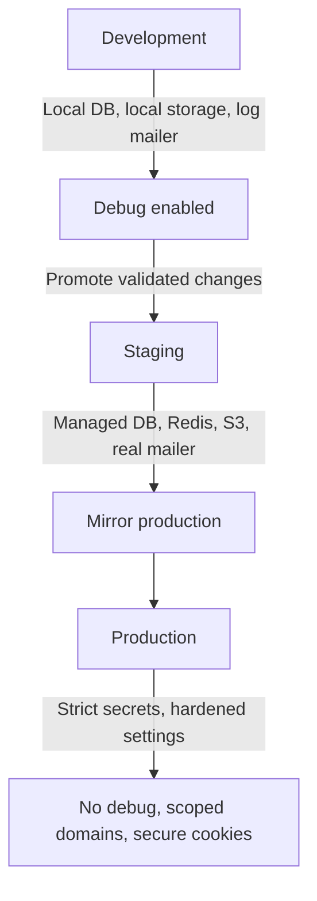

[No sources needed since this diagram shows conceptual deployment strategy]

**Section sources**
- [.env.example:1-83](file://.env.example#L1-L83)
- [config/session.php:1-233](file://config/session.php#L1-L233)
- [config/sanctum.php:1-87](file://config/sanctum.php#L1-L87)
- [config/filesystems.php:1-109](file://config/filesystems.php#L1-L109)

## Database Configuration

### Supported Drivers
The application supports:

- SQLite
- MySQL
- MariaDB
- PostgreSQL
- SQL Server (present in configuration but not actively configured by default)

### Connection Selection
`DB_CONNECTION` selects the active driver. Each connection reads its own host, port, database, credentials, charset, collation, and optional SSL settings.

### Migration Behavior
The Docker entrypoint attempts migrations automatically when `RUN_MIGRATIONS=true`, retrying up to 20 times while waiting for the database service. This makes single-container development convenient but means migrations are part of startup behavior.

### Recommended Practices
- Prefer `DB_URL` for centralized connection strings when supported by your deployment platform.
- Separate connection credentials per environment through process environment variables, not shared `.env` files.
- Keep `DB_FOREIGN_KEYS=true` for SQLite to preserve referential integrity.
- Use dedicated connections for cache, sessions, and queues when scaling horizontally.
- Test migrations against the same database version used in staging and production.

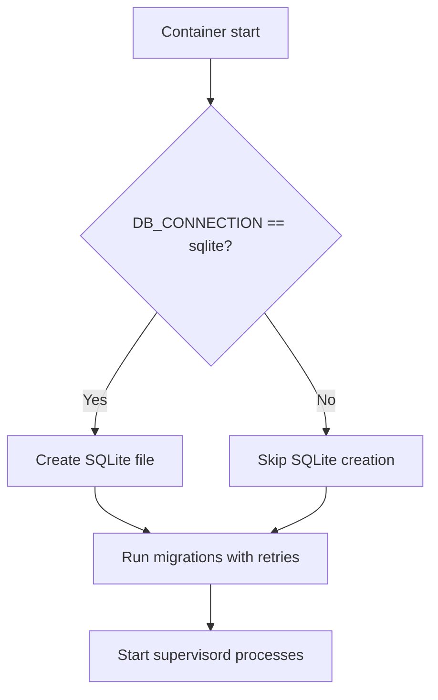

**Diagram sources**
- [docker/entrypoint.sh:1-20](file://docker/entrypoint.sh#L1-L20)
- [config/database.php:1-184](file://config/database.php#L1-L184)

**Section sources**
- [config/database.php:1-184](file://config/database.php#L1-L184)
- [docker/entrypoint.sh:1-20](file://docker/entrypoint.sh#L1-L20)

## Cache and Redis Configuration

### Cache Stores
Available stores include array, database, file, memcached, redis, dynamodb, octane, failover, and null. The default is `database`.

### Redis Roles
Redis is configured in two places:

1. Database layer: default and cache Redis connections.
2. Cache layer: `REDIS_CACHE_CONNECTION` and `REDIS_CACHE_LOCK_CONNECTION`.

When using Redis for cache and sessions, ensure the selected connections exist in `config/database.php` or the relevant Redis consumer.

### Serializable Classes
Only explicitly listed classes are deserialized from cache. This reduces the risk of arbitrary PHP object instantiation if the application key is exposed.

### Failover Cache
A failover store is defined with `database` and `array` as fallbacks. Be careful when enabling it in production because `array` is process-scoped and does not survive process restarts.

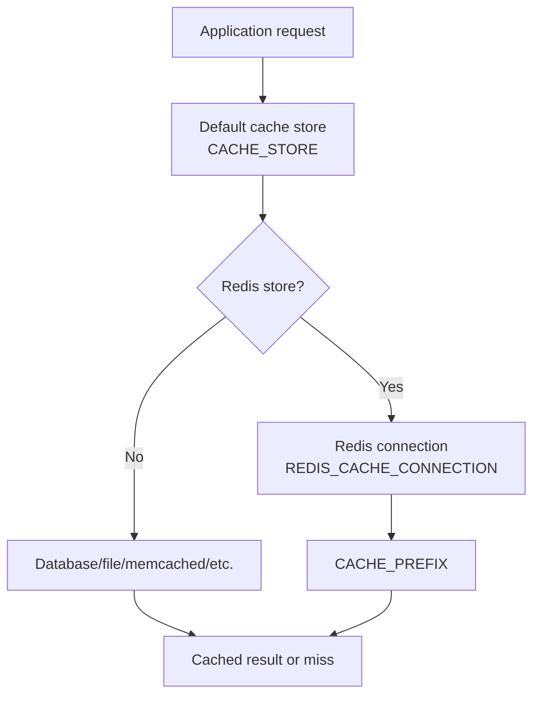

**Diagram sources**
- [config/cache.php:1-146](file://config/cache.php#L1-L146)
- [config/database.php:1-184](file://config/database.php#L1-L184)

**Section sources**
- [config/cache.php:1-146](file://config/cache.php#L1-L146)
- [config/database.php:1-184](file://config/database.php#L1-L184)

## Queue Worker Configuration

### Backend Options
Supported queue backends include sync, database, beanstalkd, SQS, redis, deferred, background, and failover. The default is `database`.

### Worker Processes
The Docker image runs supervisord, and the compose file comments indicate that the app container runs queue and scheduler tasks. The entrypoint prepares the environment and starts supervisord.

### Scaling Considerations
- Use Redis or SQS for multi-worker environments.
- Ensure `retry_after` matches the longest expected job duration.
- Monitor failed jobs using `QUEUE_FAILED_DRIVER`.
- Keep queue tables created by migrations before starting workers.
- Separate web and queue processes in production for better resource isolation.

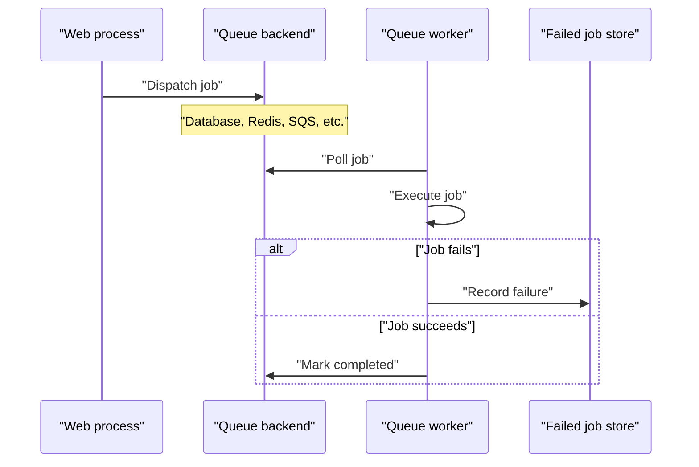

**Diagram sources**
- [config/queue.php:1-128](file://config/queue.php#L1-L128)
- [docker-compose.yml:1-31](file://docker-compose.yml#L1-L31)
- [docker/entrypoint.sh:1-20](file://docker/entrypoint.sh#L1-L20)

**Section sources**
- [config/queue.php:1-128](file://config/queue.php#L1-L128)
- [docker-compose.yml:1-31](file://docker-compose.yml#L1-L31)
- [docker/entrypoint.sh:1-20](file://docker/entrypoint.sh#L1-L20)

## Email Service Configuration

### Mailer Selection
The default mailer is `log`, which records messages instead of sending them. For production, configure `MAIL_MAILER` to use SMTP, SES, Postmark, Resend, Sendmail, or a composite driver such as `failover` or `roundrobin`.

### SMTP Editing at Runtime
`SmtpSettingService` allows updating selected SMTP settings through the application. It writes to `.env`, clears the configuration cache, and never returns stored passwords to the UI.

### Security Notes
- Passwords are write-only in the SMTP settings flow.
- Missing `MAIL_MAILER` is logged as an error.
- Test email sending is wrapped in exception handling and returns a boolean success indicator.

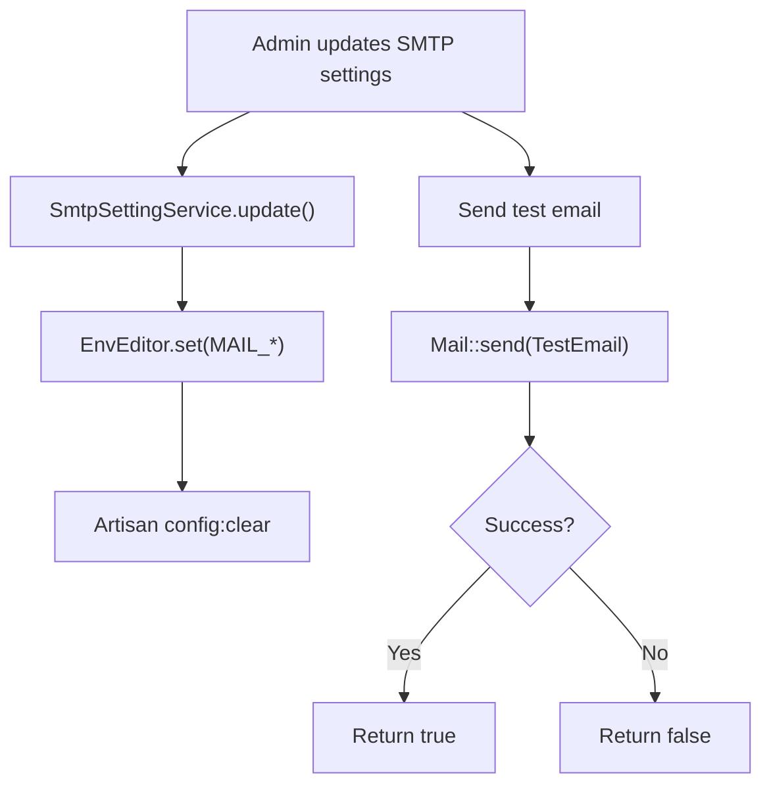

**Diagram sources**
- [app/Services/SmtpSettingService.php:1-85](file://app/Services/SmtpSettingService.php#L1-L85)
- [app/Services/EnvEditor.php:1-231](file://app/Services/EnvEditor.php#L1-L231)
- [config/mail.php:1-123](file://config/mail.php#L1-L123)

**Section sources**
- [.env.example:1-83](file://.env.example#L1-L83)
- [config/mail.php:1-123](file://config/mail.php#L1-L123)
- [app/Services/SmtpSettingService.php:1-85](file://app/Services/SmtpSettingService.php#L1-L85)

## Storage Backend Configuration

### Public Disk Behavior
The public disk is dynamically chosen based on `PUBLIC_DISK_DRIVER`:

- `s3`: Uses S3-compatible credentials and makes uploaded objects publicly readable.
- Anything else: Uses local storage rooted at `storage_path('app/public')`.

### Local Development
Local storage is appropriate for development because it avoids credential complexity and works without cloud dependencies.

### Production Storage
Cloud object storage is recommended for production because instance disks are ephemeral. Upload failures should throw exceptions so lost media is visible rather than silently dropped.

### Symbolic Links
The `storage:link` command creates a symlink from `public/storage` to `storage/app/public`. Ensure this link exists in the deployed container or volume setup.

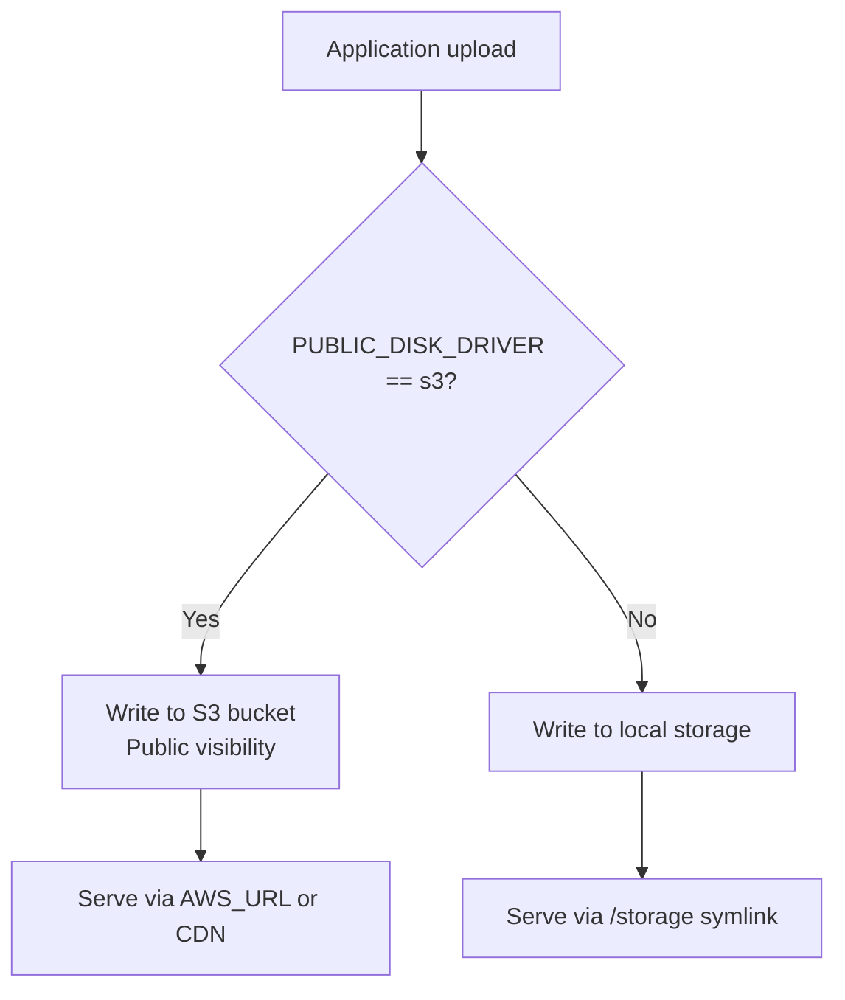

**Diagram sources**
- [config/filesystems.php:1-109](file://config/filesystems.php#L1-L109)

**Section sources**
- [.env.example:1-83](file://.env.example#L1-L83)
- [config/filesystems.php:1-109](file://config/filesystems.php#L1-L109)

## External Services and Third-Party Integrations

### Amazon S3-Compatible Storage
Used by the public disk and optional cache/store configurations. Required variables include access key, secret key, region, bucket, and optionally endpoint and URL.

### Postmark
API key is read from `POSTMARK_API_KEY` and used through the Postmark service configuration.

### Resend
API key is read from `RESEND_API_KEY` and used through the Resend service configuration.

### Amazon SES
Credentials and region are read from standard AWS environment variables.

### Slack
Bot OAuth token and default channel are available through the Slack service configuration and can be used by logging or notification integrations.

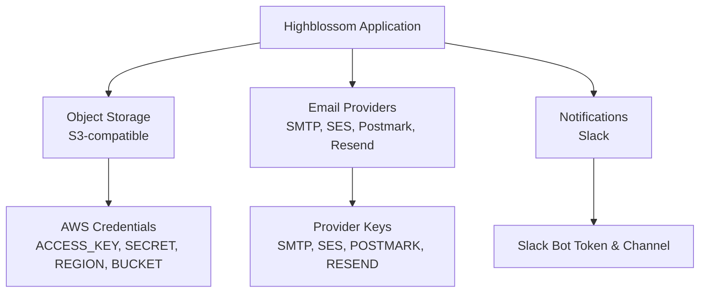

**Diagram sources**
- [config/filesystems.php:1-109](file://config/filesystems.php#L1-L109)
- [config/services.php:1-38](file://config/services.php#L1-L38)
- [config/mail.php:1-123](file://config/mail.php#L1-L123)

**Section sources**
- [config/services.php:1-38](file://config/services.php#L1-L38)
- [config/filesystems.php:1-109](file://config/filesystems.php#L1-L109)
- [config/mail.php:1-123](file://config/mail.php#L1-L123)

## Security and Secret Management

### Critical Secrets
The following secrets must be protected:

- `APP_KEY`: Encryption key.
- `DB_PASSWORD`: Database password.
- `REDIS_PASSWORD`: Redis password.
- `AWS_SECRET_ACCESS_KEY`: Object storage secret.
- `AWS_ACCESS_KEY_ID`: Object storage access key.
- `MAIL_PASSWORD`: SMTP password.
- `POSTMARK_API_KEY`: Postmark API key.
- `RESEND_API_KEY`: Resend API key.
- `SLACK_BOT_USER_OAUTH_TOKEN`: Slack bot token.

### Secret Handling Rules
- Do not commit `.env` files containing real secrets.
- Use process environment variables or a secrets manager in production.
- Rotate `APP_KEY` using `APP_PREVIOUS_KEYS` to maintain decryption of previously encrypted values.
- Restrict admin-editable environment keys to non-sensitive values.
- Never expose passwords through the settings UI.
- Disable debug mode in production.
- Enforce secure session cookies for HTTPS sites.
- Scope Sanctum stateful domains to trusted front-end origins.

### Admin Environment Editing Safety
`EnvEditor` enforces a whitelist for editable keys. Only safe keys such as `APP_NAME`, `APP_URL`, `APP_TIMEZONE`, and locale-related variables can be edited through the allowlisted interface. Feature flags prefixed with `FEATURES_` are also considered safe. Sensitive keys like `APP_KEY`, `DB_*`, `REDIS_*`, and `MAIL_*` are excluded from displayable values.

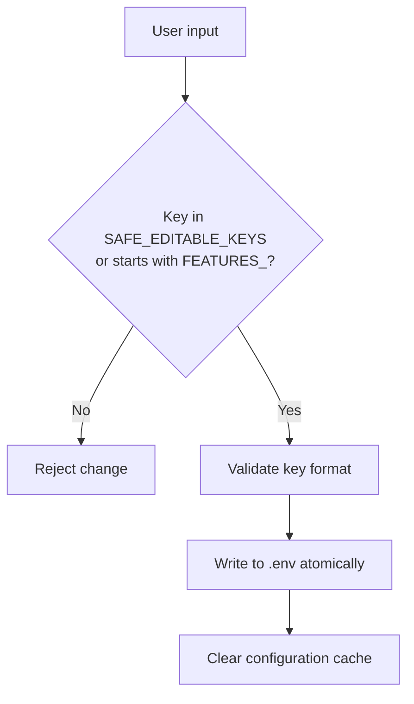

**Diagram sources**
- [app/Services/EnvEditor.php:1-231](file://app/Services/EnvEditor.php#L1-L231)

**Section sources**
- [.env.example:1-83](file://.env.example#L1-L83)
- [config/app.php:1-126](file://config/app.php#L1-L126)
- [config/session.php:1-233](file://config/session.php#L1-L233)
- [config/sanctum.php:1-87](file://config/sanctum.php#L1-L87)
- [app/Services/EnvEditor.php:1-231](file://app/Services/EnvEditor.php#L1-L231)

## Runtime Settings and Operational Behavior

### Docker Startup Flow
The container performs these steps:

1. Determine whether to run web, queue, scheduler, and Reverb processes.
2. Create the SQLite database file when `DB_CONNECTION=sqlite`.
3. Retry migrations until successful or until the retry limit is reached.
4. Fix ownership of writable directories.
5. Start supervisord to manage long-running processes.

### Supervisor-Managed Processes
The Dockerfile copies supervisord configuration and exposes port 8080. The compose file maps `APP_PORT` to 8080 and sets environment variables for the app service.

### Application Version and Health
The application includes version tracking and system overview components, indicating that runtime health and version metadata are part of the operational surface.

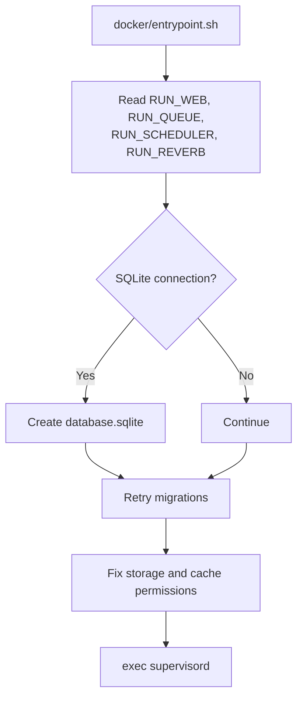

**Diagram sources**
- [docker/entrypoint.sh:1-20](file://docker/entrypoint.sh#L1-L20)
- [Dockerfile:1-32](file://Dockerfile#L1-L32)
- [docker-compose.yml:1-31](file://docker-compose.yml#L1-L31)

**Section sources**
- [docker/entrypoint.sh:1-20](file://docker/entrypoint.sh#L1-L20)
- [Dockerfile:1-32](file://Dockerfile#L1-L32)
- [docker-compose.yml:1-31](file://docker-compose.yml#L1-L31)

## Configuration Testing Strategy

### Pre-Deployment Checks
Before deploying, validate:

- `APP_KEY` exists and is valid.
- Database connectivity works with the configured driver and credentials.
- Cache store is reachable.
- Queue backend is reachable and has required tables or queues.
- Email transport can send at least a test message.
- Storage backend can write and serve public assets.
- Session backend persists across requests.
- `APP_URL`, `SESSION_SECURE_COOKIE`, and `SANCTUM_STATEFUL_DOMAINS` are consistent.
- Logging sends critical events to the intended destination.

### Unit and Integration Tests
- Use `.env.testing` or test fixtures when tests require environment values.
- Avoid committing real secrets in test fixtures.
- Use `App\Models\CompanySetting` tests to verify cached and uncached behavior.
- Verify that `EnvEditor` rejects unsafe keys.
- Verify that `SmtpSettingService` does not return passwords.

### Environment Validation Checklist
| Area | Validation |
|---|---|
| Application | Name, URL, timezone, locale, debug mode |
| Encryption | `APP_KEY` present and unchanged within a deployment |
| Database | Connection, credentials, migrations |
| Cache | Store reachability, key prefix isolation |
| Sessions | Driver reachability, secure cookie policy |
| Queue | Backend reachability, retry timeouts, failed job store |
| Email | Transport type, credentials, test message |
| Storage | Upload success, public URL resolution |
| Third-party | API keys, regions, endpoints |
| Logging | Channel reachability, log levels |

**Section sources**
- [app/Services/EnvEditor.php:1-231](file://app/Services/EnvEditor.php#L1-L231)
- [app/Services/SmtpSettingService.php:1-85](file://app/Services/SmtpSettingService.php#L1-L85)
- [app/Models/CompanySetting.php:1-196](file://app/Models/CompanySetting.php#L1-L196)

## Migration and Auditing Procedures

### Moving Changes Across Environments
Recommended migration workflow:

1. Define or update the variable in `.env.example` as documentation.
2. Add or update the corresponding process-level environment variable in the deployment configuration.
3. Test locally using Docker Compose.
4. Test in staging with production-like credentials.
5. Promote to production through the deployment pipeline.
6. Restart or reload long-running workers where necessary.

For settings changed at runtime through `EnvEditor`:

- Only safe, non-secret keys should be edited through the UI.
- Sensitive SMTP credentials should be managed through secrets management, not the settings UI.
- After changing `.env`, clear the configuration cache.

### Configuration Auditing
Audit practices should cover:

- Reviewing `.env.example` periodically to remove deprecated variables.
- Checking that production secrets are not present in repositories.
- Verifying that admin-editable keys exclude secrets.
- Validating that `APP_KEY` rotation preserves previously encrypted data.
- Confirming that `CACHE_PREFIX` isolates caches across applications sharing Redis.
- Confirming that `SESSION_SECURE_COOKIE` is enabled for HTTPS production hosts.
- Checking that `SANCTUM_STATEFUL_DOMAINS` does not include wildcard or overly broad domains.
- Reviewing log channels for accidental exposure of sensitive context.

### Persistent Application Settings
`CompanySetting` provides a database-backed key-value store with caching. It is suitable for non-secret operational preferences such as feature toggles, UI preferences, or business rules that need to be updated without redeploying.

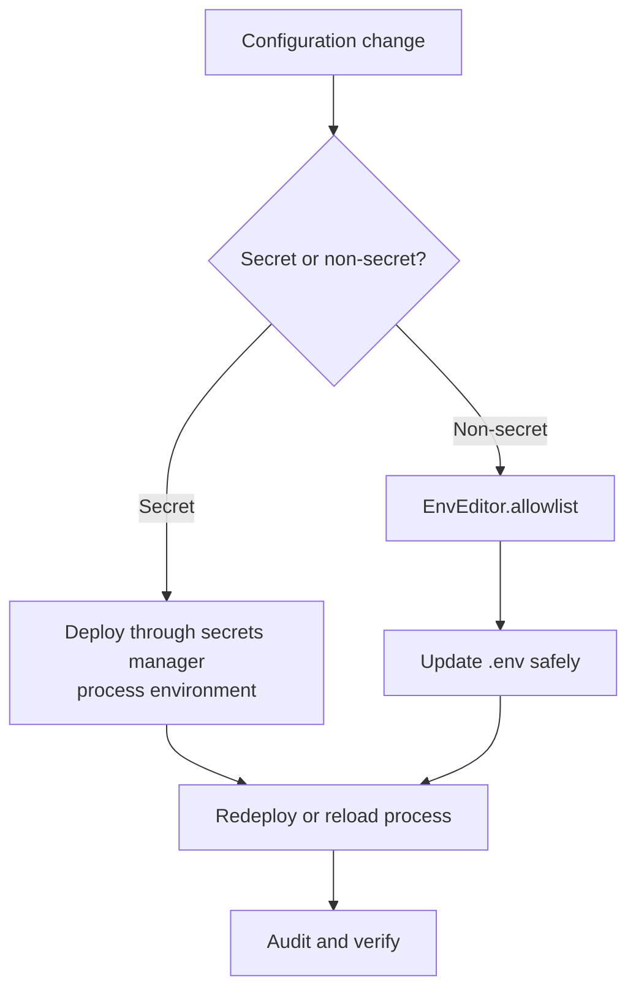

**Diagram sources**
- [app/Services/EnvEditor.php:1-231](file://app/Services/EnvEditor.php#L1-L231)
- [app/Models/CompanySetting.php:1-196](file://app/Models/CompanySetting.php#L1-L196)

**Section sources**
- [app/Services/EnvEditor.php:1-231](file://app/Services/EnvEditor.php#L1-L231)
- [app/Services/SmtpSettingService.php:1-85](file://app/Services/SmtpSettingService.php#L1-L85)
- [app/Models/CompanySetting.php:1-196](file://app/Models/CompanySetting.php#L1-L196)

## Troubleshooting Guide

### Common Issues and Resolutions

| Symptom | Likely Cause | Resolution |
|---|---|---|
| Encryption errors or invalid cipher | Missing or invalid `APP_KEY` | Generate and inject a valid `APP_KEY`. |
| Debug page appears in production | `APP_DEBUG=true` | Set `APP_DEBUG=false`. |
| Emails are not sent | `MAIL_MAILER=log` or missing credentials | Configure real mailer and credentials. |
| Uploaded images are missing after restart | Using local public disk in ephemeral containers | Set `PUBLIC_DISK_DRIVER=s3`. |
| Cache misses or stale data | Wrong cache store or missing prefix | Verify `CACHE_STORE`, `CACHE_PREFIX`, and Redis/database availability. |
| Jobs are not processed | Queue backend unreachable or wrong connection | Verify `QUEUE_CONNECTION` and backend credentials. |
| Sessions disappear between requests | Session driver unavailable or insecure cookie misconfiguration | Verify `SESSION_DRIVER` and `SESSION_SECURE_COOKIE`. |
| Sanctum API cookies rejected | `SANCTUM_STATEFUL_DOMAINS` mismatch | Align frontend domain with Sanctum configuration. |
| Passkey verification fails | `APP_URL` or origin mismatch | Ensure `APP_URL` matches the browser origin. |
| Logs not appearing externally | Wrong `LOG_CHANNEL` or missing webhook | Verify `LOG_CHANNEL`, `LOG_STACK`, and destination configuration. |
| Settings UI cannot edit a key | Key not in safe allowlist | Use secrets manager for sensitive values. |

### Diagnostic Commands and Areas
- Inspect the active environment by reviewing the resolved configuration through framework commands when available.
- Check logs using `LOG_CHANNEL` and `LOG_LEVEL`.
- Verify database connectivity using migration status and query execution.
- Test queue dispatch and failure recording.
- Send a test email through `SmtpSettingService` when configuring SMTP.
- Validate storage upload and public URL resolution.

**Section sources**
- [.env.example:1-83](file://.env.example#L1-L83)
- [config/app.php:1-126](file://config/app.php#L1-L126)
- [config/mail.php:1-123](file://config/mail.php#L1-L123)
- [config/filesystems.php:1-109](file://config/filesystems.php#L1-L109)
- [config/queue.php:1-128](file://config/queue.php#L1-L128)
- [config/session.php:1-233](file://config/session.php#L1-L233)
- [config/logging.php:1-132](file://config/logging.php#L1-L132)
- [config/passkeys.php:1-117](file://config/passkeys.php#L1-L117)
- [config/sanctum.php:1-87](file://config/sanctum.php#L1-L87)
- [app/Services/SmtpSettingService.php:1-85](file://app/Services/SmtpSettingService.php#L1-L85)

## Conclusion
Highblossom’s environment configuration combines Laravel’s standard `.env` and configuration-file model with Docker Compose defaults, supervisord process management, and runtime services. The most important operational boundaries are:

- Protect secrets through process environment variables or a secrets manager.
- Keep development simple and production strict.
- Use S3-compatible storage for persistent media.
- Use Redis or a scalable queue backend for background work.
- Configure email delivery explicitly for each deployment stage.
- Restrict admin-editable environment keys to non-secret values.
- Validate configuration before deployment and audit it regularly.

Following this guide ensures that Highblossom remains secure, portable, and predictable across development, staging, and production environments.