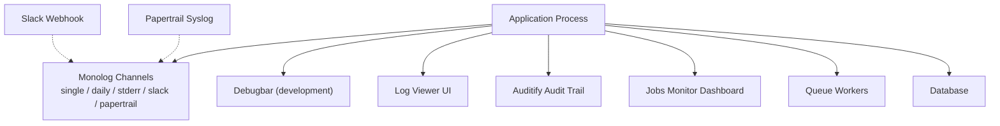
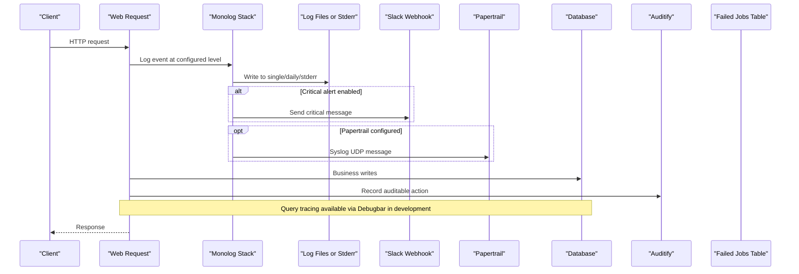
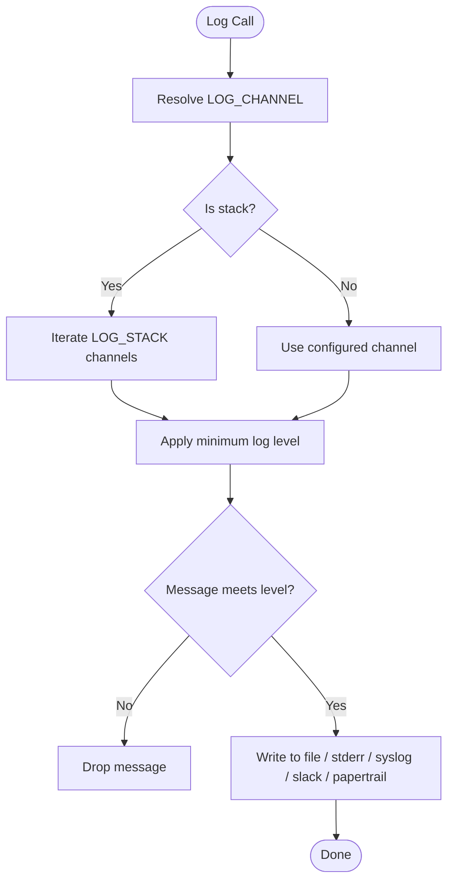
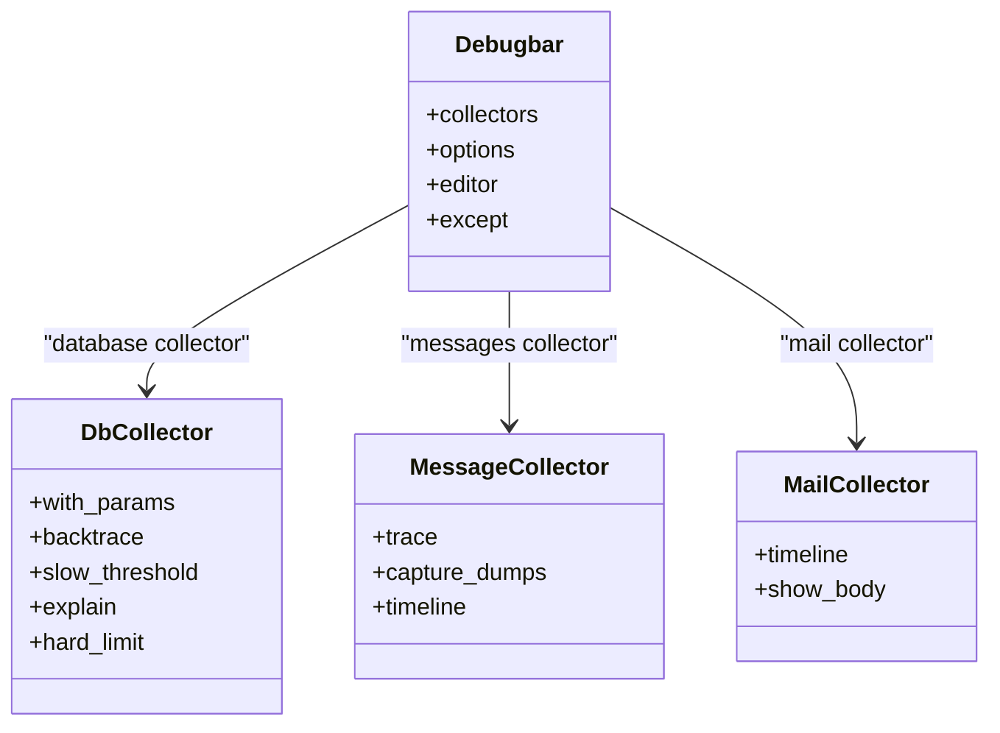
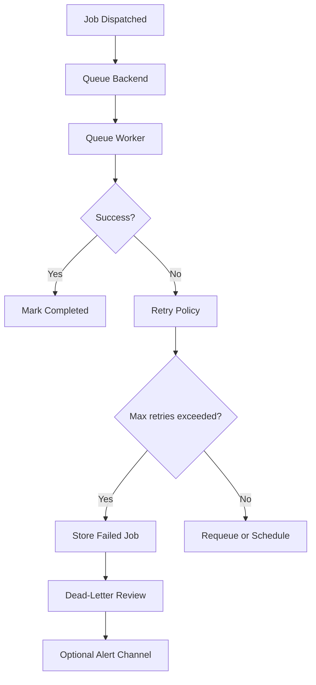
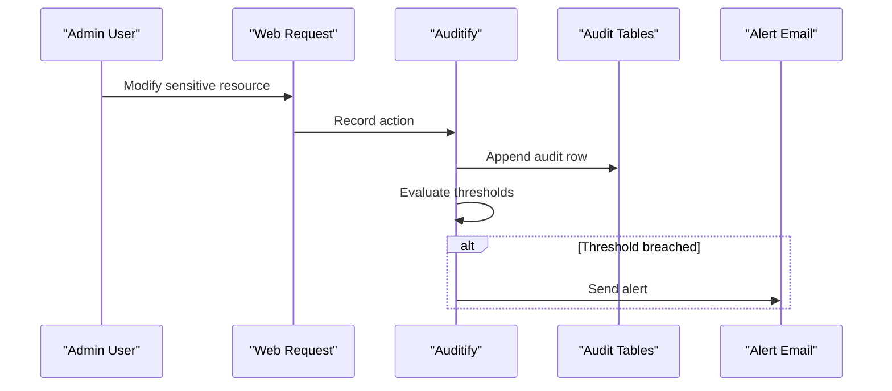
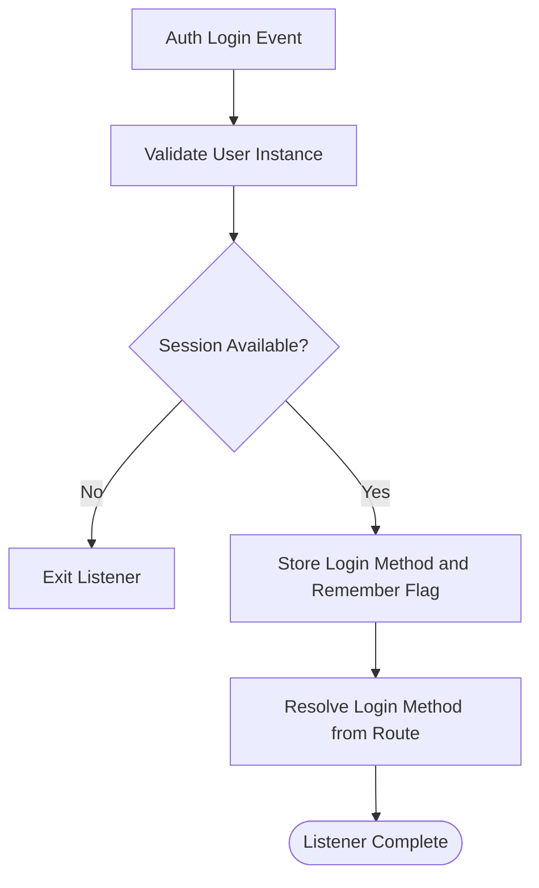
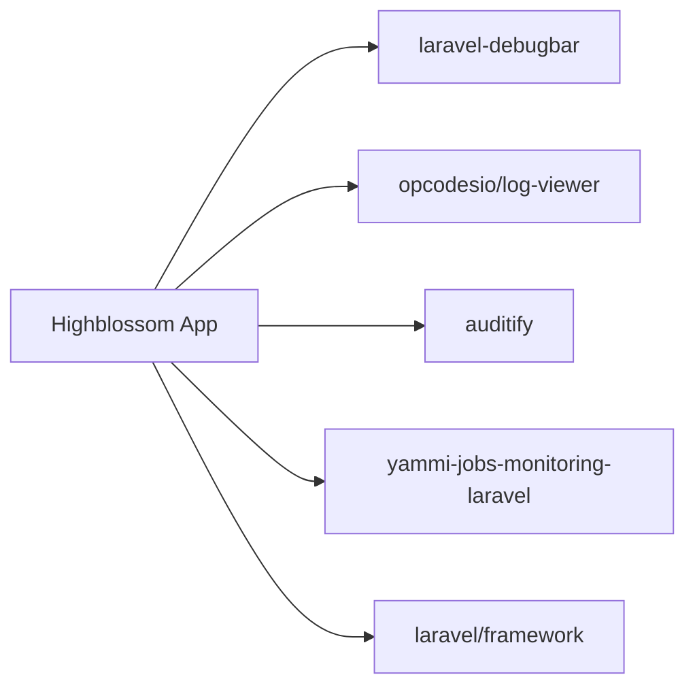

# Monitoring & Logging

<cite>
**Referenced Files in This Document**
- [logging.php](file://config/logging.php)
- [debugbar.php](file://config/debugbar.php)
- [log-viewer.php](file://config/log-viewer.php)
- [app.php](file://config/app.php)
- [composer.json](file://composer.json)
- [docker-compose.yml](file://docker-compose.yml)
- [queue.php](file://config/queue.php)
- [api.php](file://routes/api.php)
- [web.php](file://routes/web.php)
- [AppServiceProvider.php](file://app/Providers/AppServiceProvider.php)
- [RecordSessionLogin.php](file://app/Listeners/RecordSessionLogin.php)
- [PasswordPolicyAudit.php](file://app/Models/PasswordPolicyAudit.php)
- [auditify.php](file://config/auditify.php)
- [jobs-monitor.php](file://config/jobs-monitor.php)
- [services.php](file://config/services.php)
</cite>

## Table of Contents
1. Introduction
2. Project Structure
3. Core Components
4. Architecture Overview
5. Detailed Component Analysis
6. Dependency Analysis
7. Performance Considerations
8. Troubleshooting Guide
9. Conclusion

## Introduction
This document describes the Highblossom application’s monitoring and logging capabilities. It covers:

- Log channels, levels, rotation, and structured output.
- Debugbar integration for development debugging, query tracking, and performance profiling.
- Application health, queue monitoring, audit trails, and security logging.
- Error handling, exception visibility, and operational dashboards.
- Log analysis techniques, bottleneck identification, capacity planning guidance.
- Integration points for external monitoring services and production hardening.

The configuration is primarily driven by Laravel environment variables and package-specific config files. Production defaults are intentionally restrictive to reduce noise and risk.

## Project Structure
Monitoring-related configuration lives under `config/`, with runtime behavior added through service providers, listeners, routes, and database migrations. The Docker Compose file sets production-oriented defaults such as sending logs to standard error.

**Diagram sources**
- [logging.php:1-132](file://config/logging.php#L1-L132)
- [debugbar.php:1-200](file://config/debugbar.php#L1-L200)
- [log-viewer.php:1-200](file://config/log-viewer.php#L1-L200)
- [auditify.php:1-81](file://config/auditify.php#L1-L81)
- [jobs-monitor.php:1-200](file://config/jobs-monitor.php#L1-L200)
- [queue.php:1-128](file://config/queue.php#L1-L128)
- [docker-compose.yml:1-31](file://docker-compose.yml#L1-L31)

**Section sources**
- [docker-compose.yml:1-31](file://docker-compose.yml#L1-L31)
- [composer.json:1-138](file://composer.json#L1-L138)

## Core Components
The monitoring stack is composed of several independent subsystems:

| Component | Purpose | Primary Configuration | Notes |
|---|---|---|---|
| Monolog channels | Centralized logging to files, streams, Slack, and Papertrail | `config/logging.php` | Uses a default `stack` channel; environment variables control level and outputs |
| Debugbar | Development-time request diagnostics, queries, timing, memory, mail, cache | `config/debugbar.php` | Enabled when app debug mode allows it; many collectors can be toggled |
| Log Viewer | In-app log browsing for authorized users | `config/log-viewer.php` | Requires authentication; route is under admin path |
| Auditify | Security and administration audit trail | `config/auditify.php` | Tracks auth events, page visits, IP/user agent, and configurable alerts |
| Jobs Monitor | Job execution dashboard, failures, dead-letter queue | `config/jobs-monitor.php` | Optional API and UI; supports Slack, mail, PagerDuty alerts |
| Queue configuration | Failed job persistence and connection settings | `config/queue.php` | Default failed driver uses database UUIDs |
| Application defaults | Global debug, maintenance, timezone, locale | `config/app.php` | Controls debug rendering and maintenance mode storage |

**Section sources**
- [logging.php:1-132](file://config/logging.php#L1-L132)
- [debugbar.php:1-200](file://config/debugbar.php#L1-L200)
- [log-viewer.php:1-200](file://config/log-viewer.php#L1-L200)
- [auditify.php:1-81](file://config/auditify.php#L1-L81)
- [jobs-monitor.php:1-200](file://config/jobs-monitor.php#L1-L200)
- [queue.php:1-128](file://config/queue.php#L1-L128)
- [app.php:1-126](file://config/app.php#L1-L126)

## Architecture Overview
The monitoring architecture separates concerns between runtime request logging, development instrumentation, administrative auditing, and background job observability.

**Diagram sources**
- [logging.php:1-132](file://config/logging.php#L1-L132)
- [auditify.php:1-81](file://config/auditify.php#L1-L81)
- [queue.php:1-128](file://config/queue.php#L1-L128)

## Detailed Component Analysis

### Logging Configuration and Rotation
The application uses Laravel’s logging stack with multiple channels:

- **Default channel**: `stack`, which fans out to one or more channels based on `LOG_STACK`.
- **Single file log**: Writes to `storage/logs/laravel.log` with a configurable minimum level.
- **Daily rotated log**: Same path but rotates after a configurable number of days.
- **Slack channel**: Sends messages at a configurable level to a webhook URL.
- **Papertrail channel**: Sends syslog UDP messages using Monolog handlers.
- **Stderr channel**: Suitable for containerized environments where an orchestrator collects standard error.
- **Syslog and errorlog channels**: Provide native OS-level destinations.
- **Null channel**: Useful for disabling specific channels in tests or low-noise environments.
- **Emergency channel**: Provides a dedicated emergency destination.

Key environment variables include:

| Variable | Meaning | Typical Use |
|---|---|---|
| `LOG_CHANNEL` | Default channel | Override stack usage if needed |
| `LOG_STACK` | Comma-separated list of channels | Control fan-out destinations |
| `LOG_LEVEL` | Minimum Monolog level | Restrict verbose logs in production |
| `LOG_DAILY_DAYS` | Retention for daily logs | Set log retention policy |
| `SLACK_WEBHOOK_URL` | Destination for critical alerts | Integrate incident notifications |
| `LOG_SLACK_LEVEL` | Alert severity threshold | Keep only critical alerts |
| `PAPERTRAIL_URL` / `PAPERTRAIL_PORT` | Remote syslog endpoint | Centralize infrastructure logs |
| `LOG_STDERR_FORMATTER` | Output format for stderr | Align with container log parsers |

Production container defaults set `LOG_CHANNEL` to `stderr`, making Kubernetes or Docker logging drivers responsible for collection.

**Diagram sources**
- [logging.php:1-132](file://config/logging.php#L1-L132)

**Section sources**
- [logging.php:1-132](file://config/logging.php#L1-L132)
- [docker-compose.yml:1-31](file://docker-compose.yml#L1-L31)

### Structured Logging Practices
Structured logging is supported through Monolog processors and formatters:

- The `papertrail` and `stderr` channels explicitly register the PSR log message processor.
- The `replace_placeholders` option is enabled for several channels, allowing safe parameter substitution.
- Container deployments should prefer `stderr` so structured JSON or timestamped lines can be parsed by log aggregators.

Recommended practices:

- Prefer named placeholders instead of string concatenation.
- Attach contextual metadata such as request ID, user ID, tenant identifier, and operation name.
- Avoid logging sensitive data such as passwords, tokens, or full request bodies.
- Use consistent log levels: `info` for normal operations, `warning` for degraded conditions, `error` for recoverable failures, `critical` for unrecoverable failures.
- For high-volume jobs, use sampling or lower verbosity to avoid overwhelming aggregators.

**Section sources**
- [logging.php:1-132](file://config/logging.php#L1-L132)

### Debugbar Integration
The Debugbar provides rich development instrumentation:

- Collectors include messages, timing, memory, exceptions, database queries, views, routing, authentication, session, mail, cache, models, Livewire, Inertia, jobs, feature flags, and HTTP client requests.
- Many collectors have fine-grained options controlling backtraces, timelines, query parameters, EXPLAIN output, slow-query thresholds, and masked values.
- Requests matching excluded URI patterns are ignored, including telemetry and Livewire JavaScript assets.
- Editor links can integrate with local IDEs for faster navigation.

Important environment variables include:

| Variable | Effect |
|---|---|
| `DEBUGBAR_ENABLED` | Override default enablement |
| `DEBUGBAR_COLLECT_*` | Enable or disable individual collectors |
| `DEBUGBAR_OPTIONS_*` | Tune collectors such as DB, messages, memory, mail, views, events, cache, and HTTP client |
| `DEBUGBAR_EDITOR` | Select editor for backtrace navigation |

Development recommendations:

- Keep `APP_DEBUG` false in production.
- Disable expensive collectors such as full model payloads, large view data, or detailed event listener traces.
- Use slow-query thresholds and EXPLAIN output to identify database bottlenecks during development.
- Mask sensitive session, request, and config values.

**Diagram sources**
- [debugbar.php:1-200](file://config/debugbar.php#L1-L200)

**Section sources**
- [debugbar.php:1-200](file://config/debugbar.php#L1-L200)
- [app.php:1-126](file://config/app.php#L1-L126)

### Application Health and Maintenance Mode
Application-level observability includes:

- **Debug mode**: Controlled by `APP_DEBUG`; enables detailed error pages and stack traces.
- **Environment**: Controlled by `APP_ENV`; affects how services behave.
- **Maintenance mode**: Configurable storage driver (`file` or `cache`) and store backend.
- **Timezone and locale**: Used consistently across logs, dates, and internationalization.

Operational guidance:

- Never enable debug mode in production.
- Use maintenance mode during deployments and database migrations.
- Ensure the maintenance store is reachable and writable.
- Combine maintenance status with uptime probes from an external monitor.

**Section sources**
- [app.php:1-126](file://config/app.php#L1-L126)

### Job and Queue Monitoring
The queue system supports multiple backends, with the default being the database connection. Failed jobs are persisted according to the failed driver configuration.

Key behaviors:

- Default queue connection is database-backed.
- Retry windows are configurable per connection.
- Failed jobs are stored using database UUIDs by default.
- The Jobs Monitor package adds a dashboard and optional API for inspecting job runs, exceptions, and dead-letter queues.
- Alerts can be sent through Slack, email, and PagerDuty when configured.

**Diagram sources**
- [queue.php:1-128](file://config/queue.php#L1-L128)
- [jobs-monitor.php:1-200](file://config/jobs-monitor.php#L1-L200)

**Section sources**
- [queue.php:1-128](file://config/queue.php#L1-L128)
- [jobs-monitor.php:1-200](file://config/jobs-monitor.php#L1-L200)

### Audit Trails and Security Logging
Auditify provides security-focused auditing:

- Tracks IP address, user agent, URL, and page visits.
- Supports automatic model auditing and configurable exclusions.
- Can send alerts for sensitive modules and threshold-based events such as repeated failed logins, mass deletes, or bulk updates.
- Includes XSS protection with blocking and route exclusions.
- Retains audit records for a configurable number of days.

Authentication and authorization for the audit UI are controlled through both Auditify configuration and application gates. The application provider restricts Log Viewer access to Super Admin users and configures Auditify authorization similarly.

**Diagram sources**
- [auditify.php:1-81](file://config/auditify.php#L1-L81)
- [AppServiceProvider.php:1-110](file://app/Providers/AppServiceProvider.php#L1-L110)

**Section sources**
- [auditify.php:1-81](file://config/auditify.php#L1-L81)
- [AppServiceProvider.php:1-110](file://app/Providers/AppServiceProvider.php#L1-L110)
- [2026_01_01_000000_create_audit_action_logs_table.php:1-37](file://database/migrations/2026_01_01_000000_create_audit_action_logs_table.php#L1-L37)

### Session Login Tracking
The login listener captures authentication method information and stores it in the session for later processing. This supports accurate audit trails for password-based, two-factor, passkey, and remembered sessions.

Behavior highlights:

- Only handles genuine `User` instances.
- Requires an active session.
- Stores login method and remember flag under a configurable handoff key.
- Resolves login method from route names rather than exposing raw credentials.

This approach avoids race conditions caused by session ID regeneration around authentication events.

**Diagram sources**
- [RecordSessionLogin.php:1-56](file://app/Listeners/RecordSessionLogin.php#L1-L56)

**Section sources**
- [RecordSessionLogin.php:1-56](file://app/Listeners/RecordSessionLogin.php#L1-L56)

### Password Policy Audit Model
The password policy audit model represents append-only changes to password policy rules. It casts the change payload as an array and associates each record with a user. The design ensures that policy history cannot be rewritten by the account it describes and does not include secret values.

**Section sources**
- [PasswordPolicyAudit.php:1-42](file://app/Models/PasswordPolicyAudit.php#L1-L42)

### Log Viewer Access and Administration
Log Viewer is configured to require authentication in production and exposes its interface under an admin route. The application provider further restricts access to Super Admin users.

Operational notes:

- Do not expose the Log Viewer publicly.
- Combine role-based access with network-level restrictions such as VPN or bastion hosts.
- Rotate or archive logs externally even though Log Viewer can browse them.

**Section sources**
- [log-viewer.php:1-200](file://config/log-viewer.php#L1-L200)
- [AppServiceProvider.php:1-110](file://app/Providers/AppServiceProvider.php#L1-L110)

## Dependency Analysis
External packages contribute directly to monitoring and logging:

| Package | Role | Evidence |
|---|---|---|
| `fruitcake/laravel-debugbar` | Development debugging panel | Composer dependency and debug config |
| `opcodesio/log-viewer` | In-application log browser | Composer dependency and log viewer config |
| `arpanihan/auditify` | Security and admin audit trail | Composer dependency and auditify config |
| `romalytar/yammi-jobs-monitoring-laravel` | Job monitoring dashboard and alerts | Composer dependency and jobs monitor config |
| `laravel/framework` | Logging, queues, maintenance, and application bootstrap | Composer dependency and framework configs |

**Diagram sources**
- [composer.json:1-138](file://composer.json#L1-L138)

**Section sources**
- [composer.json:1-138](file://composer.json#L1-L138)

## Performance Considerations
Monitoring must not become a performance liability:

- **Logging volume**: Reduce `LOG_LEVEL` in production; use `daily` rotation and limit retention.
- **Database tracing**: Limit Debugbar query collectors to slow queries and tune soft/hard limits.
- **Mail and view collectors**: Disable heavy collectors such as full view data or large mail bodies in high-traffic environments.
- **Event and cache collectors**: Enable selectively because they add overhead.
- **Jobs Monitor**: Disable the UI or API when not needed; configure alert channels carefully to avoid alert storms.
- **Audit retention**: Configure pruning intervals to prevent unbounded growth of audit tables.
- **Queue workers**: Size workers according to job throughput and retry policies; monitor failed job growth.

Capacity planning considerations:

- Estimate log volume per hour and multiply by retention days to size storage.
- Plan external log aggregator bandwidth for Slack, Papertrail, and SIEM integrations.
- Provision database space for failed jobs, audit tables, and job monitoring tables.
- Separate monitoring databases if volume becomes significant.
- Use horizontal scaling for web processes while keeping centralized log aggregation.

[No sources needed since this section provides general guidance]

## Troubleshooting Guide

### Logs Are Missing or Empty
Likely causes:

- `LOG_CHANNEL` is set to `null` or a disabled channel.
- Container stdout/stderr is not captured by the orchestrator.
- File permissions prevent writing to `storage/logs`.
- `LOG_LEVEL` filters out expected messages.

Actions:

- Inspect `LOG_CHANNEL` and `LOG_STACK`.
- Verify `storage/logs` is writable.
- Temporarily increase `LOG_LEVEL` to `debug` in development.
- Check stderr in container logs when `LOG_CHANNEL=stderr`.

**Section sources**
- [logging.php:1-132](file://config/logging.php#L1-L132)
- [docker-compose.yml:1-31](file://docker-compose.yml#L1-L31)

### Slack Alerts Not Arriving
Likely causes:

- `SLACK_WEBHOOK_URL` is missing or invalid.
- `LOG_SLACK_LEVEL` is too high for the logged message.
- Network egress to Slack is blocked.

Actions:

- Confirm the Slack webhook is valid.
- Adjust `LOG_SLACK_LEVEL` to capture the desired severity.
- Test outbound connectivity from the container.

**Section sources**
- [logging.php:1-132](file://config/logging.php#L1-L132)

### Debugbar Is Not Visible
Likely causes:

- `APP_DEBUG` is false.
- `DEBUGBAR_ENABLED` is explicitly disabled.
- Request matches an excluded URI pattern.
- Debugbar is disabled for API responses or Livewire assets.

Actions:

- Enable `APP_DEBUG` in development.
- Check `DEBUGBAR_ENABLED`.
- Remove the request from the `except` list temporarily for investigation.
- Verify collector toggles.

**Section sources**
- [debugbar.php:1-200](file://config/debugbar.php#L1-L200)
- [app.php:1-126](file://config/app.php#L1-L126)

### Slow Database Queries
Likely causes:

- Unindexed queries.
- N+1 relationships.
- Large result sets.
- Expensive joins or subqueries.

Actions:

- Enable Debugbar database collector and EXPLAIN output in development.
- Tune `only_slow_queries` and `slow_threshold`.
- Add appropriate indexes.
- Reduce query result sizes and avoid eager loading unnecessary data.

**Section sources**
- [debugbar.php:1-200](file://config/debugbar.php#L1-L200)

### Failed Jobs Are Accumulating
Likely causes:

- Downstream service failures.
- Incorrect job payloads.
- Queue worker not running.
- Retry window misconfiguration.

Actions:

- Inspect the failed jobs table.
- Use the Jobs Monitor dashboard if enabled.
- Check alert channels for failure notifications.
- Review queue retry settings and worker process health.

**Section sources**
- [queue.php:1-128](file://config/queue.php#L1-L128)
- [jobs-monitor.php:1-200](file://config/jobs-monitor.php#L1-L200)

### Audit Trail Gaps
Likely causes:

- Model excluded from auto-audit.
- Unauthorized access to audit UI.
- Audit retention pruning removed old records.

Actions:

- Review `exclude_models` in Auditify configuration.
- Confirm Super Admin access for audit interfaces.
- Adjust pruning retention and schedule cleanup.

**Section sources**
- [auditify.php:1-81](file://config/auditify.php#L1-L81)
- [AppServiceProvider.php:1-110](file://app/Providers/AppServiceProvider.php#L1-L110)

## Conclusion
Highblossom uses a layered monitoring strategy:

- Monolog channels provide flexible, environment-aware logging.
- Debugbar offers deep development diagnostics without leaking into production.
- Log Viewer centralizes log inspection behind strict authorization.
- Auditify captures security-relevant actions and supports alerting.
- Jobs Monitor adds operational visibility for background workloads.
- Queue configuration ensures failed jobs are persisted for review.

For production, enforce least-privileged access to monitoring interfaces, retain logs according to compliance requirements, keep debug features disabled, and integrate with external observability platforms through stderr, syslog, Slack, or other configured channels.

[No sources needed since this section summarizes without analyzing specific files]