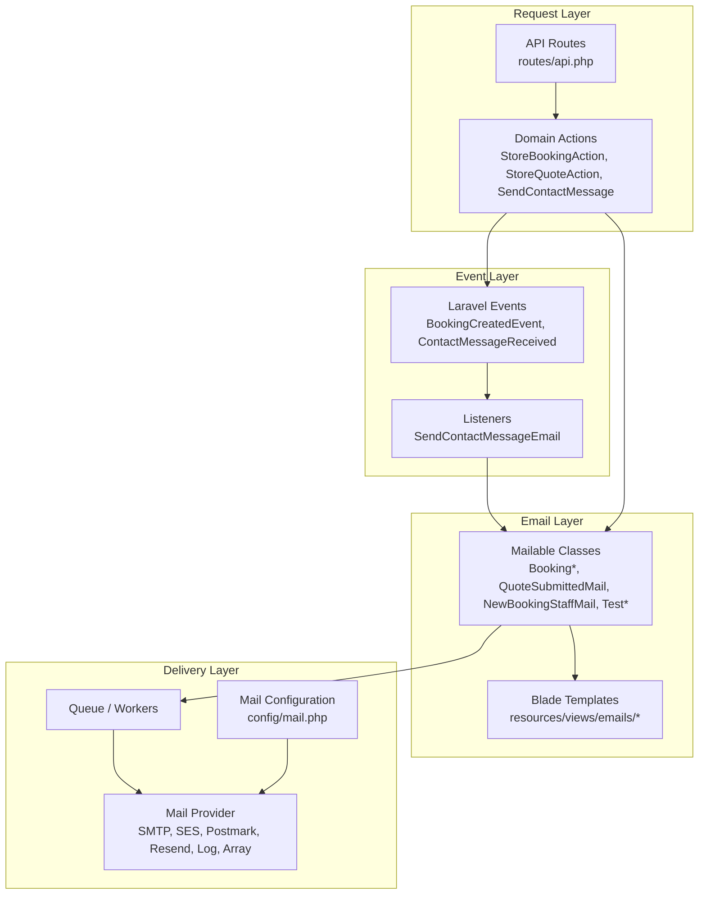
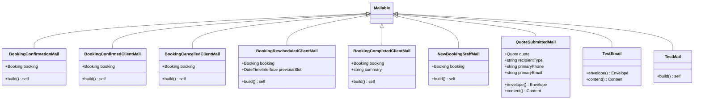
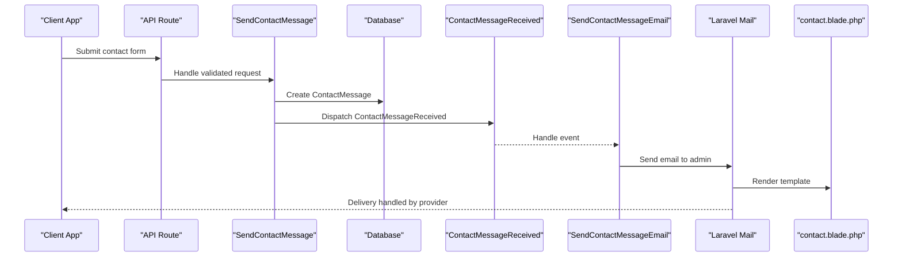
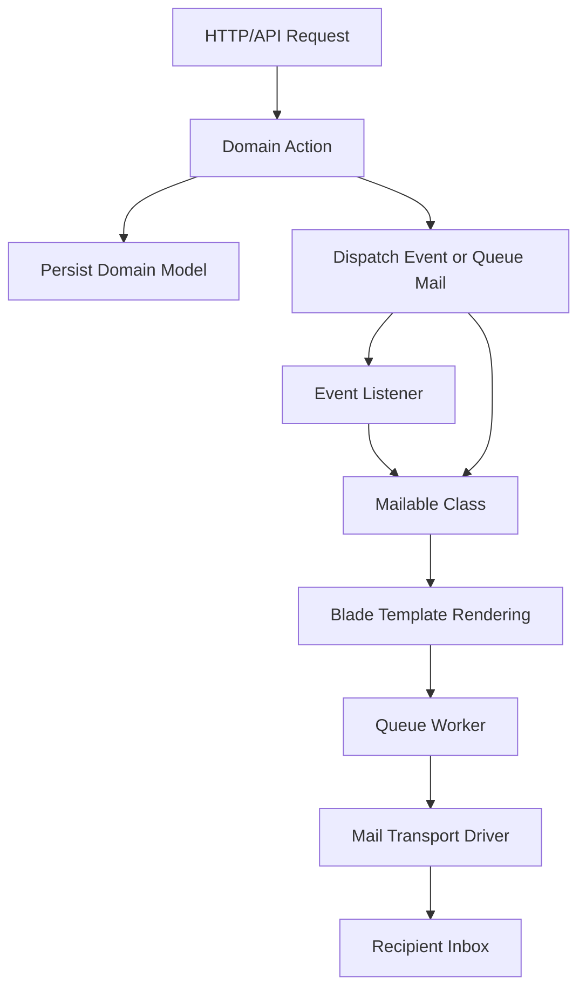
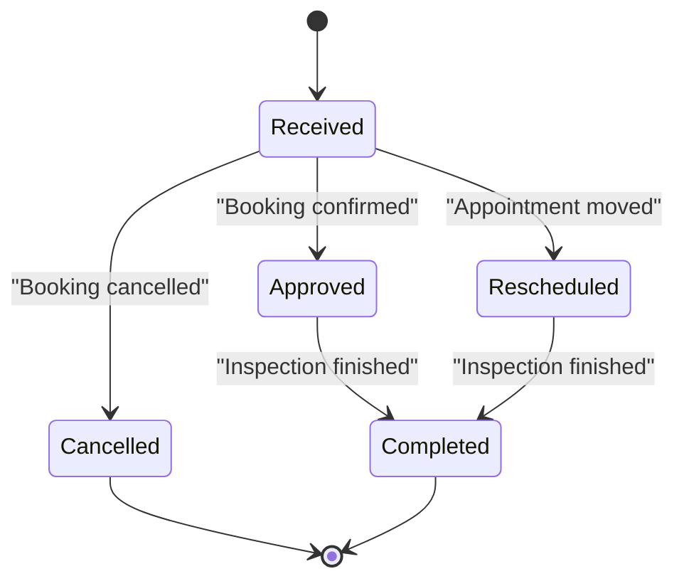
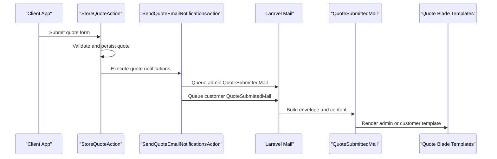
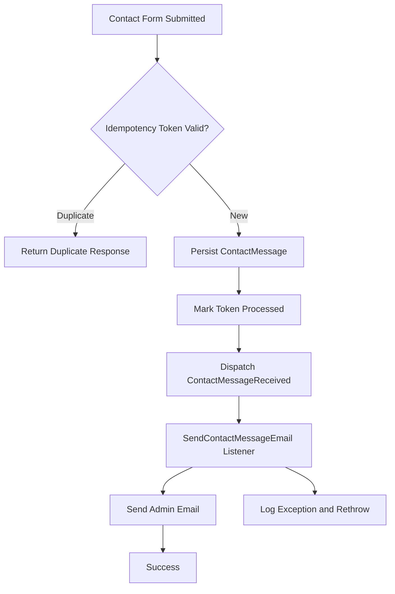
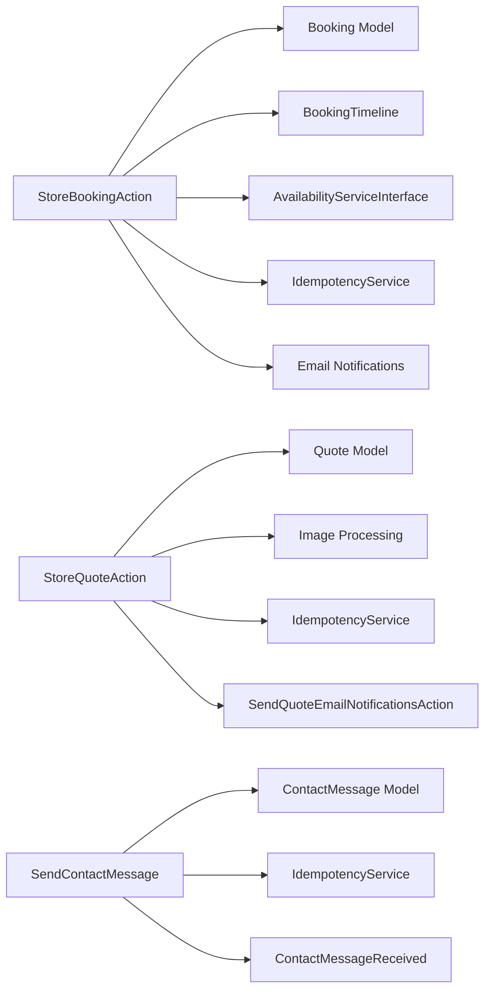
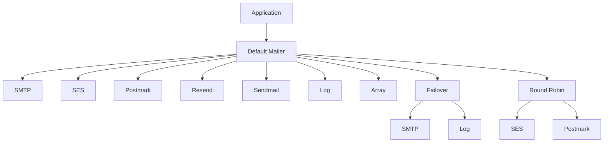

# Email System

<cite>
**Referenced Files in This Document**
- [BookingConfirmationMail.php](file://app/Mail/BookingConfirmationMail.php)
- [NewBookingStaffMail.php](file://app/Mail/NewBookingStaffMail.php)
- [QuoteSubmittedMail.php](file://app/Mail/QuoteSubmittedMail.php)
- [TestEmail.php](file://app/Mail/TestEmail.php)
- [TestMail.php](file://app/Mail/TestMail.php)
- [BookingConfirmedClientMail.php](file://app/Mail/BookingConfirmedClientMail.php)
- [BookingCancelledClientMail.php](file://app/Mail/BookingCancelledClientMail.php)
- [BookingRescheduledClientMail.php](file://app/Mail/BookingRescheduledClientMail.php)
- [BookingCompletedClientMail.php](file://app/Mail/BookingCompletedClientMail.php)
- [BookingCreatedEvent.php](file://app/Events/BookingCreatedEvent.php)
- [ContactMessageReceived.php](file://app/Events/ContactMessageReceived.php)
- [SendContactMessageEmail.php](file://app/Listeners/SendContactMessageEmail.php)
- [SendContactMessage.php](file://app/Actions/SendContactMessage.php)
- [SendQuoteEmailNotificationsAction.php](file://app/Actions/SendQuoteEmailNotificationsAction.php)
- [StoreBookingAction.php](file://app/Actions/StoreBookingAction.php)
- [StoreQuoteAction.php](file://app/Actions/StoreQuoteAction.php)
- [mail.php](file://config/mail.php)
- [api.php](file://routes/api.php)
- [confirmation.blade.php](file://resources/views/emails/bookings/confirmation.blade.php)
- [staff-new.blade.php](file://resources/views/emails/bookings/staff-new.blade.php)
- [contact.blade.php](file://resources/views/emails/contact.blade.php)
- [submitted-admin.blade.php](file://resources/views/emails/quotes/submitted-admin.blade.php)
- [submitted-customer.blade.php](file://resources/views/emails/quotes/submitted-customer.blade.php)
</cite>

## Table of Contents
1. [Introduction](#introduction)
2. [Project Structure](#project-structure)
3. [Core Components](#core-components)
4. [Architecture Overview](#architecture-overview)
5. [Detailed Component Analysis](#detailed-component-analysis)
6. [Dependency Analysis](#dependency-analysis)
7. [Performance Considerations](#performance-considerations)
8. [Troubleshooting Guide](#troubleshooting-guide)
9. [Conclusion](#conclusion)
10. [Appendices](#appendices)

## Introduction
This document explains the Highblossom email system. It covers booking confirmation emails, quote submission notifications, contact form handling, staff notifications, and test mailers. The system uses Laravel Mailables for message definitions, Blade templates for rendering, Laravel events and listeners for decoupled processing, queued jobs for reliable delivery, and a centralized mail configuration that supports multiple providers.

The main design goals are:
- Keep business logic separate from email delivery by using actions, events, and listeners.
- Queue heavy or external operations so HTTP requests remain responsive.
- Render consistent, branded emails through shared Blade components.
- Support multiple mail providers through configuration rather than code changes.
- Make testing, retrying, and monitoring straightforward.

## Project Structure
The email subsystem spans several layers:

- **Mailable classes** define recipients, subjects, views, and data payloads.
- **Blade templates** under `resources/views/emails` render HTML content using shared email layout components.
- **Actions** orchestrate domain workflows such as booking creation and quote submission.
- **Events and listeners** decouple side effects like sending emails from request handling.
- **Configuration** centralizes mail transport, global sender address, reply-to behavior, and failover strategies.
- **API routes** expose staff endpoints; they do not directly send emails but may trigger background processes.

**Diagram sources**
- [api.php:1-117](file://routes/api.php#L1-L117)
- [StoreBookingAction.php:1-200](file://app/Actions/StoreBookingAction.php#L1-L200)
- [StoreQuoteAction.php:1-160](file://app/Actions/StoreQuoteAction.php#L1-L160)
- [SendContactMessage.php:1-71](file://app/Actions/SendContactMessage.php#L1-L71)
- [BookingCreatedEvent.php:1-19](file://app/Events/BookingCreatedEvent.php#L1-L19)
- [ContactMessageReceived.php:1-24](file://app/Events/ContactMessageReceived.php#L1-L24)
- [SendContactMessageEmail.php:1-54](file://app/Listeners/SendContactMessageEmail.php#L1-L54)
- [mail.php:1-123](file://config/mail.php#L1-L123)

**Section sources**
- [api.php:1-117](file://routes/api.php#L1-L117)
- [mail.php:1-123](file://config/mail.php#L1-L123)

## Core Components

### Mailable Classes
Each Mailable class encapsulates one email type:

| Mailable | Recipient | Purpose | Queue Behavior | Main Template |
|---|---|---|---|---|
| `BookingConfirmationMail` | Client | Confirms receipt of a booking request | Implements `ShouldQueue` | `emails.bookings.confirmation` |
| `BookingConfirmedClientMail` | Client | Confirms an approved booking | Implements `ShouldQueue` | `emails.bookings.confirmed` |
| `BookingCancelledClientMail` | Client | Notifies cancellation | Implements `ShouldQueue` | `emails.bookings.cancelled` |
| `BookingRescheduledClientMail` | Client | Notifies rescheduling with previous slot context | Implements `ShouldQueue` | `emails.bookings.rescheduled` |
| `BookingCompletedClientMail` | Client | Notifies completed inspection with optional summary | Implements `ShouldQueue` | `emails.bookings.completed` |
| `NewBookingStaffMail` | Staff | Alerts staff to review a new booking | Not `ShouldQueue`; queue ownership belongs to caller | `emails.bookings.staff-new` |
| `QuoteSubmittedMail` | Admin and customer | Confirms quote submission with recipient-specific views | Implements `ShouldQueue` | `emails.quotes.submitted-admin`, `emails.quotes.submitted-customer` |
| `TestEmail` | Developer/tester | SMTP test via modern Envelope/Content pattern | Uses standard queue traits | `emails.test` |
| `TestMail` | Developer/tester | Legacy-style SMTP test | Uses standard queue traits | `emails.contact` |

Key implementation patterns:
- Most client-facing booking mailables implement `ShouldQueue` so delivery does not block request handling.
- `NewBookingStaffMail` deliberately avoids `ShouldQueue` because its caller controls queuing.
- `QuoteSubmittedMail` selects subject and view based on `recipientType`.
- All mailables accept domain models such as `Booking` or `Quote` through constructor injection.

**Diagram sources**
- [BookingConfirmationMail.php:1-39](file://app/Mail/BookingConfirmationMail.php#L1-L39)
- [BookingConfirmedClientMail.php:1-37](file://app/Mail/BookingConfirmedClientMail.php#L1-L37)
- [BookingCancelledClientMail.php:1-37](file://app/Mail/BookingCancelledClientMail.php#L1-L37)
- [BookingRescheduledClientMail.php:1-43](file://app/Mail/BookingRescheduledClientMail.php#L1-L43)
- [BookingCompletedClientMail.php:1-42](file://app/Mail/BookingCompletedClientMail.php#L1-L42)
- [NewBookingStaffMail.php:1-40](file://app/Mail/NewBookingStaffMail.php#L1-L40)
- [QuoteSubmittedMail.php:1-66](file://app/Mail/QuoteSubmittedMail.php#L1-L66)
- [TestEmail.php:1-39](file://app/Mail/TestEmail.php#L1-L39)
- [TestMail.php:1-29](file://app/Mail/TestMail.php#L1-L29)

**Section sources**
- [BookingConfirmationMail.php:1-39](file://app/Mail/BookingConfirmationMail.php#L1-L39)
- [NewBookingStaffMail.php:1-40](file://app/Mail/NewBookingStaffMail.php#L1-L40)
- [QuoteSubmittedMail.php:1-66](file://app/Mail/QuoteSubmittedMail.php#L1-L66)
- [TestEmail.php:1-39](file://app/Mail/TestEmail.php#L1-L39)
- [TestMail.php:1-29](file://app/Mail/TestMail.php#L1-L29)
- [BookingConfirmedClientMail.php:1-37](file://app/Mail/BookingConfirmedClientMail.php#L1-L37)
- [BookingCancelledClientMail.php:1-37](file://app/Mail/BookingCancelledClientMail.php#L1-L37)
- [BookingRescheduledClientMail.php:1-43](file://app/Mail/BookingRescheduledClientMail.php#L1-L43)
- [BookingCompletedClientMail.php:1-42](file://app/Mail/BookingCompletedClientMail.php#L1-L42)

### Blade Templates and Layout
Templates use shared email layout components for consistency:

- `x-emails.layout` provides title, preheader, header label, kicker, heading, and footer note.
- `x-emails.panel`, `x-emails.field`, and `x-emails.button` structure content blocks.
- Booking templates include shared detail partials where appropriate.
- Quote templates differentiate admin and customer views while reusing the same layout.

Template categories:
- **Booking confirmations**: client acknowledgment and later approval/cancellation/reschedule/completion messages.
- **Staff notification**: internal alert with quick access to the admin booking page.
- **Contact form**: inbound support message formatted for team triage.
- **Quotes**: administrative details plus customer confirmation.

**Section sources**
- [confirmation.blade.php:1-19](file://resources/views/emails/bookings/confirmation.blade.php#L1-L19)
- [staff-new.blade.php:1-22](file://resources/views/emails/bookings/staff-new.blade.php#L1-L22)
- [contact.blade.php:1-23](file://resources/views/emails/contact.blade.php#L1-L23)
- [submitted-admin.blade.php:1-39](file://resources/views/emails/quotes/submitted-admin.blade.php#L1-L39)
- [submitted-customer.blade.php:1-34](file://resources/views/emails/quotes/submitted-customer.blade.php#L1-L34)

### Event-Driven Email Flow
Two event-driven flows exist in this repository snapshot:

1. **Contact form flow**: An action persists a contact message and dispatches `ContactMessageReceived`. A listener sends an email to the configured admin address.
2. **Booking creation flow**: A domain model event `BookingCreatedEvent` exists, though the current listener set does not show a dedicated booking email listener in this snapshot.

**Diagram sources**
- [SendContactMessage.php:1-71](file://app/Actions/SendContactMessage.php#L1-L71)
- [ContactMessageReceived.php:1-24](file://app/Events/ContactMessageReceived.php#L1-L24)
- [SendContactMessageEmail.php:1-54](file://app/Listeners/SendContactMessageEmail.php#L1-L54)
- [contact.blade.php:1-23](file://resources/views/emails/contact.blade.php#L1-L23)

**Section sources**
- [SendContactMessage.php:1-71](file://app/Actions/SendContactMessage.php#L1-L71)
- [ContactMessageReceived.php:1-24](file://app/Events/ContactMessageReceived.php#L1-L24)
- [SendContactMessageEmail.php:1-54](file://app/Listeners/SendContactMessageEmail.php#L1-L54)

## Architecture Overview
The email architecture follows layered separation:

- **Request layer**: Controllers or API routes receive input and delegate to domain actions.
- **Domain layer**: Actions validate, persist data, enforce idempotency, and coordinate side effects.
- **Notification layer**: Events, listeners, and direct mail queues handle asynchronous notifications.
- **Rendering layer**: Mailable classes select templates and pass structured data.
- **Transport layer**: Laravel mail configuration selects SMTP, SES, Postmark, Resend, log, array, failover, or round-robin drivers.

[No sources needed since this diagram shows conceptual workflow, not actual code structure]

## Detailed Component Analysis

### Booking Confirmation Emails
Booking confirmation emails cover the full lifecycle:

- **Received**: `BookingConfirmationMail` tells the client their request was received.
- **Approved**: `BookingConfirmedClientMail` confirms the appointment is scheduled.
- **Cancelled**: `BookingCancelledClientMail` informs the client of cancellation.
- **Rescheduled**: `BookingRescheduledClientMail` includes the previous slot so clients understand what changed.
- **Completed**: `BookingCompletedClientMail` marks inspection completion and can include an optional customer-facing summary.

All these mailables are designed for background delivery through `ShouldQueue`.

**Diagram sources**
- [BookingConfirmationMail.php:1-39](file://app/Mail/BookingConfirmationMail.php#L1-L39)
- [BookingConfirmedClientMail.php:1-37](file://app/Mail/BookingConfirmedClientMail.php#L1-L37)
- [BookingCancelledClientMail.php:1-37](file://app/Mail/BookingCancelledClientMail.php#L1-L37)
- [BookingRescheduledClientMail.php:1-43](file://app/Mail/BookingRescheduledClientMail.php#L1-L43)
- [BookingCompletedClientMail.php:1-42](file://app/Mail/BookingCompletedClientMail.php#L1-L42)

**Section sources**
- [BookingConfirmationMail.php:1-39](file://app/Mail/BookingConfirmationMail.php#L1-L39)
- [BookingConfirmedClientMail.php:1-37](file://app/Mail/BookingConfirmedClientMail.php#L1-L37)
- [BookingCancelledClientMail.php:1-37](file://app/Mail/BookingCancelledClientMail.php#L1-L37)
- [BookingRescheduledClientMail.php:1-43](file://app/Mail/BookingRescheduledClientMail.php#L1-L43)
- [BookingCompletedClientMail.php:1-42](file://app/Mail/BookingCompletedClientMail.php#L1-L42)

### Quote Submission Notifications
Quote submissions have two audiences:

- **Admin notification**: Delivers full request details, vehicle specifications, service type, and optional reference image link.
- **Customer confirmation**: Acknowledges receipt and sets expectations for response within 24 hours.

The `QuoteSubmittedMail` mailable chooses subject and view based on `recipientType`. The `SendQuoteEmailNotificationsAction` resolves admin notification addresses from settings, queues admin emails, and queues a customer confirmation when an email address is present.

**Diagram sources**
- [StoreQuoteAction.php:1-160](file://app/Actions/StoreQuoteAction.php#L1-L160)
- [SendQuoteEmailNotificationsAction.php:1-113](file://app/Actions/SendQuoteEmailNotificationsAction.php#L1-L113)
- [QuoteSubmittedMail.php:1-66](file://app/Mail/QuoteSubmittedMail.php#L1-L66)
- [submitted-admin.blade.php:1-39](file://resources/views/emails/quotes/submitted-admin.blade.php#L1-L39)
- [submitted-customer.blade.php:1-34](file://resources/views/emails/quotes/submitted-customer.blade.php#L1-L34)

**Section sources**
- [StoreQuoteAction.php:1-160](file://app/Actions/StoreQuoteAction.php#L1-L160)
- [SendQuoteEmailNotificationsAction.php:1-113](file://app/Actions/SendQuoteEmailNotificationsAction.php#L1-L113)
- [QuoteSubmittedMail.php:1-66](file://app/Mail/QuoteSubmittedMail.php#L1-L66)
- [submitted-admin.blade.php:1-39](file://resources/views/emails/quotes/submitted-admin.blade.php#L1-L39)
- [submitted-customer.blade.php:1-34](file://resources/views/emails/quotes/submitted-customer.blade.php#L1-L34)

### Contact Form Handling
The contact form action performs four responsibilities:

1. Check idempotency token to prevent duplicate submissions.
2. Persist the contact message.
3. Mark the token as processed.
4. Dispatch `ContactMessageReceived`.

The listener then:

1. Resolve admin email from settings or mail configuration.
2. Render `emails.contact`.
3. Catch exceptions, log them with context, and rethrow so the queue can retry.

**Diagram sources**
- [SendContactMessage.php:1-71](file://app/Actions/SendContactMessage.php#L1-L71)
- [ContactMessageReceived.php:1-24](file://app/Events/ContactMessageReceived.php#L1-L24)
- [SendContactMessageEmail.php:1-54](file://app/Listeners/SendContactMessageEmail.php#L1-L54)

**Section sources**
- [SendContactMessage.php:1-71](file://app/Actions/SendContactMessage.php#L1-L71)
- [ContactMessageReceived.php:1-24](file://app/Events/ContactMessageReceived.php#L1-L24)
- [SendContactMessageEmail.php:1-54](file://app/Listeners/SendContactMessageEmail.php#L1-L54)

### Staff Notifications
Staff notifications for new bookings use `NewBookingStaffMail`. Its comment explicitly states it is rendered on a shared branded email layout and is not itself `ShouldQueue` because the notification owns the queueing. This means callers should queue the notification or mailable according to their delivery strategy.

The corresponding template surfaces customer name, email, phone, and booking details, and links to the admin booking show route.

**Section sources**
- [NewBookingStaffMail.php:1-40](file://app/Mail/NewBookingStaffMail.php#L1-L40)
- [staff-new.blade.php:1-22](file://resources/views/emails/bookings/staff-new.blade.php#L1-L22)

### Test Emails
Two test mailers exist:

- `TestEmail` uses the modern Envelope and Content pattern and renders `emails.test`.
- `TestMail` uses the legacy `build()` pattern and reuses `emails.contact`.

These are useful for validating SMTP configuration and template rendering during development.

**Section sources**
- [TestEmail.php:1-39](file://app/Mail/TestEmail.php#L1-L39)
- [TestMail.php:1-29](file://app/Mail/TestMail.php#L1-L29)

## Dependency Analysis

### Business Flows and Email Triggers
- **Booking submission**: `StoreBookingAction` handles idempotency, availability reservation, persistence, and notification coordination. It also defines a booking reference format used by emails.
- **Quote submission**: `StoreQuoteAction` handles idempotency, image upload, persistence, and delegates email notification to `SendQuoteEmailNotificationsAction`.
- **Contact submission**: `SendContactMessage` persists the message and triggers an event for asynchronous email delivery.

**Diagram sources**
- [StoreBookingAction.php:1-200](file://app/Actions/StoreBookingAction.php#L1-L200)
- [StoreQuoteAction.php:1-160](file://app/Actions/StoreQuoteAction.php#L1-L160)
- [SendContactMessage.php:1-71](file://app/Actions/SendContactMessage.php#L1-L71)

**Section sources**
- [StoreBookingAction.php:1-200](file://app/Actions/StoreBookingAction.php#L1-L200)
- [StoreQuoteAction.php:1-160](file://app/Actions/StoreQuoteAction.php#L1-L160)
- [SendContactMessage.php:1-71](file://app/Actions/SendContactMessage.php#L1-L71)

### Mail Configuration and Providers
The mail configuration defines:

- Default mailer via environment variable.
- Multiple mailers: SMTP, SES, Postmark, Resend, Sendmail, log, array.
- Global reply-to and sender address.
- Failover and round-robin strategies for resilience and load distribution.

**Diagram sources**
- [mail.php:1-123](file://config/mail.php#L1-L123)

**Section sources**
- [mail.php:1-123](file://config/mail.php#L1-L123)

## Performance Considerations

### Queued Email Delivery
Most client-facing booking mailables implement `ShouldQueue`, ensuring that:
- HTTP responses return quickly.
- Delivery failures do not immediately block user workflows.
- Background workers can process retries independently.

`NewBookingStaffMail` intentionally leaves queueing to its caller, which allows flexible placement of the job depending on how the notification is triggered.

### Idempotency and Retry Safety
Both booking and quote actions protect against duplicate submissions using idempotency tokens. This is important because queued jobs may be retried, and external mail providers may report ambiguous results.

### Bulk Email Optimization
When scaling quote or booking notifications:
- Use dedicated queue connections per provider if volume differs.
- Prefer round-robin or failover mailers only after capacity planning.
- Batch similar work where possible at the application layer before queuing individual emails.
- Monitor failed jobs and distinguish transient provider errors from permanent invalid addresses.
- Avoid heavy computation inside mailables; prepare data before constructing the mailable.

### Template Rendering Cost
Blade rendering is relatively fast, but large attachments and heavy images increase payload size. Prefer:
- Linking to stored assets instead of embedding large files.
- Keeping templates focused on presentation.
- Precomputing display strings in domain objects where safe.

[No sources needed since this section provides general guidance]

## Troubleshooting Guide

### Common Issues

| Symptom | Likely Cause | Resolution |
|---|---|---|
| Emails appear in logs instead of arriving | Default mailer is `log` | Set `MAIL_MAILER` to an active provider. |
| SMTP connection fails | Missing or incorrect host, port, credentials, or scheme | Verify `MAIL_URL`, `MAIL_HOST`, `MAIL_PORT`, `MAIL_USERNAME`, `MAIL_PASSWORD`, and `MAIL_SCHEME`. |
| Reply-to address is unexpected | Global reply-to configuration mismatch | Update `config/mail.php` reply-to values or environment variables. |
| Contact email not sent | Listener threw an exception | Check logs for the listener error; ensure admin email is configured. |
| Quote email not queued | No admin notification emails configured | Configure `quote_notification_emails` or fall back to primary email. |
| Duplicate contact or quote submission | Client resubmits without unique idempotency token | Ensure frontend generates and sends `_idempotency_token`. |
| Failed job keeps retrying | Transient provider error or malformed recipient | Inspect failed jobs, correct configuration, and mark non-retryable cases appropriately. |

### Logging and Observability
- Contact listener logs failures with contact message ID and exception context.
- Quote notification action logs success and failure with quote ID.
- Booking action logs submission errors.

Use these logs to trace whether the problem occurs before queuing, during queue processing, or during transport delivery.

**Section sources**
- [SendContactMessageEmail.php:1-54](file://app/Listeners/SendContactMessageEmail.php#L1-L54)
- [SendQuoteEmailNotificationsAction.php:1-113](file://app/Actions/SendQuoteEmailNotificationsAction.php#L1-L113)
- [StoreBookingAction.php:1-200](file://app/Actions/StoreBookingAction.php#L1-L200)

## Conclusion
Highblossom’s email system separates concerns across actions, events, listeners, mailables, templates, and configuration. Booking and quote workflows rely on idempotency and background delivery, while the contact form uses an event-driven listener for admin notifications. The configuration supports multiple providers and resilient strategies, making the system adaptable to development, staging, and production environments.

For future enhancements, consider:
- Adding a dedicated booking email listener if booking creation should trigger additional notifications.
- Centralizing localization for all email subjects and body text.
- Adding attachment validation and sanitization rules.
- Introducing per-mailer rate limits and priority queues.
- Expanding tests to cover queued delivery paths and provider failures.

## Appendices

### Creating a New Email Template
Recommended steps:
1. Define a Mailable class under `app/Mail`.
2. Add constructor parameters for required domain data.
3. Implement either `build()` or the `envelope()`/`content()` pattern.
4. Create a Blade template under `resources/views/emails`.
5. Use the shared layout component for consistent branding.
6. Queue the mailable unless the caller already manages queuing.
7. Add tests for both the mailable build logic and the template rendering.

### Configuring Different Mail Drivers
Update the default mailer and driver-specific settings:
- Use `MAIL_MAILER` to select the default driver.
- Configure SMTP through URL or host/port/username/password fields.
- Enable SES, Postmark, or Resend when those packages are installed.
- Use `log` or `array` for local testing.
- Use `failover` for primary/backup delivery.
- Use `roundrobin` for distributing load across providers.

### Implementing Custom Notification Flows
Recommended approach:
1. Create a domain action for the business operation.
2. Persist the relevant model.
3. Dispatch an event or queue a mail directly.
4. If using events, create a listener that implements `ShouldQueue`.
5. In the listener, resolve dynamic recipients and configuration.
6. Log failures and allow queue retry for transient errors.
7. Keep templates free of business rules; put formatting logic in helpers or domain objects.

### Localization Support
Current templates embed English text directly. To add localization:
- Move static copy into language files under `lang/lang/en`.
- Reference translation keys from Blade templates.
- Provide locale-aware subjects in mailables.
- Test fallback behavior when translations are missing.

### Attachment Handling
The current repository snapshot emphasizes linked storage assets rather than inline attachments:
- Quote templates link to stored images.
- Booking photo uploads are resized and stored separately.
- For true attachments, pass files through the mailable’s attachment API and avoid placing large binary data in templates.

### Email Testing Strategies
- Use the `array` mailer to capture messages in memory during tests.
- Use the `log` mailer to inspect rendered output in log files.
- Test mailable construction with minimal fixtures.
- Test templates by asserting presence of key fields.
- Test queued jobs by asserting queue job counts and payloads.
- Test idempotency by submitting duplicate requests with the same token.