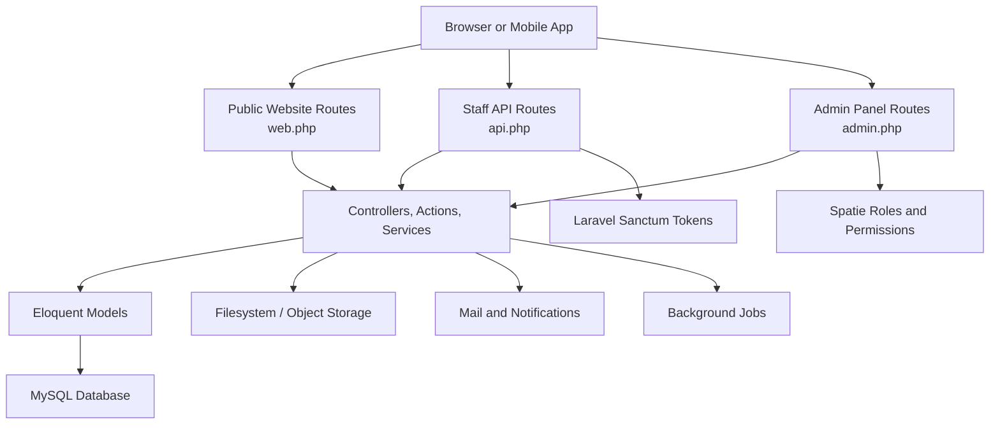
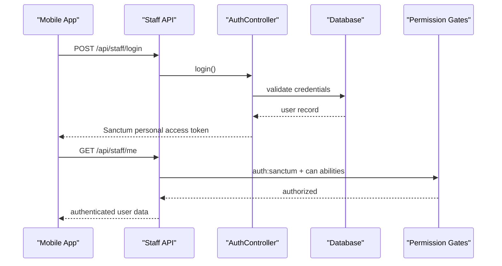
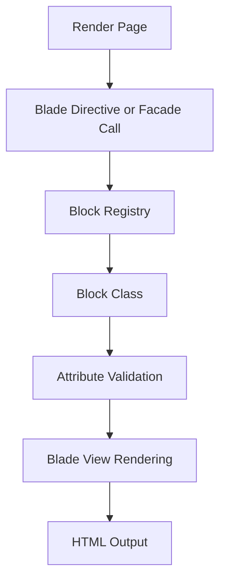

# Getting Started

<cite>
**Referenced Files in This Document**
- [composer.json](file://composer.json)
- [.env.example](file://.env.example)
- [docker-compose.yml](file://docker-compose.yml)
- [Dockerfile](file://Dockerfile)
- [docker/entrypoint.sh](file://docker/entrypoint.sh)
- [package.json](file://package.json)
- [vite.config.js](file://vite.config.js)
- [bootstrap/app.php](file://bootstrap/app.php)
- [routes/web.php](file://routes/web.php)
- [routes/api.php](file://routes/api.php)
- [routes/admin.php](file://routes/admin.php)
- [routes/settings.php](file://routes/settings.php)
- [database/seeders/DatabaseSeeder.php](file://database/seeders/DatabaseSeeder.php)
- [packages/ContentBlocks/composer.json](file://packages/ContentBlocks/composer.json)
- [packages/ContentBlocks/README.md](file://packages/ContentBlocks/README.md)
- [config/database.php](file://config/database.php)
- [config/filesystems.php](file://config/filesystems.php)
</cite>

## Table of Contents
1. [Introduction](#introduction)
2. [Project Structure](#project-structure)
3. [Prerequisites](#prerequisites)
4. [Installation](#installation)
5. [Environment Configuration](#environment-configuration)
6. [Starting the Development Server](#starting-the-development-server)
7. [Basic Usage](#basic-usage)
8. [Content Block System Overview](#content-block-system-overview)
9. [Troubleshooting](#troubleshooting)
10. [Conclusion](#conclusion)

## Introduction
Highblossom is a full-stack business management platform for architectural glass and aluminum solutions. It provides:

- A public website for visitors to browse services, gallery, blog posts, quotes, contact forms, bookings, polls, and SEO assets such as sitemap and robots files.
- An admin panel built on Laravel AdminLTE for managing bookings, inspections, quotes, staff, partners, services, glass types, gallery content, testimonials, blog posts, categories, tags, settings, and security policies.
- A token-authenticated staff mobile app API under `/api/staff`, exposing read/write endpoints for bookings, inspections, quotes, contact messages, testimonials, blog moderation, team members, partners, and gallery assets.
- A reusable local Composer package called `highblossom/content-blocks` that renders structured content blocks through Blade directives and service classes.

At its core, Highblossom uses Laravel 13 with PHP 8.2+, Livewire, Alpine.js, Tailwind CSS v4 for the public site, Bootstrap and AdminLTE for the admin panel, Sanctum for the staff API, Spatie permissions for authorization, Fortify for authentication flows including passkeys, and MySQL as the primary database in Dockerized deployments.

This guide helps you install, configure, and run the application locally, then explore both the public website and the admin panel.

## Project Structure
The project follows a standard Laravel layout with additional structure for multi-scope routes, a local package, and layered concerns:

| Area | Purpose |
|---|---|
| `app/` | Application code organized by concern: actions, controllers, models, services, listeners, jobs, middleware, Livewire components, mail, view composers, support helpers, providers, rules, enums, events, and console commands. |
| `config/` | Framework and third-party configuration files for database, cache, queue, mail, filesystems, Fortify, session, permissions, SEO, logging, and more. |
| `database/` | Migrations, factories, and seeders. The default seeder creates an initial user and runs several domain seeders. |
| `docker/` | Container entrypoint, Nginx configuration, and Supervisor configuration for running web, queue, and scheduler processes. |
| `lang/en/` | English language strings for admin panels, authentication, booking flows, validation, and site content. |
| `packages/ContentBlocks/` | Local Composer package providing a content block template system with Blade directives and auto-registration. |
| `public/` | Web root with `index.php`, generated build assets, and JavaScript utilities for media uploads. |
| `resources/` | Source CSS, JavaScript, Blade views, brand icons, and component templates. |
| `routes/` | Route definitions split across public web routes, staff API routes, admin panel routes, settings routes, and console routes. |
| `storage/` | Generated framework cache, sessions, views, logs, and uploaded or temporary files. |



**Diagram sources**
- [bootstrap/app.php:12-35](file://bootstrap/app.php#L12-L35)
- [routes/web.php:1-76](file://routes/web.php#L1-L76)
- [routes/api.php:1-117](file://routes/api.php#L1-L117)
- [routes/admin.php:1-171](file://routes/admin.php#L1-L171)

**Section sources**
- [composer.json:1-138](file://composer.json#L1-L138)
- [bootstrap/app.php:1-71](file://bootstrap/app.php#L1-L71)
- [routes/web.php:1-76](file://routes/web.php#L1-L76)
- [routes/api.php:1-117](file://routes/api.php#L1-L117)
- [routes/admin.php:1-171](file://routes/admin.php#L1-L171)

## Prerequisites
Before installing Highblossom, ensure your machine has the following:

| Requirement | Notes |
|---|---|
| PHP 8.2 or higher | Required by the project; Docker image uses PHP 8.4 FPM. |
| Composer | For dependency installation and package discovery. |
| Node.js and npm | Required for Vite asset compilation; the Docker build uses Node 22. |
| MySQL | Recommended for production-style setups; SQLite is available for quick local development through `.env`. |
| Docker and Docker Compose | Optional but recommended for a complete environment with MySQL, Nginx, PHP-FPM, queue worker, and scheduler. |
| Git | Useful for cloning the repository and reviewing migrations or seeders. |

Key requirements come from:

- PHP version constraint: `^8.2`.
- Laravel 13 framework.
- Node 22 used during the Docker asset build stage.
- MySQL 8.4 image used by the Docker Compose stack.

**Section sources**
- [composer.json:7-29](file://composer.json#L7-L29)
- [Dockerfile:1-32](file://Dockerfile#L1-L32)
- [docker-compose.yml:1-31](file://docker-compose.yml#L1-L31)

## Installation

### Option A: Install Locally Without Docker
Use this option if you already have PHP, MySQL, and Node installed.

1. Clone or copy the repository into your preferred directory.
2. Install PHP dependencies:

   ```bash
   composer install
   ```

3. Copy the environment file:

   ```bash
   cp .env.example .env
   ```

4. Generate the application key:

   ```bash
   php artisan key:generate
   ```

5. Configure your database connection in `.env`:
   - Set `DB_CONNECTION=mysql`.
   - Set `DB_HOST`, `DB_PORT`, `DB_DATABASE`, `DB_USERNAME`, and `DB_PASSWORD`.
   - If using SQLite, keep `DB_CONNECTION=sqlite`; the container entrypoint also touches the SQLite file automatically.

6. Create the database if required by your MySQL setup.

7. Run database migrations:

   ```bash
   php artisan migrate --force
   ```

8. Seed the database:

   ```bash
   php artisan db:seed
   ```

   The default seeder creates a sample user and seeds company data, roles and permissions, gallery categories, about-us content, glass types, service types, services, SEO static routes, and application versions.

9. Install frontend dependencies and compile assets:

   ```bash
   npm install
   npm run build
   ```

10. Start the Laravel development server:

    ```bash
    php artisan serve
    ```

11. Optionally start asset hot-reloading separately:

    ```bash
    npm run dev
    ```

### Option B: Install With Docker
Use this option if you want a consistent environment without manually installing PHP, MySQL, or Node.

1. Build and start the containers:

   ```bash
   docker compose up --build
   ```

2. The application will be available at port `8080` unless overridden by `APP_PORT` in `.env`.

3. The Docker entrypoint attempts to run migrations automatically while waiting for MySQL to become reachable.

4. If you need to seed the database inside the running container:

   ```bash
   docker compose exec app php artisan db:seed
   ```

5. To stop the environment:

   ```bash
   docker compose down
   ```

The Docker Compose stack exposes port `8080` and includes a MySQL container named `db` with database `app`, user `app`, and password `secret`. The application container runs Nginx, PHP-FPM, queue processing, and scheduling under Supervisor.

**Section sources**
- [composer.json:85-138](file://composer.json#L85-L138)
- [.env.example:1-83](file://.env.example#L1-L83)
- [docker-compose.yml:1-31](file://docker-compose.yml#L1-L31)
- [Dockerfile:1-32](file://Dockerfile#L1-L32)
- [docker/entrypoint.sh:1-20](file://docker/entrypoint.sh#L1-L20)
- [database/seeders/DatabaseSeeder.php:1-37](file://database/seeders/DatabaseSeeder.php#L1-L37)

## Environment Configuration
The `.env.example` file documents most environment variables. The most important ones for getting started are:

| Variable | Default or Example | Purpose |
|---|---:|---|
| `APP_NAME` | `Laravel` | Application display name. |
| `APP_ENV` | `local` | Environment label. |
| `APP_KEY` | Empty after copy | Encryption key generated by `php artisan key:generate`. |
| `APP_DEBUG` | `true` | Enable detailed error output during development. |
| `APP_URL` | `http://localhost` | Base URL used by the framework. |
| `DB_CONNECTION` | `sqlite` | Use `mysql` for production-style environments. |
| `DB_HOST`, `DB_PORT`, `DB_DATABASE`, `DB_USERNAME`, `DB_PASSWORD` | MySQL defaults when enabled | Database connection details. |
| `SESSION_DRIVER` | `database` | Stores sessions in the database. |
| `QUEUE_CONNECTION` | `database` | Uses database-backed queues. |
| `FILESYSTEM_DISK` | `local` | Default disk driver. |
| `PUBLIC_DISK_DRIVER` | `local` | Controls whether public uploads use local storage or S3-compatible object storage. |
| `MAIL_MAILER` | `log` | Development mailer writes to log instead of sending real email. |
| `AWS_ACCESS_KEY_ID`, `AWS_SECRET_KEY`, `AWS_BUCKET`, `AWS_URL` | Empty | Used when `PUBLIC_DISK_DRIVER=s3`. |

For local development:

- Keep `DB_CONNECTION=sqlite` for zero-setup databases, or switch to MySQL by uncommenting the MySQL fields.
- Keep `PUBLIC_DISK_DRIVER=local` so uploads appear under the public storage symlink.
- Keep `MAIL_MAILER=log` so emails do not send during normal development.

For Docker:

- `docker-compose.yml` overrides `DB_CONNECTION=mysql`, `DB_HOST=db`, `DB_DATABASE=app`, `DB_USERNAME=app`, and `DB_PASSWORD=secret`.
- `APP_PORT` controls the host port mapped to the container’s port `8080`.

For production-like object storage:

- Set `PUBLIC_DISK_DRIVER=s3`.
- Provide AWS credentials and bucket information.
- Ensure `AWS_DEFAULT_REGION=auto` and set `AWS_URL` to the public read URL of the bucket.

**Section sources**
- [.env.example:1-83](file://.env.example#L1-L83)
- [config/database.php:1-80](file://config/database.php#L1-L80)
- [config/filesystems.php:1-60](file://config/filesystems.php#L1-L60)
- [docker-compose.yml:1-31](file://docker-compose.yml#L1-L31)

## Starting the Development Server

### Local Development Workflow
After installation, the typical workflow is:

1. Run migrations and seeders once:

   ```bash
   php artisan migrate --force
   php artisan db:seed
   ```

2. Start the HTTP server:

   ```bash
   php artisan serve
   ```

3. Start asset hot-reload:

   ```bash
   npm run dev
   ```

4. Optionally start background workers:

   ```bash
   php artisan queue:listen
   php artisan pail
   ```

The `composer.json` scripts define a combined development command that starts the server, queue listener, log tailer, and Vite development server together.

### Docker Development Workflow
With Docker:

1. Start the stack:

   ```bash
   docker compose up --build
   ```

2. Visit `http://localhost:8080`.

3. The container runs web, queue, and scheduler processes through Supervisor.

4. If you need to run tasks interactively:

   ```bash
   docker compose exec app php artisan tinker
   ```

**Section sources**
- [composer.json:85-118](file://composer.json#L85-L118)
- [docker-compose.yml:1-31](file://docker-compose.yml#L1-L31)
- [docker/entrypoint.sh:1-20](file://docker/entrypoint.sh#L1-L20)

## Basic Usage

### Public Website
After startup, open the base URL in your browser. The public website exposes:

| Route | Method | Description |
|---|---|---|
| `/` | GET | Home page. |
| `/about-us` | GET | About us content page. |
| `/services` | GET | Services listing. |
| `/gallery` | GET | Gallery listing. |
| `/gallery/{image}` | GET | Individual gallery item. |
| `/quote` | GET | Quote request form. |
| `/contact` | GET | Contact form. |
| `/terms` | GET | Terms page. |
| `/privacy` | GET | Privacy page. |
| `/blog` | GET | Blog listing. |
| `/blog/{slug}` | GET | Single blog post. |
| `/bookings/create` | GET | Booking creation form. |
| `/sitemap.xml` | GET | Sitemap. |
| `/robots.txt` | GET | Robots file. |
| `/site.webmanifest` | GET | Web manifest. |

Public APIs include:

| Route | Method | Description |
|---|---|---|
| `/api/blog/search` | GET | Throttled blog search endpoint. |
| `/api/bookings/availability` | GET | Availability lookup. |
| `/api/bookings/calendar` | GET | Calendar availability. |
| `/api/content-blocks/poll/{poll}` | POST | Vote on a poll. |
| `/api/content-blocks/poll/{poll}/results` | GET | Poll results. |
| `/api/glass-types/{glassType}/sub-categories` | GET | Glass type subcategories. |

These routes are defined in the public web route file and are intentionally separate from the staff API prefix.

### Admin Panel
The admin panel is protected by authentication and authorization.

To access it:

1. Log in through the application’s authentication flow.
2. Navigate to `/admin`.
3. The route group requires authentication, consent handling where applicable, verification where required, and the `access admin panel` permission.

The admin panel covers:

- Bookings, closures, inspections, absences.
- Quotes and status updates.
- Testimonials, services, glass types, and glass subcategories.
- Blog posts, categories, and tags.
- Staff and partner management.
- Gallery and gallery categories.
- Company settings, password policy, application versions.
- SEO, cache tools, sorting order reports, and navigation layout options.

Authorization is enforced through Spatie roles and permissions, applied through middleware aliases registered in the application bootstrap.

### Staff Mobile App API
The staff API lives under `/api/staff` and uses Sanctum tokens.

Typical flow:



**Diagram sources**
- [routes/api.php:1-117](file://routes/api.php#L1-L117)
- [bootstrap/app.php:37-50](file://bootstrap/app.php#L37-L50)

The API supports:

- Login, two-factor challenge, logout, and current-user inspection.
- Dashboard counts.
- CRUD operations for bookings, inspections, quotes, contact messages, testimonials, blog posts, categories, tags, team members, partners, and gallery items.
- Permission gates such as `view bookings`, `update bookings`, `manage settings`, `view gallery`, and `manage gallery`.

**Section sources**
- [routes/web.php:1-76](file://routes/web.php#L1-L76)
- [routes/api.php:1-117](file://routes/api.php#L1-L117)
- [routes/admin.php:1-171](file://routes/admin.php#L1-L171)
- [bootstrap/app.php:12-50](file://bootstrap/app.php#L12-L50)

## Content Block System Overview
Highblossom includes a local package called `highblossom/content-blocks` under `packages/ContentBlocks`. It provides:

- A singleton-based block registry.
- Blade directives for rendering blocks.
- Service classes for rendering single or multiple blocks.
- Validation and type casting for block attributes.
- Auto-registration through a Laravel service provider.

The package is added to the main project through a path repository pointing at `packages/ContentBlocks`. Its provider registers itself via the `extra.laravel.providers` section.

Available block types include paragraph, image, heading, quote, code, list, CTA, video, accordion, carousel, columns, countdown, divider, embed, form, gallery, HTML, table, tabs, and poll.



**Diagram sources**
- [packages/ContentBlocks/composer.json:1-31](file://packages/ContentBlocks/composer.json#L1-L31)
- [packages/ContentBlocks/README.md:1-200](file://packages/ContentBlocks/README.md#L1-L200)

**Section sources**
- [composer.json:9-17](file://composer.json#L9-L17)
- [packages/ContentBlocks/composer.json:1-31](file://packages/ContentBlocks/composer.json#L1-L31)
- [packages/ContentBlocks/README.md:1-200](file://packages/ContentBlocks/README.md#L1-L200)

## Troubleshooting

### `APP_KEY` Is Not Set
**Symptom:** Requests fail early or encryption-related errors occur.  
**Fix:** Run `php artisan key:generate`.

**Section sources**
- [composer.json:96-100](file://composer.json#L96-L100)

### Database Connection Fails
**Symptoms:** Migration errors, connection refused, or wrong database selected.  
**Checks:**
- Confirm `DB_CONNECTION` matches your intended database.
- For MySQL, verify host, port, database name, username, and password.
- In Docker, confirm the database container is healthy and reachable as `db`.

**Section sources**
- [.env.example:18-36](file://.env.example#L18-L36)
- [config/database.php:1-80](file://config/database.php#L1-L80)
- [docker-compose.yml:13-31](file://docker-compose.yml#L13-L31)

### Assets Are Missing or Outdated
**Symptoms:** Styles or JavaScript do not load correctly.  
**Fix:**
- Install frontend dependencies: `npm install`.
- Compile assets: `npm run build`.
- For development, run `npm run dev` alongside the server.

**Section sources**
- [package.json:1-35](file://package.json#L1-L35)
- [vite.config.js:1-33](file://vite.config.js#L1-L33)

### File Uploads Do Not Appear
**Symptoms:** Uploaded images or videos are not visible.  
**Likely causes:**
- `PUBLIC_DISK_DRIVER` is set incorrectly.
- The public storage symlink is missing in development.
- Object storage credentials are missing or incorrect in production.

**Fixes:**
- Keep `PUBLIC_DISK_DRIVER=local` for local development.
- Ensure the public storage link exists for local uploads.
- For production, set `PUBLIC_DISK_DRIVER=s3` and provide AWS credentials and bucket URL.

**Section sources**
- [.env.example:58-83](file://.env.example#L58-L83)
- [config/filesystems.php:1-60](file://config/filesystems.php#L1-L60)

### Admin Panel Shows Authorization Errors
**Symptoms:** Access denied when visiting `/admin` routes.  
**Likely cause:** The logged-in user lacks the required role or permission.  
**Fix:**
- Run the seeders to create default roles, permissions, and test data.
- Verify the user has been granted the necessary abilities.

**Section sources**
- [routes/admin.php:20-171](file://routes/admin.php#L20-L171)
- [database/seeders/DatabaseSeeder.php:17-37](file://database/seeders/DatabaseSeeder.php#L17-L37)

### Staff API Returns Unauthorized or Forbidden
**Symptoms:** `/api/staff/*` returns authentication or authorization failures.  
**Likely causes:**
- Missing or invalid Sanctum token.
- User lacks required Spatie permissions.
- CSRF or state issues when calling Sanctum from another origin.

**Fixes:**
- Authenticate first through `/api/staff/login`.
- Include the Sanctum token in subsequent requests.
- Ensure the user has the required abilities such as `view bookings`, `manage settings`, or `manage gallery`.

**Section sources**
- [routes/api.php:1-117](file://routes/api.php#L1-L117)
- [bootstrap/app.php:37-50](file://bootstrap/app.php#L37-L50)

### Docker Migrations Fail Because MySQL Is Not Ready
**Symptoms:** Container exits or logs show migration failure due to unreachable database.  
**Behavior:** The entrypoint retries migrations for about 40 seconds before giving up.  
**Fixes:**
- Wait for the MySQL container to start.
- Re-run migrations manually: `docker compose exec app php artisan migrate --force`.
- Check the database container logs for initialization errors.

**Section sources**
- [docker/entrypoint.sh:1-20](file://docker/entrypoint.sh#L1-L20)
- [docker-compose.yml:13-31](file://docker-compose.yml#L13-L31)

### Email Does Not Send During Development
**Symptom:** Contact forms or notifications appear to succeed but no email arrives.  
**Cause:** `MAIL_MAILER=log` sends mail to the log instead of an SMTP server.  
**Fix:** Configure an actual mailer for testing delivery, or inspect the application logs.

**Section sources**
- [.env.example:40-56](file://.env.example#L40-L56)

## Conclusion
You now have the essential knowledge to install Highblossom, configure its environment, start the development server, and explore the public website, admin panel, and staff API. The application is designed around clear separation between public pages, administrative interfaces, mobile app endpoints, and a reusable content block system. When extending the platform, focus on adding models and services under `app/`, registering routes under the appropriate route file, and using the existing permission and filesystem abstractions for secure, maintainable growth.