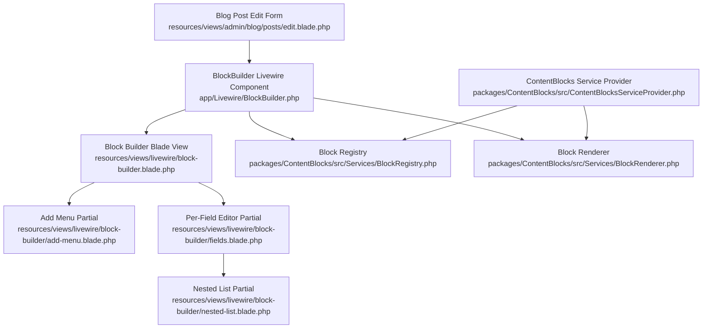
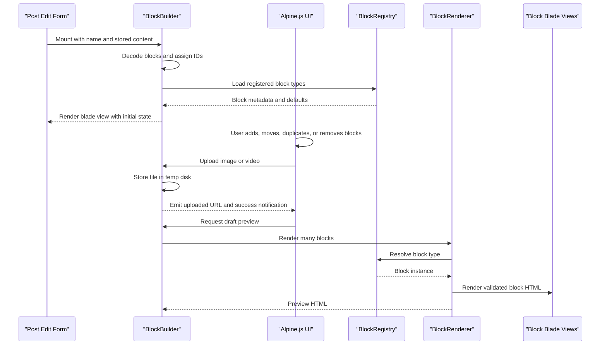
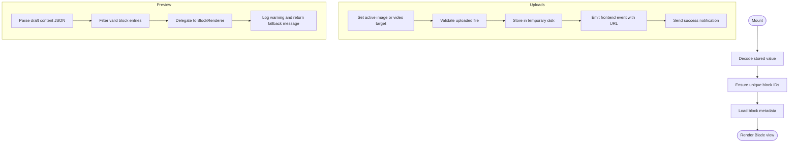
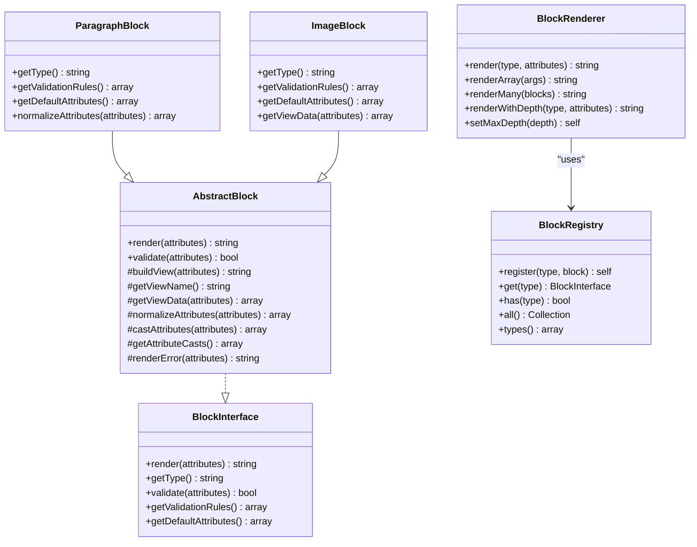
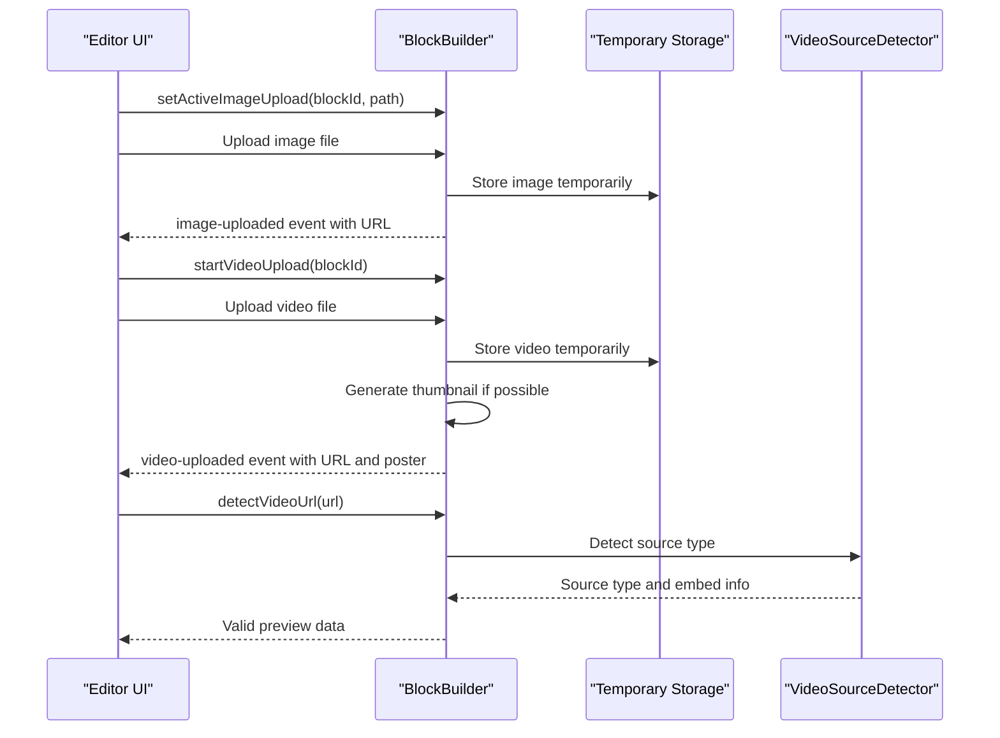
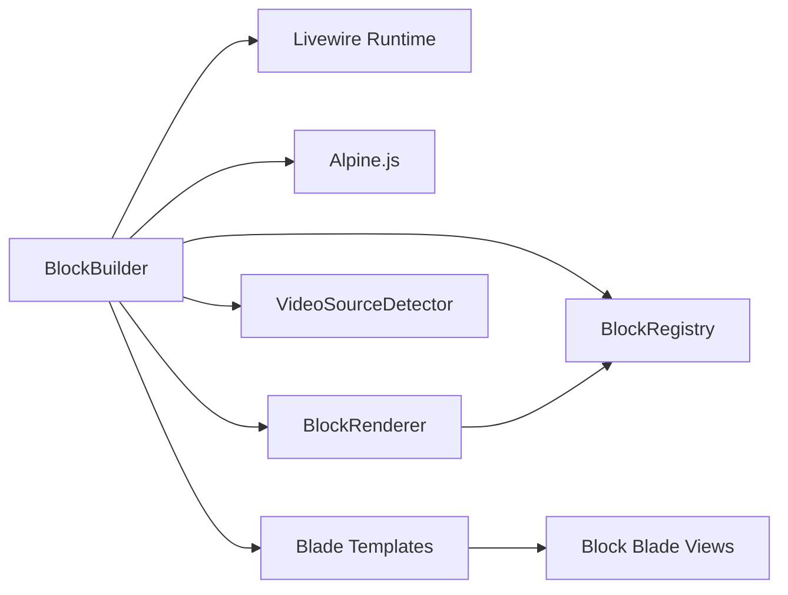

# Block Builder Component

<cite>
**Referenced Files in This Document**
- [BlockBuilder.php](file://app/Livewire/BlockBuilder.php)
- [block-builder.blade.php](file://resources/views/livewire/block-builder.blade.php)
- [add-menu.blade.php](file://resources/views/livewire/block-builder/add-menu.blade.php)
- [fields.blade.php](file://resources/views/livewire/block-builder/fields.blade.php)
- [nested-list.blade.php](file://resources/views/livewire/block-builder/nested-list.blade.php)
- [edit.blade.php](file://resources/views/admin/blog/posts/edit.blade.php)
- [VideoSourceType.php](file://app/Enums/VideoSourceType.php)
- [VideoSourceDetector.php](file://app/Services/VideoSourceDetector.php)
- [content-blocks.php](file://packages/ContentBlocks/config/content-blocks.php)
- [ContentBlocksServiceProvider.php](file://packages/ContentBlocks/src/ContentBlocksServiceProvider.php)
- [BlockRegistry.php](file://packages/ContentBlocks/src/Services/BlockRegistry.php)
- [BlockRenderer.php](file://packages/ContentBlocks/src/Services/BlockRenderer.php)
- [BlockInterface.php](file://packages/ContentBlocks/src/Contracts/BlockInterface.php)
- [AbstractBlock.php](file://packages/ContentBlocks/src/Services/AbstractBlock.php)
- [ParagraphBlock.php](file://packages/ContentBlocks/src/Blocks/ParagraphBlock.php)
- [ImageBlock.php](file://packages/ContentBlocks/src/Blocks/ImageBlock.php)
</cite>

## Table of Contents
1. [Introduction](#introduction)
2. [Project Structure](#project-structure)
3. [Core Components](#core-components)
4. [Architecture Overview](#architecture-overview)
5. [Detailed Component Analysis](#detailed-component-analysis)
6. [Dependency Analysis](#dependency-analysis)
7. [Performance Considerations](#performance-considerations)
8. [Troubleshooting Guide](#troubleshooting-guide)
9. [Conclusion](#conclusion)
10. [Appendices](#appendices)

## Introduction
The `BlockBuilder` Livewire component is the main editor for structured, drag-and-drop content blocks. It powers the content management interface used by the blog post editor and integrates with the `highblossom/content-blocks` package to register, validate, render, and preview block types. The component owns a list of blocks, exposes upload endpoints for images and videos, maps validation errors back to individual blocks, and delegates production rendering to the ContentBlocks renderer.

Its primary responsibilities are:
- Loading and normalizing stored block data.
- Building metadata for each registered block type.
- Handling image and video uploads through temporary storage.
- Detecting and validating video URLs for live previews.
- Rendering a draft preview using the same renderer that produces published content.
- Delegating most user interactions such as adding, reordering, duplicating, and removing blocks to client-side Alpine.js logic.

## Project Structure
At a high level, the builder consists of:
- A Livewire PHP component holding state and server actions.
- Blade templates providing the visual editor, add menu, per-field editors, nested list support, and preview modal.
- Integration into the blog post edit form through a hidden input that stores JSON-encoded blocks.
- The ContentBlocks package providing block registration, rendering, configuration, and default block implementations.

**Diagram sources**
- [edit.blade.php:55-65](file://resources/views/admin/blog/posts/edit.blade.php#L55-L65)
- [BlockBuilder.php:1-60](file://app/Livewire/BlockBuilder.php#L1-L60)
- [block-builder.blade.php:1-30](file://resources/views/livewire/block-builder.blade.php#L1-L30)
- [add-menu.blade.php:1-34](file://resources/views/livewire/block-builder/add-menu.blade.php#L1-L34)
- [fields.blade.php:1-20](file://resources/views/livewire/block-builder/fields.blade.php#L1-L20)
- [nested-list.blade.php:1-20](file://resources/views/livewire/block-builder/nested-list.blade.php#L1-L20)
- [BlockRegistry.php:1-66](file://packages/ContentBlocks/src/Services/BlockRegistry.php#L1-L66)
- [BlockRenderer.php:1-96](file://packages/ContentBlocks/src/Services/BlockRenderer.php#L1-L96)
- [ContentBlocksServiceProvider.php:1-40](file://packages/ContentBlocks/src/ContentBlocksServiceProvider.php#L1-L40)

**Section sources**
- [BlockBuilder.php:1-60](file://app/Livewire/BlockBuilder.php#L1-L60)
- [block-builder.blade.php:1-30](file://resources/views/livewire/block-builder.blade.php#L1-L30)
- [edit.blade.php:55-65](file://resources/views/admin/blog/posts/edit.blade.php#L55-L65)

## Core Components
The core implementation is split between the Livewire component and the ContentBlocks package:

| Area | Responsibility | Key Files |
|---|---|---|
| Livewire state and actions | Owns block list, upload state, validation error mapping, preview rendering, and view rendering | [BlockBuilder.php](file://app/Livewire/BlockBuilder.php) |
| UI layer | Drag-and-drop list, field editors, add menu, nested lists, preview modal | [block-builder.blade.php](file://resources/views/livewire/block-builder.blade.php), [fields.blade.php](file://resources/views/livewire/block-builder/fields.blade.php), [add-menu.blade.php](file://resources/views/livewire/block-builder/add-menu.blade.php), [nested-list.blade.php](file://resources/views/livewire/block-builder/nested-list.blade.php) |
| Block registration | Discovers, registers, and exposes block types | [ContentBlocksServiceProvider.php](file://packages/ContentBlocks/src/ContentBlocksServiceProvider.php), [BlockRegistry.php](file://packages/ContentBlocks/src/Services/BlockRegistry.php) |
| Block rendering | Renders blocks safely with validation, fallbacks, and depth protection | [BlockRenderer.php](file://packages/ContentBlocks/src/Services/BlockRenderer.php), [AbstractBlock.php](file://packages/ContentBlocks/src/Services/AbstractBlock.php) |
| Block contracts | Defines the interface every block must implement | [BlockInterface.php](file://packages/ContentBlocks/src/Contracts/BlockInterface.php) |
| Example blocks | Provide defaults, validation rules, attribute casts, and rendering behavior | [ParagraphBlock.php](file://packages/ContentBlocks/src/Blocks/ParagraphBlock.php), [ImageBlock.php](file://packages/ContentBlocks/src/Blocks/ImageBlock.php) |
| Video support | Detects supported video sources and generates embed information | [VideoSourceDetector.php](file://app/Services/VideoSourceDetector.php), [VideoSourceType.php](file://app/Enums/VideoSourceType.php) |

**Section sources**
- [BlockBuilder.php:1-60](file://app/Livewire/BlockBuilder.php#L1-L60)
- [BlockInterface.php:1-36](file://packages/ContentBlocks/src/Contracts/BlockInterface.php#L1-L36)
- [AbstractBlock.php:1-60](file://packages/ContentBlocks/src/Services/AbstractBlock.php#L1-L60)

## Architecture Overview
The builder follows a layered architecture:

1. **Form integration**: The blog post edit form injects the `BlockBuilder` component with a name and existing value.
2. **Livewire state**: The component decodes stored JSON into an array of blocks, ensures unique IDs, loads registry metadata, and renders its Blade view.
3. **Client-side composition**: Alpine.js manages the block list, drag-and-drop ordering, duplication, removal, collapse state, and field binding.
4. **Upload pipeline**: Images and videos are uploaded to temporary storage; the component emits frontend events so the UI can update previews immediately.
5. **Preview pipeline**: Draft previews decode JSON, filter valid blocks, and delegate rendering to `BlockRenderer::renderMany`.
6. **Package rendering**: The ContentBlocks package resolves block types from the registry and renders their Blade views with validated attributes.

**Diagram sources**
- [BlockBuilder.php:80-140](file://app/Livewire/BlockBuilder.php#L80-L140)
- [BlockBuilder.php:201-360](file://app/Livewire/BlockBuilder.php#L201-L360)
- [BlockBuilder.php:360-431](file://app/Livewire/BlockBuilder.php#L360-L431)
- [BlockRegistry.php:12-66](file://packages/ContentBlocks/src/Services/BlockRegistry.php#L12-L66)
- [BlockRenderer.php:20-96](file://packages/ContentBlocks/src/Services/BlockRenderer.php#L20-L96)

## Detailed Component Analysis

### BlockBuilder Livewire Component
The `BlockBuilder` component holds:
- A locked field name for the parent form.
- A mutable array of blocks.
- Image and video upload properties with validation attributes.
- Per-type metadata including labels, editable flags, defaults, and required fields.
- Per-block validation messages mapped by block ID.

Key behaviors include:
- Decoding incoming values as either arrays or JSON strings.
- Ensuring every block has a unique ID.
- Loading block metadata from the registry.
- Mapping Livewire validation errors keyed by block index back to block IDs.
- Managing active upload targets for images and videos.
- Generating thumbnails for uploaded videos using FFmpeg when available.
- Detecting video source types and returning embed information.
- Rendering a safe draft preview with size and structure guards.

**Diagram sources**
- [BlockBuilder.php:80-140](file://app/Livewire/BlockBuilder.php#L80-L140)
- [BlockBuilder.php:201-360](file://app/Livewire/BlockBuilder.php#L201-L360)
- [BlockBuilder.php:360-431](file://app/Livewire/BlockBuilder.php#L360-L431)

#### State Management
- `name`: The form field name used to store blocks.
- `blocks`: Array of block objects containing at least `type`, `id`, and `attributes`.
- `imageUpload`, `activeImageUploadId`, `activeImageUploadPath`: Controls targeted image uploads.
- `videoUpload`, `uploadingVideoBlockId`: Controls video upload targeting.
- `blockMeta`: Server-provided metadata about each block type.
- `blockErrors`: Validation messages grouped by block ID.

Validation rules are applied to uploaded files rather than directly to the full block payload inside this component. The component also extracts top-level required fields from block validation rules to inform the UI about mandatory attributes.

#### Drag-and-Drop and Ordering
Drag-and-drop operations are intentionally performed on the client side through Alpine.js. The PHP component contains a comment indicating that manipulation methods were moved to the browser for performance. Ordering is therefore represented by the order of items in the JavaScript-managed `blocks` array, which is serialized into the hidden form input.

#### Validation and Error Mapping
When the parent form validates block attributes, Livewire flashes errors under paths like `content.{index}.attributes`. The component maps these indexed errors to block IDs so the UI can display per-block validation feedback.

#### Preview Rendering
The preview endpoint accepts raw JSON content, enforces a maximum size, filters out invalid entries, and calls the package renderer. Errors during preview rendering are logged and replaced with a friendly fallback message.

**Section sources**
- [BlockBuilder.php:1-60](file://app/Livewire/BlockBuilder.php#L1-L60)
- [BlockBuilder.php:80-140](file://app/Livewire/BlockBuilder.php#L80-L140)
- [BlockBuilder.php:201-360](file://app/Livewire/BlockBuilder.php#L201-L360)
- [BlockBuilder.php:360-431](file://app/Livewire/BlockBuilder.php#L360-L431)

### ContentBlocks Package Relationship
The builder depends on the ContentBlocks package for:
- Discovering registered block types.
- Reading block defaults and validation rules.
- Rendering blocks consistently in both preview and production contexts.

The service provider registers the registry and renderer as singletons, auto-registers default blocks, publishes configuration, and registers Blade directives for block rendering.

**Diagram sources**
- [BlockInterface.php:1-36](file://packages/ContentBlocks/src/Contracts/BlockInterface.php#L1-L36)
- [AbstractBlock.php:1-162](file://packages/ContentBlocks/src/Services/AbstractBlock.php#L1-L162)
- [ParagraphBlock.php:1-79](file://packages/ContentBlocks/src/Blocks/ParagraphBlock.php#L1-L79)
- [ImageBlock.php:1-97](file://packages/ContentBlocks/src/Blocks/ImageBlock.php#L1-L97)
- [BlockRegistry.php:1-66](file://packages/ContentBlocks/src/Services/BlockRegistry.php#L1-L66)
- [BlockRenderer.php:1-96](file://packages/ContentBlocks/src/Services/BlockRenderer.php#L1-L96)

**Section sources**
- [ContentBlocksServiceProvider.php:1-199](file://packages/ContentBlocks/src/ContentBlocksServiceProvider.php#L1-L199)
- [BlockRegistry.php:1-66](file://packages/ContentBlocks/src/Services/BlockRegistry.php#L1-L66)
- [BlockRenderer.php:1-96](file://packages/ContentBlocks/src/Services/BlockRenderer.php#L1-L96)

### Block Registration System
The package automatically registers a set of built-in block types unless disabled by configuration. Each registration associates a string type identifier with a block instance. The `BlockBuilder` queries the registry to build its metadata, which determines:
- Whether a block appears in the add menu.
- Which blocks have inline editors.
- Default attribute values.
- Required top-level fields derived from validation rules.

Configuration options include:
- Directive prefix for Blade directives.
- View namespace for block templates.
- Auto-registration flag.
- Registry cache flag.
- Debug mode for invalid blocks.
- Temp upload cleanup settings.
- HTML sanitization settings.
- oEmbed provider configuration.
- Form block behavior.

**Section sources**
- [ContentBlocksServiceProvider.php:70-199](file://packages/ContentBlocks/src/ContentBlocksServiceProvider.php#L70-L199)
- [content-blocks.php:1-140](file://packages/ContentBlocks/config/content-blocks.php#L1-L140)
- [BlockBuilder.php:100-140](file://app/Livewire/BlockBuilder.php#L100-L140)

### Drag-and-Drop Functionality
The UI uses HTML5 drag attributes and Alpine.js bindings. Each block header includes a draggable handle. When dragging starts, the current index is recorded; when dropping, the new position is applied locally. Additional controls allow moving blocks up or down, duplicating them, collapsing their editor panel, and removing them with undo support.

Because manipulation logic was moved to the client, the PHP component avoids expensive array operations on every interaction. The persisted order is determined by the final client-side array before submission.

**Section sources**
- [block-builder.blade.php:30-120](file://resources/views/livewire/block-builder.blade.php#L30-L120)
- [BlockBuilder.php:201-210](file://app/Livewire/BlockBuilder.php#L201-L210)

### Block Configuration Interfaces
Each block implements the `BlockInterface`. Concrete blocks extend `AbstractBlock`, which provides:
- Attribute normalization merging defaults with supplied values.
- Type casting for common scalar and array types.
- Validation using Laravel’s validator.
- View resolution based on class naming conventions.
- Safe error rendering controlled by configuration debug mode.

Example blocks demonstrate how to define:
- Type identifiers.
- Validation rules.
- Default attributes.
- Attribute casts.
- Custom normalization or view data transformation.

**Section sources**
- [BlockInterface.php:1-36](file://packages/ContentBlocks/src/Contracts/BlockInterface.php#L1-L36)
- [AbstractBlock.php:1-162](file://packages/ContentBlocks/src/Services/AbstractBlock.php#L1-L162)
- [ParagraphBlock.php:1-79](file://packages/ContentBlocks/src/Blocks/ParagraphBlock.php#L1-L79)
- [ImageBlock.php:1-97](file://packages/ContentBlocks/src/Blocks/ImageBlock.php#L1-L97)

### Preview Rendering
The preview flow supports draft content without persisting it first:
1. The Blade view opens a modal and requests rendered preview HTML.
2. The component parses the raw JSON content.
3. Invalid entries are filtered out.
4. The renderer renders all remaining blocks.
5. Errors are caught, logged, and replaced with a safe fallback message.

This ensures the preview reflects the same rendering path as production content while protecting against malformed or oversized payloads.

**Section sources**
- [BlockBuilder.php:360-431](file://app/Livewire/BlockBuilder.php#L360-L431)
- [BlockRenderer.php:60-96](file://packages/ContentBlocks/src/Services/BlockRenderer.php#L60-L96)

### File Upload and Media Handling
Images and videos use Livewire’s file upload system:
- Images are validated as images with MIME and size constraints.
- Videos are validated as media files with MIME and size constraints.
- Both are stored under temporary storage locations.
- Frontend events carry the temporary URL so the editor can show immediate previews.
- Thumbnails are generated for local videos when FFmpeg is available.
- Video URL detection supports YouTube, Vimeo, Dailymotion, Facebook, direct URLs, and local files.

**Diagram sources**
- [BlockBuilder.php:201-360](file://app/Livewire/BlockBuilder.php#L201-L360)
- [VideoSourceDetector.php:1-80](file://app/Services/VideoSourceDetector.php#L1-L80)
- [VideoSourceType.php:1-46](file://app/Enums/VideoSourceType.php#L1-L46)

**Section sources**
- [BlockBuilder.php:201-360](file://app/Livewire/BlockBuilder.php#L201-L360)
- [VideoSourceType.php:1-46](file://app/Enums/VideoSourceType.php#L1-L46)
- [VideoSourceDetector.php:1-80](file://app/Services/VideoSourceDetector.php#L1-L80)

### Extending the Builder Interface

#### Adding a New Block Type
To add a new block type:
1. Create a class implementing `BlockInterface`, preferably extending `AbstractBlock`.
2. Define `getType`, `getValidationRules`, `getDefaultAttributes`, and optionally `normalizeAttributes` or `getViewData`.
3. Register the block with the registry, typically in a service provider or application boot process.
4. Add a Blade view under the configured view namespace so the renderer can locate it.
5. If you want the block to appear in the builder’s add menu and editor, add its type to the builder’s editable types list.

Example reference points:
- Block contract: [BlockInterface.php](file://packages/ContentBlocks/src/Contracts/BlockInterface.php)
- Base behavior: [AbstractBlock.php](file://packages/ContentBlocks/src/Services/AbstractBlock.php)
- Simple text block example: [ParagraphBlock.php](file://packages/ContentBlocks/src/Blocks/ParagraphBlock.php)
- Media-aware block example: [ImageBlock.php](file://packages/ContentBlocks/src/Blocks/ImageBlock.php)
- Registration pattern: [ContentBlocksServiceProvider.php](file://packages/ContentBlocks/src/ContentBlocksServiceProvider.php)
- Editable type gating: [BlockBuilder.php](file://app/Livewire/BlockBuilder.php)

#### Customizing Existing Blocks
You can customize behavior by:
- Overriding validation rules to enforce stricter business requirements.
- Overriding default attributes to change initial editor state.
- Overriding normalization to sanitize, transform, or enrich attributes.
- Overriding view data to resolve URLs or prepare data for Blade templates.
- Publishing and editing the block’s Blade view to change presentation.

Reference examples:
- Sanitization and casts: [ParagraphBlock.php](file://packages/ContentBlocks/src/Blocks/ParagraphBlock.php)
- Media URL resolution and max image count: [ImageBlock.php](file://packages/ContentBlocks/src/Blocks/ImageBlock.php)

#### Extending the Builder UI
The Blade partials expose extension points:
- `add-menu.blade.php`: Controls the dropdown of available block types.
- `fields.blade.php`: Renders per-block field editors bound to block attributes.
- `nested-list.blade.php`: Supports nested builders for complex blocks such as columns, tabs, and carousels.
- `block-builder.blade.php`: Main layout, drag-and-drop list, preview modal, and global state initialization.

If a block type does not need an inline editor, it can remain registered but excluded from editable types. Such blocks preserve saved values but do not appear in the add menu.

**Section sources**
- [BlockInterface.php:1-36](file://packages/ContentBlocks/src/Contracts/BlockInterface.php#L1-L36)
- [AbstractBlock.php:1-162](file://packages/ContentBlocks/src/Services/AbstractBlock.php#L1-L162)
- [ParagraphBlock.php:1-79](file://packages/ContentBlocks/src/Blocks/ParagraphBlock.php#L1-L79)
- [ImageBlock.php:1-97](file://packages/ContentBlocks/src/Blocks/ImageBlock.php#L1-L97)
- [ContentBlocksServiceProvider.php:70-199](file://packages/ContentBlocks/src/ContentBlocksServiceProvider.php#L70-L199)
- [add-menu.blade.php:1-34](file://resources/views/livewire/block-builder/add-menu.blade.php#L1-L34)
- [fields.blade.php:1-120](file://resources/views/livewire/block-builder/fields.blade.php#L1-L120)
- [nested-list.blade.php:1-20](file://resources/views/livewire/block-builder/nested-list.blade.php#L1-L20)
- [block-builder.blade.php:1-30](file://resources/views/livewire/block-builder.blade.php#L1-L30)

## Dependency Analysis
The builder has clear separation between UI state, server actions, and package concerns:

| Dependency | Direction | Purpose |
|---|---|---|
| Livewire | Component owns reactive properties | Manages uploads, validation, and Blade rendering |
| Alpine.js | Client-side logic | Handles drag-and-drop, block manipulation, and preview modal |
| BlockRegistry | Read-only access | Provides registered block types and instances |
| BlockRenderer | Write/read access | Produces HTML for preview and production rendering |
| VideoSourceDetector | Read-only access | Determines supported video sources |
| Blade views | Template rendering | Builds editor UI and block-specific forms |

**Diagram sources**
- [BlockBuilder.php:1-60](file://app/Livewire/BlockBuilder.php#L1-L60)
- [BlockBuilder.php:360-431](file://app/Livewire/BlockBuilder.php#L360-L431)
- [BlockRegistry.php:1-66](file://packages/ContentBlocks/src/Services/BlockRegistry.php#L1-L66)
- [BlockRenderer.php:1-96](file://packages/ContentBlocks/src/Services/BlockRenderer.php#L1-L96)
- [VideoSourceDetector.php:1-80](file://app/Services/VideoSourceDetector.php#L1-L80)

**Section sources**
- [BlockBuilder.php:1-60](file://app/Livewire/BlockBuilder.php#L1-L60)
- [BlockRenderer.php:1-96](file://packages/ContentBlocks/src/Services/BlockRenderer.php#L1-L96)
- [BlockRegistry.php:1-66](file://packages/ContentBlocks/src/Services/BlockRegistry.php#L1-L66)

## Performance Considerations
For large content structures:
- Keep client-side manipulation in Alpine.js to avoid round-trips for every reorder, duplicate, or remove action.
- Use the preview size guard to reject excessively large payloads before attempting rendering.
- Rely on the renderer’s `renderMany` method instead of repeated manual rendering loops.
- Consider disabling automatic block registration or caching the registry in development if adding many block types frequently affects startup time.
- Limit nested editors carefully; complex blocks such as columns, tabs, and carousels can increase DOM and Alpine state size.
- Avoid storing unbounded image sets; the image block already caps the number of images.
- Offload heavy operations such as thumbnail generation and external video embedding where appropriate.

Lazy loading strategies:
- Defer preview rendering until the user explicitly opens the preview modal.
- Use temporary storage for uploads and only move files to permanent storage after successful save.
- Avoid rendering all block views during editor mount; render only when needed.

Conflict resolution during collaborative editing:
- The current builder serializes block order and attributes into a single JSON field. There is no explicit optimistic locking, version stamp, or operational transformation mechanism visible in the analyzed files.
- For collaboration, consider introducing a version field, last-modified timestamp, or conflict detection strategy at the model or service layer.
- On save conflicts, prefer strategies such as rejecting concurrent edits, prompting the user to refresh, or merging changes deterministically.

[No sources needed since this section provides general guidance]

## Troubleshooting Guide
Common issues and diagnostics:

| Symptom | Likely Cause | Resolution |
|---|---|---|
| No blocks appear in the add menu | Block type is not editable or not registered | Verify the type exists in the registry and is included in editable types. |
| Block cannot be added but saved data persists | Block is registered but not marked editable | Add the type to the editable types list or implement an inline editor. |
| Validation errors do not show next to a block | Errors are keyed by index rather than block ID | Confirm the error path matches the expected block index and that mapping logic runs. |
| Preview shows empty output | Block attributes failed validation or rendering threw an exception | Check block validation rules and enable debug mode to inspect invalid block comments. |
| Image upload succeeds but preview does not update | Temporary URL not emitted or frontend listener missing | Verify the `image-uploaded` event and that the UI binds to it. |
| Video thumbnail is missing | FFmpeg unavailable or thumbnail generation failed | Check logs and ensure FFmpeg binaries exist at the configured path. |
| Unknown block type appears in preview | Renderer could not resolve the block | Ensure the block is registered before rendering. |

Useful logging locations:
- Image upload failures.
- Video thumbnail generation warnings.
- Block preview rendering exceptions.
- Block validation failures.
- Block view rendering failures.

**Section sources**
- [BlockBuilder.php:201-360](file://app/Livewire/BlockBuilder.php#L201-L360)
- [BlockBuilder.php:360-431](file://app/Livewire/BlockBuilder.php#L360-L431)
- [AbstractBlock.php:100-162](file://packages/ContentBlocks/src/Services/AbstractBlock.php#L100-L162)

## Conclusion
The `BlockBuilder` component provides a focused, extensible editor for structured page content. It separates client-side interactivity from server-side state, delegates block registration and rendering to the ContentBlocks package, and integrates cleanly with the blog post editor. Its design makes it straightforward to add new block types, customize validation and presentation, and extend the builder UI. For production systems handling large content or collaboration, additional safeguards around payload size, lazy rendering, and conflict resolution should be considered alongside the existing preview and temporary-storage patterns.

[No sources needed since this section summarizes without analyzing specific files]

## Appendices

### Data Model Summary
The builder treats blocks as arrays with at least:
- `type`: String identifying the block type.
- `id`: Unique identifier used by the UI and validation mapping.
- `attributes`: Block-specific configuration object.

Serialized to the database as JSON through the parent form’s hidden input.

**Section sources**
- [edit.blade.php:55-65](file://resources/views/admin/blog/posts/edit.blade.php#L55-L65)
- [BlockBuilder.php:80-140](file://app/Livewire/BlockBuilder.php#L80-L140)