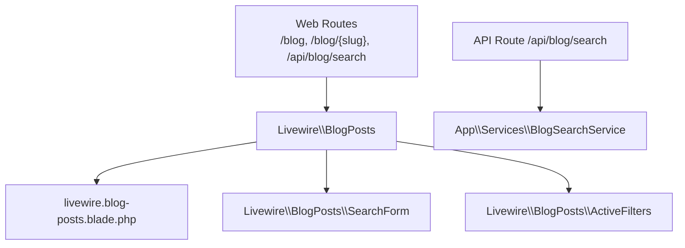
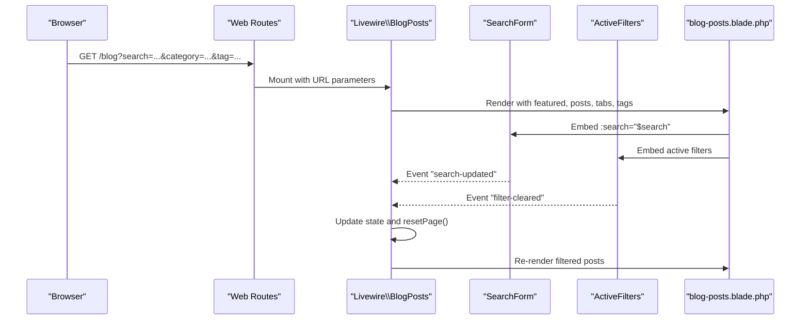
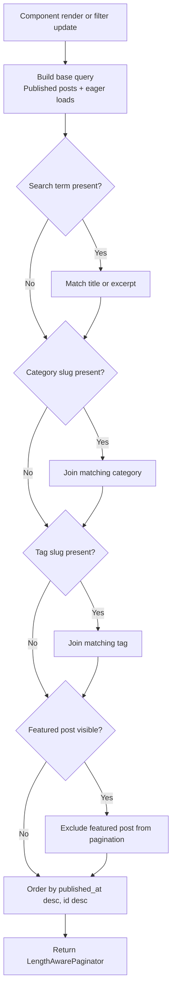
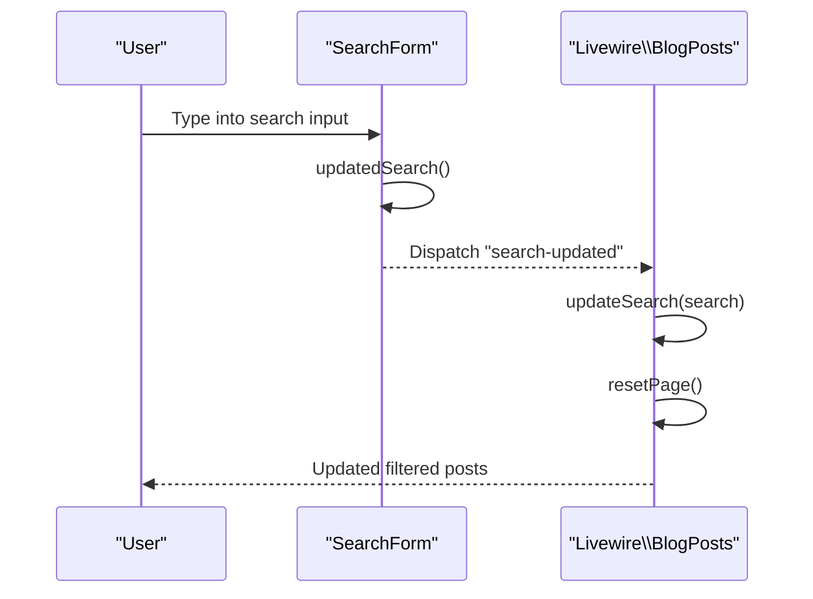
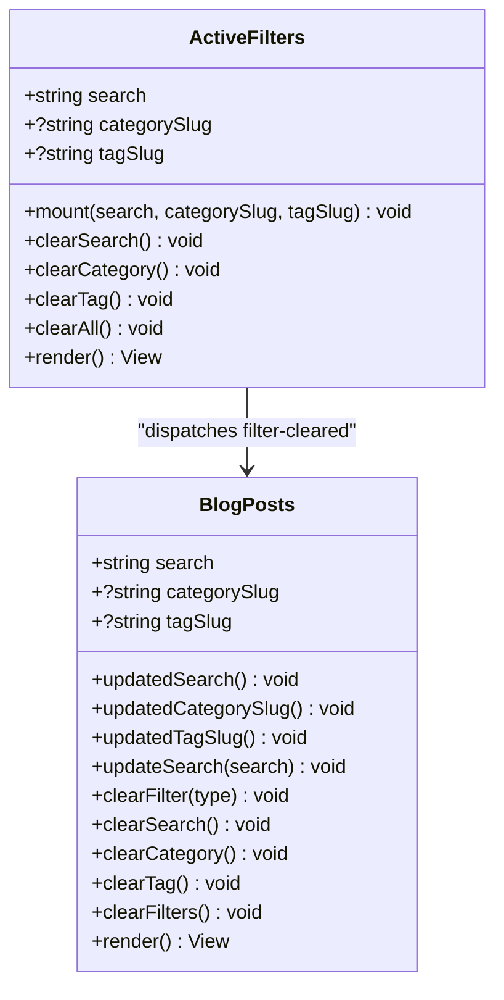
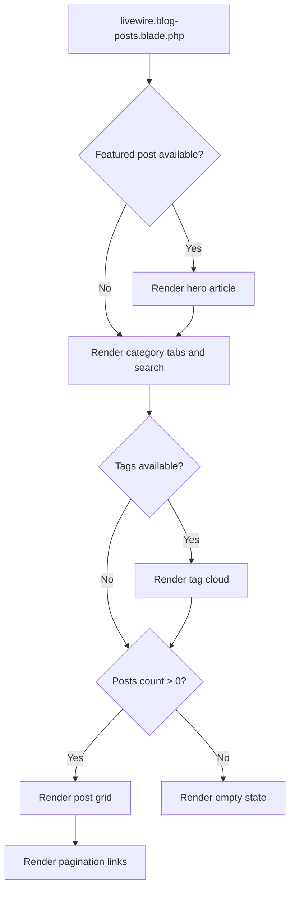
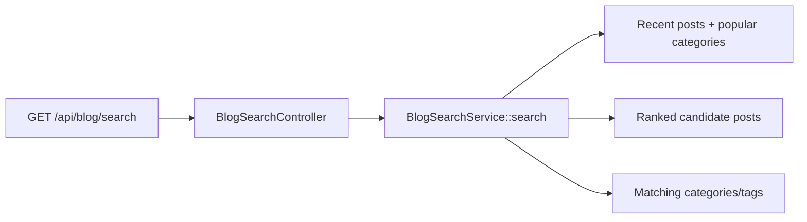
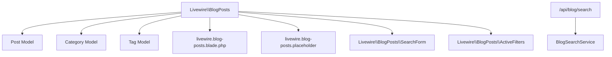

# Blog Posts Component

<cite>
**Referenced Files in This Document**   
- [BlogPosts.php](file://app/Livewire/BlogPosts.php)
- [SearchForm.php](file://app/Livewire/BlogPosts/SearchForm.php)
- [ActiveFilters.php](file://app/Livewire/BlogPosts/ActiveFilters.php)
- [blog-posts.blade.php](file://resources/views/livewire/blog-posts.blade.php)
- [BlogSearchService.php](file://app/Services/BlogSearchService.php)
- [web.php](file://routes/web.php)
</cite>

## Table of Contents
1. [Introduction](#introduction)
2. [Project Structure](#project-structure)
3. [Core Components](#core-components)
4. [Architecture Overview](#architecture-overview)
5. [Detailed Component Analysis](#detailed-component-analysis)
6. [Dependency Analysis](#dependency-analysis)
7. [Performance Considerations](#performance-considerations)
8. [Troubleshooting Guide](#troubleshooting-guide)
9. [Conclusion](#conclusion)

## Introduction
The BlogPosts Livewire component is the central entry point for the public blog listing page. It renders a featured post hero, category tabs, tag filters, an embedded search form, active filter badges, and a paginated grid of posts. The component manages URL-bound state for search, category, and tag filters, resets pagination when filters change, and exposes computed properties for query optimization.

It is distinct from `BlogSearchService`, which exists to power a separate command-palette type-ahead endpoint rather than the main listing.

## Project Structure
The blog listing feature spans one Livewire component class, two child components, one Blade view, one service used by the command palette, and web routes.

**Diagram sources**
- [web.php:39-46](file://routes/web.php#L39-L46)
- [BlogPosts.php:1-263](file://app/Livewire/BlogPosts.php#L1-L263)
- [blog-posts.blade.php:1-218](file://resources/views/livewire/blog-posts.blade.php#L1-L218)
- [BlogSearchService.php:1-203](file://app/Services/BlogSearchService.php#L1-L203)

**Section sources**
- [web.php:39-46](file://routes/web.php#L39-L46)
- [BlogPosts.php:1-263](file://app/Livewire/BlogPosts.php#L1-L263)
- [blog-posts.blade.php:1-218](file://resources/views/livewire/blog-posts.blade.php#L1-L218)
- [BlogSearchService.php:1-203](file://app/Services/BlogSearchService.php#L1-L203)

## Core Components
- **`Livewire\BlogPosts`**: Main listing component. Holds URL-synced state, computes filtered queries, handles pagination reset, dispatches and listens to events, and renders the Blade view with featured post, category tabs, tags, and posts.
- **`Livewire\BlogPosts\SearchForm`**: Small embedded search input that syncs its own URL-bound `search` value and dispatches a `search-updated` event so the parent listing can react.
- **`Livewire\BlogPosts\ActiveFilters`**: Displays currently active search, category, and tag filters and dispatches `filter-cleared` events back to the listing.
- **`resources/views/livewire/blog-posts.blade.php`**: Renders the hero card, filter navigation, tag cloud, active filter badges, post grid, pagination links, empty state, and fade-up animations.
- **`App\Services\BlogSearchService`**: Provides ranked search results and recent taxonomy suggestions for the command palette API route; it is not used by the listing component.

**Section sources**
- [BlogPosts.php:1-263](file://app/Livewire/BlogPosts.php#L1-L263)
- [SearchForm.php:1-53](file://app/Livewire/BlogPosts/SearchForm.php#L1-L53)
- [ActiveFilters.php:1-83](file://app/Livewire/BlogPosts/ActiveFilters.php#L1-L83)
- [blog-posts.blade.php:1-218](file://resources/views/livewire/blog-posts.blade.php#L1-L218)
- [BlogSearchService.php:1-203](file://app/Services/BlogSearchService.php#L1-L203)

## Architecture Overview
The listing follows a standard Livewire pattern: URL-driven state, computed queries, event-based communication between child components, and Blade rendering with pagination.

**Diagram sources**
- [web.php:39-46](file://routes/web.php#L39-L46)
- [BlogPosts.php:1-263](file://app/Livewire/BlogPosts.php#L1-L263)
- [SearchForm.php:1-53](file://app/Livewire/BlogPosts/SearchForm.php#L1-L53)
- [ActiveFilters.php:1-83](file://app/Livewire/BlogPosts/ActiveFilters.php#L1-L83)
- [blog-posts.blade.php:1-218](file://resources/views/livewire/blog-posts.blade.php#L1-L218)

## Detailed Component Analysis

### Livewire BlogPosts Component
This final component uses Livewire’s `WithPagination` trait and attributes such as `#[Url]`, `#[Locked]`, `#[Computed]`, and `#[On]`.

Key responsibilities:
- URL-bound state: `search`, `categorySlug`, `tagSlug`.
- Locked pagination size: nine posts per page.
- Computed values: `filtered`, `featuredPost`, `categoryTabs`, `publishedTotal`, `posts`, `categories`, `tags`.
- Filter lifecycle hooks: `updatedSearch`, `updatedCategorySlug`, `updatedTagSlug`.
- Event handlers: `updateSearch` for `search-updated`, `clearFilter` for `filter-cleared`.
- Public clear methods: `clearSearch`, `clearCategory`, `clearTag`, `clearFilters`.
- Rendering: passes `featured`, `posts`, `categoryTabs`, and `tags` to the Blade view.

State management highlights:
- Filters are reflected in the URL through `#[Url]`, making them shareable and browser-history friendly.
- Pagination resets automatically whenever any filter changes.
- The `filtered()` computed property drives conditional UI such as the active filter badge section.

Query behavior:
- The base query selects published posts and eager-loads categories, tags, and author.
- A text search matches title or excerpt using `like`.
- Category and tag filters use `whereHas` joins against related tables.
- The featured post is excluded from the paginated list when it is shown in the hero.
- Ordering uses `published_at` descending, then `id` descending to avoid unstable ties.

**Diagram sources**
- [BlogPosts.php:1-263](file://app/Livewire/BlogPosts.php#L1-L263)

SEO and UX notes in the listing:
- Each post link points to `blog.show` and uses `wire:navigate` for client-side navigation.
- Images use lazy loading where provided.
- The empty state explains why no posts were found and suggests adjusting filters.

**Section sources**
- [BlogPosts.php:1-263](file://app/Livewire/BlogPosts.php#L1-L263)
- [blog-posts.blade.php:1-218](file://resources/views/livewire/blog-posts.blade.php#L1-L218)

### SearchForm Child Component
The search form maintains its own URL-bound `search` value and delegates updates to the parent listing through Livewire events.

Behavior:
- Mounted with an optional `search` parameter.
- On `updatedSearch`, dispatches `search-updated` with the current search string.
- Clear action resets its local search and dispatches the same event with an empty string.
- Renders a Blade view under `livewire.blog-posts.search-form`.

Integration:
- The parent listing listens to `search-updated` via `#[On('search-updated')]`, sets `$this->search`, and resets pagination.
- Because both components bind `search` to the URL, typing in the form updates the URL immediately while also triggering filtering.

**Diagram sources**
- [SearchForm.php:1-53](file://app/Livewire/BlogPosts/SearchForm.php#L1-L53)
- [BlogPosts.php:1-263](file://app/Livewire/BlogPosts.php#L1-L263)

**Section sources**
- [SearchForm.php:1-53](file://app/Livewire/BlogPosts/SearchForm.php#L1-L53)
- [BlogPosts.php:1-263](file://app/Livewire/BlogPosts.php#L1-L263)

### ActiveFilters Child Component
The active filters component displays currently applied filters and allows users to remove them individually or all at once.

Behavior:
- Reads `search`, `categorySlug`, and `tagSlug` from the parent context.
- Clears each filter independently and dispatches `filter-cleared` with the filter type.
- `clearAll` clears every filter and dispatches `type: 'all'`.
- Resolves display names by querying the matching `Category` or `Tag` record during render.

Parent integration:
- The listing’s `clearFilter` method switches on the filter type and updates the corresponding state before resetting pagination.

**Diagram sources**
- [ActiveFilters.php:1-83](file://app/Livewire/BlogPosts/ActiveFilters.php#L1-L83)
- [BlogPosts.php:1-263](file://app/Livewire/BlogPosts.php#L1-L263)

**Section sources**
- [ActiveFilters.php:1-83](file://app/Livewire/BlogPosts/ActiveFilters.php#L1-L83)
- [BlogPosts.php:1-263](file://app/Livewire/BlogPosts.php#L1-L263)

### Blade View and Post Cards
The Blade view composes the full user experience:
- Featured hero article with image, title, excerpt, author, date, read time, and up to three tags.
- Category tabs showing post counts and highlighting the active category.
- Tag cloud with highlighted active tag.
- Active filter badges rendered by the `ActiveFilters` component.
- Responsive post grid with staggered fade-up animation.
- Pagination links using the site pagination view.
- Empty state when no posts match the current filters.

There is no dedicated `BlogPostCard` Livewire subcomponent in this repository. Individual posts are rendered directly inside the Blade loop. If a reusable card is desired, it should be extracted as a Blade partial or a new Livewire component under `resources/views/components` or `app/Livewire/BlogPosts`.

**Diagram sources**
- [blog-posts.blade.php:1-218](file://resources/views/livewire/blog-posts.blade.php#L1-L218)

**Section sources**
- [blog-posts.blade.php:1-218](file://resources/views/livewire/blog-posts.blade.php#L1-L218)

### BlogSearchService Integration Notes
`BlogSearchService` is intentionally separate from the listing component. Its documentation comment explains that the listing re-renders too much for every keystroke, so the command palette uses a throttled API endpoint instead.

Responsibilities:
- Returns either recent posts or matched posts depending on whether the search term is blank.
- Limits candidates to a small set before PHP ranking.
- Ranks posts by title match versus excerpt match.
- Includes recent categories and matching tag/category suggestions.
- Uses explicit column selection and eager loading to keep payloads small.
- Escapes `LIKE` wildcards to prevent accidental pattern matching.

The listing does not call `BlogSearchService`; it performs its own `like` search in Eloquent.

**Diagram sources**
- [web.php:42-46](file://routes/web.php#L42-L46)
- [BlogSearchService.php:1-203](file://app/Services/BlogSearchService.php#L1-L203)

**Section sources**
- [BlogSearchService.php:1-203](file://app/Services/BlogSearchService.php#L1-L203)
- [web.php:42-46](file://routes/web.php#L42-L46)

## Dependency Analysis
- `Livewire\BlogPosts` depends on Eloquent models `Post`, `Category`, and `Tag`.
- It uses Livewire features: `WithPagination`, `#[Url]`, `#[Locked]`, `#[Computed]`, `#[On]`.
- It renders three views: its own Blade file, a placeholder view, and delegates embedded child components to their own views.
- The listing and child components communicate through Livewire events rather than direct method calls.
- The API route `/api/blog/search` is independent of the listing and uses `BlogSearchService`.

**Diagram sources**
- [BlogPosts.php:1-263](file://app/Livewire/BlogPosts.php#L1-L263)
- [SearchForm.php:1-53](file://app/Livewire/BlogPosts/SearchForm.php#L1-L53)
- [ActiveFilters.php:1-83](file://app/Livewire/BlogPosts/ActiveFilters.php#L1-L83)
- [BlogSearchService.php:1-203](file://app/Services/BlogSearchService.php#L1-L203)
- [web.php:39-46](file://routes/web.php#L39-L46)

**Section sources**
- [BlogPosts.php:1-263](file://app/Livewire/BlogPosts.php#L1-L263)
- [SearchForm.php:1-53](file://app/Livewire/BlogPosts/SearchForm.php#L1-L53)
- [ActiveFilters.php:1-83](file://app/Livewire/BlogPosts/ActiveFilters.php#L1-L83)
- [BlogSearchService.php:1-203](file://app/Services/BlogSearchService.php#L1-L203)
- [web.php:39-46](file://routes/web.php#L39-L46)

## Performance Considerations

### Query Optimization in the Listing
- Published-only filtering keeps the result set focused.
- Eager loading avoids N+1 issues for categories, tags, and author.
- Excluding the featured post after computing it prevents duplicate rendering and unnecessary database rows.
- Ordering by `published_at` then `id` ensures stable pagination across posts saved at the same timestamp.

Recommendations:
- Add database indexes on columns used in common filters if they are not already indexed, such as `published_at`, `title`, `excerpt`, and foreign keys involved in `whereHas` joins.
- Consider moving complex search logic into a dedicated repository or service if future requirements require full-text search, faceted search, or advanced relevance scoring.

### Pagination Strategy
- The component locks `perPage` to nine and resets the page on every filter change. This provides consistent UX but means every filter change triggers a new query.
- For very large catalogs, consider debouncing expensive filters or providing a “Apply filters” button to batch state changes.

### Search Path Separation
- The command palette uses `BlogSearchService` and a throttled API endpoint to avoid re-rendering the entire listing on every keystroke.
- Keep the listing search simple and lightweight. If the listing becomes slow, offload heavy ranking logic to a background service or external search engine.

### Caching Strategies
- Read-heavy static data such as category lists and tag lists may benefit from application cache layers, especially when the number of categories or tags grows.
- Cache computed aggregates like category post counts only if they are expensive and do not need to reflect real-time content changes.
- Avoid caching the full paginated result unless stale data is acceptable, because pagination depends on mutable content and URL state.

### Progressive Enhancement Patterns
- Links use `wire:navigate` for smooth transitions without sacrificing SEO-friendly URLs.
- Images use lazy loading to improve initial paint performance.
- The placeholder view supports graceful loading states while Livewire mounts and computes the first response.
- The empty state gives clear feedback when filters produce no results.

[No sources needed since this section provides general guidance]

## Troubleshooting Guide

### No Posts Appear After Applying Filters
Check whether the filter combination is valid:
- Verify that the category or tag slug exists.
- Confirm the posts are marked as published.
- Inspect the URL to ensure `category` and `tag` parameters are correct.

Relevant implementation paths:
- Category lookup throws a model-not-found exception when the slug is invalid.
- Tag lookup behaves similarly.
- The view shows an empty state when the paginator has zero items.

**Section sources**
- [BlogPosts.php:1-263](file://app/Livewire/BlogPosts.php#L1-L263)
- [blog-posts.blade.php:1-218](file://resources/views/livewire/blog-posts.blade.php#L1-L218)

### Pagination Does Not Reset When Searching
The listing resets pagination in:
- `updatedSearch`
- `updatedCategorySlug`
- `updatedTagSlug`
- `updateSearch` (event handler)
- All `clear*` methods

If pagination appears stuck:
- Ensure the search input still binds to the Livewire `search` property.
- Check that the `search-updated` event is dispatched.
- Verify that no custom JavaScript overrides the Livewire input binding.

**Section sources**
- [BlogPosts.php:1-263](file://app/Livewire/BlogPosts.php#L1-L263)
- [SearchForm.php:1-53](file://app/Livewire/BlogPosts/SearchForm.php#L1-L53)

### Active Filters Do Not Clear
The active filters component dispatches `filter-cleared` with a specific type. The listing switches on that type and clears the corresponding field before resetting pagination.

Common causes:
- The child component is not receiving the parent’s filter values.
- The event payload is missing or has an unexpected type.
- Another component or script intercepts the click before Livewire handles it.

**Section sources**
- [ActiveFilters.php:1-83](file://app/Livewire/BlogPosts/ActiveFilters.php#L1-L83)
- [BlogPosts.php:1-263](file://app/Livewire/BlogPosts.php#L1-L263)

### Search Is Slow on Large Data Sets
The listing performs a simple `like` match against title and excerpt. For large datasets:
- Add appropriate database indexes.
- Limit search scope to indexed fields.
- Consider replacing or extending the search path with a dedicated search backend.
- Use the existing API route and `BlogSearchService` pattern for fast type-ahead while keeping the listing lightweight.

**Section sources**
- [BlogPosts.php:1-263](file://app/Livewire/BlogPosts.php#L1-L263)
- [BlogSearchService.php:1-203](file://app/Services/BlogSearchService.php#L1-L203)

## Conclusion
The `Livewire\BlogPosts` component provides a clean, URL-driven blog listing with search, category filtering, tag filtering, and pagination. It separates concerns through child components for search input and active filters, communicates through Livewire events, and uses computed properties to optimize query construction. The separate `BlogSearchService` serves the command palette API and should remain distinct from the listing’s query path.

For future enhancements, consider extracting a reusable post card, introducing explicit repositories or services for complex search logic, adding database indexes, and applying selective caching for read-heavy taxonomy data. These steps will improve scalability, maintainability, and user experience while preserving the component’s current clarity and progressive enhancement approach.