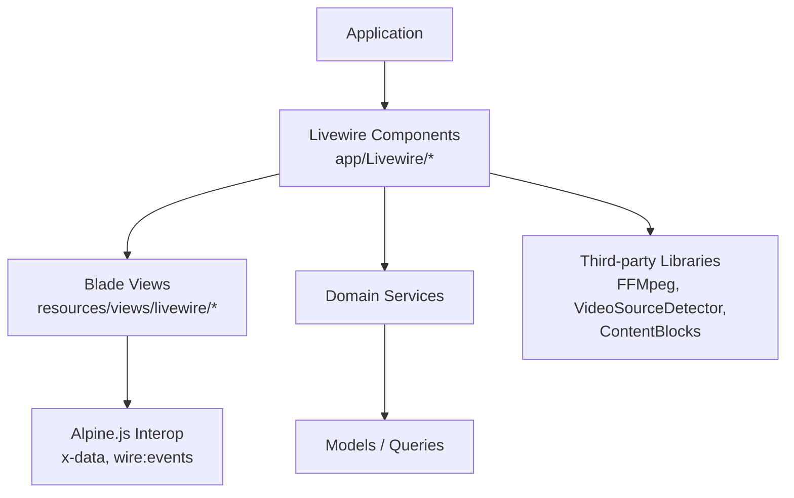
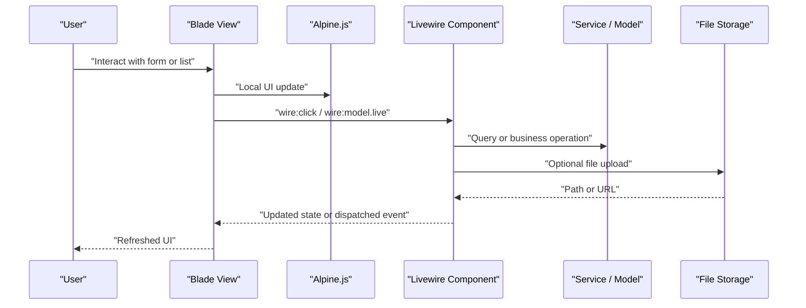
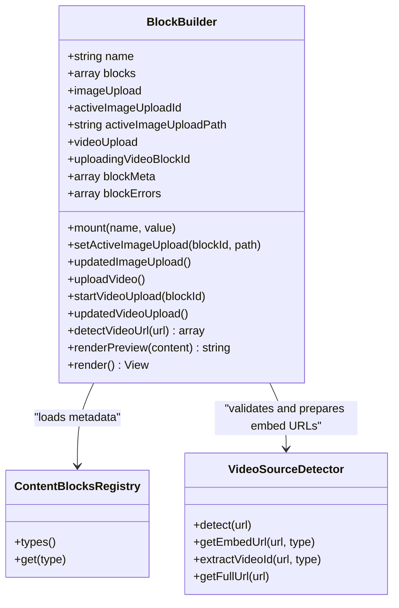
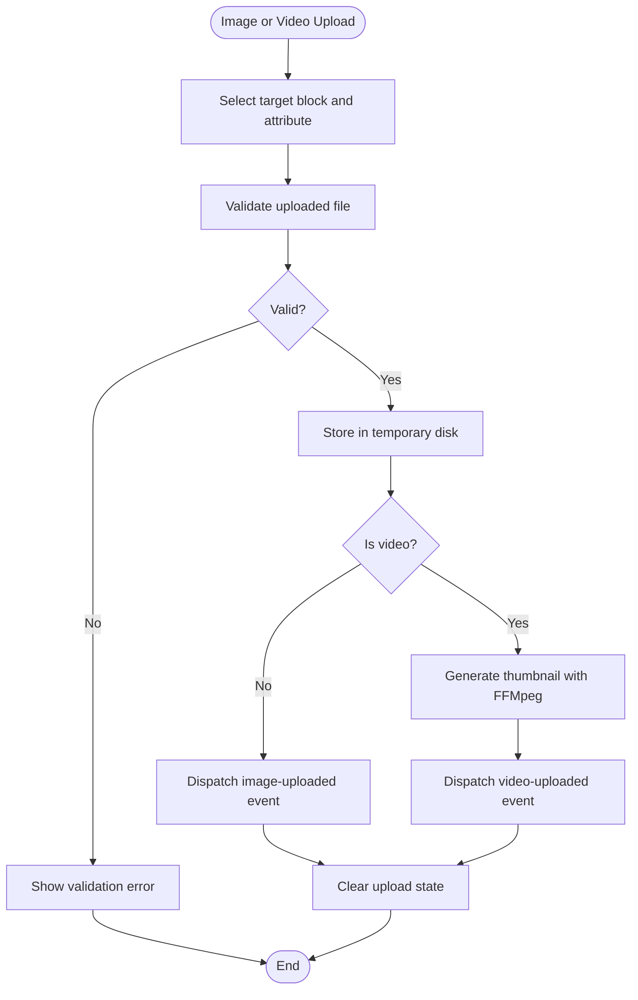
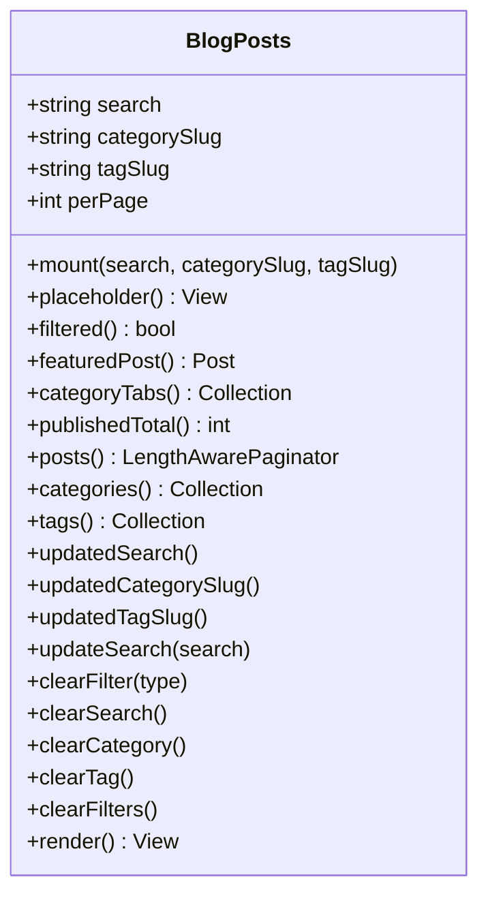
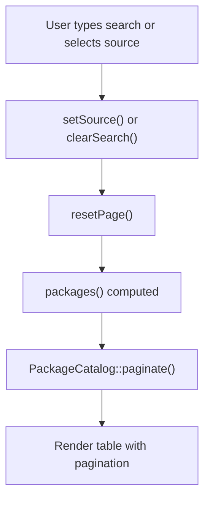
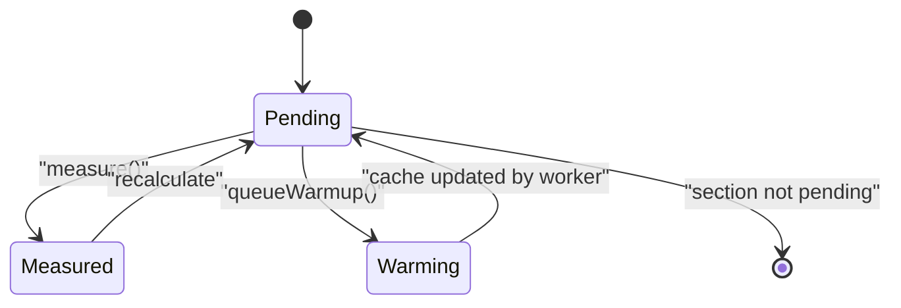
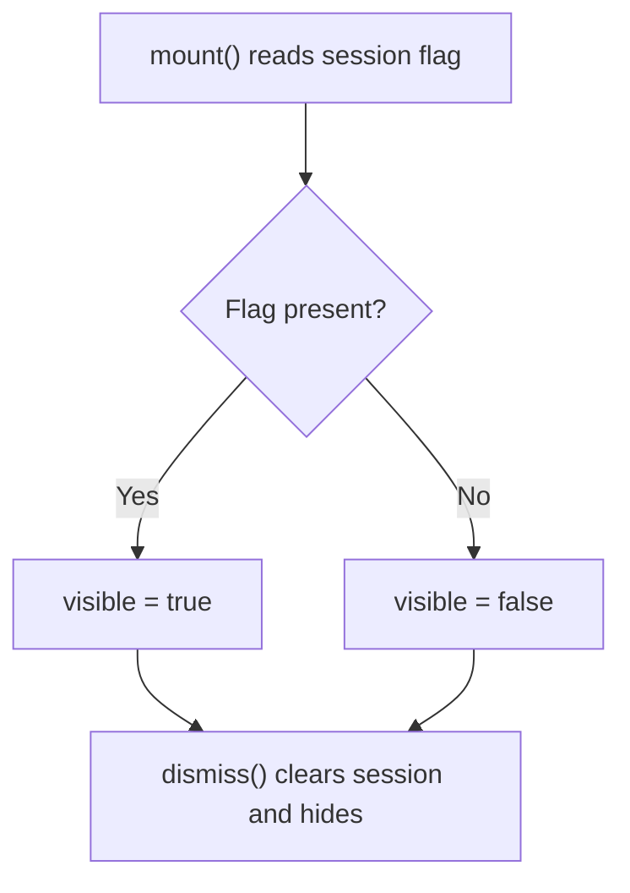
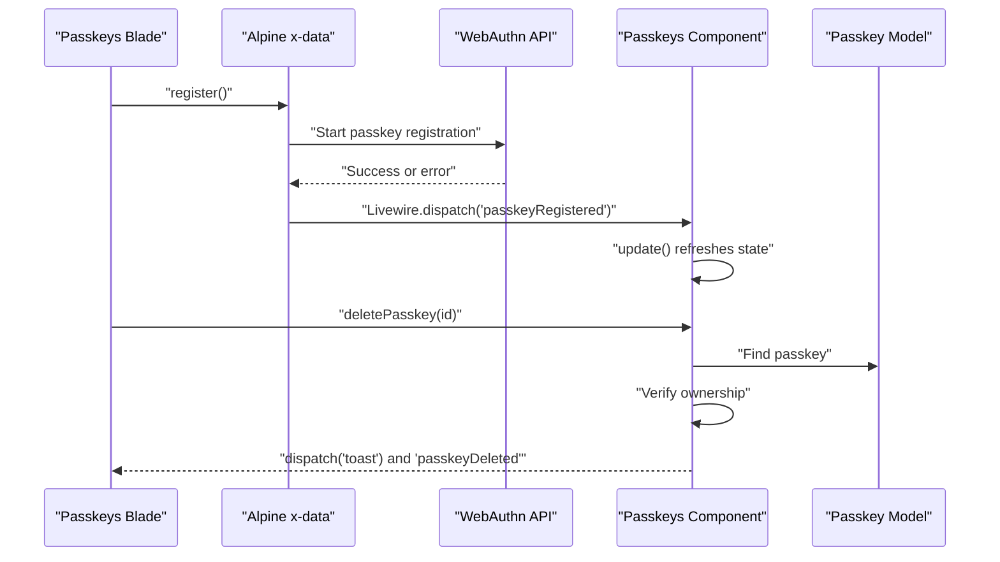
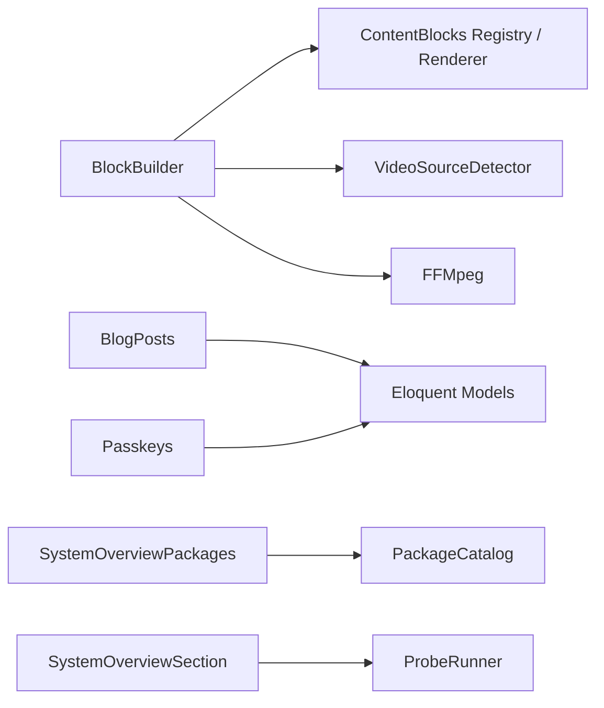

# Component Architecture & Patterns

<cite>
**Referenced Files in This Document**
- [BlockBuilder.php](file://app/Livewire/BlockBuilder.php)
- [BlogPosts.php](file://app/Livewire/BlogPosts.php)
- [SystemOverviewPackages.php](file://app/Livewire/SystemOverviewPackages.php)
- [SystemOverviewSection.php](file://app/Livewire/SystemOverviewSection.php)
- [PasskeyRecoveryBanner.php](file://app/Livewire/PasskeyRecoveryBanner.php)
- [Passkeys.php](file://app/Livewire/Passkeys.php)
- [block-builder.blade.php](file://resources/views/livewire/block-builder.blade.php)
- [blog-posts.blade.php](file://resources/views/livewire/blog-posts.blade.php)
- [system-overview-packages.blade.php](file://resources/views/livewire/system-overview-packages.blade.php)
- [system-overview-section.blade.php](file://resources/views/livewire/system-overview-section.blade.php)
- [passkey-recovery-banner.blade.php](file://resources/views/livewire/passkey-recovery-banner.blade.php)
- [passkeys.blade.php](file://resources/views/livewire/passkeys.blade.php)
- [CONVENTIONS.md](file://CONVENTIONS.md)
</cite>

## Table of Contents
1. [Introduction](#introduction)
2. [Project Structure](#project-structure)
3. [Core Components](#core-components)
4. [Architecture Overview](#architecture-overview)
5. [Detailed Component Analysis](#detailed-component-analysis)
6. [Dependency Analysis](#dependency-analysis)
7. [Performance Considerations](#performance-considerations)
8. [Troubleshooting Guide](#troubleshooting-guide)
9. [Conclusion](#conclusion)

## Introduction
This document explains the Highblossom Livewire component architecture and foundational patterns. It focuses on how components are organized, how state flows between Blade templates and PHP classes, and how the application integrates with JavaScript and third-party libraries. The goal is to help developers create reusable, maintainable Livewire components that follow the project’s established conventions.

The repository follows a Laravel 13 stack with Livewire, Alpine.js, Vite, Tailwind CSS, and several domain services. Livewire components live under `app/Livewire`, Blade views under `resources/views/livewire`, and shared UI logic is often split into small Alpine-driven templates or helper scripts.

**Section sources**
- [CONVENTIONS.md:1-118](file://CONVENTIONS.md#L1-L118)

## Project Structure
Livewire components are grouped by feature rather than by layer:

| Area | Purpose | Examples |
|---|---|---|
| `app/Livewire` | Server-side Livewire components | Block builder, blog listing, system overview, passkey management |
| `resources/views/livewire` | Blade templates rendered by Livewire | Component views, placeholders, nested field partials |
| `resources/resources/js` and `public/js` | Frontend helpers, Alpine components, uploaders | Passkey interop, image/video uploaders |
| `packages/ContentBlocks` | Reusable block registry and renderer used by the block builder | Block types, events, service provider |

**Diagram sources**
- [BlockBuilder.php:1-40](file://app/Livewire/BlockBuilder.php#L1-L40)
- [blog-posts.blade.php:1-30](file://resources/views/livewire/blog-posts.blade.php#L1-L30)

**Section sources**
- [BlockBuilder.php:1-40](file://app/Livewire/BlockBuilder.php#L1-L40)
- [blog-posts.blade.php:1-30](file://resources/views/livewire/blog-posts.blade.php#L1-L30)

## Core Components
The project uses several representative Livewire components:

| Component | Responsibility | Key Patterns |
|---|---|---|
| `BlockBuilder` | Manage content blocks, images, videos, validation, preview, and rendering through the ContentBlocks package | File uploads, validation, previews, event dispatching, external renderer |
| `BlogPosts` | Paginated, filterable blog listing with URL-synced filters | URL-bound properties, computed queries, pagination, child components |
| `SystemOverviewPackages` | Searchable, paginated package list behind authorization | Computed pagination, source filtering, lazy loading |
| `SystemOverviewSection` | Heavy system section with caching, warm-up, polling, and background work | Authorization checks, queued warm-up, polling, cache-driven rendering |
| `PasskeyRecoveryBanner` | Conditional banner based on session state | Session-based visibility, mount initialization |
| `Passkeys` | WebAuthn passkey management with frontend-driven registration and renaming | Event listeners, frontend-to-backend dispatch, toast feedback |

**Section sources**
- [BlockBuilder.php:1-40](file://app/Livewire/BlockBuilder.php#L1-L40)
- [BlogPosts.php:1-40](file://app/Livewire/BlogPosts.php#L1-L40)
- [SystemOverviewPackages.php:1-40](file://app/Livewire/SystemOverviewPackages.php#L1-L40)
- [SystemOverviewSection.php:1-40](file://app/Livewire/SystemOverviewSection.php#L1-L40)
- [PasskeyRecoveryBanner.php:1-25](file://app/Livewire/PasskeyRecoveryBanner.php#L1-L25)
- [Passkeys.php:1-30](file://app/Livewire/Passkeys.php#L1-L30)

## Architecture Overview
The Livewire architecture separates server state from presentation while allowing lightweight client interaction:

- **Server state**: Public properties hold form values, filters, and flags; private properties and constants encapsulate configuration.
- **Lifecycle methods**: `mount()` initializes data; computed properties derive expensive values; action methods respond to user interactions; `render()` passes data to Blade.
- **Blade integration**: Views bind to `$this` properties, use `wire:model`, `wire:click`, `wire:navigate`, `wire:poll`, and conditional directives.
- **JavaScript interop**: Alpine.js handles local UI state, drag-and-drop, prompts, and browser APIs; Livewire events coordinate updates.
- **External libraries**: The block builder integrates FFMpeg for video thumbnails, a video source detector, and the ContentBlocks renderer.

**Diagram sources**
- [system-overview-packages.blade.php:1-40](file://resources/views/livewire/system-overview-packages.blade.php#L1-L40)
- [Passkeys.php:1-30](file://app/Livewire/Passkeys.php#L1-L30)
- [block-builder.blade.php:1-25](file://resources/views/livewire/block-builder.blade.php#L1-L25)

**Section sources**
- [system-overview-packages.blade.php:1-40](file://resources/views/livewire/system-overview-packages.blade.php#L1-L40)
- [Passkeys.php:1-30](file://app/Livewire/Passkeys.php#L1-L30)
- [block-builder.blade.php:1-25](file://resources/views/livewire/block-builder.blade.php#L1-L25)

## Detailed Component Analysis

### BlockBuilder: Content Blocks, Uploads, Validation, and Preview
`BlockBuilder` is the most complex component. It manages:

- A list of content blocks with unique IDs.
- Editable block metadata loaded from the ContentBlocks registry.
- Image and video uploads stored temporarily.
- Server-side validation mapped back to individual blocks.
- Video thumbnail generation using FFMpeg.
- Video URL detection and preview support.
- Draft preview rendering through the ContentBlocks renderer.

**Diagram sources**
- [BlockBuilder.php:1-40](file://app/Livewire/BlockBuilder.php#L1-L40)
- [BlockBuilder.php:201-431](file://app/Livewire/BlockBuilder.php#L201-L431)

Key implementation patterns:

- **Mount initialization**: The component accepts either an array or JSON string of blocks, assigns stable IDs, and loads editable metadata.
- **Validation mapping**: Validation errors from `content.{index}.attributes` are mapped to block IDs so the UI can display per-block messages.
- **Temporary storage**: Uploaded images and videos go to a temporary disk and are later moved during persistence.
- **Event-driven UI**: Upload success is communicated via dispatched events such as `image-uploaded`, `video-uploaded`, and generic `notify`.
- **Preview safety**: Preview rendering rejects oversized input, validates structure, catches rendering exceptions, and returns safe HTML fragments.

**Diagram sources**
- [BlockBuilder.php:201-360](file://app/Livewire/BlockBuilder.php#L201-L360)

Blade integration highlights:

- The view binds initial block data through Alpine.
- Client-side editing is intentionally separated from server state for performance.
- Validation messages are passed into the Blade template and consumed by Alpine logic.
- The preview modal requests server-rendered HTML from `renderPreview`.

**Section sources**
- [BlockBuilder.php:1-40](file://app/Livewire/BlockBuilder.php#L1-L40)
- [BlockBuilder.php:201-431](file://app/Livewire/BlockBuilder.php#L201-L431)
- [block-builder.blade.php:1-60](file://resources/views/livewire/block-builder.blade.php#L1-L60)

### BlogPosts: Filtered Listing, URL State, Pagination, and Child Components
`BlogPosts` demonstrates URL-synchronized filtering, computed queries, pagination, and composition with child components.

**Diagram sources**
- [BlogPosts.php:1-40](file://app/Livewire/BlogPosts.php#L1-L40)
- [BlogPosts.php:201-263](file://app/Livewire/BlogPosts.php#L201-L263)

Patterns demonstrated:

- **URL synchronization**: `#[Url]` keeps filters in the query string without manual handling.
- **Computed properties**: Expensive queries are cached across the request.
- **Pagination reset**: Filters trigger `resetPage()` to avoid empty pages.
- **Child components**: The view includes `livewire:blog-posts.search-form` and `livewire:blog-posts.active-filters`.
- **Placeholder rendering**: A dedicated placeholder view improves perceived load time.

Blade integration:

- Links use `wire:navigate` for fast navigation.
- Featured post is promoted out of the paginated set when not filtered.
- Active filters are conditionally shown and rendered by a child component.

**Section sources**
- [BlogPosts.php:1-40](file://app/Livewire/BlogPosts.php#L1-L40)
- [BlogPosts.php:201-263](file://app/Livewire/BlogPosts.php#L201-L263)
- [blog-posts.blade.php:1-60](file://resources/views/livewire/blog-posts.blade.php#L1-L60)

### SystemOverviewPackages: Authorized, Cached, Lazy-Paginated Data
`SystemOverviewPackages` wraps a service-backed package catalog with search, source filtering, and pagination.

**Diagram sources**
- [SystemOverviewPackages.php:1-117](file://app/Livewire/SystemOverviewPackages.php#L1-L117)

Key behaviors:

- `setSource()` validates the source against allowed values.
- `updatedSearch()` resets pagination automatically.
- `packages()` and `totals()` are computed to reduce repeated work.
- `render()` enforces authorization before returning the view.
- The view debounces search input and shows loading indicators.

**Section sources**
- [SystemOverviewPackages.php:1-117](file://app/Livewire/SystemOverviewPackages.php#L1-L117)
- [system-overview-packages.blade.php:1-60](file://resources/views/livewire/system-overview-packages.blade.php#L1-L60)

### SystemOverviewSection: Heavy Section, Caching, Warm-up, and Polling
`SystemOverviewSection` renders a heavy section only after it has been measured or warmed.

**Diagram sources**
- [SystemOverviewSection.php:1-88](file://app/Livewire/SystemOverviewSection.php#L1-L88)

Important details:

- `mount()` validates the probe key through the registry.
- `section()` returns a result from the probe runner, which may be pending.
- `measure()` performs a synchronous warm-up bounded by probe budgets.
- `queueWarmup()` dispatches a job for background warming.
- `render()` authorizes access and injects metadata.
- The Blade view polls the section while pending and nests the packages component lazily when available.

**Section sources**
- [SystemOverviewSection.php:1-88](file://app/Livewire/SystemOverviewSection.php#L1-L88)
- [system-overview-section.blade.php:1-74](file://resources/views/livewire/system-overview-section.blade.php#L1-L74)

### PasskeyRecoveryBanner: Session-Driven Visibility
`PasskeyRecoveryBanner` shows a prompt when a passkey sign-in was rejected.

**Diagram sources**
- [PasskeyRecoveryBanner.php:1-50](file://app/Livewire/PasskeyRecoveryBanner.php#L1-L50)

Patterns:

- Session state controls visibility.
- `#[Locked]` prevents accidental client mutation of the visibility flag.
- The Blade view uses `wire:click` for dismissal and routes to the profile page.

**Section sources**
- [PasskeyRecoveryBanner.php:1-50](file://app/Livewire/PasskeyRecoveryBanner.php#L1-L50)
- [passkey-recovery-banner.blade.php:1-28](file://resources/views/livewire/passkey-recovery-banner.blade.php#L1-L28)

### Passkeys: Frontend-Backend Events and Ownership Checks
`Passkeys` manages WebAuthn passkeys with frontend-triggered actions and backend ownership verification.

**Diagram sources**
- [Passkeys.php:1-123](file://app/Livewire/Passkeys.php#L1-L123)
- [passkeys.blade.php:1-92](file://resources/views/livewire/passkeys.blade.php#L1-L92)

Patterns:

- `#[On(...)]` listens for frontend-dispatched events.
- Backend operations validate ownership and dispatch toast notifications.
- Renaming uses a frontend prompt and dispatches a rename request.
- Blade combines Alpine for prompts and Livewire for server updates.

**Section sources**
- [Passkeys.php:1-123](file://app/Livewire/Passkeys.php#L1-L123)
- [passkeys.blade.php:1-92](file://resources/views/livewire/passkeys.blade.php#L1-L92)

## Dependency Analysis
The components depend on internal services, models, and third-party libraries:

**Diagram sources**
- [BlockBuilder.php:1-40](file://app/Livewire/BlockBuilder.php#L1-L40)
- [BlockBuilder.php:360-431](file://app/Livewire/BlockBuilder.php#L360-L431)
- [BlogPosts.php:1-40](file://app/Livewire/BlogPosts.php#L1-L40)
- [SystemOverviewPackages.php:1-40](file://app/Livewire/SystemOverviewPackages.php#L1-L40)
- [SystemOverviewSection.php:1-40](file://app/Livewire/SystemOverviewSection.php#L1-L40)
- [Passkeys.php:1-30](file://app/Livewire/Passkeys.php#L1-L30)

Observations:

- Components delegate heavy or cross-cutting concerns to services rather than embedding logic.
- Authorization is enforced at render time where sensitive data or side effects are involved.
- External I/O (file storage, FFMpeg, queue jobs) is isolated from pure query logic.

**Section sources**
- [BlockBuilder.php:1-40](file://app/Livewire/BlockBuilder.php#L1-L40)
- [BlogPosts.php:1-40](file://app/Livewire/BlogPosts.php#L1-L40)
- [SystemOverviewPackages.php:1-40](file://app/Livewire/SystemOverviewPackages.php#L1-L40)
- [SystemOverviewSection.php:1-40](file://app/Livewire/SystemOverviewSection.php#L1-L40)
- [Passkeys.php:1-30](file://app/Livewire/Passkeys.php#L1-L30)

## Performance Considerations
The codebase applies several practical optimizations:

- **Lazy loading**: Heavy sections and lists are wrapped in lazy components or placeholders.
- **Computed properties**: Expensive queries are cached within a request.
- **Debounced input**: Search fields use debounced model binding to limit re-renders.
- **Background warm-up**: Heavy probes can be queued instead of blocking the request.
- **Polling only while needed**: Sections poll only when pending.
- **Client-side editing**: Block manipulation is handled by Alpine to avoid round trips.
- **Pagination reset on filter change**: Prevents empty pages and reduces unnecessary queries.
- **Authorization at render time**: Protects expensive operations from unauthorized calls.

Recommended practices:

- Prefer `#[Computed]` for derived state.
- Use `lazy` on large components when appropriate.
- Debounce frequent input changes.
- Offload long-running work to jobs.
- Keep Blade simple and move UI logic to Alpine when it does not require server state.
- Cache expensive read-only data through services.
- Avoid storing mutable UI state in `#[Locked]` properties unless immutability is intentional.

[No sources needed since this section provides general guidance]

## Troubleshooting Guide
Common issues and approaches:

| Issue | Symptom | Likely Cause | Resolution |
|---|---|---|---|
| Image upload fails silently | No message and no image appears | Empty upload or invalid state | Check `updatedImageUpload` and `uploadImageForBlock` flow; verify active upload ID and path |
| Video thumbnail missing | Video uploads but no poster | FFMpeg binary unavailable or exception | Inspect logs and FFMpeg configuration; handle exceptions gracefully |
| Preview too large | Preview returns fallback message | Content exceeds size limit | Reduce draft content or split blocks |
| Invalid block errors not shown | Errors appear globally but not per block | Error mapping not applied to block IDs | Ensure validation rules use nested paths and map errors by block ID |
| Blog filters do not reset pagination | Page remains on previous page after typing | Missing `resetPage()` in updated property | Add `resetPage()` in `updatedSearch`, `updatedCategorySlug`, `updatedTagSlug` |
| Unauthorized action on passkey | Toast with unauthorized message | Passkey belongs to another user | Verify ownership before mutation and return early |
| System overview not warming | Section stays pending | Queue worker not running or probe failed | Use `measure()` synchronously in development; check job processing in production |

Debugging tips:

- Use `dd()` sparingly in development for component state.
- Inspect dispatched events in the browser console when integrating Alpine and Livewire.
- Check application logs for upload and preview failures.
- Verify authorization gates when components return 403 responses.
- Use Livewire debugging tools to inspect re-renders and payload sizes.

**Section sources**
- [BlockBuilder.php:201-431](file://app/Livewire/BlockBuilder.php#L201-L431)
- [BlogPosts.php:201-263](file://app/Livewire/BlogPosts.php#L201-L263)
- [Passkeys.php:1-123](file://app/Livewire/Passkeys.php#L1-L123)
- [SystemOverviewSection.php:1-88](file://app/Livewire/SystemOverviewSection.php#L1-L88)

## Conclusion
Highblossom’s Livewire architecture emphasizes clean separation between server state, Blade presentation, and client-side interaction. Components declare explicit state, compute expensive values, enforce authorization, and delegate complex operations to services. Blade templates remain declarative, while Alpine.js handles local UI behavior. File uploads, real-time polling, background jobs, and third-party integrations are coordinated through events and services. Following these patterns produces components that are predictable, testable, and scalable.

[No sources needed since this section summarizes without analyzing specific files]