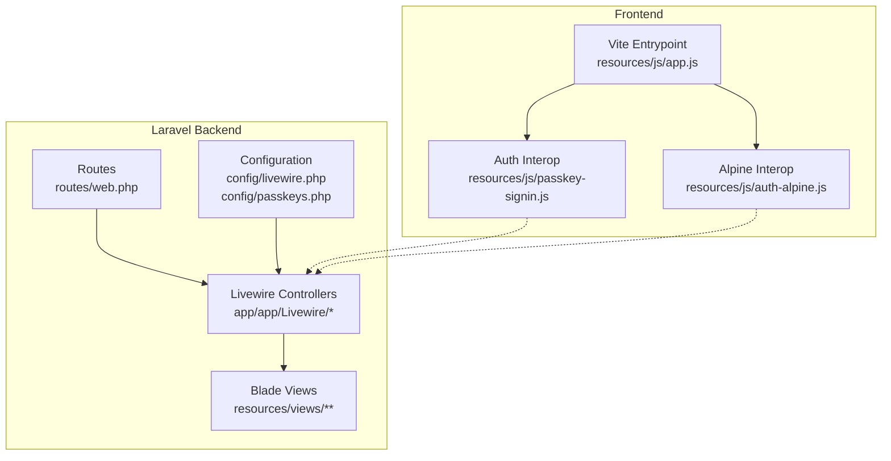
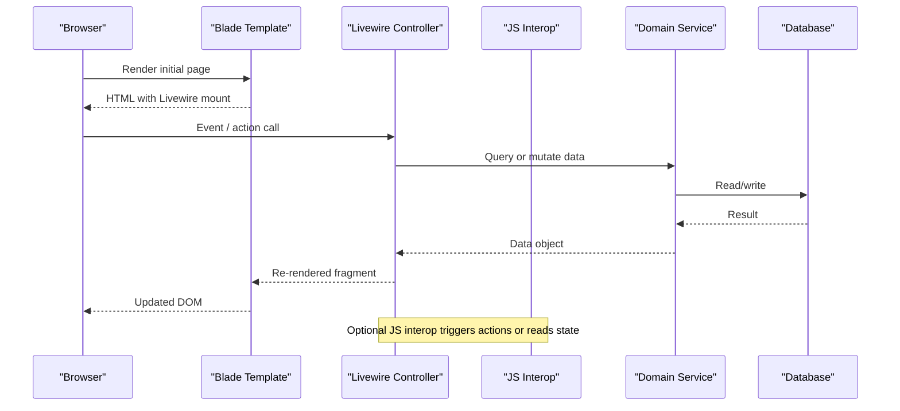
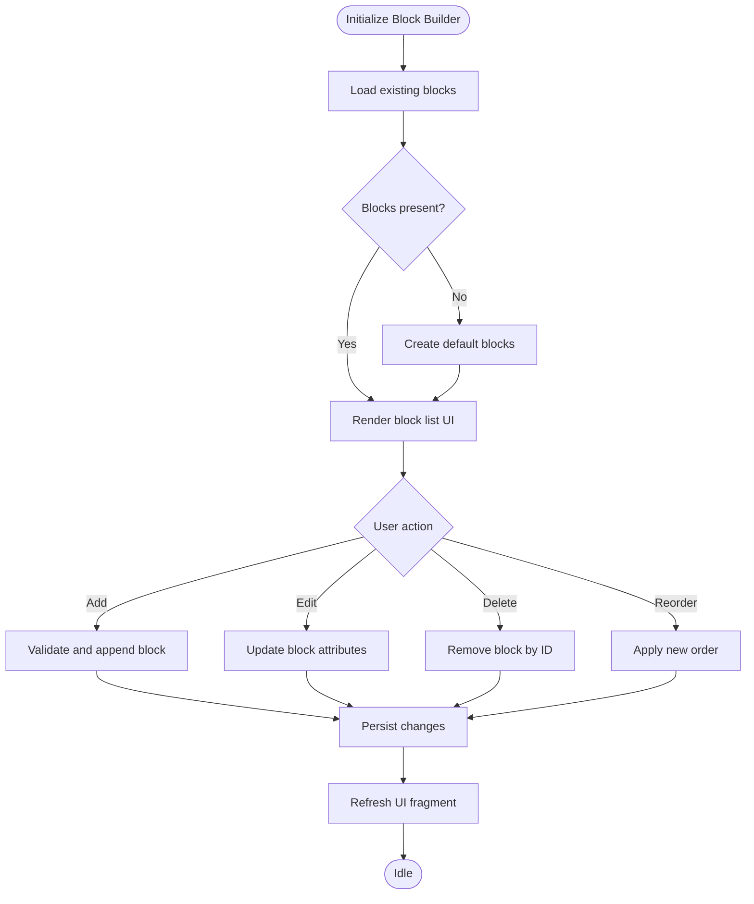
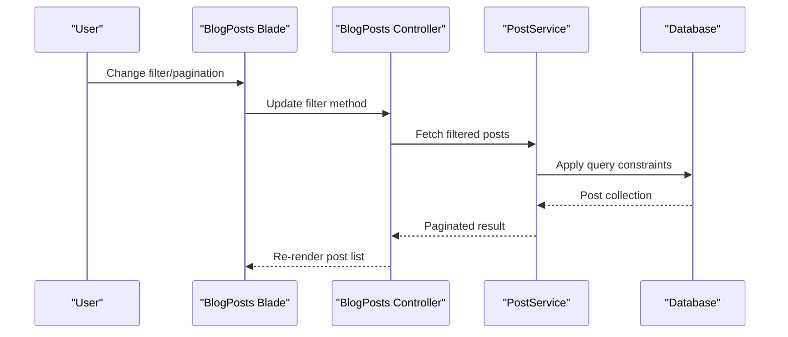
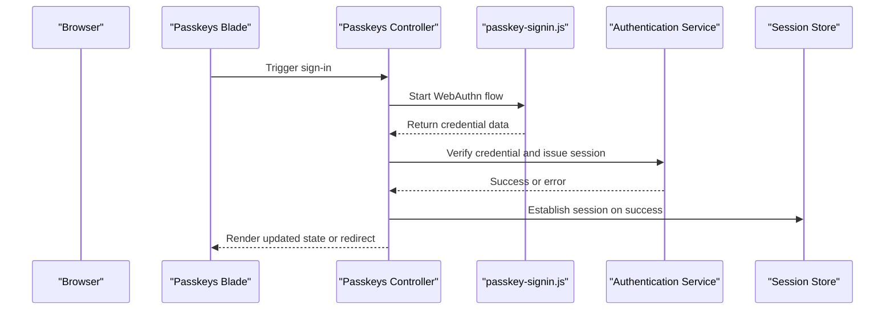
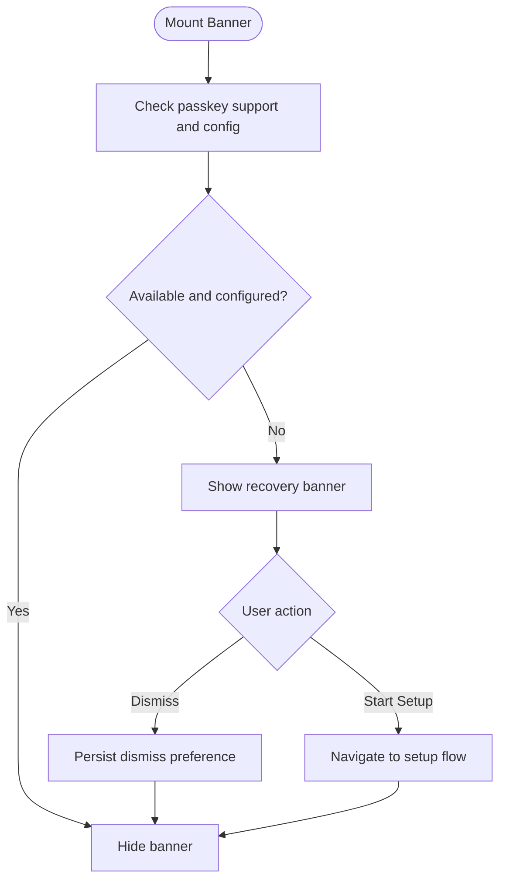
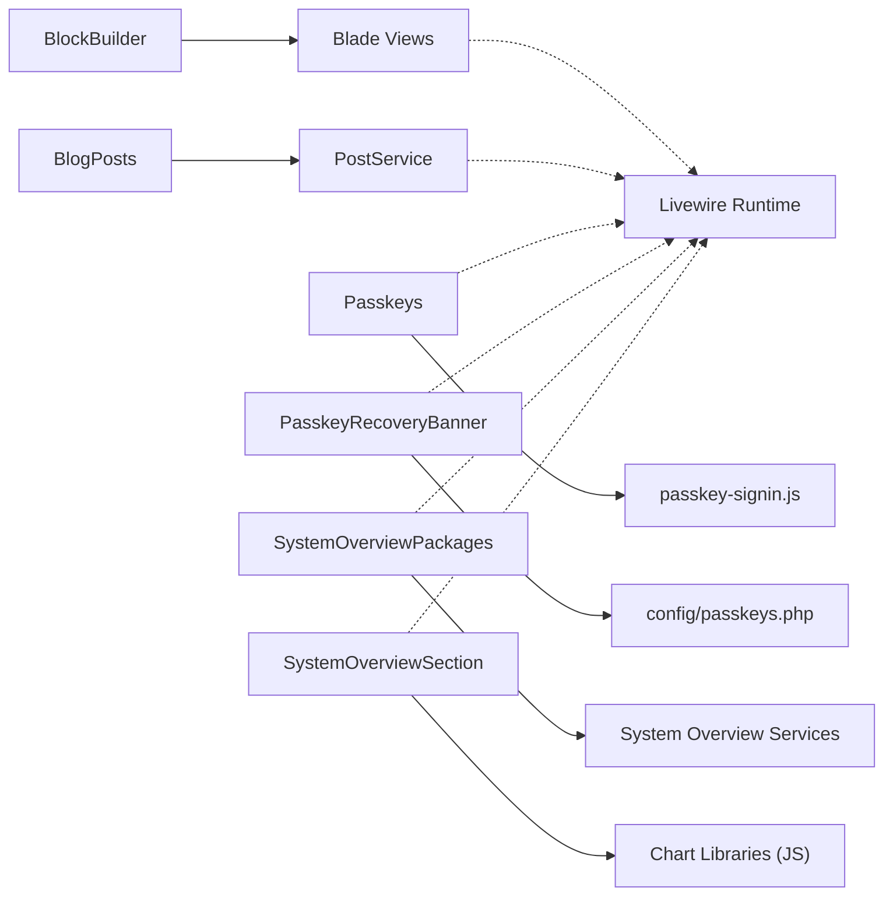

# Livewire Components

<cite>
**Referenced Files in This Document**   
- [BlockBuilder.php](file://app/app/Livewire/BlockBuilder.php)
- [BlogPosts.php](file://app/app/Livewire/BlogPosts.php)
- [Passkeys.php](file://app/app/Livewire/Passkeys.php)
- [PasskeyRecoveryBanner.php](file://app/app/Livewire/PasskeyRecoveryBanner.php)
- [SystemOverviewPackages.php](file://app/app/Livewire/SystemOverviewPackages.php)
- [SystemOverviewSection.php](file://app/app/Livewire/SystemOverviewSection.php)
- [livewire.php](file://config/livewire.php)
- [passkeys.php](file://config/passkeys.php)
- [app.js](file://resources/js/app.js)
- [passkey-signin.js](file://resources/js/passkey-signin.js)
- [auth-alpine.js](file://resources/js/auth-alpine.js)
- [web.php](file://routes/web.php)
</cite>

## Table of Contents
1. [Introduction](#introduction)
2. [Project Structure](#project-structure)
3. [Core Components](#core-components)
4. [Architecture Overview](#architecture-overview)
5. [Detailed Component Analysis](#detailed-component-analysis)
6. [Dependency Analysis](#dependency-analysis)
7. [Performance Considerations](#performance-considerations)
8. [Troubleshooting Guide](#troubleshooting-guide)
9. [Conclusion](#conclusion)
10. [Appendices](#appendices)

## Introduction
This document explains the Highblossom Livewire component architecture and usage, focusing on reactive components for content building, dynamic blog listing, passkey authentication, user experience banners, and system overview analytics. It covers component lifecycle, state management, data binding, event handling, Blade integration, JavaScript interoperability, third-party library integration, creation patterns, performance optimization, debugging techniques, testing strategies, composition principles, and best practices for maintaining performant interactive interfaces.

## Project Structure
The Livewire components live under `app/app/Livewire`, while their Blade views are typically referenced from `resources/views`. Configuration for Livewire and passkeys is centralized in `config/livewire.php` and `config/passkeys.php`. Frontend interop is handled through Vite-managed assets such as `resources/js/app.js`, `resources/js/passkey-signin.js`, and `resources/js/auth-alpine.js`. Routes are defined in `routes/web.php`.

**Diagram sources**
- [BlockBuilder.php](file://app/app/Livewire/BlockBuilder.php)
- [BlogPosts.php](file://app/app/Livewire/BlogPosts.php)
- [Passkeys.php](file://app/app/Livewire/Passkeys.php)
- [PasskeyRecoveryBanner.php](file://app/app/Livewire/PasskeyRecoveryBanner.php)
- [SystemOverviewPackages.php](file://app/app/Livewire/SystemOverviewPackages.php)
- [SystemOverviewSection.php](file://app/app/Livewire/SystemOverviewSection.php)
- [livewire.php](file://config/livewire.php)
- [passkeys.php](file://config/passkeys.php)
- [app.js](file://resources/js/app.js)
- [passkey-signin.js](file://resources/js/passkey-signin.js)
- [auth-alpine.js](file://resources/js/auth-alpine.js)
- [web.php](file://routes/web.php)

**Section sources**
- [BlockBuilder.php](file://app/app/Livewire/BlockBuilder.php)
- [BlogPosts.php](file://app/app/Livewire/BlogPosts.php)
- [Passkeys.php](file://app/app/Livewire/Passkeys.php)
- [PasskeyRecoveryBanner.php](file://app/app/Livewire/PasskeyRecoveryBanner.php)
- [SystemOverviewPackages.php](file://app/app/Livewire/SystemOverviewPackages.php)
- [SystemOverviewSection.php](file://app/app/Livewire/SystemOverviewSection.php)
- [livewire.php](file://config/livewire.php)
- [passkeys.php](file://config/passkeys.php)
- [app.js](file://resources/js/app.js)
- [passkey-signin.js](file://resources/js/passkey-signin.js)
- [auth-alpine.js](file://resources/js/auth-alpine.js)
- [web.php](file://routes/web.php)

## Core Components
Highblossom’s Livewire surface area includes:
- BlockBuilder: a content manipulation component that composes reusable content blocks.
- BlogPosts: a dynamic listing component for posts with filtering or pagination support.
- Passkeys: an authentication component integrating Web Authentication (passkeys).
- PasskeyRecoveryBanner: a UX banner guiding users to recover or set up passkeys.
- SystemOverviewPackages and SystemOverviewSection: analytics display components rendering system overview metrics and package summaries.

These components follow a consistent pattern:
- State properties define the reactive UI model.
- Public methods handle events and mutations.
- Blade templates render the current state.
- Lifecycle hooks initialize data and coordinate with services or external libraries.
- JavaScript interop handles browser-specific behaviors such as passkey flows and Alpine-driven interactions.

**Section sources**
- [BlockBuilder.php](file://app/app/Livewire/BlockBuilder.php)
- [BlogPosts.php](file://app/app/Livewire/BlogPosts.php)
- [Passkeys.php](file://app/app/Livewire/Passkeys.php)
- [PasskeyRecoveryBanner.php](file://app/app/Livewire/PasskeyRecoveryBanner.php)
- [SystemOverviewPackages.php](file://app/app/Livewire/SystemOverviewPackages.php)
- [SystemOverviewSection.php](file://app/app/Livewire/SystemOverviewSection.php)

## Architecture Overview
The reactive architecture separates concerns between server-side Livewire controllers and client-side scripts:

Key responsibilities:
- Livewire controllers own application state and respond to events.
- Blade templates provide declarative markup bound to controller properties.
- JavaScript interop bridges browser APIs (e.g., passkeys) with Livewire actions.
- Services encapsulate business logic and persistence.

**Diagram sources**
- [Passkeys.php](file://app/app/Livewire/Passkeys.php)
- [passkey-signin.js](file://resources/js/passkey-signin.js)
- [auth-alpine.js](file://resources/js/auth-alpine.js)
- [web.php](file://routes/web.php)

## Detailed Component Analysis

### BlockBuilder
Purpose:
- Provides a content-building interface for composing blocks such as headings, paragraphs, images, lists, and custom block types.
- Manages a list of block definitions and allows adding, removing, reordering, and editing block content.

State and behavior:
- Reactive array property representing the ordered list of blocks.
- Methods for creating new blocks, updating block attributes, deleting blocks, and persisting changes.
- Validation rules applied per block type before saving.

Rendering and composition:
- Blade template iterates over blocks and renders each via a view component or partial based on block type.
- Supports nested composition by embedding child blocks within container-type blocks.

Data binding:
- Two-way binding updates the block list on input changes.
- Computed-like helpers can derive metadata (e.g., preview counts) without additional round-trips.

Event handling:
- Emits events to parent components when blocks change significantly (e.g., save, reset).
- Listens to global events to synchronize shared content state across multiple builders.

Lifecycle:
- Initializes default blocks if none exist.
- Delegates heavy rendering tasks to Blade fragments to keep the controller lightweight.

Integration points:
- Uses service classes for validation and storage.
- May integrate with media libraries for image/video block assets.

**Diagram sources**
- [BlockBuilder.php](file://app/app/Livewire/BlockBuilder.php)

**Section sources**
- [BlockBuilder.php](file://app/app/Livewire/BlockBuilder.php)

### BlogPosts
Purpose:
- Displays a dynamic listing of blog posts with filtering, sorting, and pagination.

State and behavior:
- Properties for query parameters such as category, search term, sort order, and current page.
- Methods to update filters and trigger re-renders.
- Pagination-aware loading to avoid full-page reloads.

Rendering:
- Blade template renders post cards with title, excerpt, tags, and links.
- Empty-state messaging when no results match filters.

Data binding:
- Form inputs bind to filter properties; Livewire auto-updates queries on change.
- Debounced search to reduce network overhead.

Event handling:
- Emits events to track analytics or notify other components about active filters.

Lifecycle:
- Loads initial dataset using repository/service layer.
- Applies constraints and ordering before rendering.

Optimization:
- Eager loads relationships to minimize N+1 queries.
- Uses cursor or keyset pagination where appropriate.

**Diagram sources**
- [BlogPosts.php](file://app/app/Livewire/BlogPosts.php)

**Section sources**
- [BlogPosts.php](file://app/app/Livewire/BlogPosts.php)

### Passkeys
Purpose:
- Integrates passkey-based authentication into the application, coordinating browser-side Web Authentication flows with server-side verification.

State and behavior:
- Properties capturing challenge status, error messages, and user session hints.
- Methods to initiate registration and sign-in flows.
- Handlers for success and failure outcomes.

Rendering:
- Blade template presents prompts and feedback states (loading, success, error).
- Conditionally shows recovery guidance via the PasskeyRecoveryBanner.

JavaScript interop:
- Invokes `passkey-signin.js` functions to start WebAuthn operations.
- Bridges returned tokens and metadata back to Livewire actions.

Lifecycle:
- On mount, determines whether passkeys are supported and configured.
- On successful authentication, updates session and redirects or refreshes UI.

Security considerations:
- Validates origins and relies on platform-provided attestation.
- Stores minimal sensitive data; uses server-side sessions for authenticated state.

**Diagram sources**
- [Passkeys.php](file://app/app/Livewire/Passkeys.php)
- [passkey-signin.js](file://resources/js/passkey-signin.js)
- [passkeys.php](file://config/passkeys.php)

**Section sources**
- [Passkeys.php](file://app/app/Livewire/Passkeys.php)
- [passkeys.php](file://config/passkeys.php)
- [passkey-signin.js](file://resources/js/passkey-signin.js)

### PasskeyRecoveryBanner
Purpose:
- Guides users who lack passkeys to recover or configure them, improving accessibility and security posture.

State and behavior:
- Flags indicating passkey availability and recovery options.
- Methods to open help flows or link to setup instructions.

Rendering:
- Blade template displays contextual banner with actionable steps.
- Dismissable with persistent state stored in local preferences or session.

Integration:
- Reads configuration from passkeys settings.
- Coordinates with Passkeys component to offer next-step actions.

Lifecycle:
- Shows only when passkeys are unsupported or not yet configured.
- Hides after successful setup or dismissal.

**Diagram sources**
- [PasskeyRecoveryBanner.php](file://app/app/Livewire/PasskeyRecoveryBanner.php)
- [passkeys.php](file://config/passkeys.php)

**Section sources**
- [PasskeyRecoveryBanner.php](file://app/app/Livewire/PasskeyRecoveryBanner.php)
- [passkeys.php](file://config/passkeys.php)

### SystemOverviewPackages
Purpose:
- Renders a summary of system packages, versions, and health indicators for administrators and operators.

State and behavior:
- Properties containing aggregated package metadata and computed statuses.
- Methods to refresh data or toggle detail panels.

Rendering:
- Blade table or card layout showing package name, version, status, and last checked time.
- Expandable sections for dependency details.

Data binding:
- Updates automatically on scheduled refresh or manual trigger.
- Debounces rapid UI interactions to prevent excessive requests.

Lifecycle:
- Initializes data from system overview services.
- Periodically refreshes background probes where supported.

**Section sources**
- [SystemOverviewPackages.php](file://app/app/Livewire/SystemOverviewPackages.php)

### SystemOverviewSection
Purpose:
- Presents a high-level analytics dashboard section including metrics, trends, and summary statistics.

State and behavior:
- Properties for metric values, time ranges, and chart configurations.
- Methods to adjust date ranges and recompute summaries.

Rendering:
- Blade templates compose charts and stat cards.
- Integrates with third-party charting libraries through JavaScript interop.

Integration:
- Consumes analytics services to fetch processed metrics.
- Passes serialized chart data to frontend libraries.

Lifecycle:
- Loads cached aggregates first, then falls back to live computation.
- Invalidates cache on significant system changes.

**Section sources**
- [SystemOverviewSection.php](file://app/app/Livewire/SystemOverviewSection.php)

## Dependency Analysis
The components depend on:
- Laravel Livewire runtime for reactive state and Blade rendering.
- Configuration files for passkeys and Livewire behavior.
- JavaScript modules for browser-side functionality.
- Domain services for data access and business logic.
- Blade templates for presentation.

**Diagram sources**
- [BlockBuilder.php](file://app/app/Livewire/BlockBuilder.php)
- [BlogPosts.php](file://app/app/Livewire/BlogPosts.php)
- [Passkeys.php](file://app/app/Livewire/Passkeys.php)
- [PasskeyRecoveryBanner.php](file://app/app/Livewire/PasskeyRecoveryBanner.php)
- [SystemOverviewPackages.php](file://app/app/Livewire/SystemOverviewPackages.php)
- [SystemOverviewSection.php](file://app/app/Livewire/SystemOverviewSection.php)
- [passkey-signin.js](file://resources/js/passkey-signin.js)
- [livewire.php](file://config/livewire.php)
- [passkeys.php](file://config/passkeys.php)

**Section sources**
- [BlockBuilder.php](file://app/app/Livewire/BlockBuilder.php)
- [BlogPosts.php](file://app/app/Livewire/BlogPosts.php)
- [Passkeys.php](file://app/app/Livewire/Passkeys.php)
- [PasskeyRecoveryBanner.php](file://app/app/Livewire/PasskeyRecoveryBanner.php)
- [SystemOverviewPackages.php](file://app/app/Livewire/SystemOverviewPackages.php)
- [SystemOverviewSection.php](file://app/app/Livewire/SystemOverviewSection.php)
- [passkey-signin.js](file://resources/js/passkey-signin.js)
- [livewire.php](file://config/livewire.php)
- [passkeys.php](file://config/passkeys.php)

## Performance Considerations
- Minimize expensive computations inside Blade by precomputing in Livewire properties.
- Use eager loading for related models to avoid N+1 queries.
- Debounce frequent user inputs (search, filters) to limit request frequency.
- Paginate large datasets and prefer cursor-based pagination for stable performance.
- Cache frequently accessed aggregates and invalidate caches strategically.
- Offload heavy work to background jobs or scheduled tasks.
- Keep Livewire payloads small by returning only necessary data.
- Avoid unnecessary re-renders by scoping updates to specific elements.
- Lazy-load third-party libraries and charts only when visible.
- Profile with tools like Debugbar or Laravel Telescope to identify bottlenecks.

[No sources needed since this section provides general guidance]

## Troubleshooting Guide
Common issues and resolutions:
- Livewire not responding:
  - Ensure Livewire assets are properly loaded and mounted in Blade layouts.
  - Check browser console for JavaScript errors.
  - Validate CSRF and session configuration.
- Passkey flows failing:
  - Verify passkeys configuration and origin settings.
  - Confirm browser supports WebAuthn and HTTPS is enabled.
  - Inspect logs from passkey-signin.js and backend verification endpoints.
- BlogPosts showing empty results:
  - Validate filter bindings and query construction.
  - Check permissions and visibility rules for posts.
  - Review database indexes for slow queries.
- System overview metrics stale:
  - Clear relevant caches and verify probe schedules.
  - Ensure services have read access to required data sources.
- Excessive re-renders:
  - Use Livewire’s `wire:key` for stable list rendering.
  - Avoid mutating entire arrays; use targeted updates.
  - Split large components into smaller focused ones.

**Section sources**
- [livewire.php](file://config/livewire.php)
- [passkeys.php](file://config/passkeys.php)
- [passkey-signin.js](file://resources/js/passkey-signin.js)

## Conclusion
Highblossom’s Livewire architecture delivers a clear separation between reactive server-side state and client-side interactivity. The core components—BlockBuilder, BlogPosts, Passkeys, PasskeyRecoveryBanner, SystemOverviewPackages, and SystemOverviewSection—follow consistent patterns for state management, data binding, and event handling. By leveraging Blade for declarative rendering, JavaScript for browser-specific features, and services for business logic, the system remains maintainable and performant. Adopting the recommended composition patterns, optimization techniques, and testing strategies will ensure scalable and reliable interactive interfaces.

[No sources needed since this section summarizes without analyzing specific files]

## Appendices

### Creating New Livewire Components
Steps:
1. Define a controller class under `app/app/Livewire` with reactive properties and public methods.
2. Create a Blade view at `resources/views/livewire/<component>.blade.php`.
3. Mount the component in your layout or page using the standard Blade directive.
4. Bind form inputs to properties using two-way directives.
5. Handle events with method calls or global event listeners.
6. Integrate JavaScript interop by invoking helper functions from `resources/js/app.js` or feature-specific modules.
7. Test the component using Livewire’s testing utilities and browser-level assertions where needed.

Best practices:
- Keep components focused on a single responsibility.
- Prefer composition over inheritance; break complex UIs into smaller components.
- Encapsulate domain logic in services; keep controllers thin.
- Use enums and DTOs for structured data passed between components.
- Document public methods and expected payloads for reuse.

[No sources needed since this section provides general guidance]

### Component Composition Patterns
- Parent-child communication via properties and events.
- Slot-based composition for flexible layouts.
- Shared state through services or a lightweight event bus.
- Pluggable block registry for extensible content builders.
- Decorator-style wrappers for cross-cutting concerns (e.g., logging, caching).

[No sources needed since this section provides general guidance]

### Testing Strategies
- Unit test Livewire controller methods and services independently.
- Feature tests asserting full request/response cycles and rendered output.
- Browser-level tests for JavaScript interop and passkey flows.
- Snapshot tests for critical Blade fragments where appropriate.
- Mock external dependencies (APIs, filesystem, email) to isolate behavior.

[No sources needed since this section provides general guidance]