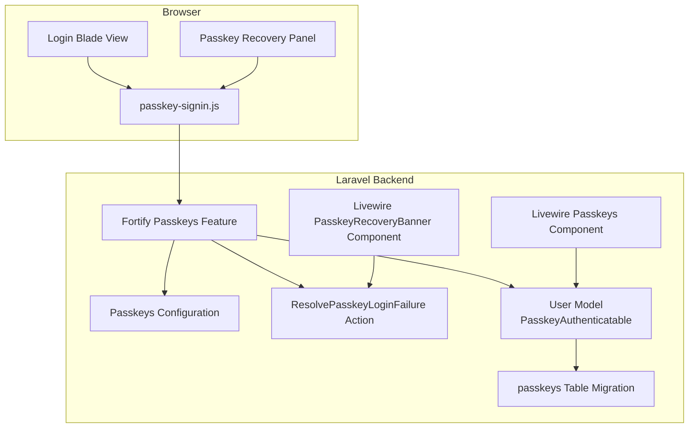
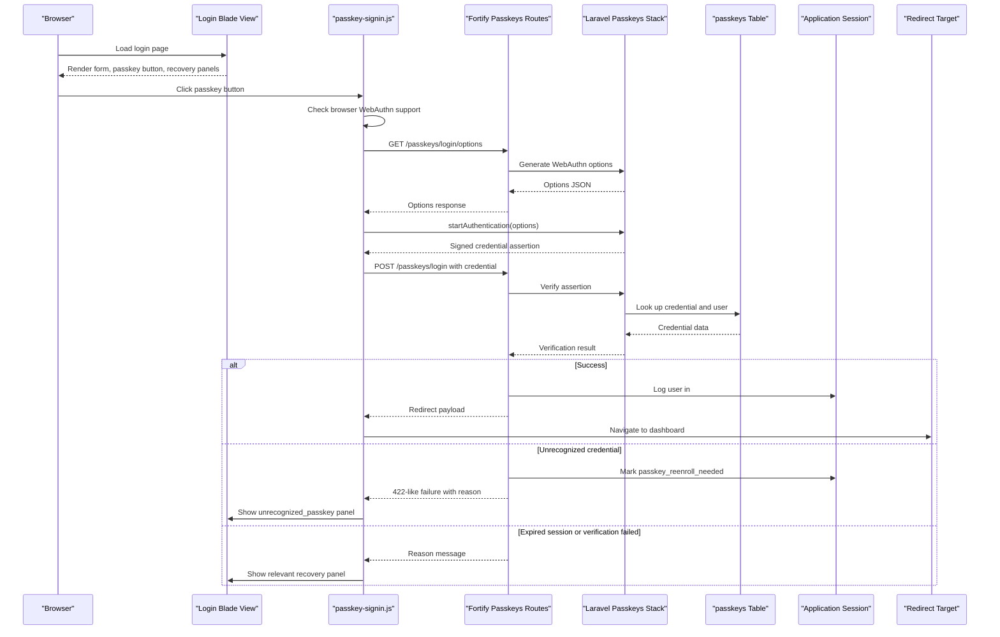
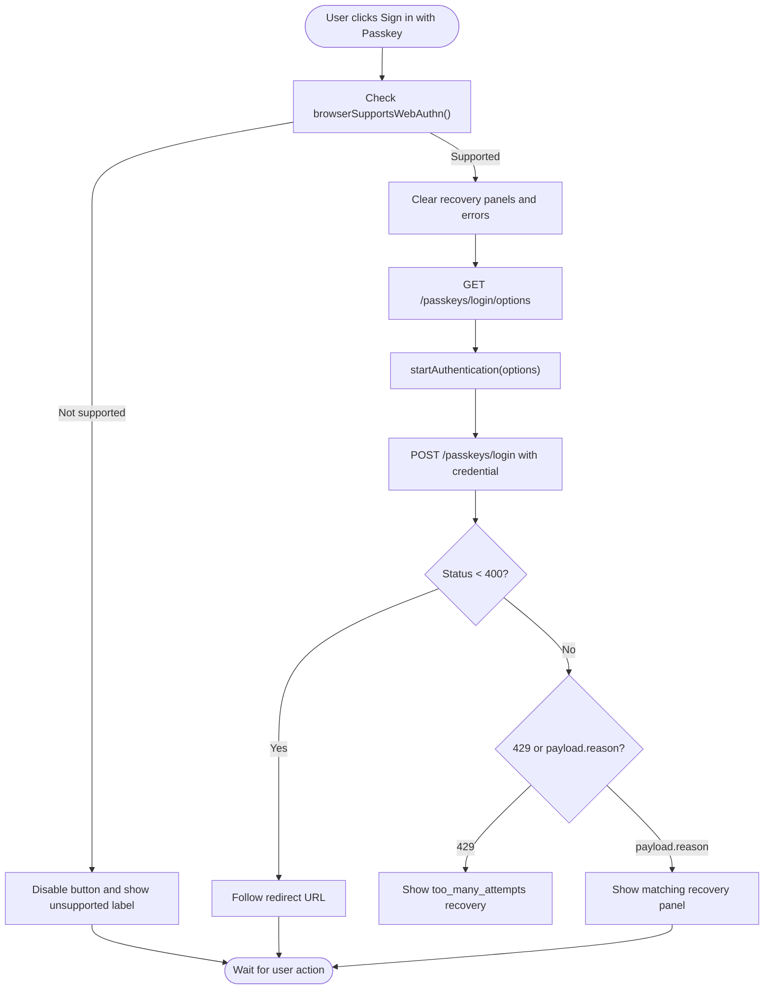
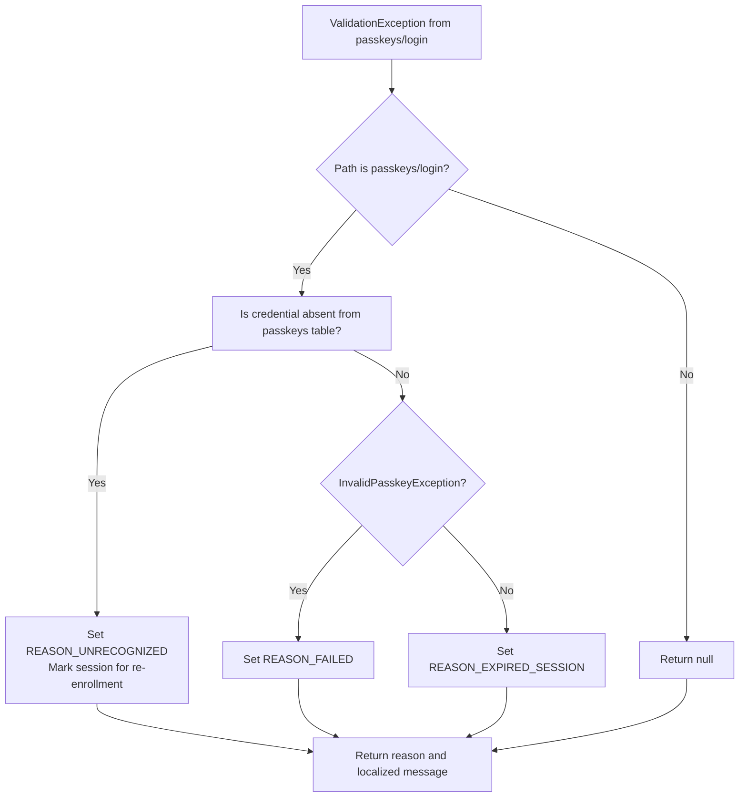
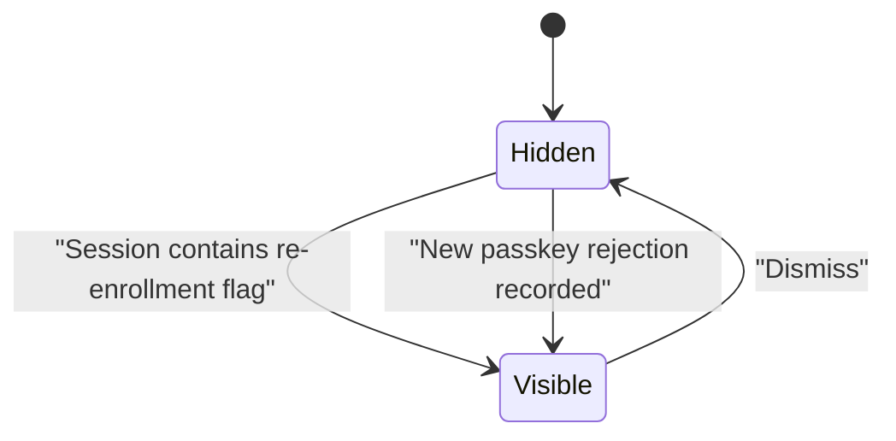
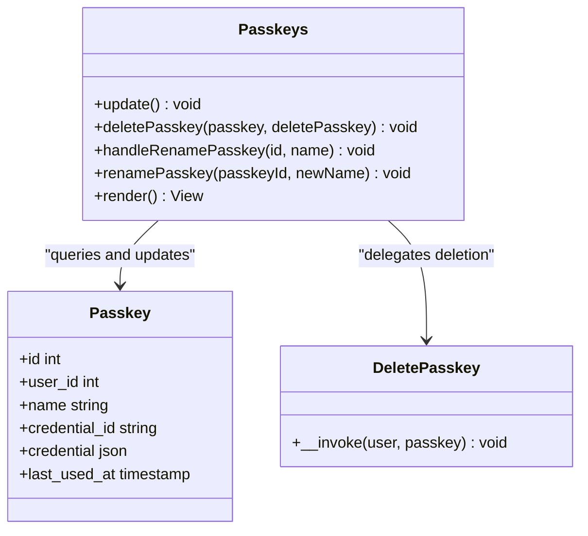
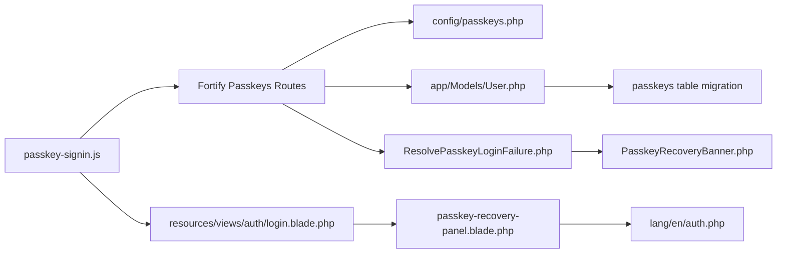

# Passkeys Authentication Components

<cite>
**Referenced Files in This Document**
- [Passkeys.php](file://app/Livewire/Passkeys.php)
- [PasskeyRecoveryBanner.php](file://app/Livewire/PasskeyRecoveryBanner.php)
- [ResolvePasskeyLoginFailure.php](file://app/Actions/Auth/ResolvePasskeyLoginFailure.php)
- [passkey-signin.js](file://resources/js/passkey-signin.js)
- [login.blade.php](file://resources/views/auth/login.blade.php)
- [passkey-recovery-panel.blade.php](file://resources/views/components/passkey-recovery-panel.blade.php)
- [auth.php](file://lang/en/auth.php)
- [User.php](file://app/Models/User.php)
- [2026_06_08_113028_create_passkeys_table.php](file://database/migrations/2026_06_08_113028_create_passkeys_table.php)
- [passkeys.php](file://config/passkeys.php)
- [fortify.php](file://config/fortify.php)
</cite>

## Table of Contents
1. [Introduction](#introduction)
2. [Project Structure](#project-structure)
3. [Core Components](#core-components)
4. [Architecture Overview](#architecture-overview)
5. [Detailed Component Analysis](#detailed-component-analysis)
6. [Dependency Analysis](#dependency-analysis)
7. [Performance Considerations](#performance-considerations)
8. [Troubleshooting Guide](#troubleshooting-guide)
9. [Conclusion](#conclusion)

## Introduction
This document explains the passkey-based authentication implementation for the application, focusing on two Livewire components: `Passkeys` and `PasskeyRecoveryBanner`. It covers WebAuthn integration with Laravel’s passkey stack, registration and login flows, failure classification, recovery UX, multi-device support, Fortify integration, session behavior, security considerations, browser compatibility handling, and fallback authentication options.

The passkey system is layered:
- Browser JavaScript performs WebAuthn operations.
- Laravel Fortify and the Laravel Passkeys package handle protocol negotiation, credential storage, and server-side verification.
- Livewire components manage user-visible passkey management and recovery prompts.
- Blade views provide the login UI and recovery panels.
- Configuration controls relying party identity, origins, timeouts, throttling, and redirect behavior.

## Project Structure
The passkey feature spans frontend scripts, backend actions, Livewire components, Blade templates, localization strings, models, migrations, and configuration files.

**Diagram sources**
- [passkey-signin.js:1-160](file://resources/js/passkey-signin.js#L1-L160)
- [login.blade.php:1-121](file://resources/views/auth/login.blade.php#L1-L121)
- [passkey-recovery-panel.blade.php:1-28](file://resources/views/components/passkey-recovery-panel.blade.php#L1-L28)
- [fortify.php:1-162](file://config/fortify.php#L1-L162)
- [passkeys.php:1-117](file://config/passkeys.php#L1-L117)
- [ResolvePasskeyLoginFailure.php:1-95](file://app/Actions/Auth/ResolvePasskeyLoginFailure.php#L1-L95)
- [Passkeys.php:1-123](file://app/Livewire/Passkeys.php#L1-L123)
- [PasskeyRecoveryBanner.php:1-50](file://app/Livewire/PasskeyRecoveryBanner.php#L1-L50)
- [User.php:1-141](file://app/Models/User.php#L1-L141)
- [2026_06_08_113028_create_passkeys_table.php:1-35](file://database/migrations/2026_06_08_113028_create_passkeys_table.php#L1-L35)

**Section sources**
- [passkey-signin.js:1-160](file://resources/js/passkey-signin.js#L1-L160)
- [login.blade.php:1-121](file://resources/views/auth/login.blade.php#L1-L121)
- [passkey-recovery-panel.blade.php:1-28](file://resources/views/components/passkey-recovery-panel.blade.php#L1-L28)
- [fortify.php:1-162](file://config/fortify.php#L1-L162)
- [passkeys.php:1-117](file://config/passkeys.php#L1-L117)
- [ResolvePasskeyLoginFailure.php:1-95](file://app/Actions/Auth/ResolvePasskeyLoginFailure.php#L1-L95)
- [Passkeys.php:1-123](file://app/Livewire/Passkeys.php#L1-L123)
- [PasskeyRecoveryBanner.php:1-50](file://app/Livewire/PasskeyRecoveryBanner.php#L1-L50)
- [User.php:1-141](file://app/Models/User.php#L1-L141)
- [2026_06_08_113028_create_passkeys_table.php:1-35](file://database/migrations/2026_06_08_113028_create_passkeys_table.php#L1-L35)

## Core Components
### Passkeys Livewire Component
The `Passkeys` component manages a logged-in user’s registered passkeys. It lists credentials, supports deletion, and supports renaming. It enforces ownership checks against the authenticated user and emits Livewire events so the frontend can refresh its UI after mutations.

Key responsibilities:
- Refreshing the passkey list after registration, deletion, or rename events.
- Deleting only passkeys owned by the current user.
- Validating and updating passkey names.
- Rendering the passkey management view with the current user’s passkeys.

Security notes:
- Deletion and rename methods explicitly compare the passkey’s stored user ID to the authenticated user ID before performing changes.
- User input for passkey names is trimmed and length-limited.
- Failure paths emit error notifications rather than exposing internal state.

**Section sources**
- [Passkeys.php:1-123](file://app/Livewire/Passkeys.php#L1-L123)

### PasskeyRecoveryBanner Livewire Component
The `PasskeyRecoveryBanner` component displays a post-login prompt when a previously linked passkey was rejected during sign-in. Its visibility is controlled by a session flag written by the passkey login failure resolver. The banner can be dismissed permanently within the current session.

Key responsibilities:
- Reading a session key to determine whether to show the re-enrollment prompt.
- Dismissing the banner and clearing the session flag.
- Rendering the recovery banner view.

Interaction pattern:
- The banner is not part of the initial WebAuthn request flow; it appears after successful password-based login when the session indicates that a passkey needs re-enrollment.

**Section sources**
- [PasskeyRecoveryBanner.php:1-50](file://app/Livewire/PasskeyRecoveryBanner.php#L1-L50)
- [ResolvePasskeyLoginFailure.php:1-95](file://app/Actions/Auth/ResolvePasskeyLoginFailure.php#L1-L95)

## Architecture Overview
The passkey authentication architecture combines browser-native WebAuthn capabilities with Laravel’s passkey ecosystem.

**Diagram sources**
- [passkey-signin.js:1-160](file://resources/js/passkey-signin.js#L1-L160)
- [login.blade.php:1-121](file://resources/views/auth/login.blade.php#L1-L121)
- [ResolvePasskeyLoginFailure.php:1-95](file://app/Actions/Auth/ResolvePasskeyLoginFailure.php#L1-L95)
- [fortify.php:1-162](file://config/fortify.php#L1-L162)
- [passkeys.php:1-117](file://config/passkeys.php#L1-L117)
- [2026_06_08_113028_create_passkeys_table.php:1-35](file://database/migrations/2026_06_08_113028_create_passkeys_table.php#L1-L35)

## Detailed Component Analysis

### WebAuthn Integration and Browser Compatibility
The login page embeds a passkey button and a set of recovery panels. The frontend script handles:
- Detecting WebAuthn support.
- Fetching WebAuthn options from the server.
- Invoking the browser’s passkey prompt.
- Submitting the signed credential.
- Handling success redirects and failure reasons.
- Showing appropriate recovery panels based on server-provided reasons.
- Managing CSRF headers using either a meta tag or an encrypted cookie.

**Diagram sources**
- [passkey-signin.js:1-160](file://resources/js/passkey-signin.js#L1-L160)
- [login.blade.php:1-121](file://resources/views/auth/login.blade.php#L1-L121)
- [passkey-recovery-panel.blade.php:1-28](file://resources/views/components/passkey-recovery-panel.blade.php#L1-L28)

**Section sources**
- [passkey-signin.js:1-160](file://resources/js/passkey-signin.js#L1-L160)
- [login.blade.php:1-121](file://resources/views/auth/login.blade.php#L1-L121)
- [passkey-recovery-panel.blade.php:1-28](file://resources/views/components/passkey-recovery-panel.blade.php#L1-L28)

### Passkey Registration Flow
Registration is provided by the Laravel Passkeys package through Fortify’s passkeys feature. The application enables this feature in configuration, which registers routes and controllers for creating passkeys. Registration typically occurs from the user’s profile or account settings after they are authenticated.

Implementation details visible in the repository:
- Fortify configuration enables the passkeys feature without requiring password confirmation for passkey creation.
- The `User` model uses `PasskeyAuthenticatable` and implements `PasskeyUser`, allowing passkeys to be associated with users.
- The `passkeys` migration stores each credential’s unique identifier, serialized credential data, name, last used timestamp, and timestamps.

Operational guidance:
- Ensure the relying party ID matches the deployed domain because passkeys are bound to the relying party.
- Confirm that allowed origins include the production domain.
- Use a stable `user_handle_secret` if the application key rotates, to avoid invalidating existing passkeys.

**Section sources**
- [fortify.php:1-162](file://config/fortify.php#L1-L162)
- [User.php:1-141](file://app/Models/User.php#L1-L141)
- [2026_06_08_113028_create_passkeys_table.php:1-35](file://database/migrations/2026_06_08_113028_create_passkeys_table.php#L1-L35)
- [passkeys.php:1-117](file://config/passkeys.php#L1-L117)

### Authentication Process and Failure Classification
The login process follows this contract:
1. Frontend requests WebAuthn options.
2. Browser prompts for a passkey.
3. Frontend submits the signed credential.
4. Server verifies the assertion and logs the user in.
5. On failure, the server returns a structured reason.

The `ResolvePasskeyLoginFailure` action class centralizes failure interpretation:
- Unrecognized passkey: the credential raw ID is not present in the passkeys table.
- Expired session: the challenge or session data required for verification is missing or unreadable.
- Verification failed: the credential exists but the assertion itself was rejected.
- Too many attempts: handled by mapping HTTP 429 responses from the frontend layer into a recoverable reason.

When an unrecognized passkey is detected, the action sets a session flag indicating that re-enrollment is needed. This flag drives the `PasskeyRecoveryBanner` component after subsequent successful logins.

**Diagram sources**
- [ResolvePasskeyLoginFailure.php:1-95](file://app/Actions/Auth/ResolvePasskeyLoginFailure.php#L1-L95)

**Section sources**
- [ResolvePasskeyLoginFailure.php:1-95](file://app/Actions/Auth/ResolvePasskeyLoginFailure.php#L1-L95)
- [passkey-signin.js:1-160](file://resources/js/passkey-signin.js#L1-L160)
- [auth.php:1-172](file://lang/en/auth.php#L1-L172)

### Recovery Mechanisms and User Experience
The login view renders four recovery panels keyed by reason:
- `unrecognized_passkey`: Indicates the device offered a passkey no longer linked to the account.
- `expired_passkey_session`: Indicates the sign-in request expired.
- `passkey_verification_failed`: Indicates the passkey is known but verification was rejected.
- `too_many_attempts`: Indicates rate limiting or excessive failures.

Frontend behavior:
- Hidden panels become visible when the server returns a matching reason.
- For `unrecognized_passkey`, the script scrolls to and focuses the email field to invite password sign-in.
- Error messages are shown in a dedicated alert box when no specific recovery panel applies.

Post-login recovery banner:
- After a successful password login, if the session contains the re-enrollment flag, `PasskeyRecoveryBanner` shows a prompt encouraging the user to register a new passkey.
- Dismissing the banner clears the session flag and hides the prompt.

**Diagram sources**
- [PasskeyRecoveryBanner.php:1-50](file://app/Livewire/PasskeyRecoveryBanner.php#L1-L50)
- [ResolvePasskeyLoginFailure.php:1-95](file://app/Actions/Auth/ResolvePasskeyLoginFailure.php#L1-L95)
- [login.blade.php:1-121](file://resources/views/auth/login.blade.php#L1-L121)
- [passkey-recovery-panel.blade.php:1-28](file://resources/views/components/passkey-recovery-panel.blade.php#L1-L28)

**Section sources**
- [login.blade.php:1-121](file://resources/views/auth/login.blade.php#L1-L121)
- [passkey-recovery-panel.blade.php:1-28](file://resources/views/components/passkey-recovery-panel.blade.php#L1-L28)
- [PasskeyRecoveryBanner.php:1-50](file://app/Livewire/PasskeyRecoveryBanner.php#L1-L50)
- [auth.php:1-172](file://lang/en/auth.php#L1-L172)

### Passkey Management Component Behavior
The `Passkeys` Livewire component exposes methods for deleting and renaming passkeys. It listens for Livewire events triggered by registration, deletion, and rename operations so the UI can refresh without a full page reload.

Important behaviors:
- Ownership validation prevents cross-user modifications.
- Name updates enforce non-empty values and maximum length.
- Events allow other parts of the UI to react to passkey mutations.

**Diagram sources**
- [Passkeys.php:1-123](file://app/Livewire/Passkeys.php#L1-L123)

**Section sources**
- [Passkeys.php:1-123](file://app/Livewire/Passkeys.php#L1-L123)

## Dependency Analysis
The passkey feature depends on several layers:

**Diagram sources**
- [passkey-signin.js:1-160](file://resources/js/passkey-signin.js#L1-L160)
- [login.blade.php:1-121](file://resources/views/auth/login.blade.php#L1-L121)
- [passkey-recovery-panel.blade.php:1-28](file://resources/views/components/passkey-recovery-panel.blade.php#L1-L28)
- [auth.php:1-172](file://lang/en/auth.php#L1-L172)
- [User.php:1-141](file://app/Models/User.php#L1-L141)
- [2026_06_08_113028_create_passkeys_table.php:1-35](file://database/migrations/2026_06_08_113028_create_passkeys_table.php#L1-L35)
- [passkeys.php:1-117](file://config/passkeys.php#L1-L117)
- [ResolvePasskeyLoginFailure.php:1-95](file://app/Actions/Auth/ResolvePasskeyLoginFailure.php#L1-L95)
- [PasskeyRecoveryBanner.php:1-50](file://app/Livewire/PasskeyRecoveryBanner.php#L1-L50)

### Multi-Device Support
Multi-device support is inherent to WebAuthn and the Laravel Passkeys implementation:
- A single user can have multiple passkeys stored in the `passkeys` table.
- Each passkey has a unique `credential_id`.
- The `last_used_at` timestamp helps track recent usage.
- The `Passkeys` component allows users to manage multiple credentials, including renaming and deletion.
- Fortify and the passkeys stack handle challenge generation and assertion verification per credential.

Security implications:
- If a passkey is compromised, the user should remove it through the passkey management interface.
- Cross-origin isolation and proper relying party configuration reduce risks of credential confusion.

**Section sources**
- [2026_06_08_113028_create_passkeys_table.php:1-35](file://database/migrations/2026_06_08_113028_create_passkeys_table.php#L1-L35)
- [Passkeys.php:1-123](file://app/Livewire/Passkeys.php#L1-L123)

### Fortify Integration
Fortify provides the passkeys feature, route prefix, middleware, and authentication guard. The application configures:
- Guard: `web`.
- Username field: `email`.
- Home path: `/dashboard`.
- Passkeys feature enabled without password confirmation for passkey registration.

This means passkey login integrates with the same session and guard pipeline as other Fortify authentication flows.

**Section sources**
- [fortify.php:1-162](file://config/fortify.php#L1-L162)

### Session Management
Passkey authentication uses standard Laravel sessions:
- Successful verification logs the user in via the configured guard.
- Failed passkey login can set a session flag to indicate re-enrollment is needed.
- The recovery banner reads and clears that session flag.

Best practices:
- Avoid storing sensitive WebAuthn payloads in session beyond what is necessary.
- Invalidate or rotate sessions appropriately when passkeys are removed or security-sensitive changes occur.
- Combine passkeys with existing security measures such as rate limiting and optional two-factor authentication.

**Section sources**
- [PasskeyRecoveryBanner.php:1-50](file://app/Livewire/PasskeyRecoveryBanner.php#L1-L50)
- [ResolvePasskeyLoginFailure.php:1-95](file://app/Actions/Auth/ResolvePasskeyLoginFailure.php#L1-L95)
- [fortify.php:1-162](file://config/fortify.php#L1-L162)

## Performance Considerations
- WebAuthn options and assertion verification are network-bound and depend on browser performance. The default timeout is 60 seconds, which is generous for mobile devices and slower networks.
- The passkey endpoint throttle is configurable; the default configuration references a throttle setting suitable for protecting against automated abuse.
- The frontend disables the passkey button while waiting and restores its state after completion, reducing duplicate submissions.
- Listing passkeys queries only the authenticated user’s credentials, keeping database load proportional to the number of passkeys per user.

Recommendations:
- Monitor average response times for `/passkeys/login/options` and `/passkeys/login`.
- Adjust the timeout based on real-world user feedback, especially for low-power devices.
- Consider caching static configuration such as relying party metadata if the passkeys stack exposes cacheable endpoints.

[No sources needed since this section provides general guidance]

## Troubleshooting Guide

### Common Login Failures and Responses
| Symptom | Likely Cause | User Guidance | Backend Behavior |
|---|---|---|---|
| Browser does not offer a passkey | WebAuthn not supported or no registered passkey for origin | Show unsupported label and fall back to password | Frontend disables button when `browserSupportsWebAuthn()` is false |
| Passkey prompt cancels immediately | User cancelled or browser aborted the ceremony | Show generic error or ignore cancellation | Script ignores `AbortError`, `NotAllowedError`, `UserCancelledError` |
| “That passkey is no longer linked” | Credential raw ID not found in passkeys table | Invite another passkey or password sign-in | Sets re-enrollment session flag and returns reason |
| “Sign-in request expired” | Challenge or session data unavailable | Retry the passkey login | Returns expired session reason |
| “Verification could not be verified” | Assertion rejected despite known credential | Suggest trying another passkey or password | Returns verification failed reason |
| “Too many attempts” | Rate limit exceeded | Wait and retry later | Maps HTTP 429 to a recovery reason |

**Section sources**
- [passkey-signin.js:1-160](file://resources/js/passkey-signin.js#L1-L160)
- [ResolvePasskeyLoginFailure.php:1-95](file://app/Actions/Auth/ResolvePasskeyLoginFailure.php#L1-L95)
- [auth.php:1-172](file://lang/en/auth.php#L1-L172)

### Registration Failures
Possible causes include:
- Relying party ID mismatch between configuration and deployment domain.
- Origin not included in allowed origins.
- Missing or incorrect user handle secret after application key rotation.
- Browser not supporting WebAuthn registration.

Diagnostics:
- Verify `relying_party_id` derives from `app.url`.
- Confirm `allowed_origins` includes the deployed origin.
- Check that `user_handle_secret` remains stable across key rotations.
- Test registration from a modern browser with passkeys enabled.

**Section sources**
- [passkeys.php:1-117](file://config/passkeys.php#L1-L117)
- [fortify.php:1-162](file://config/fortify.php#L1-L162)

### Recovery Options When Users Lose Access to Their Passkeys
Recommended steps:
1. Allow the user to sign in with a fallback method, such as a password.
2. After successful password login, display the `PasskeyRecoveryBanner` if the session indicates a passkey needs re-enrollment.
3. Guide the user to register a new passkey from their profile or account settings.
4. Encourage registering multiple passkeys across devices to improve resilience.
5. Provide clear copy explaining why the old passkey was rejected and how to create a new one.

**Section sources**
- [PasskeyRecoveryBanner.php:1-50](file://app/Livewire/PasskeyRecoveryBanner.php#L1-L50)
- [ResolvePasskeyLoginFailure.php:1-95](file://app/Actions/Auth/ResolvePasskeyLoginFailure.php#L1-L95)
- [login.blade.php:1-121](file://resources/views/auth/login.blade.php#L1-L121)
- [auth.php:1-172](file://lang/en/auth.php#L1-L172)

### Security Best Practices
- Always use HTTPS; WebAuthn requires secure contexts.
- Pin the correct relying party ID and restrict allowed origins.
- Keep CSRF protection active for all JSON endpoints.
- Validate passkey ownership before allowing deletion or renaming.
- Use rate limiting on passkey endpoints.
- Treat passkeys as strong authenticators but do not assume they replace all security controls.
- Provide fallback authentication paths for degraded environments.
- Audit passkey removals and suspicious activity where possible.

**Section sources**
- [Passkeys.php:1-123](file://app/Livewire/Passkeys.php#L1-L123)
- [passkeys.php:1-117](file://config/passkeys.php#L1-L117)
- [passkey-signin.js:1-160](file://resources/js/passkey-signin.js#L1-L160)

### Fallback Authentication Methods
The login view preserves the standard password login form alongside the passkey button. When passkeys are unsupported, canceled, or rejected, the interface guides the user toward password sign-in. This ensures continuity of access even when passkeys are unavailable.

**Section sources**
- [login.blade.php:1-121](file://resources/views/auth/login.blade.php#L1-L121)
- [passkey-signin.js:1-160](file://resources/js/passkey-signin.js#L1-L160)

## Conclusion
The passkey implementation combines browser-native WebAuthn with Laravel Fortify and a small set of focused backend components. The frontend handles device capability detection, ceremony coordination, and user feedback. The backend validates credentials, classifies failures, and persists passkeys securely. The Livewire components provide a safe management interface and a recovery prompt for users whose passkeys were rejected.

For robust deployments, ensure correct relying party configuration, enable rate limiting, test across devices and browsers, and maintain clear fallback flows. The design keeps passkeys as a primary authentication method while preserving password-based recovery and multi-device resilience.