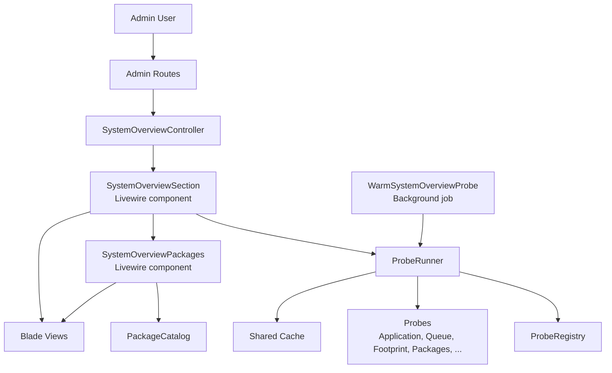
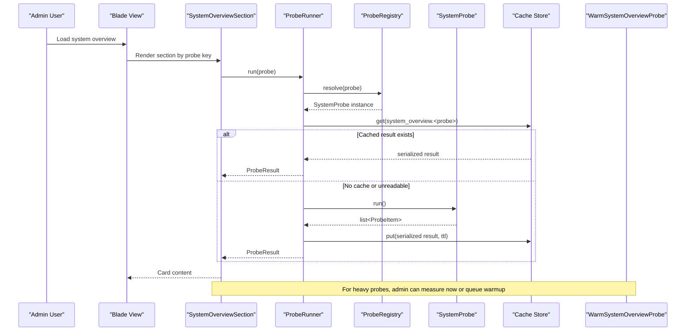
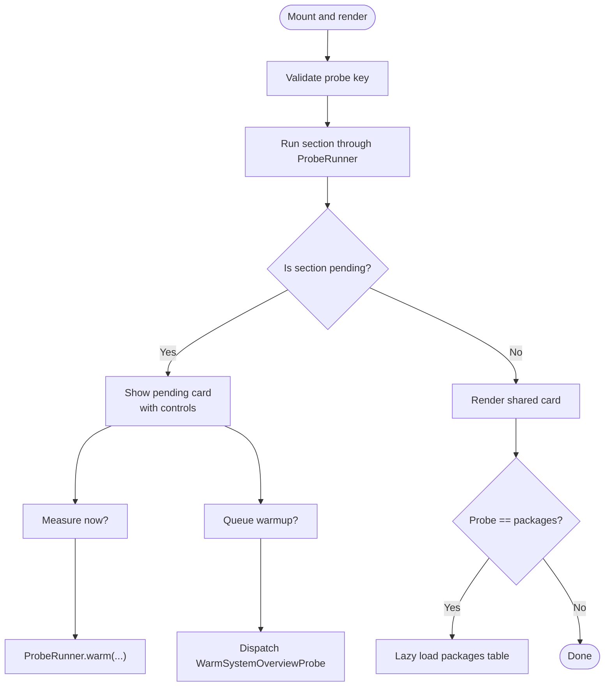
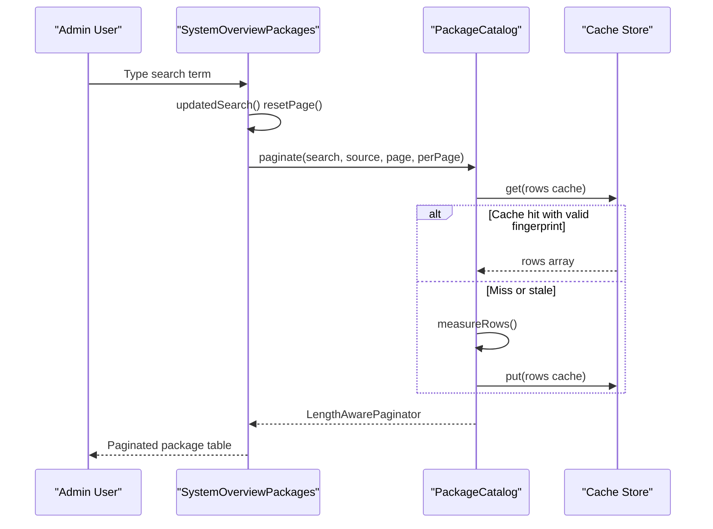
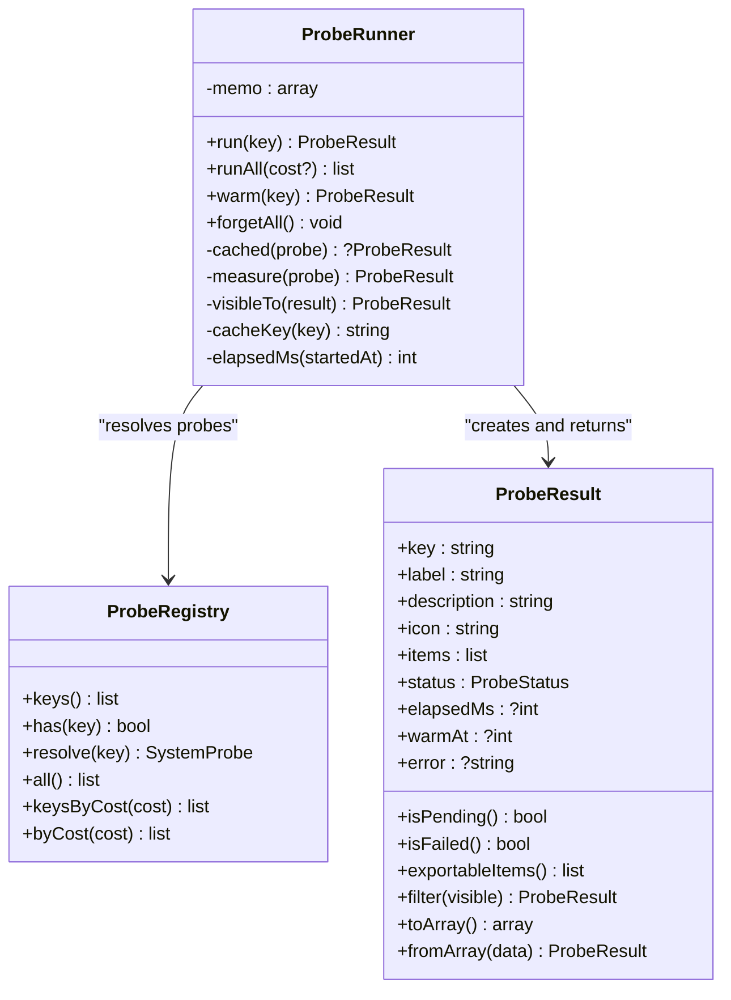
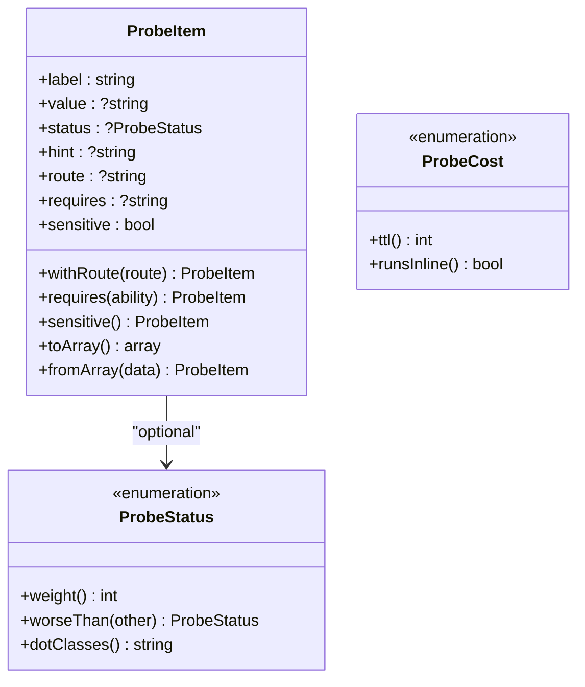
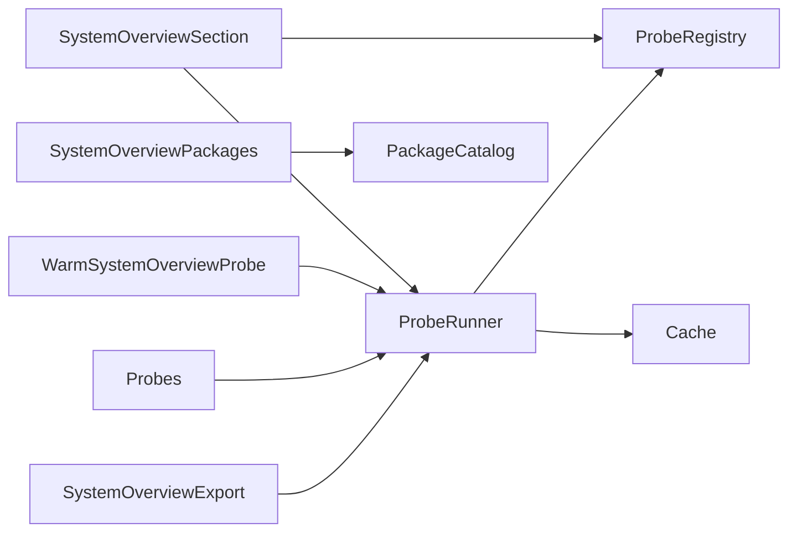

# System Overview Components

<cite>
**Referenced Files in This Document**   
- [SystemOverviewPackages.php](file://app/Livewire/SystemOverviewPackages.php)
- [SystemOverviewSection.php](file://app/Livewire/SystemOverviewSection.php)
- [WarmSystemOverviewProbe.php](file://app/Jobs/WarmSystemOverviewProbe.php)
- [ProbeRegistry.php](file://app/Support/SystemOverview/ProbeRegistry.php)
- [ProbeRunner.php](file://app/Support/SystemOverview/ProbeRunner.php)
- [ProbeResult.php](file://app/Support/SystemOverview/ProbeResult.php)
- [ProbeItem.php](file://app/Support/SystemOverview/ProbeItem.php)
- [PackageCatalog.php](file://app/Support/SystemOverview/PackageCatalog.php)
- [SystemProbe.php](file://app/Support/SystemOverview/SystemProbe.php)
- [ProbeCost.php](file://app/Support/SystemOverview/ProbeCost.php)
- [ProbeStatus.php](file://app/Support/SystemOverview/ProbeStatus.php)
- [BoundedSizeScanner.php](file://app/Support/SystemOverview/BoundedSizeScanner.php)
- [SystemOverviewExport.php](file://app/Support/SystemOverview/SystemOverviewExport.php)
- [ApplicationProbe.php](file://app/Support/SystemOverview/Probes/ApplicationProbe.php)
- [PackagesProbe.php](file://app/Support/SystemOverview/Probes/PackagesProbe.php)
- [FootprintProbe.php](file://app/Support/SystemOverview/Probes/FootprintProbe.php)
- [QueueProbe.php](file://app/Support/SystemOverview/Probes/QueueProbe.php)
- [system-overview-section.blade.php](file://resources/views/livewire/system-overview-section.blade.php)
- [system-overview-packages.blade.php](file://resources/views/livewire/system-overview-packages.blade.php)
</cite>

## Table of Contents
1. Introduction
2. Project Structure
3. Core Components
4. Architecture Overview
5. Detailed Component Analysis
6. Dependency Analysis
7. Performance Considerations
8. Troubleshooting Guide
9. Conclusion

## Introduction
This document explains the system overview subsystem, focusing on two Livewire components: `SystemOverviewPackages` and `SystemOverviewSection`. It covers how the analytics dashboard aggregates metrics from application state, queues, databases, storage, caches, and lock files; how it renders real-time cards; how heavy measurements are warmed off the request path; and how to extend monitoring with new probes, add metrics, customize layouts, and optimize for large datasets and responsive interfaces.

## Project Structure
The system overview is built around a small set of cohesive layers:

- Livewire components render interactive dashboard sections.
- A probe registry and runner manage allowlisted diagnostic sections.
- Individual probes collect metrics from services, models, filesystems, and configuration.
- A package catalog parses and caches dependency lists.
- A background job warms expensive sections.
- Blade views present cards, skeletons, and a searchable package table.

**Diagram sources**
- [SystemOverviewSection.php:1-88](file://app/Livewire/SystemOverviewSection.php#L1-L88)
- [SystemOverviewPackages.php:1-117](file://app/Livewire/SystemOverviewPackages.php#L1-L117)
- [WarmSystemOverviewProbe.php:1-76](file://app/Jobs/WarmSystemOverviewProbe.php#L1-L76)
- [ProbeRunner.php:1-194](file://app/Support/SystemOverview/ProbeRunner.php#L1-L194)
- [ProbeRegistry.php:1-118](file://app/Support/SystemOverview/ProbeRegistry.php#L1-L118)
- [PackageCatalog.php:1-200](file://app/Support/SystemOverview/PackageCatalog.php#L1-L200)
- [system-overview-section.blade.php:1-74](file://resources/views/livewire/system-overview-section.blade.php#L1-L74)
- [system-overview-packages.blade.php:1-130](file://resources/views/livewire/system-overview-packages.blade.php#L1-L130)

**Section sources**
- [SystemOverviewSection.php:1-88](file://app/Livewire/SystemOverviewSection.php#L1-L88)
- [SystemOverviewPackages.php:1-117](file://app/Livewire/SystemOverviewPackages.php#L1-L117)
- [ProbeRunner.php:1-194](file://app/Support/SystemOverview/ProbeRunner.php#L1-L194)
- [ProbeRegistry.php:1-118](file://app/Support/SystemOverview/ProbeRegistry.php#L1-L118)

## Core Components
- `SystemOverviewSection`: Renders one card per system section, serves cached or pending results, triggers inline measurement for light sections, and dispatches a background warm-up for heavy sections.
- `SystemOverviewPackages`: Renders the dependencies table under the “Dependencies” card, supports filtering by source (all, composer, npm), live search with debouncing, pagination, and skeleton loading.
- `ProbeRunner`: Central execution engine that reads from cache, measures fresh data when needed, stores serializable results, filters visibility by permissions, and records elapsed time.
- `ProbeRegistry`: Allowlisted catalogue mapping lightweight keys to probe classes, used everywhere route parameters reach the runtime.
- `ProbeResult` and `ProbeItem`: Immutable value objects representing a measured section and its rows, including severity, hints, routes, sensitivity, and exportability.
- `PackageCatalog`: Parses `composer.lock` and `package.json`, caches counts and rows keyed by lock-file fingerprint, and provides an in-memory paginator for the packages table.

**Section sources**
- [SystemOverviewSection.php:1-88](file://app/Livewire/SystemOverviewSection.php#L1-L88)
- [SystemOverviewPackages.php:1-117](file://app/Livewire/SystemOverviewPackages.php#L1-L117)
- [ProbeRunner.php:1-194](file://app/Support/SystemOverview/ProbeRunner.php#L1-L194)
- [ProbeRegistry.php:1-118](file://app/Support/SystemOverview/ProbeRegistry.php#L1-L118)
- [ProbeResult.php:1-200](file://app/Support/SystemOverview/ProbeResult.php#L1-L200)
- [ProbeItem.php:1-127](file://app/Support/SystemOverview/ProbeItem.php#L1-L127)
- [PackageCatalog.php:1-200](file://app/Support/SystemOverview/PackageCatalog.php#L1-L200)

## Architecture Overview
The dashboard follows a layered, fault-tolerant design:

- Route-level authorization gates access to the overview page and refresh/export endpoints.
- Livewire components provide reactive UI without exposing raw metric computation.
- The runner isolates failures so one broken probe does not break the whole page.
- Heavy work is executed off the request path via a unique queue job.
- Results are serialized to plain scalars for safe caching across runtimes.
- Export builds a redacted report by filtering sensitive lines at payload time.

**Diagram sources**
- [ProbeRunner.php:1-194](file://app/Support/SystemOverview/ProbeRunner.php#L1-L194)
- [ProbeRegistry.php:1-118](file://app/Support/SystemOverview/ProbeRegistry.php#L1-L118)
- [SystemOverviewSection.php:1-88](file://app/Livewire/SystemOverviewSection.php#L1-L88)
- [WarmSystemOverviewProbe.php:1-76](file://app/Jobs/WarmSystemOverviewProbe.php#L1-L76)

## Detailed Component Analysis

### SystemOverviewSection
Responsibilities:
- Accepts one allowlisted probe key.
- Returns a `ProbeResult` through `ProbeRunner`.
- Offers “Measure now” for immediate bounded measurement.
- Offers “Warm in background” to enqueue a deduplicated job.
- Enforces “view system overview” ability on every render.

Real-time behavior:
- Pending heavy sections use periodic polling to refresh once warming completes.
- The view toggles between a placeholder card and the shared card template.
- When the probe is “packages,” the nested packages table is loaded lazily after the card has been measured.

**Diagram sources**
- [SystemOverviewSection.php:1-88](file://app/Livewire/SystemOverviewSection.php#L1-L88)
- [system-overview-section.blade.php:1-74](file://resources/views/livewire/system-overview-section.blade.php#L1-L74)

Implementation highlights:
- Authorization is enforced in `render`, protecting both initial rendering and update requests because warming writes to shared cache.
- Background warmup uses a job with uniqueness, timeouts, and idempotent attempts.
- Inline measurement is intentionally only reachable through explicit user actions, never automatically during normal page loads.

**Section sources**
- [SystemOverviewSection.php:1-88](file://app/Livewire/SystemOverviewSection.php#L1-L88)
- [WarmSystemOverviewProbe.php:1-76](file://app/Jobs/WarmSystemOverviewProbe.php#L1-L76)
- [system-overview-section.blade.php:1-74](file://resources/views/livewire/system-overview-section.blade.php#L1-L74)

### SystemOverviewPackages
Responsibilities:
- Display a paginated, searchable table of Composer and npm packages.
- Support source tabs: all, composer, npm.
- Debounce live search input to avoid excessive updates.
- Reset pagination when search or source changes.
- Provide a lazy-loading skeleton while the card measures.

Data flow:
- `packages()` calls `PackageCatalog::paginate`, which returns an in-memory paginator over cached rows.
- `totals()` aggregates counts for tab labels.
- Source selection validates against allowed values and resets pagination.

**Diagram sources**
- [SystemOverviewPackages.php:1-117](file://app/Livewire/SystemOverviewPackages.php#L1-L117)
- [PackageCatalog.php:1-200](file://app/Support/SystemOverview/PackageCatalog.php#L1-L200)
- [system-overview-packages.blade.php:1-130](file://resources/views/livewire/system-overview-packages.blade.php#L1-L130)

Performance characteristics:
- The lock file is parsed once per fingerprint rather than per view.
- Rows are cached so keystrokes filter an in-memory array instead of re-parsing JSON.
- Pagination limits rendered rows to 15 by default.
- Search is debounced in the view to reduce Livewire traffic.

**Section sources**
- [SystemOverviewPackages.php:1-117](file://app/Livewire/SystemOverviewPackages.php#L1-L117)
- [PackageCatalog.php:1-200](file://app/Support/SystemOverview/PackageCatalog.php#L1-L200)
- [system-overview-packages.blade.php:1-130](file://resources/views/livewire/system-overview-packages.blade.php#L1-L130)

### ProbeRunner and ProbeRegistry
ProbeRunner responsibilities:
- Memoize results per request.
- Read from cache and reconstruct `ProbeResult` from arrays.
- Measure only when necessary and store serializable payloads.
- Filter items by ability before returning them to the caller.
- Convert exceptions into failed sections with safe messages.

ProbeRegistry responsibilities:
- Maintain an allowlist of probe keys and implementations.
- Provide ordered keys, lookups, and cost-based filtering for background warming.

**Diagram sources**
- [ProbeRunner.php:1-194](file://app/Support/SystemOverview/ProbeRunner.php#L1-L194)
- [ProbeRegistry.php:1-118](file://app/Support/SystemOverview/ProbeRegistry.php#L1-L118)
- [ProbeResult.php:1-200](file://app/Support/SystemOverview/ProbeResult.php#L1-L200)

**Section sources**
- [ProbeRunner.php:1-194](file://app/Support/SystemOverview/ProbeRunner.php#L1-L194)
- [ProbeRegistry.php:1-118](file://app/Support/SystemOverview/ProbeRegistry.php#L1-L118)
- [ProbeResult.php:1-200](file://app/Support/SystemOverview/ProbeResult.php#L1-L200)

### Data Models and Status Semantics
`ProbeItem` represents one metric row with:
- Human-readable label and preformatted value.
- Optional status, hint, link route, permission requirement, and export sensitivity.

`ProbeStatus` defines severity ordering and visual dot classes:
- Ok, Info, Pending, Warn, Fail.
- Sections take the worst status among visible items.

`ProbeCost` distinguishes light and heavy probes:
- Light probes may run inline and have short TTLs.
- Heavy probes must be warmed off the request path and have longer TTLs.

**Diagram sources**
- [ProbeItem.php:1-127](file://app/Support/SystemOverview/ProbeItem.php#L1-L127)
- [ProbeStatus.php:1-58](file://app/Support/SystemOverview/ProbeStatus.php#L1-L58)
- [ProbeCost.php:1-36](file://app/Support/SystemOverview/ProbeCost.php#L1-L36)

**Section sources**
- [ProbeItem.php:1-127](file://app/Support/SystemOverview/ProbeItem.php#L1-L127)
- [ProbeStatus.php:1-58](file://app/Support/SystemOverview/ProbeStatus.php#L1-L58)
- [ProbeCost.php:1-36](file://app/Support/SystemOverview/ProbeCost.php#L1-L36)

### Example Probes
- ApplicationProbe reports framework version, environment, debug mode, maintenance mode, cache state, timezone, locale, and recorded release.
- PackagesProbe summarizes Composer and npm counts and lock file age; it forces row parsing so the warm path pays once.
- FootprintProbe measures disk volume, code directories, uploads, logs, media registry, gallery images, and cache groups using a bounded scanner.
- QueueProbe shows connection type, pending jobs, reserved workers, failure counts, throughput, and scheduled commands.

These probes illustrate how to expose system health, integrate with services, and mark sensitive or permission-gated information.

**Section sources**
- [ApplicationProbe.php:1-115](file://app/Support/SystemOverview/Probes/ApplicationProbe.php#L1-L115)
- [PackagesProbe.php:1-83](file://app/Support/SystemOverview/Probes/PackagesProbe.php#L1-L83)
- [FootprintProbe.php:1-200](file://app/Support/SystemOverview/Probes/FootprintProbe.php#L1-L200)
- [QueueProbe.php:1-190](file://app/Support/SystemOverview/Probes/QueueProbe.php#L1-L190)

## Dependency Analysis
High-level relationships:

**Diagram sources**
- [SystemOverviewSection.php:1-88](file://app/Livewire/SystemOverviewSection.php#L1-L88)
- [SystemOverviewPackages.php:1-117](file://app/Livewire/SystemOverviewPackages.php#L1-L117)
- [ProbeRunner.php:1-194](file://app/Support/SystemOverview/ProbeRunner.php#L1-L194)
- [ProbeRegistry.php:1-118](file://app/Support/SystemOverview/ProbeRegistry.php#L1-L118)
- [WarmSystemOverviewProbe.php:1-76](file://app/Jobs/WarmSystemOverviewProbe.php#L1-L76)
- [SystemOverviewExport.php:1-90](file://app/Support/SystemOverview/SystemOverviewExport.php#L1-L90)

Coupling and cohesion:
- Components depend only on high-level runners and catalogs, keeping UI logic separate from metric collection.
- Probes are independent and side-effect free except for their own cache usage.
- The runner centralizes caching, timing, error handling, and visibility filtering.

External integration points:
- Database and queue tables for backlog and failure metrics.
- Filesystem for footprint scanning.
- Cache store for shared results.
- Jobs monitor facade when available.

**Section sources**
- [ProbeRunner.php:1-194](file://app/Support/SystemOverview/ProbeRunner.php#L1-L194)
- [ProbeRegistry.php:1-118](file://app/Support/SystemOverview/ProbeRegistry.php#L1-L118)
- [PackageCatalog.php:1-200](file://app/Support/SystemOverview/PackageCatalog.php#L1-L200)

## Performance Considerations
- Off-request-path warming: Heavy probes like packages and footprint are warmed by `WarmSystemOverviewProbe`, preventing slow filesystem or lock-file scans from blocking users.
- Fingerprint-based invalidation: Package catalog caches rows and counts keyed by a lock-file fingerprint, avoiding TTL-only staleness.
- In-memory pagination: Once rows are cached, search and pagination operate on arrays rather than re-parsing JSON.
- Request memoization: `ProbeRunner` keeps per-request results so exports and views share measurement costs within a single request.
- Bounded scanning: `BoundedSizeScanner` caps file count and wall-clock time, skipping symlinks and known large directories.
- Short and long TTLs: Light probes cache briefly; heavy probes cache longer.
- Visibility filtering at read time: One cache entry serves multiple roles, reducing duplication while still hiding restricted lines.

Recommendations:
- Keep heavy probes truly heavy; prefer queries over full directory walks.
- Mark potentially large outputs as sensitive if they should not leave the app.
- Use `ProbeCost::Light` only for fast operations; otherwise use queued warming.
- Prefer already computed aggregates where possible, such as using the media registry instead of walking storage buckets.

**Section sources**
- [WarmSystemOverviewProbe.php:1-76](file://app/Jobs/WarmSystemOverviewProbe.php#L1-L76)
- [PackageCatalog.php:1-200](file://app/Support/SystemOverview/PackageCatalog.php#L1-L200)
- [ProbeRunner.php:1-194](file://app/Support/SystemOverview/ProbeRunner.php#L1-L194)
- [BoundedSizeScanner.php:1-113](file://app/Support/SystemOverview/BoundedSizeScanner.php#L1-L113)
- [ProbeCost.php:1-36](file://app/Support/SystemOverview/ProbeCost.php#L1-L36)

## Troubleshooting Guide
Common symptoms and remedies:

- Section shows “Not measured yet”:
  - The probe is heavy and has not been warmed.
  - Click “Measure now” to run immediately, or “Warm in background” to enqueue the job.
  - Ensure queue workers are running if background warming is preferred.

- Section shows “Probe error”:
  - The probe threw an exception; check application logs for the probe name, user ID, exception class, and message.
  - The rest of the dashboard remains functional because errors are converted to failed sections.

- Dashboard is slow on first load:
  - Heavy probes may need warming.
  - Verify the schedule or worker is executing warm-up jobs.
  - Clear stale cache entries if lock files changed but the fingerprint did not invalidate correctly.

- Package table is empty or outdated:
  - Confirm `composer.lock` and `package.json` exist and are readable.
  - Clear package catalog caches after changing dependencies.
  - Verify the lock file fingerprint matches the current files.

- Some metrics are missing:
  - Lines can be hidden by permissions through `requires`.
  - Sensitive lines are excluded from exports.
  - Some features require additional tables or configurations, such as jobs monitoring.

Optimization tips:
- Reduce scope of filesystem scans by adding pruned directories or limiting paths.
- Avoid returning secrets from probes; use `ProbeItem::sensitive()` where appropriate.
- Use existing services like `CacheManagerService` for cache group sizes instead of walking framework storage manually.

**Section sources**
- [ProbeRunner.php:1-194](file://app/Support/SystemOverview/ProbeRunner.php#L1-L194)
- [ProbeResult.php:1-200](file://app/Support/SystemOverview/ProbeResult.php#L1-L200)
- [ProbeItem.php:1-127](file://app/Support/SystemOverview/ProbeItem.php#L1-L127)
- [PackageCatalog.php:1-200](file://app/Support/SystemOverview/PackageCatalog.php#L1-L200)

## Conclusion
The system overview combines Livewire-driven dashboards with a robust probe abstraction. Light metrics render reactively, while heavy diagnostics are warmed off the request path and safely cached. Package monitoring is optimized for large lock files through fingerprinted caching and in-memory pagination. The design makes it straightforward to add new probes, restrict sensitive data, export redacted reports, and scale the dashboard under load.

## Appendices

### How to Add a New System Metric
Steps:
1. Create a probe class implementing `SystemProbe`.
2. Return a list of `ProbeItem` values with labels, formatted values, optional statuses, hints, routes, permissions, and sensitivity flags.
3. Register the probe key and class in `ProbeRegistry`.
4. Choose `ProbeCost::Light` for fast checks or `ProbeCost::Heavy` for filesystem or lock-file work.
5. Test the section in the dashboard and verify caching, permissions, and export behavior.

Example references:
- [ApplicationProbe.php:1-115](file://app/Support/SystemOverview/Probes/ApplicationProbe.php#L1-L115)
- [QueueProbe.php:1-190](file://app/Support/SystemOverview/Probes/QueueProbe.php#L1-L190)
- [ProbeRegistry.php:1-118](file://app/Support/SystemOverview/ProbeRegistry.php#L1-L118)
- [ProbeItem.php:1-127](file://app/Support/SystemOverview/ProbeItem.php#L1-L127)

### How to Customize Dashboard Layouts
- Use the shared card template for any probe result.
- Replace text, hints, links, and status dots through `ProbeItem`.
- Restrict visibility with `requires` so only authorized users see certain lines.
- Hide values from exports with `sensitive`.

References:
- [ProbeItem.php:1-127](file://app/Support/SystemOverview/ProbeItem.php#L1-L127)
- [ProbeResult.php:1-200](file://app/Support/SystemOverview/ProbeResult.php#L1-L200)
- [system-overview-section.blade.php:1-74](file://resources/views/livewire/system-overview-section.blade.php#L1-L74)

### How to Extend Monitoring Capabilities
- Integrate existing services such as cache managers, database queries, or queue backends.
- Use `YammiJobs` facade when the jobs monitoring package is installed.
- Leverage `BoundedSizeScanner` for filesystem scans with hard limits.
- Build exports by relying on `SystemOverviewExport`, which redacts sensitive lines automatically.

References:
- [QueueProbe.php:1-190](file://app/Support/SystemOverview/Probes/QueueProbe.php#L1-L190)
- [FootprintProbe.php:1-200](file://app/Support/SystemOverview/Probes/FootprintProbe.php#L1-L200)
- [BoundedSizeScanner.php:1-113](file://app/Support/SystemOverview/BoundedSizeScanner.php#L1-L113)
- [SystemOverviewExport.php:1-90](file://app/Support/SystemOverview/SystemOverviewExport.php#L1-L90)

### Responsive Design Considerations
- The packages table hides less important columns on smaller screens and scrolls horizontally when needed.
- Search input and source tabs wrap gracefully on narrow devices.
- Cards use flexible spacing and dark-mode-friendly colors.

References:
- [system-overview-packages.blade.php:1-130](file://resources/views/livewire/system-overview-packages.blade.php#L1-L130)
- [system-overview-section.blade.php:1-74](file://resources/views/livewire/system-overview-section.blade.php#L1-L74)