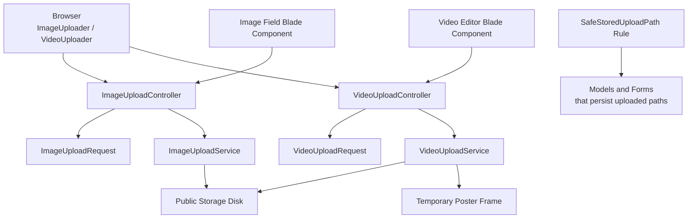
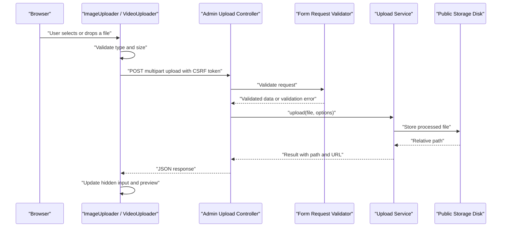
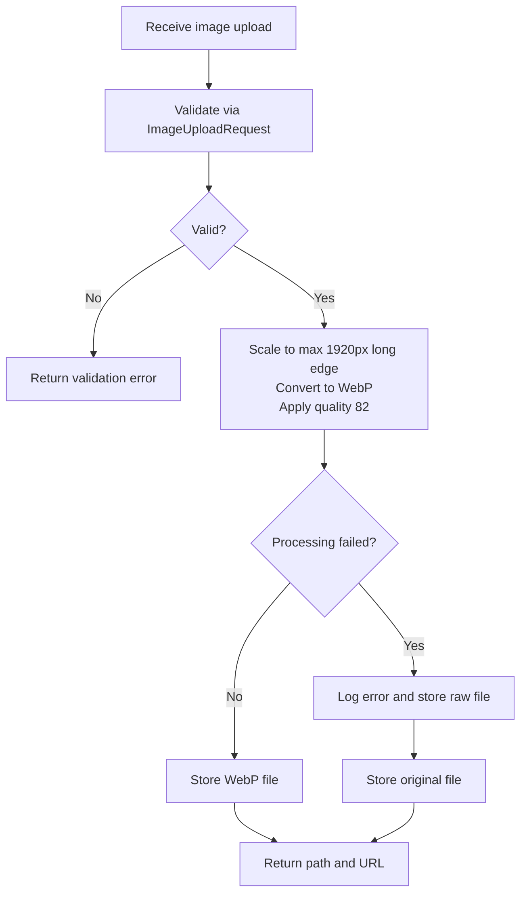
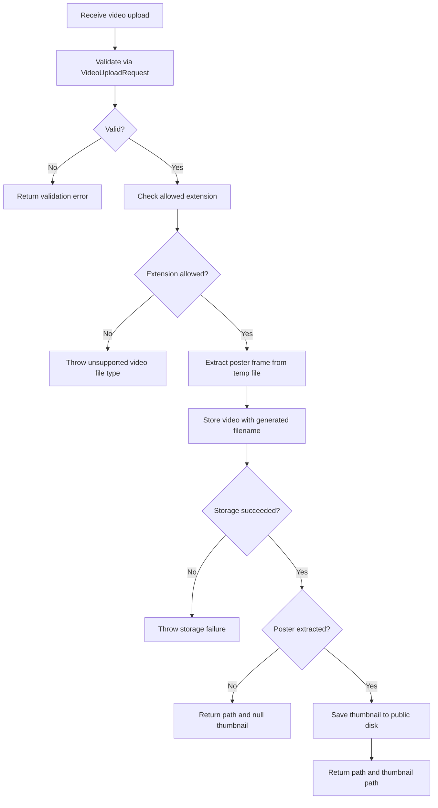
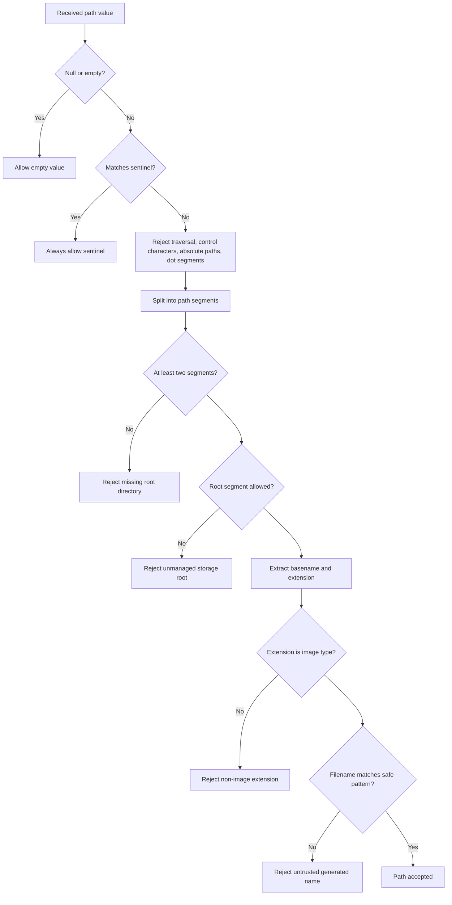
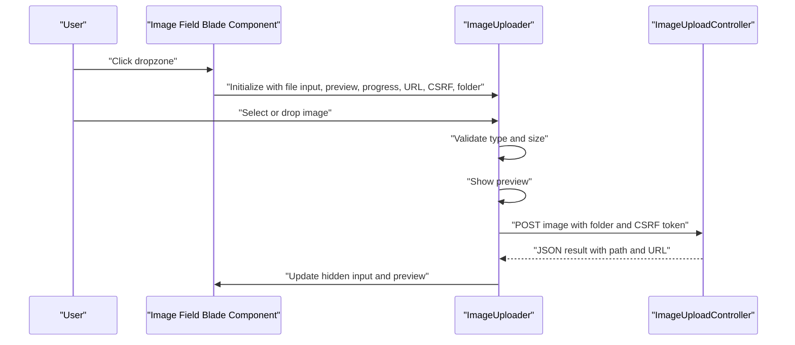
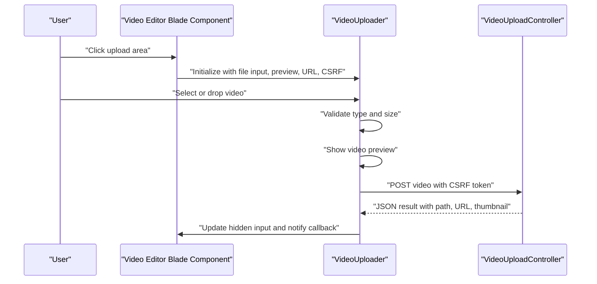
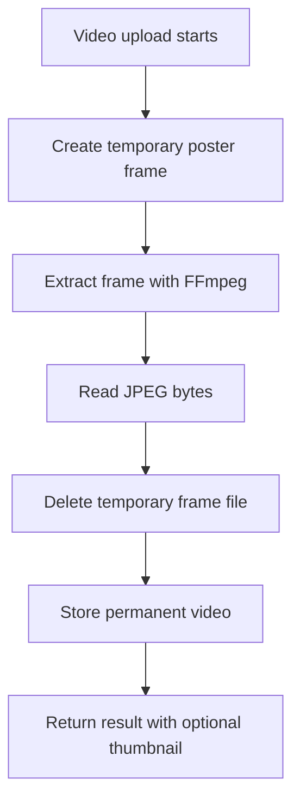
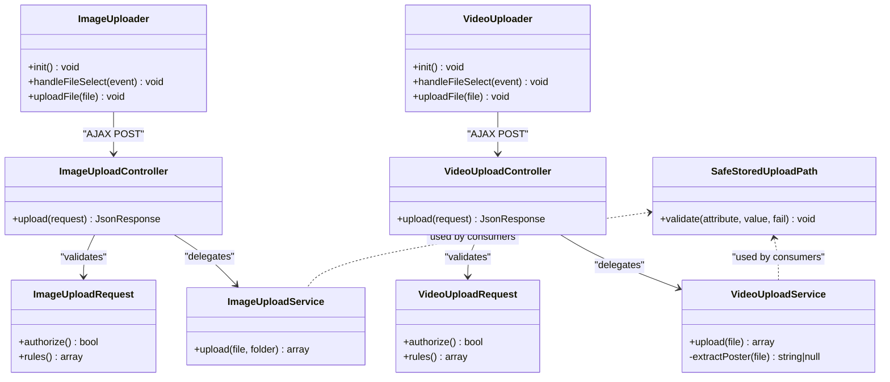

# File Upload System

<cite>
**Referenced Files in This Document**
- [ImageUploadService.php](file://app/Services/ImageUploadService.php)
- [VideoUploadService.php](file://app/Services/VideoUploadService.php)
- [SafeStoredUploadPath.php](file://app/Rules/SafeStoredUploadPath.php)
- [ImageUploadController.php](file://app/Http/Controllers/Admin/ImageUploadController.php)
- [VideoUploadController.php](file://app/Http/Controllers/Admin/VideoUploadController.php)
- [ImageUploadRequest.php](file://app/Http/Requests/Admin/ImageUploadRequest.php)
- [VideoUploadRequest.php](file://app/Http/Requests/Admin/VideoUploadRequest.php)
- [image-upload.js](file://public/js/image-upload.js)
- [video-uploader.js](file://public/js/video-uploader.js)
- [image-field.blade.php](file://resources/views/components/ui/image-field.blade.php)
- [video-editor.blade.php](file://resources/views/components/blocks/video-editor.blade.php)
- [filesytems.php](file://config/filesystems.php)
- [CleanupTempUploadsCommand.php](file://app/Console/Commands/CleanupTempUploadsCommand.php)
- [CleanupOrphanedUploads.php](file://app/Console/Commands/CleanupOrphanedUploads.php)
</cite>

## Table of Contents
1. [Introduction](#introduction)
2. [Project Structure](#project-structure)
3. [Core Components](#core-components)
4. [Architecture Overview](#architecture-overview)
5. [Detailed Component Analysis](#detailed-component-analysis)
6. [Dependency Analysis](#dependency-analysis)
7. [Performance Considerations](#performance-considerations)
8. [Troubleshooting Guide](#troubleshooting-guide)
9. [Conclusion](#conclusion)
10. [Appendices](#appendices)

## Introduction
This document describes the Highblossom file upload system used by the admin and content interfaces. It covers how images, videos, and documents are accepted, validated, stored, previewed, and cleaned up. The system exposes two primary server-side services:

- `ImageUploadService`: processes and stores images as normalized WebP files with a fixed maximum long edge and quality setting.
- `VideoUploadService`: stores supported video formats and optionally extracts a poster frame from the temporary upload file before storage.

The front end provides unified JavaScript uploaders for images and videos that support drag-and-drop, client-side validation, real-time progress bars, cancellation of previous uploads, and hidden-input path submission. Server-side validation is enforced through Laravel Form Requests, while path safety is enforced through the `SafeStoredUploadPath` rule when persisted paths are consumed later.

## Project Structure
The upload feature spans controllers, request validators, services, frontend assets, Blade components, filesystem configuration, and maintenance commands.

**Diagram sources**
- [ImageUploadController.php:1-41](file://app/Http/Controllers/Admin/ImageUploadController.php#L1-L41)
- [VideoUploadController.php:1-41](file://app/Http/Controllers/Admin/VideoUploadController.php#L1-L41)
- [ImageUploadRequest.php:1-54](file://app/Http/Requests/Admin/ImageUploadRequest.php#L1-L54)
- [VideoUploadRequest.php:1-33](file://app/Http/Requests/Admin/VideoUploadRequest.php#L1-L33)
- [ImageUploadService.php:1-70](file://app/Services/ImageUploadService.php#L1-L70)
- [VideoUploadService.php:1-105](file://app/Services/VideoUploadService.php#L1-L105)
- [SafeStoredUploadPath.php:1-139](file://app/Rules/SafeStoredUploadPath.php#L1-L139)
- [image-field.blade.php:1-145](file://resources/views/components/ui/image-field.blade.php#L1-L145)
- [video-editor.blade.php:1-169](file://resources/views/components/blocks/video-editor.blade.php#L1-L169)

**Section sources**
- [ImageUploadController.php:1-41](file://app/Http/Controllers/Admin/ImageUploadController.php#L1-L41)
- [VideoUploadController.php:1-41](file://app/Http/Controllers/Admin/VideoUploadController.php#L1-L41)
- [ImageUploadService.php:1-70](file://app/Services/ImageUploadService.php#L1-L70)
- [VideoUploadService.php:1-105](file://app/Services/VideoUploadService.php#L1-L105)
- [SafeStoredUploadPath.php:1-139](file://app/Rules/SafeStoredUploadPath.php#L1-L139)
- [image-field.blade.php:1-145](file://resources/views/components/ui/image-field.blade.php#L1-L145)
- [video-editor.blade.php:1-169](file://resources/views/components/blocks/video-editor.blade.php#L1-L169)

## Core Components
This section summarizes the responsibilities of each major component.

| Component | Responsibility | Key Behavior |
|---|---|---|
| `ImageUploadController` | Exposes the image upload endpoint for admin AJAX calls | Accepts an image and optional folder, delegates to `ImageUploadService`, returns JSON with success, path, and URL |
| `VideoUploadController` | Exposes the video upload endpoint | Accepts a video, delegates to `VideoUploadService`, returns JSON with path, URL, and thumbnail URL |
| `ImageUploadRequest` | Validates image uploads | Requires an image, enforces MIME types, limits size to 2 MB, restricts allowed folders |
| `VideoUploadRequest` | Validates video uploads | Requires a video, enforces MIME types, limits size to 30 MB |
| `ImageUploadService` | Processes and stores images | Scales to a maximum long edge of 1920 pixels, converts to WebP at quality 82, falls back to raw storage on processing failure |
| `VideoUploadService` | Stores videos and generates thumbnails | Accepts MP4, WebM, MOV, AVI; writes generated filenames under `videos`; extracts a poster frame using FFmpeg before storing |
| `SafeStoredUploadPath` | Validates persisted upload paths | Rejects traversal, absolute paths, unknown roots, non-image extensions, and unsafe basenames |
| `ImageUploader` (client) | Handles image selection, preview, validation, and upload | Supports drag-and-drop, progress bar, XHR timeout, cancellation, and hidden input update |
| `VideoUploader` (client) | Handles video selection, preview, validation, and upload | Supports drag-and-drop, progress bar, error handling, timeout handling, and hidden input update |
| Image field Blade component | Provides a reusable admin image upload UI | Wires `ImageUploader`, renders preview, supports removal, and submits a safe stored path |
| Video editor Blade component | Provides video preview, direct upload, and URL-based sources | Wires `VideoUploader` and integrates with Livewire block attributes |

**Section sources**
- [ImageUploadController.php:1-41](file://app/Http/Controllers/Admin/ImageUploadController.php#L1-L41)
- [VideoUploadController.php:1-41](file://app/Http/Controllers/Admin/VideoUploadController.php#L1-L41)
- [ImageUploadRequest.php:1-54](file://app/Http/Requests/Admin/ImageUploadRequest.php#L1-L54)
- [VideoUploadRequest.php:1-33](file://app/Http/Requests/Admin/VideoUploadRequest.php#L1-L33)
- [ImageUploadService.php:1-70](file://app/Services/ImageUploadService.php#L1-L70)
- [VideoUploadService.php:1-105](file://app/Services/VideoUploadService.php#L1-L105)
- [SafeStoredUploadPath.php:1-139](file://app/Rules/SafeStoredUploadPath.php#L1-L139)
- [image-upload.js:1-200](file://public/js/image-upload.js#L1-L200)
- [video-uploader.js:1-200](file://public/js/video-uploader.js#L1-L200)
- [image-field.blade.php:1-145](file://resources/views/components/ui/image-field.blade.php#L1-L145)
- [video-editor.blade.php:1-169](file://resources/views/components/blocks/video-editor.blade.php#L1-L169)

## Architecture Overview
The upload flow is layered:

1. **Client layer**: Browser-side JavaScript validates MIME type and size, shows previews, tracks upload progress, and sends multipart form data.
2. **Routing and controller layer**: Admin endpoints accept requests and delegate to services.
3. **Validation layer**: Laravel Form Requests validate inputs before service execution.
4. **Service layer**: Services perform storage operations and media processing.
5. **Storage layer**: Files are written to the configured public disk, which may be local or object storage.
6. **Persistence layer**: Consumers use `SafeStoredUploadPath` to ensure only trusted relative paths are accepted.

**Diagram sources**
- [image-upload.js:1-200](file://public/js/image-upload.js#L1-L200)
- [video-uploader.js:1-200](file://public/js/video-uploader.js#L1-L200)
- [ImageUploadController.php:1-41](file://app/Http/Controllers/Admin/ImageUploadController.php#L1-L41)
- [VideoUploadController.php:1-41](file://app/Http/Controllers/Admin/VideoUploadController.php#L1-L41)
- [ImageUploadRequest.php:1-54](file://app/Http/Requests/Admin/ImageUploadRequest.php#L1-L54)
- [VideoUploadRequest.php:1-33](file://app/Http/Requests/Admin/VideoUploadRequest.php#L1-L33)
- [ImageUploadService.php:1-70](file://app/Services/ImageUploadService.php#L1-L70)
- [VideoUploadService.php:1-105](file://app/Services/VideoUploadService.php#L1-L105)

## Detailed Component Analysis

### Image Upload Pipeline
The image pipeline normalizes every successful upload to WebP. If image processing fails, it logs the error and attempts to store the original file so transient processing issues do not fail the entire upload.

**Diagram sources**
- [ImageUploadRequest.php:1-54](file://app/Http/Requests/Admin/ImageUploadRequest.php#L1-L54)
- [ImageUploadService.php:1-70](file://app/Services/ImageUploadService.php#L1-L70)
- [ImageUploadController.php:1-41](file://app/Http/Controllers/Admin/ImageUploadController.php#L1-L41)

Key implementation details:

- **Allowed image MIME types**: JPEG, PNG, JPG, WebP, GIF.
- **Maximum image size**: 2 MB.
- **Maximum image dimension**: Long edge scaled to 1920 pixels.
- **Output format**: WebP with quality 82.
- **Fallback behavior**: On image processing exception, the service logs the failure and stores the raw file instead.
- **Storage location**: Relative path under the requested folder on the public disk.
- **Response format**: JSON object containing `success`, `path`, and `url`.

**Section sources**
- [ImageUploadRequest.php:1-54](file://app/Http/Requests/Admin/ImageUploadRequest.php#L1-L54)
- [ImageUploadService.php:1-70](file://app/Services/ImageUploadService.php#L1-L70)
- [ImageUploadController.php:1-41](file://app/Http/Controllers/Admin/ImageUploadController.php#L1-L41)

### Video Upload Pipeline
The video pipeline accepts common desktop and mobile video formats, generates a stable filename, extracts a poster frame from the temporary upload file, then persists both the video and its thumbnail.

**Diagram sources**
- [VideoUploadRequest.php:1-33](file://app/Http/Requests/Admin/VideoUploadRequest.php#L1-L33)
- [VideoUploadService.php:1-105](file://app/Services/VideoUploadService.php#L1-L105)
- [VideoUploadController.php:1-41](file://app/Http/Controllers/Admin/VideoUploadController.php#L1-L41)

Key implementation details:

- **Allowed video MIME types**: MP4, WebM, MOV, AVI.
- **Maximum video size**: 30 MB.
- **Filename strategy**: Timestamp plus random string plus original extension.
- **Thumbnail generation**: Uses FFmpeg to extract one frame from the temporary upload file before it is moved.
- **Failure isolation**: Thumbnail extraction failures are logged and treated as optional; the video itself can still succeed.
- **Storage location**: Videos under `videos`, thumbnails under `videos/thumbnails`.
- **Response format**: JSON object containing `success`, `path`, `url`, and `thumbnail`.

**Section sources**
- [VideoUploadRequest.php:1-33](file://app/Http/Requests/Admin/VideoUploadRequest.php#L1-L33)
- [VideoUploadService.php:1-105](file://app/Services/VideoUploadService.php#L1-L105)
- [VideoUploadController.php:1-41](file://app/Http/Controllers/Admin/VideoUploadController.php#L1-L41)

### Path Safety Validation
When application code receives a previously stored path, it should validate that the path came from the application’s own upload pipeline rather than accepting arbitrary user-supplied storage locations.

**Diagram sources**
- [SafeStoredUploadPath.php:1-139](file://app/Rules/SafeStoredUploadPath.php#L1-L139)

Important security properties:

- Blocks absolute paths and Windows-style drive prefixes.
- Blocks null bytes, backslashes, empty segments, single-dot segments, and double-dot traversal.
- Restricts top-level directories to an explicit allowlist such as `uploads`, `gallery`, `staff`, `avatars`, and others.
- Restricts extensions to image types: WebP, JPEG, JPG, PNG, GIF.
- Restricts filenames to alphanumeric, underscore, and hyphen characters up to 80 characters.
- Supports an optional sentinel value that is always accepted.

**Section sources**
- [SafeStoredUploadPath.php:1-139](file://app/Rules/SafeStoredUploadPath.php#L1-L139)

### Frontend Image Upload Integration
The image field component wires the browser-side `ImageUploader` class to a Blade template. It provides:

- A click-to-open file input.
- Drag-and-drop highlighting.
- Live image preview.
- Inline progress indication.
- Optional remove button.
- Submission of the stored path through a hidden input validated by `SafeStoredUploadPath`.

**Diagram sources**
- [image-field.blade.php:1-145](file://resources/views/components/ui/image-field.blade.php#L1-L145)
- [image-upload.js:1-200](file://public/js/image-upload.js#L1-L200)
- [ImageUploadController.php:1-41](file://app/Http/Controllers/Admin/ImageUploadController.php#L1-L41)

Configuration highlights:

- Default maximum image size: 2 MB.
- Accepted client types: JPEG, PNG, JPG, WebP.
- Upload URL: Admin image upload route.
- Folder parameter: Defaults to `uploads/images` but can be customized per field.
- Events: Supports completion, error, preview, start, and end callbacks.

**Section sources**
- [image-field.blade.php:1-145](file://resources/views/components/ui/image-field.blade.php#L1-L145)
- [image-upload.js:1-200](file://public/js/image-upload.js#L1-L200)

### Frontend Video Upload Integration
The video editor component provides a native preview, drag-and-drop support, and integration with a Livewire-bound hidden input. It also supports external video URLs alongside direct uploads.

**Diagram sources**
- [video-editor.blade.php:1-169](file://resources/views/components/blocks/video-editor.blade.php#L1-L169)
- [video-uploader.js:1-200](file://public/js/video-uploader.js#L1-L200)
- [VideoUploadController.php:1-41](file://app/Http/Controllers/Admin/VideoUploadController.php#L1-L41)

Configuration highlights:

- Default maximum video size: 30 MB.
- Accepted client types: MP4, WebM, QuickTime/MOV, AVI.
- Upload URL: Admin video upload route.
- Progress UI: Built-in progress bar when a progress container is provided.
- Error handling: Network error and timeout events are handled explicitly.

**Section sources**
- [video-editor.blade.php:1-169](file://resources/views/components/blocks/video-editor.blade.php#L1-L169)
- [video-uploader.js:1-200](file://public/js/video-uploader.js#L1-L200)

### Temporary File Handling and Cleanup
Temporary files appear in two contexts:

1. **PHP upload temp files**: Used by PHP during multipart uploads. These are managed by PHP and removed according to PHP configuration after the request completes.
2. **Poster frame temp files**: Created by `VideoUploadService` while extracting thumbnails. The service creates a temporary JPEG file in the system temp directory, reads its contents, deletes it in a `finally` block, and returns either the bytes or `null` if extraction fails.

Maintenance commands exist for related cleanup tasks:

- `content-blocks:cleanup-temp-uploads`: Removes temporary uploaded files older than a configurable number of hours.
- `content-blocks:cleanup-orphaned-uploads`: Removes temporary files no longer referenced in post content, subject to configuration.

**Diagram sources**
- [VideoUploadService.php:1-105](file://app/Services/VideoUploadService.php#L1-L105)
- [CleanupTempUploadsCommand.php:1-53](file://app/Console/Commands/CleanupTempUploadsCommand.php#L1-L53)
- [CleanupOrphanedUploads.php:1-54](file://app/Console/Commands/CleanupOrphanedUploads.php#L1-L54)

**Section sources**
- [VideoUploadService.php:1-105](file://app/Services/VideoUploadService.php#L1-L105)
- [CleanupTempUploadsCommand.php:1-53](file://app/Console/Commands/CleanupTempUploadsCommand.php#L1-L53)
- [CleanupOrphanedUploads.php:1-54](file://app/Console/Commands/CleanupOrphanedUploads.php#L1-L54)

## Dependency Analysis
The upload system has clear layering and limited coupling:

- Controllers depend only on request validators and services.
- Services depend on storage and external tools (`Image` facade, FFmpeg).
- Frontend uploaders depend only on DOM APIs, XHR, and the configured upload routes.
- Persistence consumers depend on `SafeStoredUploadPath` instead of trusting raw user input.

**Diagram sources**
- [ImageUploadController.php:1-41](file://app/Http/Controllers/Admin/ImageUploadController.php#L1-L41)
- [VideoUploadController.php:1-41](file://app/Http/Controllers/Admin/VideoUploadController.php#L1-L41)
- [ImageUploadRequest.php:1-54](file://app/Http/Requests/Admin/ImageUploadRequest.php#L1-L54)
- [VideoUploadRequest.php:1-33](file://app/Http/Requests/Admin/VideoUploadRequest.php#L1-L33)
- [ImageUploadService.php:1-70](file://app/Services/ImageUploadService.php#L1-L70)
- [VideoUploadService.php:1-105](file://app/Services/VideoUploadService.php#L1-L105)
- [SafeStoredUploadPath.php:1-139](file://app/Rules/SafeStoredUploadPath.php#L1-L139)
- [image-upload.js:1-200](file://public/js/image-upload.js#L1-L200)
- [video-uploader.js:1-200](file://public/js/video-uploader.js#L1-L200)

**Section sources**
- [ImageUploadController.php:1-41](file://app/Http/Controllers/Admin/ImageUploadController.php#L1-L41)
- [VideoUploadController.php:1-41](file://app/Http/Controllers/Admin/VideoUploadController.php#L1-L41)
- [ImageUploadService.php:1-70](file://app/Services/ImageUploadService.php#L1-L70)
- [VideoUploadService.php:1-105](file://app/Services/VideoUploadService.php#L1-L105)
- [SafeStoredUploadPath.php:1-139](file://app/Rules/SafeStoredUploadPath.php#L1-L139)
- [image-upload.js:1-200](file://public/js/image-upload.js#L1-L200)
- [video-uploader.js:1-200](file://public/js/video-uploader.js#L1-L200)

## Performance Considerations
- **Image normalization cost**: Every image is decoded, scaled, converted to WebP, and re-encoded. For large batches, consider queuing or background processing if uploads become a bottleneck.
- **FFmpeg dependency**: Video thumbnail extraction depends on FFmpeg being installed and available. Missing or misconfigured FFmpeg will cause thumbnail extraction to fail, though the video itself may still upload successfully.
- **Object storage latency**: When the public disk points to an object store, network latency affects upload and thumbnail storage time.
- **Client timeouts**: Image uploads default to a short XHR timeout, while video uploads use a longer timeout because videos are larger.
- **Memory usage**: Large images and videos are loaded into memory during processing and thumbnail extraction.
- **Storage driver configuration**: The public disk can be local or S3-like object storage. Object storage should be configured with appropriate visibility, credentials, region, bucket, and endpoint settings.

[No sources needed since this section provides general guidance]

## Troubleshooting Guide

### Common Issues and Resolutions

| Issue | Likely Cause | Resolution |
|---|---|---|
| Image upload succeeds but file remains original format | Image processing threw an exception and the fallback stored the raw file | Check image processing libraries and logs; verify the original image is valid and supported |
| Video uploads fail with unsupported type | Client or server MIME validation rejected the file | Ensure the client sends an accepted MIME type and the server allows the same extension |
| Thumbnails are missing | FFmpeg extraction failed or returned no frame | Verify FFmpeg installation, permissions, and video integrity; check server logs |
| Large image or video times out | Client XHR timeout too short for network or file size | Increase timeout in the uploader or split uploads if required |
| Uploads fail on object storage | Misconfigured credentials, bucket, endpoint, or visibility | Review filesystem disk configuration and cloud provider settings |
| Persisted image path rejected by model validation | Path does not pass `SafeStoredUploadPath` | Ensure the path uses an allowed root directory, image extension, and safe filename |
| Temporary files accumulate | Cleanup command not scheduled or retention period too high | Schedule the cleanup commands and review retention configuration |
| Upload cancellation does not work reliably | Previous XHR not aborted before new upload | Ensure the current XHR is aborted before starting a new upload cycle |

**Section sources**
- [ImageUploadService.php:1-70](file://app/Services/ImageUploadService.php#L1-L70)
- [VideoUploadService.php:1-105](file://app/Services/VideoUploadService.php#L1-L105)
- [SafeStoredUploadPath.php:1-139](file://app/Rules/SafeStoredUploadPath.php#L1-L139)
- [image-upload.js:1-200](file://public/js/image-upload.js#L1-L200)
- [video-uploader.js:1-200](file://public/js/video-uploader.js#L1-L200)
- [filesytems.php:1-109](file://config/filesystems.php#L1-L109)
- [CleanupTempUploadsCommand.php:1-53](file://app/Console/Commands/CleanupTempUploadsCommand.php#L1-L53)
- [CleanupOrphanedUploads.php:1-54](file://app/Console/Commands/CleanupOrphanedUploads.php#L1-L54)

## Conclusion
Highblossom’s upload system separates concerns cleanly: controllers handle HTTP boundaries, request classes enforce input contracts, services manage storage and media processing, and the frontend provides responsive UX with validation, preview, and progress. Security is reinforced by strict MIME checks, size limits, controlled destination folders, and the `SafeStoredUploadPath` rule for persisted references. For production deployments, ensure object storage is correctly configured, FFmpeg is available where video thumbnails are required, and cleanup commands run regularly to prevent orphaned temporary files.

[No sources needed since this section summarizes without analyzing specific files]

## Appendices

### Practical Usage Examples

#### Programmatic Image Upload
To upload an image programmatically:

1. Prepare a multipart form with an `image` field and an optional `folder` field.
2. Send a POST request to the admin image upload route.
3. Include the CSRF token.
4. Expect JSON with `success`, `path`, and `url`.
5. Use the returned path with `SafeStoredUploadPath` before persistence.

**Section sources**
- [ImageUploadController.php:1-41](file://app/Http/Controllers/Admin/ImageUploadController.php#L1-L41)
- [ImageUploadRequest.php:1-54](file://app/Http/Requests/Admin/ImageUploadRequest.php#L1-L54)
- [ImageUploadService.php:1-70](file://app/Services/ImageUploadService.php#L1-L70)
- [SafeStoredUploadPath.php:1-139](file://app/Rules/SafeStoredUploadPath.php#L1-L139)

#### Programmatic Video Upload
To upload a video programmatically:

1. Prepare a multipart form with a `video` field.
2. Send a POST request to the admin video upload route.
3. Include the CSRF token.
4. Expect JSON with `success`, `path`, `url`, and `thumbnail`.
5. Treat the thumbnail as optional because extraction can fail gracefully.

**Section sources**
- [VideoUploadController.php:1-41](file://app/Http/Controllers/Admin/VideoUploadController.php#L1-L41)
- [VideoUploadRequest.php:1-33](file://app/Http/Requests/Admin/VideoUploadRequest.php#L1-L33)
- [VideoUploadService.php:1-105](file://app/Services/VideoUploadService.php#L1-L105)

#### Multiple File Uploads
The current implementations process one file per request. To support multiple files:

- Wrap the existing upload logic in a loop over multiple files.
- Return aggregated results or partial failures.
- Add idempotency keys if retrying partially failed batches.
- Extend client uploaders to queue multiple uploads and track per-file progress.

[No sources needed since this section proposes conceptual extensions]

#### Customizing Upload Behavior
Common customizations include:

- Adjusting maximum file sizes in request validators.
- Changing allowed folders in `ImageUploadRequest`.
- Adding new allowed extensions in `VideoUploadService`.
- Modifying image scaling and quality constants in `ImageUploadService`.
- Updating client defaults for accepted types, maximum size, and timeout values.
- Extending `SafeStoredUploadPath` with additional allowed directories or sentinels.

**Section sources**
- [ImageUploadRequest.php:1-54](file://app/Http/Requests/Admin/ImageUploadRequest.php#L1-L54)
- [VideoUploadRequest.php:1-33](file://app/Http/Requests/Admin/VideoUploadRequest.php#L1-L33)
- [ImageUploadService.php:1-70](file://app/Services/ImageUploadService.php#L1-L70)
- [VideoUploadService.php:1-105](file://app/Services/VideoUploadService.php#L1-L105)
- [SafeStoredUploadPath.php:1-139](file://app/Rules/SafeStoredUploadPath.php#L1-L139)
- [image-upload.js:1-200](file://public/js/image-upload.js#L1-L200)
- [video-uploader.js:1-200](file://public/js/video-uploader.js#L1-L200)