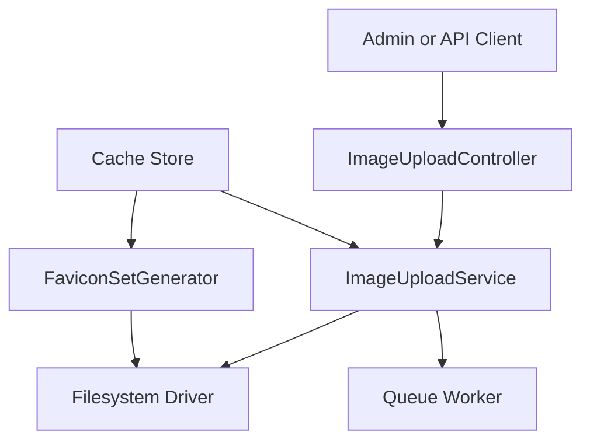
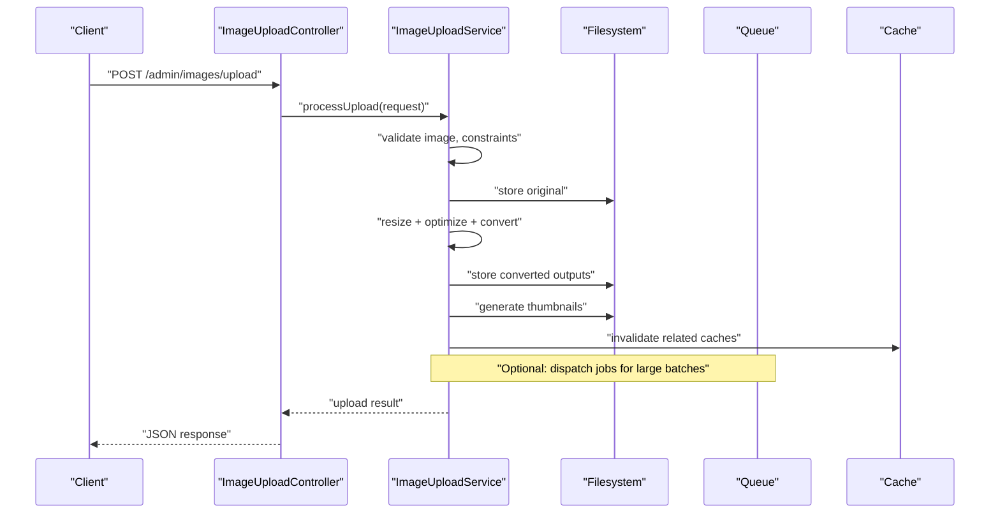
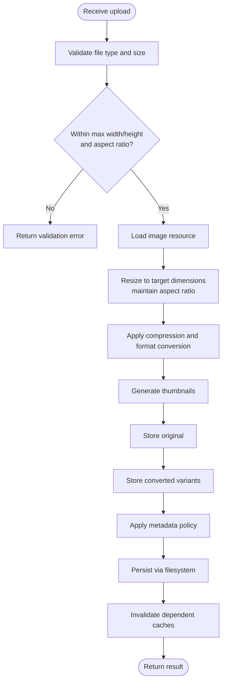
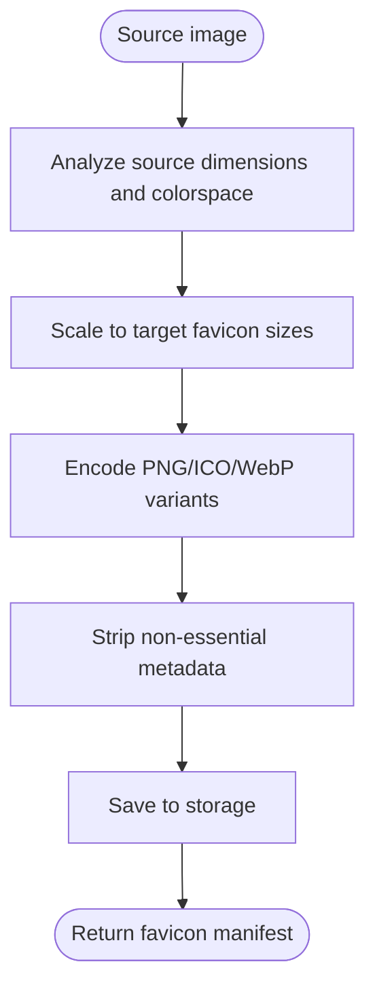
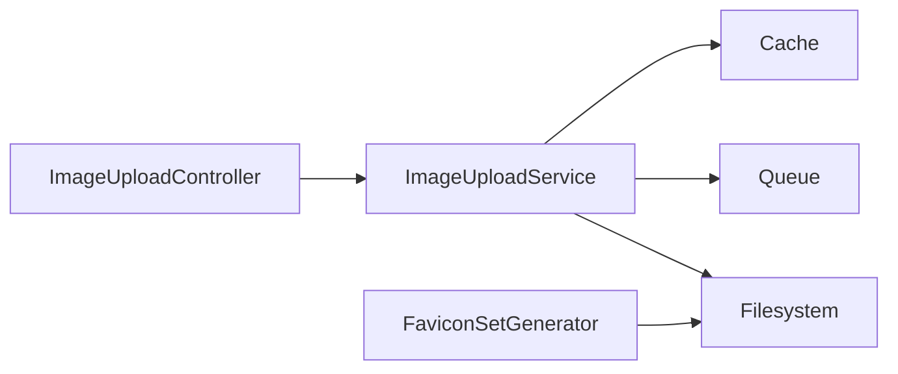

# Image Processing Pipeline

<cite>
**Referenced Files in This Document**   
- [ImageUploadService.php](file://app/app/Services/ImageUploadService.php)
- [FaviconSetGenerator.php](file://app/app/Services/FaviconSetGenerator.php)
- [ImageUploadController.php](file://app/app/Http/Controllers/Admin/ImageUploadController.php)
- [filesystems.php](file://config/filesystems.php)
- [queue.php](file://config/queue.php)
- [cache.php](file://config/cache.php)
</cite>

## Table of Contents
1. [Introduction](#introduction)
2. [Project Structure](#project-structure)
3. [Core Components](#core-components)
4. [Architecture Overview](#architecture-overview)
5. [Detailed Component Analysis](#detailed-component-analysis)
6. [Dependency Analysis](#dependency-analysis)
7. [Performance Considerations](#performance-considerations)
8. [Troubleshooting Guide](#troubleshooting-guide)
9. [Conclusion](#conclusion)

## Introduction
This document explains the Highblossom image processing pipeline with a focus on:
- Uploading, resizing, compressing, and converting images to JPEG, PNG, and WebP.
- Thumbnail generation and quality control.
- Generating multi-size favicon sets from source images.
- Configuration for storage drivers, quality thresholds, output formats, and queue processing.
- Programmatic usage patterns, batch workflows, and performance guidance for large volumes of images.

The pipeline is implemented as application services backed by Laravel filesystems, queues, and cache. It separates upload handling, image transformation logic, and favicon generation into dedicated classes so that controllers and other parts of the application can reuse consistent image processing behavior.

## Project Structure
The image processing pipeline centers around three main files:
- `ImageUploadService.php` — orchestrates uploads, validation, resizing, compression, format conversion, thumbnails, and persistence.
- `FaviconSetGenerator.php` — builds multiple favicon sizes from a single source image.
- `ImageUploadController.php` — exposes admin endpoints for uploading and processing images.

Supporting configuration lives in:
- `config/filesystems.php` — storage driver definitions (local, S3, etc.).
- `config/queue.php` — background job configuration for heavy image workloads.
- `config/cache.php` — caching strategy for processed images and metadata.

**Diagram sources**
- [ImageUploadController.php](file://app/app/Http/Controllers/Admin/ImageUploadController.php)
- [ImageUploadService.php](file://app/app/Services/ImageUploadService.php)
- [FaviconSetGenerator.php](file://app/app/Services/FaviconSetGenerator.php)
- [filesystems.php](file://config/filesystems.php)
- [queue.php](file://config/queue.php)
- [cache.php](file://config/cache.php)

**Section sources**
- [ImageUploadService.php](file://app/app/Services/ImageUploadService.php)
- [FaviconSetGenerator.php](file://app/app/Services/FaviconSetGenerator.php)
- [ImageUploadController.php](file://app/app/Http/Controllers/Admin/ImageUploadController.php)
- [filesystems.php](file://config/filesystems.php)
- [queue.php](file://config/queue.php)
- [cache.php](file://config/cache.php)

## Core Components
- ImageUploadService: Central service for validating uploaded images, enforcing dimension and aspect-ratio constraints, resizing, optimizing compression, converting between JPEG/PNG/WebP, generating thumbnails, preserving selected metadata, and persisting results through configured storage.
- FaviconSetGenerator: Utility for creating a set of favicon variants at standard sizes from a source image, including appropriate formats and optional metadata stripping.
- ImageUploadController: HTTP endpoint layer used by the admin interface to accept uploads and delegate processing to ImageUploadService.

Key capabilities:
- Automatic resizing to target dimensions while respecting aspect ratios.
- Compression optimization per output format.
- Format conversion among JPEG, PNG, and WebP.
- Thumbnail generation with configurable size presets.
- Metadata preservation options for EXIF/IPTC/XMP where supported by the backend.
- Batch-friendly design via queueable operations.

**Section sources**
- [ImageUploadService.php](file://app/app/Services/ImageUploadService.php)
- [FaviconSetGenerator.php](file://app/app/Services/FaviconSetGenerator.php)
- [ImageUploadController.php](file://app/app/Http/Controllers/Admin/ImageUploadController.php)

## Architecture Overview
The pipeline follows a layered architecture:
- Presentation layer: Admin controller accepts uploads.
- Service layer: ImageUploadService encapsulates all image processing logic.
- Asset generator layer: FaviconSetGenerator provides favicon variant generation.
- Infrastructure layer: Filesystem abstraction, queue workers, and cache store handle persistence and concurrency.

**Diagram sources**
- [ImageUploadController.php](file://app/app/Http/Controllers/Admin/ImageUploadController.php)
- [ImageUploadService.php](file://app/app/Services/ImageUploadService.php)
- [filesystems.php](file://config/filesystems.php)
- [queue.php](file://config/queue.php)
- [cache.php](file://config/cache.php)

## Detailed Component Analysis

### ImageUploadService
Responsibilities:
- Validate incoming file type and size.
- Enforce maximum width/height and aspect ratio rules.
- Normalize input to a working image resource.
- Resize images to requested dimensions while maintaining aspect ratio.
- Optimize compression based on target format.
- Convert between JPEG, PNG, and WebP.
- Generate one or more thumbnail sizes.
- Preserve or strip metadata according to configuration.
- Persist original and processed variants using the configured filesystem.
- Optionally dispatch background jobs for batch processing.

Important behaviors:
- Dimension constraints prevent oversized uploads and ensure consistent output sizing.
- Aspect ratio handling avoids distortion; it may pad or crop depending on configuration.
- Quality thresholds are applied per format to balance visual fidelity and file size.
- WebP conversion improves delivery size when clients support it.
- Thumbnails are produced alongside originals for efficient listing views.
- Metadata preservation is selective to avoid bloating outputs and to respect privacy needs.

Processing flow:

**Diagram sources**
- [ImageUploadService.php](file://app/app/Services/ImageUploadService.php)

Quality and format settings:
- Per-format quality values control JPEG, PNG, and WebP encoding.
- Target dimensions and aspect ratio policies determine how images are resized.
- Output formats can be enforced globally or per request.

Thumbnail generation:
- Preset sizes are generated after primary conversion.
- Thumbnails use optimized compression suitable for preview lists.

Metadata handling:
- Selective preservation of useful EXIF fields (e.g., orientation).
- Optional stripping of sensitive data before storing public variants.

Error handling:
- Validation errors for unsupported types or oversized files.
- Graceful fallbacks if a format cannot be encoded.
- Consistent exception messages for debugging.

Performance characteristics:
- Uses memory-efficient image resources.
- Avoids redundant conversions by caching intermediate results when possible.
- Supports queue-based processing for large batches.

**Section sources**
- [ImageUploadService.php](file://app/app/Services/ImageUploadService.php)

### FaviconSetGenerator
Responsibilities:
- Accept a source image and generate a set of favicon variants.
- Produce standard favicon sizes (for example, 16x16, 32x32, 48x48, 64x64, 180x180).
- Render PNG and ICO where needed, plus WebP for modern browsers.
- Apply consistent color correction and transparency handling.
- Strip unnecessary metadata to minimize file size.
- Return paths or URLs for each generated variant.

Output structure:
- A manifest-like collection mapping each favicon size to its stored path or URL.
- Optional inclusion of Apple Touch Icon and Android icon variants.

Processing flow:

**Diagram sources**
- [FaviconSetGenerator.php](file://app/app/Services/FaviconSetGenerator.php)

**Section sources**
- [FaviconSetGenerator.php](file://app/app/Services/FaviconSetGenerator.php)

### ImageUploadController
Responsibilities:
- Accept image uploads from the admin interface.
- Delegate validation and processing to ImageUploadService.
- Return structured JSON responses indicating success or failure.
- Integrate with authorization and middleware as required by the admin area.

Integration points:
- Uses request validation rules compatible with ImageUploadService expectations.
- May trigger batch processing endpoints for bulk imports.

**Section sources**
- [ImageUploadController.php](file://app/app/Http/Controllers/Admin/ImageUploadController.php)

## Dependency Analysis
External dependencies and integration points:
- Filesystem abstraction: All persisted images go through the configured storage driver.
- Queue system: Background workers process large batches asynchronously.
- Cache store: Used to invalidate or bypass stale processed assets.
- Image libraries: Underlying GD/Imagick extensions provide encoding and decoding.

**Diagram sources**
- [ImageUploadService.php](file://app/app/Services/ImageUploadService.php)
- [FaviconSetGenerator.php](file://app/app/Services/FaviconSetGenerator.php)
- [ImageUploadController.php](file://app/app/Http/Controllers/Admin/ImageUploadController.php)
- [filesystems.php](file://config/filesystems.php)
- [queue.php](file://config/queue.php)
- [cache.php](file://config/cache.php)

**Section sources**
- [filesystems.php](file://config/filesystems.php)
- [queue.php](file://config/queue.php)
- [cache.php](file://config/cache.php)

## Performance Considerations
Memory management:
- Process images through streaming resources rather than loading entire files into memory when possible.
- Release image handles promptly after encoding.
- Use lower-quality previews for initial list views.

Queue processing:
- Offload heavy resize/convert operations to background jobs for large batches.
- Configure worker concurrency and memory limits appropriately.
- Implement idempotent operations so retries do not duplicate files.

Caching strategies:
- Cache processed image URLs keyed by source fingerprint and transformation parameters.
- Invalidate caches when source content changes or processing rules are updated.
- Use short-lived cache entries during experimentation with new quality or format settings.

Batch workflows:
- Chunk large import jobs to avoid long-running processes.
- Monitor job failures and implement retry with backoff.
- Provide progress reporting for long-running batch operations.

Optimization recommendations:
- Prefer WebP for web delivery when client support is available.
- Tune per-format quality thresholds to meet target file size budgets.
- Precompute commonly used thumbnail sizes to reduce runtime conversions.
- Consider server-side image serving libraries for dynamic transformations if applicable.

[No sources needed since this section provides general guidance]

## Troubleshooting Guide
Common issues and resolutions:
- Unsupported image type: Ensure only allowed formats are accepted and validate MIME types server-side.
- Excessive file size: Enforce maximum file size and pre-validate on the client side.
- Memory exhaustion: Increase worker memory limits, reduce concurrent jobs, or chunk batches.
- Missing thumbnails: Verify storage permissions and write access to the configured disk.
- Incorrect aspect ratio: Review constraint configuration and cropping/padding policies.
- Poor image quality: Adjust per-format quality thresholds and verify destination dimensions.
- Stale cached assets: Clear relevant cache keys or force regeneration when rules change.

Operational checks:
- Confirm filesystem driver configuration and credentials.
- Verify queue workers are running and processing jobs.
- Inspect logs for failed encodings or permission denials.
- Validate that cache stores are reachable and writable.

**Section sources**
- [ImageUploadService.php](file://app/app/Services/ImageUploadService.php)
- [FaviconSetGenerator.php](file://app/app/Services/FaviconSetGenerator.php)
- [ImageUploadController.php](file://app/app/Http/Controllers/Admin/ImageUploadController.php)
- [filesystems.php](file://config/filesystems.php)
- [queue.php](file://config/queue.php)
- [cache.php](file://config/cache.php)

## Conclusion
The Highblossom image processing pipeline centralizes upload handling, image transformation, and favicon generation behind well-defined services. ImageUploadService enforces constraints, optimizes output sizes, converts formats, and generates thumbnails, while FaviconSetGenerator produces a complete set of favicon variants. Together with filesystem, queue, and cache configurations, they form a scalable, maintainable foundation for image-heavy features such as galleries, hero sections, and media-rich content. For large-scale operations, prioritize queue-based processing, careful memory management, and effective caching to deliver fast, reliable image handling across the application.

[No sources needed since this section summarizes without analyzing specific files]