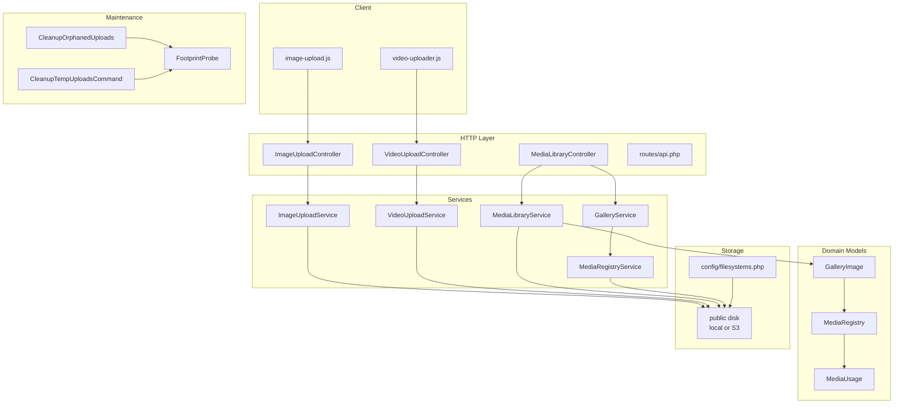
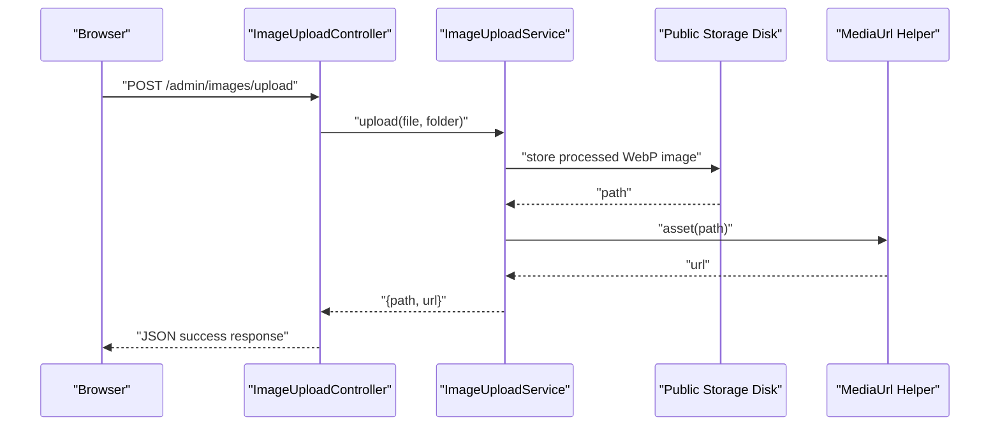
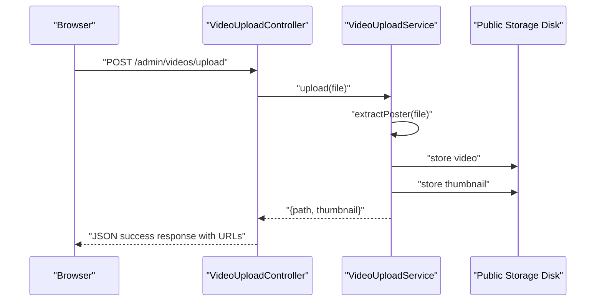
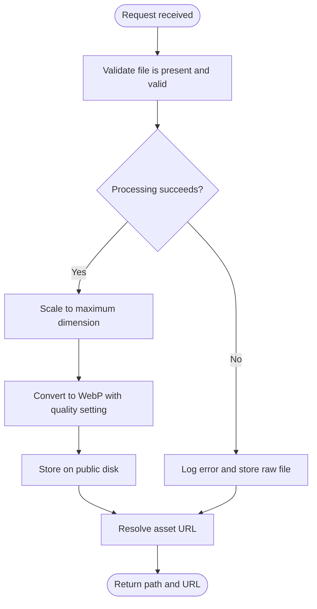
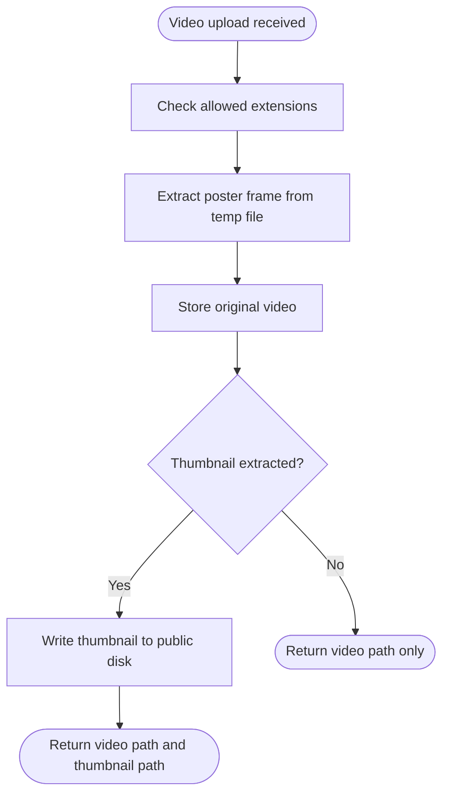
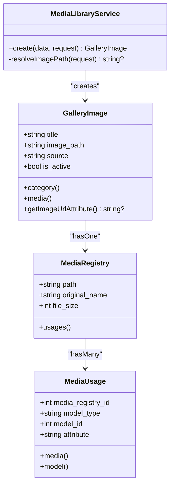
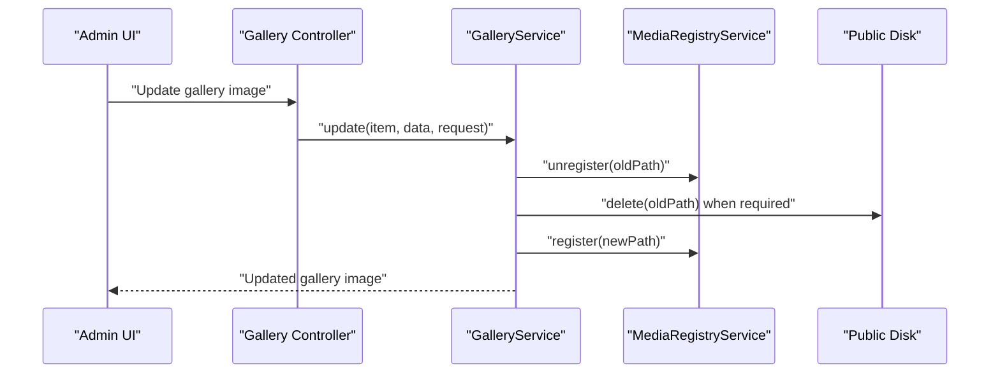
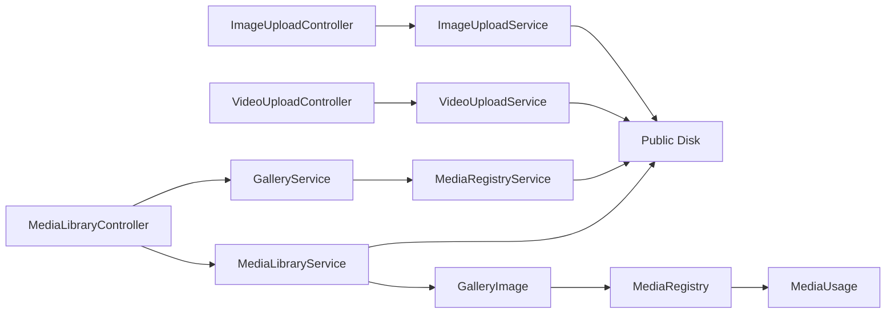

# Media Management

<cite>
**Referenced Files in This Document**
- [ImageUploadService.php](file://app/Services/ImageUploadService.php)
- [VideoUploadService.php](file://app/Services/VideoUploadService.php)
- [MediaLibraryService.php](file://app/Services/MediaLibraryService.php)
- [GalleryService.php](file://app/Services/GalleryService.php)
- [MediaRegistryService.php](file://app/Services/MediaRegistryService.php)
- [MediaRegistry.php](file://app/Models/MediaRegistry.php)
- [MediaUsage.php](file://app/Models/MediaUsage.php)
- [GalleryImage.php](file://app/Models/GalleryImage.php)
- [filesystems.php](file://config/filesystems.php)
- [ImageUploadController.php](file://app/Http/Controllers/Admin/ImageUploadController.php)
- [VideoUploadController.php](file://app/Http/Controllers/Admin/VideoUploadController.php)
- [MediaLibraryController.php](file://app/Http/Controllers/Admin/MediaLibraryController.php)
- [image-upload.js](file://public/js/image-upload.js)
- [video-uploader.js](file://public/js/video-uploader.js)
- [api.php](file://routes/api.php)
- [CleanupOrphanedUploads.php](file://app/Console/Commands/CleanupOrphanedUploads.php)
- [CleanupTempUploadsCommand.php](file://app/Console/Commands/CleanupTempUploadsCommand.php)
- [FootprintProbe.php](file://app/Support/SystemOverview/Probes/FootprintProbe.php)
- [2026_05_14_142832_create_media_registries_table.php](file://database/migrations/2026_05_14_142832_create_media_registries_table.php)
- [2026_05_14_142833_create_media_usages_table.php](file://database/migrations/2026_05_14_142833_create_media_usages_table.php)
</cite>

## Table of Contents
1. [Introduction](#introduction)
2. [Project Structure](#project-structure)
3. [Core Components](#core-components)
4. [Architecture Overview](#architecture-overview)
5. [Detailed Component Analysis](#detailed-component-analysis)
6. [Dependency Analysis](#dependency-analysis)
7. [Performance Considerations](#performance-considerations)
8. [Security and Validation](#security-and-validation)
9. [Duplicate Detection and Cleanup](#duplicate-detection-and-cleanup)
10. [Storage Configuration](#storage-configuration)
11. [Examples](#examples)
12. [Troubleshooting Guide](#troubleshooting-guide)
13. [Backup Procedures](#backup-procedures)
14. [Conclusion](#conclusion)

## Introduction
This document explains the Highblossom media management system. It covers multi-format file uploads for images, videos, and documents; image processing through resizing, compression, and WebP conversion; video handling with poster-frame extraction; organizational features for the media library; and the registry model used to track media metadata and relationships. It also documents storage configuration for local and cloud storage (AWS S3), the optimization pipeline, validation and security behavior, duplicate detection strategies, cleanup processes, performance considerations, caching strategies, and backup procedures.

## Project Structure
The media system spans services, models, controllers, JavaScript uploaders, routes, configuration, database migrations, and maintenance commands:

**Diagram sources**
- [ImageUploadController.php:1-41](file://app/Http/Controllers/Admin/ImageUploadController.php#L1-L41)
- [VideoUploadController.php:1-41](file://app/Http/Controllers/Admin/VideoUploadController.php#L1-L41)
- [MediaLibraryController.php:1-169](file://app/Http/Controllers/Admin/MediaLibraryController.php#L1-L169)
- [ImageUploadService.php:1-70](file://app/Services/ImageUploadService.php#L1-L70)
- [VideoUploadService.php:1-105](file://app/Services/VideoUploadService.php#L1-L105)
- [MediaLibraryService.php:1-79](file://app/Services/MediaLibraryService.php#L1-L79)
- [GalleryService.php:1-139](file://app/Services/GalleryService.php#L1-L139)
- [MediaRegistryService.php:1-67](file://app/Services/MediaRegistryService.php#L1-L67)
- [MediaRegistry.php:1-25](file://app/Models/MediaRegistry.php#L1-L25)
- [MediaUsage.php:1-34](file://app/Models/MediaUsage.php#L1-L34)
- [GalleryImage.php:1-169](file://app/Models/GalleryImage.php#L1-L169)
- [filesystems.php:1-109](file://config/filesystems.php#L1-L109)
- [image-upload.js:1-241](file://public/js/image-upload.js#L1-L241)
- [video-uploader.js:1-211](file://public/js/video-uploader.js#L1-L211)
- [api.php:1-117](file://routes/api.php#L1-L117)
- [CleanupOrphanedUploads.php:1-54](file://app/Console/Commands/CleanupOrphanedUploads.php#L1-L54)
- [CleanupTempUploadsCommand.php:1-53](file://app/Console/Commands/CleanupTempUploadsCommand.php#L1-L53)
- [FootprintProbe.php:1-213](file://app/Support/SystemOverview/Probes/FootprintProbe.php#L1-L213)

**Section sources**
- [ImageUploadController.php:1-41](file://app/Http/Controllers/Admin/ImageUploadController.php#L1-L41)
- [VideoUploadController.php:1-41](file://app/Http/Controllers/Admin/VideoUploadController.php#L1-L41)
- [MediaLibraryController.php:1-169](file://app/Http/Controllers/Admin/MediaLibraryController.php#L1-L169)
- [filesystems.php:1-109](file://config/filesystems.php#L1-L109)

## Core Components
- ImageUploadService: Normalizes uploaded images to a fixed maximum dimension, converts them to WebP, applies quality compression, stores on the public disk, and returns both path and URL.
- VideoUploadService: Validates supported video formats, extracts a poster frame using FFmpeg from the temporary upload file, stores the original video, and saves a generated thumbnail alongside it.
- MediaLibraryService: Creates gallery entries for content-block assets, resizes and converts uploads to WebP, and assigns them to the media library source.
- GalleryService: Manages curated gallery images, integrates with MediaRegistryService to track usage, and handles image replacement and deletion.
- MediaRegistryService: Registers media files, tracks polymorphic usage by model and attribute, removes usages, and deletes unused files from storage.
- MediaRegistry and MediaUsage: Eloquent models representing registered media files and their polymorphic relationships to application models.
- GalleryImage: Domain model distinguishing between public gallery rows and library rows, exposing an image URL accessor and a relationship to MediaRegistry.

**Section sources**
- [ImageUploadService.php:1-70](file://app/Services/ImageUploadService.php#L1-L70)
- [VideoUploadService.php:1-105](file://app/Services/VideoUploadService.php#L1-L105)
- [MediaLibraryService.php:1-79](file://app/Services/MediaLibraryService.php#L1-L79)
- [GalleryService.php:1-139](file://app/Services/GalleryService.php#L1-L139)
- [MediaRegistryService.php:1-67](file://app/Services/MediaRegistryService.php#L1-L67)
- [MediaRegistry.php:1-25](file://app/Models/MediaRegistry.php#L1-L25)
- [MediaUsage.php:1-34](file://app/Models/MediaUsage.php#L1-L34)
- [GalleryImage.php:1-169](file://app/Models/GalleryImage.php#L1-L169)

## Architecture Overview
The media pipeline separates client-side validation and preview from server-side processing, storage abstraction, and usage tracking. Controllers accept validated requests and delegate to services. Services perform type-specific operations and write to the configured public disk. Registry services keep database records aligned with stored files.

**Diagram sources**
- [ImageUploadController.php:1-41](file://app/Http/Controllers/Admin/ImageUploadController.php#L1-L41)
- [ImageUploadService.php:1-70](file://app/Services/ImageUploadService.php#L1-L70)

**Diagram sources**
- [VideoUploadController.php:1-41](file://app/Http/Controllers/Admin/VideoUploadController.php#L1-L41)
- [VideoUploadService.php:1-105](file://app/Services/VideoUploadService.php#L1-L105)

## Detailed Component Analysis

### Image Upload Pipeline
The image upload flow validates the request, delegates to ImageUploadService, scales the image to a maximum long edge, converts to WebP, stores on the public disk, and returns a normalized result. If image processing fails, the service logs the error and falls back to storing the raw file so transient processing issues do not break the endpoint.

**Diagram sources**
- [ImageUploadService.php:1-70](file://app/Services/ImageUploadService.php#L1-L70)

Key responsibilities:
- Dimension normalization and format conversion reduce bandwidth and improve rendering performance.
- Error fallback prevents complete endpoint failure when image processing libraries are unavailable or misconfigured.
- URL resolution uses a centralized helper to support both local and cloud-backed disks.

**Section sources**
- [ImageUploadService.php:1-70](file://app/Services/ImageUploadService.php#L1-L70)
- [ImageUploadController.php:1-41](file://app/Http/Controllers/Admin/ImageUploadController.php#L1-L41)
- [image-upload.js:1-241](file://public/js/image-upload.js#L1-L241)

### Video Upload Pipeline
The video upload flow validates the file extension, extracts a poster frame while the file is still available locally, stores the original video, and writes a thumbnail under a generated path. Thumbnail generation failures are logged but do not fail the entire upload.

**Diagram sources**
- [VideoUploadService.php:1-105](file://app/Services/VideoUploadService.php#L1-L105)
- [VideoUploadController.php:1-41](file://app/Http/Controllers/Admin/VideoUploadController.php#L1-L41)
- [video-uploader.js:1-211](file://public/js/video-uploader.js#L1-L211)

Important notes:
- Allowed extensions are explicitly checked.
- Poster extraction happens before the upload temp file is moved.
- The service never assumes a filesystem path for already-stored media.

**Section sources**
- [VideoUploadService.php:1-105](file://app/Services/VideoUploadService.php#L1-L105)
- [VideoUploadController.php:1-41](file://app/Http/Controllers/Admin/VideoUploadController.php#L1-L41)
- [video-uploader.js:1-211](file://public/js/video-uploader.js#L1-L211)

### Media Library Organization
The media library creates GalleryImage records for content blocks. Uploads are resized and converted to WebP, assigned to the library source, and marked inactive so they do not appear in the public gallery until curated.

**Diagram sources**
- [MediaLibraryService.php:1-79](file://app/Services/MediaLibraryService.php#L1-L79)
- [GalleryImage.php:1-169](file://app/Models/GalleryImage.php#L1-L169)
- [MediaRegistry.php:1-25](file://app/Models/MediaRegistry.php#L1-L25)
- [MediaUsage.php:1-34](file://app/Models/MediaUsage.php#L1-L34)

**Section sources**
- [MediaLibraryService.php:1-79](file://app/Services/MediaLibraryService.php#L1-L79)
- [MediaLibraryController.php:1-169](file://app/Http/Controllers/Admin/MediaLibraryController.php#L1-L169)
- [GalleryImage.php:1-169](file://app/Models/GalleryImage.php#L1-L169)

### Media Registry and Usage Tracking
MediaRegistryService registers a file once per unique path and links it to the consuming model and attribute. When a model changes its media reference, registration is updated accordingly. Deletion checks remaining usages before removing the physical file.

**Diagram sources**
- [2026_05_14_142832_create_media_registries_table.php:1-30](file://database/migrations/2026_05_14_142832_create_media_registries_table.php#L1-L30)
- [2026_05_14_142833_create_media_usages_table.php:1-30](file://database/migrations/2026_05_14_142833_create_media_usages_table.php#L1-L30)
- [MediaRegistryService.php:1-67](file://app/Services/MediaRegistryService.php#L1-L67)

Behavior summary:
- `register` creates or reuses a registry entry and ensures a usage record exists for the given model and attribute.
- `unregister` removes a specific usage row.
- `forceDelete` refuses deletion if any usage remains and otherwise deletes the file and registry row.

**Section sources**
- [MediaRegistryService.php:1-67](file://app/Services/MediaRegistryService.php#L1-L67)
- [MediaRegistry.php:1-25](file://app/Models/MediaRegistry.php#L1-L25)
- [MediaUsage.php:1-34](file://app/Models/MediaUsage.php#L1-L34)
- [2026_05_14_142832_create_media_registries_table.php:1-30](file://database/migrations/2026_05_14_142832_create_media_registries_table.php#L1-L30)
- [2026_05_14_142833_create_media_usages_table.php:1-30](file://database/migrations/2026_05_14_142833_create_media_usages_table.php#L1-L30)

### Gallery Service Integration
GalleryService coordinates creation, update, and deletion of gallery images. During updates, it unregisters old paths and registers new ones. Its delete method demonstrates direct storage cleanup, while the safer registry-aware deletion is delegated to MediaRegistryService when appropriate.

**Diagram sources**
- [GalleryService.php:1-139](file://app/Services/GalleryService.php#L1-L139)
- [MediaRegistryService.php:1-67](file://app/Services/MediaRegistryService.php#L1-L67)

**Section sources**
- [GalleryService.php:1-139](file://app/Services/GalleryService.php#L1-L139)

## Dependency Analysis
The following diagram shows how components depend on each other and on shared storage:

**Diagram sources**
- [ImageUploadController.php:1-41](file://app/Http/Controllers/Admin/ImageUploadController.php#L1-L41)
- [VideoUploadController.php:1-41](file://app/Http/Controllers/Admin/VideoUploadController.php#L1-L41)
- [MediaLibraryController.php:1-169](file://app/Http/Controllers/Admin/MediaLibraryController.php#L1-L169)
- [ImageUploadService.php:1-70](file://app/Services/ImageUploadService.php#L1-L70)
- [VideoUploadService.php:1-105](file://app/Services/VideoUploadService.php#L1-L105)
- [MediaLibraryService.php:1-79](file://app/Services/MediaLibraryService.php#L1-L79)
- [GalleryService.php:1-139](file://app/Services/GalleryService.php#L1-L139)
- [MediaRegistryService.php:1-67](file://app/Services/MediaRegistryService.php#L1-L67)
- [GalleryImage.php:1-169](file://app/Models/GalleryImage.php#L1-L169)
- [MediaRegistry.php:1-25](file://app/Models/MediaRegistry.php#L1-L25)
- [MediaUsage.php:1-34](file://app/Models/MediaUsage.php#L1-L34)

Coupling observations:
- Controllers are thin and delegate processing to services.
- Services use Laravel’s storage facade and image helpers without hardcoding storage locations.
- Registry service centralizes usage tracking and safe deletion logic.
- GalleryImage exposes a URL accessor and a registry relationship, decoupling views from storage details.

**Section sources**
- [ImageUploadService.php:1-70](file://app/Services/ImageUploadService.php#L1-L70)
- [VideoUploadService.php:1-105](file://app/Services/VideoUploadService.php#L1-L105)
- [MediaLibraryService.php:1-79](file://app/Services/MediaLibraryService.php#L1-L79)
- [GalleryService.php:1-139](file://app/Services/GalleryService.php#L1-L139)
- [MediaRegistryService.php:1-67](file://app/Services/MediaRegistryService.php#L1-L67)
- [GalleryImage.php:1-169](file://app/Models/GalleryImage.php#L1-L169)

## Performance Considerations
- Image scaling and WebP conversion reduce payload size and improve load times.
- Fixed maximum dimensions prevent oversized images from being stored.
- Video thumbnail extraction runs against the temporary upload file to avoid object-store round trips during processing.
- FootprintProbe reports storage volume, framework storage, logs, temp uploads, registered media, and published/library image counts.
- Temp upload scanning can be expensive; the probe marks itself as heavy and should be warmed off the critical request path.

Recommendations:
- Keep image quality and maximum dimensions tuned to audience devices.
- Offload heavy background tasks such as transcoding to a job queue when volumes increase.
- Use the footprint probe periodically rather than on every request.
- Monitor bucket costs and access patterns when using S3.

[No sources needed since this section provides general guidance]

## Security and Validation
Frontend validators restrict accepted MIME types and enforce size limits before upload:
- Image uploader defaults to common image MIME types and a 2 MB limit.
- Video uploader defaults to video MIME types and a 30 MB limit.

Server-side validation adds another layer:
- ImageUploadService throws on invalid uploaded files and catches image-processing exceptions, falling back to raw storage.
- VideoUploadService rejects unsupported extensions and safely handles FFmpeg failures.
- Controllers return structured JSON errors with appropriate HTTP status codes.

Additional safeguards:
- CSRF tokens are included in upload requests via the frontend form data.
- Throttling and authentication apply to staff API endpoints where applicable.
- Public-facing URLs are resolved through a centralized helper, reducing exposure to internal storage layout.

Best practices:
- Always validate at both client and server layers.
- Restrict allowed extensions and MIME types.
- Enforce size limits appropriate to your infrastructure.
- Log processing failures without leaking sensitive information.
- Avoid trusting client-provided filenames directly; generated names reduce collision risk.

**Section sources**
- [image-upload.js:1-241](file://public/js/image-upload.js#L1-L241)
- [video-uploader.js:1-211](file://public/js/video-uploader.js#L1-L211)
- [ImageUploadService.php:1-70](file://app/Services/ImageUploadService.php#L1-L70)
- [VideoUploadService.php:1-105](file://app/Services/VideoUploadService.php#L1-L105)
- [ImageUploadController.php:1-41](file://app/Http/Controllers/Admin/ImageUploadController.php#L1-L41)
- [VideoUploadController.php:1-41](file://app/Http/Controllers/Admin/VideoUploadController.php#L1-L41)
- [api.php:1-117](file://routes/api.php#L1-L117)

## Duplicate Detection and Cleanup
Duplicate detection strategy:
- MediaRegistryService uses the stored path as the uniqueness key. Re-registering the same path reuses the existing registry entry.
- Usage records are upserted by model type, model ID, and attribute, preventing duplicate references to the same model attribute.

Cleanup mechanisms:
- CleanupOrphanedUploads scans temporary uploads older than a configurable retention period and removes those not referenced by post content.
- CleanupTempUploads allows administrators to delete all temporary files older than a specified age.
- MediaRegistryService::forceDelete removes a file only when no usage records remain, protecting active media.

Operational notes:
- Temp cleanup behavior is controlled by configuration flags and retention hours.
- Cleanup commands report deleted, skipped, and failed counts for visibility.
- FootprintProbe surfaces orphaned temp upload counts to help operators detect backlog.

**Section sources**
- [MediaRegistryService.php:1-67](file://app/Services/MediaRegistryService.php#L1-L67)
- [CleanupOrphanedUploads.php:1-54](file://app/Console/Commands/CleanupOrphanedUploads.php#L1-L54)
- [CleanupTempUploadsCommand.php:1-53](file://app/Console/Commands/CleanupTempUploadsCommand.php#L1-L53)
- [FootprintProbe.php:1-213](file://app/Support/SystemOverview/Probes/FootprintProbe.php#L1-L213)

## Storage Configuration
The public disk is driver-switchable:
- Local mode serves files from a storage directory and exposes them via a symbolic link.
- S3 mode uses AWS credentials, region, bucket, optional endpoint, and path-style endpoints. It is configured for public visibility and throws on storage failures.
- A separate `s3` disk is also defined for non-public operations.
- A `temp` disk is provided for temporary uploads.

Configuration keys:
- `FILESYSTEM_DISK`: default disk.
- `PUBLIC_DISK_DRIVER`: switches the public disk between local and S3.
- AWS-related environment variables configure the S3 public disk and generic S3 disk.

Implications:
- All upload services target the `public` disk name, making backend storage transparent to business logic.
- Cloud storage requires proper IAM policies and bucket CORS settings for browser uploads.
- Backups must include both the database registry and the underlying storage medium.

**Section sources**
- [filesystems.php:1-109](file://config/filesystems.php#L1-L109)

## Examples

### Uploading Images Programmatically
Use the image upload controller endpoint with a multipart form containing the image file and optional folder parameter. The service normalizes the image, stores it, and returns both path and URL.

Steps:
- Prepare a multipart form with the image field and CSRF token.
- Send a POST request to the admin image upload route.
- Handle the JSON response containing success, path, and URL.
- Persist the returned path into your domain model when required.

Relevant implementation:
- [ImageUploadController.php:1-41](file://app/Http/Controllers/Admin/ImageUploadController.php#L1-L41)
- [ImageUploadService.php:1-70](file://app/Services/ImageUploadService.php#L1-L70)

### Uploading Videos Programmatically
Use the video upload controller endpoint with a multipart form containing the video file. The service validates the extension, extracts a poster frame, stores the video, and returns both path and thumbnail path.

Steps:
- Prepare a multipart form with the video field and CSRF token.
- Send a POST request to the admin video upload route.
- Handle the JSON response containing success, path, URL, and optional thumbnail URL.
- Store the returned paths in your domain model.

Relevant implementation:
- [VideoUploadController.php:1-41](file://app/Http/Controllers/Admin/VideoUploadController.php#L1-L41)
- [VideoUploadService.php:1-105](file://app/Services/VideoUploadService.php#L1-L105)

### Accessing Media in Views
GalleryImage exposes a computed image URL that resolves the stored path through the media URL helper. This abstraction allows views to render images regardless of whether storage is local or S3.

Steps:
- Retrieve a GalleryImage instance.
- Access the image URL property to get a full URL.
- Display the URL in an `` tag or media player.

Relevant implementation:
- [GalleryImage.php:1-169](file://app/Models/GalleryImage.php#L1-L169)

### Customizing the Upload Workflow
To customize image processing:
- Adjust maximum dimensions and quality constants in ImageUploadService.
- Add additional format conversions or responsive variants.
- Extend VideoUploadService to produce multiple resolutions or HLS streams.
- Integrate with a job queue for asynchronous processing.

To customize organization:
- Extend MediaLibraryService to add tags, categories, or custom metadata.
- Use MediaRegistryService to register additional attributes or audit trails.

[No sources needed since this section provides general guidance]

## Troubleshooting Guide
Common issues and remedies:
- Image processing fails: The service logs the exception and stores the raw file. Verify image library availability and permissions.
- FFmpeg thumbnail generation fails: The service logs the error and continues without a thumbnail. Install FFmpeg or adjust permissions.
- Storage write failures: With S3 enabled, storage throws on failure. Check credentials, bucket policy, network connectivity, and endpoint configuration.
- Orphaned temp files: Run cleanup commands or rely on scheduled cleanup based on retention hours.
- Missing URLs: Ensure the storage symlink exists for local public disk and that CDN/bucket URLs are configured correctly.

Diagnostic tools:
- FootprintProbe displays storage usage, temp upload backlog, registered media totals, and image row counts.
- MediaLibraryController show action loads registry and usage metadata for inspection.

**Section sources**
- [ImageUploadService.php:1-70](file://app/Services/ImageUploadService.php#L1-L70)
- [VideoUploadService.php:1-105](file://app/Services/VideoUploadService.php#L1-L105)
- [filesystems.php:1-109](file://config/filesystems.php#L1-L109)
- [CleanupOrphanedUploads.php:1-54](file://app/Console/Commands/CleanupOrphanedUploads.php#L1-L54)
- [CleanupTempUploadsCommand.php:1-53](file://app/Console/Commands/CleanupTempUploadsCommand.php#L1-L53)
- [FootprintProbe.php:1-213](file://app/Support/SystemOverview/Probes/FootprintProbe.php#L1-L213)
- [MediaLibraryController.php:1-169](file://app/Http/Controllers/Admin/MediaLibraryController.php#L1-L169)

## Backup Procedures
Recommended backup strategy:
- Database backups must include the media registry and usage tables to preserve metadata and relationships.
- Filesystem backups must include the configured public storage root for local deployments.
- For S3 deployments, enable bucket versioning and cross-region replication according to your recovery objectives.
- Schedule regular backups and test restoration procedures.
- Coordinate backups with cleanup jobs to avoid retaining deleted-but-unused artifacts longer than necessary.

Operational checklist:
- Confirm `PUBLIC_DISK_DRIVER` and related AWS variables before backing up.
- Include temp directories only when troubleshooting upload issues.
- Validate integrity of stored objects after restore.
- Update CDN caches or invalidate stale URLs after restoring large media sets.

[No sources needed since this section provides general guidance]

## Conclusion
Highblossom’s media management system separates concerns cleanly: controllers accept requests, services process and optimize media, models organize assets, and registry services track relationships. The public disk abstraction supports local and cloud storage seamlessly. Image uploads are normalized to efficient formats, video uploads generate thumbnails, and the media library keeps content-block assets organized. Robust validation, logging, cleanup commands, and footprint diagnostics help maintain reliability and performance. For production systems, tune optimization parameters, schedule cleanup, monitor storage footprints, and implement disciplined backup and restore procedures.

[No sources needed since this section summarizes without analyzing specific files]