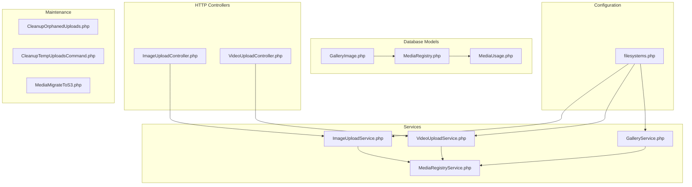
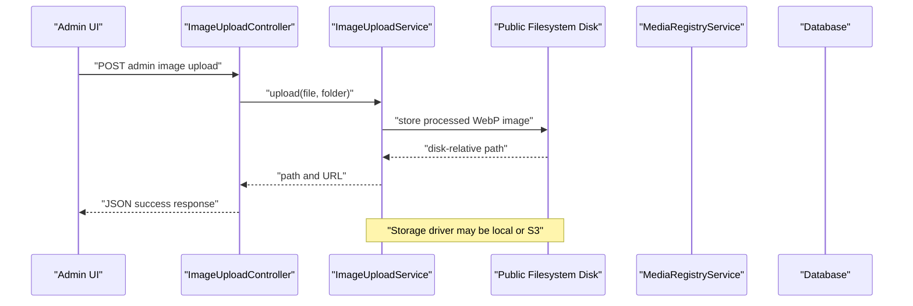
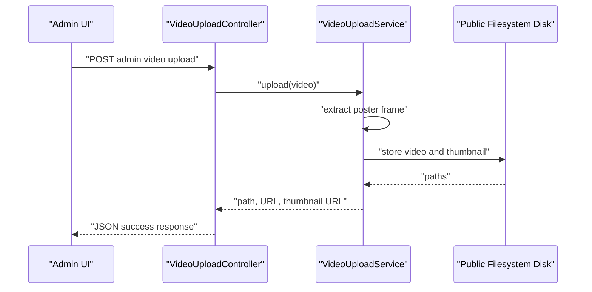
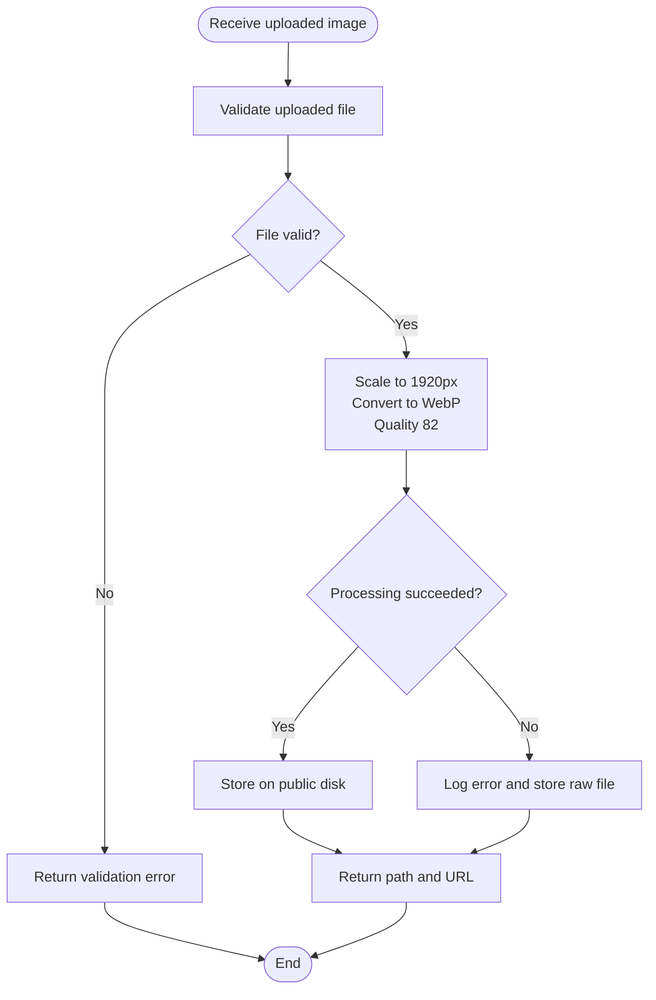
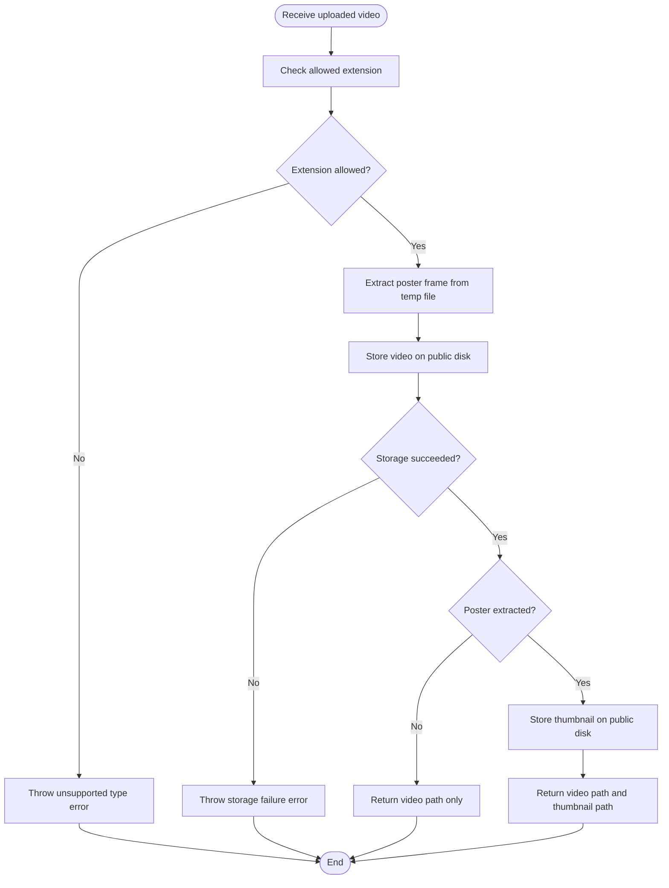
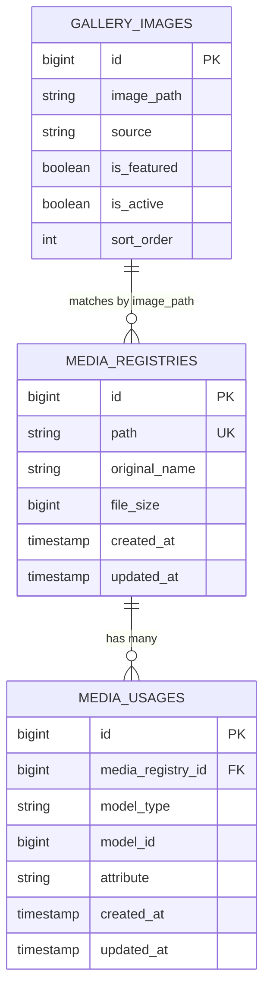
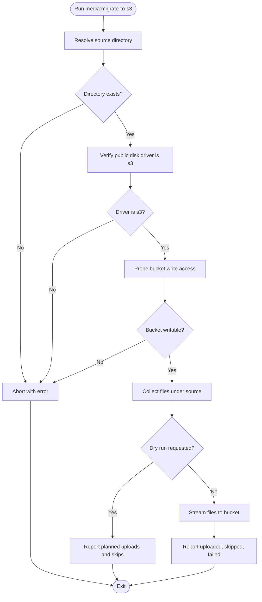
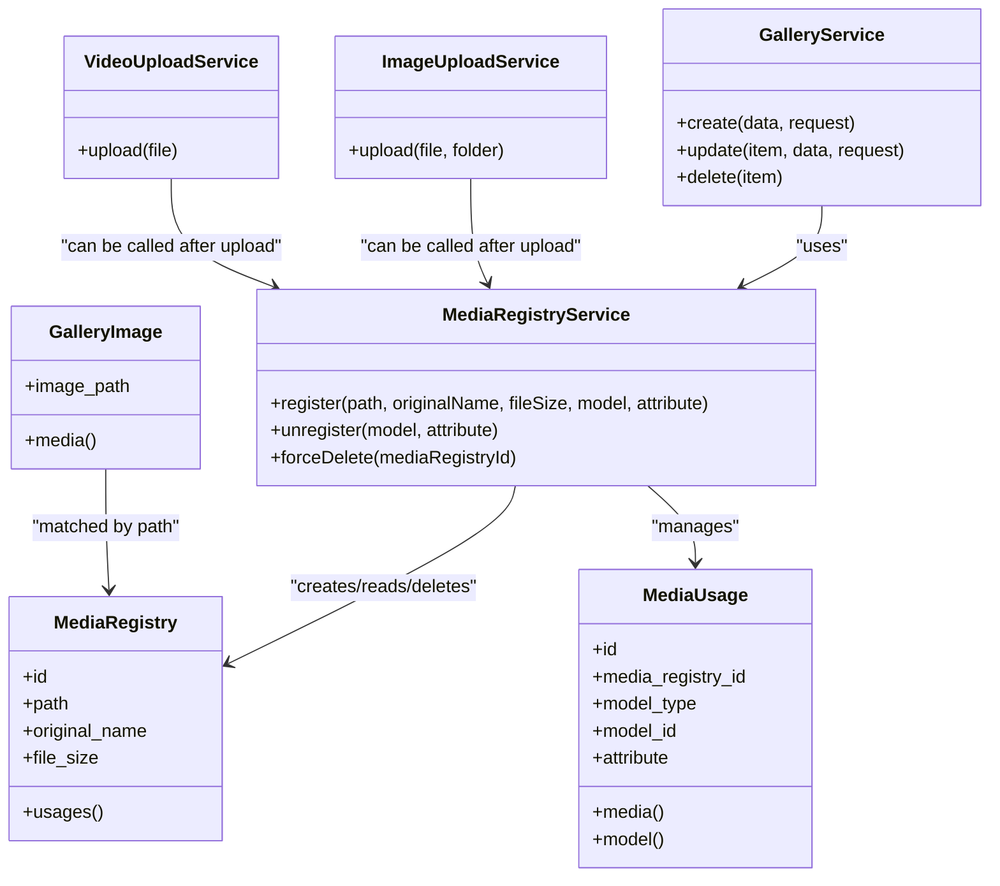

# Storage Configuration & Management

<cite>
**Referenced Files in This Document **
- [MediaRegistry.php](file://app/Models/MediaRegistry.php)
- [MediaUsage.php](file://app/Models/MediaUsage.php)
- [MediaRegistryService.php](file://app/Services/MediaRegistryService.php)
- [ImageUploadService.php](file://app/Services/ImageUploadService.php)
- [VideoUploadService.php](file://app/Services/VideoUploadService.php)
- [GalleryService.php](file://app/Services/GalleryService.php)
- [GalleryImage.php](file://app/Models/GalleryImage.php)
- [ImageUploadController.php](file://app/Http/Controllers/Admin/ImageUploadController.php)
- [VideoUploadController.php](file://app/Http/Controllers/Admin/VideoUploadController.php)
- [filesystems.php](file://config/filesystems.php)
- [2026_05_14_142832_create_media_registries_table.php](file://database/migrations/2026_05_14_142832_create_media_registries_table.php)
- [2026_05_14_142833_create_media_usages_table.php](file://database/migrations/2026_05_14_142833_create_media_usages_table.php)
- [2026_10_11_000000_normalise_persisted_media_paths.php](file://database/migrations/2026_10_11_000000_normalise_persisted_media_paths.php)
- [CleanupOrphanedUploads.php](file://app/Console/Commands/CleanupOrphanedUploads.php)
- [CleanupTempUploadsCommand.php](file://app/Console/Commands/CleanupTempUploadsCommand.php)
- [MediaMigrateToS3.php](file://app/Console/Commands/MediaMigrateToS3.php)
</cite>

## Table of Contents
1. Introduction
2. Project Structure
3. Core Components
4. Architecture Overview
5. Detailed Component Analysis
6. Dependency Analysis
7. Performance Considerations
8. Troubleshooting Guide
9. Conclusion

## Introduction
This document explains the Highblossom media storage configuration and management system. It covers how uploaded files are recorded, tracked, served, migrated, cleaned up, and protected through database relationships and filesystem configuration.

The system separates three concerns:
- Filesystem configuration for local and cloud-backed storage.
- Database models and services that record metadata and ownership of media assets.
- Upload handlers, cleanup commands, and migration tools that operate on those assets.

The core data model is intentionally minimal: a central registry stores canonical paths, original names, and file sizes; a polymorphic usage table records which application entities consume each asset. The public disk can be backed by a local folder or an object store such as AWS S3, selected through environment variables.

## Project Structure
The relevant code spans models, services, controllers, filesystem configuration, migrations, and console commands:

**Diagram sources**
- [filesystems.php:1-109](file://config/filesystems.php#L1-L109)
- [MediaRegistry.php:1-25](file://app/Models/MediaRegistry.php#L1-L25)
- [MediaUsage.php:1-34](file://app/Models/MediaUsage.php#L1-L34)
- [MediaRegistryService.php:1-67](file://app/Services/MediaRegistryService.php#L1-L67)
- [ImageUploadService.php:1-70](file://app/Services/ImageUploadService.php#L1-L70)
- [VideoUploadService.php:1-105](file://app/Services/VideoUploadService.php#L1-L105)
- [GalleryService.php:1-139](file://app/Services/GalleryService.php#L1-L139)
- [GalleryImage.php:1-169](file://app/Models/GalleryImage.php#L1-L169)
- [ImageUploadController.php:1-41](file://app/Http/Controllers/Admin/ImageUploadController.php#L1-L41)
- [VideoUploadController.php:1-41](file://app/Http/Controllers/Admin/VideoUploadController.php#L1-L41)
- [CleanupOrphanedUploads.php:1-54](file://app/Console/Commands/CleanupOrphanedUploads.php#L1-L54)
- [CleanupTempUploadsCommand.php:1-53](file://app/Console/Commands/CleanupTempUploadsCommand.php#L1-L53)
- [MediaMigrateToS3.php:1-247](file://app/Console/Commands/MediaMigrateToS3.php#L1-L247)

**Section sources**
- [filesystems.php:1-109](file://config/filesystems.php#L1-L109)
- [MediaRegistry.php:1-25](file://app/Models/MediaRegistry.php#L1-L25)
- [MediaUsage.php:1-34](file://app/Models/MediaUsage.php#L1-L34)
- [MediaRegistryService.php:1-67](file://app/Services/MediaRegistryService.php#L1-L67)
- [ImageUploadService.php:1-70](file://app/Services/ImageUploadService.php#L1-L70)
- [VideoUploadService.php:1-105](file://app/Services/VideoUploadService.php#L1-L105)
- [GalleryService.php:1-139](file://app/Services/GalleryService.php#L1-L139)
- [GalleryImage.php:1-169](file://app/Models/GalleryImage.php#L1-L169)
- [ImageUploadController.php:1-41](file://app/Http/Controllers/Admin/ImageUploadController.php#L1-L41)
- [VideoUploadController.php:1-41](file://app/Http/Controllers/Admin/VideoUploadController.php#L1-L41)
- [CleanupOrphanedUploads.php:1-54](file://app/Console/Commands/CleanupOrphanedUploads.php#L1-L54)
- [CleanupTempUploadsCommand.php:1-53](file://app/Console/Commands/CleanupTempUploadsCommand.php#L1-L53)
- [MediaMigrateToS3.php:1-247](file://app/Console/Commands/MediaMigrateToS3.php#L1-L247)

## Core Components

### Media Registry Model
The `MediaRegistry` model represents one canonical media asset. Its database row contains:
- A unique path used to locate the file on the configured public disk.
- The original filename supplied by the uploader.
- The persisted file size.
- Timestamps for created and updated entries.

It exposes a relationship to `MediaUsage`, allowing queries from a registered file to all consumers.

#### Data integrity notes
- The path column is unique, preventing duplicate registry rows for the same stored location.
- There is no database-level foreign key constraint from `media_registry.path` to consumer tables; instead, consumers store disk-relative paths and rely on service-layer registration for ownership tracking.

**Section sources**
- [MediaRegistry.php:1-25](file://app/Models/MediaRegistry.php#L1-L25)
- [2026_05_14_142832_create_media_registries_table.php:1-30](file://database/migrations/2026_05_14_142832_create_media_registries_table.php#L1-L30)

### Media Usage Model
The `MediaUsage` model is a polymorphic pivot between the registry and any Eloquent model that uses a media asset. Columns include:
- A foreign key referencing `media_registries.id`.
- Polymorphic columns identifying the owning model class and identifier.
- An optional attribute name indicating which field consumes the media.
- Timestamps.

Relationships:
- `media()` returns the parent `MediaRegistry`.
- `model()` resolves the owning entity.

This design supports multiple consumers across bookings, posts, galleries, and future features without adding new join tables.

**Section sources**
- [MediaUsage.php:1-34](file://app/Models/MediaUsage.php#L1-L34)
- [2026_05_14_142833_create_media_usages_table.php:1-30](file://database/migrations/2026_05_14_142833_create_media_usages_table.php#L1-L30)

### Media Registry Service
`MediaRegistryService` is the single place where ownership and lifecycle decisions happen:
- `register(path, originalName, fileSize, model, attribute)` creates or reuses a registry entry and records the consuming model and attribute.
- `unregister(model, attribute)` removes one usage reference.
- `forceDelete(mediaRegistryId)` refuses deletion while usages remain, deletes the physical file from the public disk, then removes the registry row.

This service should be the authoritative owner of deletion logic because it enforces the “no active usage” rule before touching storage.

**Section sources**
- [MediaRegistryService.php:1-67](file://app/Services/MediaRegistryService.php#L1-L67)

### Gallery Image Integration
`GalleryImage` demonstrates a concrete consumer:
- It stores a disk-relative image path.
- It has a helper relationship to `MediaRegistry` based on matching `image_path` to `path`.
- `GalleryService` registers or unregisters usage when gallery images are created, replaced, removed, or deleted.

Note: the gallery delete flow currently deletes the file directly rather than using `MediaRegistryService::forceDelete`; this is documented as naive cleanup in the service.

**Section sources**
- [GalleryImage.php:1-169](file://app/Models/GalleryImage.php#L1-L169)
- [GalleryService.php:1-139](file://app/Services/GalleryService.php#L1-L139)

## Architecture Overview

**Diagram sources**
- [ImageUploadController.php:1-41](file://app/Http/Controllers/Admin/ImageUploadController.php#L1-L41)
- [ImageUploadService.php:1-70](file://app/Services/ImageUploadService.php#L1-L70)
- [filesystems.php:1-109](file://config/filesystems.php#L1-L109)

A similar flow applies to video uploads, except `VideoUploadService` extracts a poster frame before moving the uploaded file and stores both the video and thumbnail on the public disk.

**Diagram sources**
- [VideoUploadController.php:1-41](file://app/Http/Controllers/Admin/VideoUploadController.php#L1-L41)
- [VideoUploadService.php:1-105](file://app/Services/VideoUploadService.php#L1-L105)
- [filesystems.php:1-109](file://config/filesystems.php#L1-L109)

## Detailed Component Analysis

### Filesystem Configuration
The filesystem configuration defines four disks:

| Disk | Purpose | Driver and behavior |
|---|---|---|
| `local` | Private application files | Local filesystem under `storage_path('app/private')`. Serving is enabled, but failures do not throw. |
| `public` | User-facing media | Switchable between local and S3. In S3 mode, credentials, region, bucket, endpoint, URL, path-style endpoints, public visibility, and failure reporting are configured. In local mode, it points to `storage_path('app/public')` with a default URL built from `APP_URL`. |
| `s3` | Generic S3 access | Uses the same AWS environment variables as the S3 branch of `public`, but does not force public visibility. |
| `temp` | Temporary processing files | Local filesystem under `storage_path('app/temp')`. |

The default disk is controlled by `FILESYSTEM_DISK`. The public disk’s driver is chosen by `PUBLIC_DISK_DRIVER`. When set to `s3`, the bucket is expected to be publicly accessible through `AWS_URL`, and uploads use public visibility with failure reporting enabled.

Symbolic links map the web-accessible `public/storage` directory to `storage_path('app/public')` for local development.

**Section sources**
- [filesystems.php:1-109](file://config/filesystems.php#L1-L109)

### Upload Processing Logic

#### Image Upload Flow
`ImageUploadService`:
- Validates the uploaded file.
- Scales the image to a maximum long edge of 1920 pixels.
- Converts it to WebP at quality 82.
- Stores it on the `public` disk.
- Falls back to storing the raw file if image processing fails, logging the error.
- Returns a normalized path and URL through `MediaUrl`.

`ImageUploadController` accepts validated requests and returns JSON with success, path, and URL. Errors return HTTP 422.

**Diagram sources**
- [ImageUploadService.php:1-70](file://app/Services/ImageUploadService.php#L1-L70)
- [ImageUploadController.php:1-41](file://app/Http/Controllers/Admin/ImageUploadController.php#L1-L41)

#### Video Upload Flow
`VideoUploadService`:
- Accepts MP4, WebM, MOV, or AVI extensions.
- Extracts a poster frame at approximately one second into the video while the upload is still locally available.
- Generates a unique filename and thumbnail path.
- Stores the video and thumbnail on the `public` disk.
- Returns both paths and corresponding URLs.

Errors include unsupported types and storage failures. Thumbnail extraction failures are logged and treated as optional.

**Diagram sources**
- [VideoUploadService.php:1-105](file://app/Services/VideoUploadService.php#L1-L105)
- [VideoUploadController.php:1-41](file://app/Http/Controllers/Admin/VideoUploadController.php#L1-L41)

### Data Model Relationships

**Diagram sources**
- [2026_05_14_142832_create_media_registries_table.php:1-30](file://database/migrations/2026_05_14_142832_create_media_registries_table.php#L1-L30)
- [2026_05_14_142833_create_media_usages_table.php:1-30](file://database/migrations/2026_05_14_142833_create_media_usages_table.php#L1-L30)
- [GalleryImage.php:1-169](file://app/Models/GalleryImage.php#L1-L169)

### Migration Between Storage Providers
`MediaMigrateToS3` is a one-off migration tool for moving local public media into an S3-backed `public` disk.

Key behaviors:
- Requires `PUBLIC_DISK_DRIVER=s3` and valid AWS credentials.
- Probes write capability by writing and deleting a probe key before real work.
- Recursively collects files under a configurable source directory, defaulting to `storage_path('app/public')`.
- Supports a prefix filter so only a subfolder such as `gallery` is migrated.
- Skips existing keys unless `--force` is passed.
- Streams files to avoid loading large videos into memory.
- Reports counts of uploaded, skipped, and failed files.

Recommended migration procedure:
1. Configure AWS credentials and set `PUBLIC_DISK_DRIVER=s3`.
2. Run with `--dry-run` first to review planned uploads.
3. Run again without `--dry-run` after confirming the plan.
4. Re-run as needed; existing keys are skipped unless `--force` is used.

**Diagram sources**
- [MediaMigrateToS3.php:1-247](file://app/Console/Commands/MediaMigrateToS3.php#L1-L247)
- [filesystems.php:1-109](file://config/filesystems.php#L1-L109)

### Path Normalization Migration
Historical content sometimes stored absolute URLs such as `https://example.test/storage/gallery/image.jpg`. These bind to a specific host and become stale after domain changes or moves to object storage.

The normalization migration:
- Rewrites structured media references in several simple columns, including service images, featured post images, and hero images.
- Rewrites media attributes inside post content blocks for keys like `src` and `poster`, including nested block structures.
- Leaves rich-text HTML untouched because relative paths inside HTML would resolve against the page rather than the media disk.
- Uses `MediaUrl::path()` to convert stored URLs into disk-relative paths.

This migration makes persisted media references portable across environments and storage drivers.

**Section sources**
- [2026_10_11_000000_normalise_persisted_media_paths.php:1-200](file://database/migrations/2026_10_11_000000_normalise_persisted_media_paths.php#L1-L200)

### Cleanup Processes
There are two related maintenance responsibilities:

1. Orphaned temporary uploads:
   - `CleanupOrphanedUploads` checks whether temp cleanup is enabled.
   - It reads retention hours from configuration.
   - It delegates cleanup to `ContentBlockCleanupService`.

2. Age-based temporary file cleanup:
   - `CleanupTempUploadsCommand` accepts an `--hours` option.
   - It also delegates to `ContentBlockCleanupService`.

These commands manage temporary files rather than production media assets. Production media deletion should generally go through `MediaRegistryService::forceDelete` so usage relationships are respected.

**Section sources**
- [CleanupOrphanedUploads.php:1-54](file://app/Console/Commands/CleanupOrphanedUploads.php#L1-L54)
- [CleanupTempUploadsCommand.php:1-53](file://app/Console/Commands/CleanupTempUploadsCommand.php#L1-L53)
- [MediaRegistryService.php:1-67](file://app/Services/MediaRegistryService.php#L1-L67)

## Dependency Analysis

**Diagram sources**
- [MediaRegistry.php:1-25](file://app/Models/MediaRegistry.php#L1-L25)
- [MediaUsage.php:1-34](file://app/Models/MediaUsage.php#L1-L34)
- [MediaRegistryService.php:1-67](file://app/Services/MediaRegistryService.php#L1-L67)
- [ImageUploadService.php:1-70](file://app/Services/ImageUploadService.php#L1-L70)
- [VideoUploadService.php:1-105](file://app/Services/VideoUploadService.php#L1-L105)
- [GalleryService.php:1-139](file://app/Services/GalleryService.php#L1-L139)
- [GalleryImage.php:1-169](file://app/Models/GalleryImage.php#L1-L169)

### Coupling and Cohesion
- `MediaRegistryService` centralizes ownership rules and is cohesive around registry operations.
- Upload services focus on transformation and persistence; they do not enforce usage semantics themselves.
- `GalleryService` coordinates business rules for gallery images and explicitly calls registry registration/unregistration.
- The public filesystem disk abstracts local folders and S3 buckets behind a single interface, reducing coupling between upload logic and storage implementation.

### Potential Risks
- Consumer models store disk-relative paths directly, so renaming or regenerating paths requires coordinated updates across both the file system and the application data.
- Some delete flows (for example, gallery deletion) bypass `MediaRegistryService::forceDelete`, risking orphaned registry rows or accidental deletions if usage tracking is incomplete.
- The registry tracks canonical paths, but MIME type is not persisted in `MediaRegistry`; clients should derive or validate MIME types at serving time.

**Section sources**
- [MediaRegistryService.php:1-67](file://app/Services/MediaRegistryService.php#L1-L67)
- [GalleryService.php:1-139](file://app/Services/GalleryService.php#L1-L139)

## Performance Considerations
- Image uploads normalize to WebP and cap dimensions, reducing bandwidth and storage costs compared to keeping original high-resolution uploads.
- Video uploads stream files to object storage, avoiding loading entire videos into application memory.
- Thumbnail generation runs against the PHP upload temporary file before the video is moved, ensuring correct operation even when the final destination is remote.
- Object storage writes use streaming where possible, improving throughput for large media.
- Registry lookups are primarily by unique path, which is efficient for deduplication and ownership checks.

[No sources needed since this section provides general guidance]

## Troubleshooting Guide

### Upload Returns Invalid File Error
- Verify the request includes a valid uploaded file.
- For images, check that the file passes Laravel’s upload validation.
- Inspect logs for image processing exceptions; the image service falls back to raw storage when processing fails.

**Section sources**
- [ImageUploadController.php:1-41](file://app/Http/Controllers/Admin/ImageUploadController.php#L1-L41)
- [ImageUploadService.php:1-70](file://app/Services/ImageUploadService.php#L1-L70)

### Upload Returns Unsupported Video Type
- Only MP4, WebM, MOV, and AVI are accepted.
- Convert unsupported formats before uploading.

**Section sources**
- [VideoUploadService.php:1-105](file://app/Services/VideoUploadService.php#L1-L105)

### Public URL Does Not Resolve After Moving to S3
- Ensure `PUBLIC_DISK_DRIVER=s3` and that AWS credentials, bucket, and `AWS_URL` are configured.
- Confirm the bucket is publicly readable through the configured URL.
- Run the path normalization migration if historical content contains absolute URLs.

**Section sources**
- [filesystems.php:1-109](file://config/filesystems.php#L1-L109)
- [2026_10_11_000000_normalise_persisted_media_paths.php:1-200](file://database/migrations/2026_10_11_000000_normalise_persisted_media_paths.php#L1-L200)

### Migration to S3 Fails Before Writing Files
- The command probes bucket write access before collecting or uploading files.
- Fix credentials, permissions, endpoint configuration, or bucket policy.
- Use `--dry-run` first to inspect the planned upload list.

**Section sources**
- [MediaMigrateToS3.php:1-247](file://app/Console/Commands/MediaMigrateToS3.php#L1-L247)

### Orphaned Registry Rows or Missing Files
- Use `MediaRegistryService::forceDelete` only when you are certain a file has no remaining usages.
- Audit `media_usages` to find consumers of a given registry ID.
- Be aware that some legacy delete paths may not update usage records consistently.

**Section sources**
- [MediaRegistryService.php:1-67](file://app/Services/MediaRegistryService.php#L1-L67)
- [GalleryService.php:1-139](file://app/Services/GalleryService.php#L1-L139)

### Temporary Files Are Accumulating
- Enable or schedule `content-blocks:cleanup-temp-uploads` or `content-blocks:cleanup-orphaned-uploads`.
- Adjust retention hours through configuration.

**Section sources**
- [CleanupTempUploadsCommand.php:1-53](file://app/Console/Commands/CleanupTempUploadsCommand.php#L1-L53)
- [CleanupOrphanedUploads.php:1-54](file://app/Console/Commands/CleanupOrphanedUploads.php#L1-L54)

## Conclusion
Highblossom’s storage system cleanly separates concerns:
- The filesystem configuration abstracts local and cloud storage behind named disks.
- `MediaRegistry` and `MediaUsage` provide a lightweight, extensible ownership model.
- Upload services handle transformation and persistence while delegating ownership decisions to `MediaRegistryService`.
- Maintenance commands and migrations support cleanup, portability, and provider migration.

For production safety:
- Always register usage through `MediaRegistryService` when a persistent model claims a media path.
- Prefer `forceDelete` for safe removal of unused assets.
- Keep public URLs normalized to disk-relative paths after changing domains or storage providers.
- Schedule temporary file cleanup and audit usage relationships periodically.

[No sources needed since this section summarizes without analyzing specific files]