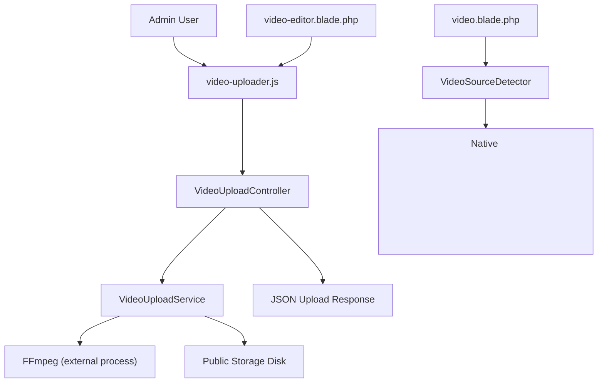
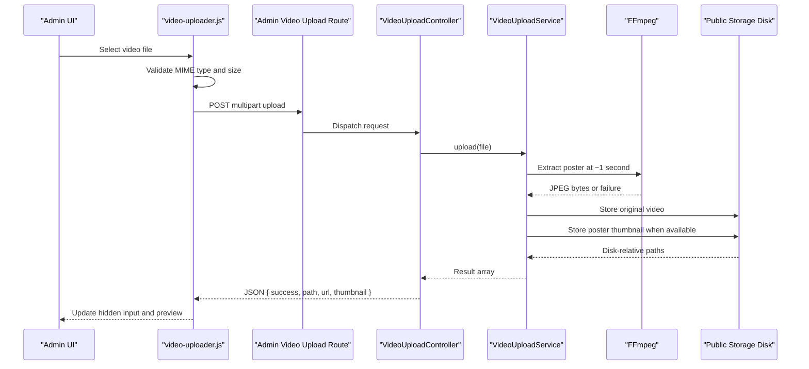
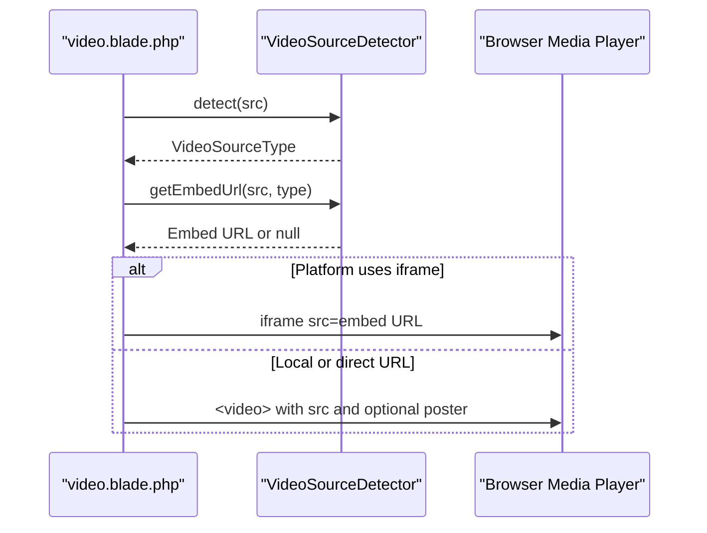
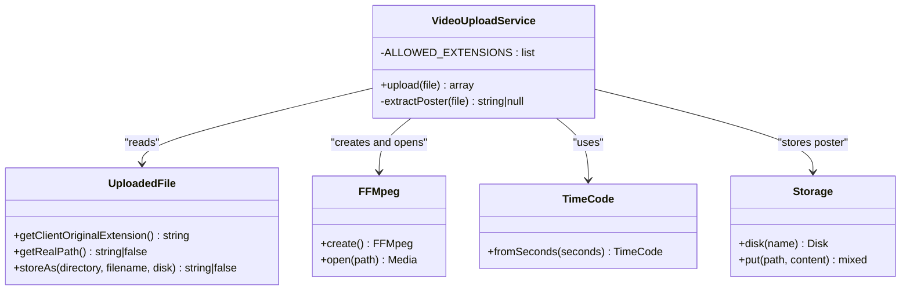
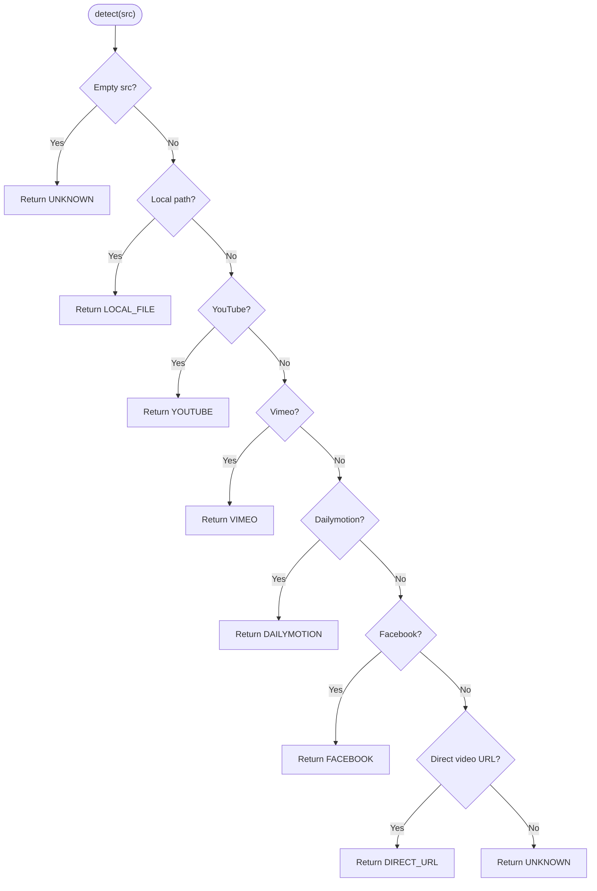
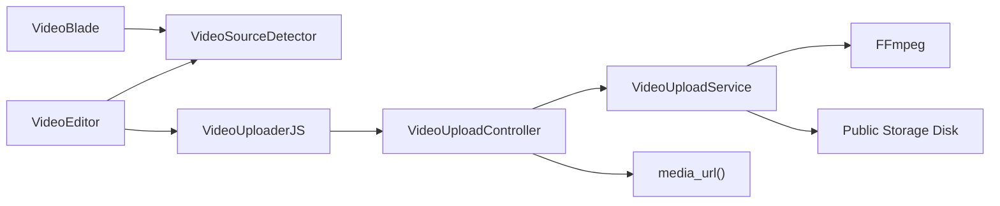

# Video Handling & Transcoding

<cite>
**Referenced Files in This Document**   
- [VideoUploadService.php](file://app/Services/VideoUploadService.php)
- [VideoSourceDetector.php](file://app/Services/VideoSourceDetector.php)
- [VideoSourceType.php](file://app/Enums/VideoSourceType.php)
- [VideoUploadController.php](file://app/Http/Controllers/Admin/VideoUploadController.php)
- [video.blade.php](file://resources/views/components/blocks/video.blade.php)
- [video-editor.blade.php](file://resources/views/components/blocks/video-editor.blade.php)
- [video-uploader.js](file://public/js/video-uploader.js)
- [filesystems.php](file://config/filesystems.php)
- [helpers.php](file://app/Support/helpers.php)
</cite>

## Table of Contents
1. [Introduction](#introduction)
2. [Project Structure](#project-structure)
3. [Core Components](#core-components)
4. [Architecture Overview](#architecture-overview)
5. [Detailed Component Analysis](#detailed-component-analysis)
6. [Dependency Analysis](#dependency-analysis)
7. [Performance Considerations](#performance-considerations)
8. [Troubleshooting Guide](#troubleshooting-guide)
9. [Conclusion](#conclusion)

## Introduction
This document describes the Highblossom video handling system. It covers how uploaded videos are stored and previewed, how different video sources are detected and rendered, and how the system integrates with storage backends and media players. The current implementation focuses on:

- Uploading local video files and generating a poster thumbnail from the first second of the file.
- Detecting whether a video source is a local file, an external URL, or a third-party platform such as YouTube, Vimeo, Dailymotion, or Facebook.
- Rendering native HTML5 video for local and direct URLs, and iframe embeds for supported platforms.
- Providing an admin upload UI that validates accepted MIME types, enforces a client-side size limit, and uploads via AJAX.

The system does not currently perform server-side transcoding, format normalization, resolution scaling, codec configuration, or duration detection. Those capabilities are outside the present codebase and should be added explicitly if required by future requirements.

## Project Structure
The video pipeline spans backend services, an admin controller, Blade components, and frontend JavaScript:

**Diagram sources**
- [video-uploader.js:1-200](file://public/js/video-uploader.js#L1-L200)
- [VideoUploadController.php:1-41](file://app/Http/Controllers/Admin/VideoUploadController.php#L1-L41)
- [VideoUploadService.php:1-105](file://app/Services/VideoUploadService.php#L1-L105)
- [video.blade.php:1-78](file://resources/views/components/blocks/video.blade.php#L1-L78)
- [VideoSourceDetector.php:1-445](file://app/Services/VideoSourceDetector.php#L1-L445)
- [video-editor.blade.php:1-169](file://resources/views/components/blocks/video-editor.blade.php#L1-L169)

**Section sources**
- [VideoUploadService.php:1-105](file://app/Services/VideoUploadService.php#L1-L105)
- [VideoSourceDetector.php:1-445](file://app/Services/VideoSourceDetector.php#L1-L445)
- [VideoUploadController.php:1-41](file://app/Http/Controllers/Admin/VideoUploadController.php#L1-L41)
- [video.blade.php:1-78](file://resources/views/components/blocks/video.blade.php#L1-L78)
- [video-editor.blade.php:1-169](file://resources/views/components/blocks/video-editor.blade.php#L1-L169)
- [video-uploader.js:1-200](file://public/js/video-uploader.js#L1-L200)
- [filesystems.php:1-109](file://config/filesystems.php#L1-L109)
- [helpers.php:1-40](file://app/Support/helpers.php#L1-L40)

## Core Components
- `VideoUploadService`: Validates the uploaded file extension, stores the original video on the public disk, and extracts a JPEG poster frame at approximately one second using FFmpeg.
- `VideoSourceDetector`: Determines whether a video source string represents a local path, a direct URL, or a known third-party platform, and produces embed URLs where applicable.
- `VideoSourceType`: Enumerates supported source types and provides helpers such as iframe support and display labels.
- `VideoUploadController`: Admin endpoint that accepts a video upload, delegates to `VideoUploadService`, and returns paths plus media URLs.
- `video.blade.php` and `video-editor.blade.php`: Render either a native `<video>` element or a platform iframe based on the detected source type.
- `video-uploader.js`: Provides drag-and-drop validation, preview, progress indication, and AJAX upload to the admin endpoint.
- `filesystems.php`: Configures the default, public, S3, and temporary storage disks used by the upload pipeline.
- `helpers.php`: Provides the `media_url()` helper used to convert stored disk-relative paths into displayable URLs.

**Section sources**
- [VideoUploadService.php:1-105](file://app/Services/VideoUploadService.php#L1-L105)
- [VideoSourceDetector.php:1-445](file://app/Services/VideoSourceDetector.php#L1-L445)
- [VideoSourceType.php:1-46](file://app/Enums/VideoSourceType.php#L1-L46)
- [VideoUploadController.php:1-41](file://app/Http/Controllers/Admin/VideoUploadController.php#L1-L41)
- [video.blade.php:1-78](file://resources/views/components/blocks/video.blade.php#L1-L78)
- [video-editor.blade.php:1-169](file://resources/views/components/blocks/video-editor.blade.php#L1-L169)
- [video-uploader.js:1-200](file://public/js/video-uploader.js#L1-L200)
- [filesystems.php:1-109](file://config/filesystems.php#L1-L109)
- [helpers.php:1-40](file://app/Support/helpers.php#L1-L40)

## Architecture Overview
The end-to-end flow has two main paths: uploading local videos and rendering any configured video source.

**Diagram sources**
- [video-uploader.js:1-200](file://public/js/video-uploader.js#L1-L200)
- [VideoUploadController.php:1-41](file://app/Http/Controllers/Admin/VideoUploadController.php#L1-L41)
- [VideoUploadService.php:1-105](file://app/Services/VideoUploadService.php#L1-L105)
- [filesystems.php:1-109](file://config/filesystems.php#L1-L109)

### Rendering Flow

**Diagram sources**
- [video.blade.php:1-78](file://resources/views/components/blocks/video.blade.php#L1-L78)
- [VideoSourceDetector.php:1-445](file://app/Services/VideoSourceDetector.php#L1-L445)

## Detailed Component Analysis

### VideoUploadService
Responsibilities:
- Accept an `UploadedFile`.
- Reject unsupported extensions.
- Generate a stable-looking filename using timestamp and random suffix.
- Extract a poster frame from the PHP upload temp file before it is moved.
- Store the original video under `videos/` on the public disk.
- Store a generated JPEG thumbnail under `videos/thumbnails/`.
- Return both the stored video path and optional thumbnail path.

Key behaviors:
- Allowed extensions are `mp4`, `webm`, `mov`, and `avi`.
- Poster extraction runs against the real upload path; if no local path exists, poster generation is skipped.
- Poster extraction uses FFmpeg to open the file, take a frame at one second, save it as JPEG, read its contents, and delete the temporary file afterward.
- FFmpeg failures are logged and treated as non-fatal for the upload: the video still stores, but the thumbnail becomes `null`.

Error handling:
- Unsupported extension throws `RuntimeException`.
- Storage failure throws `RuntimeException`.
- FFmpeg exception is caught, logged, and converted to a missing thumbnail rather than failing the whole upload.

Limitations relevant to the documentation objective:
- No server-side transcoding.
- No format normalization.
- No codec configuration.
- No resolution scaling.
- No quality presets.
- No duration detection.

**Section sources**
- [VideoUploadService.php:1-105](file://app/Services/VideoUploadService.php#L1-L105)

#### Class Diagram

**Diagram sources**
- [VideoUploadService.php:1-105](file://app/Services/VideoUploadService.php#L1-L105)

### VideoSourceDetector
Responsibilities:
- Detect whether a video source string is a local path, a direct URL, or a known third-party platform.
- Extract video identifiers where possible.
- Build embed URLs for iframe-based platforms.
- Convert relative or absolute local paths into full application URLs.

Supported detections:
- Local file paths starting with `/`, `storage/`, `videos/`, or `uploads/`.
- YouTube URLs including watch, short link, and embed formats.
- Vimeo URLs.
- Dailymotion URLs including long and short forms.
- Facebook URLs including reels, share links, short links, watch pages, legacy photo/video pages, profile videos, and older formats.
- Direct video file URLs.
- Unknown inputs return `UNKNOWN`.

Platform-specific behavior:
- YouTube, Vimeo, Dailymotion, and Facebook use iframe embedding.
- Local files and direct URLs render through the native HTML5 `<video>` element.
- Facebook share and short URLs may be resolved through HTTP redirects before embedding.

Limitations:
- Detection is pattern-based and relies on URL structure.
- Facebook resolution makes network requests and can fail silently, returning `null` from internal resolution while still marking the source as Facebook.
- There is no built-in fallback strategy when a platform blocks access or changes its URL layout.

**Section sources**
- [VideoSourceDetector.php:1-445](file://app/Services/VideoSourceDetector.php#L1-L445)

#### Detection Flow

**Diagram sources**
- [VideoSourceDetector.php:1-445](file://app/Services/VideoSourceDetector.php#L1-L445)

### VideoSourceType
Purpose:
- Centralize supported video source values.
- Provide `usesIframe()` so views can decide between iframe embeds and native video.
- Provide human-readable labels for UI badges and error messages.

Supported values:
- `local_file`
- `youtube`
- `vimeo`
- `dailymotion`
- `facebook`
- `direct_url`
- `unknown`

**Section sources**
- [VideoSourceType.php:1-46](file://app/Enums/VideoSourceType.php#L1-L46)

### Admin Upload Controller
Responsibilities:
- Receive validated video uploads.
- Call `VideoUploadService::upload()`.
- Return JSON containing success status, stored path, full media URL, and thumbnail URL.
- Convert runtime exceptions into a 500 JSON error response.

Integration points:
- Uses Laravel’s request validation through `VideoUploadRequest`.
- Wraps service results with `media_url()` to produce displayable URLs.

**Section sources**
- [VideoUploadController.php:1-41](file://app/Http/Controllers/Admin/VideoUploadController.php#L1-L41)
- [helpers.php:1-40](file://app/Support/helpers.php#L1-L40)

### Frontend Video Uploader
Responsibilities:
- Attach change listeners to the file input.
- Support drag-and-drop preview.
- Validate MIME type against accepted video types.
- Enforce a 30MB client-side size limit.
- Show a live video preview using a data URL.
- Send an AJAX upload with progress reporting.
- On success, write the returned path into a hidden input and invoke completion callbacks.
- Handle load, error, and timeout states.

Accepted types:
- `video/mp4`
- `video/webm`
- `video/quicktime`
- `video/x-msvideo`

Timeout:
- 120 seconds for upload requests.

**Section sources**
- [video-uploader.js:1-200](file://public/js/video-uploader.js#L1-L200)

### Blade Video Components
`video.blade.php`:
- Resolves the video URL or source attribute.
- Detects the source type.
- Chooses iframe embeds for platforms that support them.
- Renders a native `<video>` element for local files and direct URLs.
- Supports alignment, caption, autoplay, controls, and CSS classes.

`video-editor.blade.php`:
- Shows a badge indicating the detected source type.
- Previews embedded platforms as placeholders and local/direct videos inline.
- Includes a file input accepting MP4, WEBM, MOV, and AVI.
- Initializes the `VideoUploader` JavaScript class pointing at the admin upload route.

**Section sources**
- [video.blade.php:1-78](file://resources/views/components/blocks/video.blade.php#L1-L78)
- [video-editor.blade.php:1-169](file://resources/views/components/blocks/video-editor.blade.php#L1-L169)

### Storage Configuration
The public storage disk determines where uploaded videos and thumbnails are persisted:

- In development, the public disk defaults to a local directory under `storage/app/public`.
- When `PUBLIC_DISK_DRIVER` is set to `s3`, the public disk becomes an S3-compatible object store configured through AWS environment variables.
- The bucket visibility is set to public, and writes throw on failure when running as S3.
- A separate `temp` disk exists under `storage/app/temp`.
- A symbolic link maps `public/storage` to `storage/app/public` for local serving.

This means video delivery can come from the application server or from an object store, depending on configuration.

**Section sources**
- [filesystems.php:1-109](file://config/filesystems.php#L1-L109)

## Dependency Analysis

**Diagram sources**
- [VideoUploadController.php:1-41](file://app/Http/Controllers/Admin/VideoUploadController.php#L1-L41)
- [VideoUploadService.php:1-105](file://app/Services/VideoUploadService.php#L1-L105)
- [video.blade.php:1-78](file://resources/views/components/blocks/video.blade.php#L1-L78)
- [video-editor.blade.php:1-169](file://resources/views/components/blocks/video-editor.blade.php#L1-L169)
- [video-uploader.js:1-200](file://public/js/video-uploader.js#L1-L200)
- [helpers.php:1-40](file://app/Support/helpers.php#L1-L40)

Coupling notes:
- The upload controller depends directly on the upload service and the media URL helper.
- The upload service depends on FFmpeg being installed and callable.
- The Blade component depends on the detector for rendering decisions.
- The editor component couples the file input to the shared JavaScript uploader.

Cohesion notes:
- `VideoUploadService` encapsulates all upload and poster-generation logic.
- `VideoSourceDetector` centralizes URL parsing and embed building.
- `VideoSourceType` keeps source semantics consistent across services and views.

**Section sources**
- [VideoUploadController.php:1-41](file://app/Http/Controllers/Admin/VideoUploadController.php#L1-L41)
- [VideoUploadService.php:1-105](file://app/Services/VideoUploadService.php#L1-L105)
- [VideoSourceDetector.php:1-445](file://app/Services/VideoSourceDetector.php#L1-L445)
- [video.blade.php:1-78](file://resources/views/components/blocks/video.blade.php#L1-L78)
- [video-editor.blade.php:1-169](file://resources/views/components/blocks/video-editor.blade.php#L1-L169)
- [video-uploader.js:1-200](file://public/js/video-uploader.js#L1-L200)

## Performance Considerations

### Current Behavior
- Thumbnail extraction happens synchronously during upload.
- FFmpeg runs once per upload to extract a single frame.
- The original video is stored without transcoding or resizing.
- The client-side size limit is 30MB, but server-side limits depend on PHP and web server configuration.
- Long or large uploads use a 120-second client timeout.

### Background Job Processing
There is no background job worker around the current upload flow. For long or heavy videos, consider:

- Splitting work into queued jobs:
  - Job 1: Validate and move the uploaded file.
  - Job 2: Extract thumbnails and metadata asynchronously.
  - Job 3: Optionally transcode to normalized formats.
- Returning an initial upload confirmation immediately and updating the record when processing completes.
- Using Laravel queues and a reliable queue driver.
- Adding job monitoring, retries, and dead-letter handling.

### Storage Optimization
Recommendations:
- Add server-side file size and MIME validation beyond the frontend.
- Normalize stored filenames consistently and avoid relying on timestamps alone for uniqueness.
- Consider deduplicating identical uploads using content hashing.
- Use compression-friendly containers and codecs for web delivery.
- Keep originals only if needed for reprocessing; otherwise normalize immediately.
- Move static video assets off the application instance using the configured public disk or CDN.

### CDN Integration
- When the public disk points to S3 or another object store, configure the object store URL and enable public reads.
- Place a CDN in front of the object store for caching, geographic distribution, and reduced origin load.
- Use cache-control headers appropriate for immutable media assets.
- Invalidate or version assets when reprocessing videos.

### Streaming Support
- Native `<video>` supports progressive download and some adaptive streaming features depending on the browser and container.
- The current pipeline does not create HLS or DASH variants.
- If adaptive streaming is required, add a transcoding step that produces multiple bitrates and playlist manifests, then serve those variants through the CDN.

[No sources needed since this section provides general guidance]

## Troubleshooting Guide

### Unsupported Video Format
Symptoms:
- Upload fails with an unsupported video file type message.

Likely causes:
- The uploaded file extension is not one of `mp4`, `webm`, `mov`, or `avi`.
- The frontend allowed MIME types do not match the backend expectations.

Resolution:
- Confirm the file extension matches the backend whitelist.
- Ensure the frontend accepts the intended MIME types.
- If supporting new formats, extend the backend whitelist and update frontend validation.

**Section sources**
- [VideoUploadService.php:1-105](file://app/Services/VideoUploadService.php#L1-L105)
- [video-uploader.js:1-200](file://public/js/video-uploader.js#L1-L200)

### Thumbnail Generation Failure
Symptoms:
- Video uploads successfully, but no thumbnail is returned.
- Logs contain FFmpeg thumbnail generation errors.

Likely causes:
- FFmpeg is not installed or not executable.
- The upload temp file cannot be opened.
- The selected frame cannot be extracted.

Behavior:
- Thumbnail generation failure is logged and converted into a missing thumbnail.
- The original video remains stored.

Resolution:
- Verify FFmpeg installation and permissions.
- Test with a valid local video file.
- Check application logs for FFmpeg error details.

**Section sources**
- [VideoUploadService.php:1-105](file://app/Services/VideoUploadService.php#L1-L105)

### Storage Write Failure
Symptoms:
- Upload returns a failed storage message.

Likely causes:
- Public disk is misconfigured.
- Object store credentials or bucket permissions are incorrect.
- Filesystem permissions prevent writing.

Resolution:
- Check `filesystems.php` configuration.
- Validate AWS or object store environment variables.
- Confirm the symlink exists for local public storage.
- Inspect storage permissions.

**Section sources**
- [VideoUploadService.php:1-105](file://app/Services/VideoUploadService.php#L1-L105)
- [filesystems.php:1-109](file://config/filesystems.php#L1-L109)

### Unsupported Source Type in Views
Symptoms:
- Video renders as an invalid source placeholder.

Likely causes:
- The source string does not match local path patterns, direct URL patterns, or recognized platform patterns.
- The source is marked as unknown.

Resolution:
- Use a recognized YouTube, Vimeo, Dailymotion, or Facebook URL.
- Use a direct URL ending in a video extension when hosting your own files.
- Store the video through the upload pipeline and use the returned path.

**Section sources**
- [video.blade.php:1-78](file://resources/views/components/blocks/video.blade.php#L1-L78)
- [VideoSourceDetector.php:1-445](file://app/Services/VideoSourceDetector.php#L1-L445)

### Facebook Share Link Not Embedding Correctly
Symptoms:
- Facebook share or short links do not resolve to an expected embed.

Likely causes:
- Redirect resolution fails due to network issues, bot detection, or changed Facebook URL formats.
- The cached resolved URL is stale within the request lifecycle.

Resolution:
- Prefer direct Facebook video URLs when possible.
- Monitor logs for Facebook resolution warnings.
- Extend URL patterns as Facebook changes its layouts.

**Section sources**
- [VideoSourceDetector.php:1-445](file://app/Services/VideoSourceDetector.php#L1-L445)

### Upload Timeout
Symptoms:
- Large videos report an upload timeout.

Likely causes:
- Network latency or slow connection.
- Server-side timeouts shorter than the client timeout.
- PHP execution or memory limits exceeded.

Resolution:
- Increase client timeout if necessary.
- Tune server and PHP upload limits.
- Move long-running processing to background jobs.

**Section sources**
- [video-uploader.js:1-200](file://public/js/video-uploader.js#L1-L200)

## Conclusion
Highblossom’s video handling system currently provides a practical upload-and-preview workflow for local files and a robust source detector for common video platforms. Uploaded videos are stored without transcoding, and a poster frame is optionally extracted using FFmpeg. Views render native video for local and direct sources and iframe embeds for supported platforms.

For production-grade video pipelines, the most important additions would be:
- Background job processing for transcoding, thumbnail generation, and metadata extraction.
- Explicit transcoding rules targeting web-friendly codecs and containers.
- Resolution scaling and bitrate variants for adaptive streaming.
- Quality presets and configurable encoding profiles.
- Duration detection and validation.
- Strict server-side format and size enforcement.
- CDN-backed delivery with proper caching and invalidation.

These enhancements should be introduced deliberately so they integrate cleanly with the existing service, controller, view, and storage layers.

[No sources needed since this section summarizes without analyzing specific files]