# Asset Optimization

<cite>
**Referenced Files in This Document**
- [vite.config.js](file://vite.config.js)
- [package.json](file://package.json)
- [Dockerfile](file://Dockerfile)
- [docker/nginx.conf](file://docker/nginx.conf)
- [resources/css/app.css](file://resources/css/app.css)
- [resources/css/auth.css](file://resources/css/auth.css)
- [resources/css/admin.css](file://resources/css/admin.css)
- [resources/js/app.js](file://resources/js/app.js)
- [resources/js/site-alpine.js](file://resources/js/site-alpine.js)
- [resources/js/auth-alpine.js](file://resources/js/auth-alpine.js)
- [resources/js/site-booking.js](file://resources/js/site-booking.js)
- [resources/js/admin.js](file://resources/js/admin.js)
- [resources/views/layouts/site.blade.php](file://resources/views/layouts/site.blade.php)
- [resources/views/layouts/base.blade.php](file://resources/views/layouts/base.blade.php)
- [resources/views/layouts/admin.blade.php](file://resources/views/layouts/admin.blade.php)
- [resources/views/layouts/auth/split-simple.blade.php](file://resources/views/layouts/auth/split-simple.blade.php)
- [resources/views/layouts/auth/simple-simple.blade.php](file://resources/views/layouts/auth/simple-simple.blade.php)
- [resources/views/components/error-layout.blade.php](file://resources/views/components/error-layout.blade.php)
- [resources/views/partials/head.blade.php](file://resources/views/partials/head.blade.php)
- [resources/views/partials/favicons.blade.php](file://resources/views/partials/favicons.blade.php)
- [resources/views/partials/cookie-consent.blade.php](file://resources/views/partials/cookie-consent.blade.php)
- [resources/views/welcome.blade.php](file://resources/views/welcome.blade.php)
- [resources/views/site/services.blade.php](file://resources/views/site/services.blade.php)
- [resources/views/site/gallery.blade.php](file://resources/views/site/gallery.blade.php)
- [resources/views/site/contact.blade.php](file://resources/views/site/contact.blade.php)
- [resources/views/blog/show.blade.php](file://resources/views/blog/show.blade.php)
- [resources/views/livewire/blog-posts.blade.php](file://resources/views/livewire/blog-posts.blade.php)
- [resources/views/components/hero/cinematic.blade.php](file://resources/views/components/hero/cinematic.blade.php)
</cite>

## Table of Contents
1. [Introduction](#introduction)
2. [Project Structure](#project-structure)
3. [Core Components](#core-components)
4. [Architecture Overview](#architecture-overview)
5. [Detailed Component Analysis](#detailed-component-analysis)
6. [Dependency Analysis](#dependency-analysis)
7. [Performance Considerations](#performance-considerations)
8. [Troubleshooting Guide](#troubleshooting-guide)
9. [Conclusion](#conclusion)

## Introduction
This document explains how Highblossom builds, optimizes, and serves frontend assets. It focuses on the Vite build pipeline, Tailwind CSS processing, Alpine.js loading strategy, JavaScript bundling, image handling, font preconnection, CDN usage, asset versioning, browser caching, and Web vitals-related patterns. The goal is to make optimization decisions traceable to actual source files while remaining understandable for non-experts.

## Project Structure
Highblossom is a Laravel application that uses Vite through `laravel-vite-plugin`. Frontend sources live under `resources`, while the production build is emitted into `public/build` and baked into the Docker image. Blade layouts inject built assets using the `@vite` directive. Static third-party assets are referenced directly from `public` or external CDNs.

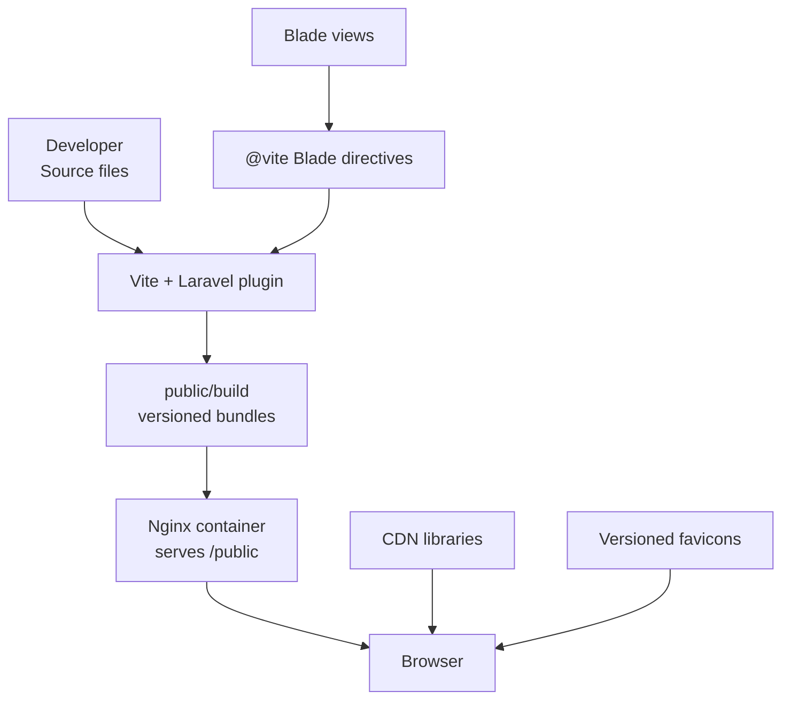

**Diagram sources**
- [vite.config.js:1-33](file://vite.config.js#L1-L33)
- [Dockerfile:1-32](file://Dockerfile#L1-L32)
- [docker/nginx.conf:1-20](file://docker/nginx.conf#L1-L20)
- [resources/views/layouts/site.blade.php:61-65](file://resources/views/layouts/site.blade.php#L61-L65)

**Section sources**
- [vite.config.js:1-33](file://vite.config.js#L1-L33)
- [package.json:1-35](file://package.json#L1-L35)
- [Dockerfile:1-32](file://Dockerfile#L1-L32)
- [docker/nginx.conf:1-20](file://docker/nginx.conf#L1-L20)

## Core Components
The frontend optimization surface consists of:

| Area | Primary file(s) | Responsibility |
|---|---|---|
| Vite build configuration | [vite.config.js](file://vite.config.js) | Declares entry points, Tailwind integration, dev server behavior |
| Node dependencies and scripts | [package.json](file://package.json) | Defines `build` and `dev` scripts; pins Vite, Tailwind, Alpine, Passkeys, Bootstrap, jQuery |
| Production asset pipeline | [Dockerfile](file://Dockerfile) | Installs Node dependencies, runs `npm run build`, copies `public/build` into the runtime image |
| HTTP server | [docker/nginx.conf](file://docker/nginx.conf) | Serves `/var/www/html/public` with Laravel routing fallback |
| Public site CSS | [resources/css/app.css](file://resources/css/app.css) | Tailwind v4 theme tokens, custom variants, design tokens |
| Auth UI CSS | [resources/css/auth.css](file://resources/css/auth.css) | Scoped legacy UI styles for auth pages |
| Admin CSS | [resources/css/admin.css](file://resources/css/admin.css) | Dark admin theme variables and component styles |
| Main JavaScript bundle | [resources/js/app.js](file://resources/js/app.js) | Bootstraps passkeys helpers, password utilities, delegated DOM handlers, parallax scroll logic |
| Site Alpine components | [resources/js/site-alpine.js](file://resources/js/site-alpine.js) | Queues Alpine registrations, lightbox, blog search palette |
| Auth Alpine instance | [resources/js/auth-alpine.js](file://resources/js/auth-alpine.js) | Boots a single Alpine instance for authentication flows |
| Booking wizard | [resources/js/site-booking.js](file://resources/js/site-booking.js) | Multi-step booking state, calendar, slot selection, draft persistence |
| Admin JavaScript | [resources/js/admin.js](file://resources/js/admin.js) | Admin Alpine plugins, focus traps, media picker, command palette |
| Blade asset injection | Multiple layout files | `@vite` directives and CDN links |

**Section sources**
- [vite.config.js:1-33](file://vite.config.js#L1-L33)
- [package.json:1-35](file://package.json#L1-L35)
- [Dockerfile:1-32](file://Dockerfile#L1-L32)
- [resources/css/app.css:1-40](file://resources/css/app.css#L1-L40)
- [resources/js/app.js:1-40](file://resources/js/app.js#L1-L40)
- [resources/js/site-alpine.js:1-40](file://resources/js/site-alpine.js#L1-L40)
- [resources/js/auth-alpine.js:1-16](file://resources/js/auth-alpine.js#L1-L16)
- [resources/js/site-booking.js:1-40](file://resources/js/site-booking.js#L1-L40)
- [resources/js/admin.js:1-40](file://resources/js/admin.js#L1-L40)

## Architecture Overview
The build and delivery flow connects Blade templates, Vite, Tailwind, Alpine.js, and the production container.

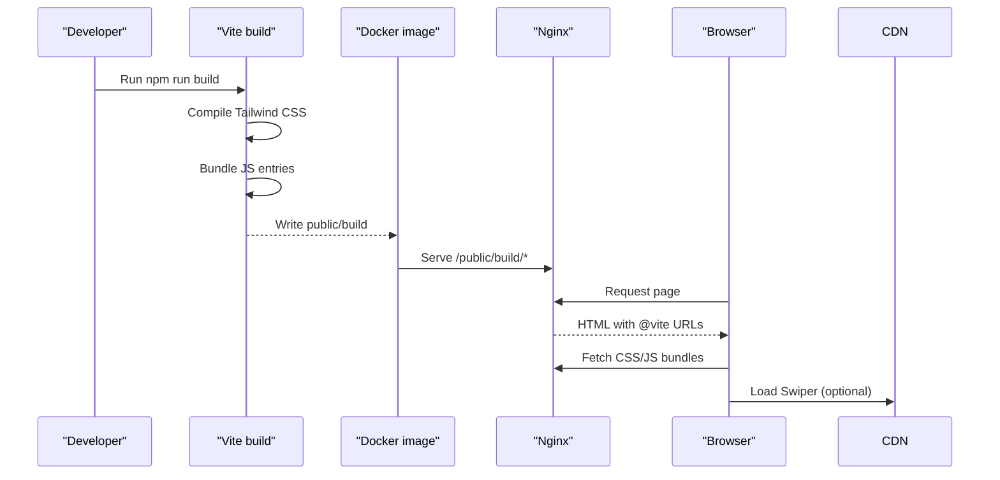

**Diagram sources**
- [package.json:1-12](file://package.json#L1-L12)
- [vite.config.js:1-33](file://vite.config.js#L1-L33)
- [Dockerfile:12-25](file://Dockerfile#L12-L25)
- [docker/nginx.conf:1-20](file://docker/nginx.conf#L1-L20)
- [resources/views/layouts/site.blade.php:61-123](file://resources/views/layouts/site.blade.php#L61-L123)

## Detailed Component Analysis

### Vite Build Configuration and Code Splitting
Vite defines seven entry points grouped by feature:

| Entry point | Purpose |
|---|---|
| `resources/css/app.css` | Public site Tailwind CSS |
| `resources/js/app.js` | Shared JavaScript, passkeys helpers, global DOM listeners |
| `resources/js/site-booking.js` | Booking wizard Alpine state |
| `resources/js/site-alpine.js` | Public site Alpine plugins and components |
| `resources/css/auth.css` | Legacy auth UI CSS |
| `resources/js/auth-alpine.js` | Authentication Alpine instance |
| `resources/css/admin.css` | Admin panel CSS |
| `resources/js/admin.js` | Admin Alpine features |

Code splitting occurs per entry point. Each Blade layout requests only its needed entries, so shared code is not duplicated unnecessarily. For example, the public site layout includes the core app bundle plus booking and Alpine-specific scripts, while the admin layout adds the admin bundle.

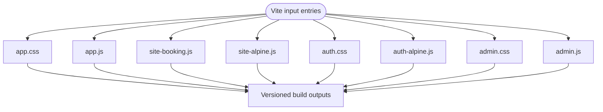

**Diagram sources**
- [vite.config.js:5-24](file://vite.config.js#L5-L24)

Optimization implications:
- **Tree shaking**: Unused ES modules are dropped at build time because the project uses ESM and modern tooling.
- **Entry-level splitting**: Each Blade view loads only its required JavaScript entry, reducing initial payload.
- **Tailwind v4**: The CSS build integrates Tailwind through `@tailwindcss/vite`; unused utility classes are eliminated when they do not appear in the scanned template and CSS sources.
- **Dev server**: The development server enables CORS and ignores compiled Blade views during watch mode.

**Section sources**
- [vite.config.js:1-33](file://vite.config.js#L1-L33)
- [package.json:5-12](file://package.json#L5-L12)

### Tailwind CSS Optimization
Tailwind is integrated via the Vite plugin and imported from `resources/css/app.css`. The main stylesheet declares theme tokens, custom variants, and scoped design tokens rather than relying on a large legacy CSS framework for the public site.

Key behaviors:
- Tailwind scans used classes across Blade and CSS sources and emits only what is referenced.
- Custom variants such as dark mode and sidebar state are defined in the same CSS file.
- Theme tokens centralize fonts, colors, spacing, shadows, and z-index values, reducing ad hoc style duplication.
- The auth and admin CSS files remain separate to keep authentication and admin styling isolated from the public site’s Tailwind layer.

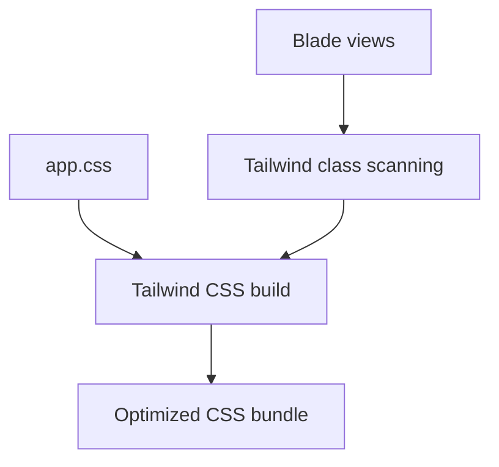

**Diagram sources**
- [vite.config.js:1-12](file://vite.config.js#L1-L12)
- [resources/css/app.css:1-20](file://resources/css/app.css#L1-L20)

Recommendations:
- Keep Tailwind classes descriptive and avoid inline arbitrary values where possible, so scanning remains predictable.
- Use semantic token variables defined in `app.css` instead of hard-coded colors in views.
- Avoid importing unnecessary frameworks into `app.css`; use dedicated entries like `admin.css` for admin-only dependencies.

**Section sources**
- [vite.config.js:1-12](file://vite.config.js#L1-L12)
- [resources/css/app.css:1-40](file://resources/css/app.css#L1-L40)
- [resources/css/auth.css:1-20](file://resources/css/auth.css#L1-L20)
- [resources/css/admin.css:1-20](file://resources/css/admin.css#L1-L20)

### Alpine.js Loading Strategy
Alpine.js is loaded differently depending on the page type:

- **Public site**: Livewire boots one Alpine instance. The site’s Alpine entry registers plugins and defers component registration until Livewire’s Alpine instance is ready, avoiding duplicate instances.
- **Authentication flows**: A dedicated `auth-alpine.js` bootstraps Alpine explicitly for pages that need it without pulling Alpine into the general app bundle.
- **Admin panel**: Admin JavaScript also initializes Alpine plugins and components after Alpine is ready.

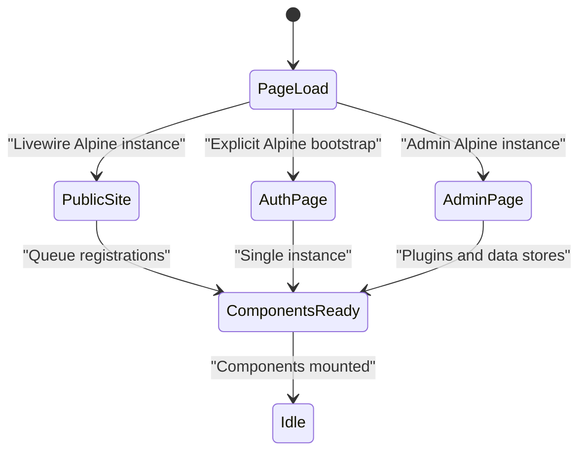

**Diagram sources**
- [resources/js/site-alpine.js:1-20](file://resources/js/site-alpine.js#L1-L20)
- [resources/js/auth-alpine.js:1-16](file://resources/js/auth-alpine.js#L1-L16)
- [resources/js/admin.js:1-30](file://resources/js/admin.js#L1-L30)

Optimization notes:
- Avoiding a second Alpine copy prevents memory overhead and event duplication.
- Defer-heavy logic is kept out of the shared `app.js` bundle when it belongs to a specific feature.
- Event listeners are attached at the document level with delegation, which works safely when Livewire swaps content.

**Section sources**
- [resources/js/site-alpine.js:1-40](file://resources/js/site-alpine.js#L1-L40)
- [resources/js/auth-alpine.js:1-16](file://resources/js/auth-alpine.js#L1-L16)
- [resources/js/admin.js:1-60](file://resources/js/admin.js#L1-L60)

### JavaScript Optimization and Module Bundling
The main public JavaScript bundle handles:
- Passkeys helper exposure.
- Global password generation.
- Delegated click handlers for menus, modals, and password toggles.
- Scroll-linked parallax for hero sections.

The booking wizard is split into its own module, keeping form state isolated. The admin bundle contains heavier interactive features such as focus trapping, media library browsing, and command palette state.

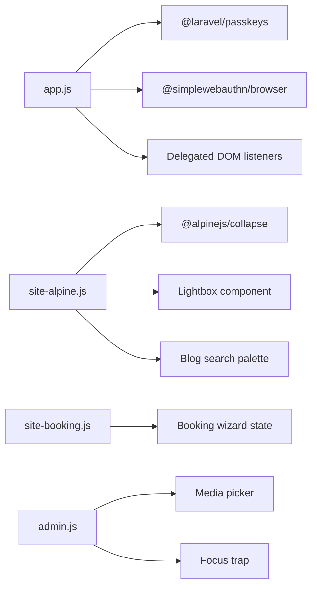

**Diagram sources**
- [resources/js/app.js:1-40](file://resources/js/app.js#L1-L40)
- [resources/js/site-alpine.js:1-40](file://resources/js/site-alpine.js#L1-L40)
- [resources/js/site-booking.js:1-40](file://resources/js/site-booking.js#L1-L40)
- [resources/js/admin.js:1-40](file://resources/js/admin.js#L1-L40)

Runtime performance characteristics:
- Passive scroll listeners reduce main-thread contention during scrolling.
- Delegated event handling avoids re-binding handlers after Livewire navigation.
- Feature-specific bundles prevent heavy admin or booking logic from loading on unrelated pages.

**Section sources**
- [resources/js/app.js:1-157](file://resources/js/app.js#L1-L157)
- [resources/js/site-booking.js:1-120](file://resources/js/site-booking.js#L1-L120)
- [resources/js/admin.js:1-120](file://resources/js/admin.js#L1-L120)

### Blade Layouts and Asset Injection
Blade layouts control which assets are injected:

| Layout | Injected assets |
|---|---|
| Public site | Core CSS, app JS, booking JS, site Alpine JS, Swiper CDN |
| Base layout | Core CSS and app JS |
| Admin layout | Core CSS, admin CSS, admin JS, CKEditor script |
| Auth layouts | Core CSS and app JS |
| Error layout | Core CSS and app JS |
| Partial head | Core CSS and app JS |

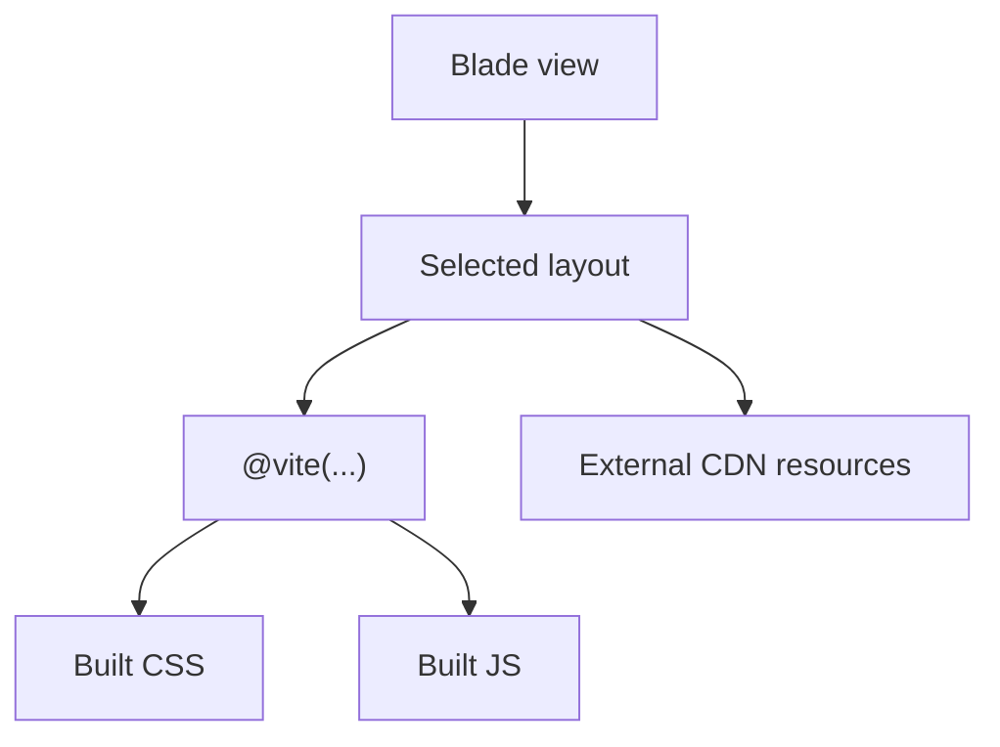

**Diagram sources**
- [resources/views/layouts/site.blade.php:61-123](file://resources/views/layouts/site.blade.php#L61-L123)
- [resources/views/layouts/base.blade.php:28-40](file://resources/views/layouts/base.blade.php#L28-L40)
- [resources/views/layouts/admin.blade.php:31-131](file://resources/views/layouts/admin.blade.php#L31-L131)
- [resources/views/layouts/auth/split-simple.blade.php:8](file://resources/views/layouts/auth/split-simple.blade.php#L8)
- [resources/views/layouts/auth/simple-simple.blade.php:8](file://resources/views/layouts/auth/simple-simple.blade.php#L8)
- [resources/views/components/error-layout.blade.php:13-20](file://resources/views/components/error-layout.blade.php#L13-L20)
- [resources/views/partials/head.blade.php:8-11](file://resources/views/partials/head.blade.php#L8-L11)

Best practices demonstrated:
- Use `@vite` with an explicit array of entries so each page loads only what it needs.
- Keep third-party libraries on a CDN only when appropriate; prefer local bundles for sensitive flows such as authentication.
- Preconnect to external font hosts to reduce DNS latency.

**Section sources**
- [resources/views/layouts/site.blade.php:46-123](file://resources/views/layouts/site.blade.php#L46-L123)
- [resources/views/layouts/base.blade.php:28-40](file://resources/views/layouts/base.blade.php#L28-L40)
- [resources/views/layouts/admin.blade.php:31-131](file://resources/views/layouts/admin.blade.php#L31-L131)
- [resources/views/partials/head.blade.php:8-11](file://resources/views/partials/head.blade.php#L8-L11)

### CDN Integration Patterns
The public site loads Swiper from jsDelivr:
- Stylesheet link in the head section.
- Script tag near the end of the body.

This pattern is convenient but introduces a third-party dependency outside the application bundle. For security-sensitive pages, the repository intentionally avoids CDN-based Alpine builds.

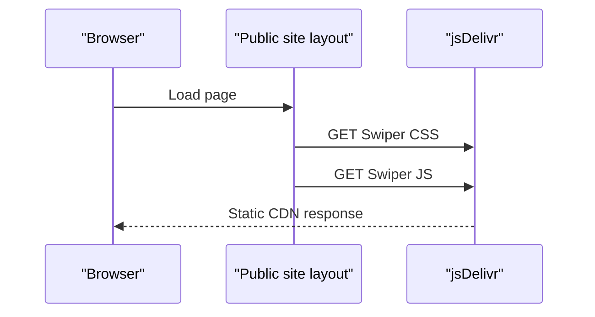

**Diagram sources**
- [resources/views/layouts/site.blade.php:65-123](file://resources/views/layouts/site.blade.php#L65-L123)
- [resources/js/auth-alpine.js:1-16](file://resources/js/auth-alpine.js#L1-L16)

Considerations:
- CDN availability affects first paint if critical assets depend on it.
- Cache headers and integrity checks should be configured at the CDN provider.
- Move critical UI libraries into the Vite bundle when reliability or security is important.

**Section sources**
- [resources/views/layouts/site.blade.php:65-123](file://resources/views/layouts/site.blade.php#L65-L123)
- [resources/js/auth-alpine.js:1-16](file://resources/js/auth-alpine.js#L1-L16)

### Asset Versioning Strategies
Favicons use a query-string version parameter generated by Blade:
- `favicon.ico?v=...`
- `favicon.svg?v=...`
- `favicon-48x48.png?v=...`
- `favicon-96x96.png?v=...`
- `apple-touch-icon.png?v=...`

This forces browsers to refresh static icons when the version changes. Vite’s build output is copied into `public/build`, so the container always serves the latest compiled assets.

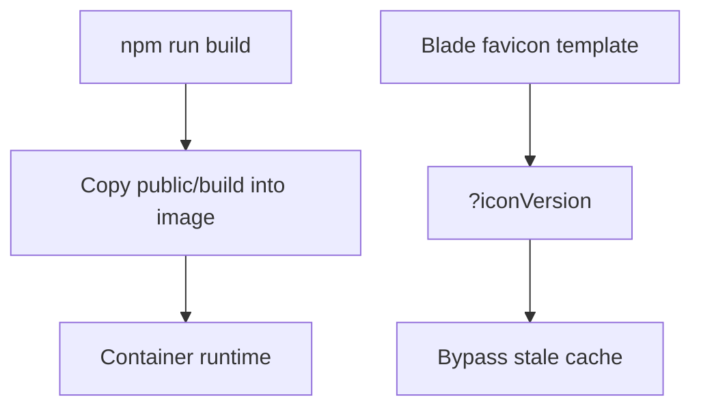

**Diagram sources**
- [Dockerfile:19-25](file://Dockerfile#L19-L25)
- [resources/views/partials/favicons.blade.php:7-13](file://resources/views/partials/favicons.blade.php#L7-L13)

Recommendations:
- Centralize the icon version variable so it can be tied to build metadata or Git revision.
- Apply similar versioning to other long-lived static assets when served directly from `public`.

**Section sources**
- [resources/views/partials/favicons.blade.php:7-13](file://resources/views/partials/favicons.blade.php#L7-L13)
- [Dockerfile:19-25](file://Dockerfile#L19-L25)

### Browser Caching Headers
The Nginx configuration serves the Laravel public directory and routes PHP requests through FastCGI. It does not define explicit cache-control headers for static assets.

Implications:
- Without explicit caching headers, browsers may rely on default behavior or upstream proxy/cache behavior.
- Long-term caching for immutable build artifacts improves repeat visit performance.
- Cache invalidation should be coordinated with versioned filenames or query parameters.

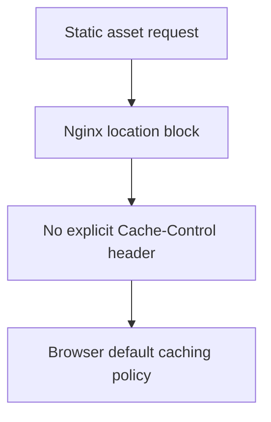

**Diagram sources**
- [docker/nginx.conf:1-20](file://docker/nginx.conf#L1-L20)

Recommended improvement:
- Add cache headers for `public/build` with immutable fingerprints and longer max-age values.
- Keep dynamic PHP responses uncached unless they are explicitly cacheable.

**Section sources**
- [docker/nginx.conf:1-20](file://docker/nginx.conf#L1-L20)

### Image Optimization Pipeline and Progressive Loading
Images in public-facing views commonly use:
- Native lazy loading via `loading="lazy"`.
- Explicit dimensions where known.
- Accept attributes limiting uploads to JPEG, PNG, and WebP.
- Placeholder images for missing service images.

Examples include service tiles, gallery items, contact images, blog posts, livewire blog listings, and cinematic hero images.

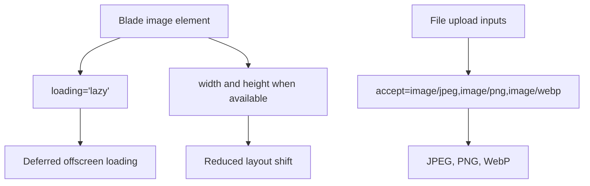

**Diagram sources**
- [resources/views/site/services.blade.php:60-63](file://resources/views/site/services.blade.php#L60-L63)
- [resources/views/site/services.blade.php:126-129](file://resources/views/site/services.blade.php#L126-L129)
- [resources/views/site/services.blade.php:143-143](file://resources/views/site/services.blade.php#L143-L143)
- [resources/views/site/gallery.blade.php:52-52](file://resources/views/site/gallery.blade.php#L52-L52)
- [resources/views/site/contact.blade.php:139-139](file://resources/views/site/contact.blade.php#L139-L139)
- [resources/views/blog/show.blade.php:98-98](file://resources/views/blog/show.blade.php#L98-L98)
- [resources/views/livewire/blog-posts.blade.php:136-136](file://resources/views/livewire/blog-posts.blade.php#L136-L136)
- [resources/views/components/hero/cinematic.blade.php:528-548](file://resources/views/components/hero/cinematic.blade.php#L528-L548)
- [resources/views/components/hero/cinematic.blade.php:643-643](file://resources/views/components/hero/cinematic.blade.php#L643-L643)

Current status:
- Lazy loading is widely applied.
- WebP support exists through accept attributes and some uploaded formats, but there is no automatic format negotiation or responsive `srcset` in the analyzed files.
- Placeholder images improve perceived performance when real images are unavailable.

Recommendations:
- Generate WebP or AVIF variants server-side and serve them based on client capability.
- Use `srcset` and `sizes` for responsive images where thumbnails and full-size versions differ.
- Prefer native decoding attributes and explicit dimensions to reduce layout shift.

**Section sources**
- [resources/views/site/services.blade.php:60-143](file://resources/views/site/services.blade.php#L60-L143)
- [resources/views/site/gallery.blade.php:52-52](file://resources/views/site/gallery.blade.php#L52-L52)
- [resources/views/site/contact.blade.php:139-139](file://resources/views/site/contact.blade.php#L139-L139)
- [resources/views/blog/show.blade.php:98-98](file://resources/views/blog/show.blade.php#L98-L98)
- [resources/views/livewire/blog-posts.blade.php:136-136](file://resources/views/livewire/blog-posts.blade.php#L136-L136)
- [resources/views/components/hero/cinematic.blade.php:528-643](file://resources/views/components/hero/cinematic.blade.php#L528-L643)

### Font Optimization and Critical Resource Preloading
Font optimization currently relies on preconnecting to Google Fonts and Bunny Fonts:
- Public site layout preconnects to `fonts.googleapis.com` and `fonts.gstatic.com`.
- Head partial preconnects to `fonts.bunny.net`.
- Admin and error layouts also preconnect to Google Fonts.

No explicit `font-display` strategy or preload tags were found in the analyzed layouts.

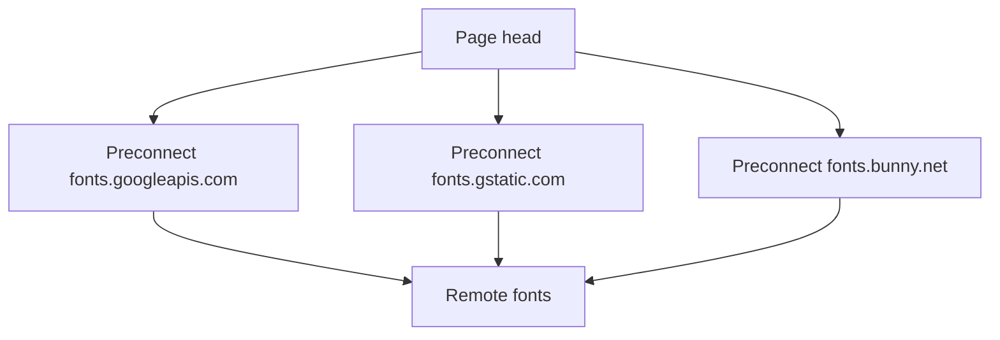

**Diagram sources**
- [resources/views/layouts/site.blade.php:46-47](file://resources/views/layouts/site.blade.php#L46-L47)
- [resources/views/partials/head.blade.php:8-8](file://resources/views/partials/head.blade.php#L8-L8)
- [resources/views/layouts/admin.blade.php:31-32](file://resources/views/layouts/admin.blade.php#L31-L32)
- [resources/views/components/error-layout.blade.php:13-14](file://resources/views/components/error-layout.blade.php#L13-L14)

Recommendations:
- Preload critical font files for above-the-fold text.
- Use `font-display: swap` to avoid invisible text during font loading.
- Consider self-hosting critical fonts to reduce third-party DNS and connection overhead.

**Section sources**
- [resources/views/layouts/site.blade.php:46-47](file://resources/views/layouts/site.blade.php#L46-L47)
- [resources/views/partials/head.blade.php:8-8](file://resources/views/partials/head.blade.php#L8-L8)
- [resources/views/layouts/admin.blade.php:31-32](file://resources/views/layouts/admin.blade.php#L31-L32)
- [resources/views/components/error-layout.blade.php:13-14](file://resources/views/components/error-layout.blade.php#L13-L14)

### Performance Monitoring and Web Vitals
The analyzed frontend files do not include a Web Vitals monitoring implementation. However, several patterns contribute positively to web vitals:
- **LCP**: Preconnect reduces font latency; critical CSS is bundled through Vite.
- **CLS**: Images have explicit dimensions in some places, reducing layout shift.
- **INP/FID**: Delegated event listeners and passive scroll listeners reduce event handler overhead.
- **TBT**: Feature-specific JS bundles keep heavy logic out of unrelated pages.

Where monitoring could be added:
- Instrument LCP, INP, CLS, and TBT at the layout level.
- Report metrics to analytics or observability endpoints.
- Correlate metric degradation with new Vite entries or third-party scripts.

[No sources needed since this section provides general guidance]

## Dependency Analysis
Frontend dependencies are declared in `package.json`. The most relevant optimization-related dependencies include:

| Dependency | Role | Optimization relevance |
|---|---|---|
| `vite` | Build tool | Modern bundler with tree shaking and code splitting |
| `laravel-vite-plugin` | Laravel integration | Maps Blade `@vite` to built assets |
| `tailwindcss` | Utility CSS | Generates minimal CSS when unused classes are absent |
| `@tailwindcss/vite` | Vite adapter | Integrates Tailwind into the Vite pipeline |
| `alpinejs` | Lightweight interactivity | Small runtime when loaded once |
| `@alpinejs/collapse` | Alpine plugin | Adds collapse behavior without a full framework |
| `@laravel/passkeys` | Passkey helpers | Exposed globally for secure authentication flows |
| `@simplewebauthn/browser` | WebAuthn helpers | Used in the shared app bundle |
| `bootstrap` | UI framework | Present but scoped primarily to older or admin contexts |
| `jquery` | Legacy DOM utility | Retained for compatibility |

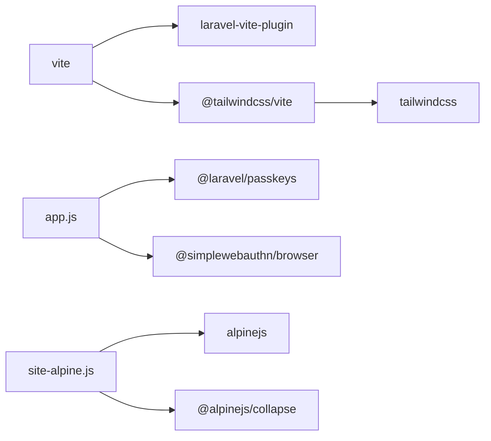

**Diagram sources**
- [package.json:13-35](file://package.json#L13-L35)
- [resources/js/app.js:1-20](file://resources/js/app.js#L1-L20)
- [resources/js/site-alpine.js:1-10](file://resources/js/site-alpine.js#L1-L10)

**Section sources**
- [package.json:1-35](file://package.json#L1-L35)
- [resources/js/app.js:1-20](file://resources/js/app.js#L1-L20)
- [resources/js/site-alpine.js:1-10](file://resources/js/site-alpine.js#L1-L10)

## Performance Considerations
Based on the current codebase:

- **Bundle size control**: Split assets by layout and feature. Do not add heavy libraries to `app.js` unless they are truly shared.
- **CSS efficiency**: Rely on Tailwind scanning and avoid unused imports. Keep auth and admin styles in their own files.
- **JavaScript runtime**: Prefer delegation over many bound listeners. Keep Alpine instances unique per page type.
- **Image loading**: Continue using lazy loading, explicit dimensions, and accepted image formats. Add responsive variants where thumbnails differ significantly from full images.
- **Fonts**: Preconnect to font providers and consider preloading critical fonts.
- **Caching**: Add explicit cache headers for immutable build artifacts and coordinate cache busting with versioned URLs or filenames.
- **CDN trade-offs**: Use CDNs for non-critical third-party libraries; prefer local bundles for security-sensitive flows.

[No sources needed since this section provides general guidance]

## Troubleshooting Guide

| Symptom | Likely cause | Resolution |
|---|---|---|
| Alpine components do not work on the public site | Duplicate Alpine instances or registrations before Livewire boots | Ensure Alpine registrations are queued and applied on `alpine:init` as implemented in the site Alpine entry. |
| Authentication Alpine toggles fail | Missing Alpine instance or multiple instances | Load only the auth Alpine entry on auth pages and ensure a single Alpine instance is started. |
| Heavy admin features load on public pages | Wrong entry included in layout | Verify `@vite` calls in layouts only include necessary entries. |
| Images do not load efficiently | Missing lazy loading or oversized images | Add `loading="lazy"` and appropriate dimensions; generate optimized image variants. |
| Fonts flash invisible text | Missing font display strategy or slow remote fonts | Use `font-display: swap`, preload critical fonts, and keep preconnect hints. |
| Static assets are not cached effectively | Nginx lacks explicit cache headers | Configure immutable cache policies for `public/build` and versioned static assets. |
| Favicons are stale in the browser | Missing version parameter | Ensure the favicon URL includes a changing version value. |

**Section sources**
- [resources/js/site-alpine.js:1-20](file://resources/js/site-alpine.js#L1-L20)
- [resources/js/auth-alpine.js:1-16](file://resources/js/auth-alpine.js#L1-L16)
- [resources/views/partials/favicons.blade.php:7-13](file://resources/views/partials/favicons.blade.php#L7-L13)
- [docker/nginx.conf:1-20](file://docker/nginx.conf#L1-L20)

## Conclusion
Highblossom’s frontend optimization is centered around Vite entry-point splitting, Tailwind CSS scanning, scoped Alpine.js initialization, and Blade-driven asset injection. The repository already demonstrates strong baseline practices: feature-specific bundles, lazy-loaded images, deferred Alpine registrations, and font preconnections. To strengthen performance further, the project should add immutable cache headers for build artifacts, adopt responsive image variants, preconnect and preload critical fonts, and instrument Web Vitals for ongoing monitoring. These steps will improve load times, interaction responsiveness, and visual stability without changing the existing architecture.