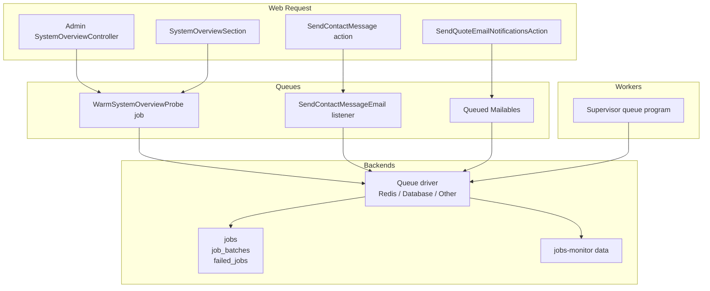
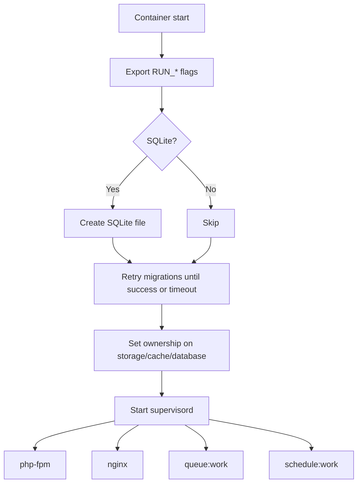
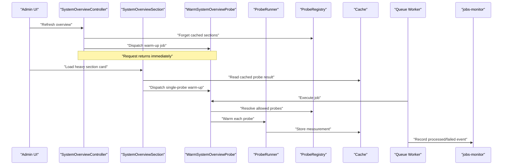
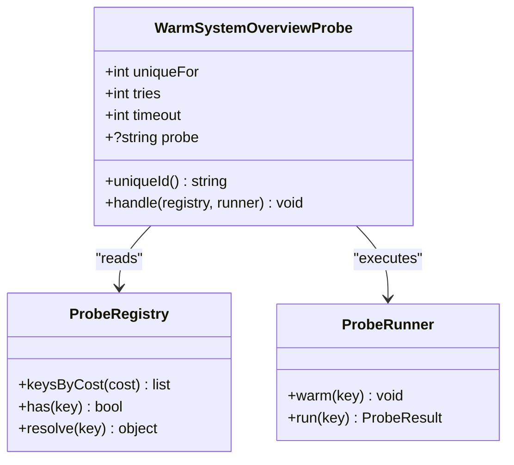
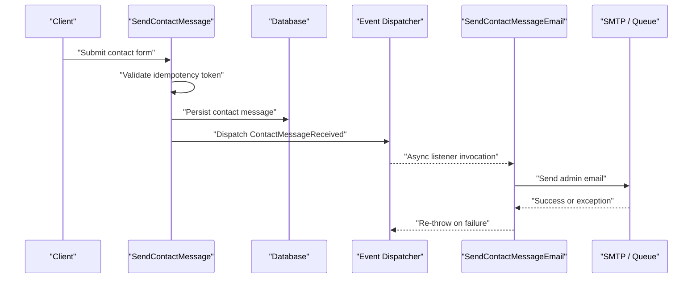
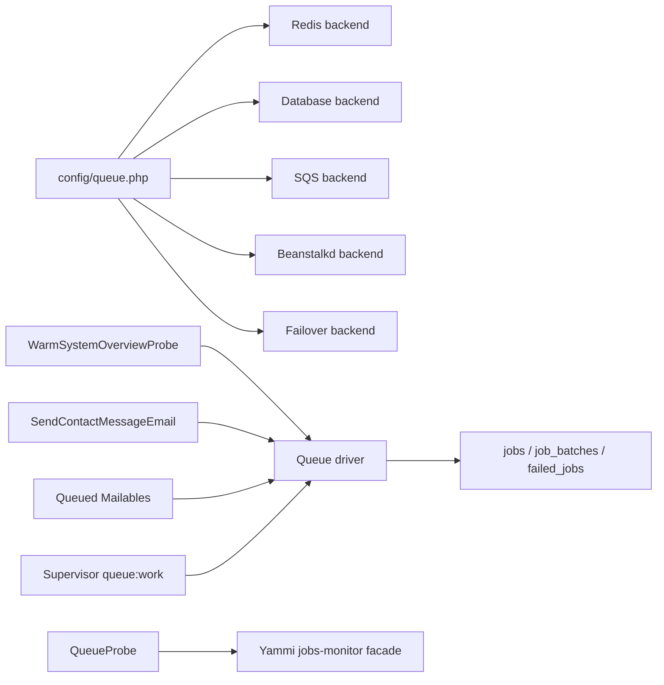
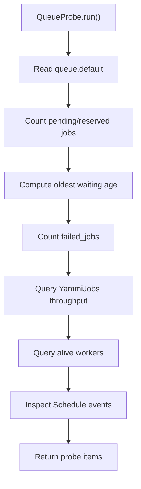

# Background Jobs & Queues

<cite>
**Referenced Files in This Document**
- [config/queue.php](file://config/queue.php)
- [config/jobs-monitor.php](file://config/jobs-monitor.php)
- [database/migrations/0001_01_01_000002_create_jobs_table.php](file://database/migrations/0001_01_01_000002_create_jobs_table.php)
- [app/Jobs/WarmSystemOverviewProbe.php](file://app/Jobs/WarmSystemOverviewProbe.php)
- [routes/console.php](file://routes/console.php)
- [docker/supervisord.conf](file://docker/supervisord.conf)
- [docker/entrypoint.sh](file://docker/entrypoint.sh)
- [app/Support/SystemOverview/Probes/QueueProbe.php](file://app/Support/SystemOverview/Probes/QueueProbe.php)
- [app/Actions/SendContactMessage.php](file://app/Actions/SendContactMessage.php)
- [app/Events/ContactMessageReceived.php](file://app/Events/ContactMessageReceived.php)
- [app/Listeners/SendContactMessageEmail.php](file://app/Listeners/SendContactMessageEmail.php)
- [app/Providers/EventServiceProvider.php](file://app/Providers/EventServiceProvider.php)
- [app/Services/IdempotencyService.php](file://app/Services/IdempotencyService.php)
- [app/Services/ImageUploadService.php](file://app/Services/ImageUploadService.php)
- [app/Services/VideoUploadService.php](file://app/Services/VideoUploadService.php)
- [app/Http/Controllers/Admin/SystemOverviewController.php](file://app/Http/Controllers/Admin/SystemOverviewController.php)
- [app/Livewire/SystemOverviewSection.php](file://app/Livewire/SystemOverviewSection.php)
- [app/Actions/SendQuoteEmailNotificationsAction.php](file://app/Actions/SendQuoteEmailNotificationsAction.php)
- [app/Mail/BookingConfirmationMail.php](file://app/Mail/BookingConfirmationMail.php)
</cite>

## Table of Contents
1. Introduction
2. Project Structure
3. Core Components
4. Architecture Overview
5. Detailed Component Analysis
6. Dependency Analysis
7. Performance Considerations
8. Troubleshooting Guide
9. Conclusion

## Introduction
This document explains how Highblossom uses background jobs and queues to keep the web request path responsive, handle email delivery, process media, run system probes, and integrate with the `jobs-monitor` package for observability. It covers queue driver configuration, job dispatching patterns, retry and failure handling, monitoring, worker management, horizontal scaling, prioritization, rate limiting, idempotency, and performance tuning for high-throughput scenarios.

## Project Structure
The background-job surface in this project is small but focused:

- Queue configuration lives under `config/queue.php`.
- The only application-defined job is `WarmSystemOverviewProbe`, used to measure heavy dashboard sections off the request path.
- Email notifications are queued via Laravel mail classes or listeners implementing `ShouldQueue`.
- Job persistence tables (`jobs`, `job_batches`, `failed_jobs`) are created by a migration.
- Worker processes are managed through Docker and Supervisor.
- Monitoring and metrics come from the `jobs-monitor` package plus a custom `QueueProbe` that reports backlog, failures, workers, and scheduled work.

**Diagram sources**
- [app/Http/Controllers/Admin/SystemOverviewController.php:40-56](file://app/Http/Controllers/Admin/SystemOverviewController.php#L40-L56)
- [app/Livewire/SystemOverviewSection.php:60-74](file://app/Livewire/SystemOverviewSection.php#L60-L74)
- [app/Jobs/WarmSystemOverviewProbe.php:21-75](file://app/Jobs/WarmSystemOverviewProbe.php#L21-L75)
- [app/Actions/SendContactMessage.php:33-70](file://app/Actions/SendContactMessage.php#L33-L70)
- [app/Listeners/SendContactMessageEmail.php:29-53](file://app/Listeners/SendContactMessageEmail.php#L29-L53)
- [app/Actions/SendQuoteEmailNotificationsAction.php:38-84](file://app/Actions/SendQuoteEmailNotificationsAction.php#L38-L84)
- [config/queue.php:1-128](file://config/queue.php#L1-L128)
- [docker/supervisord.conf:38-52](file://docker/supervisord.conf#L38-L52)

**Section sources**
- [config/queue.php:1-128](file://config/queue.php#L1-L128)
- [database/migrations/0001_01_01_000002_create_jobs_table.php:10-51](file://database/migrations/0001_01_01_000002_create_jobs_table.php#L10-L51)
- [docker/supervisord.conf:38-52](file://docker/supervisord.conf#L38-L52)

## Core Components

### Queue Drivers and Configuration
The default queue connection is driven by `QUEUE_CONNECTION`. Available connections include sync, database, redis, beanstalkd, sqs, deferred, background, and failover.

Key settings:
- Default connection: `env('QUEUE_CONNECTION', 'database')`.
- Redis connection: `REDIS_QUEUE_CONNECTION`, `REDIS_QUEUE`, `REDIS_QUEUE_RETRY_AFTER`, `block_for`, `after_commit`.
- Database connection: `DB_QUEUE_CONNECTION`, `DB_QUEUE_TABLE`, `DB_QUEUE`, `DB_QUEUE_RETRY_AFTER`.
- SQS connection: AWS credentials, prefix, queue name, suffix, region, and `after_commit`.
- Beanstalkd connection: host, queue, retry after, block time, and `after_commit`.
- Failover connection: ordered list of fallback connections.
- Failed job storage: `QUEUE_FAILED_DRIVER`, database connection, and `failed_jobs` table.
- Batching: `job_batches` table backed by `DB_CONNECTION`.

Operational guidance:
- Use Redis for production throughput because it avoids per-job SQL overhead and supports atomic operations.
- Keep `retry_after` aligned with job timeouts so reserved jobs are released when workers die.
- For distributed environments, prefer Redis or SQS over the database driver.

**Section sources**
- [config/queue.php:17-22](file://config/queue.php#L17-L22)
- [config/queue.php:39-112](file://config/queue.php#L39-L112)
- [config/queue.php:114-128](file://config/queue.php#L114-L128)

### Job Persistence and Schema
The project creates three core tables:

| Table | Purpose | Important Columns |
|---|---|---|
| `jobs` | Pending and reserved jobs | `queue`, `payload`, `attempts`, `reserved_at`, `available_at`, `created_at` |
| `job_batches` | Batch tracking | `id`, `name`, `total_jobs`, `pending_jobs`, `failed_jobs`, `failed_job_ids`, timestamps |
| `failed_jobs` | Dead-letter store | `uuid`, `connection`, `queue`, `payload`, `exception`, `failed_at` |

These tables support database-backed queueing, batch status queries, and failed-job inspection without loading full payloads into memory unless explicitly requested.

**Section sources**
- [database/migrations/0001_01_01_000002_create_jobs_table.php:10-51](file://database/migrations/0001_01_01_000002_create_jobs_table.php#L10-L51)

### Worker Process Management
Docker runs three Supervisor programs: PHP-FPM, Nginx, and a queue worker. The queue worker command is:

- `php artisan queue:work --sleep=3 --tries=3 --max-time=3600`
- Controlled by `RUN_QUEUE`.
- Runs as user `www-data`.
- Uses `stopasgroup` and `killasgroup` for graceful shutdown.
- Logs stdout/stderr to `/dev/stdout` and `/dev/stderr`.

The entrypoint script:
- Sets runtime flags including `RUN_WEB`, `RUN_QUEUE`, `RUN_SCHEDULER`, and `RUN_REVERB`.
- Creates SQLite if needed.
- Retries migrations until the database is reachable.
- Starts Supervisor.

**Diagram sources**
- [docker/entrypoint.sh:1-20](file://docker/entrypoint.sh#L1-L20)
- [docker/supervisord.conf:1-66](file://docker/supervisord.conf#L1-L66)

**Section sources**
- [docker/supervisord.conf:38-52](file://docker/supervisord.conf#L38-L52)
- [docker/entrypoint.sh:1-20](file://docker/entrypoint.sh#L1-L20)

## Architecture Overview

**Diagram sources**
- [app/Http/Controllers/Admin/SystemOverviewController.php:40-56](file://app/Http/Controllers/Admin/SystemOverviewController.php#L40-L56)
- [app/Livewire/SystemOverviewSection.php:60-74](file://app/Livewire/SystemOverviewSection.php#L60-L74)
- [app/Jobs/WarmSystemOverviewProbe.php:21-75](file://app/Jobs/WarmSystemOverviewProbe.php#L21-L75)

## Detailed Component Analysis

### WarmSystemOverviewProbe Job
This job measures heavy system overview sections off the request path. It implements uniqueness so repeated requests coalesce into one running instance, and it limits retries to one attempt so transient failures leave the section pending rather than noisy retries.

Key properties:
- `uniqueFor = 60`: lock held for 60 seconds.
- `tries = 1`: no automatic retries.
- `timeout = 90`: wall-clock limit.
- `uniqueId()`: scoped by optional probe key.
- `handle()`: walks the registry, skips unknown keys, and asks the runner to warm each target.

**Diagram sources**
- [app/Jobs/WarmSystemOverviewProbe.php:21-75](file://app/Jobs/WarmSystemOverviewProbe.php#L21-L75)

Dispatch points:
- Admin controller refreshes all heavy sections and dispatches a general warm-up job.
- Livewire component can dispatch a targeted warm-up for one probe.
- Console scheduler warms heavy sections twice daily without overlapping.

**Section sources**
- [app/Jobs/WarmSystemOverviewProbe.php:21-75](file://app/Jobs/WarmSystemOverviewProbe.php#L21-L75)
- [app/Http/Controllers/Admin/SystemOverviewController.php:40-56](file://app/Http/Controllers/Admin/SystemOverviewController.php#L40-L56)
- [app/Livewire/SystemOverviewSection.php:60-74](file://app/Livewire/SystemOverviewSection.php#L60-L74)
- [routes/console.php:25-32](file://routes/console.php#L25-L32)

### Event-to-Listener Async Email Pipeline
Contact form submissions use an action to validate and persist the message, then emit an event. The listener implements `ShouldQueue`, so email sending happens in a worker.

Flow:
1. Action checks idempotency token and marks it processed before persisting.
2. Message is saved.
3. `ContactMessageReceived` event is dispatched.
4. `SendContactMessageEmail` listener runs asynchronously.
5. If email sending fails, the listener logs and re-throws, allowing queue retry behavior.

**Diagram sources**
- [app/Actions/SendContactMessage.php:33-70](file://app/Actions/SendContactMessage.php#L33-L70)
- [app/Events/ContactMessageReceived.php:1-24](file://app/Events/ContactMessageReceived.php#L1-L24)
- [app/Listeners/SendContactMessageEmail.php:29-53](file://app/Listeners/SendContactMessageEmail.php#L29-L53)
- [app/Providers/EventServiceProvider.php:28-40](file://app/Providers/EventServiceProvider.php#L28-L40)

**Section sources**
- [app/Actions/SendContactMessage.php:13-70](file://app/Actions/SendContactMessage.php#L13-L70)
- [app/Events/ContactMessageReceived.php:1-24](file://app/Events/ContactMessageReceived.php#L1-L24)
- [app/Listeners/SendContactMessageEmail.php:1-53](file://app/Listeners/SendContactMessageEmail.php#L1-L53)
- [app/Providers/EventServiceProvider.php:28-40](file://app/Providers/EventServiceProvider.php#L28-L40)

### Quote Email Notifications
Quote submission triggers queued emails to configured admin recipients and optionally the customer. The action:
- Reads notification recipients from settings.
- Queues multiple `QuoteSubmittedMail` instances.
- Catches exceptions and logs them without failing the calling flow.

This pattern isolates email transport errors from business logic while still preserving visibility through structured logs.

**Section sources**
- [app/Actions/SendQuoteEmailNotificationsAction.php:18-112](file://app/Actions/SendQuoteEmailNotificationsAction.php#L18-L112)
- [app/Mail/BookingConfirmationMail.php:1-22](file://app/Mail/BookingConfirmationMail.php#L1-L22)

### Idempotency Patterns
The contact form prevents duplicate submissions using an idempotency token stored in cache. The service:
- Checks whether a token has already been processed.
- Marks tokens processed with a TTL.
- Supports returning stored results for retries.
- Generates deterministic keys from request data.

This protects against accidental double submits and client-side retries.

**Section sources**
- [app/Services/IdempotencyService.php:1-95](file://app/Services/IdempotencyService.php#L1-L95)
- [app/Actions/SendContactMessage.php:33-52](file://app/Actions/SendContactMessage.php#L33-L52)

### File Processing Pipelines
Image and video upload services perform CPU-intensive transformations and remote storage operations. They are designed to be resilient:

- Image pipeline normalizes uploads to WebP at a fixed quality and dimension, falling back to raw storage if processing fails.
- Video pipeline extracts a poster frame before moving the uploaded file, then stores the video and thumbnail separately. Thumbnail extraction failures are logged and do not prevent video storage.

Recommendation: move these transformations to background jobs when uploads occur during sensitive request paths or when many files are processed concurrently.

**Section sources**
- [app/Services/ImageUploadService.php:1-70](file://app/Services/ImageUploadService.php#L1-L70)
- [app/Services/VideoUploadService.php:1-105](file://app/Services/VideoUploadService.php#L1-L105)

### Third-Party API Call Batching
The repository does not contain a dedicated batching utility for third-party APIs. However, Laravel’s built-in job batching is available through the `job_batches` table and configuration. Recommended pattern:
- Group related API calls into a batch job.
- Track partial failures through batch metadata.
- Route batches to a dedicated queue connection with appropriate concurrency and retry settings.
- Combine with idempotency keys to make retries safe.

[No sources needed since this section provides general guidance]

## Dependency Analysis

**Diagram sources**
- [config/queue.php:17-128](file://config/queue.php#L17-L128)
- [app/Jobs/WarmSystemOverviewProbe.php:21-75](file://app/Jobs/WarmSystemOverviewProbe.php#L21-L75)
- [app/Listeners/SendContactMessageEmail.php:29-53](file://app/Listeners/SendContactMessageEmail.php#L29-L53)
- [app/Support/SystemOverview/Probes/QueueProbe.php:1-190](file://app/Support/SystemOverview/Probes/QueueProbe.php#L1-L190)
- [docker/supervisord.conf:38-52](file://docker/supervisord.conf#L38-L52)

**Section sources**
- [config/queue.php:17-128](file://config/queue.php#L17-L128)
- [app/Support/SystemOverview/Probes/QueueProbe.php:1-190](file://app/Support/SystemOverview/Probes/QueueProbe.php#L1-L190)

## Performance Considerations

### Choosing a Queue Backend
- **Redis**: Best for high throughput, low latency, and distributed workers. Tune `REDIS_QUEUE_RETRY_AFTER` and consider separate Redis connections for queues.
- **Database**: Easier setup but higher contention under load. Prefer only for development or low-volume workloads.
- **SQS / Beanstalkd**: Suitable for cloud-native or existing message infrastructure; configure credentials and regions appropriately.

### Retry Strategy
- Global worker retry count is set to `3` in Supervisor.
- Application-level jobs may override this, as seen with `WarmSystemOverviewProbe::tries = 1`.
- Align `retry_after` with job execution budgets so dead workers release reserved jobs promptly.
- Use idempotent job design so retries do not create duplicates.

### Concurrency and Scaling
- Supervisor starts one queue worker process per container. Scale horizontally by running more containers or adding more Supervisor-managed worker processes.
- Use Redis connection pooling and separate queue names for critical workloads.
- Consider splitting workloads into priority queues such as `default`, `high`, and `low`, and start multiple workers bound to different queues.

### Resource Allocation
- Bound CPU-heavy work (image/video transforms, external API calls) with timeouts and retries.
- Avoid holding database transactions open inside long-running jobs.
- Use `withoutOverlapping` for scheduled warm-ups and cleanup commands to prevent runaway overlap.

### Monitoring and Metrics
The `QueueProbe` aggregates:
- Active queue driver.
- Pending and reserved job counts.
- Oldest waiting job age.
- Failed job totals and recent failures.
- Throughput over the last 24 hours from jobs-monitor.
- Alive worker heartbeats from jobs-monitor.
- Number and summary of registered scheduled commands.

The `jobs-monitor` configuration exposes:
- Dashboard UI and JSON API toggles.
- Optional dedicated monitoring database.
- Alert channels: Slack, mail, PagerDuty, Opsgenie, webhook.
- Scheduled alert evaluation and worker underprovisioning checks.

**Diagram sources**
- [app/Support/SystemOverview/Probes/QueueProbe.php:33-190](file://app/Support/SystemOverview/Probes/QueueProbe.php#L33-L190)

**Section sources**
- [app/Support/SystemOverview/Probes/QueueProbe.php:33-190](file://app/Support/SystemOverview/Probes/QueueProbe.php#L33-L190)
- [config/jobs-monitor.php:1-261](file://config/jobs-monitor.php#L1-L261)

## Troubleshooting Guide

### Jobs Are Not Running
Checklist:
1. Confirm the queue worker is enabled: `RUN_QUEUE=true` in the entrypoint.
2. Verify Supervisor started the queue program.
3. Check `QUEUE_CONNECTION` resolves to a working backend.
4. Validate backend connectivity: Redis, database, SQS credentials, or Beanstalkd host.
5. Inspect worker logs for errors.

**Section sources**
- [docker/entrypoint.sh:1-20](file://docker/entrypoint.sh#L1-L20)
- [docker/supervisord.conf:38-52](file://docker/supervisord.conf#L38-L52)
- [config/queue.php:17-22](file://config/queue.php#L17-L22)

### Jobs Fail Repeatedly
- Inspect `failed_jobs` for payload and exception details.
- Determine whether failures are transient (network, SMTP, external API) or permanent (invalid data).
- Fix data issues and use the monitoring UI or failed-job tools to retry or delete records.
- Adjust `retry_after` if workers are killed before completion.

**Section sources**
- [database/migrations/0001_01_01_000002_create_jobs_table.php:38-51](file://database/migrations/0001_01_01_000002_create_jobs_table.php#L38-L51)
- [config/queue.php:114-128](file://config/queue.php#L114-L128)

### High Backlog or Slow Drain
Symptoms:
- Growing pending job count.
- Oldest waiting job increasing.
- Zero or few alive workers.

Actions:
- Ensure workers are alive according to jobs-monitor heartbeat.
- Increase worker count horizontally.
- Separate critical jobs into a higher-priority queue.
- Reduce per-job duration by extracting slow work into smaller jobs.
- Check backend capacity and network latency.

**Section sources**
- [app/Support/SystemOverview/Probes/QueueProbe.php:118-171](file://app/Support/SystemOverview/Probes/QueueProbe.php#L118-L171)

### Duplicate Emails or Redundant Work
Causes:
- Client retries submitting forms.
- Network retries around HTTP boundaries.
- Non-idempotent job logic.

Mitigations:
- Use idempotency tokens for incoming requests.
- Implement idempotent job keys or database constraints.
- Apply `ShouldBeUnique` where overlapping runs must be prevented.

**Section sources**
- [app/Services/IdempotencyService.php:1-95](file://app/Services/IdempotencyService.php#L1-L95)
- [app/Jobs/WarmSystemOverviewProbe.php:21-75](file://app/Jobs/WarmSystemOverviewProbe.php#L21-L75)

### Monitoring and Alerts
Use `jobs-monitor` to:
- View job run history, exceptions, and dead-letter entries.
- Enable the dashboard UI under a protected route.
- Configure alert channels for failures, missing workers, or threshold breaches.
- Inspect worker heartbeat health and expected worker counts.

**Section sources**
- [config/jobs-monitor.php:1-261](file://config/jobs-monitor.php#L1-L261)

## Conclusion
Highblossom uses queues to isolate expensive work from the request path. The current implementation includes one application job for warming system probes, asynchronous email delivery via queued listeners and mailables, and robust scheduling through Supervisor. The `jobs-monitor` package and `QueueProbe` provide essential visibility into backlog, failures, worker health, and throughput.

For production-scale reliability:
- Prefer Redis as the queue backend.
- Enforce idempotency for both inbound requests and background jobs.
- Separate workloads into named queues and scale workers accordingly.
- Tune retry policies, timeouts, and `retry_after` values together.
- Monitor backlog, failures, and worker heartbeats continuously.
- Move CPU-intensive file processing and third-party API calls into bounded, retriable jobs with clear error handling.