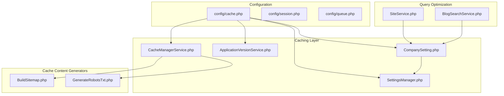
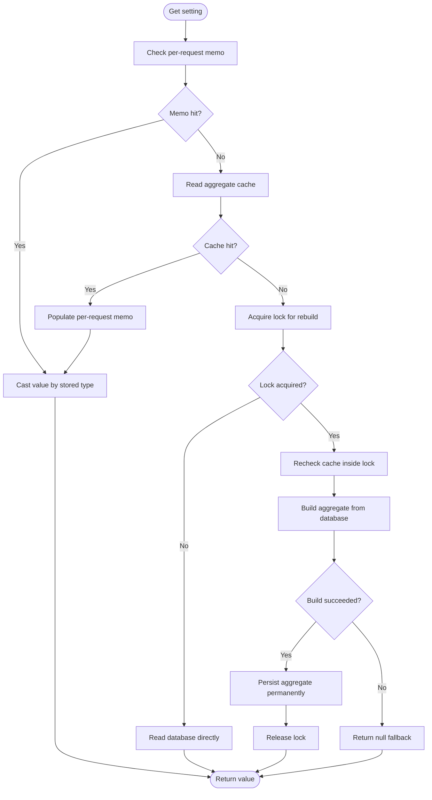
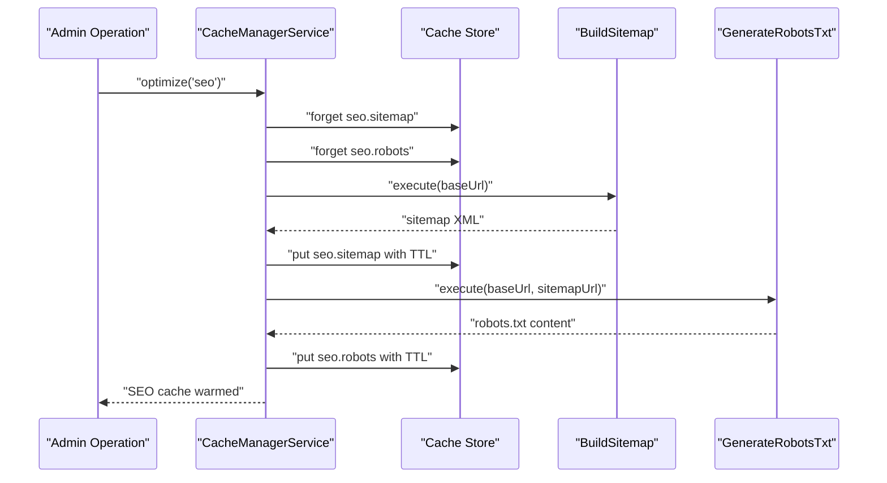
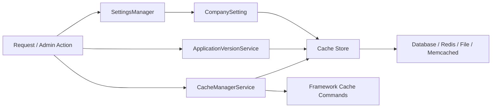
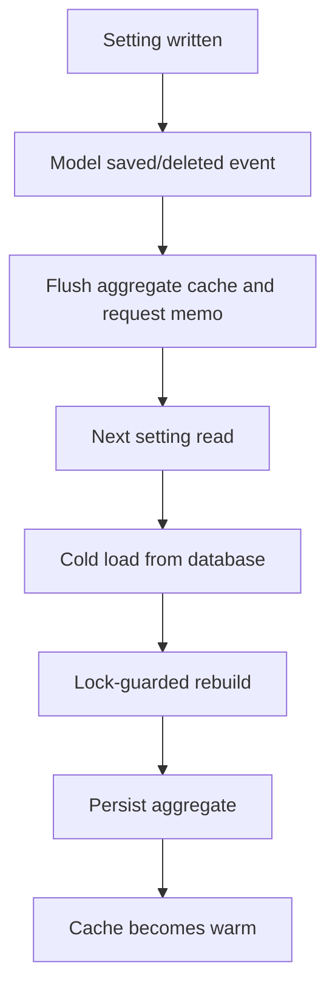
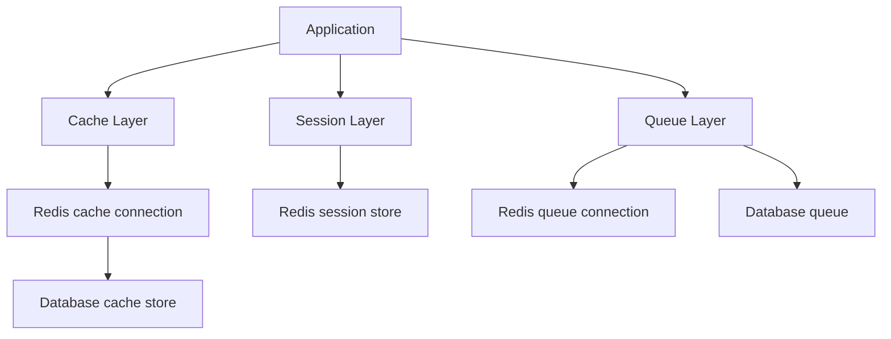
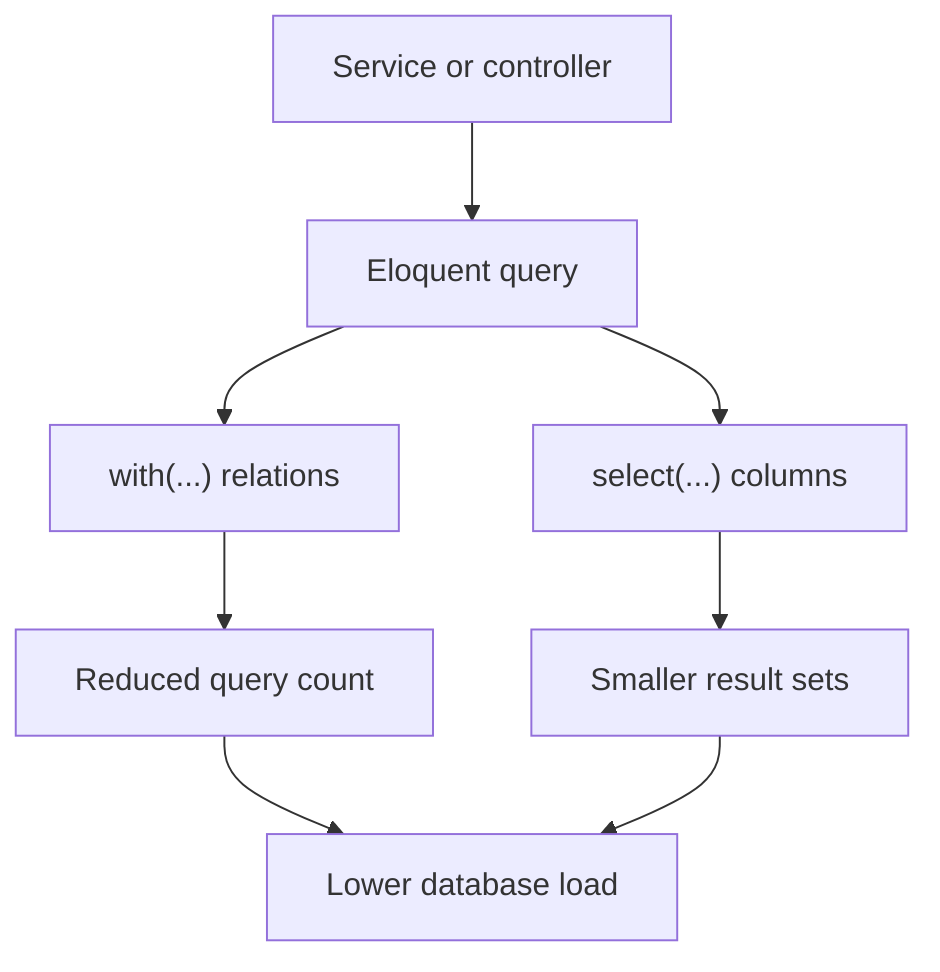
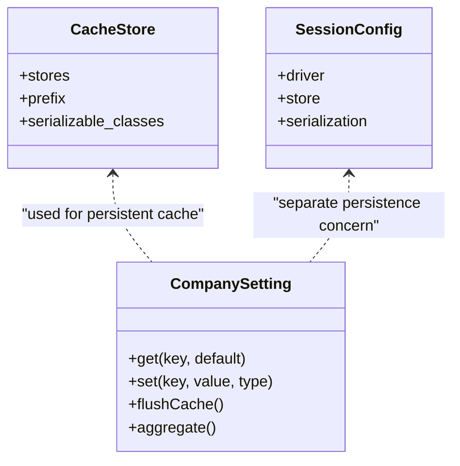
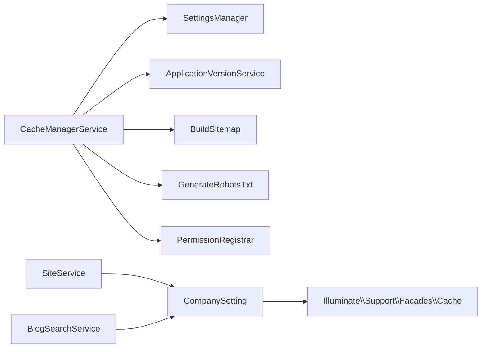

# Caching Strategies

<cite>
**Referenced Files in This Document**
- [CacheManagerService.php](file://app/Services/CacheManagerService.php)
- [cache.php](file://config/cache.php)
- [session.php](file://config/session.php)
- [queue.php](file://config/queue.php)
- [CompanySetting.php](file://app/Models/CompanySetting.php)
- [SettingsManager.php](file://app/Services/Settings/SettingsManager.php)
- [ApplicationVersionService.php](file://app/Services/ApplicationVersionService.php)
- [BuildSitemap.php](file://app/Actions/Seo/BuildSitemap.php)
- [GenerateRobotsTxt.php](file://app/Actions/Seo/GenerateRobotsTxt.php)
- [SiteService.php](file://app/Services/SiteService.php)
- [BlogSearchService.php](file://app/Services/BlogSearchService.php)
</cite>

## Table of Contents
1. [Introduction](#introduction)
2. [Project Structure](#project-structure)
3. [Core Components](#core-components)
4. [Architecture Overview](#architecture-overview)
5. [Detailed Component Analysis](#detailed-component-analysis)
6. [Dependency Analysis](#dependency-analysis)
7. [Performance Considerations](#performance-considerations)
8. [Troubleshooting Guide](#troubleshooting-guide)
9. [Conclusion](#conclusion)

## Introduction
This document explains how Highblossom caches data, why it is structured the way it is, and how to extend or troubleshoot its caching behavior. The application uses several complementary strategies:

- A centralized cache administration service for groups such as settings, SEO output, version information, framework caches, and general application cache.
- A per-request aggregate cache for company settings with lock-guarded rebuilds.
- Redis-backed configuration for the default cache store, sessions, and queues.
- Database query optimization through eager loading and selective column retrieval.
- Explicit TTL-based caching for generated SEO assets.

The goal is to reduce database load, avoid repeated expensive computations, and keep cache invalidation predictable without sacrificing correctness.

## Project Structure
The caching implementation spans configuration files, a dedicated cache management service, model-level caching, service classes, and action classes that generate cacheable content.

**Diagram sources**
- [cache.php:1-146](file://config/cache.php#L1-L146)
- [session.php:1-233](file://config/session.php#L1-L233)
- [queue.php:1-128](file://config/queue.php#L1-L128)
- [CacheManagerService.php:1-200](file://app/Services/CacheManagerService.php#L1-L200)
- [CompanySetting.php:1-196](file://app/Models/CompanySetting.php#L1-L196)
- [SettingsManager.php:1-163](file://app/Services/Settings/SettingsManager.php#L1-L163)
- [ApplicationVersionService.php:1-120](file://app/Services/ApplicationVersionService.php#L1-L120)
- [BuildSitemap.php:1-166](file://app/Actions/Seo/BuildSitemap.php#L1-L166)
- [GenerateRobotsTxt.php:1-70](file://app/Actions/Seo/GenerateRobotsTxt.php#L1-L70)
- [SiteService.php:1-360](file://app/Services/SiteService.php#L1-L360)
- [BlogSearchService.php:1-150](file://app/Services/BlogSearchService.php#L1-L150)

**Section sources**
- [cache.php:1-146](file://config/cache.php#L1-L146)
- [session.php:1-233](file://config/session.php#L1-L233)
- [queue.php:1-128](file://config/queue.php#L1-L128)

## Core Components

### CacheManagerService
`CacheManagerService` is the central administrative entry point for cache groups. It exposes:

- **Groups**: `settings`, `seo`, `versions`, `app`, and `framework`. Each group has a label, description, and whether it supports warm/rebuild operations.
- **Key validation**: User input selects only from an allowlisted set of group keys; raw cache keys are never accepted directly.
- **Clearing**: Group-specific clearing logic delegates to helpers such as settings flushing, SEO cache removal, version cache forgetting, framework cache clearing, and permission cache rebuilding.
- **Optimization/warming**: Group-specific warming actions trigger settings reload, SEO rebuild, version resolution, and framework cache compilation.
- **Statistics**: For non-database stores, entry counts and sizes are unavailable; for the database store, statistics are computed by querying the cache table with group-scoped filters. Framework statistics count compiled config, routes, events, and Blade views.

Important responsibilities:

| Responsibility | Implementation approach |
|---|---|
| Group registry | Fixed array returned by `groups()` |
| Key safety | `groupKeys()` and `optimizableGroupKeys()` restrict user selection |
| Settings invalidation | Flushes aggregate setting cache and legacy per-key entries |
| SEO invalidation | Removes sitemap and robots.txt entries |
| Version invalidation | Forgets the application-version cache key |
| Application cache invalidation | Calls `Cache::flush()` and rebuilds permissions |
| Framework invalidation | Clears and recompiles config, routes, events, and views |
| Statistics | Database queries for entry count and value length; file inspection for framework cache |

**Section sources**
- [CacheManagerService.php:1-200](file://app/Services/CacheManagerService.php#L1-L200)
- [CacheManagerService.php:201-328](file://app/Services/CacheManagerService.php#L201-L328)

### Company Setting Cache
Company settings use a two-layer strategy:

1. **Per-request memoization**: A container-bound instance holds the resolved key-to-value map for the current request. Multiple reads within one request do not repeat cache or database access.
2. **Persistent aggregate cache**: All settings are loaded into one cache entry keyed by `company_settings`. Writes trigger cache invalidation so subsequent reads rebuild from the database.

The persistent load path includes:

- Attempt to read from the cache store.
- Acquire a short-lived distributed lock when a cold rebuild is needed.
- Double-check the cache after acquiring the lock.
- Build the aggregate from the database.
- Persist the built result permanently unless the build fails.
- Fall back to direct database reads if another process holds the lock.
- Catch exceptions and fall back to the database so missing tables or cache stores do not break writes.

**Diagram sources**
- [CompanySetting.php:100-196](file://app/Models/CompanySetting.php#L100-L196)

**Section sources**
- [CompanySetting.php:1-196](file://app/Models/CompanySetting.php#L1-L196)
- [SettingsManager.php:1-163](file://app/Services/Settings/SettingsManager.php#L1-L163)

### Application Version Cache
The application version service defines a dedicated cache key and caches the current version identifier with a one-hour TTL. This reduces repeated version resolution work while still allowing updates to propagate relatively quickly.

**Section sources**
- [ApplicationVersionService.php:1-120](file://app/Services/ApplicationVersionService.php#L1-L120)

### SEO Output Cache
SEO output is cached explicitly rather than relying on automatic query caching:

- Sitemap XML is generated by `BuildSitemap` and stored under a fixed key.
- Robots.txt content is generated by `GenerateRobotsTxt` and stored under a separate key.
- TTLs come from the `seo.cache.sitemap_duration` and `seo.cache.robots_duration` configuration values.
- Clearing removes both keys.
- Warming clears then regenerates both outputs.

**Diagram sources**
- [CacheManagerService.php:250-328](file://app/Services/CacheManagerService.php#L250-L328)
- [BuildSitemap.php:1-166](file://app/Actions/Seo/BuildSitemap.php#L1-L166)
- [GenerateRobotsTxt.php:1-70](file://app/Actions/Seo/GenerateRobotsTxt.php#L1-L70)

**Section sources**
- [CacheManagerService.php:201-328](file://app/Services/CacheManagerService.php#L201-L328)
- [BuildSitemap.php:1-166](file://app/Actions/Seo/BuildSitemap.php#L1-L166)
- [GenerateRobotsTxt.php:1-70](file://app/Actions/Seo/GenerateRobotsTxt.php#L1-L70)

## Architecture Overview

**Diagram sources**
- [CacheManagerService.php:1-200](file://app/Services/CacheManagerService.php#L1-L200)
- [CompanySetting.php:100-196](file://app/Models/CompanySetting.php#L100-L196)
- [ApplicationVersionService.php:1-120](file://app/Services/ApplicationVersionService.php#L1-L120)
- [cache.php:1-146](file://config/cache.php#L1-L146)

The architecture separates concerns:

- **Administrative layer**: `CacheManagerService` manages groups, invalidation, warming, and statistics.
- **Domain caching layer**: `CompanySetting` and `ApplicationVersionService` encapsulate domain-specific cache behavior.
- **Content generation layer**: SEO actions produce cacheable payloads.
- **Infrastructure layer**: Laravel cache configuration determines the backend.

## Detailed Component Analysis

### Cache Key Generation
Highblossom avoids raw user-controlled cache keys at the administrative boundary:

- Cache groups are defined centrally and validated against allowed keys.
- Domain components define their own constants or explicit string keys:
  - Company settings use `company_settings`.
  - Application version uses a dedicated constant.
  - SEO uses explicit keys like `seo.sitemap` and `seo.robots`.
- Framework caches are managed through artisan commands rather than manual keys.

This design prevents accidental key collisions and makes invalidation predictable.

**Section sources**
- [CacheManagerService.php:1-120](file://app/Services/CacheManagerService.php#L1-L120)
- [CompanySetting.php:20-40](file://app/Models/CompanySetting.php#L20-L40)
- [ApplicationVersionService.php:10-25](file://app/Services/ApplicationVersionService.php#L10-L25)

### TTL Management
TTL policies vary by cache purpose:

| Cache target | TTL policy | Reasoning |
|---|---|---|
| Application version | One hour | Balances freshness with reduced version lookup cost |
| SEO sitemap | Configurable duration via `seo.cache.sitemap_duration` | Sitemaps change infrequently |
| SEO robots.txt | Configurable duration via `seo.cache.robots_duration` | Robots rules change less often than content |
| Company settings | Permanent until invalidation | Aggregate cache should survive until writes invalidate it |
| Framework caches | Manual warm/clear lifecycle | Framework artifacts are rebuilt during deployment or maintenance |

**Section sources**
- [ApplicationVersionService.php:40-50](file://app/Services/ApplicationVersionService.php#L40-L50)
- [CacheManagerService.php:260-328](file://app/Services/CacheManagerService.php#L260-L328)
- [CompanySetting.php:160-170](file://app/Models/CompanySetting.php#L160-L170)

### Cache Invalidation Patterns
Invalidation follows explicit, group-aware patterns:

- **Write-through invalidation**: `CompanySetting` flushes its aggregate cache on saved/deleted model events.
- **Aggregate invalidation**: Deleting one setting invalidates the entire settings map; the next read rebuilds it efficiently.
- **Group invalidation**: `CacheManagerService::clear()` dispatches to group-specific cleanup.
- **Cross-store awareness**: After `Cache::flush()`, Spatie permissions are rebuilt because they share the same store.
- **Legacy cleanup**: Settings clearing also sweeps legacy per-key entries left before the aggregate cache was introduced.

**Diagram sources**
- [CompanySetting.php:45-110](file://app/Models/CompanySetting.php#L45-L110)
- [CompanySetting.php:130-196](file://app/Models/CompanySetting.php#L130-L196)

**Section sources**
- [CacheManagerService.php:100-180](file://app/Services/CacheManagerService.php#L100-L180)
- [CompanySetting.php:40-110](file://app/Models/CompanySetting.php#L40-L110)

### Redis Configuration
The repository defines Redis support for multiple layers:

#### Default Cache Store
- The default cache store is configured via `CACHE_STORE`.
- The Redis cache store uses `REDIS_CACHE_CONNECTION` and optionally a separate lock connection.
- Keys are prefixed using `CACHE_PREFIX`, derived from the application name.
- Serializable classes include Eloquent collections, paginators, and selected models.

#### Session Storage
- The default session driver is `database`.
- When using cache-driven drivers, `SESSION_STORE` selects the cache store used between requests.
- Sessions use JSON serialization by default to reduce gadget-chain risk.
- Connection, table, cookie, security, and SameSite attributes are configurable.

#### Queue Backend
- The default queue connection is `database`.
- Redis queue connections use `REDIS_QUEUE_CONNECTION` and `REDIS_QUEUE`.
- Retry behavior, blocking behavior, and failed job storage are configurable.
- Job batching uses a configurable database and table.

**Diagram sources**
- [cache.php:1-146](file://config/cache.php#L1-L146)
- [session.php:1-233](file://config/session.php#L1-L233)
- [queue.php:1-128](file://config/queue.php#L1-L128)

**Section sources**
- [cache.php:1-146](file://config/cache.php#L1-L146)
- [session.php:1-233](file://config/session.php#L1-L233)
- [queue.php:1-128](file://config/queue.php#L1-L128)

### Database Query Caching Techniques

#### Query Cache vs Service-Level Cache
The project does not appear to enable global Laravel query cache globally. Instead, it favors:

- Explicit service-level caching for expensive or frequently accessed data.
- Aggregate caching for settings.
- TTL-based caching for generated content.
- Database query optimization through eager loading and selective columns.

This approach gives more control over invalidation and avoids accidentally caching stale or overly broad results.

#### Eager Loading to Prevent N+1 Queries
Eager loading appears consistently across site-facing services:

- `SiteService` eagerly loads relationships such as categories, subcategories, authors, tags, and inspections.
- `BlogSearchService` eagerly loads categories alongside blog posts.

This pattern reduces N+1 query problems when rendering lists or detail pages.

#### Strategic `select()` Usage
`BlogSearchService` demonstrates targeted column selection by selecting only fields required for search results and related category identifiers. This reduces payload size and memory pressure compared to loading full Eloquent models.

**Diagram sources**
- [SiteService.php:280-360](file://app/Services/SiteService.php#L280-L360)
- [BlogSearchService.php:55-100](file://app/Services/BlogSearchService.php#L55-L100)

**Section sources**
- [SiteService.php:280-360](file://app/Services/SiteService.php#L280-L360)
- [BlogSearchService.php:55-100](file://app/Services/BlogSearchService.php#L55-L100)

### Practical Caching Examples

#### Expensive Service Calls
Use a service method wrapped around a cache lookup:

1. Generate a stable cache key from immutable inputs.
2. Attempt a cache read.
3. If missing, compute the result.
4. Store the result with a TTL appropriate to the data’s volatility.
5. Invalidate or update the key when inputs change.

For example, this pattern applies to generated SEO assets where the TTL comes from configuration.

#### API Responses
When caching API responses:

- Include all request parameters that affect the response in the cache key.
- Use short TTLs for volatile data and longer TTLs for reference data.
- Prefer partial invalidation when possible.
- Avoid caching authenticated or user-scoped data under shared keys unless scoped by user identity.

#### Computed Values
Computed values should be cached only when recomputation is costly and the value changes infrequently. The application version service is a good example: it caches a numeric identifier for one hour instead of recomputing it on every request.

**Section sources**
- [ApplicationVersionService.php:40-50](file://app/Services/ApplicationVersionService.php#L40-L50)
- [CacheManagerService.php:260-328](file://app/Services/CacheManagerService.php#L260-L328)

### Cache Warming Strategies
Warming is exposed through `CacheManagerService::optimize()` and `optimizeAll()`:

- Settings warming calls `SettingsManager::all()`, which builds and caches the aggregate.
- SEO warming rebuilds sitemap and robots.txt.
- Version warming resolves and caches the current version.
- Framework warming compiles config, routes, events, and views.

Recommended warmers:

| Scenario | Recommended action |
|---|---|
| Deployment | Warm settings, versions, SEO, and framework caches |
| Content publish | Invalidate relevant SEO or content groups |
| Settings update | Rely on write-triggered invalidation and optional admin warm |
| Cache store migration | Run `optimizeAll()` after store is available |

**Section sources**
- [CacheManagerService.php:120-180](file://app/Services/CacheManagerService.php#L120-L180)

### Cache Penetration Prevention
Penetration occurs when many requests repeatedly miss the cache for nonexistent or invalid keys. Mitigations present or recommended:

- Existing protections:
  - Group keys are allowlisted, preventing arbitrary cache targets.
  - Company setting reads fail gracefully to defaults or direct database reads when cache is unavailable.
  - Cache misses during rebuild are guarded by a distributed lock.
- Recommended additions:
  - Add short-lived negative caches for invalid API parameters.
  - Rate-limit unauthenticated cache-miss-heavy endpoints.
  - Validate and normalize cache keys before use.
  - Monitor cache miss rates and database query spikes.

**Section sources**
- [CacheManagerService.php:1-120](file://app/Services/CacheManagerService.php#L1-L120)
- [CompanySetting.php:130-196](file://app/Models/CompanySetting.php#L130-L196)

### Distributed Cache Considerations
For multi-server deployments:

- Use a shared backend such as Redis rather than the file store.
- Ensure consistent Redis connections across web, queue, and session layers.
- Keep cache prefixes unique per environment to avoid cross-environment collisions.
- Use distributed locks for rebuild paths, as implemented by the settings aggregate.
- Separate cache and queue Redis connections if traffic patterns differ.
- Monitor eviction policies, memory limits, and connection pools.

**Section sources**
- [cache.php:1-146](file://config/cache.php#L1-L146)
- [session.php:1-233](file://config/session.php#L1-L233)
- [queue.php:1-128](file://config/queue.php#L1-L128)
- [CompanySetting.php:140-170](file://app/Models/CompanySetting.php#L140-L170)

### Serialization Formats
Serialization behavior differs by component:

- Cache store serialization is controlled by the `serializable_classes` list. Only explicitly listed classes can be unserialized from cache, reducing gadget-chain risks.
- Session serialization defaults to JSON.
- Company settings store values as text with a type hint and cast them on read to boolean, number, JSON, or string.

**Diagram sources**
- [cache.php:1-146](file://config/cache.php#L1-L146)
- [session.php:190-233](file://config/session.php#L190-L233)
- [CompanySetting.php:1-120](file://app/Models/CompanySetting.php#L1-L120)

**Section sources**
- [cache.php:100-146](file://config/cache.php#L100-L146)
- [session.php:190-233](file://config/session.php#L190-L233)
- [CompanySetting.php:1-120](file://app/Models/CompanySetting.php#L1-L120)

### Compression Options
The configuration does not enable compression at the cache layer. Compression decisions should consider:

- CPU overhead versus bandwidth savings.
- Whether the backend supports compressed storage natively.
- Whether large serialized objects would benefit from compression.
- Whether the chosen backend already compresses data automatically.

If compression is added later, prefer a dedicated cache store option or a wrapper that compresses only large payloads.

[No sources needed since this section provides general guidance]

### Memory Usage Monitoring
Memory usage should be monitored at multiple levels:

- **Cache store metrics**: Redis memory, eviction stats, and key counts.
- **Database cache store**: Entry count and value size are partially exposed through `CacheManagerService::stats()`.
- **Framework cache**: Compiled files and view cache sizes are inspected by the framework statistics helper.
- **Application memory**: Large eager-loaded datasets or serialized models should be profiled under realistic load.

**Section sources**
- [CacheManagerService.php:201-250](file://app/Services/CacheManagerService.php#L201-L250)

## Dependency Analysis

**Diagram sources**
- [CacheManagerService.php:1-200](file://app/Services/CacheManagerService.php#L1-L200)
- [CompanySetting.php:1-120](file://app/Models/CompanySetting.php#L1-L120)
- [SiteService.php:280-360](file://app/Services/SiteService.php#L280-L360)
- [BlogSearchService.php:55-100](file://app/Services/BlogSearchService.php#L55-L100)

Coupling observations:

- `CacheManagerService` depends on external services but isolates cache operations behind a small public surface.
- `CompanySetting` couples cache access tightly to model lifecycle events, ensuring consistency.
- Site services depend on settings caching indirectly through `SettingsManager` and `CompanySetting`.
- No circular dependency is visible among the core caching components.

**Section sources**
- [CacheManagerService.php:1-200](file://app/Services/CacheManagerService.php#L1-L200)
- [CompanySetting.php:1-196](file://app/Models/CompanySetting.php#L1-L196)

## Performance Considerations

- Prefer aggregate caches for read-heavy reference data, as seen with company settings.
- Use TTLs for generated content where staleness is acceptable.
- Avoid global query caching unless you understand invalidation requirements.
- Use eager loading to eliminate N+1 queries.
- Select only required columns when building lists.
- Warm caches after deployment rather than relying on first-request cold starts.
- Monitor database cache store growth and framework cache file sizes.
- Test cache behavior under concurrent writes to ensure locks and rebuild paths behave correctly.

[No sources needed since this section provides general guidance]

## Troubleshooting Guide

### Settings Appear Stale
Likely causes:

- Cache store is unavailable.
- Legacy per-key entries remain after switching to aggregate caching.
- Permission cache was flushed but not rebuilt.

Resolution steps:

1. Verify the cache store is reachable.
2. Clear the settings group through the cache manager.
3. Warm settings by calling the settings resolver.
4. Rebuild framework and permission caches if necessary.

**Section sources**
- [CacheManagerService.php:100-180](file://app/Services/CacheManagerService.php#L100-L180)
- [CompanySetting.php:100-170](file://app/Models/CompanySetting.php#L100-L170)

### SEO Assets Are Missing
Likely causes:

- SEO cache was cleared.
- Sitemap or robots TTL expired.
- URL configuration changed.

Resolution steps:

1. Warm the SEO group.
2. Confirm `seo.cache.sitemap_duration` and `seo.cache.robots_duration` have expected values.
3. Regenerate sitemap and robots content.

**Section sources**
- [CacheManagerService.php:260-328](file://app/Services/CacheManagerService.php#L260-L328)
- [BuildSitemap.php:1-166](file://app/Actions/Seo/BuildSitemap.php#L1-L166)
- [GenerateRobotsTxt.php:1-70](file://app/Actions/Seo/GenerateRobotsTxt.php#L1-L70)

### High Database Load Despite Caching
Likely causes:

- Missing eager loading on list queries.
- Overuse of `get()` without column selection.
- Cache misses caused by unstable keys.
- Database cache store being the bottleneck.

Resolution steps:

1. Audit list queries for eager loading.
2. Replace wide model loads with `select()` where possible.
3. Switch to Redis for shared cache and session storage in multi-server environments.
4. Monitor cache hit ratios and slow queries.

**Section sources**
- [SiteService.php:280-360](file://app/Services/SiteService.php#L280-L360)
- [BlogSearchService.php:55-100](file://app/Services/BlogSearchService.php#L55-L100)
- [cache.php:1-146](file://config/cache.php#L1-L146)

### Cache Store Fails During First Boot
Likely causes:

- Cache table missing.
- Redis not yet available.
- Migration running while cache is accessed.

Behavior in code:

- Company settings catch exceptions during cache and database access and fall back to direct database reads.
- Failed builds are not persisted, so retries occur on subsequent requests.

**Section sources**
- [CompanySetting.php:140-196](file://app/Models/CompanySetting.php#L140-L196)

## Conclusion
Highblossom’s caching strategy combines explicit group management, aggregate model caching, TTL-based generated content caching, and query optimization. The most important design principles are:

- Keep cache keys stable and validated.
- Invalidate aggressively enough to stay correct, but not so much that caching loses value.
- Prefer aggregate caches for small, frequently read reference data.
- Use TTLs for generated outputs.
- Optimize database queries independently of cache layers.
- Configure Redis carefully for shared, distributed environments.
- Measure performance with real-world cache states and workload patterns.