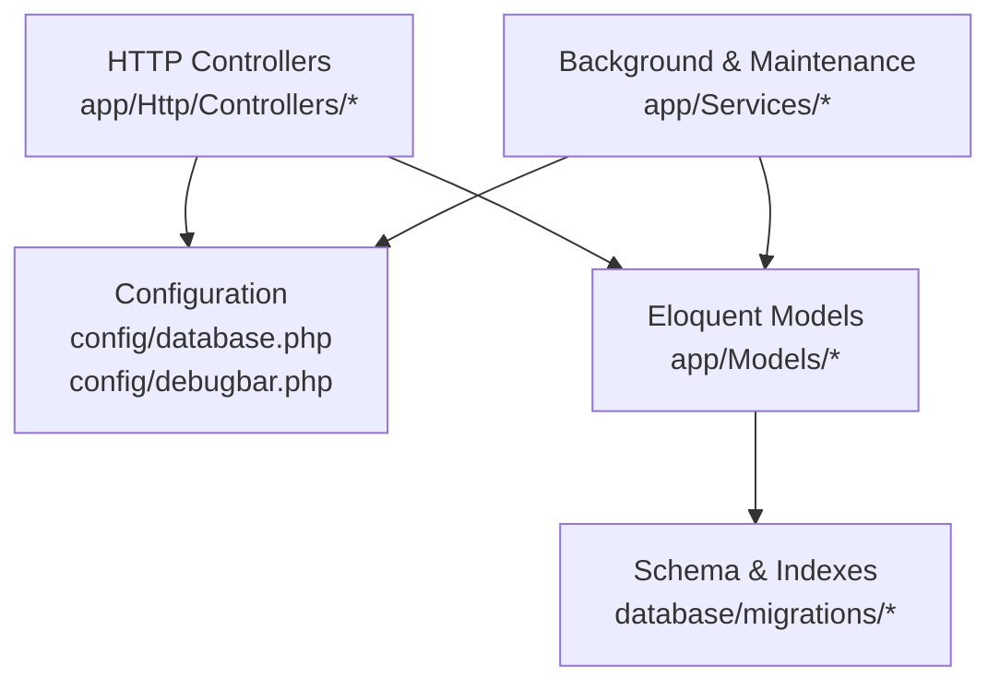
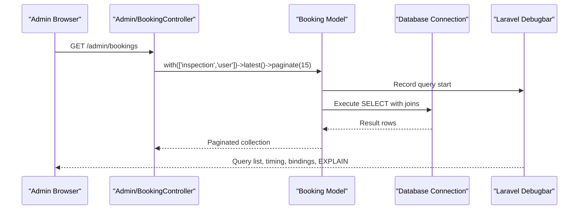
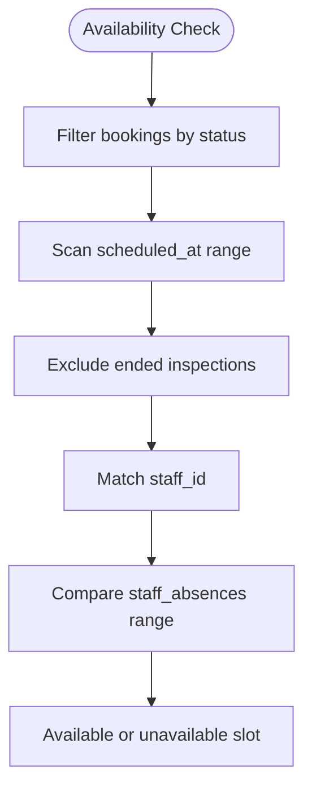
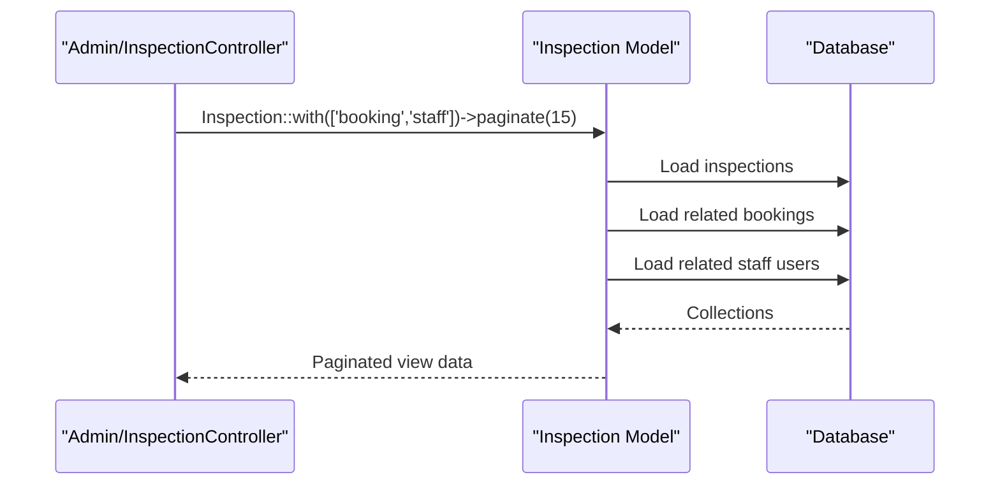
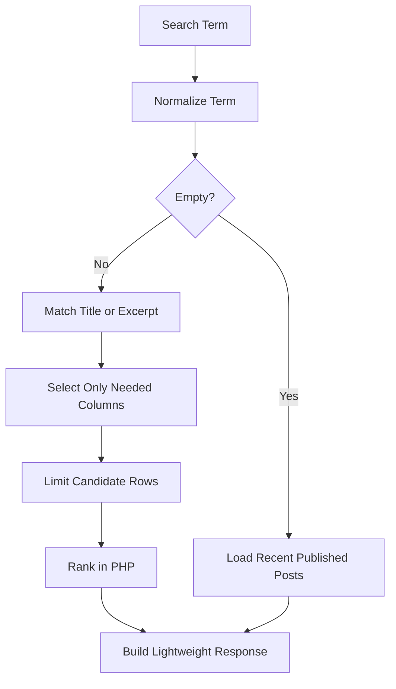
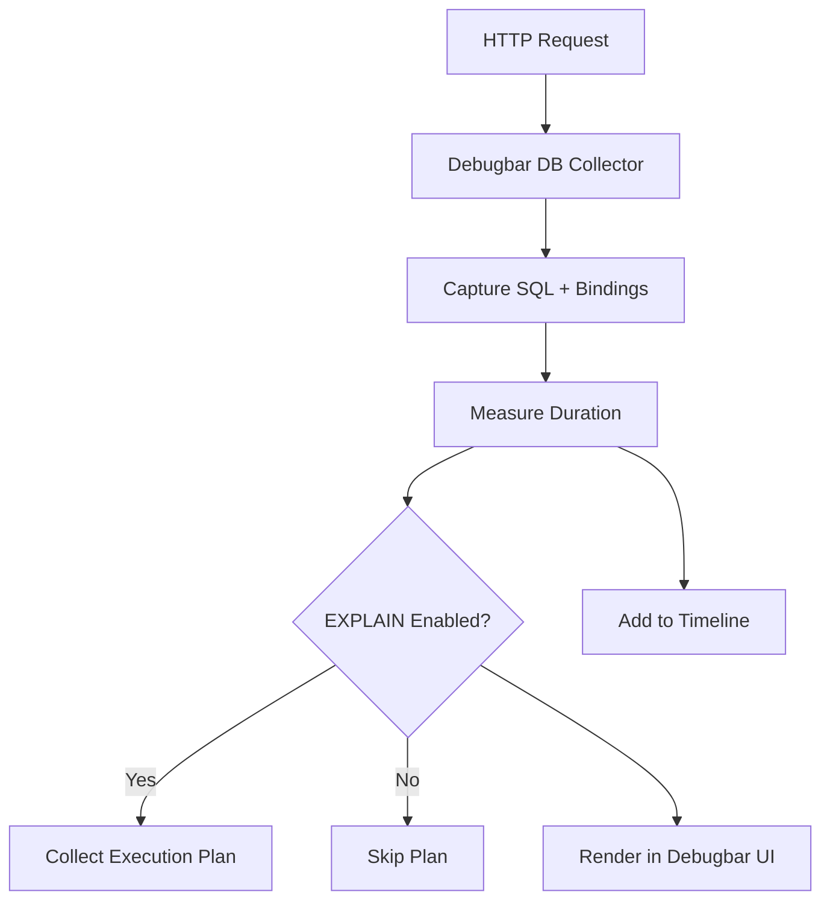
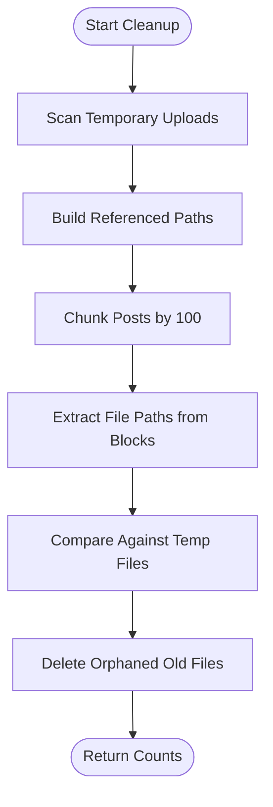
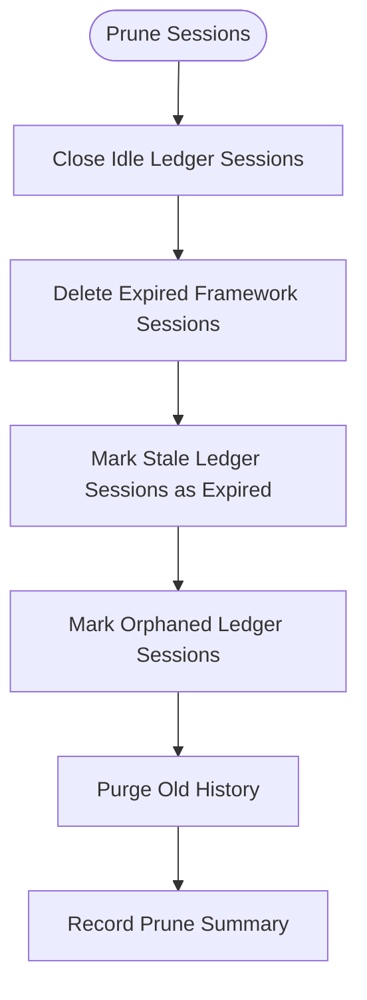
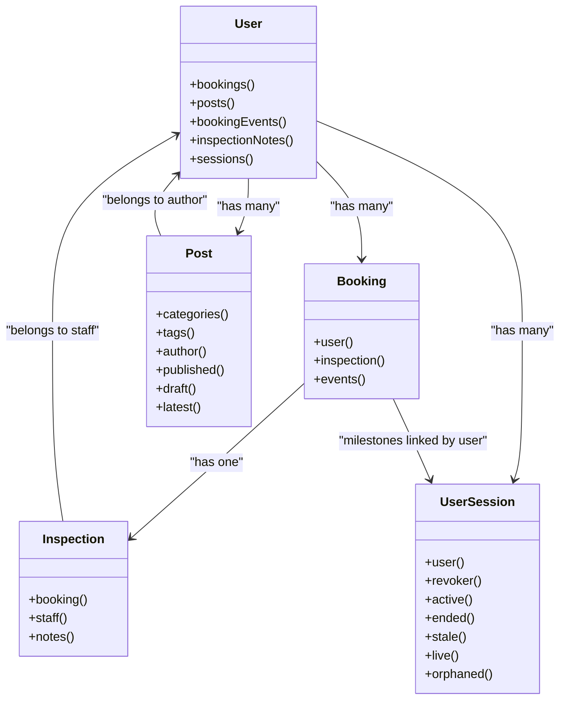

# Database Optimization

<cite>
**Referenced Files in This Document**   
- [database.php](file://config/database.php)
- [debugbar.php](file://config/debugbar.php)
- [2026_04_17_093356_create_bookings_table.php](file://database/migrations/2026_04_17_093356_create_bookings_table.php)
- [2026_04_17_093358_create_inspections_table.php](file://database/migrations/2026_04_17_093358_create_inspections_table.php)
- [2026_04_17_093357_create_staff_absences_table.php](file://database/migrations/2026_04_17_093357_create_staff_absences_table.php)
- [2026_04_17_110000_create_company_settings_table.php](file://database/migrations/2026_04_17_110000_create_company_settings_table.php)
- [2026_04_17_110002_create_services_table.php](file://database/migrations/2026_04_17_110002_create_services_table.php)
- [2026_04_17_110003_create_gallery_images_table.php](file://database/migrations/2026_04_17_110003_create_gallery_images_table.php)
- [2026_04_17_150001_create_seo_static_routes_table.php](file://database/migrations/2026_04_17_150001_create_seo_static_routes_table.php)
- [2026_04_22_152139_create_post_category_table.php](file://database/migrations/2026_04_22_152139_create_post_category_table.php)
- [2026_04_22_152142_create_post_tag_table.php](file://database/migrations/2026_04_22_152142_create_post_tag_table.php)
- [2026_07_07_000001_add_unique_index_to_bookings_scheduled_at.php](file://database/migrations/2026_07_07_000001_add_unique_index_to_bookings_scheduled_at.php)
- [2026_10_01_000000_replace_unique_index_on_bookings_scheduled_at.php](file://database/migrations/2026_10_01_000000_replace_unique_index_on_bookings_scheduled_at.php)
- [2026_10_01_150000_create_booking_events_table.php](file://database/migrations/2026_10_01_150000_create_booking_events_table.php)
- [2026_10_01_150100_create_inspection_notes_table.php](file://database/migrations/2026_10_01_150100_create_inspection_notes_table.php)
- [2026_10_01_150300_add_previous_scheduled_at_to_booking_events_table.php](file://database/migrations/2026_10_01_150300_add_previous_scheduled_at_to_booking_events_table.php)
- [2026_10_03_130000_create_user_sessions_table.php](file://database/migrations/2026_10_03_130000_create_user_sessions_table.php)
- [2026_10_20_000000_create_password_policy_audits_table.php](file://database/migrations/2026_10_20_000000_create_password_policy_audits_table.php)
- [Booking.php](file://app/Models/Booking.php)
- [Inspection.php](file://app/Models/Inspection.php)
- [User.php](file://app/Models/User.php)
- [Post.php](file://app/Models/Post.php)
- [Service.php](file://app/Models/Service.php)
- [GalleryImage.php](file://app/Models/GalleryImage.php)
- [ContactMessage.php](file://app/Models/ContactMessage.php)
- [UserSession.php](file://app/Models/UserSession.php)
- [Admin/BookingController.php](file://app/Http/Controllers/Admin/BookingController.php)
- [Admin/InspectionController.php](file://app/Http/Controllers/Admin/InspectionController.php)
- [Admin/PostController.php](file://app/Http/Controllers/Admin/PostController.php)
- [BlogSearchService.php](file://app/Services/BlogSearchService.php)
- [ContentBlockCleanupService.php](file://app/Services/Content/ContentBlockCleanupService.php)
- [SessionManager.php](file://app/Services/SessionManager.php)
</cite>

## Table of Contents
1. [Introduction](#introduction)
2. [Project Structure](#project-structure)
3. [Core Components](#core-components)
4. [Architecture Overview](#architecture-overview)
5. [Detailed Component Analysis](#detailed-component-analysis)
6. [Dependency Analysis](#dependency-analysis)
7. [Performance Considerations](#performance-considerations)
8. [Troubleshooting Guide](#troubleshooting-guide)
9. [Conclusion](#conclusion)

## Introduction
This document explains how Highblossom’s database layer is designed and optimized for performance, correctness, and maintainability. It covers indexing strategies visible in the migrations, Eloquent query patterns used by controllers and services, profiling configuration through Laravel Debugbar, batch processing for large datasets, connection configuration, migration practices, and schema design principles such as normalization, selective denormalization, and partitioning considerations.

The goal is to help developers identify where queries run, why indexes exist, how relationships are loaded, and what can be tuned when a page or background job becomes slow.

## Project Structure
Highblossom follows a conventional Laravel layout:

- Configuration lives under `config/`.
- Schema definitions live under `database/migrations/`.
- Eloquent models live under `app/Models/`.
- HTTP entry points live under `app/Http/Controllers/`.
- Background and maintenance logic lives under `app/Services/`.

**Diagram sources**
- [database.php:1-184](file://config/database.php#L1-L184)
- [debugbar.php:1-200](file://config/debugbar.php#L1-L200)
- [2026_04_17_093356_create_bookings_table.php:1-36](file://database/migrations/2026_04_17_093356_create_bookings_table.php#L1-L36)
- [Booking.php:1-134](file://app/Models/Booking.php#L1-L134)
- [Admin/BookingController.php:1-103](file://app/Http/Controllers/Admin/BookingController.php#L1-L103)
- [SessionManager.php:1-200](file://app/Services/SessionManager.php#L1-L200)

**Section sources**
- [database.php:1-184](file://config/database.php#L1-L184)
- [debugbar.php:1-200](file://config/debugbar.php#L1-L200)

## Core Components
The database optimization surface area in Highblossom consists of five areas:

1. **Index strategy**: Composite indexes on time ranges and foreign keys; unique constraints for identity fields; secondary indexes for filtering and ordering.
2. **Eloquent query style**: Explicit eager loading with `with()`, targeted relationship loading with `load()` or `loadMissing()`, scoped queries, and explicit column selection.
3. **Query profiling**: Debugbar collectors for database queries, bindings, execution time, EXPLAIN output, and slow-query thresholds.
4. **Batch processing**: Chunked iteration over posts and session cleanup, transactional batches, and bounded candidate sets.
5. **Connection and lifecycle management**: MySQL/MariaDB/PostgreSQL connections, Redis-backed cache and queue clients, and durable session ledger tables.

**Section sources**
- [2026_04_17_093356_create_bookings_table.php:1-36](file://database/migrations/2026_04_17_093356_create_bookings_table.php#L1-L36)
- [2026_10_01_150000_create_booking_events_table.php:1-44](file://database/migrations/2026_10_01_150000_create_booking_events_table.php#L1-L44)
- [Admin/BookingController.php:1-103](file://app/Http/Controllers/Admin/BookingController.php#L1-L103)
- [debugbar.php:1-200](file://config/debugbar.php#L1-L200)
- [ContentBlockCleanupService.php:150-200](file://app/Services/Content/ContentBlockCleanupService.php#L150-L200)
- [SessionManager.php:1-200](file://app/Services/SessionManager.php#L1-L200)

## Architecture Overview
At runtime, an admin request flows from a controller into an Eloquent model, which resolves its table definition from migrations and executes SQL through the configured database connection. Debugbar records each query while the application is being profiled.

**Diagram sources**
- [Admin/BookingController.php:17-35](file://app/Http/Controllers/Admin/BookingController.php#L17-L35)
- [Booking.php:1-134](file://app/Models/Booking.php#L1-L134)
- [database.php:35-70](file://config/database.php#L35-L70)
- [debugbar.php:15-120](file://config/debugbar.php#L15-L120)

## Detailed Component Analysis

### Indexing Strategy

#### Composite Indexes for Availability and Dashboard Queries
Several migrations define composite indexes that directly support common dashboard and scheduling queries:

| Table | Index Pattern | Purpose |
|---|---:|---|
| `bookings` | `status`, `created_at` | Filters bookings by status and orders recent records for listing pages. |
| `inspections` | `scheduled_at`, `ended_at`, `staff_id` | Supports availability checks and staff schedule scans. |
| `staff_absences` | `starts_at`, `ends_at`, `staff_id` | Supports absence overlap checks against scheduled inspections. |
| `booking_events` | `booking_id`, `happened_at` | Loads customer-facing timeline events per booking. |
| `inspection_notes` | `inspection_id`, `created_at` | Loads internal notes per inspection. |
| `user_sessions` | `user_id`, `ended_at` and `user_id`, `last_seen_at` | Supports user session history and idle/expired scans. |

These indexes are not generic single-column indices; they are ordered around the leading columns most likely to appear together in `WHERE` clauses and `ORDER BY` clauses.

**Diagram sources**
- [2026_04_17_093358_create_inspections_table.php:12-25](file://database/migrations/2026_04_17_093358_create_inspections_table.php#L12-L25)
- [2026_04_17_093357_create_staff_absences_table.php:12-23](file://database/migrations/2026_04_17_093357_create_staff_absences_table.php#L12-L23)
- [2026_04_17_093356_create_bookings_table.php:12-26](file://database/migrations/2026_04_17_093356_create_bookings_table.php#L12-L26)

#### Unique Constraints vs Selective Uniqueness
The project demonstrates careful evolution of uniqueness semantics:

- `users.email` is unique.
- `services.slug`, `posts.slug`, `categories.slug`, `tags.slug`, and similar lookup fields use unique constraints.
- `company_settings.key` is unique for key-value settings.
- `seo_static_routes.route_name` is unique.
- `user_sessions.session_id` is unique.
- `password_policy_audits.created_at` has an index but no uniqueness requirement.
- The original unique constraint on `bookings.scheduled_at` was replaced by a plain index because the business rule moved from “one booking per time slot” at the schema level to “SELECT ... FOR UPDATE gap locking inside a transaction.”

This shows that uniqueness should only be enforced at the database level when it represents a permanent data invariant. When concurrency control is handled in application transactions, a plain index may be more appropriate.

**Section sources**
- [2026_04_17_093356_create_bookings_table.php:12-26](file://database/migrations/2026_04_17_093356_create_bookings_table.php#L12-L26)
- [2026_04_17_110000_create_company_settings_table.php:10-20](file://database/migrations/2026_04_17_110000_create_company_settings_table.php#L10-L20)
- [2026_04_17_150001_create_seo_static_routes_table.php:10-35](file://database/migrations/2026_04_17_150001_create_seo_static_routes_table.php#L10-L35)
- [2026_10_01_000000_replace_unique_index_on_bookings_scheduled_at.php:1-46](file://database/migrations/2026_10_01_000000_replace_unique_index_on_bookings_scheduled_at.php#L1-L46)
- [2026_10_03_130000_create_user_sessions_table.php:40-57](file://database/migrations/2026_10_03_130000_create_user_sessions_table.php#L40-L57)
- [2026_10_20_000000_create_password_policy_audits_table.php:14-24](file://database/migrations/2026_10_20_000000_create_password_policy_audits_table.php#L14-L24)

#### Covering Index Considerations
The codebase does not explicitly create covering indexes using framework syntax, but several queries demonstrate the principle:

- Blog search selects only the columns needed for the palette response rather than fetching full JSON content blocks.
- Gallery image queries use scopes and explicit relations instead of loading unnecessary attributes.
- Session metrics use aggregated raw SQL instead of loading every framework session row.

Where high-frequency read paths select a small fixed set of columns, adding a covering index on those columns can avoid table lookups after the index scan.

**Section sources**
- [BlogSearchService.php:45-95](file://app/Services/BlogSearchService.php#L45-L95)
- [BlogSearchService.php:97-140](file://app/Services/BlogSearchService.php#L97-L140)
- [SessionManager.php:60-115](file://app/Services/SessionManager.php#L60-L115)

### Eloquent ORM Optimization

#### Eager Loading with `with()`
Controllers consistently use eager loading to prevent N+1 queries:

- Admin bookings list eagerly loads `inspection` and `user`.
- Inspection list eagerly loads `booking` and `staff`.
- Post list eagerly loads `author`, `categories`, and `tags`.
- API endpoints eagerly load related entities such as inspections, glass types, service types, and subcategories.

This pattern ensures one initial query retrieves parent rows and additional queries retrieve related collections, rather than issuing a query per row.

**Diagram sources**
- [Admin/InspectionController.php:22-33](file://app/Http/Controllers/Admin/InspectionController.php#L22-L33)
- [Inspection.php:44-66](file://app/Models/Inspection.php#L44-L66)

#### Targeted Relationship Loading
Single-resource views use `load()` to fetch only the relationships required for that page:

- Booking show loads `user`, `inspection.staff`, `inspection.notes.author`, and `events.actor`.
- Inspection show loads `booking`, `staff`, and `notes.author`.
- Post edit uses `load('categories', 'tags')`.

This avoids loading unrelated associations such as all post tags when editing a single post.

**Section sources**
- [Admin/BookingController.php:37-45](file://app/Http/Controllers/Admin/BookingController.php#L37-L45)
- [Admin/InspectionController.php:39-52](file://app/Http/Controllers/Admin/InspectionController.php#L39-L52)
- [Admin/PostController.php:56-64](file://app/Http/Controllers/Admin/PostController.php#L56-L64)

#### Column Selection and Lightweight Responses
Blog search deliberately limits returned columns to what the command palette needs. This reduces payload size and avoids loading heavy JSON block trees from `posts.content`.

**Diagram sources**
- [BlogSearchService.php:20-44](file://app/Services/BlogSearchService.php#L20-L44)
- [BlogSearchService.php:45-95](file://app/Services/BlogSearchService.php#L45-L95)

**Section sources**
- [BlogSearchService.php:45-95](file://app/Services/BlogSearchService.php#L45-L95)

#### Lazy Loading Prevention
The repository favors:

- `with()` in list queries.
- `load()` for detail pages.
- Scoped queries such as `scopePublished`, `scopeActive`, `scopeOrdered`, `scopeLive`, `scopeEnded`, and `scopeOrphaned`.
- Raw aggregation for session statistics instead of loading many rows.

A potential concern is the use of `User::all()` in the inspection show method to populate staff members. If the user table grows large, this should be paginated or filtered.

**Section sources**
- [Admin/InspectionController.php:47-52](file://app/Http/Controllers/Admin/InspectionController.php#L47-L52)
- [Post.php:120-180](file://app/Models/Post.php#L120-L180)
- [UserSession.php:70-180](file://app/Models/UserSession.php#L70-L180)

### Query Profiling and Slow Query Analysis

#### Laravel Debugbar Configuration
Debugbar is enabled conditionally and collects database activity by default. Relevant options include:

- `collectors.db` enables PDO query collection.
- `options.db.with_params` includes parameter substitution.
- `options.db.backtrace` captures file locations for each query.
- `options.db.explain.enabled` can generate EXPLAIN output.
- `options.db.only_slow_queries` can limit collection to slow queries.
- `options.db.slow_threshold` defines the millisecond threshold for highlighting slow queries.
- `options.db.show_query_result` can optionally display selected query results.

**Diagram sources**
- [debugbar.php:15-120](file://config/debugbar.php#L15-L120)

**Section sources**
- [debugbar.php:15-120](file://config/debugbar.php#L15-L120)

#### Slow Query Logging Outside Debugbar
For production analysis, the following approaches complement Debugbar:

- Enable the database engine’s slow query log so queries exceeding a server-side threshold are persisted.
- Use Debugbar’s slow-query threshold during development and staging.
- Correlate slow queries with backtrace information to locate controller, service, or model code.
- Review EXPLAIN output for full-table scans, missing indexes, or inefficient joins.

[No sources needed since this section provides general guidance]

### Batch Processing and Large Dataset Handling

#### Chunked Post Cleanup
The content block cleanup service reads posts in chunks of 100 to collect referenced file paths. This prevents loading every post into memory and avoids long-running database locks.

**Diagram sources**
- [ContentBlockCleanupService.php:150-200](file://app/Services/Content/ContentBlockCleanupService.php#L150-L200)

#### Session Pruning in Batches
`SessionManager::prune` processes sessions in bounded batches:

- Idle sessions are closed before expired sessions.
- Framework session rows are deleted independently.
- Open ledger rows become orphaned if their framework session row disappears.
- Each batch runs in its own transaction to avoid holding long locks.
- A constant `CHUNK = 500` controls statement-level batching.

**Diagram sources**
- [SessionManager.php:115-200](file://app/Services/SessionManager.php#L115-L200)
- [SessionManager.php:1-60](file://app/Services/SessionManager.php#L1-L60)

**Section sources**
- [ContentBlockCleanupService.php:150-200](file://app/Services/Content/ContentBlockCleanupService.php#L150-L200)
- [SessionManager.php:1-200](file://app/Services/SessionManager.php#L1-L200)

### Database Connection Pooling and Lifecycle Management

#### Connection Configuration
The database configuration supports multiple drivers:

- Default driver is MySQL via environment variables.
- MariaDB and PostgreSQL drivers are available.
- SQLite, SQL Server, and Redis configurations are present.
- SSL CA options are supported for MySQL.
- Redis persistent connections and retry/backoff behavior are configurable.

There is no custom connection pooler wrapper in the application code; pooling is delegated to the underlying PDO/driver stack and infrastructure.

#### Read/Write Splitting
The current configuration does not define separate `read` and `write` connections. For future scaling:

- Define a primary write connection.
- Define one or more read replica connections.
- Route writes to the primary and reads to replicas.
- Ensure replication lag is considered when reading immediately after writes.

[No sources needed since this section provides general guidance]

#### Connection Lifecycle
Key lifecycle responsibilities are split across layers:

- Laravel manages default connections and query builders.
- `UserSession` correlates ledger rows with framework sessions.
- `SessionManager` performs periodic reconciliation and pruning.
- Redis is used for caching, queue client configuration, and optional session storage.

**Section sources**
- [database.php:1-184](file://config/database.php#L1-L184)
- [UserSession.php:1-180](file://app/Models/UserSession.php#L1-L180)
- [SessionManager.php:1-200](file://app/Services/SessionManager.php#L1-L200)

### Migration Performance and Bulk Operations

#### Migration Design Principles
Migrations in Highblossom follow these patterns:

- Foreign keys reference primary keys with cascade or null-on-delete semantics.
- Frequently filtered columns have explicit indexes.
- Composite indexes match query order.
- Lookup columns such as slugs and keys use unique constraints.
- Audit and event tables append rows and index timestamps for historical queries.

#### Bulk Update Patterns
Bulk operations appear in the admin post controller:

- Multiple posts are updated by loading them with necessary relations.
- Validation filters out incomplete posts before publishing.
- Status changes are applied through a service layer.

For very large bulk updates, prefer native bulk update methods where safe and testable, then wrap idempotent operations in transactions.

**Section sources**
- [Admin/PostController.php:110-150](file://app/Http/Controllers/Admin/PostController.php#L110-L150)
- [2026_04_22_152139_create_post_category_table.php:12-23](file://database/migrations/2026_04_22_152139_create_post_category_table.php#L12-L23)
- [2026_04_22_152142_create_post_tag_table.php:12-23](file://database/migrations/2026_04_22_152142_create_post_tag_table.php#L12-L23)

### Schema Design Principles

#### Normalization
Normalization is evident in:

- Separate `bookings`, `inspections`, `booking_events`, and `inspection_notes` tables.
- Many-to-many pivot tables `post_category` and `post_tag` with composite primary keys.
- Separation of public milestone events from internal inspection notes.
- Dedicated `user_sessions` ledger distinct from the framework session store.

#### Selective Denormalization
Denormalization is used intentionally:

- `company_settings` stores typed values by key for fast application settings retrieval.
- `gallery_images.source` distinguishes curated gallery rows from library rows without requiring a join.
- `user_sessions` stores parsed device, platform, browser, and login metadata so rendering and filtering do not re-parse user agents.

#### Partitioning Strategy
Partitioning is not implemented in the schema, but the design hints at natural partition candidates:

- `booking_events` and `inspection_notes` grow chronologically.
- `user_sessions` is an append-heavy audit ledger.
- `password_policy_audits` records policy changes over time.
- `contact_messages` and audit tables can accumulate indefinitely.

Future partitioning could consider:

- Time-based partitioning for event and audit tables.
- Tenant or company-based partitioning if multi-tenancy is introduced.
- Archiving old sessions and audit rows to cold storage.

**Section sources**
- [2026_10_01_150000_create_booking_events_table.php:12-35](file://database/migrations/2026_10_01_150000_create_booking_events_table.php#L12-L35)
- [2026_10_01_150100_create_inspection_notes_table.php:12-35](file://database/migrations/2026_10_01_150100_create_inspection_notes_table.php#L12-L35)
- [2026_10_03_130000_create_user_sessions_table.php:12-57](file://database/migrations/2026_10_03_130000_create_user_sessions_table.php#L12-L57)
- [2026_04_17_110000_create_company_settings_table.php:10-20](file://database/migrations/2026_04_17_110000_create_company_settings_table.php#L10-L20)
- [GalleryImage.php:20-65](file://app/Models/GalleryImage.php#L20-L65)

## Dependency Analysis

**Diagram sources**
- [User.php:80-141](file://app/Models/User.php#L80-L141)
- [Booking.php:85-134](file://app/Models/Booking.php#L85-L134)
- [Inspection.php:44-82](file://app/Models/Inspection.php#L44-L82)
- [Post.php:100-180](file://app/Models/Post.php#L100-L180)
- [UserSession.php:40-180](file://app/Models/UserSession.php#L40-L180)

**Section sources**
- [User.php:80-141](file://app/Models/User.php#L80-L141)
- [Booking.php:85-134](file://app/Models/Booking.php#L85-L134)
- [Inspection.php:44-82](file://app/Models/Inspection.php#L44-L82)
- [Post.php:100-180](file://app/Models/Post.php#L100-L180)
- [UserSession.php:40-180](file://app/Models/UserSession.php#L40-L180)

## Performance Considerations

- Prefer explicit `with()` calls in list endpoints to avoid N+1 queries.
- Use `load()` or `loadMissing()` for detail endpoints.
- Select only the columns needed by the response.
- Keep composite indexes aligned with query predicates and ordering.
- Avoid `select('*')` on large tables.
- Use chunked iteration for background jobs that scan rows.
- Run expensive sweeps in small transactional batches.
- Keep unique constraints for true invariants; otherwise use application-level locking or gap locks.
- Monitor Debugbar for unexpected query growth, repeated queries, and missing EXPLAIN plans.
- Treat `User::all()` and similar unbounded queries as scalability risks.

[No sources needed since this section provides general guidance]

## Troubleshooting Guide

### Symptom: Admin Bookings Page Is Slow
Likely causes:

- Missing or mismatched index for status filtering and ordering.
- N+1 queries for related users or inspections.
- Overly broad search conditions.

Actions:

- Inspect Debugbar for the booking list query and its bindings.
- Verify the composite index on `bookings.status` and `bookings.created_at`.
- Confirm eager loading of `inspection` and `user`.
- Add narrow filters before pagination.

**Section sources**
- [Admin/BookingController.php:17-35](file://app/Http/Controllers/Admin/BookingController.php#L17-L35)
- [2026_04_17_093356_create_bookings_table.php:12-26](file://database/migrations/2026_04_17_093356_create_bookings_table.php#L12-L26)

### Symptom: Scheduling Conflicts or False Blocking
Likely causes:

- Relying on a unique constraint on `scheduled_at` when cancellation semantics changed.
- Application-level gap locking not triggered.

Actions:

- Confirm the unique constraint has been replaced by a plain index.
- Ensure booking creation uses a transaction with appropriate row locks.
- Review availability logic against `inspections` and `staff_absences`.

**Section sources**
- [2026_10_01_000000_replace_unique_index_on_bookings_scheduled_at.php:1-46](file://database/migrations/2026_10_01_000000_replace_unique_index_on_bookings_scheduled_at.php#L1-L46)
- [2026_04_17_093358_create_inspections_table.php:12-25](file://database/migrations/2026_04_17_093358_create_inspections_table.php#L12-L25)
- [2026_04_17_093357_create_staff_absences_table.php:12-23](file://database/migrations/2026_04_17_093357_create_staff_absences_table.php#L12-L23)

### Symptom: High Memory Usage During Cleanup or Auditing
Likely causes:

- Loading entire tables into memory.
- Not chunking large result sets.

Actions:

- Use chunked iteration for scanning posts or audit rows.
- Process files and references incrementally.
- Log deletions and errors instead of keeping large arrays.

**Section sources**
- [ContentBlockCleanupService.php:150-200](file://app/Services/Content/ContentBlockCleanupService.php#L150-L200)
- [SessionManager.php:1-60](file://app/Services/SessionManager.php#L1-L60)

### Symptom: Debugbar Shows Too Many Queries
Likely causes:

- Missing eager loading.
- Repeated lazy-loaded relationships.
- Unnecessary relation traversal in views.

Actions:

- Add `with()` to list queries.
- Replace nested lazy access with targeted `load()` calls.
- Disable nonessential Debugbar collectors in production.

**Section sources**
- [Admin/BookingController.php:17-45](file://app/Http/Controllers/Admin/BookingController.php#L17-L45)
- [Admin/InspectionController.php:22-52](file://app/Http/Controllers/Admin/InspectionController.php#L22-L52)
- [debugbar.php:15-120](file://config/debugbar.php#L15-L120)

## Conclusion
Highblossom’s database optimization relies on intentional indexes, disciplined Eloquent relationships, lightweight query responses, controlled batch processing, and structured session auditing. The most important next steps for maintaining performance are:

- Keep indexes aligned with actual query patterns.
- Continue using eager loading and explicit column selection.
- Profile slow endpoints with Debugbar and EXPLAIN.
- Keep background jobs bounded by chunk size and transaction scope.
- Evolve the schema toward archival and partitioning as time-series tables grow.
- Introduce read/write splitting only after measuring read and write pressure separately.

[No sources needed since this section summarizes without analyzing specific files]