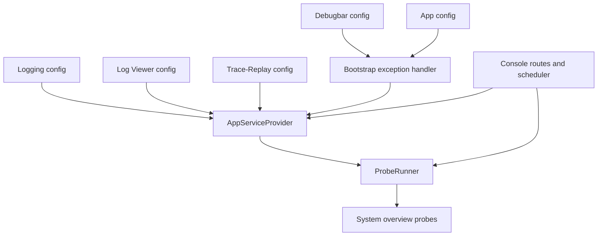
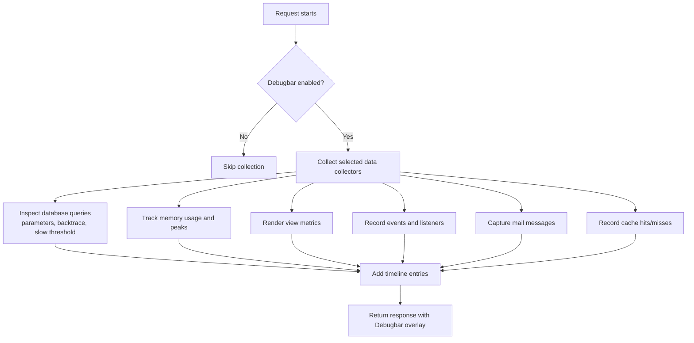
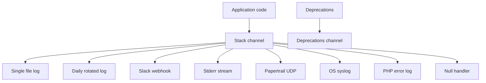
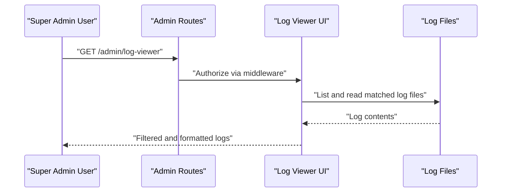
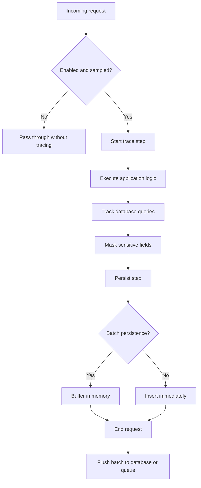
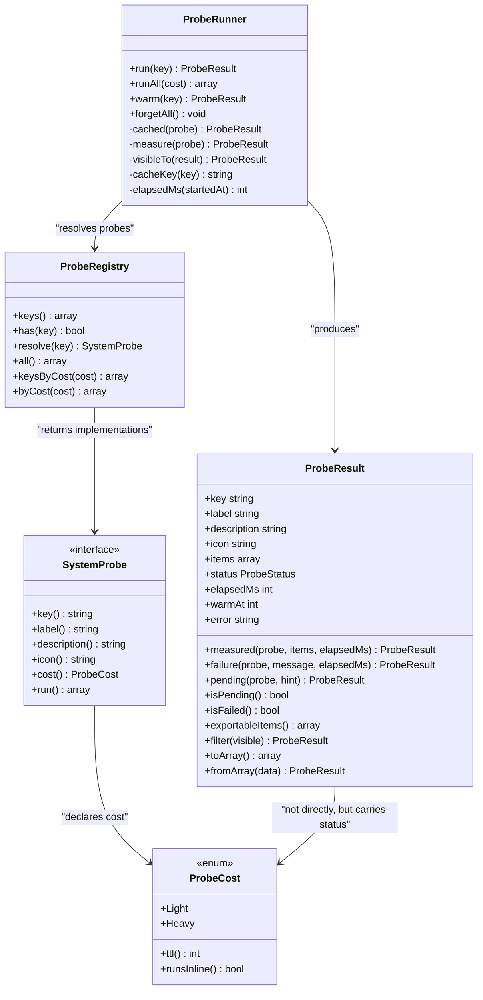
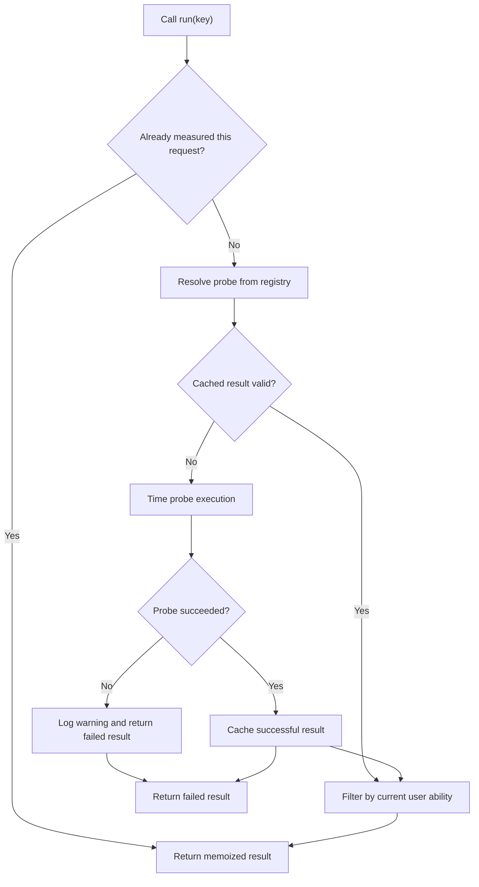
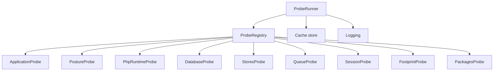
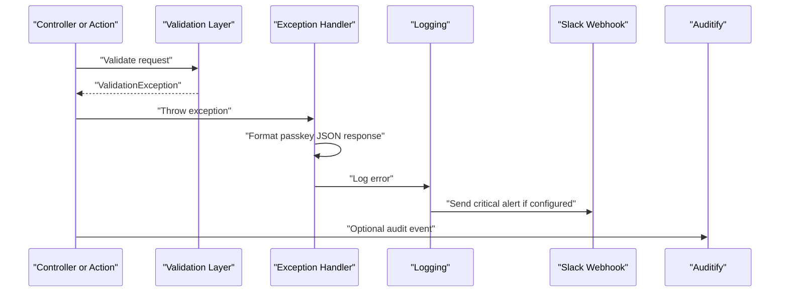
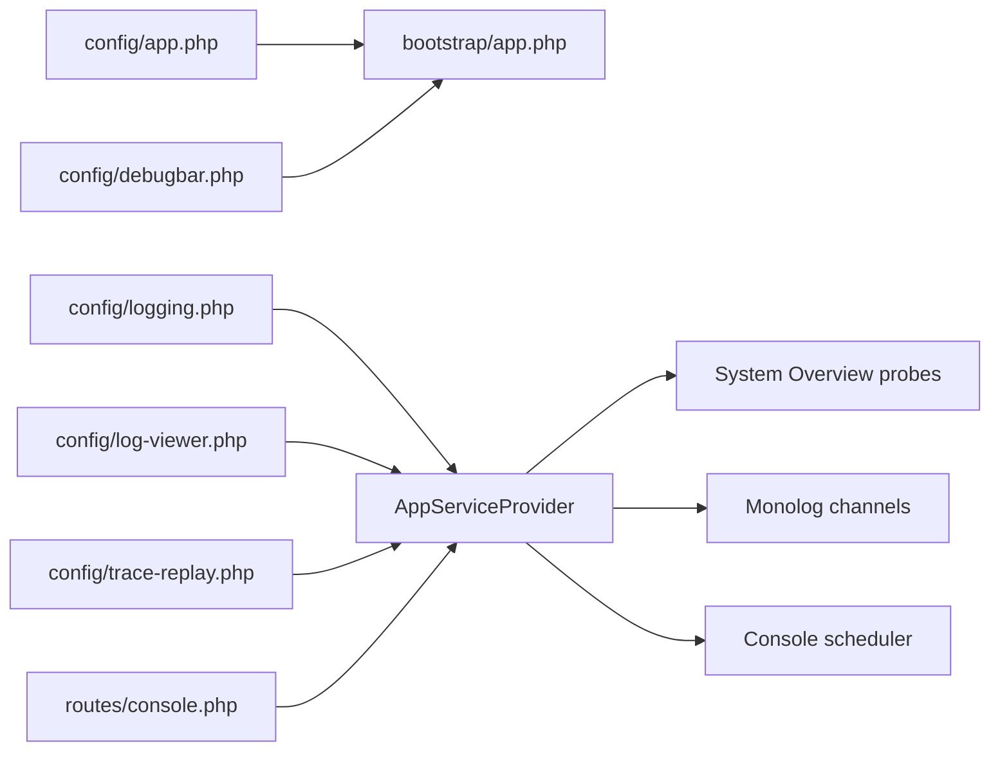

# Monitoring & Debugging

<cite>
**Referenced Files in This Document**
- [debugbar.php](file://config/debugbar.php)
- [logging.php](file://config/logging.php)
- [log-viewer.php](file://config/log-viewer.php)
- [app.php](file://config/app.php)
- [trace-replay.php](file://config/trace-replay.php)
- [bootstrap app.php](file://bootstrap/app.php)
- [console routes](file://routes/console.php)
- [AppServiceProvider](file://app/Providers/AppServiceProvider.php)
- [ProbeRunner](file://app/Support/SystemOverview/ProbeRunner.php)
- [ProbeRegistry](file://app/Support/SystemOverview/ProbeRegistry.php)
- [SystemProbe interface](file://app/Support/SystemOverview/SystemProbe.php)
- [ProbeResult](file://app/Support/SystemOverview/ProbeResult.php)
- [ProbeCost](file://app/Support/SystemOverview/ProbeCost.php)
- [ApplicationProbe](file://app/Support/SystemOverview/Probes/ApplicationProbe.php)
- [DatabaseProbe](file://app/Support/SystemOverview/Probes/DatabaseProbe.php)
- [PostureProbe](file://app/Support/SystemOverview/Probes/PostureProbe.php)
- [QueueProbe](file://app/Support/SystemOverview/Probes/QueueProbe.php)
- [FootprintProbe](file://app/Support/SystemOverview/Probes/FootprintProbe.php)
- [PackagesProbe](file://app/Support/SystemOverview/Probes/PackagesProbe.php)
- [PhpRuntimeProbe](file://app/Support/SystemOverview/Probes/PhpRuntimeProbe.php)
- [SessionProbe](file://app/Support/SystemOverview/Probes/SessionProbe.php)
- [StoresProbe](file://app/Support/SystemOverview/Probes/StoresProbe.php)
</cite>

## Table of Contents
1. [Introduction](#introduction)
2. [Project Structure](#project-structure)
3. [Core Components](#core-components)
4. [Architecture Overview](#architecture-overview)
5. [Detailed Component Analysis](#detailed-component-analysis)
6. [Dependency Analysis](#dependency-analysis)
7. [Performance Considerations](#performance-considerations)
8. [Troubleshooting Guide](#troubleshooting-guide)
9. [Conclusion](#conclusion)

## Introduction
This document explains how Highblossom monitors performance, debugs requests, logs structured events, and exposes system health through the admin interface. It covers:

- Laravel Debugbar integration for request profiling, query inspection, memory tracking, and collector configuration.
- Logging strategy using Monolog channels, log rotation, Slack alerts, stderr output, and a browser-based log viewer.
- Trace-Replay instrumentation for sampled request tracing, database query tracking, payload masking, retention, queue offloading, and failure notifications.
- Custom system-health probes that measure application state, database posture, runtime configuration, queues, storage footprint, sessions, and dependencies.
- Error handling, exception rendering, production safety, and security considerations for debug tools.

The goal is to help developers and operators diagnose slow requests, identify failing jobs or migrations, understand resource usage, and safely enable debugging without exposing secrets in production.

## Project Structure
Monitoring and debugging in Highblossom are distributed across configuration files, framework bootstrap logic, service providers, scheduled tasks, and the System Overview probe subsystem:

| Area | Purpose | Key files |
|---|---|---|
| Request profiling and inspection | Enable/disable Debugbar, select collectors, configure SQL and memory behavior | `config/debugbar.php` |
| Logging infrastructure | Channels, rotation, Slack, Papertrail, stderr, deprecations | `config/logging.php`, `config/log-viewer.php` |
| Tracing and replay | Sampling, masking, persistence, queueing, dashboard access control | `config/trace-replay.php` |
| Application environment | Debug flag, URL, timezone, locale, maintenance mode driver | `config/app.php` |
| Exception handling | Validation exception rendering, passkey error shaping | `bootstrap/app.php` |
| Scheduled diagnostics | Cleanup, session pruning, warm-up job | `routes/console.php` |
| Admin authorization | Log Viewer and Auditify authorization | `app/Providers/AppServiceProvider.php` |
| System health probes | Health KPIs, cache warming, bounded scans, role-filtered data | `app/Support/SystemOverview/*` |



**Diagram sources**
- [debugbar.php:1-120](file://config/debugbar.php#L1-L120)
- [logging.php:1-132](file://config/logging.php#L1-L132)
- [log-viewer.php:1-120](file://config/log-viewer.php#L1-L120)
- [trace-replay.php:1-192](file://config/trace-replay.php#L1-L192)
- [app.php:1-126](file://config/app.php#L1-L126)
- [bootstrap app.php:1-71](file://bootstrap/app.php#L1-L71)
- [AppServiceProvider:1-110](file://app/Providers/AppServiceProvider.php#L1-L110)
- [console routes:1-33](file://routes/console.php#L1-L33)
- [ProbeRunner:1-194](file://app/Support/SystemOverview/ProbeRunner.php#L1-L194)

**Section sources**
- [debugbar.php:1-120](file://config/debugbar.php#L1-L120)
- [logging.php:1-132](file://config/logging.php#L1-L132)
- [log-viewer.php:1-120](file://config/log-viewer.php#L1-L120)
- [trace-replay.php:1-192](file://config/trace-replay.php#L1-L192)
- [app.php:1-126](file://config/app.php#L1-L126)
- [bootstrap app.php:1-71](file://bootstrap/app.php#L1-L71)
- [console routes:1-33](file://routes/console.php#L1-L33)
- [AppServiceProvider:1-110](file://app/Providers/AppServiceProvider.php#L1-L110)
- [ProbeRunner:1-194](file://app/Support/SystemOverview/ProbeRunner.php#L1-L194)

## Core Components
Highblossom’s monitoring surface has five main components:

1. **Laravel Debugbar**: Enables per-request profiling with configurable collectors for time, memory, database queries, views, events, mail, cache, models, Livewire, HTTP client, and more. It can be selectively disabled via environment variables and route exclusions.
2. **Monolog logging stack**: Routes application logs through a configurable channel stack with single-file, daily rotation, Slack, Papertrail, stderr, syslog, and null channels. Deprecation logging is independently controlled.
3. **Log Viewer**: A browsable, authenticated UI under an admin route for reviewing local and remote log files. Access is restricted by middleware and role checks.
4. **Trace-Replay**: An optional tracing layer that samples HTTP requests, records steps, tracks database activity, masks sensitive payloads, persists traces efficiently, optionally queues persistence, and prunes old traces.
5. **System Overview probes**: A set of allowlisted health probes executed through a registry and runner, with caching, cost classification, role filtering, and graceful failure handling.

These components work together: Debugbar and Trace-Replay capture request-level details; logging captures structured events; Log Viewer centralizes log access; probes report business and system KPIs; and scheduling keeps caches warm and maintenance tasks running.

**Section sources**
- [debugbar.php:1-120](file://config/debugbar.php#L1-L120)
- [logging.php:1-132](file://config/logging.php#L1-L132)
- [log-viewer.php:1-120](file://config/log-viewer.php#L1-L120)
- [trace-replay.php:1-192](file://config/trace-replay.php#L1-L192)
- [ProbeRunner:1-194](file://app/Support/SystemOverview/ProbeRunner.php#L1-L194)

## Architecture Overview
At request time, Highblossom combines several observability layers:

```mermaid
sequenceDiagram
    participant Client as "HTTP Client"
    participant Framework as "Laravel Application"
    participant Debugbar as "Laravel Debugbar"
    participant Logger as "Monolog Logging"
    participant TraceReplay as "Trace-Replay"
    participant DB as "Database"
    participant Cache as "Cache Store"
    participant LogViewer as "Log Viewer UI"
    participant Scheduler as "Console Scheduler"

    Client->>Framework: "Request"
    Framework->>Debugbar: "Collect time, memory, queries, views, events"
    Framework->>Logger: "Structured log events"
    Framework->>TraceReplay: "Sampled trace step"
    TraceReplay->>DB: "Persist trace step"
    TraceReplay->>Cache: "Buffer or queue batch persistence"
    Framework-->>Client: "Response"

    Note over Debugbar,TraceReplay: "Both may add overhead; both are configurable."

    LogViewer->>Logger: "Read log files"
    Scheduler->>Framework: "Run scheduled commands"
    Scheduler->>Cache: "Warm system overview sections"
```

**Diagram sources**
- [debugbar.php:1-120](file://config/debugbar.php#L1-L120)
- [logging.php:1-132](file://config/logging.php#L1-L132)
- [trace-replay.php:1-192](file://config/trace-replay.php#L1-L192)
- [log-viewer.php:1-120](file://config/log-viewer.php#L1-L120)
- [console routes:1-33](file://routes/console.php#L1-L33)

## Detailed Component Analysis

### Laravel Debugbar Integration
Debugbar is configured centrally and exposed through many collectors. The key behaviors are:

- **Enablement**: Controlled by an environment variable and normally tied to the application debug setting.
- **Route exclusions**: Certain paths such as telemetry, Horizon, browser logs, and Livewire assets are excluded from collection.
- **Collectors**: Time, memory, exceptions, logs, database queries, views, authentication, Gate checks, session, Symfony request, mail, Laravel metadata, events, cache, models, Livewire, Inertia, jobs, feature flags, and HTTP client calls can each be enabled or disabled individually.
- **Database inspection**: Query parameters, backtraces, slow-query thresholds, EXPLAIN output, memory usage, soft/hard limits, and timeline integration are configurable.
- **Memory and timing options**: Memory baseline, peak reset, precision, message traces, dump capture, and timeline inclusion are available.
- **Sensitive data controls**: Session keys, Symfony request keys, config values, and HTTP client payloads can be masked.

This makes Debugbar suitable for development and staging, while allowing fine-grained reduction of overhead and information exposure in higher environments.



**Diagram sources**
- [debugbar.php:1-200](file://config/debugbar.php#L1-L200)

Operational guidance:
- Use `except` patterns to avoid instrumenting health endpoints, asset routes, and background API consumers.
- Disable expensive collectors such as full event data, all logs, or raw view data in production unless actively investigating.
- Tune `only_slow_queries` and `slow_threshold` so the database panel highlights problematic queries without capturing every statement.
- Mask sensitive session or request fields through the relevant masked arrays.

**Section sources**
- [debugbar.php:1-200](file://config/debugbar.php#L1-L200)

### Logging Strategy
Highblossom uses Monolog with multiple channels and a default stack.

| Channel | Behavior | Typical use |
|---|---|---|
| `stack` | Composes other channels based on an environment list | Default application logger |
| `single` | Writes to a single file | Local development or simple deployments |
| `daily` | Rotates logs after a configurable number of days | Long-running applications needing rotation |
| `slack` | Sends critical messages to a webhook | Alerting on severe failures |
| `papertrail` | Uses UDP Syslog to a remote host | Centralized external logging |
| `stderr` | Streams JSON-friendly logs to standard error | Container orchestration ingestion |
| `syslog` | Integrates with OS syslog | Host-level log aggregation |
| `errorlog` | Uses PHP error log | Fallback logging destination |
| `null` | Drops logs | Disabling logging for tests or specific environments |

Key features include:
- Placeholder replacement for structured log messages.
- Deprecation channel separate from application logs.
- Environment-driven level and destination selection.
- Rotation through `daily` with a configurable day count.
- Optional centralized delivery through Papertrail or Slack.



**Diagram sources**
- [logging.php:1-132](file://config/logging.php#L1-L132)

Recommended practices:
- Keep `LOG_LEVEL` appropriate for the environment: `debug` locally, `info` or `warning` in production.
- Route critical errors to Slack while retaining detailed logs in daily files or a container-friendly stderr stream.
- Avoid logging sensitive user data directly; rely on structured context fields rather than unstructured messages.
- Rotate logs with `daily` and retain only the necessary window.

**Section sources**
- [logging.php:1-132](file://config/logging.php#L1-L132)

### Log Viewer and Centralized Log Aggregation
Log Viewer provides a browsable interface for reviewing log files. Important configuration points:

- The UI can be globally enabled or disabled.
- Production requires authentication by default.
- The route path defaults to an admin-only location.
- Middleware enforces web routing and authorization.
- Remote hosts can be configured for multi-environment log viewing.
- Include and exclude file patterns allow grouping application and server logs.

Authorization is enforced in the application service provider: Log Viewer access is limited to users with the `Super Admin` role. This prevents general staff from reading sensitive logs.



**Diagram sources**
- [log-viewer.php:1-120](file://config/log-viewer.php#L1-L120)
- [AppServiceProvider:33-46](file://app/Providers/AppServiceProvider.php#L33-L46)

Centralization recommendations:
- Ship stdout/stderr or Papertrail logs to a centralized platform such as Cloudwatch, Datadog, Elastic, or Splunk.
- Use Log Viewer for direct filesystem access when external aggregation is unavailable or when diagnosing container-local issues.
- Restrict Log Viewer behind strong authentication and network policies in production.

**Section sources**
- [log-viewer.php:1-120](file://config/log-viewer.php#L1-L120)
- [AppServiceProvider:33-46](file://app/Providers/AppServiceProvider.php#L33-L46)

### Trace-Replay Instrumentation
Trace-Replay adds sampled request tracing with safeguards against overhead and data leakage.

Key capabilities:
- **Sampling**: Controls what fraction of requests are traced; manual start calls bypass sampling.
- **Payload size limit**: Prevents large payloads from bloaching storage.
- **Batch persistence**: Buffers trace steps in memory and writes them in one operation at the end of the request/job.
- **Queue offload**: Can persist traces asynchronously to reduce request latency.
- **Database query tracking**: Records query counts and total time within each trace step.
- **Data masking**: Replaces sensitive fields like passwords, tokens, secrets, credit card numbers, and private keys.
- **Retention**: Prunes traces older than a configured number of days.
- **Dashboard protection**: Supports middleware, API tokens, IP allowlists, and mutating-method restrictions.
- **Failure notifications**: Optional email or Slack alerts when traces end in error.
- **Auto-tracing**: Wraps queued jobs, Artisan commands, and Livewire requests automatically.



**Diagram sources**
- [trace-replay.php:1-192](file://config/trace-replay.php#L1-L192)

Security notes:
- Always review `mask_fields` and ensure no secret flows into trace payloads.
- Restrict dashboard access with middleware, authentication, or IP allowlists.
- Disable mutation-safe replay in production unless explicitly required.
- Set a reasonable retention period and prune traces regularly.

**Section sources**
- [trace-replay.php:1-192](file://config/trace-replay.php#L1-L192)

### System Overview Health Probes
The System Overview subsystem measures application health through a fixed set of probes. Each probe returns a small, serializable result that can be cached, filtered by permissions, and exported safely.

#### Core types and relationships


**Diagram sources**
- [ProbeRunner:1-194](file://app/Support/SystemOverview/ProbeRunner.php#L1-L194)
- [ProbeRegistry:1-118](file://app/Support/SystemOverview/ProbeRegistry.php#L1-L118)
- [SystemProbe interface:1-47](file://app/Support/SystemOverview/SystemProbe.php#L1-L47)
- [ProbeResult:1-200](file://app/Support/SystemOverview/ProbeResult.php#L1-L200)
- [ProbeCost:1-36](file://app/Support/SystemOverview/ProbeCost.php#L1-L36)

#### Execution flow


**Diagram sources**
- [ProbeRunner:40-130](file://app/Support/SystemOverview/ProbeRunner.php#L40-L130)

#### Registered probes
The registry allows only known probe keys, preventing arbitrary class resolution:

| Probe key | Responsibility | Cost classification |
|---|---|---|
| `application` | Framework version, name, environment, debug mode, maintenance mode, cache status, release info | Light |
| `posture` | Security posture, registration, verification, two-factor coverage, writable paths, free space, proxy trust, env exposure, audit trail | Light |
| `runtime` | PHP version, OS, required extensions, image driver, PDO drivers, loaded extensions, INI settings | Light |
| `database` | Connection reachability, driver, database name, server version, footprint, table count, migration drift | Light |
| `stores` | Cache, session, queue, mail, and filesystem backing stores | Light |
| `queue` | Backlog, reserved jobs, throughput, worker heartbeats, failures, scheduled commands | Light |
| `sessions` | Live sessions, stale rows, sign-in ledger, last pruning results | Light |
| `footprint` | Disk volume, application code size, upload folders, framework storage, logs, temp uploads, registered media, gallery images, cache groups | Heavy |
| `packages` | Composer and npm dependency totals and lock file age | Heavy |

#### Example probe behaviors

- **ApplicationProbe** reports environment, debug mode, maintenance mode, cache artifacts, and the recorded application release. It warns when debug or maintenance modes are active and marks missing caches differently in production versus development.
- **DatabaseProbe** verifies connectivity, reads database and server versions, estimates database size, counts tables, compares migration file counts with executed migrations, and includes a sensitive endpoint line that requires elevated permission.
- **PostureProbe** reviews security-critical configuration including registration, email verification, second factors, privileged account coverage, application key presence, writable paths, free disk space, proxy trust, environment exposure, Vite marker, and audit trail availability.
- **QueueProbe** inspects backlog, reserved jobs, 24-hour throughput, alive workers, recent failures, and scheduled commands. It integrates with the jobs-monitor package where available.
- **FootprintProbe** walks directories and aggregates sizes for application code, uploads, framework storage, logs, temporary uploads, registered media, gallery images, and cache groups. It uses a bounded scanner and separates heavy work from normal requests.
- **PackagesProbe** parses lock files to report Composer and npm dependency counts and lock file freshness.
- **PhpRuntimeProbe** reads allowed INI settings, required extensions from `composer.lock`, and runtime metadata.
- **SessionProbe** reports live and stale framework sessions, sign-ins, idle timeout, and last pruning activity.
- **StoresProbe** summarizes backing stores and evaluates cookie security and public storage link state.



**Diagram sources**
- [ProbeRegistry:14-118](file://app/Support/SystemOverview/ProbeRegistry.php#L14-L118)
- [ApplicationProbe:1-115](file://app/Support/SystemOverview/Probes/ApplicationProbe.php#L1-L115)
- [PostureProbe:1-200](file://app/Support/SystemOverview/Probes/PostureProbe.php#L1-L200)
- [PhpRuntimeProbe:1-157](file://app/Support/SystemOverview/Probes/PhpRuntimeProbe.php#L1-L157)
- [DatabaseProbe:1-200](file://app/Support/SystemOverview/Probes/DatabaseProbe.php#L1-L200)
- [StoresProbe:1-155](file://app/Support/SystemOverview/Probes/StoresProbe.php#L1-L155)
- [QueueProbe:1-190](file://app/Support/SystemOverview/Probes/QueueProbe.php#L1-L190)
- [SessionProbe:1-146](file://app/Support/SystemOverview/Probes/SessionProbe.php#L1-L146)
- [FootprintProbe:1-200](file://app/Support/SystemOverview/Probes/FootprintProbe.php#L1-L200)
- [PackagesProbe:1-83](file://app/Support/SystemOverview/Probes/PackagesProbe.php#L1-L83)
- [ProbeRunner:1-194](file://app/Support/SystemOverview/ProbeRunner.php#L1-L194)

#### Authorization and sensitivity
- Probes can mark lines as sensitive.
- Results are filtered by current user ability before being returned to the caller.
- Sensitive lines remain in the cache but are hidden at read time.
- Exports strip sensitive items.
- Some probe lines require explicit permissions such as `manage environment`.

**Section sources**
- [ProbeRunner:1-194](file://app/Support/SystemOverview/ProbeRunner.php#L1-L194)
- [ProbeRegistry:1-118](file://app/Support/SystemOverview/ProbeRegistry.php#L1-L118)
- [SystemProbe:1-47](file://app/Support/SystemOverview/SystemProbe.php#L1-L47)
- [ProbeResult:1-200](file://app/Support/SystemOverview/ProbeResult.php#L1-L200)
- [ProbeCost:1-36](file://app/Support/SystemOverview/ProbeCost.php#L1-L36)
- [ApplicationProbe:1-115](file://app/Support/SystemOverview/Probes/ApplicationProbe.php#L1-L115)
- [DatabaseProbe:1-200](file://app/Support/SystemOverview/Probes/DatabaseProbe.php#L1-L200)
- [PostureProbe:1-200](file://app/Support/SystemOverview/Probes/PostureProbe.php#L1-L200)
- [QueueProbe:1-190](file://app/Support/SystemOverview/Probes/QueueProbe.php#L1-L190)
- [FootprintProbe:1-200](file://app/Support/SystemOverview/Probes/FootprintProbe.php#L1-L200)
- [PackagesProbe:1-83](file://app/Support/SystemOverview/Probes/PackagesProbe.php#L1-L83)
- [PhpRuntimeProbe:1-157](file://app/Support/SystemOverview/Probes/PhpRuntimeProbe.php#L1-L157)
- [SessionProbe:1-146](file://app/Support/SystemOverview/Probes/SessionProbe.php#L1-L146)
- [StoresProbe:1-155](file://app/Support/SystemOverview/Probes/StoresProbe.php#L1-L155)

### Error Tracking, Reporting, and Exception Handling
Error handling spans framework-level exception rendering, structured logging, alerting, and audit trails:

- **Exception rendering**: Validation exceptions on passkey-related JSON routes are transformed into a structured JSON response containing a user-facing message, reason, and validation errors.
- **Logging**: Errors and warnings are written through the configured logging stack. Probe failures are logged with probe identity, user ID, exception class, and message.
- **Alerting**: Critical logs can be sent to Slack. Trace-Replay can send failure notifications via email or Slack when enabled.
- **Audit trails**: Auditify is authorized through the same Super Admin gate used elsewhere, ensuring audit tooling remains restricted.
- **Production safety**: Destructive database commands are prohibited in production through the service provider.



**Diagram sources**
- [bootstrap app.php:28-66](file://bootstrap/app.php#L28-L66)
- [logging.php:1-132](file://config/logging.php#L1-L132)
- [trace-replay.php:140-192](file://config/trace-replay.php#L140-L192)
- [AppServiceProvider:33-106](file://app/Providers/AppServiceProvider.php#L33-L106)

**Section sources**
- [bootstrap app.php:28-66](file://bootstrap/app.php#L28-L66)
- [logging.php:1-132](file://config/logging.php#L1-L132)
- [trace-replay.php:140-192](file://config/trace-replay.php#L140-L192)
- [AppServiceProvider:33-106](file://app/Providers/AppServiceProvider.php#L33-L106)
- [ProbeRunner:120-194](file://app/Support/SystemOverview/ProbeRunner.php#L120-L194)

## Dependency Analysis
Monitoring components have clear boundaries:

- Configuration files are consumed early by Laravel during boot.
- `AppServiceProvider` registers Log Viewer authorization, schedule behavior, default behaviors, and gates.
- Console routes register scheduled tasks that support operational hygiene and probe warming.
- Debugbar and Trace-Replay attach into the HTTP lifecycle.
- Logging is used throughout application code and probes.
- Probes depend on services, models, cache, and database connections but are isolated through the registry and runner.



**Diagram sources**
- [app.php:1-126](file://config/app.php#L1-L126)
- [bootstrap app.php:1-71](file://bootstrap/app.php#L1-L71)
- [debugbar.php:1-120](file://config/debugbar.php#L1-L120)
- [logging.php:1-132](file://config/logging.php#L1-L132)
- [log-viewer.php:1-120](file://config/log-viewer.php#L1-L120)
- [trace-replay.php:1-192](file://config/trace-replay.php#L1-L192)
- [console routes:1-33](file://routes/console.php#L1-L33)
- [AppServiceProvider:1-110](file://app/Providers/AppServiceProvider.php#L1-L110)

**Section sources**
- [app.php:1-126](file://config/app.php#L1-L126)
- [bootstrap app.php:1-71](file://bootstrap/app.php#L1-L71)
- [debugbar.php:1-120](file://config/debugbar.php#L1-L120)
- [logging.php:1-132](file://config/logging.php#L1-L132)
- [log-viewer.php:1-120](file://config/log-viewer.php#L1-L120)
- [trace-replay.php:1-192](file://config/trace-replay.php#L1-L192)
- [console routes:1-33](file://routes/console.php#L1-L33)
- [AppServiceProvider:1-110](file://app/Providers/AppServiceProvider.php#L1-L110)

## Performance Considerations
Observability tools add measurable overhead. Highblossom mitigates this through configuration and design choices:

- **Debugbar collectors**: Many collectors are individually toggleable. Disable expensive ones in production, especially full event dumps, raw view data, or excessive database parameter capture.
- **Database panel limits**: Soft and hard limits prevent query collectors from overwhelming the request with bindings and backtraces. Slow-query highlighting helps focus attention.
- **Trace-Replay sampling**: Only a fraction of requests should be traced in production. Batch persistence avoids one write per step, and queue persistence removes persistence latency from the request path.
- **Payload masking**: Sensitive fields are replaced before storage, reducing risk and avoiding accidental retention of secrets.
- **System Overview probes**: Heavy probes such as `footprint` and `packages` are classified as heavy and warmed by scheduled jobs rather than executed inline during page requests.
- **Caching**: Probe results are cached with TTLs appropriate to their cost. Light probes expire quickly; heavy probes expire less frequently.
- **Scheduling**: Cleanup, session pruning, and system overview warming are scheduled to keep operations predictable and avoid blocking user requests.

Recommendations:
- Monitor Debugbar and Trace-Replay overhead in staging before enabling them in production.
- Use sampling rates below `1.0` for high-traffic production systems.
- Keep `max_payload_size` conservative to prevent database growth.
- Schedule regular trace pruning.
- Prefer lightweight probes for inline measurement; reserve directory walks and dependency parsing for warm-up jobs.

[No sources needed since this section provides general guidance]

## Troubleshooting Guide

### Debugbar not appearing
Check whether:
- The application debug mode is enabled.
- Debugbar is enabled by its environment variable.
- The requested URI matches an exclusion pattern.
- Relevant collectors are enabled.
- The browser is loading the Debugbar assets and overlay scripts.

**Section sources**
- [debugbar.php:1-60](file://config/debugbar.php#L1-L60)
- [app.php:20-40](file://config/app.php#L20-L40)

### Too many database queries captured
Tune the database collector:
- Enable slow-query-only capture.
- Increase `slow_threshold` if normal traffic generates many short queries.
- Reduce `soft_limit` and `hard_limit`.
- Disable backtraces or query result previews if they add overhead.

**Section sources**
- [debugbar.php:120-200](file://config/debugbar.php#L120-L200)

### Logs not reaching Slack or Papertrail
Verify:
- The channel is included in the configured stack.
- Webhook URLs, usernames, levels, and Papertrail host/port settings are correct.
- Network egress is allowed to the external logging endpoint.
- The log level meets the channel’s minimum severity.

**Section sources**
- [logging.php:60-120](file://config/logging.php#L60-L120)

### Log Viewer inaccessible
Confirm:
- Log Viewer is enabled.
- The route path is accessible.
- The requesting user has the `Super Admin` role.
- Authentication middleware is applied.
- The environment requires auth in production.

**Section sources**
- [log-viewer.php:10-80](file://config/log-viewer.php#L10-L80)
- [AppServiceProvider:33-46](file://app/Providers/AppServiceProvider.php#L33-L46)

### Trace-Replay consuming too much storage
Review:
- `sample_rate`.
- `max_payload_size`.
- `retention_days`.
- Whether batch persistence or queue persistence is enabled.
- Whether auto-tracing is enabled for jobs or commands.
- Whether `on_failure` notifications are generating additional load.

**Section sources**
- [trace-replay.php:1-120](file://config/trace-replay.php#L1-L120)
- [trace-replay.php:120-192](file://config/trace-replay.php#L120-L192)

### System Overview section shows pending
A heavy probe may not yet be warmed. The warm-up job runs twice daily, and the runner can also trigger measurement for explicitly warmed keys. If the cache entry becomes unreadable, it is discarded and re-measured on next access.

**Section sources**
- [ProbeRunner:40-130](file://app/Support/SystemOverview/ProbeRunner.php#L40-L130)
- [ProbeCost:18-36](file://app/Support/SystemOverview/ProbeCost.php#L18-L36)
- [console routes:18-33](file://routes/console.php#L18-L33)

### Probe throws unexpectedly
ProbeRunner catches exceptions, logs a warning with probe identity and user context, and returns a failed result instead of breaking the entire page. Check the application logs for the warning message and exception class.

**Section sources**
- [ProbeRunner:140-194](file://app/Support/SystemOverview/ProbeRunner.php#L140-L194)

## Conclusion
Highblossom combines layered observability tools:

- Debugbar provides deep per-request visibility during development and controlled investigation periods.
- Monolog channels deliver structured, rotatable logs to files, stderr, Slack, and remote systems.
- Log Viewer centralizes filesystem log access behind strict authorization.
- Trace-Replay adds sampled, masked, and prunable request tracing with optional queue offloading and failure alerts.
- System Overview probes expose business and system KPIs through a safe, allowlisted, cached, and role-filtered interface.

For production, prefer conservative sampling, minimal collectors, rotated logs, authenticated log viewers, masked traces, scheduled warm-ups, and strict access controls. This balance preserves insight while limiting performance impact and security exposure.

[No sources needed since this section summarizes without analyzing specific files]