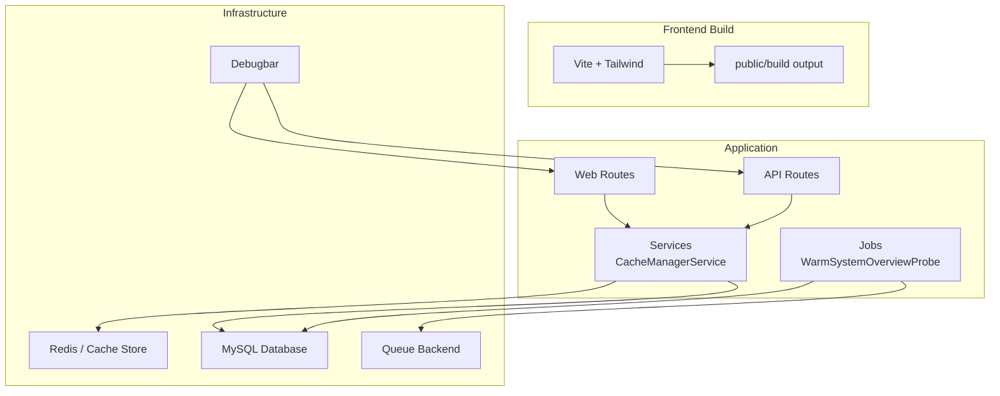
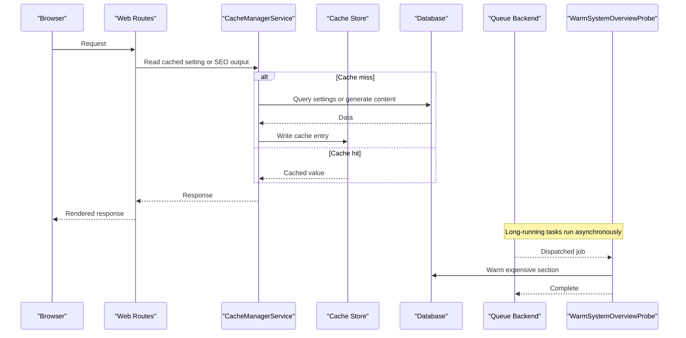
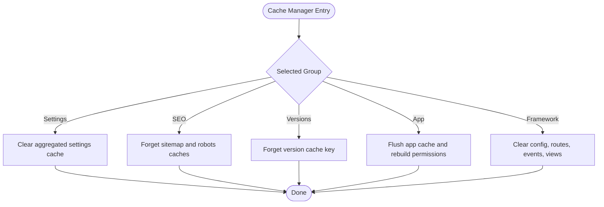
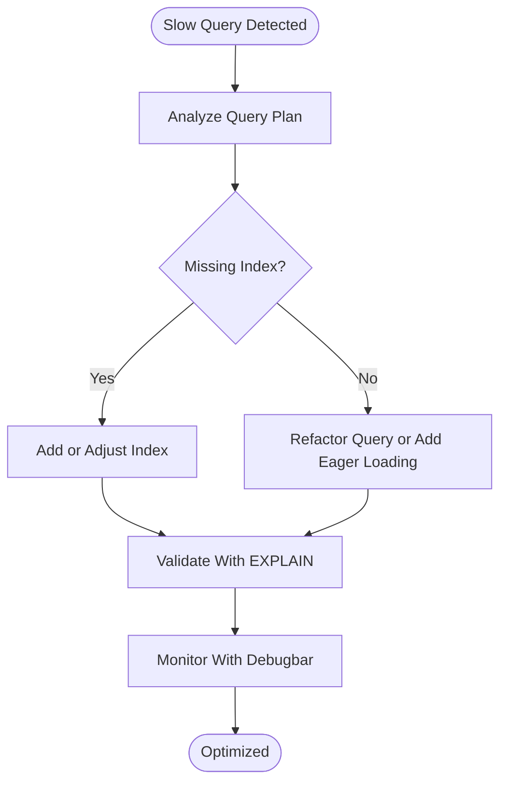
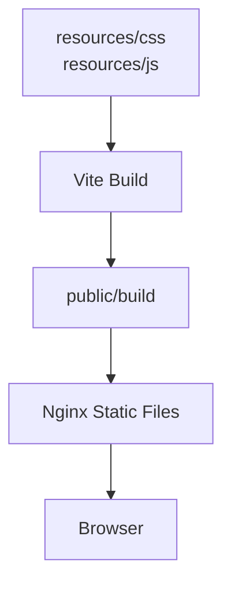
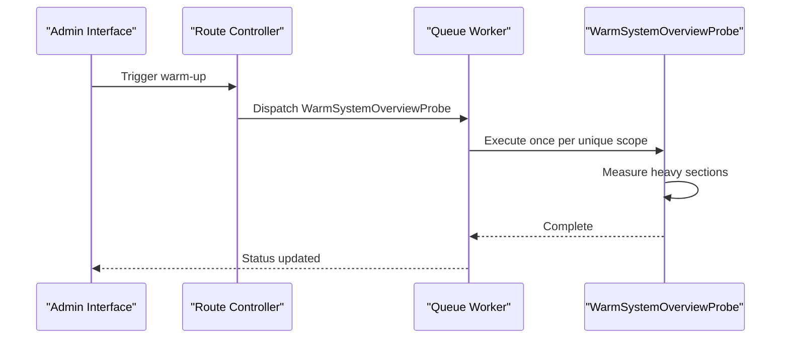
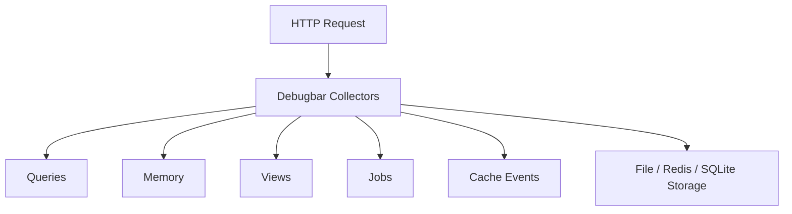
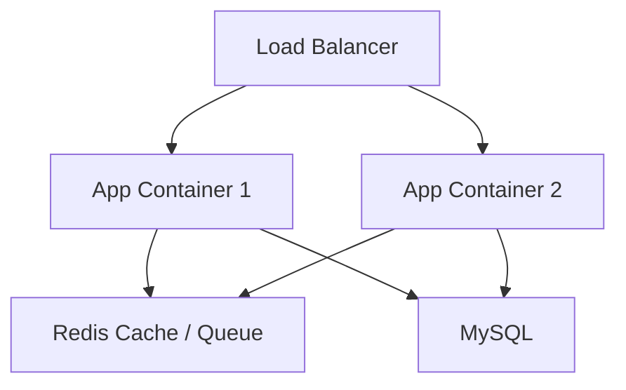
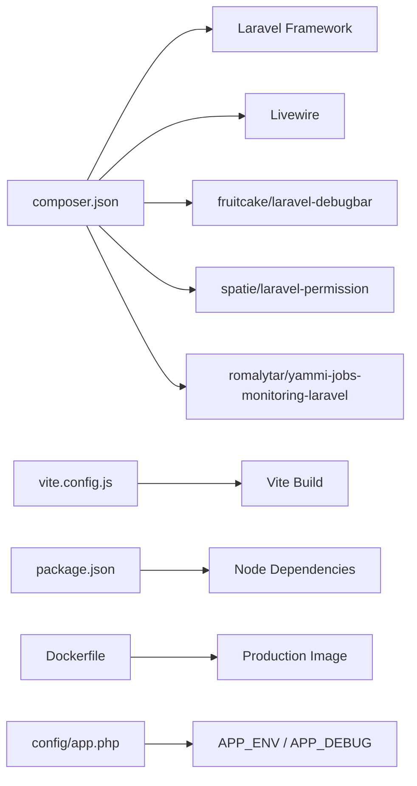

# Performance & Optimization

<cite>
**Referenced Files in This Document**   
- [config/cache.php](file://config/cache.php)
- [config/database.php](file://config/database.php)
- [config/queue.php](file://config/queue.php)
- [config/debugbar.php](file://config/debugbar.php)
- [config/app.php](file://config/app.php)
- [app/Services/CacheManagerService.php](file://app/Services/CacheManagerService.php)
- [app/Jobs/WarmSystemOverviewProbe.php](file://app/Jobs/WarmSystemOverviewProbe.php)
- [vite.config.js](file://vite.config.js)
- [package.json](file://package.json)
- [composer.json](file://composer.json)
- [routes/web.php](file://routes/web.php)
- [routes/api.php](file://routes/api.php)
- [docker-compose.yml](file://docker-compose.yml)
- [Dockerfile](file://Dockerfile)
</cite>

## Table of Contents
1. [Introduction](#introduction)
2. [Project Structure](#project-structure)
3. [Core Components](#core-components)
4. [Architecture Overview](#architecture-overview)
5. [Detailed Component Analysis](#detailed-component-analysis)
6. [Dependency Analysis](#dependency-analysis)
7. [Performance Considerations](#performance-considerations)
8. [Troubleshooting Guide](#troubleshooting-guide)
9. [Conclusion](#conclusion)
10. [Appendices](#appendices)

## Introduction
This document describes Highblossom’s performance optimization and monitoring strategy as implemented in the repository. It focuses on:

- Caching with Redis and application-level cache groups through `CacheManagerService`.
- Database query optimization, indexing considerations, and profiling.
- Frontend asset optimization through Vite, build configuration, and CDN integration options.
- Background job processing using queues for long-running work.
- Monitoring and debugging through Debugbar, queue/job instrumentation, and log-based tools.
- Load balancing, horizontal scaling, and database connection pooling guidance based on the current Dockerized setup.
- Common bottlenecks, optimization checklists, and regression detection strategies.

The goal is to make these concepts accessible while providing concrete references to the actual files that implement or configure each area.

## Project Structure
The project follows a standard Laravel structure with additional packages and tooling:

- Application logic lives under `app/`, including services, jobs, models, routes, and providers.
- Configuration is centralized under `config/`, with dedicated files for cache, database, queue, and debugging.
- Frontend assets are built with Vite from `resources/css` and `resources/js`.
- Production builds ship PHP, Nginx, PHP-FPM, queue workers, and scheduler inside one container image.

**Diagram sources**
- [vite.config.js:1-33](file://vite.config.js#L1-L33)
- [routes/web.php:1-76](file://routes/web.php#L1-L76)
- [routes/api.php:1-117](file://routes/api.php#L1-L117)
- [app/Services/CacheManagerService.php:1-328](file://app/Services/CacheManagerService.php#L1-L328)
- [app/Jobs/WarmSystemOverviewProbe.php:1-76](file://app/Jobs/WarmSystemOverviewProbe.php#L1-L76)
- [config/cache.php:1-146](file://config/cache.php#L1-L146)
- [config/database.php:1-184](file://config/database.php#L1-L184)
- [config/queue.php:1-128](file://config/queue.php#L1-L128)
- [config/debugbar.php:1-389](file://config/debugbar.php#L1-L389)

**Section sources**
- [vite.config.js:1-33](file://vite.config.js#L1-L33)
- [package.json:1-35](file://package.json#L1-L35)
- [routes/web.php:1-76](file://routes/web.php#L1-L76)
- [routes/api.php:1-117](file://routes/api.php#L1-L117)

## Core Components
The most important performance-related components are:

| Component | Purpose | Key Behaviors |
|---|---|---|
| Cache configuration | Defines default cache store, Redis connections, key prefix, and serializable classes | Default store can be database; Redis connections exist for default and cache databases; serializable classes include Eloquent collections and selected models |
| `CacheManagerService` | Centralizes cache inspection, clearing, warming, and framework cache optimization | Supports groups such as settings, SEO output, versions, app cache, and framework cache; rebuilds sitemap and robots.txt; clears and rebuilds config, routes, events, and views |
| Queue configuration | Defines queue backends, retry behavior, batching, and failed job storage | Supports sync, database, SQS, Redis, deferred, background, and failover; configurable retry windows |
| `WarmSystemOverviewProbe` | Background job that warms heavy system overview sections without blocking requests | Implements uniqueness, single try, timeout, and coalescing of repeated warm-up dispatches |
| Debugbar configuration | Controls data collection, collectors, storage, and UI behavior | Collectors for DB, memory, cache, views, jobs, and more; slow-query thresholds and EXPLAIN support |
| Vite configuration | Defines frontend entry points, Tailwind integration, and dev server behavior | Multiple CSS/JS entry points for public site, auth, and admin panels |
| Dockerfile | Builds vendor assets, frontend assets, and ships a single production image | Installs PHP extensions, Nginx, Supervisor, and copies compiled assets |

**Section sources**
- [config/cache.php:1-146](file://config/cache.php#L1-L146)
- [app/Services/CacheManagerService.php:1-328](file://app/Services/CacheManagerService.php#L1-L328)
- [config/queue.php:1-128](file://config/queue.php#L1-L128)
- [app/Jobs/WarmSystemOverviewProbe.php:1-76](file://app/Jobs/WarmSystemOverviewProbe.php#L1-L76)
- [config/debugbar.php:1-389](file://config/debugbar.php#L1-L389)
- [vite.config.js:1-33](file://vite.config.js#L1-L33)
- [Dockerfile:1-32](file://Dockerfile#L1-L32)

## Architecture Overview
Highblossom combines a request-driven web/API layer with background processing and layered caching.

**Diagram sources**
- [routes/web.php:1-76](file://routes/web.php#L1-L76)
- [app/Services/CacheManagerService.php:1-328](file://app/Services/CacheManagerService.php#L1-L328)
- [config/cache.php:1-146](file://config/cache.php#L1-L146)
- [config/database.php:1-184](file://config/database.php#L1-L184)
- [app/Jobs/WarmSystemOverviewProbe.php:1-76](file://app/Jobs/WarmSystemOverviewProbe.php#L1-L76)
- [config/queue.php:1-128](file://config/queue.php#L1-L128)

## Detailed Component Analysis

### Caching Strategy with Redis and CacheManagerService
The cache configuration supports multiple stores, with Redis connections explicitly defined for both default and cache usage. The default store may fall back to the database store depending on environment configuration. Serializable classes allow safe deserialization of specific Eloquent collections and models from cache.

`CacheManagerService` introduces an explicit cache group registry:

| Group | Description | Optimizable Behavior |
|---|---|---|
| Settings | Aggregated company settings | Warms by reading all settings; clears aggregate and legacy keys |
| SEO Output | Sitemap and robots.txt | Rebuilds via SEO actions and caches responses with configured durations |
| Versions | Current application version pointer | Warms by invoking version service |
| App Cache | Remaining application entries | Flushes and rebuilds permission cache |
| Framework Cache | Config, routes, events, and compiled views | Clears and rebuilds framework caches |

**Diagram sources**
- [app/Services/CacheManagerService.php:1-328](file://app/Services/CacheManagerService.php#L1-L328)
- [config/cache.php:1-146](file://config/cache.php#L1-L146)

Key implementation characteristics:

- **Group allowlist**: Only predefined group keys are accepted, preventing arbitrary cache-key manipulation.
- **Database cache stats**: When the default cache store is database-backed, group statistics count entries and compute approximate size by scanning the cache table.
- **Framework cache stats**: Counts compiled config, route, event files and generated view files, plus their sizes.
- **Permission cache handling**: Flushing app cache requires rebuilding Spatie permission cache because it shares the same store.
- **SEO rebuild**: Sitemap and robots.txt are regenerated through dedicated actions and stored with TTL values from SEO configuration.

Optimization recommendations derived from this component:

- Prefer Redis as the default cache store for high-throughput environments.
- Use group-specific warm operations instead of full flushes during deployments.
- Monitor database-backed cache size when falling back to the database store.
- Keep serializable class lists minimal and audited to reduce security surface.

**Section sources**
- [config/cache.php:1-146](file://config/cache.php#L1-L146)
- [app/Services/CacheManagerService.php:1-328](file://app/Services/CacheManagerService.php#L1-L328)

### Database Query Optimization and Profiling
The database configuration defines MySQL/MariaDB connections with charset, collation, prefix indexes, and SSL options. Redis configuration includes separate default and cache connections with retry and backoff settings.

Query optimization should focus on:

- **Eager loading**: Avoid N+1 queries by eagerly loading relationships used in list pages, dashboards, and API endpoints.
- **Selective columns**: Retrieve only needed fields for read-heavy endpoints, especially for large tables like bookings, inspections, posts, and gallery images.
- **Indexing strategy**: Add composite indexes for frequently filtered columns such as scheduled dates, status flags, foreign keys, and unique constraints.
- **Pagination**: Use pagination on listing endpoints rather than loading entire tables into memory.
- **Query profiling**: Use Debugbar’s database collector, slow-query threshold, and EXPLAIN output to identify expensive queries.

The Debugbar database collector provides:

- Slow-query highlighting.
- Backtrace tracing to locate query origins.
- Optional EXPLAIN output.
- Limits for soft and hard query capture to avoid overhead on very active applications.

**Diagram sources**
- [config/database.php:1-184](file://config/database.php#L1-L184)
- [config/debugbar.php:1-389](file://config/debugbar.php#L1-L389)

Important notes:

- The current repository does not show custom database query scopes or centralized query builders, so eager loading and indexing decisions must be applied at model and controller/service levels.
- Redis retry and backoff configuration improves resilience but does not replace proper query design.

**Section sources**
- [config/database.php:1-184](file://config/database.php#L1-L184)
- [config/debugbar.php:1-389](file://config/debugbar.php#L1-L389)

### Asset Optimization Through Vite and Build Process
The frontend build uses Vite with TailwindCSS and multiple entry points:

- Public site CSS and JavaScript.
- Site-specific booking and Alpine scripts.
- Auth styling and scripts.
- Admin panel CSS and JavaScript.

The production Dockerfile runs `npm run build` during image creation, copying compiled assets into `public/build`.

Optimization opportunities:

- **Code splitting**: Configure per-route or per-feature chunks for large admin interfaces.
- **Tree shaking**: Ensure unused CSS and JS are removed by keeping imports explicit.
- **Asset pipeline tuning**: Consider disabling development-only features in production builds.
- **CDN integration**: Serve `public/build` assets from a CDN by adjusting asset URLs in the hosting layer or middleware.
- **Lazy loading**: Defer non-critical JavaScript and use dynamic imports where appropriate.

**Diagram sources**
- [vite.config.js:1-33](file://vite.config.js#L1-L33)
- [package.json:1-35](file://package.json#L1-L35)
- [Dockerfile:1-32](file://Dockerfile#L1-L32)

Current limitations visible in the repository:

- No explicit Vite CDN URL configuration.
- No lazy-loading configuration in `vite.config.js`.
- Asset optimization relies on Vite defaults and production build mode.

**Section sources**
- [vite.config.js:1-33](file://vite.config.js#L1-L33)
- [package.json:1-35](file://package.json#L1-L35)
- [Dockerfile:1-32](file://Dockerfile#L1-L32)

### Background Job Processing and Memory Management
Queues are configured with multiple backends, including database, Redis, SQS, and failover. The default backend can be changed through environment variables. Failed jobs are stored either in the database or other supported drivers.

`WarmSystemOverviewProbe` demonstrates best practices for long-running background work:

- Implements uniqueness to prevent overlapping warm-ups.
- Uses a bounded number of tries.
- Applies a wall-clock timeout.
- Coalesces repeated dispatches for the same scope.

**Diagram sources**
- [app/Jobs/WarmSystemOverviewProbe.php:1-76](file://app/Jobs/WarmSystemOverviewProbe.php#L1-L76)
- [config/queue.php:1-128](file://config/queue.php#L1-L128)

Memory management and garbage collection guidance:

- Keep job payloads small and pass identifiers instead of large objects.
- Use timeouts and bounded loops inside jobs to avoid unbounded memory growth.
- Monitor failed jobs and queue backlog through monitoring tools.
- Tune PHP memory limits and OPcache based on workload.

**Section sources**
- [config/queue.php:1-128](file://config/queue.php#L1-L128)
- [app/Jobs/WarmSystemOverviewProbe.php:1-76](file://app/Jobs/WarmSystemOverviewProbe.php#L1-L76)

### Monitoring and Debugging Approaches
Debugbar is configured with extensive collectors for time, memory, database queries, views, jobs, cache, mail, and HTTP client activity. It also supports:

- AJAX request capture.
- Storage driver selection (file, Redis, SQLite, PDO).
- Remote path mapping for IDE integration.
- Slow-query thresholds and EXPLAIN.
- View grouping and exclusion rules.

**Diagram sources**
- [config/debugbar.php:1-389](file://config/debugbar.php#L1-L389)

Additional monitoring and debugging tools present in the project:

- Log viewer for browsing application logs.
- Scheduler list for inspecting scheduled tasks.
- Nightwatch for testing and potentially performance-related test workflows.
- Truss for query analysis in development.

Security note: Debugbar storage exposure and force-enable options should remain disabled in production unless access is strictly controlled.

**Section sources**
- [config/debugbar.php:1-389](file://config/debugbar.php#L1-L389)
- [composer.json:1-138](file://composer.json#L1-L138)

### Load Balancing, Horizontal Scaling, and Connection Pooling
The current deployment is a single-container setup running Nginx, PHP-FPM, queue workers, and scheduler under Supervisor. Database connectivity is configured for MySQL, and Redis connections are available for caching and queue backends.

Scaling considerations:

- **Horizontal scaling**: Run multiple application containers behind a load balancer. Share stateless session and cache stores (for example, Redis) across instances.
- **Session persistence**: If using file-based sessions, move to a shared store such as Redis.
- **Cache coherence**: Use Redis as the default cache store so multiple instances share warmed settings, SEO output, and framework caches.
- **Queue scaling**: Run multiple queue workers per instance or scale worker processes independently.
- **Database connection pooling**: MySQL connection pooling is typically provided by the database server or proxy; PHP-FPM manages persistent connections according to its process model.
- **Rate limiting**: Throttling is already applied to several endpoints, which helps protect against abuse during traffic spikes.

**Diagram sources**
- [docker-compose.yml:1-31](file://docker-compose.yml#L1-L31)
- [Dockerfile:1-32](file://Dockerfile#L1-L32)
- [config/database.php:1-184](file://config/database.php#L1-L184)
- [config/queue.php:1-128](file://config/queue.php#L1-L128)
- [routes/web.php:1-76](file://routes/web.php#L1-L76)
- [routes/api.php:1-117](file://routes/api.php#L1-L117)

**Section sources**
- [docker-compose.yml:1-31](file://docker-compose.yml#L1-L31)
- [Dockerfile:1-32](file://Dockerfile#L1-L32)
- [routes/web.php:1-76](file://routes/web.php#L1-L76)
- [routes/api.php:1-117](file://routes/api.php#L1-L117)

## Dependency Analysis
The following diagram maps core runtime dependencies relevant to performance:

**Diagram sources**
- [composer.json:1-138](file://composer.json#L1-L138)
- [vite.config.js:1-33](file://vite.config.js#L1-L33)
- [package.json:1-35](file://package.json#L1-L35)
- [Dockerfile:1-32](file://Dockerfile#L1-L32)
- [config/app.php:1-126](file://config/app.php#L1-L126)

**Section sources**
- [composer.json:1-138](file://composer.json#L1-L138)
- [vite.config.js:1-33](file://vite.config.js#L1-L33)
- [package.json:1-35](file://package.json#L1-L35)
- [Dockerfile:1-32](file://Dockerfile#L1-L32)
- [config/app.php:1-126](file://config/app.php#L1-L126)

## Performance Considerations
Use the following checklist to evaluate and improve performance:

| Area | Checklist |
|---|---|
| Caching | Switch default cache to Redis in production; prefer group warm operations; monitor database cache fallback size; keep serializable classes minimal |
| Database | Add missing indexes; use eager loading; paginate large datasets; profile slow queries with Debugbar; review EXPLAIN plans |
| Frontend | Split large bundles; enable CDN for static assets; defer non-critical scripts; audit unused CSS and JS |
| Queues | Move long-running work off the request path; tune retry_after and timeout; monitor failed jobs; consider Redis queue backend |
| Monitoring | Enable Debugbar collectors selectively; disable verbose storage in production; track memory, DB queries, and cache events |
| Scaling | Stateless application containers; shared Redis cache and sessions; independent queue worker scaling; rate-limit sensitive endpoints |
| Deployment | Optimize autoloader; run Vite production build; install PHP extensions required by the app; verify OPcache configuration |

[No sources needed since this section provides general guidance]

## Troubleshooting Guide
Common performance issues and how to investigate them:

| Symptom | Likely Cause | Investigation Steps |
|---|---|---|
| High CPU on page load | N+1 queries or heavy synchronous computation | Enable Debugbar DB collector; check query counts and execution times |
| Slow dashboard or listing pages | Missing indexes or fetching too many rows | Review EXPLAIN output; add composite indexes; apply pagination |
| Cache misses after deployment | Full cache flush or wrong cache store | Use `CacheManagerService` to warm specific groups; verify Redis connection |
| Large response payloads | Unoptimized frontend assets | Inspect `public/build`; split bundles; move assets to CDN |
| Queue backlog growing | Underprovisioned workers or long job duration | Check queue backend; increase worker count; tune retry and timeout |
| Excessive memory usage | Large cached objects or unbounded loops | Reduce payload size; limit loop iterations; monitor memory collector |
| Stale SEO output | Outdated sitemap or robots cache | Rebuild SEO cache group; verify TTL configuration |

Debugbar tips:

- Limit DB collectors with soft and hard limits in high-traffic requests.
- Use slow-query thresholds to highlight problematic queries.
- Exclude noisy paths from collectors when debugging specific endpoints.
- Disable or restrict Debugbar storage exposure in production.

**Section sources**
- [config/debugbar.php:1-389](file://config/debugbar.php#L1-L389)
- [app/Services/CacheManagerService.php:1-328](file://app/Services/CacheManagerService.php#L1-L328)
- [config/queue.php:1-128](file://config/queue.php#L1-L128)

## Conclusion
Highblossom’s performance foundation rests on three pillars:

1. **Caching**: A structured cache group system backed by Redis or database storage, with explicit warming and framework cache control.
2. **Background processing**: Queue-based jobs for long-running work, with uniqueness and timeout safeguards.
3. **Observability**: Debugbar and supporting tools provide visibility into queries, memory, cache, views, and jobs.

To sustain performance at scale, adopt Redis as the primary cache and queue backend, optimize database queries with indexes and eager loading, split and serve frontend assets efficiently, and deploy horizontally with shared state. Use Debugbar and queue/job monitoring to detect regressions early and guide targeted optimizations.

[No sources needed since this section summarizes without analyzing specific files]

## Appendices

### Optimization Checklist Summary
- Prefer Redis for cache and queue stores.
- Warm cache groups instead of flushing everything.
- Profile and index database queries regularly.
- Split and serve frontend assets through a CDN.
- Offload heavy work to queues.
- Keep Debugbar selective and secure.
- Scale horizontally with stateless containers.

[No sources needed since this section provides general guidance]