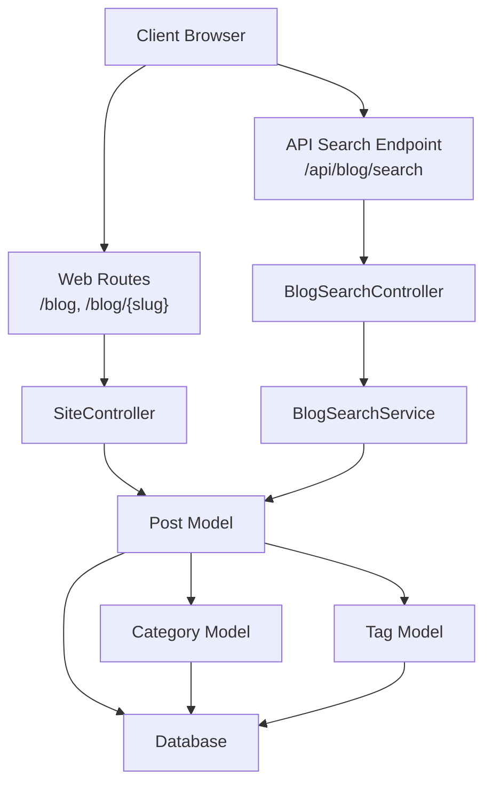
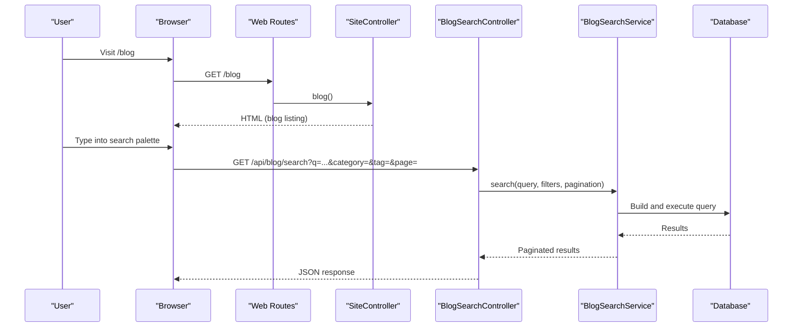
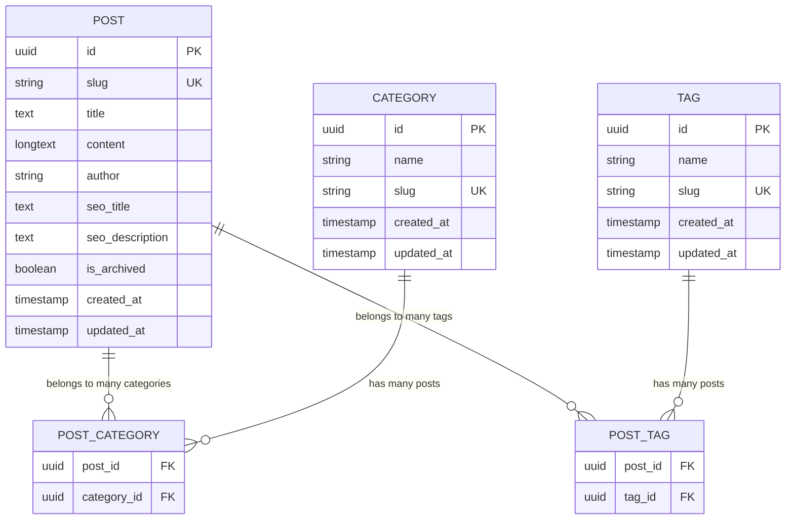
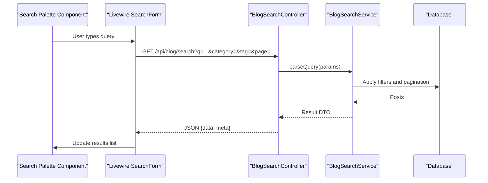
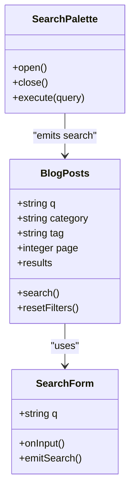
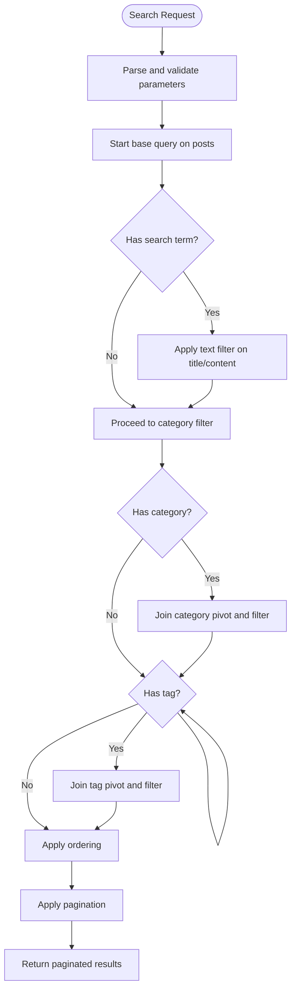
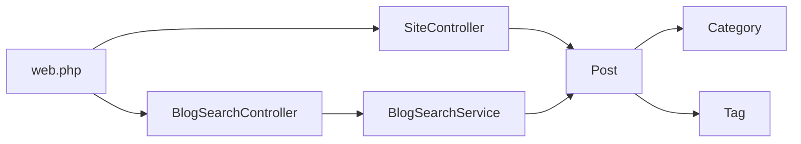

# Blog and Content Management

<cite>
**Referenced Files in This Document**   
- [Post.php](file://app/app/Models/Post.php)
- [Category.php](file://app/app/Models/Category.php)
- [Tag.php](file://app/app/Models/Tag.php)
- [BlogSearchService.php](file://app/app/Services/BlogSearchService.php)
- [BlogSearchController.php](file://app/app/Http/Controllers/Api/BlogSearchController.php)
- [SiteController.php](file://app/app/Http/Controllers/SiteController.php)
- [web.php](file://routes/web.php)
- [PostController.php](file://app/app/Http/Controllers/Admin/PostController.php)
- [api.php](file://routes/api.php)
- [index.blade.php](file://resources/resources/views/blog/index.blade.php)
- [show.blade.php](file://resources/resources/views/blog/show.blade.php)
- [blog-posts.blade.php](file://resources/resources/views/livewire/blog-posts.blade.php)
- [search-form.blade.php](file://resources/resources/views/livewire/blog-posts/search-form.blade.php)
- [search-palette.blade.php](file://resources/resources/views/components/blog/search-palette.blade.php)
- [2026_04_22_152139_create_post_category_table.php](file://database/database/migrations/2026_04_22_152139_create_post_category_table.php)
- [2026_04_22_152142_create_post_tag_table.php](file://database/database/migrations/2026_04_22_152142_create_post_tag_table.php)
- [2026_05_12_083642_add_seo_metadata_to_posts_table.php](file://database/database/migrations/2026_05_12_083642_add_seo_metadata_to_posts_table.php)
- [2026_10_17_120000_add_author_and_relax_content_limits_to_posts_table.php](file://database/database/migrations/2026_10_17_120000_add_author_and_relax_content_limits_to_posts_table.php)
- [2026_10_17_150000_add_archived_status_to_posts_table.php](file://database/database/migrations/2026_10_17_150000_add_archived_status_to_posts_table.php)
</cite>

## Table of Contents
1. [Introduction](#introduction)
2. [Project Structure](#project-structure)
3. [Core Components](#core-components)
4. [Architecture Overview](#architecture-overview)
5. [Detailed Component Analysis](#detailed-component-analysis)
6. [Dependency Analysis](#dependency-analysis)
7. [Performance Considerations](#performance-considerations)
8. [Troubleshooting Guide](#troubleshooting-guide)
9. [Conclusion](#conclusion)
10. [Appendices](#appendices)

## Introduction
This document explains the blog system and content management features: how posts relate to categories and tags, how articles are listed and displayed, how real-time search works, and how content is created and organized. It also covers Blade templates, Livewire components for search, pagination, SEO metadata, image handling, caching, and optimization strategies.

The implementation uses a Laravel application with Eloquent models, service classes, API controllers, Livewire components, Blade views, and database migrations. Public blog pages are served through the site controller, while real-time search is exposed via an API endpoint.

## Project Structure
The blog feature spans several layers:

- Models: Post, Category, Tag define the data entities and relationships.
- Services: BlogSearchService encapsulates query processing and filtering logic.
- Controllers: SiteController renders public blog routes; BlogSearchController handles JSON search requests.
- Livewire: BlogPosts and SearchForm provide interactive search and listing behavior.
- Views: Blade templates render the blog index, individual post details, and search UI.
- Routes: web.php registers public blog endpoints and the throttled search API.
- Migrations: Define the posts, categories, tags, and their pivot tables, plus SEO and author fields.



**Diagram sources**
- [web.php:25-44](file://routes/web.php#L25-L44)
- [SiteController.php](file://app/app/Http/Controllers/SiteController.php)
- [BlogSearchController.php](file://app/app/Http/Controllers/Api/BlogSearchController.php)
- [BlogSearchService.php](file://app/app/Services/BlogSearchService.php)
- [Post.php](file://app/app/Models/Post.php)
- [Category.php](file://app/app/Models/Category.php)
- [Tag.php](file://app/app/Models/Tag.php)

**Section sources**
- [web.php:25-44](file://routes/web.php#L25-L44)
- [Post.php](file://app/app/Models/Post.php)
- [Category.php](file://app/app/Models/Category.php)
- [Tag.php](file://app/app/Models/Tag.php)
- [BlogSearchService.php](file://app/app/Services/BlogSearchService.php)
- [BlogSearchController.php](file://app/app/Http/Controllers/Api/BlogSearchController.php)

## Core Components
- Post model: Represents articles, including title, slug, content, author, SEO metadata, archived status, and relationships to categories and tags.
- Category model: Represents content categories used to group posts.
- Tag model: Represents freeform or controlled labels attached to posts.
- BlogSearchService: Encapsulates search query parsing, filtering by category/tag/text, ordering, and pagination preparation.
- BlogSearchController: Exposes a throttled JSON endpoint that accepts search parameters and returns paginated results.
- SiteController: Renders public blog listing and single-post pages.
- Livewire components: Provide client-side search form behavior and live result rendering.
- Blade templates: Render blog listings, individual posts, and search components.

Key responsibilities:
- Data modeling and relationships between posts, categories, and tags.
- Query construction and filtering in the search service.
- API exposure and throttling for real-time search.
- Public route handling and view rendering for blog content.

**Section sources**
- [Post.php](file://app/app/Models/Post.php)
- [Category.php](file://app/app/Models/Category.php)
- [Tag.php](file://app/app/Models/Tag.php)
- [BlogSearchService.php](file://app/app/Services/BlogSearchService.php)
- [BlogSearchController.php](file://app/app/Http/Controllers/Api/BlogSearchController.php)
- [SiteController.php](file://app/app/Http/Controllers/SiteController.php)

## Architecture Overview
The blog architecture follows a layered design:

- Presentation layer: Blade templates and Livewire components render user interfaces for blog listing, post detail, and search.
- Routing layer: Public routes serve static blog pages; API routes expose a throttled search endpoint.
- Controller layer: SiteController handles page rendering; BlogSearchController processes search requests.
- Service layer: BlogSearchService centralizes query logic, filtering, sorting, and pagination preparation.
- Data layer: Eloquent models interact with the database schema defined by migrations.



**Diagram sources**
- [web.php:25-44](file://routes/web.php#L25-L44)
- [BlogSearchController.php](file://app/app/Http/Controllers/Api/BlogSearchController.php)
- [BlogSearchService.php](file://app/app/Services/BlogSearchService.php)

## Detailed Component Analysis

### Post, Category, and Tag Relationships
The blog content model centers on Post with many-to-many relationships to Category and Tag. The database schema includes dedicated pivot tables for these associations, enabling flexible categorization and tagging.



**Diagram sources**
- [Post.php](file://app/app/Models/Post.php)
- [Category.php](file://app/app/Models/Category.php)
- [Tag.php](file://app/app/Models/Tag.php)
- [2026_04_22_152139_create_post_category_table.php](file://database/database/migrations/2026_04_22_152139_create_post_category_table.php)
- [2026_04_22_152142_create_post_tag_table.php](file://database/database/migrations/2026_04_22_152142_create_post_tag_table.php)
- [2026_05_12_083642_add_seo_metadata_to_posts_table.php](file://database/database/migrations/2026_05_12_083642_add_seo_metadata_to_posts_table.php)
- [2026_10_17_120000_add_author_and_relax_content_limits_to_posts_table.php](file://database/database/migrations/2026_10_17_120000_add_author_and_relax_content_limits_to_posts_table.php)
- [2026_10_17_150000_add_archived_status_to_posts_table.php](file://database/database/migrations/2026_10_17_150000_add_archived_status_to_posts_table.php)

Implementation notes:
- Post has relationships to Category and Tag via Eloquent’s many-to-many helpers.
- Category and Tag each have inverse relationships back to Post.
- Pivot tables store post-category and post-tag associations.
- Post includes SEO fields and an archived flag to control visibility.

Complexity considerations:
- Listing posts with categories/tags typically requires eager loading to avoid N+1 queries.
- Filtering by multiple categories/tags uses JOINs on pivot tables; indexing slug and name columns improves performance.

**Section sources**
- [Post.php](file://app/app/Models/Post.php)
- [Category.php](file://app/app/Models/Category.php)
- [Tag.php](file://app/app/Models/Tag.php)
- [2026_04_22_152139_create_post_category_table.php](file://database/database/migrations/2026_04_22_152139_create_post_category_table.php)
- [2026_04_22_152142_create_post_tag_table.php](file://database/database/migrations/2026_04_22_152142_create_post_tag_table.php)
- [2026_05_12_083642_add_seo_metadata_to_posts_table.php](file://database/database/migrations/2026_05_12_083642_add_seo_metadata_to_posts_table.php)
- [2026_10_17_120000_add_author_and_relax_content_limits_to_posts_table.php](file://database/database/migrations/2026_10_17_120000_add_author_and_relax_content_limits_to_posts_table.php)
- [2026_10_17_150000_add_archived_status_to_posts_table.php](file://database/database/migrations/2026_10_17_150000_add_archived_status_to_posts_table.php)

### Public Blog Routes and Display Logic
Public blog pages are registered under web routes:
- /blog lists articles.
- /blog/{slug} displays a single article.

These routes are handled by SiteController methods, which load posts with related categories and tags and pass them to Blade views.

```mermaid
flowchart TD
  Start(["Request"]) --> RouteCheck{"Route matches blog?"}
  RouteCheck -->|Yes, /blog| ListAction["SiteController::blog()"]
  RouteCheck -->|Yes, /blog/{slug}| ShowAction["SiteController::blogShow(slug)"]
  ListAction --> LoadPosts["Load posts with categories/tags"]
  ShowAction --> LoadPost["Load post by slug with categories/tags"]
  LoadPosts --> RenderIndex["Render blog/index.blade.php"]
  LoadPost --> RenderShow["Render blog/show.blade.php"]
  RenderIndex --> End(["Response"])
  RenderShow --> End
```

**Diagram sources**
- [web.php:25-44](file://routes/web.php#L25-L44)
- [SiteController.php](file://app/app/Http/Controllers/SiteController.php)
- [index.blade.php](file://resources/resources/views/blog/index.blade.php)
- [show.blade.php](file://resources/resources/views/blog/show.blade.php)

Pagination:
- The blog listing supports pagination to limit the number of posts per page.
- Ensure the controller applies pagination before passing data to the view.
- Use Laravel’s paginator in Blade to render next/previous links.

SEO display:
- Individual post views should output meta title, description, canonical URL, and Open Graph data using Post’s SEO fields.

**Section sources**
- [web.php:25-44](file://routes/web.php#L25-L44)
- [SiteController.php](file://app/app/Http/Controllers/SiteController.php)
- [index.blade.php](file://resources/resources/views/blog/index.blade.php)
- [show.blade.php](file://resources/resources/views/blog/show.blade.php)

### Real-Time Search: BlogSearchController and BlogSearchService
The search feature exposes a throttled API endpoint at /api/blog/search. It accepts query parameters such as q (search term), category, tag, sort order, and page.



**Diagram sources**
- [web.php:33-37](file://routes/web.php#L33-L37)
- [BlogSearchController.php](file://app/app/Http/Controllers/Api/BlogSearchController.php)
- [BlogSearchService.php](file://app/app/Services/BlogSearchService.php)
- [search-palette.blade.php](file://resources/resources/views/components/blog/search-palette.blade.php)
- [search-form.blade.php](file://resources/resources/views/livewire/blog-posts/search-form.blade.php)

Input validation and sanitization:
- Validate q, category, tag, sort, and page in the controller or request class.
- Sanitize search terms to prevent SQL injection and ensure safe database queries.

Filtering options:
- Full-text search on title/content.
- Exact or partial matching on category and tag slugs/names.
- Ordering by relevance, date, or custom fields.

Pagination:
- Enforce maximum page size to avoid heavy queries.
- Return metadata such as total count, current page, and last page.

Throttling:
- The endpoint is rate-limited to protect against abuse from repeated keystrokes.

**Section sources**
- [web.php:33-37](file://routes/web.php#L33-L37)
- [BlogSearchController.php](file://app/app/Http/Controllers/Api/BlogSearchController.php)
- [BlogSearchService.php](file://app/app/Services/BlogSearchService.php)
- [search-form.blade.php](file://resources/resources/views/livewire/blog-posts/search-form.blade.php)
- [search-palette.blade.php](file://resources/resources/views/components/blog/search-palette.blade.php)

### Livewire Search Components
Livewire provides the interactive search experience:
- BlogPosts component manages state for search results and pagination.
- SearchForm component handles input binding and emits events to trigger searches.
- The search palette component offers a command-style interface for quick queries.



**Diagram sources**
- [BlogPosts.php](file://app/app/Livewire/BlogPosts.php)
- [search-form.blade.php](file://resources/resources/views/livewire/blog-posts/search-form.blade.php)
- [blog-posts.blade.php](file://resources/resources/views/livewire/blog-posts.blade.php)
- [search-palette.blade.php](file://resources/resources/views/components/blog/search-palette.blade.php)

Best practices:
- Debounce input events to reduce API calls.
- Cache frequent queries where appropriate.
- Handle empty states and errors gracefully in the UI.

**Section sources**
- [BlogPosts.php](file://app/app/Livewire/BlogPosts.php)
- [search-form.blade.php](file://resources/resources/views/livewire/blog-posts/search-form.blade.php)
- [blog-posts.blade.php](file://resources/resources/views/livewire/blog-posts.blade.php)
- [search-palette.blade.php](file://resources/resources/views/components/blog/search-palette.blade.php)

### Content Creation Workflow
Content creation flows through the admin area:
- Admin PostController manages creating, updating, and deleting posts.
- Categories and Tags can be managed via dedicated admin controllers and forms.
- When creating a post, authors assign categories and tags, set SEO metadata, and optionally mark posts as archived.

Steps:
1. Create or select a category.
2. Create or select a tag.
3. Compose the post content and set the title/slug.
4. Add SEO metadata and choose an author.
5. Save the post; pivot records are created automatically by Eloquent relationships.

Validation and permissions:
- Enforce role-based access for content creation and editing.
- Validate required fields like title, slug uniqueness, and content presence.

**Section sources**
- [PostController.php](file://app/app/Http/Controllers/Admin/PostController.php)
- [Post.php](file://app/app/Models/Post.php)
- [Category.php](file://app/app/Models/Category.php)
- [Tag.php](file://app/app/Models/Tag.php)

### Category and Tag Management
Categories and Tags are independent entities linked to posts via pivot tables.

Operations:
- Create new categories/tags through admin interfaces.
- Assign multiple categories/tags to a post.
- Remove associations without deleting the category/tag itself.

Data integrity:
- Slug uniqueness constraints prevent duplicate identifiers.
- Cascade behaviors should be considered when deleting categories/tags if they become orphaned.

**Section sources**
- [Category.php](file://app/app/Models/Category.php)
- [Tag.php](file://app/app/Models/Tag.php)
- [2026_04_22_152139_create_post_category_table.php](file://database/database/migrations/2026_04_22_152139_create_post_category_table.php)
- [2026_04_22_152142_create_post_tag_table.php](file://database/database/migrations/2026_04_22_152142_create_post_tag_table.php)

### Search Indexing and Query Processing
BlogSearchService implements the core query building:
- Normalizes and validates inputs.
- Applies filters for categories and tags.
- Performs full-text search across title and content.
- Orders results by relevance or date.
- Prepares paginated results for the API.



**Diagram sources**
- [BlogSearchService.php](file://app/app/Services/BlogSearchService.php)

Optimization tips:
- Use indexed columns for slug, name, and commonly filtered fields.
- Avoid SELECT *; only select necessary columns.
- Consider database-level full-text indexes for large datasets.

**Section sources**
- [BlogSearchService.php](file://app/app/Services/BlogSearchService.php)

### Blade Templates for Blog Listings, Posts, and Search Results
Templates render the user-facing parts of the blog:

- resources/resources/views/blog/index.blade.php: Lists posts with pagination and basic metadata.
- resources/resources/views/blog/show.blade.php: Displays a single post with full content, categories, tags, and SEO metadata.
- resources/resources/views/livewire/blog-posts.blade.php: Renders search results and pagination controls.
- resources/resources/views/livewire/blog-posts/search-form.blade.php: Binds input fields and triggers Livewire actions.
- resources/resources/views/components/blog/search-palette.blade.php: Provides a command-style search interface.

Rendering guidelines:
- Eager-load relationships to minimize queries.
- Escape dynamic content to prevent XSS.
- Use semantic HTML and accessible markup for better UX and SEO.

**Section sources**
- [index.blade.php](file://resources/resources/views/blog/index.blade.php)
- [show.blade.php](file://resources/resources/views/blog/show.blade.php)
- [blog-posts.blade.php](file://resources/resources/views/livewire/blog-posts.blade.php)
- [search-form.blade.php](file://resources/resources/views/livewire/blog-posts/search-form.blade.php)
- [search-palette.blade.php](file://resources/resources/views/components/blog/search-palette.blade.php)

## Dependency Analysis
The blog feature depends on:

- Routes: web.php defines public routes and the throttled search API.
- Controllers: SiteController serves public pages; BlogSearchController serves JSON search responses.
- Services: BlogSearchService contains business logic for query processing.
- Models: Post, Category, Tag define entities and relationships.
- Views: Blade templates render UI components.



**Diagram sources**
- [web.php:25-44](file://routes/web.php#L25-L44)
- [SiteController.php](file://app/app/Http/Controllers/SiteController.php)
- [BlogSearchController.php](file://app/app/Http/Controllers/Api/BlogSearchController.php)
- [BlogSearchService.php](file://app/app/Services/BlogSearchService.php)
- [Post.php](file://app/app/Models/Post.php)
- [Category.php](file://app/app/Models/Category.php)
- [Tag.php](file://app/app/Models/Tag.php)

**Section sources**
- [web.php:25-44](file://routes/web.php#L25-L44)
- [SiteController.php](file://app/app/Http/Controllers/SiteController.php)
- [BlogSearchController.php](file://app/app/Http/Controllers/Api/BlogSearchController.php)
- [BlogSearchService.php](file://app/app/Services/BlogSearchService.php)
- [Post.php](file://app/app/Models/Post.php)
- [Category.php](file://app/app/Models/Category.php)
- [Tag.php](file://app/app/Models/Tag.php)

## Performance Considerations
- Eager loading: Always eager-load categories and tags when listing posts to prevent N+1 queries.
- Pagination: Limit the number of posts per page and enforce maximum page sizes for search results.
- Indexes: Add database indexes on slug, name, and frequently filtered columns.
- Caching: Cache expensive queries or rendered fragments for stable content; invalidate caches on post/category/tag updates.
- Image optimization: Serve optimized images (WebP/AVIF), use responsive srcset, and lazy-load below-the-fold images.
- Throttling: Keep rate limits on search endpoints to mitigate abuse.
- CDN: Offload static assets and images via a CDN for faster delivery.

[No sources needed since this section provides general guidance]

## Troubleshooting Guide
Common issues and resolutions:

- Search returns no results:
  - Verify query parameter names and values.
  - Check that posts are not archived and are published.
  - Ensure search terms match expected fields (title vs content).
- Slow blog listing:
  - Confirm relationships are eager-loaded.
  - Check for missing indexes on slug/name columns.
- API rate limiting errors:
  - Increase debounce interval on the frontend.
  - Review throttle configuration if legitimate traffic is affected.
- SEO metadata not appearing:
  - Confirm Post’s SEO fields are populated.
  - Verify Blade template outputs meta tags correctly.

**Section sources**
- [web.php:33-37](file://routes/web.php#L33-L37)
- [BlogSearchController.php](file://app/app/Http/Controllers/Api/BlogSearchController.php)
- [BlogSearchService.php](file://app/app/Services/BlogSearchService.php)
- [show.blade.php](file://resources/resources/views/blog/show.blade.php)

## Conclusion
The blog system combines robust Eloquent models, a centralized search service, and clear separation between public pages and API endpoints. Livewire enhances interactivity, while Blade templates deliver accessible, SEO-friendly layouts. By following the recommended patterns for relationships, query processing, pagination, and caching, you can maintain high performance and scalability. Extending the system with additional filters, media handling, and structured data is straightforward due to its modular design.

[No sources needed since this section summarizes without analyzing specific files]

## Appendices

### Examples

#### Adding a New Category
- Create a new category through the admin interface.
- Assign the category to one or more posts via the post editor.
- Verify that the pivot table records are created and that listing pages reflect the association.

**Section sources**
- [Category.php](file://app/app/Models/Category.php)
- [Post.php](file://app/app/Models/Post.php)
- [2026_04_22_152139_create_post_category_table.php](file://database/database/migrations/2026_04_22_152139_create_post_category_table.php)

#### Implementing Custom Search Filters
- Extend BlogSearchService to accept additional parameters (e.g., author, date range).
- Update BlogSearchController to validate and forward new parameters.
- Modify Livewire components to include new filter inputs and update query state.
- Test with representative datasets to ensure correctness and performance.

**Section sources**
- [BlogSearchService.php](file://app/app/Services/BlogSearchService.php)
- [BlogSearchController.php](file://app/app/Http/Controllers/Api/BlogSearchController.php)
- [search-form.blade.php](file://resources/resources/views/livewire/blog-posts/search-form.blade.php)

### SEO and Metadata
- Populate Post’s SEO title and description fields.
- Output canonical URLs and Open Graph tags in the post view.
- Ensure sitemap generation includes blog posts.

**Section sources**
- [show.blade.php](file://resources/resources/views/blog/show.blade.php)
- [2026_05_12_083642_add_seo_metadata_to_posts_table.php](file://database/database/migrations/2026_05_12_083642_add_seo_metadata_to_posts_table.php)

### Content Visibility and Archival
- Use the archived status to hide posts from public listings and search results.
- Archive old content instead of deleting to preserve historical references.

**Section sources**
- [2026_10_17_150000_add_archived_status_to_posts_table.php](file://database/database/migrations/2026_10_17_150000_add_archived_status_to_posts_table.php)

### Author Field
- Set the author field to attribute content ownership and enable author-based filtering if needed.

**Section sources**
- [2026_10_17_120000_add_author_and_relax_content_limits_to_posts_table.php](file://database/database/migrations/2026_10_17_120000_add_author_and_relax_content_limits_to_posts_table.php)