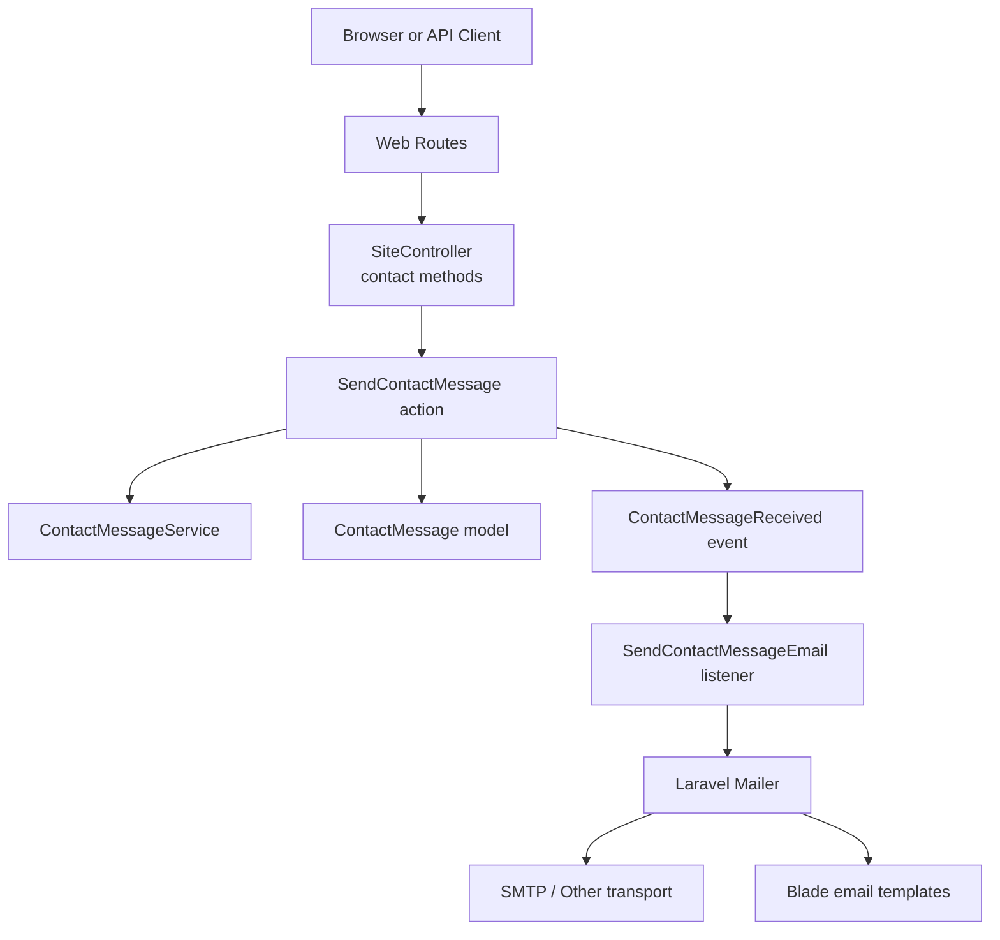
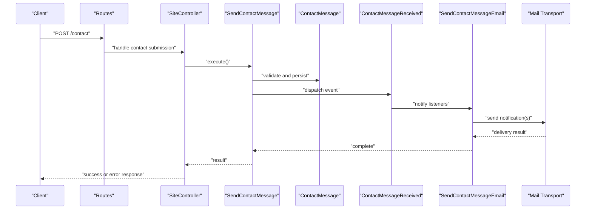
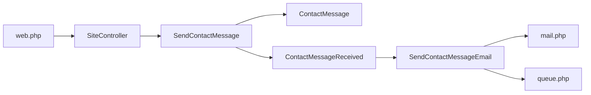

# Contact Form and Email Handling

<cite>
**Referenced Files in This Document**
- [SiteController.php](file://app/Http/Controllers/SiteController.php)
- [ContactMessage.php](file://app/Models/ContactMessage.php)
- [SendContactMessage.php](file://app/Actions/SendContactMessage.php)
- [ContactMessageReceived.php](file://app/Events/ContactMessageReceived.php)
- [SendContactMessageEmail.php](file://app/Listeners/SendContactMessageEmail.php)
- [ContactMessageService.php](file://app/Services/ContactMessageService.php)
- [2026_04_17_110005_create_contact_messages_table.php](file://database/migrations/2026_04_17_110005_create_contact_messages_table.php)
- [contact.php](file://lang/en/contact.php)
- [web.php](file://routes/web.php)
- [mail.php](file://config/mail.php)
- [queue.php](file://config/queue.php)
- [events.php](file://bootstrap/app.php)
</cite>

## Table of Contents
1. [Introduction](#introduction)
2. [Project Structure](#project-structure)
3. [Core Components](#core-components)
4. [Architecture Overview](#architecture-overview)
5. [Detailed Component Analysis](#detailed-component-analysis)
6. [Dependency Analysis](#dependency-analysis)
7. [Performance Considerations](#performance-considerations)
8. [Security Considerations](#security-considerations)
9. [Troubleshooting Guide](#troubleshooting-guide)
10. [Conclusion](#conclusion)

## Introduction
This document explains the contact form system and email handling mechanisms. It covers how public contact submissions are received, validated, stored, and turned into emails for staff or administrators. The focus is on:
- How the site controller exposes contact endpoints.
- The ContactMessage model and database schema.
- The action that processes a contact submission.
- The event-driven listener that sends notification emails.
- Mail configuration and template rendering.
- Validation, spam protection, message storage, notification triggers, and admin forwarding.
- Customization examples for forms, templates, and category-based recipients.

## Project Structure
The contact feature spans several layers:
- HTTP layer: routes and controllers expose public endpoints.
- Application layer: actions encapsulate business logic for sending messages.
- Domain layer: models represent persisted contact messages.
- Event layer: an event is raised when a contact message arrives.
- Listener layer: the listener reacts to the event and dispatches emails.
- Services layer: shared services may assist with settings, SMTP, or messaging concerns.
- Configuration layer: mail and queue backends are configured centrally.
- Views layer: Blade templates render email content.

**Diagram sources**
- [web.php](file://routes/web.php)
- [SiteController.php](file://app/Http/Controllers/SiteController.php)
- [SendContactMessage.php](file://app/Actions/SendContactMessage.php)
- [ContactMessageService.php](file://app/Services/ContactMessageService.php)
- [ContactMessage.php](file://app/Models/ContactMessage.php)
- [ContactMessageReceived.php](file://app/Events/ContactMessageReceived.php)
- [SendContactMessageEmail.php](file://app/Listeners/SendContactMessageEmail.php)
- [mail.php](file://config/mail.php)
- [queue.php](file://config/queue.php)

**Section sources**
- [web.php](file://routes/web.php)
- [SiteController.php](file://app/Http/Controllers/SiteController.php)
- [SendContactMessage.php](file://app/Actions/SendContactMessage.php)
- [ContactMessageService.php](file://app/Services/ContactMessageService.php)
- [ContactMessage.php](file://app/Models/ContactMessage.php)
- [ContactMessageReceived.php](file://app/Events/ContactMessageReceived.php)
- [SendContactMessageEmail.php](file://app/Listeners/SendContactMessageEmail.php)
- [mail.php](file://config/mail.php)
- [queue.php](file://config/queue.php)

## Core Components
- SiteController contact methods: entry points for public contact submissions.
- SendContactMessage action: orchestrates validation, persistence, events, and notifications.
- ContactMessage model: domain entity for contact submissions.
- ContactMessageReceived event: signals that a new message has been created.
- SendContactMessageEmail listener: consumes the event and sends emails via Laravel Mailer.
- ContactMessageService: reusable service for contact-related operations if needed by other parts of the app.
- Database migration: defines the contact_messages table schema.
- Localization file: provides user-facing labels for the contact form.
- Mail and queue configuration: controls email transport and asynchronous processing.

**Section sources**
- [SiteController.php](file://app/Http/Controllers/SiteController.php)
- [SendContactMessage.php](file://app/Actions/SendContactMessage.php)
- [ContactMessage.php](file://app/Models/ContactMessage.php)
- [ContactMessageReceived.php](file://app/Events/ContactMessageReceived.php)
- [SendContactMessageEmail.php](file://app/Listeners/SendContactMessageEmail.php)
- [ContactMessageService.php](file://app/Services/ContactMessageService.php)
- [2026_04_17_110005_create_contact_messages_table.php](file://database/migrations/2026_04_17_110005_create_contact_messages_table.php)
- [contact.php](file://lang/en/contact.php)
- [mail.php](file://config/mail.php)
- [queue.php](file://config/queue.php)

## Architecture Overview
The contact flow uses a layered architecture with event-driven email delivery:
1. A client submits a contact form to a route handled by SiteController.
2. The controller delegates to the SendContactMessage action.
3. The action validates input, persists the ContactMessage, and raises ContactMessageReceived.
4. The SendContactMessageEmail listener receives the event and sends one or more emails using Blade templates.
5. Emails are dispatched through the configured mail transport, optionally queued for performance.

**Diagram sources**
- [web.php](file://routes/web.php)
- [SiteController.php](file://app/Http/Controllers/SiteController.php)
- [SendContactMessage.php](file://app/Actions/SendContactMessage.php)
- [ContactMessage.php](file://app/Models/ContactMessage.php)
- [ContactMessageReceived.php](file://app/Events/ContactMessageReceived.php)
- [SendContactMessageEmail.php](file://app/Listeners/SendContactMessageEmail.php)
- [mail.php](file://config/mail.php)

## Detailed Component Analysis

### SiteController Contact Methods
Responsibilities:
- Expose public endpoints for contact form submission.
- Accept form data from the request.
- Delegate processing to the SendContactMessage action.
- Return appropriate responses (success, validation errors).

Integration points:
- Web routes define the URL endpoint.
- Request payloads should include fields such as name, email, subject/category, and message body.
- Responses should be compatible with both browser redirects and JSON APIs.

Validation and security notes:
- Prefer validating at the action level through the SendContactMessage action to keep controllers thin.
- Apply rate limiting on the route to reduce abuse.
- Sanitize output where necessary; avoid executing untrusted content.

Customization tips:
- Add additional fields to the request payload and extend the action’s validation rules accordingly.
- Introduce a category field to route emails to different recipients.

**Section sources**
- [web.php](file://routes/web.php)
- [SiteController.php](file://app/Http/Controllers/SiteController.php)

### SendContactMessage Action
Responsibilities:
- Orchestrate contact submission processing.
- Validate incoming data against business rules.
- Persist a ContactMessage record.
- Raise the ContactMessageReceived event so listeners can react.
- Optionally return structured results to the controller.

Processing logic:
- Input normalization and validation.
- Creation of a ContactMessage instance.
- Persistence via Eloquent.
- Dispatching an event for decoupled email handling.

Optimization opportunities:
- Defer heavy work (e.g., sending emails) to listeners or jobs to keep this action fast.
- Use idempotency keys for duplicate prevention if the same submission can be retried.

Error handling:
- Throw validation exceptions on invalid input.
- Wrap persistence and event dispatch in try/catch blocks to handle unexpected failures gracefully.

**Section sources**
- [SendContactMessage.php](file://app/Actions/SendContactMessage.php)
- [ContactMessage.php](file://app/Models/ContactMessage.php)
- [ContactMessageReceived.php](file://app/Events/ContactMessageReceived.php)

### ContactMessage Model
Responsibilities:
- Represent a contact submission in the application domain.
- Provide attributes for name, email, category, message, and optional metadata.
- Define fillable fields, casts, and relationships if any.

Data structure highlights:
- Typical fields include sender name, sender email, subject or category, message text, and timestamps.
- Casting booleans or enums for status flags, if used.

Complexity considerations:
- Simple CRUD with lightweight queries; indexes on frequently filtered columns like created_at or category if needed.

Extensibility:
- Add computed properties for formatted display values.
- Attach observers for auditing or analytics if required.

**Section sources**
- [ContactMessage.php](file://app/Models/ContactMessage.php)
- [2026_04_17_110005_create_contact_messages_table.php](file://database/migrations/2026_04_17_110005_create_contact_messages_table.php)

### ContactMessageReceived Event
Responsibilities:
- Carry the persisted ContactMessage context to listeners.
- Enable decoupled processing such as sending emails, logging, or analytics.

Usage:
- Dispatched by the SendContactMessage action after successful persistence.
- Listeners receive the event and perform side effects without blocking the main flow.

**Section sources**
- [ContactMessageReceived.php](file://app/Events/ContactMessageReceived.php)

### SendContactMessageEmail Listener
Responsibilities:
- Listen for ContactMessageReceived.
- Build and send one or more notification emails based on the message content.
- Support multiple recipients, including admins and department-specific addresses.
- Render Blade templates with message data.

Delivery process:
- Resolve mail configuration from config/mail.php.
- Optionally use queued mailers defined in config/queue.php for asynchronous delivery.
- Map categories or subjects to recipient lists.

Template usage:
- Uses Blade views under the mail templates directory.
- Passes ContactMessage attributes to the view for rendering.

Customization:
- Add conditional routing to different recipient lists based on message category.
- Attach attachments if allowed by policy and validated safely.

**Section sources**
- [SendContactMessageEmail.php](file://app/Listeners/SendContactMessageEmail.php)
- [mail.php](file://config/mail.php)
- [queue.php](file://config/queue.php)

### ContactMessageService
Responsibilities:
- Encapsulate reusable contact-related logic.
- Provide helpers for reading settings, formatting messages, or querying stored messages.

Integration points:
- Can be injected into controllers, actions, or admin features for consistency.

Extensibility:
- Add methods for exporting messages, generating reports, or integrating with third-party systems.

**Section sources**
- [ContactMessageService.php](file://app/Services/ContactMessageService.php)

### Database Migration: contact_messages Table
Purpose:
- Defines the persistent schema for contact submissions.

Schema characteristics:
- Columns for sender information, subject or category, message body, and timestamps.
- Indexes on frequently queried columns for performance.

Migration best practices:
- Keep backward-compatible changes.
- Seed default settings if needed.

**Section sources**
- [2026_04_17_110005_create_contact_messages_table.php](file://database/migrations/2026_04_17_110005_create_contact_messages_table.php)

### Localization File: contact.php
Purpose:
- Provides UI strings for the contact form, such as placeholders, labels, and success messages.

Customization:
- Translate labels into other languages.
- Add new keys for additional form fields.

**Section sources**
- [contact.php](file://lang/en/contact.php)

### Web Routes
Purpose:
- Register the public contact endpoint(s) that invoke SiteController methods.

Configuration:
- Ensure routes are accessible without authentication.
- Apply middleware such as rate limiting and CSRF protection.

**Section sources**
- [web.php](file://routes/web.php)

## Dependency Analysis
High-level dependencies:
- Routes depend on controllers.
- Controllers depend on actions.
- Actions depend on models and events.
- Events trigger listeners.
- Listeners depend on mail configuration and templates.
- Services provide cross-cutting utilities.

**Diagram sources**
- [web.php](file://routes/web.php)
- [SiteController.php](file://app/Http/Controllers/SiteController.php)
- [SendContactMessage.php](file://app/Actions/SendContactMessage.php)
- [ContactMessage.php](file://app/Models/ContactMessage.php)
- [ContactMessageReceived.php](file://app/Events/ContactMessageReceived.php)
- [SendContactMessageEmail.php](file://app/Listeners/SendContactMessageEmail.php)
- [mail.php](file://config/mail.php)
- [queue.php](file://config/queue.php)

**Section sources**
- [web.php](file://routes/web.php)
- [SiteController.php](file://app/Http/Controllers/SiteController.php)
- [SendContactMessage.php](file://app/Actions/SendContactMessage.php)
- [ContactMessage.php](file://app/Models/ContactMessage.php)
- [ContactMessageReceived.php](file://app/Events/ContactMessageReceived.php)
- [SendContactMessageEmail.php](file://app/Listeners/SendContactMessageEmail.php)
- [mail.php](file://config/mail.php)
- [queue.php](file://config/queue.php)

## Performance Considerations
- Keep controller methods thin; delegate processing to actions and services.
- Use asynchronous mail delivery when possible to avoid blocking requests.
- Cache static configuration for recipients and templates if accessed frequently.
- Index database columns used in filtering or reporting, such as created_at or category.
- Monitor queue worker throughput and adjust concurrency based on load.

[No sources needed since this section provides general guidance]

## Security Considerations
Form submission security:
- Enforce CSRF protection on web routes.
- Apply strict server-side validation in the action.
- Limit request size and field lengths to prevent abuse.
- Implement rate limiting per IP or per email address.
- Avoid executing or storing raw HTML from users unless explicitly sanitized.

Email security:
- Use TLS and authenticated SMTP credentials.
- Set explicit From addresses and Reply-To headers.
- Validate and sanitize any dynamic content before rendering templates.
- Avoid leaking sensitive data in email bodies or headers.

Spam protection measures:
- Rate limiting and CAPTCHA integration for high-risk endpoints.
- Honeypot fields to detect automated submissions.
- Block known disposable email domains or suspicious patterns.
- Log and alert on repeated failed submissions.

[No sources needed since this section provides general guidance]

## Troubleshooting Guide
Common issues and resolutions:
- Emails not sent:
  - Verify mail driver settings in mail.php.
  - Check queue workers are running if using async mail.
  - Inspect logs for SMTP connection errors.
- Delivery delays:
  - Increase queue worker concurrency.
  - Check external SMTP provider limits and throttling.
- Template rendering errors:
  - Ensure all variables passed from the listener exist in the Blade template.
  - Clear compiled view cache if templates change unexpectedly.
- Recipient routing problems:
  - Confirm category-to-email mapping logic in the listener.
  - Validate configuration values for different departments or roles.

Operational checks:
- Review queue job tables and failed job queues.
- Inspect application logs around event dispatch and listener execution.
- Test mail delivery with a test email class if available.

**Section sources**
- [mail.php](file://config/mail.php)
- [queue.php](file://config/queue.php)
- [SendContactMessageEmail.php](file://app/Listeners/SendContactMessageEmail.php)

## Conclusion
The contact form system follows a clean, layered design with clear separation of responsibilities. Controllers expose endpoints, actions orchestrate validation and persistence, events decouple email delivery, and listeners render and send emails through configurable transports. This approach makes it easy to customize forms, extend templates, route emails by category, and secure submissions against abuse. Proper configuration of mail and queue backends ensures reliable delivery even under load.

[No sources needed since this section summarizes without analyzing specific files]