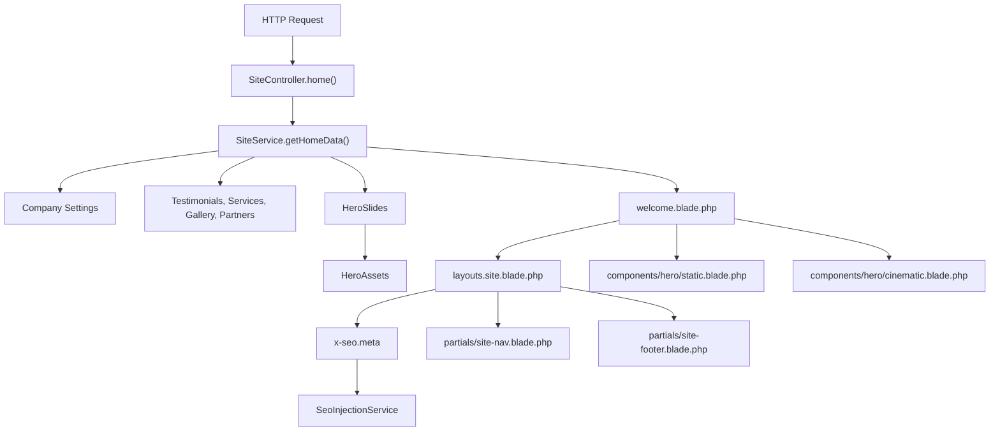
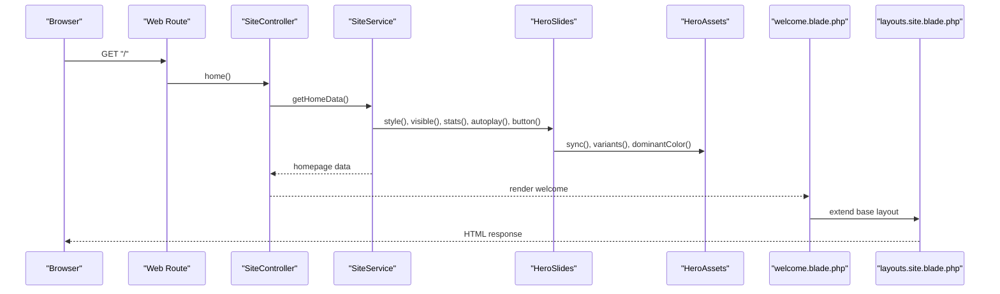
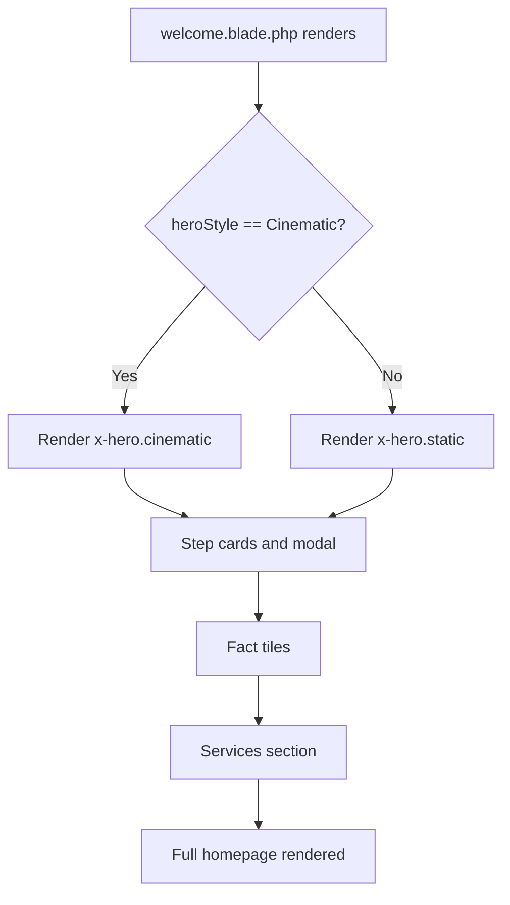
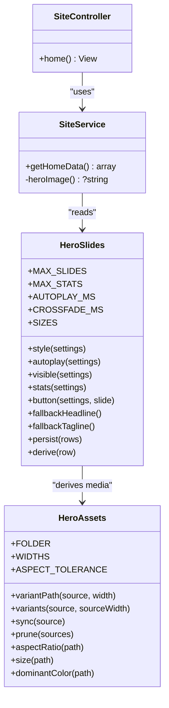
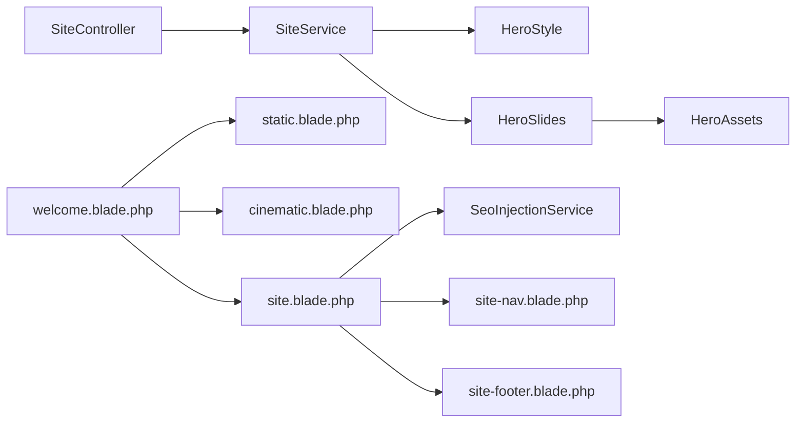

# Homepage and Landing Page

<cite>
**Referenced Files in This Document**   
- [SiteController.php](file://app/Http/Controllers/SiteController.php)
- [SiteService.php](file://app/Services/SiteService.php)
- [HeroSlides.php](file://app/Support/HeroSlides.php)
- [HeroAssets.php](file://app/Support/HeroAssets.php)
- [HeroStyle.php](file://app/Enums/HeroStyle.php)
- [welcome.blade.php](file://resources/views/welcome.blade.php)
- [static.blade.php](file://resources/views/components/hero/static.blade.php)
- [cinematic.blade.php](file://resources/views/components/hero/cinematic.blade.php)
- [site.blade.php](file://resources/views/layouts/site.blade.php)
- [SeoInjectionService.php](file://app/Services/SeoInjectionService.php)
- [site-nav.blade.php](file://resources/views/partials/site-nav.blade.php)
- [site-footer.blade.php](file://resources/views/partials/site-footer.blade.php)
</cite>

## Table of Contents

1. [Introduction](#introduction)
2. [Project Structure](#project-structure)
3. [Core Components](#core-components)
4. [Architecture Overview](#architecture-overview)
5. [Detailed Component Analysis](#detailed-component-analysis)
6. [Dependency Analysis](#dependency-analysis)
7. [Performance Considerations](#performance-considerations)
8. [Troubleshooting Guide](#troubleshooting-guide)
9. [Accessibility, Mobile Responsiveness, and Browser Compatibility](#accessibility-mobile-responsiveness-and-browser-compatibility)
10. [Conclusion](#conclusion)

## Introduction

The Highblossom homepage is the public landing page for the automotive glass service site. It renders through a Laravel controller that delegates data loading to a shared service, then passes configuration into a Blade layout and a hero section component. The hero itself has two variants:

- **Static variant**: A single background photograph with an animated headline, trust badges, subheadline, and call-to-action links.
- **Cinematic variant**: A full-bleed card with layered photography, a display word behind the subject, one or more auto-playing slides, stat counters, and slide preview controls.

The implementation is designed so editors can switch between these variants from the admin interface without changing frontend code. When no usable cinematic slide exists, the homepage automatically falls back to the static variant. Dynamic content such as testimonials, services, gallery images, partners, process steps, and FAQ rows is loaded from models and settings, while SEO metadata is generated centrally.

## Project Structure

The homepage lives under the public-facing site layer:

| Layer | Responsibility | Key Files |
|---|---|---|
| HTTP Controller | Receives the home request and returns the `welcome` view | [SiteController.php](file://app/Http/Controllers/SiteController.php) |
| Service | Assembles homepage data, including hero configuration | [SiteService.php](file://app/Services/SiteService.php) |
| Hero Configuration | Normalizes slide data, statistics, autoplay, button defaults, and responsive sizes | [HeroSlides.php](file://app/Support/HeroSlides.php) |
| Hero Image Assets | Generates responsive WebP variants and dominant colors | [HeroAssets.php](file://app/Support/HeroAssets.php) |
| Hero Style Enum | Chooses between static and cinematic presentation | [HeroStyle.php](file://app/Enums/HeroStyle.php) |
| View Layout | Base HTML, head, SEO injection, navigation, footer, and global scripts | [site.blade.php](file://resources/views/layouts/site.blade.php) |
| Home View | Root homepage markup and style switch | [welcome.blade.php](file://resources/views/welcome.blade.php) |
| Static Hero Component | Single-image hero fallback | [static.blade.php](file://resources/views/components/hero/static.blade.php) |
| Cinematic Hero Component | Slide carousel with layered media | [cinematic.blade.php](file://resources/views/components/hero/cinematic.blade.php) |
| Navigation and Footer | Global site navigation and footer linking back to the homepage | [site-nav.blade.php](file://resources/views/partials/site-nav.blade.php), [site-footer.blade.php](file://resources/views/partials/site-footer.blade.php) |
| SEO Injection | Generates meta tags, Open Graph, Twitter cards, and structured data | [SeoInjectionService.php](file://app/Services/SeoInjectionService.php) |

**Diagram sources**
- [SiteController.php:1-180](file://app/Http/Controllers/SiteController.php#L1-L180)
- [SiteService.php:1-200](file://app/Services/SiteService.php#L1-L200)
- [HeroSlides.php:1-200](file://app/Support/HeroSlides.php#L1-L200)
- [HeroAssets.php:1-200](file://app/Support/HeroAssets.php#L1-L200)
- [welcome.blade.php:1-200](file://resources/views/welcome.blade.php#L1-L200)
- [site.blade.php:1-131](file://resources/views/layouts/site.blade.php#L1-L131)

**Section sources**
- [SiteController.php:1-180](file://app/Http/Controllers/SiteController.php#L1-L180)
- [SiteService.php:1-200](file://app/Services/SiteService.php#L1-L200)
- [welcome.blade.php:1-200](file://resources/views/welcome.blade.php#L1-L200)
- [site.blade.php:1-131](file://resources/views/layouts/site.blade.php#L1-L131)

## Core Components

### SiteController Home Method

The `SiteController::home()` method is the entry point for the homepage. It does not build data directly; it returns the `welcome` view and delegates all dynamic content to `SiteService::getHomeData()`. This keeps the controller thin and reusable across other public pages.

Key responsibilities:

- Injects `SiteService`, `StoreQuoteAction`, and `SendContactMessage`.
- Returns the `welcome` Blade view.
- Passes the array returned by `SiteService::getHomeData()`.

This design means changes to homepage content should generally be made in `SiteService` or the Blade templates, not in the controller.

**Section sources**
- [SiteController.php:20-45](file://app/Http/Controllers/SiteController.php#L20-L45)

### SiteService Home Data

`SiteService::getHomeData()` is the central hub for homepage content. It loads:

- Featured and other testimonials.
- Hero style, slides, stats, autoplay setting, and button defaults.
- The static hero image.
- Featured services and gallery images.
- Active partners with logos.
- Backed testimonial stats.
- Fact tiles, warranty highlights, process steps, and FAQs.
- Time format display preferences.

The service also enforces the fallback rule: if the admin selects the cinematic hero but no usable slide exists, the homepage renders the static hero instead.

**Section sources**
- [SiteService.php:40-115](file://app/Services/SiteService.php#L40-L115)
- [SiteService.php:117-140](file://app/Services/SiteService.php#L117-L140)

### HeroSlides Configuration

`HeroSlides` owns the contract for a slide row. It normalizes, validates, derives, and presents hero data. Important constants include:

| Constant | Purpose |
|---|---|
| `MAX_SLIDES` | Limits the number of carousel slides |
| `MAX_STATS` | Limits the number of hero stat counters |
| `AUTOPLAY_MS` | Controls how long each slide stays visible |
| `CROSSFADE_MS` | Controls the crossfade transition duration |
| `SIZES` | Defines the responsive `sizes` attribute used by browser image selection |

Public methods include:

| Method | Output |
|---|---|
| `style()` | Resolves whether the homepage uses static or cinematic mode |
| `autoplay()` | Reads whether slides advance automatically |
| `visible()` | Filters out invalid rows and resolves URLs |
| `stats()` | Prepares stat counters for animation |
| `button()` | Resolves per-slide or default call-to-action label and URL |
| `persist()` | Sanitizes and derives saved slide rows |
| `present()` | Converts stored rows into arrays the template can render |

**Section sources**
- [HeroSlides.php:1-120](file://app/Support/HeroSlides.php#L1-L120)
- [HeroSlides.php:201-379](file://app/Support/HeroSlides.php#L201-L379)

### HeroAssets Media Pipeline

`HeroAssets` manages derived image files for the cinematic hero. It generates WebP variants at fixed widths and computes a dominant color placeholder.

Important behavior:

- Variant paths are deterministic based on source filename and hash.
- Widths below the source image size generate resized WebP files.
- Widths at or above the source size point back to the original file, avoiding upscaling.
- Missing variants are generated on save, not on every page load.
- Unreadable or external paths are rejected safely.
- Derived files outside configured sources are pruned.

| Property or Method | Meaning |
|---|---|
| `FOLDER` | Public disk folder for derived hero assets |
| `WIDTHS` | Responsive ladder: small, medium, large |
| `ASPECT_TOLERANCE` | Maximum allowed aspect-ratio difference between background and cutout |
| `variantPath()` | Builds a deterministic path for one width |
| `variants()` | Maps requested widths to actual asset paths |
| `sync()` | Creates missing variants idempotently |
| `prune()` | Removes orphaned derived files |
| `dominantColor()` | Extracts a placeholder color for preloader backgrounds |

**Section sources**
- [HeroAssets.php:1-200](file://app/Support/HeroAssets.php#L1-L200)
- [HeroAssets.php:201-268](file://app/Support/HeroAssets.php#L201-L268)

### HeroStyle Enum

`HeroStyle` defines the two supported homepage hero modes:

| Value | Behavior |
|---|---|
| `Static` | Classic single-image hero with animated headline and trust copy |
| `Cinematic` | Full-bleed layered card with slides, counters, and transitions |

It also provides labels, descriptions, default values, options for the admin UI, and safe normalization so invalid stored values do not crash the homepage.

**Section sources**
- [HeroStyle.php:1-78](file://app/Enums/HeroStyle.php#L1-L78)

## Architecture Overview

The homepage request follows a clear server-side rendering pipeline. No JavaScript is required to render the first page; client scripts enhance interactivity afterward.

**Diagram sources**
- [SiteController.php:20-45](file://app/Http/Controllers/SiteController.php#L20-L45)
- [SiteService.php:40-115](file://app/Services/SiteService.php#L40-L115)
- [HeroSlides.php:1-120](file://app/Support/HeroSlides.php#L1-L120)
- [HeroAssets.php:1-200](file://app/Support/HeroAssets.php#L1-L200)
- [welcome.blade.php:1-60](file://resources/views/welcome.blade.php#L1-L60)
- [site.blade.php:1-131](file://resources/views/layouts/site.blade.php#L1-L131)

## Detailed Component Analysis

### Home View and Style Switch

The `welcome.blade.php` file is the root homepage template. It extends the site layout and declares the page title. Its most important responsibility is choosing between the cinematic and static hero components.

The decision logic is:

1. If `heroStyle` equals `HeroStyle::Cinematic`, render the cinematic hero component.
2. Otherwise, render the static hero component.
3. The service already downgrades cinematic when there are no usable slides, so the view branch is stable.

Below the hero, the view renders:

- An Alpine-powered step card grid.
- A modal dialog for step details.
- Fact tiles backed by testimonials or admin-defined tiles.
- Services preview.
- Additional homepage sections.

**Diagram sources**
- [welcome.blade.php:1-60](file://resources/views/welcome.blade.php#L1-L60)

**Section sources**
- [welcome.blade.php:1-200](file://resources/views/welcome.blade.php#L1-L200)

### Static Hero Component

The static hero component is the classic landing block. It expects:

| Prop | Purpose |
|---|---|
| `heroImage` | Background photograph URL |
| `tagline` | Headline text and accessible heading content |
| `years` | Optional years-of-experience badge |

Rendering characteristics:

- Uses a full-width background image with overlay gradients and grain texture.
- Provides an accessible `<h1>` and visual headline container.
- Includes trust badges and optional experience badge.
- Links to quote and gallery routes.
- Marks the background image as eager-loaded with high fetch priority.

Customization points:

- Change the background image by updating the company setting read by `SiteService`.
- Replace locale keys for tagline, badges, and CTAs.
- Adjust gradient overlays and opacity in the component.
- Add or remove badges around the headline area.

**Section sources**
- [static.blade.php:1-96](file://resources/views/components/hero/static.blade.php#L1-L96)

### Cinematic Hero Component

The cinematic hero component renders a multi-layer slide carousel. It receives:

| Prop | Purpose |
|---|---|
| `slides` | Array of prepared slide objects |
| `stats` | Stat counters for the bottom strip |
| `autoplay` | Whether slides advance automatically |
| `button` | Default label and URL for the primary CTA |
| `whatsapp` | Optional WhatsApp link |

Each slide object contains:

| Field | Meaning |
|---|---|
| `background_src` | Primary photograph URL |
| `background_srcset` | Responsive image candidates |
| `cutout_src` | Optional foreground subject cutout |
| `cutout_srcset` | Responsive cutout candidates |
| `width`, `height` | Photograph dimensions |
| `dominant` | Placeholder background color |
| `headline`, `tagline`, `button_label`, `button_url` | Per-slide copy and CTA |
| `word`, `alt` | Display word and accessibility alt text |

The component builds a semantic carousel with:

- CSS custom properties for interval and crossfade timing.
- Keyboard navigation using left and right arrow keys.
- Pause-on-hover and focus management.
- A single scrim over the entire card for consistent contrast.
- Three layers per slide: photograph, display word, and subject cutout.
- First-slide content rendered in static HTML so search engines and non-JavaScript users still see meaningful text.

**Diagram sources**
- [HeroSlides.php:1-120](file://app/Support/HeroSlides.php#L1-L120)
- [HeroAssets.php:1-200](file://app/Support/HeroAssets.php#L1-L200)
- [SiteService.php:40-115](file://app/Services/SiteService.php#L40-L115)
- [SiteController.php:20-45](file://app/Http/Controllers/SiteController.php#L20-L45)

**Section sources**
- [cinematic.blade.php:1-200](file://resources/views/components/hero/cinematic.blade.php#L1-L200)
- [HeroSlides.php:1-200](file://app/Support/HeroSlides.php#L1-L200)

### Blade Template Structure

The Blade structure is layered:

1. `layouts.site.blade.php` provides the document shell, viewport, fonts, global styles, scripts, navigation, footer, and SEO meta injection.
2. `welcome.blade.php` extends the site layout and provides the homepage body.
3. Hero components are included inside the homepage header.
4. Navigation and footer partials are reused across the site.

The layout includes:

- UTF-8 charset.
- Responsive viewport meta tag.
- Google site verification meta tag.
- SEO meta component.
- Favicon and theme script includes.
- Font preconnects and stylesheet links.
- Vite asset pipeline for CSS and JavaScript.
- Swiper CDN for carousel functionality.
- Announcement dismissal state applied before first paint.

**Section sources**
- [site.blade.php:1-131](file://resources/views/layouts/site.blade.php#L1-L131)

### Hero Slides System

The slides system is built around persisted settings rather than hard-coded data. Each slide can carry:

- Background photograph.
- Optional foreground cutout.
- Alt text.
- Headline.
- Tagline.
- Button label.
- Button URL.

At save time, `HeroSlides::persist()` whitelists typed keys, trims values, recomputes derived fields, and ensures only valid photographs remain. At render time, `HeroSlides::visible()` filters empty rows and limits output to `MAX_SLIDES`.

The carousel configuration comes from:

| Setting | Source |
|---|---|
| Hero style | `home_hero_style` |
| Autoplay | `home_hero_autoplay` |
| Slides | `home_hero_slides` |
| Stats | `home_hero_stats` |
| Button label | `home_hero_button_label` |
| Button URL | `home_hero_button_url` |

Slide transitions use:

- CSS custom properties for interval and crossfade duration.
- Alpine.js for active slide state.
- Keyboard events for left/right navigation.
- Mouse hover and focus events for pause behavior.

**Section sources**
- [HeroSlides.php:1-120](file://app/Support/HeroSlides.php#L1-L120)
- [HeroSlides.php:201-379](file://app/Support/HeroSlides.php#L201-L379)
- [cinematic.blade.php:1-200](file://resources/views/components/hero/cinematic.blade.php#L1-L200)

### Background Media Handling

Background media handling is split between storage, derivation, and presentation:

1. `SiteService::heroImage()` reads the configured static hero image and converts it to a public asset URL.
2. `HeroAssets::sync()` generates responsive WebP variants during save.
3. `HeroAssets::variants()` maps responsive widths to either generated variants or the original source.
4. `HeroSlides::srcset()` builds the `srcset` attribute string.
5. `HeroAssets::dominantColor()` supplies a placeholder color for the cinematic card background.

This avoids filesystem or object-storage requests on every page load.

**Section sources**
- [SiteService.php:117-140](file://app/Services/SiteService.php#L117-L140)
- [HeroAssets.php:1-200](file://app/Support/HeroAssets.php#L1-L200)
- [HeroSlides.php:201-379](file://app/Support/HeroSlides.php#L201-L379)

### Navigation Integration

The global navigation and footer both link back to the homepage route. The navigation marks the current route as active when the user is on the homepage.

Navigation integration patterns:

- Header logo links to `route('home')`.
- Desktop menu item for the homepage is highlighted with an active class.
- Mobile menu includes a homepage link.
- Footer logo links to the homepage.
- Contact calls and WhatsApp actions in the footer reference homepage translation keys.

**Section sources**
- [site-nav.blade.php:170-187](file://resources/views/partials/site-nav.blade.php#L170-L187)
- [site-nav.blade.php:376-379](file://resources/views/partials/site-nav.blade.php#L376-L379)
- [site-footer.blade.php:7-7](file://resources/views/partials/site-footer.blade.php#L7-L7)
- [site-footer.blade.php:135-135](file://resources/views/partials/site-footer.blade.php#L135-L135)

### SEO Meta Tag Generation

SEO metadata is not baked into the homepage controller. Instead, the site layout injects an SEO meta component, which is populated by `SeoInjectionService`.

The service:

- Registers a view composer that attaches metadata to every view.
- Resolves metadata from bound models implementing `HasSeoInterface`.
- Falls back to static route metadata.
- Applies default site-wide metadata.
- Appends the site name to page titles.
- Sets canonical URLs.
- Copies metadata to Open Graph and Twitter fields when missing.
- Adds LocalBusiness structured data unless a page already supplies schema.

For the homepage, this means the layout will emit meta tags based on the current route and site settings. If no explicit route-level SEO override exists, defaults from company settings are used.

**Section sources**
- [site.blade.php:1-15](file://resources/views/layouts/site.blade.php#L1-L15)
- [SeoInjectionService.php:1-200](file://app/Services/SeoInjectionService.php#L1-L200)

## Dependency Analysis

The homepage depends on several layers:

**Diagram sources**
- [SiteController.php:20-45](file://app/Http/Controllers/SiteController.php#L20-L45)
- [SiteService.php:40-115](file://app/Services/SiteService.php#L40-L115)
- [HeroSlides.php:1-120](file://app/Support/HeroSlides.php#L1-L120)
- [HeroAssets.php:1-200](file://app/Support/HeroAssets.php#L1-L200)
- [welcome.blade.php:1-60](file://resources/views/welcome.blade.php#L1-L60)
- [site.blade.php:1-131](file://resources/views/layouts/site.blade.php#L1-L131)

Coupling observations:

- `SiteController` is loosely coupled to content because it delegates to `SiteService`.
- `SiteService` depends on settings and Eloquent models but hides database complexity from views.
- `HeroSlides` and `HeroAssets` encapsulate the hero contract, reducing duplication between admin, public templates, and persistence.
- Views depend on props passed from the service rather than reading settings directly.
- SEO is centralized, preventing scattered meta tag logic across pages.

Potential risks:

- Changes to slide shape must go through `HeroSlides` to keep admin, persistence, and public rendering in sync.
- Media paths must remain on the configured public disk for `HeroAssets` to resolve them.
- If company settings become malformed, normalization and filtering prevent broken renders, but administrators may need guidance about invalid rows.

**Section sources**
- [SiteController.php:20-45](file://app/Http/Controllers/SiteController.php#L20-L45)
- [SiteService.php:40-115](file://app/Services/SiteService.php#L40-L115)
- [HeroSlides.php:1-120](file://app/Support/HeroSlides.php#L1-L120)
- [HeroAssets.php:1-200](file://app/Support/HeroAssets.php#L1-L200)

## Performance Considerations

### Large Media Assets

Recommendations:

- Upload high-resolution originals and let `HeroAssets` generate WebP variants. Avoid storing multiple manually resized copies.
- Use the cinematic hero’s responsive `srcset` so browsers choose appropriate widths.
- Keep slide counts at or below `MAX_SLIDES`.
- Prefer static hero mode when no cinematic slides are needed.
- Ensure generated variants exist after deployment; the asset pipeline skips upscaling and assumes variants are present.
- Monitor object storage for orphaned derived files and rely on pruning where possible.

### First Paint and Critical Rendering

The static hero marks its background image as eager with high fetch priority. This improves initial visual performance but increases bandwidth usage. Consider:

- Using appropriately sized hero images for the static variant.
- Keeping cinematic slide backgrounds optimized for web delivery.
- Relying on the dominant color placeholder in the cinematic hero to avoid white flashes while photos decode.
- Avoiding unnecessary animations when motion is reduced.

### Client-Side Interactivity

The homepage uses Alpine.js for:

- Step card selection.
- Modal open/close behavior.
- Cinematic carousel state.
- Slide progression timing.

These enhancements are secondary to server-rendered HTML. Pages should remain functional without JavaScript, especially for accessibility and crawlers.

### Database Queries

`SiteService::getHomeData()` performs queries for testimonials, services, gallery images, and partners. For very large datasets:

- Index relevant model columns such as active flags, order fields, and category relationships.
- Limit featured collections explicitly.
- Cache frequently accessed settings where appropriate.
- Avoid adding unbounded joins to the homepage query path.

[No sources needed since this section provides general guidance]

## Troubleshooting Guide

### Cinematic Hero Shows Nothing or Falls Back to Static

Likely causes:

- No slide has a readable background.
- The configured hero style is cinematic, but `HeroSlides::visible()` filtered out all rows.
- Slide background paths are missing or external URLs that cannot be processed.

Check:

- Company settings for `home_hero_style`.
- Company settings for `home_hero_slides`.
- Whether each slide has a valid background path.
- Whether `HeroAssets::sync()` produced variants.

Relevant code paths:

- [SiteService.php:40-115](file://app/Services/SiteService.php#L40-L115)
- [HeroSlides.php:60-120](file://app/Support/HeroSlides.php#L60-L120)
- [HeroAssets.php:120-200](file://app/Support/HeroAssets.php#L120-L200)

### Background Images Not Loading

Likely causes:

- Path is not on the configured public disk.
- File was deleted after variants were generated.
- External URL was stored instead of a local path.
- Storage permissions are incorrect.

Relevant checks:

- `HeroAssets::isUsable()` rejects empty strings, external URLs, and missing files.
- `HeroAssets::variants()` points wide slots back to the source file.
- `HeroAssets::sync()` logs skipped variants.

Relevant code paths:

- [HeroAssets.php:1-120](file://app/Support/HeroAssets.php#L1-L120)
- [HeroAssets.php:201-268](file://app/Support/HeroAssets.php#L201-L268)

### Cutout Appears Misaligned

Likely causes:

- Cutout aspect ratio differs significantly from the background.
- The editor replaced the background but kept an old cutout.

Behavior:

- `HeroSlides::aspectsMatch()` compares aspect ratios.
- Mismatched cutouts are removed during persistence.
- A tolerance allows small rounding differences.

Relevant code paths:

- [HeroSlides.php:330-379](file://app/Support/HeroSlides.php#L330-L379)
- [HeroAssets.php:30-50](file://app/Support/HeroAssets.php#L30-L50)

### Carousel Does Not Auto-Advance

Likely causes:

- Autoplay setting is disabled.
- JavaScript failed to load.
- User hovered over the carousel or moved focus away.

Check:

- Company setting `home_hero_autoplay`.
- Whether `data-hero-autoplay` is set correctly.
- Whether `site-alpine.js` is loaded by Vite.

Relevant code paths:

- [HeroSlides.php:90-120](file://app/Support/HeroSlides.php#L90-L120)
- [cinematic.blade.php:1-60](file://resources/views/components/hero/cinematic.blade.php#L1-L60)
- [site.blade.php:40-80](file://resources/views/layouts/site.blade.php#L40-L80)

### SEO Tags Missing or Incorrect

Likely causes:

- No explicit route-level SEO override.
- Company settings lack meta title or description.
- OG image path is missing or not publicly accessible.

Check:

- `SeoInjectionService` default metadata resolution.
- Company settings for SEO fields.
- Whether the route is marked private and excluded from indexing.

Relevant code paths:

- [SeoInjectionService.php:120-200](file://app/Services/SeoInjectionService.php#L120-L200)
- [site.blade.php:1-15](file://resources/views/layouts/site.blade.php#L1-L15)

**Section sources**
- [SiteService.php:40-115](file://app/Services/SiteService.php#L40-L115)
- [HeroSlides.php:60-120](file://app/Support/HeroSlides.php#L60-L120)
- [HeroSlides.php:330-379](file://app/Support/HeroSlides.php#L330-L379)
- [HeroAssets.php:1-120](file://app/Support/HeroAssets.php#L1-L120)
- [HeroAssets.php:201-268](file://app/Support/HeroAssets.php#L201-L268)
- [cinematic.blade.php:1-60](file://resources/views/components/hero/cinematic.blade.php#L1-L60)
- [site.blade.php:40-80](file://resources/views/layouts/site.blade.php#L40-L80)
- [SeoInjectionService.php:120-200](file://app/Services/SeoInjectionService.php#L120-L200)

## Accessibility, Mobile Responsiveness, and Browser Compatibility

### Accessibility

The implementation includes several accessibility-oriented behaviors:

- The static hero uses an accessible `<h1>` and associates the visual headline container with that heading.
- The cinematic hero sets carousel roles and labels, supports keyboard navigation, and pauses on hover/focus.
- The homepage step modal uses `role="dialog"`, `aria-modal`, labeled title and description elements, escape key handling, and click-away dismissal.
- Decorative elements use `aria-hidden`.
- Contrast is preserved by a shared scrim over cinematic slides rather than relying on variable photo brightness.

Recommendations:

- Keep headlines concise and descriptive.
- Provide meaningful alt text for background and cutout images.
- Test keyboard-only navigation through the carousel and modal.
- Verify screen reader announcements for slide changes.
- Ensure CTA buttons have visible focus indicators.

**Section sources**
- [static.blade.php:40-96](file://resources/views/components/hero/static.blade.php#L40-L96)
- [cinematic.blade.php:1-60](file://resources/views/components/hero/cinematic.blade.php#L1-L60)
- [welcome.blade.php:60-180](file://resources/views/welcome.blade.php#L60-L180)

### Mobile Responsiveness

Responsive behavior is primarily Tailwind-based:

- Hero images use responsive classes and explicit width/height attributes.
- Cinematic slides use responsive `sizes` and `srcset` to serve appropriate widths.
- Card heights adapt to viewport height using clamp functions.
- Padding and typography scale from mobile to desktop.
- The step grid switches from one column to two or four columns.

Recommendations:

- Test hero images on narrow screens.
- Verify cutout alignment on different aspect ratios.
- Ensure tap targets are large enough on mobile.
- Confirm that the carousel remains usable without hover interactions.

**Section sources**
- [static.blade.php:1-96](file://resources/views/components/hero/static.blade.php#L1-L96)
- [cinematic.blade.php:1-200](file://resources/views/components/hero/cinematic.blade.php#L1-L200)
- [HeroSlides.php:30-50](file://app/Support/HeroSlides.php#L30-L50)

### Browser Compatibility

Compatibility considerations:

- The layout uses modern font features and backdrop blur utilities.
- The cinematic hero uses CSS custom properties, `clamp()`, `backdrop-filter`, and `background-clip: text`.
- Graceful fallbacks exist for unsupported features, such as the text-fill-color fallback in the cinematic word layer.
- Alpine.js powers interactive behavior; pages degrade gracefully when scripts fail.
- Swiper is loaded from a CDN for additional carousel functionality.

Recommendations:

- Test on older browsers if legacy support is required.
- Validate fallback styles for `background-clip: text`.
- Verify that reduced-motion preferences disable animations.
- Ensure progressive enhancement works when JavaScript is disabled.

**Section sources**
- [site.blade.php:1-131](file://resources/views/layouts/site.blade.php#L1-L131)
- [cinematic.blade.php:60-200](file://resources/views/components/hero/cinematic.blade.php#L60-L200)

## Conclusion

The Highblossom homepage is a layered, service-driven Blade application. The controller is thin, the service centralizes data assembly, and the hero components encapsulate presentation logic. The cinematic hero is powerful but opt-in, falling back safely to the static hero when no usable slide exists. Media handling is optimized by deriving responsive WebP variants at save time, avoiding per-request filesystem work. SEO metadata is centralized, and accessibility is addressed through semantic headings, roles, labels, keyboard navigation, and contrast-preserving scrim layers.

When customizing the homepage:

- Edit content through company settings and models where possible.
- Use `HeroSlides` and `HeroAssets` contracts for hero configuration.
- Optimize images before upload rather than creating multiple manual copies.
- Test both static and cinematic modes, especially when switching hero styles.
- Validate accessibility, mobile responsiveness, and graceful degradation without JavaScript.

[No sources needed since this section summarizes without analyzing specific files]