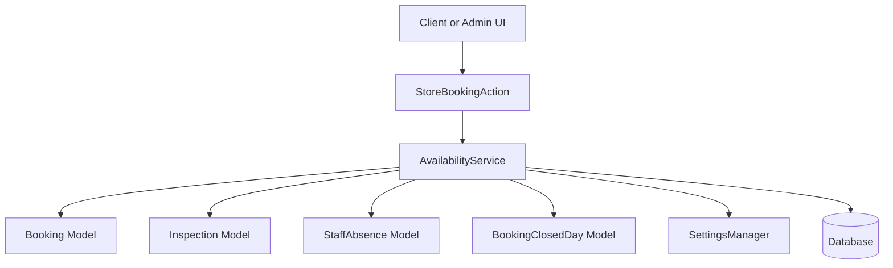
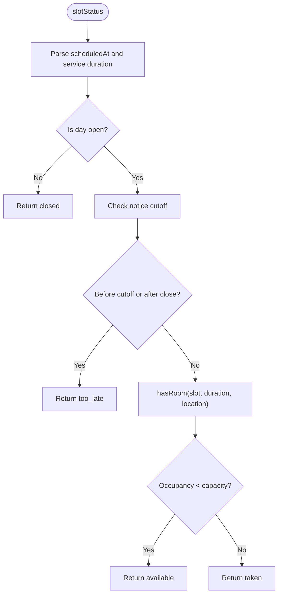
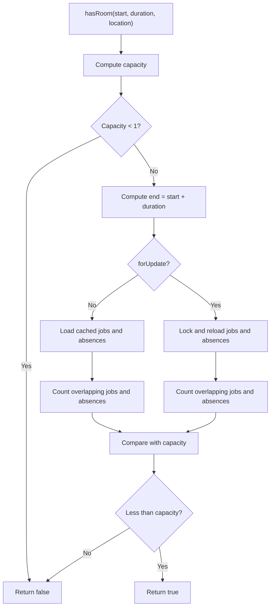
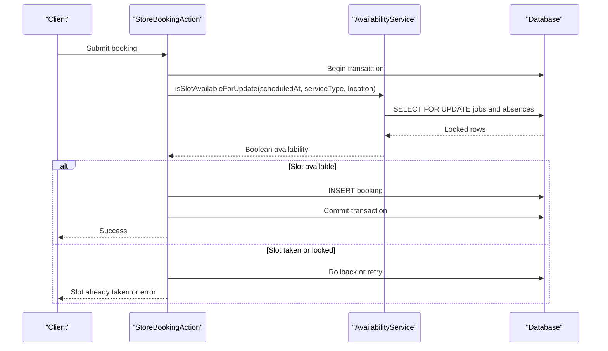
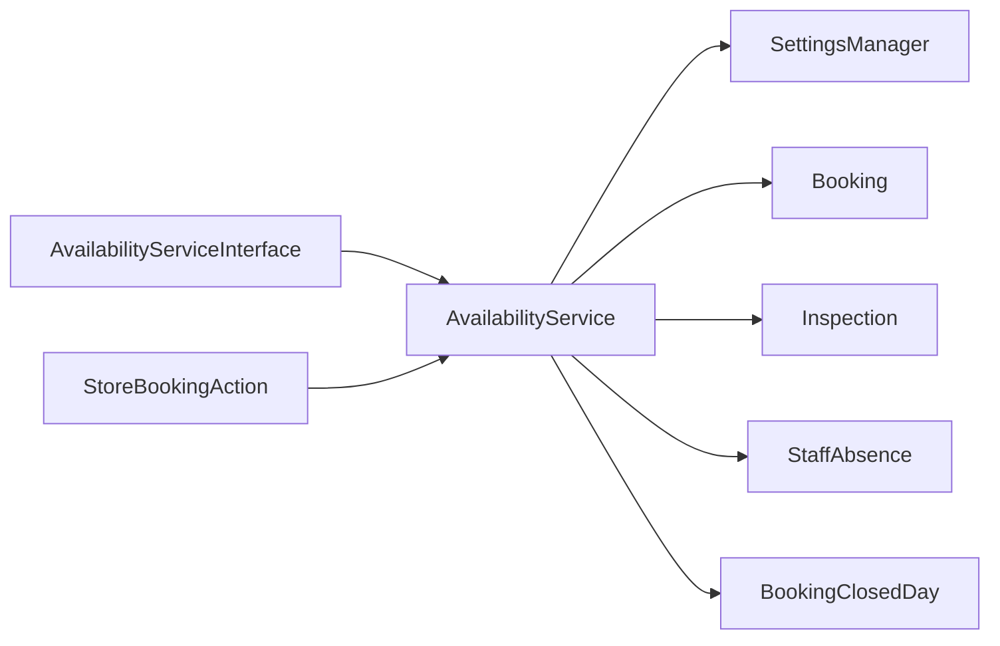

# Availability Algorithm and Scheduling Logic

<cite>
**Referenced Files in This Document**
- [AvailabilityService.php](file://app/Services/AvailabilityService.php)
- [AvailabilityServiceInterface.php](file://app/Services/Contracts/AvailabilityServiceInterface.php)
- [StoreBookingAction.php](file://app/Actions/StoreBookingAction.php)
- [Booking.php](file://app/Models/Booking.php)
- [Inspection.php](file://app/Models/Inspection.php)
- [StaffAbsence.php](file://app/Models/StaffAbsence.php)
- [BookingClosedDay.php](file://app/Models/BookingClosedDay.php)
- [SettingsManager.php](file://app/Services/Settings/SettingsManager.php)
- [2026_07_07_000000_add_scheduled_fields_to_bookings_table.php](file://database/migrations/2026_07_07_000000_add_scheduled_fields_to_bookings_table.php)
- [2026_10_01_000000_replace_unique_index_on_bookings_scheduled_at.php](file://database/migrations/2026_10_01_000000_replace_unique_index_on_bookings_scheduled_at.php)
- [2026_10_01_000001_close_saturday_working_hours.php](file://database/migrations/2026_10_01_000001_close_saturday_working_hours.php)
- [2026_10_18_000001_create_booking_closed_days_table.php](file://database/migrations/2026_10_18_000001_create_booking_closed_days_table.php)
</cite>

## Table of Contents
1. [Introduction](#introduction)
2. [Project Structure](#project-structure)
3. [Core Components](#core-components)
4. [Architecture Overview](#architecture-overview)
5. [Detailed Component Analysis](#detailed-component-analysis)
6. [Dependency Analysis](#dependency-analysis)
7. [Performance Considerations](#performance-considerations)
8. [Troubleshooting Guide](#troubleshooting-guide)
9. [Conclusion](#conclusion)
10. [Appendices](#appendices)

## Introduction
This document explains the availability algorithm that decides which appointment slots a customer may book. It covers open-hours calculation, lead-time enforcement, slot interval alignment, capacity limits per location, conflict detection over time intervals, staff absences, shop-wide closures, the notice cutoff system, and the caching strategy used to keep calendar rendering fast. It also contrasts the read-only availability path with the transactional update path that uses row locking for concurrent booking protection.

The implementation is centered on one service class, supported by Eloquent models, database schema changes, settings defaults, and the booking submission action.

## Project Structure
The availability logic lives primarily in a single service, with supporting models and migrations:

- Service layer: `AvailabilityService` implements `AvailabilityServiceInterface`.
- Models: `Booking`, `Inspection`, `StaffAbsence`, `BookingClosedDay`.
- Settings: `SettingsManager` supplies working hours, capacities, durations, and time format preferences.
- Booking flow: `StoreBookingAction` uses the service inside a database transaction with retry logic.
- Schema: scheduled fields, indexes, closed days, and Saturday working-hour normalization are defined in migrations.

**Diagram sources**
- [AvailabilityService.php:1-748](file://app/Services/AvailabilityService.php#L1-L748)
- [StoreBookingAction.php:1-267](file://app/Actions/StoreBookingAction.php#L1-L267)
- [SettingsManager.php:1-163](file://app/Services/Settings/SettingsManager.php#L1-L163)

**Section sources**
- [AvailabilityService.php:1-748](file://app/Services/AvailabilityService.php#L1-L748)
- [AvailabilityServiceInterface.php:1-133](file://app/Services/Contracts/AvailabilityServiceInterface.php#L1-L133)
- [StoreBookingAction.php:1-267](file://app/Actions/StoreBookingAction.php#L1-L267)

## Core Components
- `AvailabilityService`: The central scheduling engine. It calculates open slots, checks conflicts, enforces business rules, and caches data within a request.
- `AvailabilityServiceInterface`: Declares public methods and status constants (`available`, `closed`, `too_late`, `taken`).
- `Booking`: Stores the scheduled start, duration, location, and derived end time; also exposes inspection-driven rescheduling behavior.
- `Inspection`: Represents an inspection tied to a booking; when an inspection is scheduled, it can override the effective start time used for conflict checks.
- `StaffAbsence`: Represents staff-off periods that reduce available capacity.
- `BookingClosedDay`: Represents shop-wide closure dates where no bookings are allowed.
- `SettingsManager`: Provides working hours, slot intervals, service durations, capacities, and display formatting.
- `StoreBookingAction`: Wraps the booking submission in a transaction, performs a locked availability check, persists the booking, and retries on database deadlocks.

Key responsibilities:
- Decide whether a date/time is bookable.
- Generate all candidate slot starts for a day.
- Count overlapping committed jobs and staff absences against a location’s capacity.
- Protect concurrent submissions using `SELECT ... FOR UPDATE`.
- Cache job and absence data across a padded time window.

**Section sources**
- [AvailabilityServiceInterface.php:1-133](file://app/Services/Contracts/AvailabilityServiceInterface.php#L1-L133)
- [AvailabilityService.php:1-748](file://app/Services/AvailabilityService.php#L1-L748)
- [Booking.php:1-134](file://app/Models/Booking.php#L1-L134)
- [Inspection.php:1-82](file://app/Models/Inspection.php#L1-L82)
- [StaffAbsence.php:1-39](file://app/Models/StaffAbsence.php#L1-L39)
- [BookingClosedDay.php:1-35](file://app/Models/BookingClosedDay.php#L1-L35)
- [SettingsManager.php:1-163](file://app/Services/Settings/SettingsManager.php#L1-L163)
- [StoreBookingAction.php:1-267](file://app/Actions/StoreBookingAction.php#L1-L267)

## Architecture Overview
The availability algorithm follows this sequence:

1. Parse the requested slot into application timezone-naive wall-clock time.
2. Determine the job duration from the service type.
3. Check whether the day is open.
4. Enforce the minimum notice cutoff.
5. Verify the job finishes before closing time.
6. Count existing occupied capacity for the requested location.
7. Compare occupancy against the location capacity.
8. Return `available`, `closed`, `too_late`, or `taken`.

**Diagram sources**
- [AvailabilityService.php:1-748](file://app/Services/AvailabilityService.php#L1-L748)

**Section sources**
- [AvailabilityService.php:1-748](file://app/Services/AvailabilityService.php#L1-L748)

## Detailed Component Analysis

### Open Hours Calculation
Open hours determine whether a day has any valid slots and where each slot must finish.

- The service reads configured daily hours and treats missing or closed days as unavailable.
- A special `booking_closed_days` table marks shop-wide closure dates regardless of daily configuration.
- Slot generation only includes starts where the full job fits before closing time.
- Saturday was historically treated as closed in code while the stored setting claimed otherwise; a migration aligned the stored working hours with actual behavior.

Configuration source:
- Working hours, time format, and related defaults live in `SettingsManager::getDefaults`.

Impact:
- If `openHoursFor` returns null, every slot on that day is closed.
- Even if the day is open, a late-starting slot may still be rejected because the job would extend past closing.

**Section sources**
- [AvailabilityService.php:501-748](file://app/Services/AvailabilityService.php#L501-L748)
- [SettingsManager.php:1-163](file://app/Services/Settings/SettingsManager.php#L1-L163)
- [2026_10_01_000001_close_saturday_working_hours.php:1-56](file://database/migrations/2026_10_01_000001_close_saturday_working_hours.php#L1-L56)
- [2026_10_18_000001_create_booking_closed_days_table.php:1-39](file://database/migrations/2026_10_18_000001_create_booking_closed_days_table.php#L1-L39)

### Lead Time Enforcement and Notice Cutoff
The system prevents last-minute bookings through a configurable lead time.

- `leadTimeHours` reads `booking_lead_time_hours` and clamps negative values to zero.
- `noticeCutoff` adds those hours to the current application time.
- Both `slotStatus` and `isSlotAvailableForUpdate` reject slots before the cutoff.
- `earliestBookableSlot` aligns the first candidate forward to the next grid boundary after the cutoff.

Business rule extension point:
- Change `booking_lead_time_hours` in settings.
- Override the cutoff calculation by extending the service or wrapping it behind a policy method.

**Section sources**
- [AvailabilityService.php:201-500](file://app/Services/AvailabilityService.php#L201-L500)
- [AvailabilityService.php:501-748](file://app/Services/AvailabilityService.php#L501-L748)
- [SettingsManager.php:1-163](file://app/Services/Settings/SettingsManager.php#L1-L163)

### Slot Interval Management
Slots are generated at fixed intervals rather than per minute.

- `slotIntervalMinutes` reads `booking_slot_interval_minutes` and clamps it between 15 and 240 minutes.
- `slotStartsFor` walks from opening time forward, advancing by the interval, and only keeps starts where the job finishes before closing.
- `alignForward` finds the next grid-aligned slot boundary after a given moment.

Implications:
- A 30-minute default means candidates like 08:00, 08:30, 09:00, and so on.
- A longer interval reduces the number of conflict checks but offers coarser choices.
- Very short or very long intervals are guarded by constants.

**Section sources**
- [AvailabilityService.php:201-500](file://app/Services/AvailabilityService.php#L201-L500)
- [AvailabilityService.php:501-748](file://app/Services/AvailabilityService.php#L501-L748)

### Capacity Constraints Per Location
Capacity determines how many jobs can run concurrently.

- `capacityFor` supports `workshop`, `mobile`, and unknown locations.
- Unknown locations use the smaller of workshop and mobile capacity to avoid overpromising.
- Capacity is read from `booking_capacity_workshop` and `booking_capacity_mobile`, with a fallback of one bay when unset.
- If capacity is zero, no slot is available.

Location semantics:
- Workshop slots count only against workshop capacity.
- Mobile slots count only against mobile capacity.
- Bookings without a location are counted against every pool because the system cannot determine which bay they will occupy.

Schema support:
- `scheduled_at` and `location` were added to the bookings table to enable this filtering.

**Section sources**
- [AvailabilityService.php:201-500](file://app/Services/AvailabilityService.php#L201-L500)
- [SettingsManager.php:1-163](file://app/Services/Settings/SettingsManager.php#L1-L163)
- [2026_07_07_000000_add_scheduled_fields_to_bookings_table.php:1-29](file://database/migrations/2026_07_07_000000_add_scheduled_fields_to_bookings_table.php#L1-L29)

### Interval-Based Conflict Detection in `hasRoom`
Conflict detection compares job spans, not just start instants.

- `hasRoom` computes the requested slot span `[start, end]`.
- It counts existing jobs and absences overlapping that span.
- If the overlap count is less than capacity, the slot is available.
- An absent staff member increases the effective occupancy count for the affected interval.

Overlap test:
- `occupies` returns true when a job’s effective start is before the requested end and its effective end is after the requested start.
- Effective start prefers the inspection’s scheduled time when an inspection exists; otherwise it uses the booking’s `scheduled_at`.
- This avoids double-counting a rescheduled appointment as both a booking and an inspection.

**Diagram sources**
- [AvailabilityService.php:201-500](file://app/Services/AvailabilityService.php#L201-L500)
- [AvailabilityService.php:501-748](file://app/Services/AvailabilityService.php#L501-L748)

**Section sources**
- [AvailabilityService.php:201-500](file://app/Services/AvailabilityService.php#L201-L500)
- [AvailabilityService.php:501-748](file://app/Services/AvailabilityService.php#L501-L748)

### Overlapping Jobs Query Optimization
The service avoids one query per slot by batching data.

- `loadWindow` loads non-cancelled bookings and staff absences once per padded window.
- It separately queries inspections to find rescheduled bookings, then attaches them manually instead of using eager loading, avoiding lazy-load false positives during repeated calendar scans.
- `overlappingJobs` filters the in-memory collection with `occupies`.
- The padded range means a single survey answers many per-slot questions without additional database hits.

Optimization details:
- Job cache stores committed jobs inside the loaded window.
- Absence cache stores absence intervals.
- `ensureWindow` skips re-loading if the requested range is already covered.

**Section sources**
- [AvailabilityService.php:201-500](file://app/Services/AvailabilityService.php#L201-L500)
- [AvailabilityService.php:501-748](file://app/Services/AvailabilityService.php#L501-L748)
- [Inspection.php:1-82](file://app/Models/Inspection.php#L1-L82)

### Read Path vs Update Path Using Row Locking
There are two availability paths:

- Read path: `isSlotAvailable` / `slotStatus` / `slotsForDate`. These load data from the cache and do not lock rows.
- Update path: `isSlotAvailableForUpdate`. Used inside a transaction to protect concurrent submissions.

Update path protections:
- `lockedJobs` runs a `SELECT ... FOR UPDATE` query with a padded `scheduled_at` range.
- `lockedAbsences` locks absence rows overlapping the window.
- After locking, results are filtered through the same `occupies` predicate used by the read path, preventing picker and submission disagreement.
- Database unique constraints on `scheduled_at` were replaced with a plain index; concurrency is enforced by gap locks inside the transaction.

Submission flow:
- `StoreBookingAction` wraps the locked availability check and booking insert in a transaction.
- On deadlock, it retries up to two times with a small backoff.
- If the slot is taken, it returns a user-friendly result indicating the slot is already booked.

**Diagram sources**
- [StoreBookingAction.php:1-267](file://app/Actions/StoreBookingAction.php#L1-L267)
- [AvailabilityService.php:501-748](file://app/Services/AvailabilityService.php#L501-L748)
- [2026_10_01_000000_replace_unique_index_on_bookings_scheduled_at.php:1-46](file://database/migrations/2026_10_01_000000_replace_unique_index_on_bookings_scheduled_at.php#L1-L46)

**Section sources**
- [AvailabilityService.php:1-200](file://app/Services/AvailabilityService.php#L1-L200)
- [AvailabilityService.php:501-748](file://app/Services/AvailabilityService.php#L501-L748)
- [StoreBookingAction.php:1-267](file://app/Actions/StoreBookingAction.php#L1-L267)
- [2026_10_01_000000_replace_unique_index_on_bookings_scheduled_at.php:1-46](file://database/migrations/2026_10_01_000000_replace_unique_index_on_bookings_scheduled_at.php#L1-L46)

### Staff Absences and Closed Days
Staff absences reduce available capacity over their time ranges.

- `overlappingAbsences` counts absence intervals that intersect the requested slot span.
- `lockedAbsences` does the same under row locking.
- Absences are stored with start and end datetimes and indexed for efficient range queries.

Shop-wide closures differ from staff absences:
- `booking_closed_days` represents company-wide closure dates.
- `closedDateList` loads future closure dates once per request.
- `openHoursFor` rejects any date in the closed-date list, returning null.
- This is stronger than a single staff absence: even with multiple bays, a closure blocks the whole day.

**Section sources**
- [AvailabilityService.php:201-500](file://app/Services/AvailabilityService.php#L201-L500)
- [AvailabilityService.php:501-748](file://app/Services/AvailabilityService.php#L501-L748)
- [StaffAbsence.php:1-39](file://app/Models/StaffAbsence.php#L1-L39)
- [BookingClosedDay.php:1-35](file://app/Models/BookingClosedDay.php#L1-L35)

### Horizon-Based Caching Strategy
The horizon is the maximum future window the calendar surveys.

- `HORIZON_DAYS` is 90 days.
- `earliestBookableSlot` searches forward up to the horizon and returns null if none is found.
- `upcomingOpenDays` and `monthAvailability` use the horizon to dim fully booked days without checking every slot individually.
- The window cache pads the range by one day on each side so one pair of queries serves many per-slot checks.

Performance effect:
- Calendar pages load a bounded historical/future window once.
- Subsequent slot checks reuse in-memory collections instead of hitting the database repeatedly.

**Section sources**
- [AvailabilityService.php:1-200](file://app/Services/AvailabilityService.php#L1-L200)
- [AvailabilityService.php:201-500](file://app/Services/AvailabilityService.php#L201-L500)
- [AvailabilityService.php:501-748](file://app/Services/AvailabilityService.php#L501-L748)

### Example Customization Scenarios

#### Customizing Business Rules
- Change minimum booking notice: adjust `booking_lead_time_hours` in settings.
- Change slot granularity: adjust `booking_slot_interval_minutes`.
- Change service durations: add entries to `booking_service_durations`.
- Change capacities: adjust `booking_capacity_workshop` and `booking_capacity_mobile`.
- Close specific days: insert rows into `booking_closed_days`.

These settings are applied through `SettingsManager` and consumed by the service.

#### Extending Capacity Calculations
- Extend `capacityFor` to include new location types.
- Add capacity factors for vehicle size, inspection complexity, or required equipment.
- Introduce temporary capacity reductions for holidays or staffing shortages.

#### Integrating with External Scheduling Systems
- Wrap `AvailabilityService` behind another facade or adapter.
- Replace `overlappingJobs` and `lockedJobs` with remote API calls.
- Keep the same contract: return the number of conflicting resources for the requested interval.
- Preserve the `occupies` interval test so external systems still compare spans, not instants.

#### Debugging Availability Conflicts
- Inspect `statusForLoadedSlot` output for individual slots.
- Compare the requested slot span with the effective job span from `occupies`.
- Check whether an inspection overrides the booking’s scheduled start.
- Verify capacity settings and location matching.
- Confirm closed days and staff absence ranges.
- For concurrency issues, inspect transaction logs around `StoreBookingAction` and database deadlock warnings.

**Section sources**
- [AvailabilityService.php:201-500](file://app/Services/AvailabilityService.php#L201-L500)
- [AvailabilityService.php:501-748](file://app/Services/AvailabilityService.php#L501-L748)
- [SettingsManager.php:1-163](file://app/Services/Settings/SettingsManager.php#L1-L163)
- [StoreBookingAction.php:1-267](file://app/Actions/StoreBookingAction.php#L1-L267)

## Dependency Analysis
The availability subsystem depends on configuration, models, and the booking action:

**Diagram sources**
- [AvailabilityServiceInterface.php:1-133](file://app/Services/Contracts/AvailabilityServiceInterface.php#L1-L133)
- [AvailabilityService.php:1-748](file://app/Services/AvailabilityService.php#L1-L748)
- [StoreBookingAction.php:1-267](file://app/Actions/StoreBookingAction.php#L1-L267)

Coupling and cohesion:
- `AvailabilityService` is cohesive around scheduling rules but tightly coupled to the current model shape and settings keys.
- The interface isolates consumers from implementation details, making testing and substitution easier.
- `StoreBookingAction` couples availability validation with persistence, idempotency, and notifications.

Potential risks:
- Changes to `occupies` affect both read and update paths; tests should cover both.
- Changing padding, indices, or capacity logic can affect performance and concurrency behavior.

**Section sources**
- [AvailabilityService.php:1-748](file://app/Services/AvailabilityService.php#L1-L748)
- [AvailabilityServiceInterface.php:1-133](file://app/Services/Contracts/AvailabilityServiceInterface.php#L1-L133)
- [StoreBookingAction.php:1-267](file://app/Actions/StoreBookingAction.php#L1-L267)

## Performance Considerations
- Batched window loading: One survey loads bookings, inspections, and absences for a padded range, reducing thousands of per-slot queries.
- In-memory filtering: `overlappingJobs` and `overlappingAbsences` filter collections rather than issuing per-interval queries.
- Horizon limit: 90-day horizon bounds memory and query scope.
- Clamped settings: Interval and duration values are clamped to safe ranges to prevent pathological calendars.
- Index usage: Scheduled-at and absence-range indexes improve range scans.
- Concurrency cost: Row locking protects correctness but serializes conflicting transactions; deadlocks are retried.

Recommendations for high-volume scenarios:
- Prefer batch calendar endpoints such as `monthAvailability` and `upcomingOpenDays` over per-slot checks.
- Avoid extremely small slot intervals; they increase memory and comparison work.
- Ensure database connections and workers are sized for concurrent `SELECT ... FOR UPDATE` contention.
- Monitor deadlock rates in `StoreBookingAction` and tune retry/backoff behavior if necessary.
- Cache expensive cross-service integrations if replacing internal queries with external calls.

[No sources needed since this section provides general guidance]

## Troubleshooting Guide

### Timezone Handling
- All slot math uses application timezone-naive wall-clock time.
- Display formatting respects the configured 12/24-hour preference.
- Do not mix the display timezone into scheduling comparisons; doing so can cause incorrect overlaps.

Symptoms:
- Slots appear shifted relative to local client time.
- A slot is marked available in one environment but not another.

Checks:
- Verify the application timezone setting.
- Confirm that input timestamps are normalized to the expected naive wall-clock representation.
- Review `formatTime` and `atTime` usage.

**Section sources**
- [AvailabilityService.php:1-200](file://app/Services/AvailabilityService.php#L1-L200)
- [AvailabilityService.php:501-748](file://app/Services/AvailabilityService.php#L501-L748)
- [SettingsManager.php:1-163](file://app/Services/Settings/SettingsManager.php#L1-L163)

### Concurrent Booking Protection
- Use `isSlotAvailableForUpdate` inside a transaction.
- The update path locks overlapping jobs and absences.
- Unique indexes on `scheduled_at` were removed; reservation safety now relies on row locking.
- Deadlocks are retried twice with a short delay.

Symptoms:
- “Slot already taken” responses under load.
- Database deadlock exceptions logged.

Checks:
- Ensure booking submission uses the action’s transaction wrapper.
- Inspect logs for deadlock warnings.
- Validate that the same capacity and location parameters are used for read and write paths.

**Section sources**
- [StoreBookingAction.php:1-267](file://app/Actions/StoreBookingAction.php#L1-L267)
- [AvailabilityService.php:501-748](file://app/Services/AvailabilityService.php#L501-L748)
- [2026_10_01_000000_replace_unique_index_on_bookings_scheduled_at.php:1-46](file://database/migrations/2026_10_01_000000_replace_unique_index_on_bookings_scheduled_at.php#L1-L46)

### Performance Bottlenecks
- Large horizons or tiny intervals increase memory and CPU.
- Repeated per-slot availability checks can bypass caching benefits.
- External integrations replace cheap in-memory filters with network calls.

Checks:
- Reduce horizon size if business needs allow it.
- Increase slot interval for coarse-grained calendars.
- Use month-level availability APIs to precompute dimmed dates.
- Profile database queries and lock wait times under load.

**Section sources**
- [AvailabilityService.php:1-200](file://app/Services/AvailabilityService.php#L1-L200)
- [AvailabilityService.php:201-500](file://app/Services/AvailabilityService.php#L201-L500)
- [AvailabilityService.php:501-748](file://app/Services/AvailabilityService.php#L501-L748)

## Conclusion
The availability algorithm is designed around predictable business rules and performance-aware data access. It converts user inputs into aligned time windows, applies open hours, notice cutoffs, and location-specific capacity, and detects conflicts over full job spans. The read path favors speed through batched caching, while the update path prioritizes correctness through row locking and transactional retries. Customization points exist in settings and extension hooks for capacity, durations, intervals, and integration with external scheduling systems.

[No sources needed since this section summarizes without analyzing specific files]

## Appendices

### Key Configuration Keys
- `working_hours`: Daily open/close and closed flags.
- `booking_lead_time_hours`: Minimum advance booking time.
- `booking_slot_interval_minutes`: Minutes between slot starts.
- `booking_capacity_workshop`: Concurrent workshop jobs.
- `booking_capacity_mobile`: Concurrent mobile jobs.
- `booking_service_durations`: Default job durations per service type.
- `time_format_display`: Twelve-hour or twenty-four-hour display format.

These defaults and retrieval patterns are implemented in the settings manager and consumed by the availability service.

**Section sources**
- [SettingsManager.php:1-163](file://app/Services/Settings/SettingsManager.php#L1-L163)
- [AvailabilityService.php:201-500](file://app/Services/AvailabilityService.php#L201-L500)