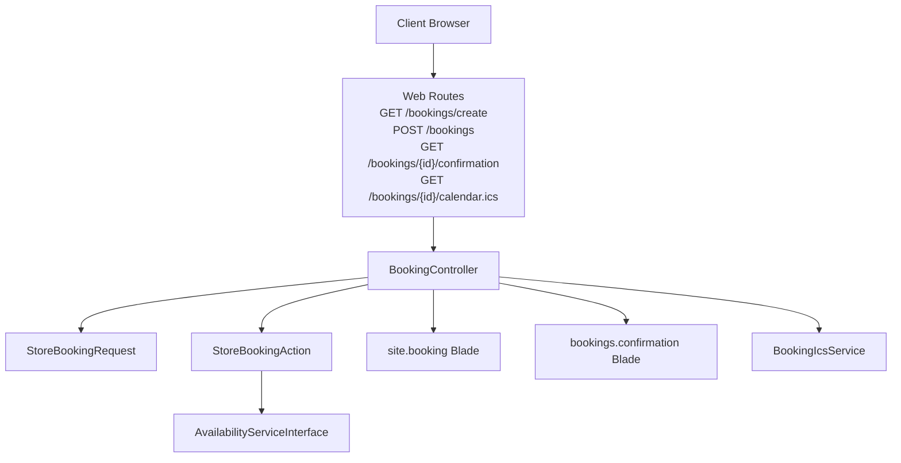
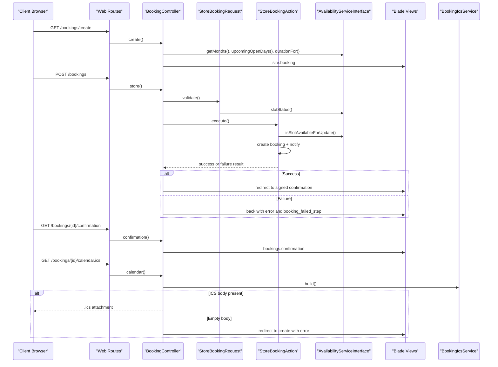
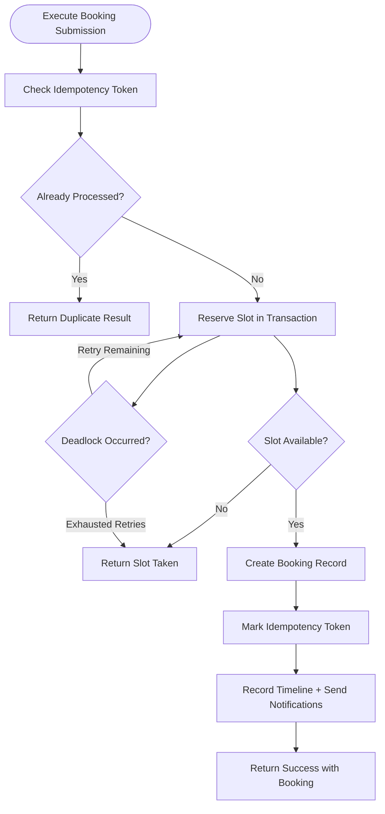
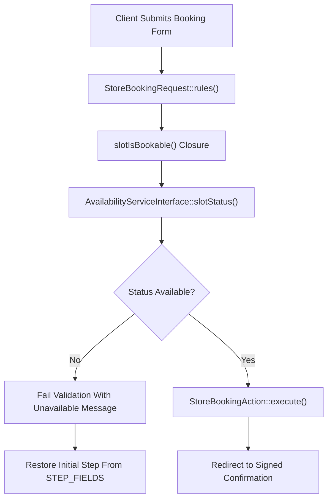
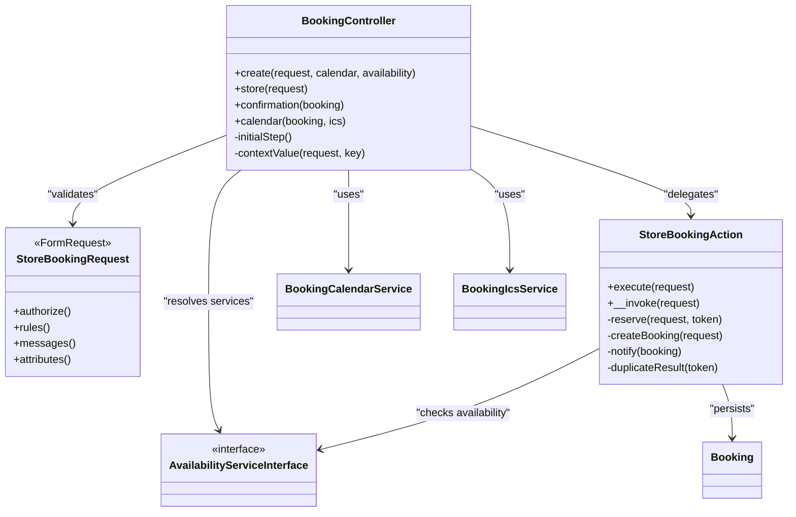

# Booking Controller and Routes

<cite>
**Referenced Files in This Document **
- [BookingController.php](file://app/Http/Controllers/BookingController.php)
- [web.php](file://routes/web.php)
- [StoreBookingAction.php](file://app/Actions/StoreBookingAction.php)
- [StoreBookingRequest.php](file://app/Http/Requests/Bookings/StoreBookingRequest.php)
- [booking.blade.php](file://resources/views/site/booking.blade.php)
</cite>

## Table of Contents
1. [Introduction](#introduction)
2. [Project Structure](#project-structure)
3. [Core Components](#core-components)
4. [Architecture Overview](#architecture-overview)
5. [Detailed Component Analysis](#detailed-component-analysis)
6. [Dependency Analysis](#dependency-analysis)
7. [Performance Considerations](#performance-considerations)
8. [Troubleshooting Guide](#troubleshooting-guide)
9. [Conclusion](#conclusion)

## Introduction
This document explains the public booking flow built around `BookingController`, the web routes that expose it, and the `StoreBookingAction` that performs the actual booking creation. It covers:

- Rendering the booking form with a service-aware calendar and quick-pick days.
- Validating and submitting the booking through `StoreBookingRequest` and `StoreBookingAction`.
- Redirecting to a signed confirmation page.
- Generating ICS calendar downloads for confirmed bookings.
- Handling slot conflicts, idempotency, validation errors, and session-based wizard state restoration.

The intended audience includes developers extending the booking wizard, adding validation rules, integrating new steps, or diagnosing race conditions and UI state issues.

## Project Structure
The booking feature is composed of:

- A public controller for rendering, submitting, confirming, and exporting bookings.
- Web routes under `/bookings/*`.
- A request validator defining per-step fields and availability-aware validation.
- An action handling concurrency, persistence, notifications, and idempotency.
- A Blade view providing the multi-step booking wizard.

**Diagram sources **
- [web.php:49-58](file://routes/web.php#L49-L58)
- [BookingController.php:1-146](file://app/Http/Controllers/BookingController.php#L1-L146)
- [StoreBookingRequest.php:1-178](file://app/Http/Requests/Bookings/StoreBookingRequest.php#L1-L178)
- [StoreBookingAction.php:1-267](file://app/Actions/StoreBookingAction.php#L1-L267)

**Section sources**
- [web.php:49-58](file://routes/web.php#L49-L58)
- [BookingController.php:1-146](file://app/Http/Controllers/BookingController.php#L1-L146)

## Core Components

### Public Web Routes
| Route | Method | Purpose | Middleware | Notes |
|---|---|---|---|---|
| `/bookings/create` | GET | Render the booking form with calendar context | None by default | Uses query parameters or old input for selected service and location. |
| `/bookings` | POST | Submit a validated booking | `throttle:3,1` | Limits submissions to three per minute per client identity. |
| `/bookings/{booking}/confirmation` | GET | Show confirmation with event timeline | `signed` | Prevents guessing booking IDs through signed URLs. |
| `/bookings/{booking}/calendar.ics` | GET | Download an ICS file | `signed` | Returns empty-body redirect when no appointment time exists. |

There are also availability API endpoints at `/api/bookings/availability` and `/api/bookings/calendar`, throttled at 30 requests per minute, but they belong to a different controller and are not part of this document’s scope.

**Section sources**
- [web.php:49-58](file://routes/web.php#L49-L58)

### BookingController Responsibilities
| Method | Input | Output | Behavior |
|---|---|---|---|
| `create()` | `Request`, `BookingCalendarService`, `AvailabilityServiceInterface` | View | Builds calendar months, upcoming open days, duration, initial wizard step, and persisted selection context. |
| `store()` | `StoreBookingRequest` | Redirect | Delegates to `StoreBookingAction`; redirects to signed confirmation on success; returns to previous step on failure with preserved input. |
| `confirmation()` | `Booking` | View | Loads related events and renders the confirmation page. |
| `calendar()` | `Booking`, `BookingIcsService` | Response or redirect | Generates ICS content; falls back to the create route with an error message when there is no appointment time. |

Key implementation details:

- The controller reads `service_type` and `location` from query parameters or flashed old input so the calendar reflects the user’s actual selection after a failed submission.
- The initial wizard step is restored from `booking_failed_step` or by scanning stored validation errors against `StoreBookingRequest::STEP_FIELDS`.
- Confirmation URLs are generated with `URL::signedRoute('bookings.confirmation', $result['booking'])`.
- Calendar downloads use `Content-Type: text/calendar; charset=utf-8` and a filename derived from the booking’s display reference.

**Section sources**
- [BookingController.php:1-146](file://app/Http/Controllers/BookingController.php#L1-L146)

### StoreBookingRequest Validation Model
`StoreBookingRequest` defines:

- Three wizard steps mapped by `STEP_FIELDS`:
  - Step 1: service type, damage type, vehicle make/model/year, location, client address.
  - Step 2: scheduled date and time.
  - Step 3: client name, email, phone, WhatsApp preference, vehicle details, damage photo.
- Field-level validation including enum constraints, length limits, email format, phone regex, image MIME and size checks, and a required idempotency token.
- A custom availability closure that validates the requested slot using `AvailabilityServiceInterface::slotStatus()`.
- Custom messages and attribute names for readable error output.

Important design points:

- The maximum free-text length is capped at 191 characters to match the underlying database column width.
- Mobile locations require a client address; workshop locations allow it to be nullable.
- The slot validator shares the same availability logic used by the frontend picker, reducing disagreement between UI and server.

**Section sources**
- [StoreBookingRequest.php:1-178](file://app/Http/Requests/Bookings/StoreBookingRequest.php#L1-L178)

### StoreBookingAction Business Logic
`StoreBookingAction` handles:

- Idempotency via `_idempotency_token`.
- Concurrent slot reservation with retry logic for deadlocks.
- Availability re-check inside a transaction.
- Booking record creation with structured fields such as vehicle details, damage type, location, client address, and price.
- Post-creation notification and event dispatch wrapped in exception handling.
- Duplicate submission handling so repeated form submissions return the original booking when possible.

Concurrency model:

- Up to two attempts are made when a database deadlock occurs.
- A short sleep separates retries.
- If both attempts fail, the slot is treated as taken.

Post-creation behavior:

- A booking milestone is recorded through `BookingTimeline`.
- Staff with the `update bookings` permission receive a notification.
- A `BookingCreatedEvent` is fired.
- Mail or queue failures do not roll back the already committed booking.

Idempotency model:

- Repeated tokens return the previously created booking.
- If the original result cannot be recovered, the action signals a duplicate but marks the submission unsuccessful so the caller can surface an appropriate message.

**Section sources**
- [StoreBookingAction.php:1-267](file://app/Actions/StoreBookingAction.php#L1-L267)

## Architecture Overview
The end-to-end booking lifecycle moves from page load through validation, reservation, confirmation, and optional calendar export.

**Diagram sources **
- [web.php:49-58](file://routes/web.php#L49-L58)
- [BookingController.php:1-146](file://app/Http/Controllers/BookingController.php#L1-L146)
- [StoreBookingRequest.php:1-178](file://app/Http/Requests/Bookings/StoreBookingRequest.php#L1-L178)
- [StoreBookingAction.php:1-267](file://app/Actions/StoreBookingAction.php#L1-L267)

## Detailed Component Analysis

### BookingController Methods

#### `create(Request $request, BookingCalendarService $calendar, AvailabilityServiceInterface $availability): View`
Responsibilities:

- Resolve `service_type` and `location` from query parameters or old input.
- Build three months of calendar data.
- Provide up to 14 upcoming open days as quick picks.
- Supply the service duration.
- Determine the initial wizard step.
- Pass context values into the `site.booking` view.

Why this matters:

- Rendering the calendar for default values would be misleading after a failed submit because the server may reject those defaults.
- The initial step calculation prevents forcing users to scroll through completed sections when only one step has errors.

**Section sources**
- [BookingController.php:24-55](file://app/Http/Controllers/BookingController.php#L24-L55)
- [booking.blade.php:59](file://resources/views/site/booking.blade.php#L59)

#### `store(StoreBookingRequest $request): RedirectResponse`
Responsibilities:

- Delegate to `StoreBookingAction::execute()`.
- On success: redirect to a signed confirmation URL with a success flash message.
- On failure: redirect back with an error, optionally force the wizard to step 2 if the slot was taken, and preserve old input.

Edge case handling:

- Slot contention is surfaced as a non-user-error so the UI can restore the correct step while keeping all other form data intact.

**Section sources**
- [BookingController.php:57-78](file://app/Http/Controllers/BookingController.php#L57-L78)

#### `confirmation(Booking $booking): View`
Responsibilities:

- Eager-load booking events.
- Render the confirmation view with the loaded booking.

Integration point:

- The view is responsible for displaying the booking and its timeline; the controller ensures events are available.

**Section sources**
- [BookingController.php:80-88](file://app/Http/Controllers/BookingController.php#L80-L88)

#### `calendar(Booking $booking, BookingIcsService $ics): RedirectResponse|Response`
Responsibilities:

- Generate ICS content through `BookingIcsService`.
- Return a `.ics` attachment when content exists.
- Redirect to the booking create route with an error when the booking has no appointment time.

Security note:

- The route requires a signed URL, so clients cannot guess another customer’s calendar link.

**Section sources**
- [BookingController.php:90-112](file://app/Http/Controllers/BookingController.php#L90-L112)
- [web.php:54-58](file://routes/web.php#L54-L58)

#### Wizard State Helpers

##### `initialStep(): int`
Logic summary:

1. Use `booking_failed_step` from session if present and valid.
2. Otherwise inspect stored validation errors.
3. Map the first failing step using `StoreBookingRequest::STEP_FIELDS`.
4. Default to step 1.

This is the single source of truth for restoring the wizard after validation failures.

**Section sources**
- [BookingController.php:114-141](file://app/Http/Controllers/BookingController.php#L114-L141)
- [StoreBookingRequest.php:40-53](file://app/Http/Requests/Bookings/StoreBookingRequest.php#L40-L53)

##### `contextValue(Request $request, string $key): ?string`
Purpose:

- Read a booking context value from either the current query string or old input.
- Normalize empty strings to null so the view can fall back to defaults safely.

**Section sources**
- [BookingController.php:143-146](file://app/Http/Controllers/BookingController.php#L143-L146)

### StoreBookingAction Concurrency and Persistence Flow

**Diagram sources **
- [StoreBookingAction.php:45-119](file://app/Actions/StoreBookingAction.php#L45-L119)

Key behaviors:

- The availability check and booking insert share one database transaction.
- Deadlocks are retried once after a short delay.
- If the slot is unavailable or retries are exhausted, the caller receives a “slot taken” response.
- Notification failures are logged but do not undo the booking.
- Duplicate tokens recover the original booking when possible.

**Section sources**
- [StoreBookingAction.php:45-119](file://app/Actions/StoreBookingAction.php#L45-L119)
- [StoreBookingAction.php:200-267](file://app/Actions/StoreBookingAction.php#L200-L267)

### Validation Flow and Step Mapping

**Diagram sources **
- [StoreBookingRequest.php:55-116](file://app/Http/Requests/Bookings/StoreBookingRequest.php#L55-L116)
- [StoreBookingRequest.php:118-178](file://app/Http/Requests/Bookings/StoreBookingRequest.php#L118-L178)
- [BookingController.php:114-141](file://app/Http/Controllers/BookingController.php#L114-L141)

**Section sources**
- [StoreBookingRequest.php:55-178](file://app/Http/Requests/Bookings/StoreBookingRequest.php#L55-L178)

## Dependency Analysis

**Diagram sources **
- [BookingController.php:1-146](file://app/Http/Controllers/BookingController.php#L1-L146)
- [StoreBookingRequest.php:1-178](file://app/Http/Requests/Bookings/StoreBookingRequest.php#L1-L178)
- [StoreBookingAction.php:1-267](file://app/Actions/StoreBookingAction.php#L1-L267)

Coupling and cohesion observations:

- `BookingController` is thin and focused on HTTP concerns: routing, validation delegation, view preparation, and response formatting.
- Business logic is isolated in `StoreBookingAction`, improving testability and separation of concerns.
- Availability rules are shared between the frontend picker and server-side validation through `AvailabilityServiceInterface`.
- The controller depends on concrete services (`BookingCalendarService`, `BookingIcsService`) rather than implementing calendar generation itself.

Potential risks:

- Adding new booking fields requires updating both `StoreBookingRequest::STEP_FIELDS` and the persistence mapping in `StoreBookingAction::createBooking()`.
- Changing wizard steps without updating `STEP_FIELDS` can cause validation errors to land on unexpected steps.

**Section sources**
- [BookingController.php:1-146](file://app/Http/Controllers/BookingController.php#L1-L146)
- [StoreBookingAction.php:121-200](file://app/Actions/StoreBookingAction.php#L121-L200)
- [StoreBookingRequest.php:40-53](file://app/Http/Requests/Bookings/StoreBookingRequest.php#L40-L53)

## Performance Considerations

- Rate limiting:
  - The POST `/bookings` route is limited to three requests per minute, protecting against rapid resubmissions and abuse.
  - The availability API endpoints are limited to 30 requests per minute, which is relevant when debugging or testing the calendar picker.
- Database locking:
  - Slot reservation uses a transaction with row locking and deadlock retries.
  - Two attempts are allowed before treating the slot as genuinely unavailable.
- Image processing:
  - Damage photos are resized, converted, and compressed; failures are logged and do not prevent booking creation.
- Calendar rendering:
  - The controller renders three months of calendar data and up to 14 upcoming open days. Large calendars should be considered when scaling high-traffic booking pages.
- Signed URLs:
  - Confirmation and ICS endpoints use signed URLs, adding signature verification overhead but preventing ID enumeration.

Recommendations:

- Keep the number of pre-rendered calendar months reasonable if traffic increases.
- Monitor deadlock logs from `StoreBookingAction` during peak booking periods.
- Ensure image storage and disk space are sized appropriately for damage photos.
- Avoid removing the throttle middleware from `/bookings` unless you add stronger backend idempotency or application-layer rate limiting.

[No sources needed since this section provides general guidance]

## Troubleshooting Guide

### Symptom: User sees the wrong wizard step after validation failure
Likely causes:

- A new field was added to the form but not mapped in `StoreBookingRequest::STEP_FIELDS`.
- `booking_failed_step` was left in session from a previous request.
- The frontend does not read `data-initial-step` correctly.

Checks:

- Inspect `StoreBookingRequest::STEP_FIELDS`.
- Verify that `initialStep()` can locate the failing step.
- Confirm the Blade view passes `initialStep` to the client.

**Section sources**
- [BookingController.php:114-141](file://app/Http/Controllers/BookingController.php#L114-L141)
- [StoreBookingRequest.php:40-53](file://app/Http/Requests/Bookings/StoreBookingRequest.php#L40-L53)
- [booking.blade.php:59](file://resources/views/site/booking.blade.php#L59)

### Symptom: Slot appears available in the UI but submission fails
Likely causes:

- Another user reserved the slot concurrently.
- The slot became closed, too late, or unavailable between picker interaction and submission.
- The availability status changed due to business hours or staff absence configuration.

Behavior:

- The controller redirects back with an error and forces step 2 so the user can choose another time.
- Old input is preserved.
- Logs may show deadlock retries from `StoreBookingAction`.

**Section sources**
- [BookingController.php:60-78](file://app/Http/Controllers/BookingController.php#L60-L78)
- [StoreBookingAction.php:71-119](file://app/Actions/StoreBookingAction.php#L71-L119)

### Symptom: Double-click creates duplicate bookings
Likely causes:

- The idempotency token is missing or expired.
- The token was not sent with the request.
- The stored idempotency result cannot be recovered.

Expected behavior:

- Duplicate tokens return the original booking when possible.
- If recovery fails, the action reports a duplicate but marks the submission unsuccessful.

**Section sources**
- [StoreBookingAction.php:45-69](file://app/Actions/StoreBookingAction.php#L45-L69)
- [StoreBookingAction.php:232-267](file://app/Actions/StoreBookingAction.php#L232-L267)

### Symptom: ICS download redirects to the booking form
Likely causes:

- The booking has no appointment time.
- The booking was created but not yet assigned a valid scheduled slot.

Behavior:

- The controller redirects to the create route with an error message.

**Section sources**
- [BookingController.php:90-112](file://app/Http/Controllers/BookingController.php#L90-L112)

### Symptom: Confirmation or calendar links are rejected as invalid
Likely causes:

- The URL signature expired.
- The URL was altered.
- The route parameter is not a valid booking.

Mitigation:

- Regenerate the confirmation link from the application.
- Do not share unsigned confirmation URLs.
- Treat signed URL failures as security-sensitive and avoid exposing raw exceptions to users.

**Section sources**
- [web.php:51-58](file://routes/web.php#L51-L58)
- [BookingController.php:60-78](file://app/Http/Controllers/BookingController.php#L60-L78)

### Symptom: Validation messages do not match field names
Likely causes:

- A field name changed without updating `attributes()`.
- A custom message key was removed or renamed.

Checks:

- Review `StoreBookingRequest::attributes()` and `messages()`.
- Verify localization keys exist where translation files are used.

**Section sources**
- [StoreBookingRequest.php:118-178](file://app/Http/Requests/Bookings/StoreBookingRequest.php#L118-L178)

## Conclusion
The public booking flow is intentionally layered:

- `BookingController` owns HTTP boundaries, user-facing responses, and wizard state restoration.
- `StoreBookingRequest` centralizes validation, step ownership, and availability checks.
- `StoreBookingAction` owns persistence, concurrency protection, notifications, and idempotency.
- Routes protect sensitive confirmation and calendar endpoints with signing and rate limiting.

When extending the booking flow, prefer updating:

- `StoreBookingRequest::STEP_FIELDS` for wizard step ownership.
- `StoreBookingRequest::rules()` and `messages()` for validation behavior.
- `StoreBookingAction::createBooking()` for persistence changes.
- `BookingController::initialStep()` only when the step-resolution strategy needs adjustment.
- `BookingController::create()` when calendar or availability context must change.

This separation makes it safer to add steps, change validation, handle edge cases, and extend the controller without mixing HTTP concerns with business logic.

[No sources needed since this section summarizes without analyzing specific files]