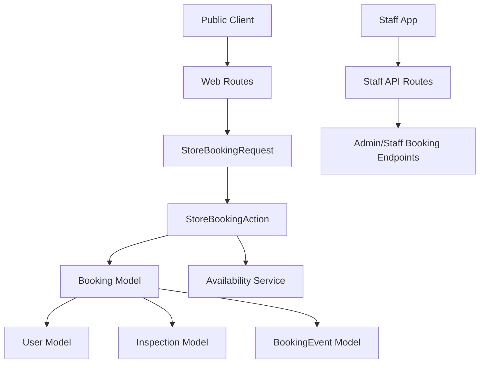
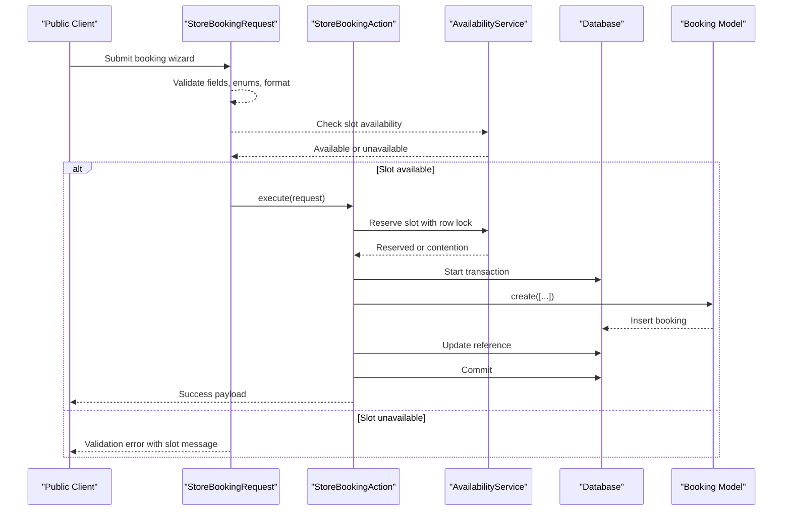
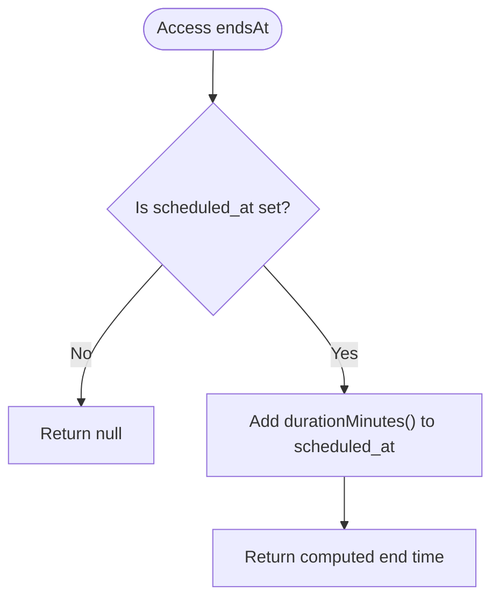
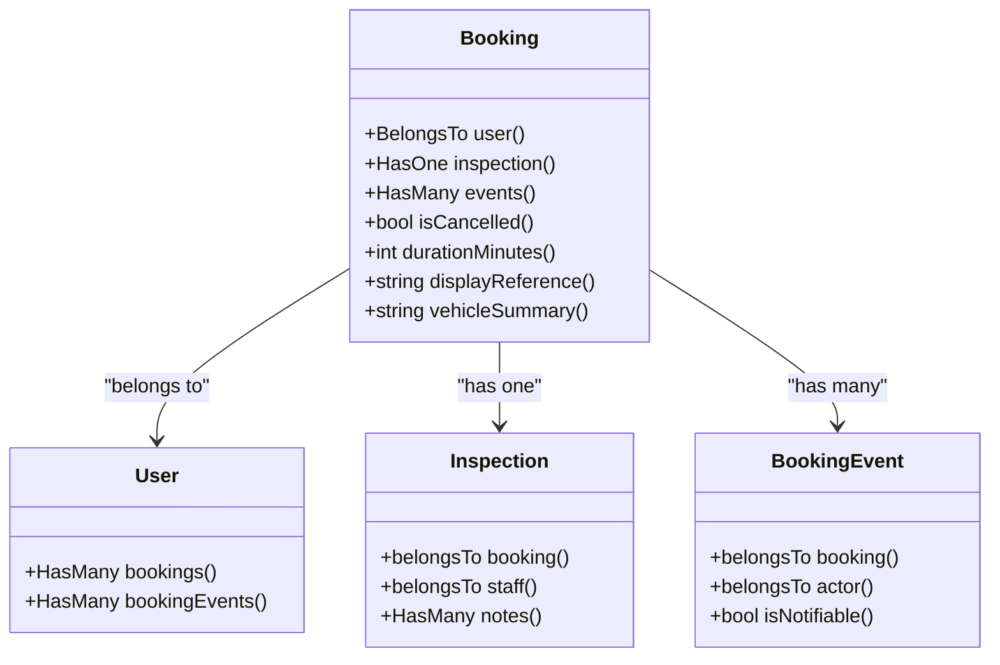
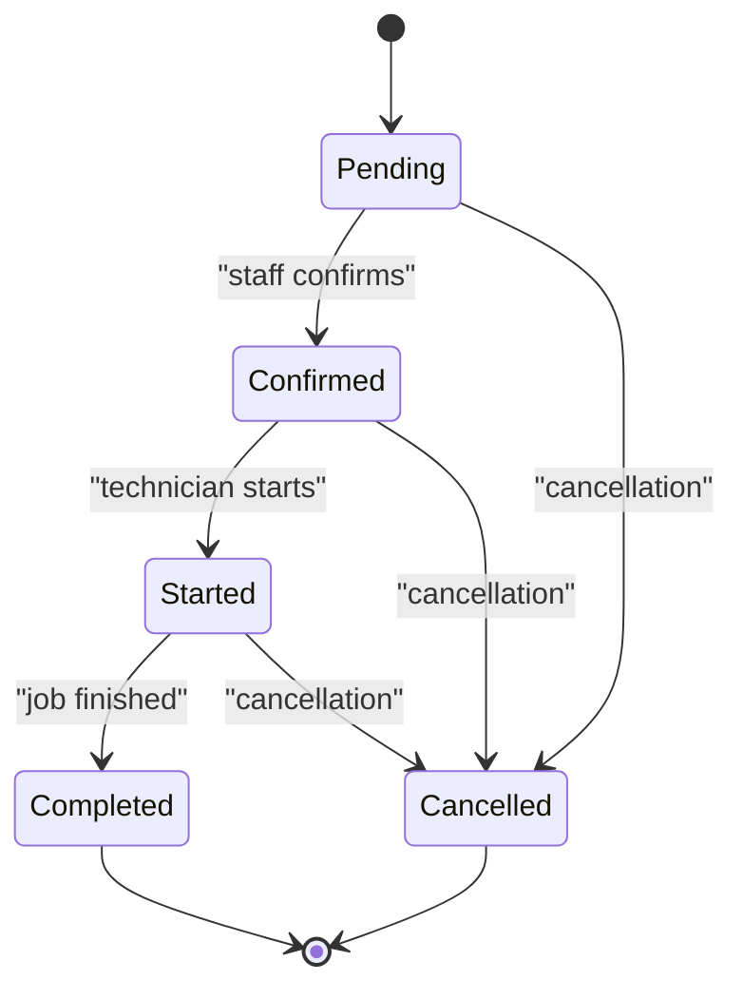
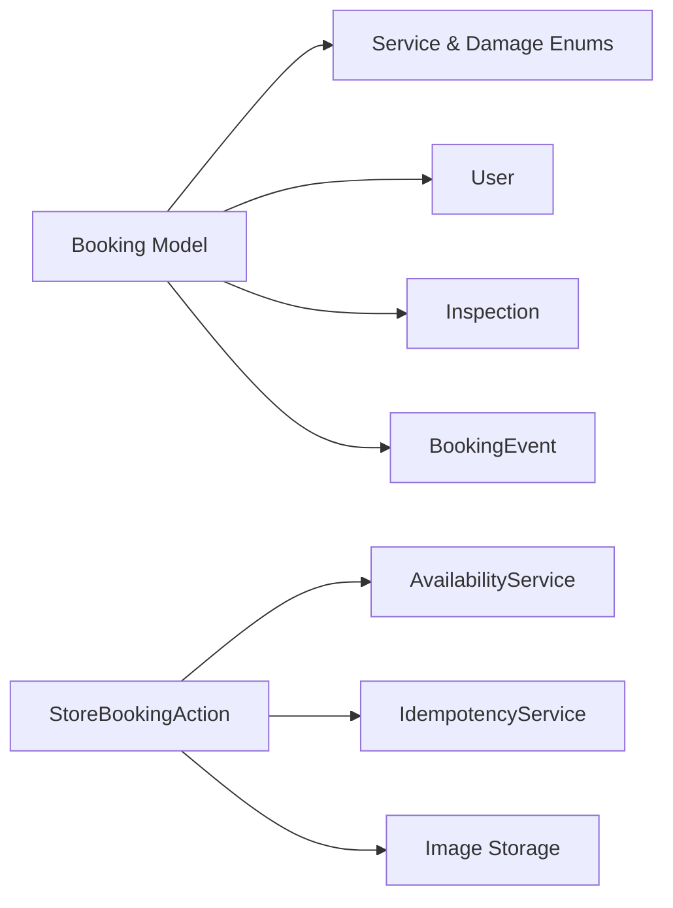

# Booking Model and Data Structure

<cite>
**Referenced Files in This Document**
- [Booking.php](file://app/Models/Booking.php)
- [StoreBookingRequest.php](file://app/Http/Requests/Bookings/StoreBookingRequest.php)
- [StoreBookingAction.php](file://app/Actions/StoreBookingAction.php)
- [BookingServiceType.php](file://app/Enums/BookingServiceType.php)
- [BookingDamageType.php](file://app/Enums/BookingDamageType.php)
- [User.php](file://app/Models/User.php)
- [Inspection.php](file://app/Models/Inspection.php)
- [BookingEvent.php](file://app/Models/BookingEvent.php)
- [create_bookings_table.php](file://database/migrations/2026_04_17_093356_create_bookings_table.php)
- [add_scheduled_fields_to_bookings_table.php](file://database/migrations/2026_07_07_000000_add_scheduled_fields_to_bookings_table.php)
- [add_client_address_to_bookings_table.php](file://database/migrations/2026_07_09_195328_add_client_address_to_bookings_table.php)
- [replace_unique_index_on_bookings_scheduled_at.php](file://database/migrations/2026_10_01_000000_replace_unique_index_on_bookings_scheduled_at.php)
- [add_structured_fields_to_bookings_table.php](file://database/migrations/2026_10_18_000000_add_structured_fields_to_bookings_table.php)
- [add_prefers_whatsapp_to_bookings_table.php](file://database/migrations/2026_10_18_000002_add_prefers_whatsapp_to_bookings_table.php)
- [make_vehicle_details_nullable_on_bookings_table.php](file://database/migrations/2026_10_18_000003_make_vehicle_details_nullable_on_bookings_table.php)
- [create_booking_events_table.php](file://database/migrations/2026_10_01_150000_create_booking_events_table.php)
- [add_previous_scheduled_at_to_booking_events_table.php](file://database/migrations/2026_10_01_150300_add_previous_scheduled_at_to_booking_events_table.php)
- [booking.php](file://lang/en/booking.php)
- [api.php](file://routes/api.php)
</cite>

## Table of Contents
1. Introduction
2. Project Structure
3. Core Components
4. Architecture Overview
5. Detailed Component Analysis
6. Dependency Analysis
7. Performance Considerations
8. Troubleshooting Guide
9. Conclusion
10. Appendices

## Introduction
This document describes the data model and lifecycle of the Booking entity used by the glass-fitting application. It covers every database column, Eloquent relationships, type casting, computed attributes, validation rules, business constraints, and the end-to-end flow from public booking submission through completion. It also provides practical examples for querying bookings, filtering by service type or date range, and accessing related inspection and timeline data.

## Project Structure
The Booking model is part of the core domain layer and interacts with:
- Request validation (`StoreBookingRequest`)
- The booking creation action (`StoreBookingAction`)
- Enumerations for service and damage types
- Related models: `User`, `Inspection`, `BookingEvent`
- Database migrations that define the `bookings` and `booking_events` tables
- Staff API routes under `/staff/bookings`

**Diagram sources**
- [StoreBookingRequest.php:1-178](file://app/Http/Requests/Bookings/StoreBookingRequest.php#L1-L178)
- [StoreBookingAction.php:1-200](file://app/Actions/StoreBookingAction.php#L1-L200)
- [Booking.php:1-134](file://app/Models/Booking.php#L1-L134)
- [api.php:1-117](file://routes/api.php#L1-L117)

**Section sources**
- [Booking.php:1-134](file://app/Models/Booking.php#L1-L134)
- [StoreBookingRequest.php:1-178](file://app/Http/Requests/Bookings/StoreBookingRequest.php#L1-L178)
- [StoreBookingAction.php:1-200](file://app/Actions/StoreBookingAction.php#L1-L200)
- [api.php:1-117](file://routes/api.php#L1-L117)

## Core Components
- **Booking**: Eloquent model representing a customer appointment for glass work. It stores client details, vehicle information, scheduling metadata, pricing, status, and reference identifiers.
- **StoreBookingRequest**: Public-facing request validator that enforces field presence, formats, enum values, slot availability, and optional photo upload.
- **StoreBookingAction**: Orchestrates idempotent booking submission, slot reservation, persistence, notification, and error handling.
- **BookingServiceType** and **BookingDamageType**: PHP enums backing typed fields for service kind and damage classification.
- **User**, **Inspection**, **BookingEvent**: Related entities for ownership, on-site inspection records, and customer-visible milestones.

**Section sources**
- [Booking.php:1-134](file://app/Models/Booking.php#L1-L134)
- [StoreBookingRequest.php:1-178](file://app/Http/Requests/Bookings/StoreBookingRequest.php#L1-L178)
- [StoreBookingAction.php:1-200](file://app/Actions/StoreBookingAction.php#L1-L200)
- [BookingServiceType.php:1-64](file://app/Enums/BookingServiceType.php#L1-L64)
- [BookingDamageType.php:1-37](file://app/Enums/BookingDamageType.php#L1-L37)
- [User.php:1-141](file://app/Models/User.php#L1-L141)
- [Inspection.php:1-82](file://app/Models/Inspection.php#L1-L82)
- [BookingEvent.php:1-84](file://app/Models/BookingEvent.php#L1-L84)

## Architecture Overview
The Booking lifecycle begins with a public form submission validated by `StoreBookingRequest`. A successful request is handed to `StoreBookingAction`, which performs an idempotency check, verifies slot availability through the availability service, persists the booking inside a transaction, assigns a unique reference, and sends notifications. At runtime, the Booking model exposes computed attributes such as `endsAt`, `displayReference`, `vehicleSummary`, and `durationMinutes`. Business logic uses enums for service and damage types, while status transitions are tracked via `BookingEvent`.

**Diagram sources**
- [StoreBookingRequest.php:1-178](file://app/Http/Requests/Bookings/StoreBookingRequest.php#L1-L178)
- [StoreBookingAction.php:1-200](file://app/Actions/StoreBookingAction.php#L1-L200)
- [Booking.php:1-134](file://app/Models/Booking.php#L1-L134)

## Detailed Component Analysis

### Booking Database Columns
The `bookings` table was created and evolved through several migrations. The final shape includes:

| Column | Type / Constraint | Nullable | Default | Purpose and Notes |
|---|---|---:|---|---|
| `id` | Auto-increment primary key | No | — | Unique identifier; used to derive the customer-facing reference. |
| `reference` | String, unique index | Yes | — | Customer-facing ID like `HB-000123`; backfilled during migration. |
| `user_id` | Foreign key to `users.id` | Yes | — | Optional owner (staff or authenticated user). Deleted with null-on-delete. |
| `client_name` | String | No | — | Client contact name. |
| `client_email` | String, indexed | No | — | Client email address. |
| `client_phone` | String | No | — | Client phone number; validated as digits only. |
| `prefers_whatsapp` | Boolean | No | `false` | Preferred follow-up channel; not the phone number itself. |
| `client_address` | String | Yes | — | Where the vehicle is parked; required for mobile jobs. |
| `vehicle_details` | String | Yes | — | Legacy free-form notes (registration, insurer, ADAS, parking access). Now nullable after structured fields were added. |
| `service_type` | String, length 32, indexed | Yes | — | One of the `BookingServiceType` enum values; drives duration and slot capacity. |
| `damage_type` | String, length 32 | Yes | — | One of the `BookingDamageType` enum values; used for triage and quoting. |
| `vehicle_make` | String, length 191 | Yes | — | Structured vehicle make. |
| `vehicle_model` | String, length 191 | Yes | — | Structured vehicle model. |
| `vehicle_year` | Unsigned small integer | Yes | — | Structured vehicle year; cast to integer. |
| `damage_photo_path` | String, length 191 | Yes | — | Path to the uploaded and resized damage photo. |
| `scheduled_at` | Timestamp, indexed | Yes | — | Booked start time; no longer globally unique. |
| `duration_minutes` | Unsigned small integer | No | `60` | Snapshot of job length at booking time; never negative. |
| `location` | String | Yes | — | Either `mobile` or `workshop`. |
| `status` | Enum string | No | `pending` | Values: `pending`, `confirmed`, `cancelled`, `completed`. Indexed; combined index with `created_at` supports dashboard lists. |
| `total_price` | Decimal(10,2) | No | `0.00` | Pricing stored as decimal with two decimals. |
| `created_at` / `updated_at` | Timestamps | No | — | Standard Eloquent timestamps. |

Key constraints and indexes:
- `reference` is unique.
- `service_type` has an index.
- `status` has a dedicated index.
- `status` + `created_at` has a composite index for dashboard queries.
- `scheduled_at` has a plain index after the earlier unique constraint was removed.

**Section sources**
- [create_bookings_table.php:1-36](file://database/migrations/2026_04_17_093356_create_bookings_table.php#L1-L36)
- [add_scheduled_fields_to_bookings_table.php:1-29](file://database/migrations/2026_07_07_000000_add_scheduled_fields_to_bookings_table.php#L1-L29)
- [add_client_address_to_bookings_table.php:1-28](file://database/migrations/2026_07_09_195328_add_client_address_to_bookings_table.php#L1-L28)
- [replace_unique_index_on_bookings_scheduled_at.php:1-46](file://database/migrations/2026_10_01_000000_replace_unique_index_on_bookings_scheduled_at.php#L1-L46)
- [add_structured_fields_to_bookings_table.php:1-74](file://database/migrations/2026_10_18_000000_add_structured_fields_to_bookings_table.php#L1-L74)
- [add_prefers_whatsapp_to_bookings_table.php:1-37](file://database/migrations/2026_10_18_000002_add_prefers_whatsapp_to_bookings_table.php#L1-L37)
- [make_vehicle_details_nullable_on_bookings_table.php:1-38](file://database/migrations/2026_10_18_000003_make_vehicle_details_nullable_on_bookings_table.php#L1-L38)

### Eloquent Casting Configuration
The Booking model casts several columns to safer PHP types:

| Column | Cast | Meaning |
|---|---|---|
| `scheduled_at` | `datetime` | Carbon datetime object when present. |
| `total_price` | `decimal:2` | Numeric decimal with two places. |
| `vehicle_year` | `integer` | Numeric year. |
| `duration_minutes` | `integer` | Non-negative duration in minutes. |
| `prefers_whatsapp` | `boolean` | Follow-up preference flag. |
| `service_type` | `BookingServiceType::class` | Typed enum for service category. |
| `damage_type` | `BookingDamageType::class` | Typed enum for damage classification. |

These casts ensure consistent behavior across controllers, services, views, and API responses.

**Section sources**
- [Booking.php:1-134](file://app/Models/Booking.php#L1-L134)

### Computed Attributes and Helper Methods
- `endsAt`: Returns a Carbon datetime representing the calculated end of the booking. It is derived from `scheduled_at` plus `durationMinutes`. Returns `null` if there is no scheduled slot yet.
- `durationMinutes`: Returns the effective duration in minutes. Uses the stored `duration_minutes` value but guarantees at least 15 minutes and falls back to 60 when unset.
- `displayReference`: Returns the stored `reference`; if absent, returns a formatted fallback based on the numeric ID.
- `vehicleSummary`: Assembles a one-line description from `vehicle_year`, `vehicle_make`, and `vehicle_model`. If structured fields are empty, it falls back to the legacy `vehicle_details` text.

**Diagram sources**
- [Booking.php:1-134](file://app/Models/Booking.php#L1-L134)

**Section sources**
- [Booking.php:1-134](file://app/Models/Booking.php#L1-L134)

### Eloquent Relationships
- `user()`: Belongs to `User`. A booking may be created without an authenticated user because `user_id` is nullable.
- `inspection()`: Has one `Inspection`. An inspection represents the on-site job linked to this booking.
- `events()`: Has many `BookingEvent` rows, ordered by `happened_at`. These events are the customer-visible milestone timeline.

**Diagram sources**
- [Booking.php:1-134](file://app/Models/Booking.php#L1-L134)
- [User.php:1-141](file://app/Models/User.php#L1-L141)
- [Inspection.php:1-82](file://app/Models/Inspection.php#L1-L82)
- [BookingEvent.php:1-84](file://app/Models/BookingEvent.php#L1-L84)

**Section sources**
- [Booking.php:1-134](file://app/Models/Booking.php#L1-L134)
- [User.php:1-141](file://app/Models/User.php#L1-L141)
- [Inspection.php:1-82](file://app/Models/Inspection.php#L1-L82)
- [BookingEvent.php:1-84](file://app/Models/BookingEvent.php#L1-L84)

### Enums and Labels
- `BookingServiceType`: Represents windscreen, side/rear glass, heavy machinery, and fleet jobs. Each case provides a default duration and a language-key label.
- `BookingDamageType`: Represents chip, crack, shattered, seal leak, and other damage. It provides labels and values for forms and translations.

Both enums support `values()` for programmatic lists and `label()` for localized display.

**Section sources**
- [BookingServiceType.php:1-64](file://app/Enums/BookingServiceType.php#L1-L64)
- [BookingDamageType.php:1-37](file://app/Enums/BookingDamageType.php#L1-L37)
- [booking.php:1-149](file://lang/en/booking.php#L1-L149)

### Validation Rules and Business Constraints
The public booking form is validated by `StoreBookingRequest`. Important rules include:

| Field | Rules | Business Reason |
|---|---|---|
| `service_type` | Required, string, enum `BookingServiceType` | Determines job type and capacity pool. |
| `damage_type` | Required, string, enum `BookingDamageType` | Used for triage and quoting. |
| `vehicle_make` | Required, string, max 191 | Structured vehicle info. |
| `vehicle_model` | Required, string, max 191 | Structured vehicle info. |
| `vehicle_year` | Required, integer, 1970 to current year plus one | Prevents unrealistic vehicle years. |
| `location` | Required, must be `mobile` or `workshop` | Selects capacity and scheduling pool. |
| `client_address` | Required when location is `mobile`; otherwise nullable | Needed for mobile visits. |
| `scheduled_at` | Required, strict ISO-like format, custom availability check | Ensures the slot is still bookable. |
| `client_name` | Required, string, max 191 | Contact identity. |
| `client_email` | Required, valid email, max 191 | Confirmation and reminders. |
| `client_phone` | Required, digits only, 7–20 characters | Phone follow-ups. |
| `prefers_whatsapp` | Nullable boolean | Follow-up channel preference. |
| `vehicle_details` | Nullable, string, max 191 | Free-form notes. |
| `damage_photo` | Nullable image file, JPG/JPEG/PNG/WebP, up to 5 MB | Optional evidence for the right parts. |
| `_idempotency_token` | Required, string, max 64 | Prevents duplicate submissions. |

Additional business constraints:
- Slots are checked twice: once in the UI picker path and again in the creation transaction.
- The creation transaction uses a row lock through the availability service so concurrent users cannot both claim the same slot.
- Duplicate requests sharing the same idempotency token return the existing result rather than creating another booking.
- Photo processing failures are logged and do not fail the booking; the booking proceeds without a photo.
- The maximum text length is capped at 191 to match MySQL column widths.

**Section sources**
- [StoreBookingRequest.php:1-178](file://app/Http/Requests/Bookings/StoreBookingRequest.php#L1-L178)
- [StoreBookingAction.php:1-200](file://app/Actions/StoreBookingAction.php#L1-L200)
- [booking.php:1-149](file://lang/en/booking.php#L1-L149)

### Data Lifecycle
A booking moves through these phases:

1. **Drafting**: The client fills the wizard steps; validation occurs per step using `STEP_FIELDS`.
2. **Slot Reservation**: The availability service checks whether the requested slot is open for the given service type and location.
3. **Persistence**: Inside a database transaction, the booking is inserted with status `pending`, price `0`, and a generated reference.
4. **Notification**: Staff are notified and the client receives confirmation messaging.
5. **Confirmation**: Staff update status to `confirmed`; a corresponding `BookingEvent` is recorded.
6. **Start**: When the technician begins work, a `started` event is recorded.
7. **Completion**: After finishing, the inspection is completed and a `completed` event is recorded.
8. **Cancellation**: If the job is cancelled, status becomes `cancelled` and a cancellation event is recorded.

**Diagram sources**
- [StoreBookingAction.php:1-200](file://app/Actions/StoreBookingAction.php#L1-L200)
- [BookingEvent.php:1-84](file://app/Models/BookingEvent.php#L1-L84)
- [create_booking_events_table.php:1-44](file://database/migrations/2026_10_01_150000_create_booking_events_table.php#L1-L44)

**Section sources**
- [StoreBookingAction.php:1-200](file://app/Actions/StoreBookingAction.php#L1-L200)
- [BookingEvent.php:1-84](file://app/Models/BookingEvent.php#L1-L84)
- [create_booking_events_table.php:1-44](file://database/migrations/2026_10_01_150000_create_booking_events_table.php#L1-L44)

## Dependency Analysis
The Booking entity depends on:
- **Enum dependencies**: `BookingServiceType` and `BookingDamageType` provide validated, translatable values.
- **User dependency**: Ownership and audit trail via `user_id` and `BookingEvent.user_id`.
- **Inspection dependency**: A single inspection record tracks the actual job execution.
- **BookingEvent dependency**: Timeline of customer-visible milestones.
- **Availability service dependency**: Slot availability and duration calculations.
- **Idempotency service dependency**: Prevents duplicate submissions.
- **Image storage dependency**: Damage photos are resized and stored under `bookings/damage`.

**Diagram sources**
- [Booking.php:1-134](file://app/Models/Booking.php#L1-L134)
- [StoreBookingAction.php:1-200](file://app/Actions/StoreBookingAction.php#L1-L200)

**Section sources**
- [Booking.php:1-134](file://app/Models/Booking.php#L1-L134)
- [StoreBookingAction.php:1-200](file://app/Actions/StoreBookingAction.php#L1-L200)

## Performance Considerations
- **Indexes**:
  - `status` and `status`+`created_at` support dashboard listings and filtering.
  - `service_type` supports filtering by job category.
  - `scheduled_at` is indexed for scheduling queries after the unique constraint was replaced.
- **Decimal precision**: `total_price` uses decimal(10,2), avoiding floating-point rounding issues.
- **Duration snapshotting**: `duration_minutes` is stored at booking time so historical jobs do not shift when service settings change.
- **Row locking**: The booking transaction locks availability rows to prevent double-booking under contention.
- **Text limits**: All free-text fields are capped at 191 characters to match MySQL column sizes and avoid truncation errors.

[No sources needed since this section provides general guidance]

## Troubleshooting Guide
Common issues and their likely causes:

- **Slot already taken**:
  - Cause: Another client claimed the same slot, or the slot became unavailable between UI selection and submission.
  - Resolution: Ask the client to choose another slot. The action retries once on deadlock before failing.
- **Too late to book**:
  - Cause: The requested time is within the minimum lead time configured by the availability service.
  - Resolution: Offer a later time.
- **Closed day**:
  - Cause: The selected day is closed or outside working hours.
  - Resolution: Choose an open day.
- **Duplicate submission**:
  - Cause: The client submitted the form more than once with the same idempotency token.
  - Resolution: Return the original booking result instead of creating another record.
- **Photo upload failed**:
  - Cause: Image could not be decoded or saved.
  - Resolution: The booking still succeeds; log the failure and proceed without a photo.
- **Reference mismatch**:
  - Cause: Old records created before references existed may rely on the fallback formatter.
  - Resolution: Use `displayReference`, which falls back to a zero-padded ID prefix when `reference` is missing.

**Section sources**
- [StoreBookingAction.php:1-200](file://app/Actions/StoreBookingAction.php#L1-L200)
- [StoreBookingRequest.php:1-178](file://app/Http/Requests/Bookings/StoreBookingRequest.php#L1-L178)
- [Booking.php:1-134](file://app/Models/Booking.php#L1-L134)

## Conclusion
The Booking model centralizes customer appointments with carefully separated concerns: structured vehicle data, typed enums, immutable duration snapshots, and a robust scheduling pipeline. Its relationships to `User`, `Inspection`, and `BookingEvent` support ownership, operational tracking, and customer-visible timelines. Validation and transactional safeguards protect against invalid input, double-booking, and duplicate submissions. For reporting and operations, use the provided indexes and computed attributes to query efficiently while preserving the integrity of historical data.

[No sources needed since this section summarizes without analyzing specific files]

## Appendices

### Querying Examples
Below are conceptual examples of how to query the Booking model. Replace `$query` with your preferred repository or controller scope.

- Find all pending bookings:
  - `Booking::where('status', 'pending')->get()`
- Filter by service type:
  - `Booking::where('service_type', 'windscreen')->get()`
  - Or using the enum: `Booking::where('service_type', BookingServiceType::Windscreen)->get()`
- Filter by date range using `scheduled_at`:
  - `Booking::whereBetween('scheduled_at', [$start, $end])->get()`
- Access related inspection:
  - `$booking->inspection`
- Access customer-visible timeline:
  - `$booking->events`
- Check cancellation:
  - `$booking->isCancelled()`
- Display customer-friendly reference:
  - `$booking->displayReference()`
- Compute end time:
  - `$booking->endsAt`
- Effective duration:
  - `$booking->durationMinutes()`
- Vehicle summary:
  - `$booking->vehicleSummary()`

### Staff API Endpoints
The staff app accesses bookings through Sanctum-authenticated routes under `/staff`:

| Method | Route | Description |
|---|---|---|
| GET | `/staff/bookings` | List bookings. |
| GET | `/staff/bookings/{booking}` | Show a booking. |
| PATCH | `/staff/bookings/{booking}` | Update a booking. |
| PATCH | `/staff/bookings/{booking}/status` | Update booking status. |

All staff endpoints require authentication and appropriate permissions.

**Section sources**
- [api.php:1-117](file://routes/api.php#L1-L117)