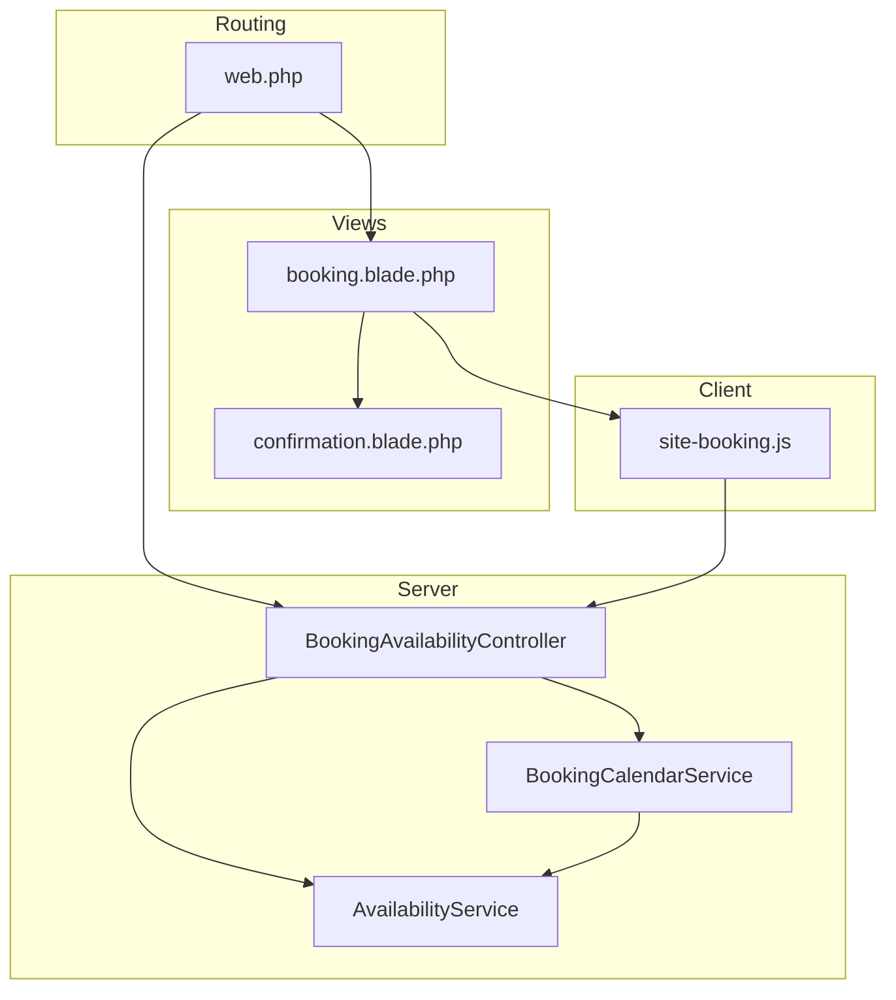
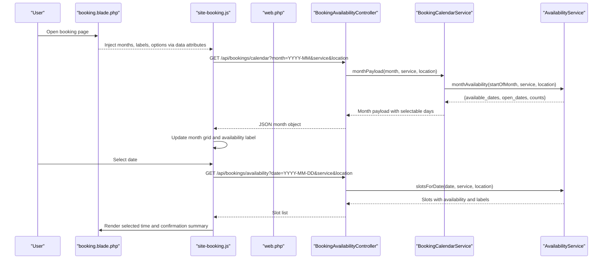
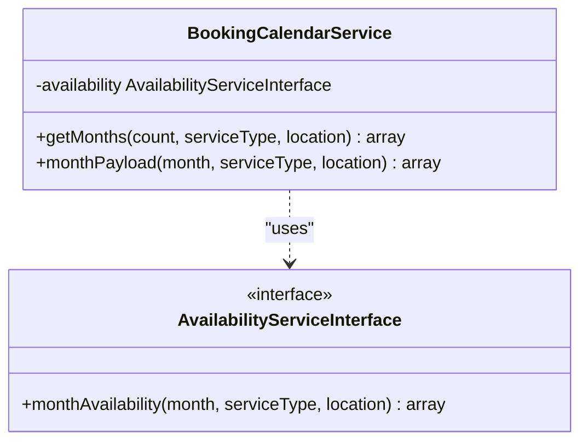
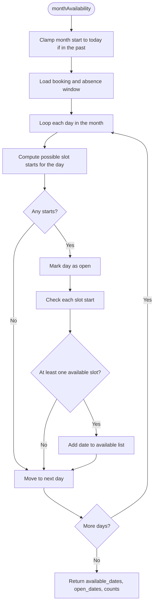
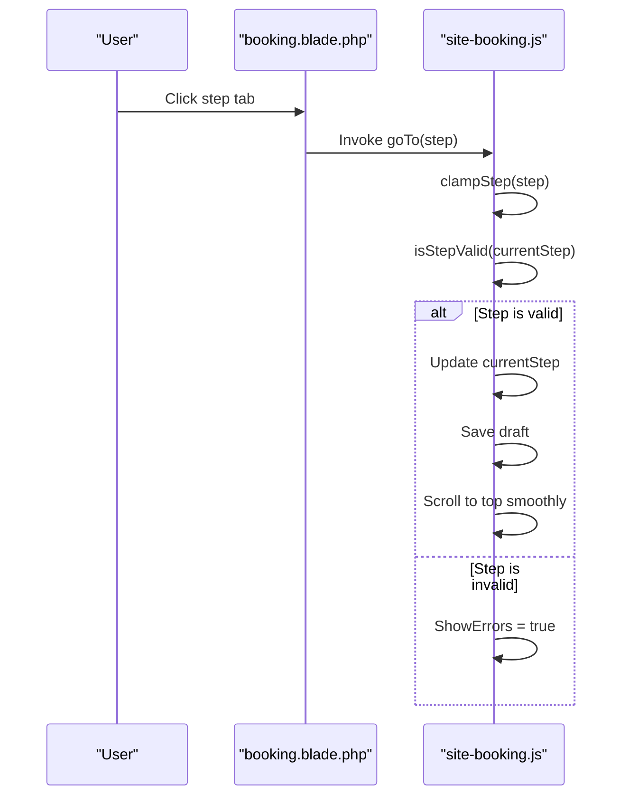
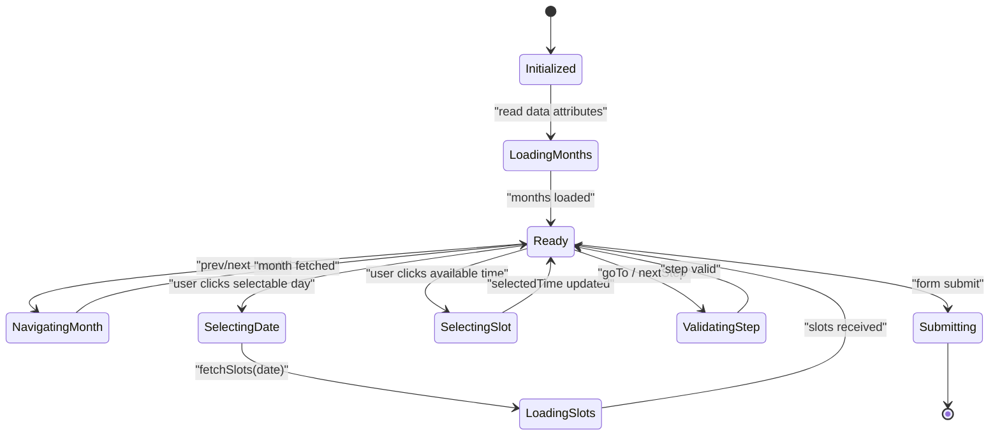
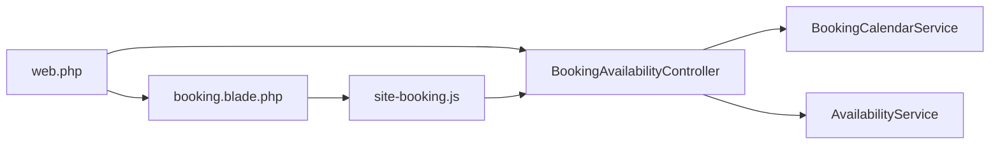

# Calendar Rendering and UI Components

<cite>
**Referenced Files in This Document **
- [BookingCalendarService.php](file://app/Services/BookingCalendarService.php)
- [AvailabilityService.php](file://app/Services/AvailabilityService.php)
- [BookingAvailabilityController.php](file://app/Http/Controllers/Api/BookingAvailabilityController.php)
- [site-booking.js](file://resources/js/site-booking.js)
- [booking.blade.php](file://resources/views/site/booking.blade.php)
- [confirmation.blade.php](file://resources/views/bookings/confirmation.blade.php)
- [web.php](file://routes/web.php)
</cite>

## Table of Contents
1. [Introduction](#introduction)
2. [Project Structure](#project-structure)
3. [Core Components](#core-components)
4. [Architecture Overview](#architecture-overview)
5. [Detailed Component Analysis](#detailed-component-analysis)
6. [Dependency Analysis](#dependency-analysis)
7. [Performance Considerations](#performance-considerations)
8. [Troubleshooting Guide](#troubleshooting-guide)
9. [Conclusion](#conclusion)
10. [Appendices](#appendices)

## Introduction
This document explains the calendar rendering system used by the public booking flow. It covers how server-side availability is converted into a client-friendly month grid, how Blade renders the booking wizard, and how Alpine.js manages state, draft persistence, real-time slot fetching, and responsive calendar interaction. It also documents the data contract between PHP-generated month data and JavaScript-driven interactivity, with guidance for customization and performance tuning.

The system separates concerns clearly:
- PHP decides what can be booked.
- Blade renders the initial page and step layout.
- Alpine.js drives interactive selection without re-rendering the entire form.
- API endpoints return validated availability so the UI cannot offer slots the backend will reject.

## Project Structure
The booking calendar spans services, controllers, routes, Blade views, and client-side JavaScript.

**Diagram sources **
- [web.php:48-72](file://routes/web.php#L48-L72)
- [BookingAvailabilityController.php:18-116](file://app/Http/Controllers/Api/BookingAvailabilityController.php#L18-L116)
- [BookingCalendarService.php:1-101](file://app/Services/BookingCalendarService.php#L1-L101)
- [AvailabilityService.php:252-297](file://app/Services/AvailabilityService.php#L252-L297)
- [booking.blade.php:1-722](file://resources/views/site/booking.blade.php#L1-L722)
- [confirmation.blade.php:1-184](file://resources/views/bookings/confirmation.blade.php#L1-L184)
- [site-booking.js:1-876](file://resources/js/site-booking.js#L1-L876)

**Section sources**
- [web.php:48-72](file://routes/web.php#L48-L72)
- [booking.blade.php:1-722](file://resources/views/site/booking.blade.php#L1-L722)
- [confirmation.blade.php:1-184](file://resources/views/bookings/confirmation.blade.php#L1-L184)

## Core Components
The calendar system has four primary parts:

| Component | Responsibility | Key Inputs | Key Outputs |
|---|---|---|---|
| `BookingCalendarService` | Builds one or more month payloads for the calendar grid | Month start, service type, location | Months with selectable days, leading blanks, availability counts |
| `AvailabilityService` | Computes open days, available days, time slots, durations, notice windows, capacity | Dates, service type, location, settings | Slot lists, status labels, earliest bookable slot |
| `BookingAvailabilityController` | Validates request context and returns JSON for calendar and slots | Query parameters `month`, `service`, `location`, `date` | JSON payload consumed by Alpine.js |
| `site-booking.js` | Manages wizard steps, calendar navigation, draft persistence, slot selection | Data attributes from Blade, API responses | DOM updates, selected booking values, submission state |

**Section sources**
- [BookingCalendarService.php:1-101](file://app/Services/BookingCalendarService.php#L1-L101)
- [AvailabilityService.php:252-331](file://app/Services/AvailabilityService.php#L252-L331)
- [BookingAvailabilityController.php:18-116](file://app/Http/Controllers/Api/BookingAvailabilityController.php#L18-L116)
- [site-booking.js:1-200](file://resources/js/site-booking.js#L1-L200)

## Architecture Overview
The calendar follows a server-authoritative model. The browser never decides whether a day or slot is bookable; it only displays what the server says.

**Diagram sources **
- [booking.blade.php:23-120](file://resources/views/site/booking.blade.php#L23-L120)
- [site-booking.js:460-508](file://resources/js/site-booking.js#L460-L508)
- [site-booking.js:527-548](file://resources/js/site-booking.js#L527-L548)
- [site-booking.js:580-620](file://resources/js/site-booking.js#L580-L620)
- [BookingAvailabilityController.php:48-116](file://app/Http/Controllers/Api/BookingAvailabilityController.php#L48-L116)
- [BookingCalendarService.php:39-101](file://app/Services/BookingCalendarService.php#L39-L101)
- [AvailabilityService.php:252-331](file://app/Services/AvailabilityService.php#L252-L331)

## Detailed Component Analysis

### BookingCalendarService
`BookingCalendarService` produces a flat, predictable month structure suitable for both server rendering and API responses. Its design emphasizes two goals:
- A Monday-first grid that matches working-week expectations.
- Day selectability based on actual available slots, not merely whether the shop is open.

Key behaviors:
- `getMonths(count, serviceType, location)` generates consecutive months starting from today.
- `monthPayload(month, serviceType, location)` builds one month payload, including:
  - `month`: ISO-like year-month key.
  - `label`: Human-readable month and year.
  - `leading_blanks`: Number of blank cells before the first day to align Monday as column one.
  - `available_count`: Number of dates with at least one bookable slot.
  - `open_count`: Number of dates where the shop is open.
  - `days`: Array of day objects with `date`, `day`, `selectable`, `reason`, and `is_today`.

Day classification logic:
- Past dates are marked as past.
- Closed days are not selectable.
- Open but fully booked days are selectable only when they still have at least one free slot.
- Free days carry no reason.

Leading blank calculation:
- The number of blanks uses `(weekday + 6) % 7`, which maps Sunday through Saturday to positions 0–6 while treating Monday as the first visible column.

Complexity considerations:
- `getMonths` iterates `count` times and delegates each month to `monthPayload`.
- `monthPayload` creates one day entry per calendar day and relies on `AvailabilityService::monthAvailability` for availability data.

Optimization opportunities:
- Cache month payloads when the same service and location combination is requested multiple times within a single request.
- Avoid regenerating the full month array when only the current month needs refresh.

**Section sources**
- [BookingCalendarService.php:1-101](file://app/Services/BookingCalendarService.php#L1-L101)

#### Class Diagram

**Diagram sources **
- [BookingCalendarService.php:1-101](file://app/Services/BookingCalendarService.php#L1-L101)
- [AvailabilityService.php:252-297](file://app/Services/AvailabilityService.php#L252-L297)

### AvailabilityService
`AvailabilityService` is the authoritative source of truth for booking feasibility. It handles:
- Notice cutoffs.
- Service duration mapping.
- Slot interval configuration.
- Workshop and mobile capacity pools.
- Open-day checks against closed days and business hours.
- Conflict detection across existing bookings and staff absences.

Important methods for calendar rendering:
- `monthAvailability(month, serviceType, location)` scans every day in the month and returns:
  - `available_dates`: dates with at least one available slot.
  - `open_dates`: dates where the business is open.
  - `available_count` and `open_count`.
- `slotsForDate(date, serviceType, location)` returns an array of time slots with `time`, display labels, end times, availability, and status.
- `earliestBookableSlot(serviceType, location)` finds the next potentially bookable slot within the horizon.
- `durationFor(serviceType)` maps service types to job duration minutes.
- `slotIntervalMinutes()` clamps configured intervals to safe bounds.
- `capacityFor(location)` selects workshop or mobile capacity.

Data-flow implications:
- Because duration and location affect occupancy, two different service/location combinations may render different calendars even for the same date range.
- The service intentionally avoids per-slot queries inside month scanning; it loads a window once and evaluates intervals.

**Section sources**
- [AvailabilityService.php:1-200](file://app/Services/AvailabilityService.php#L1-L200)
- [AvailabilityService.php:252-331](file://app/Services/AvailabilityService.php#L252-L331)

#### Flowchart: Month Availability Calculation

**Diagram sources **
- [AvailabilityService.php:252-297](file://app/Services/AvailabilityService.php#L252-L297)

### BookingAvailabilityController
The controller exposes two API endpoints used by the booking wizard:

| Endpoint | Purpose | Validation | Response Highlights |
|---|---|---|---|
| `GET /api/bookings/availability` | Returns time slots for one date | Required date within today and horizon, optional service and location | Slots, availability count, lead time, interval, duration, earliest slot |
| `GET /api/bookings/calendar` | Returns one month grid | Required `Y-m` month, optional service and location | Month payload from `BookingCalendarService` |

Design notes:
- Both endpoints accept `service` and `location` because availability depends on capacity pools and job duration.
- The calendar endpoint enforces the horizon so the client cannot request arbitrary future months.
- The availability endpoint validates that the date is not beyond the horizon.

**Section sources**
- [BookingAvailabilityController.php:18-116](file://app/Http/Controllers/Api/BookingAvailabilityController.php#L18-L116)

### Blade View Structure: Booking Wizard
The main booking view is a multi-step wizard composed of:
- Hero section with title and description.
- Step navigation using four numbered tabs.
- Form fields grouped into panels.
- Hidden inputs carrying selected values to the backend.
- Localization labels injected as JSON data attributes.

Step breakdown:
1. Vehicle and service selection:
   - Service type buttons.
   - Damage type pills.
   - Vehicle make, model, and year inputs.
   - Location selector (mobile or workshop).
   - Conditional address field for mobile fittings.
2. Date and time selection:
   - Quick pick buttons for today, tomorrow, this week, and earliest.
   - Server-provided calendar grid.
   - Time slot picker populated after selecting a date.
   - Selected time summary banner.
3. Client details:
   - Name, email, phone.
   - WhatsApp preference.
   - Optional vehicle details.
4. Review and submit:
   - Summary of selections.
   - Submit button bound to the wizard’s validation.

State binding:
- Blade binds old input values into Alpine state via `data-*` attributes.
- Live edits trigger `saveDraft()`.
- Navigation guards prevent moving forward unless the current step is valid.

Accessibility:
- Steps use an ordered list with `aria-current="step"` for the active step.
- Calendar grid uses `role="grid"` and keyboard navigation.
- Slot buttons use `aria-pressed` for the selected time.

**Section sources**
- [booking.blade.php:1-722](file://resources/views/site/booking.blade.php#L1-L722)

#### Sequence Diagram: Wizard Step Navigation

**Diagram sources **
- [booking.blade.php:68-116](file://resources/views/site/booking.blade.php#L68-L116)
- [site-booking.js:198-230](file://resources/js/site-booking.js#L198-L230)

### Alpine.js Booking Wizard Implementation
The wizard is implemented as an Alpine.js component exposed through `window.bookingWizard`. It owns:
- Wizard state: current step, visited steps, error visibility, submission state.
- Step 1 state: service type, damage type, vehicle fields, location, address.
- Step 2 state: selected date, selected time, scheduled timestamp, slots, availability labels, calendar navigation.
- Step 3 state: client name, email, phone, WhatsApp preference, vehicle details.
- Shared state: months cache, month-by-key index, focus date, labels, drafts.

State management highlights:
- Initialization reads all `data-*` attributes from the root element.
- Months are preloaded from Blade and indexed by month key.
- Draft persistence uses `localStorage` under a fixed key prefix.
- When a `scheduledAt` value exists, the wizard restores the date and time and fetches slots immediately.
- Changing service type or location triggers `onContextChange`, which refreshes the current month and refetches slots.

Draft persistence:
- The draft key is `highblossom-booking-draft`.
- The wizard stores the current step under a separate key suffix.
- On the confirmation page, the draft is cleared because a successful booking means the form should not reopen later.

Real-time slot fetching:
- Selecting a date calls `fetchSlots(date)`.
- The request includes service and location query parameters.
- The response populates the slot list and sets loading states.
- If no date is selected, slot fetching is skipped.

Responsive calendar interaction:
- The calendar supports arrow keys, Home, End, Page Up, and Page Down.
- Focus remains attached to a date rather than a DOM node so month navigation preserves cursor position.
- When focus moves out of the current month, the wizard auto-navigates to the month containing the focused date.

Customization points:
- Add new wizard steps by extending `totalSteps`, adding state, step validation, and Blade sections.
- Customize slot display by overriding the template around slot buttons and using slot metadata returned by the API.
- Adjust calendar appearance by modifying CSS classes and Tailwind utilities in the Blade template.

Performance characteristics:
- Months are cached in memory and keyed by month string.
- Refreshing a month removes stale entries from both the array and the key map.
- Context changes avoid unnecessary work when no date is selected yet.
- The client does not perform availability computation; it only reacts to server decisions.

**Section sources**
- [site-booking.js:1-200](file://resources/js/site-booking.js#L1-L200)
- [site-booking.js:201-450](file://resources/js/site-booking.js#L201-L450)
- [site-booking.js:460-508](file://resources/js/site-booking.js#L460-L508)
- [site-booking.js:527-578](file://resources/js/site-booking.js#L527-L578)
- [site-booking.js:580-620](file://resources/js/site-booking.js#L580-L620)
- [confirmation.blade.php:160-184](file://resources/views/bookings/confirmation.blade.php#L160-L184)

#### State and Interaction Diagram

**Diagram sources **
- [site-booking.js:1-200](file://resources/js/site-booking.js#L1-L200)
- [site-booking.js:460-508](file://resources/js/site-booking.js#L460-L508)
- [site-booking.js:527-548](file://resources/js/site-booking.js#L527-L548)
- [site-booking.js:580-620](file://resources/js/site-booking.js#L580-L620)

## Dependency Analysis
The booking calendar has layered dependencies:

Coupling and cohesion:
- `BookingCalendarService` is cohesive around month construction and delegates availability calculations to `AvailabilityService`.
- `BookingAvailabilityController` is thin: it validates input and delegates business logic.
- `site-booking.js` is decoupled from domain rules; it consumes JSON contracts.
- Blade acts as the integration layer between server data and client state.

Potential risks:
- Tight coupling exists between Blade data attributes and Alpine initialization. Changing attribute names requires coordinated updates.
- The calendar API contract must remain stable because both initial rendering and lazy month loading depend on it.

External dependencies:
- Carbon for date handling.
- Laravel routing and middleware for throttling and signed routes.
- Localization strings for user-facing labels.

**Section sources**
- [web.php:48-72](file://routes/web.php#L48-L72)
- [BookingAvailabilityController.php:18-116](file://app/Http/Controllers/Api/BookingAvailabilityController.php#L18-L116)
- [BookingCalendarService.php:1-101](file://app/Services/BookingCalendarService.php#L1-L101)
- [site-booking.js:1-200](file://resources/js/site-booking.js#L1-L200)

## Performance Considerations
Recommended strategies for large date ranges and high-traffic booking pages:

1. Limit visible months:
   - Use `totalMonths` and baseline month logic to cap the number of months rendered.
   - Avoid requesting months beyond the horizon enforced by the controller.

2. Cache month payloads:
   - Keep month objects in the Alpine state keyed by month string.
   - Only refresh the active month when service type or location changes.

3. Reduce repeated availability queries:
   - Debounce rapid service or location changes.
   - Avoid refetching slots when the selected date has not changed.

4. Optimize server-side scanning:
   - Keep `AvailabilityService` window-based caching for bookings and absences.
   - Prefer bulk evaluation over per-slot database queries.

5. Minimize DOM churn:
   - Let Alpine manage reactive bindings instead of replacing entire calendar HTML.
   - Use Tailwind utility classes for styling rather than heavy inline scripts.

6. Handle network failures gracefully:
   - Fallback to a minimal month object when calendar requests fail.
   - Keep the UI usable even when slot loading fails.

[No sources needed since this section provides general guidance]

## Troubleshooting Guide
Common issues and resolutions:

| Symptom | Likely Cause | Resolution |
|---|---|---|
| Calendar shows all open days as selectable even when fully booked | Client-side availability decision or stale month data | Ensure `selectable` comes from `BookingCalendarService`; refresh months when service/location changes |
| Slots do not load after changing service type | Context change did not trigger slot refresh | Verify `onContextChange` runs and `fetchSlots` receives a valid date |
| Keyboard navigation jumps unexpectedly | Focus anchor moved out of current month | Confirm `reanchorFocus` chooses a selectable day when the focused date is missing |
| Draft survives after booking | Draft not cleared on confirmation | Check confirmation view clears `highblossom-booking-draft` and its step key |
| Future months beyond horizon appear | Client bypassed controller validation | Rely on `/api/bookings/calendar` and keep `maxMonthIndex` aligned with `totalMonths` |
| Time slots show unavailable reasons incorrectly | Mismatch between duration, notice cutoff, and capacity | Validate `durationFor`, `leadTimeHours`, and `slotIntervalMinutes` in settings |

**Section sources**
- [site-booking.js:460-492](file://resources/js/site-booking.js#L460-L492)
- [site-booking.js:527-578](file://resources/js/site-booking.js#L527-L578)
- [confirmation.blade.php:160-184](file://resources/views/bookings/confirmation.blade.php#L160-L184)
- [BookingAvailabilityController.php:48-116](file://app/Http/Controllers/Api/BookingAvailabilityController.php#L48-L116)

## Conclusion
The booking calendar system is designed around a clear separation of responsibilities. Server-side services compute availability and produce deterministic month and slot data. Blade renders the initial wizard and passes localized labels and precomputed months to Alpine.js. The client then manages user interaction, persistent drafts, and responsive calendar behavior without owning booking rules. This architecture keeps the UI fast and consistent while preserving correctness: a tampered client cannot offer a slot the server will reject.

## Appendices

### Customizing Calendar Appearance
- Modify CSS classes in the Blade template for the calendar grid, weekday headers, day cells, and slot buttons.
- Change accent colors, borders, hover states, and disabled styles through Tailwind utilities.
- Replace iconography or add badges by editing the slot and day templates in the Blade view.

**Section sources**
- [booking.blade.php:201-392](file://resources/views/site/booking.blade.php#L201-L392)
- [booking.blade.php:470-517](file://resources/views/site/booking.blade.php#L470-L517)

### Adding a New Booking Step
1. Increase `totalSteps` in Alpine state.
2. Add step-specific properties.
3. Extend `stepFields(step)` to include required fields.
4. Add validation logic in `isStepValid`.
5. Add a Blade section guarded by `currentStep === N`.
6. Update step labels and navigation if necessary.
7. Persist new fields in the draft storage.

**Section sources**
- [site-booking.js:1-200](file://resources/js/site-booking.js#L1-L200)
- [site-booking.js:160-230](file://resources/js/site-booking.js#L160-L230)
- [booking.blade.php:155-200](file://resources/views/site/booking.blade.php#L155-L200)

### Implementing Custom Slot Displays
- Use the slot objects returned by `/api/bookings/availability`.
- Bind slot metadata such as `time`, `label`, `end_label`, `available`, and `status`.
- Respect the `disabled` state for unavailable slots.
- Show human-readable reasons using localization labels provided by the server.

**Section sources**
- [BookingAvailabilityController.php:48-87](file://app/Http/Controllers/Api/BookingAvailabilityController.php#L48-L87)
- [booking.blade.php:470-517](file://resources/views/site/booking.blade.php#L470-L517)
- [site-booking.js:580-620](file://resources/js/site-booking.js#L580-L620)

### Optimizing Calendar Performance for Large Date Ranges
- Cap the number of months using `totalMonths` and baseline month tracking.
- Invalidate only the active month when service or location changes.
- Avoid redundant slot requests by guarding on selected date.
- Keep month data keyed by month string for fast lookup.
- Defer heavy computations to the server and consume lightweight JSON.

**Section sources**
- [site-booking.js:460-508](file://resources/js/site-booking.js#L460-L508)
- [site-booking.js:527-578](file://resources/js/site-booking.js#L527-L578)
- [AvailabilityService.php:252-331](file://app/Services/AvailabilityService.php#L252-L331)