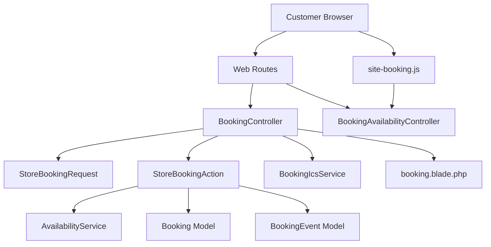
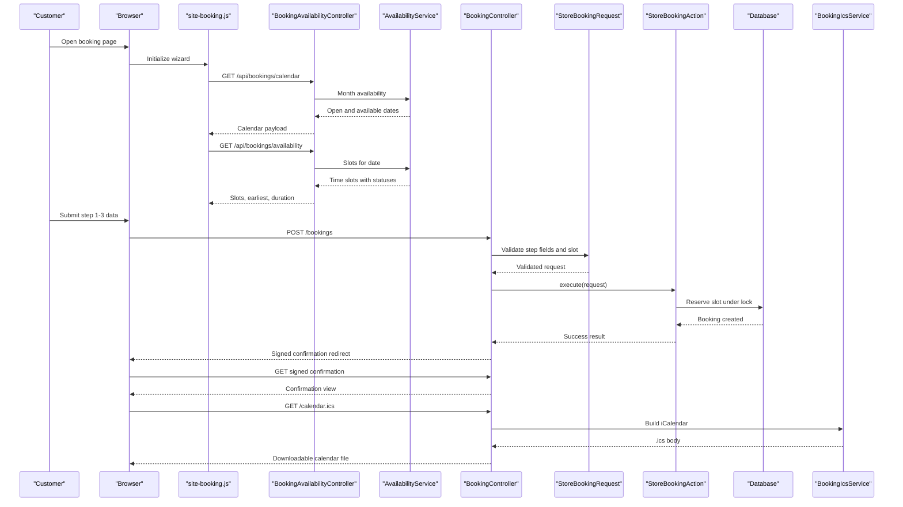
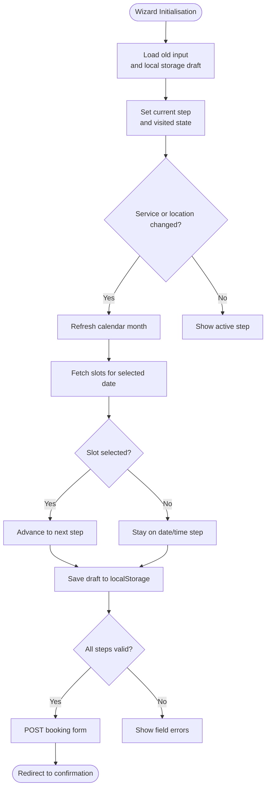
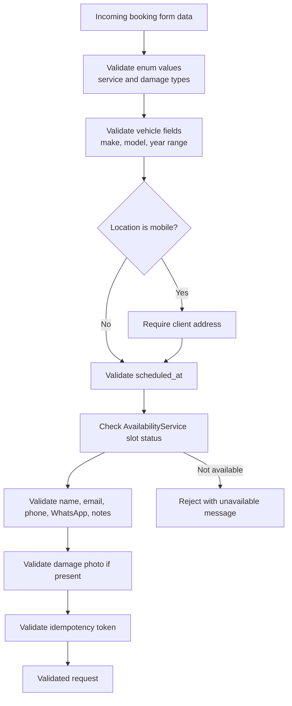
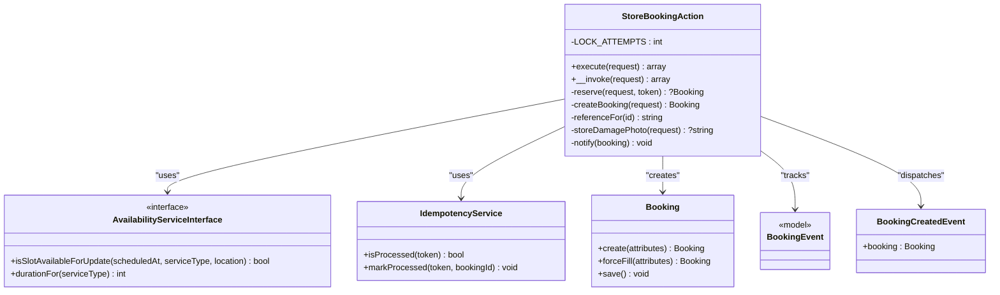
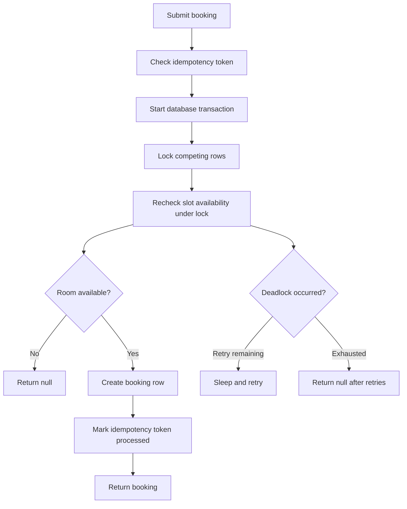
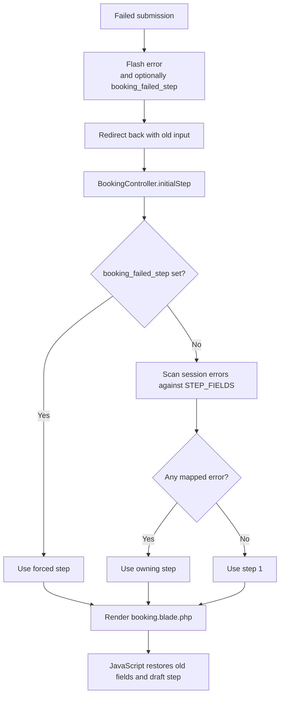
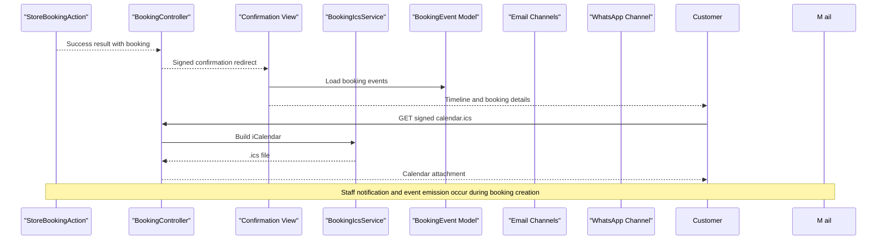
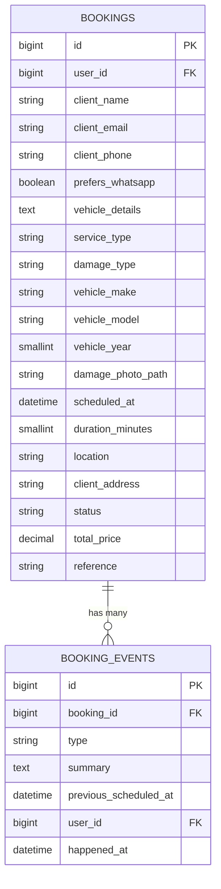
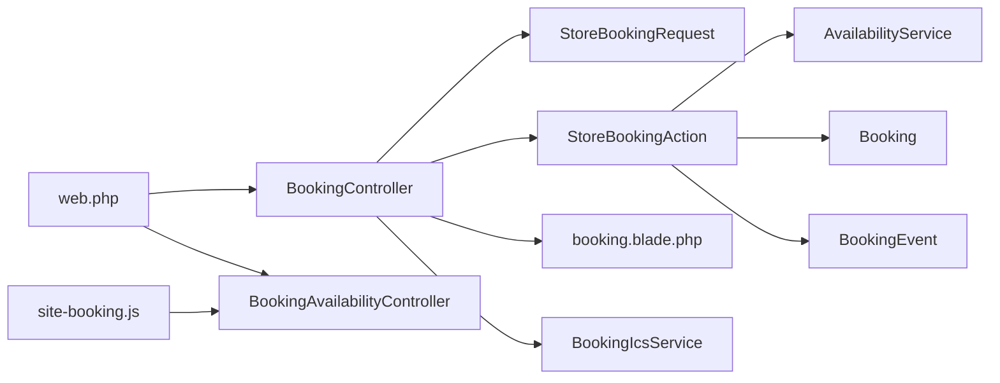

# End-to-End Booking Workflow

<cite>
**Referenced Files in This Document**
- [StoreBookingAction.php](file://app/Actions/StoreBookingAction.php)
- [StoreBookingRequest.php](file://app/Http/Requests/Bookings/StoreBookingRequest.php)
- [BookingController.php](file://app/Http/Controllers/BookingController.php)
- [BookingAvailabilityController.php](file://app/Http/Controllers/Api/BookingAvailabilityController.php)
- [AvailabilityService.php](file://app/Services/AvailabilityService.php)
- [BookingIcsService.php](file://app/Services/BookingIcsService.php)
- [BookingCreatedEvent.php](file://app/Events/BookingCreatedEvent.php)
- [Booking.php](file://app/Models/Booking.php)
- [BookingEvent.php](file://app/Models/BookingEvent.php)
- [web.php](file://routes/web.php)
- [site-booking.js](file://resources/js/site-booking.js)
- [booking.blade.php](file://resources/views/site/booking.blade.php)
</cite>

## Table of Contents
1. [Introduction](#introduction)
2. [Project Structure](#project-structure)
3. [Core Components](#core-components)
4. [Architecture Overview](#architecture-overview)
5. [Detailed Component Analysis](#detailed-component-analysis)
6. [Dependency Analysis](#dependency-analysis)
7. [Performance Considerations](#performance-considerations)
8. [Troubleshooting Guide](#troubleshooting-guide)
9. [Conclusion](#conclusion)
10. [Appendices](#appendices)

## Introduction
This document explains the complete public booking workflow, from a customer choosing a vehicle and service to receiving confirmation and calendar artifacts. The system uses a four-step wizard:

1. Vehicle and service selection.
2. Date and time picking.
3. Contact details and optional preferences.
4. Confirmation review and submission.

The backend orchestrates validation, availability checking, idempotent booking creation, notifications, event logging, and conflict handling through `StoreBookingAction`. Availability is calculated by `AvailabilityService`, which considers business hours, closed days, staff absences, service duration, and workshop/mobile capacity. Customer-facing progress is tracked through `BookingEvent` milestones attached to each `Booking`.

## Project Structure
The booking flow crosses several layers:

- **Routes** define public endpoints for form rendering, submission, confirmation, calendar download, and slot/calendar APIs.
- **Controllers** render views, validate input via request classes, call actions, and return redirects or JSON responses.
- **Form requests** encapsulate step-aware validation rules and human-readable messages.
- **Actions** encapsulate multi-step domain operations such as reserving slots and creating bookings.
- **Services** provide reusable capabilities like availability calculation and iCalendar generation.
- **Models** represent persistent entities such as bookings and their milestone events.
- **Frontend JavaScript** implements the interactive wizard, local draft persistence, and server-backed slot loading.
- **Blade view** wires old input, translations, initial wizard state, and the HTML form.

**Diagram sources**
- [web.php:48-76](file://routes/web.php#L48-L76)
- [BookingController.php:21-146](file://app/Http/Controllers/BookingController.php#L21-L146)
- [BookingAvailabilityController.php:18-117](file://app/Http/Controllers/Api/BookingAvailabilityController.php#L18-L117)
- [StoreBookingRequest.php:15-178](file://app/Http/Requests/Bookings/StoreBookingRequest.php#L15-L178)
- [StoreBookingAction.php:18-267](file://app/Actions/StoreBookingAction.php#L18-L267)
- [AvailabilityService.php:27-200](file://app/Services/AvailabilityService.php#L27-L200)
- [BookingIcsService.php:15-141](file://app/Services/BookingIcsService.php#L15-L141)
- [Booking.php:12-134](file://app/Models/Booking.php#L12-L134)
- [BookingEvent.php:12-84](file://app/Models/BookingEvent.php#L12-L84)
- [site-booking.js:1-200](file://resources/js/site-booking.js#L1-L200)
- [booking.blade.php:1-200](file://resources/views/site/booking.blade.php#L1-L200)

**Section sources**
- [web.php:48-76](file://routes/web.php#L48-L76)
- [BookingController.php:21-146](file://app/Http/Controllers/BookingController.php#L21-L146)
- [store_booking_request.php:15-178](file://app/Http/Requests/Bookings/StoreBookingRequest.php#L15-L178)

## Core Components
The booking system is centered on these components:

| Component | Responsibility | Key Behaviors |
|---|---|---|
| `StoreBookingAction` | Orchestrates booking submission | Idempotency, slot reservation, booking creation, notification dispatch, error logging |
| `StoreBookingRequest` | Validates wizard input per step | Enum checks, phone/email/format rules, mobile-address rule, slot bookability check |
| `BookingController` | Handles form display, submission, confirmation, calendar download | Redirects, session-based step restoration, signed confirmation URLs |
| `AvailabilityService` | Calculates open, available, and occupied slots | Business hours, lead time, service duration, capacity pools, concurrency locking |
| `BookingIcsService` | Generates RFC 5545 calendar files | Floating wall-clock times, summary/description/location encoding, line folding |
| `Booking` | Represents a customer appointment | Duration computation, reference formatting, vehicle summary, status helpers |
| `BookingEvent` | Records visible milestones | Received, confirmed, rescheduled, started, completed, cancelled |
| `site-booking.js` | Implements the four-step wizard | Local storage drafts, calendar navigation, slot fetching, auto-pick, validation mirroring |
| `booking.blade.php` | Renders the wizard UI | Old-input hydration, translated labels, hidden fields, step tabs, form submission |

**Section sources**
- [StoreBookingAction.php:18-267](file://app/Actions/StoreBookingAction.php#L18-L267)
- [StoreBookingRequest.php:15-178](file://app/Http/Requests/Bookings/StoreBookingRequest.php#L15-L178)
- [BookingController.php:21-146](file://app/Http/Controllers/BookingController.php#L21-L146)
- [AvailabilityService.php:27-200](file://app/Services/AvailabilityService.php#L27-L200)
- [BookingIcsService.php:15-141](file://app/Services/BookingIcsService.php#L15-L141)
- [Booking.php:12-134](file://app/Models/Booking.php#L12-L134)
- [BookingEvent.php:12-84](file://app/Models/BookingEvent.php#L12-L84)
- [site-booking.js:1-200](file://resources/js/site-booking.js#L1-L200)
- [booking.blade.php:1-200](file://resources/views/site/booking.blade.php#L1-L200)

## Architecture Overview
The end-to-end journey combines client-side wizardry with server-side guarantees:

**Diagram sources**
- [web.php:48-76](file://routes/web.php#L48-L76)
- [BookingAvailabilityController.php:37-117](file://app/Http/Controllers/Api/BookingAvailabilityController.php#L37-L117)
- [AvailabilityService.php:107-200](file://app/Services/AvailabilityService.php#L107-L200)
- [BookingController.php:51-146](file://app/Http/Controllers/BookingController.php#L51-L146)
- [StoreBookingRequest.php:63-178](file://app/Http/Requests/Bookings/StoreBookingRequest.php#L63-L178)
- [StoreBookingAction.php:49-267](file://app/Actions/StoreBookingAction.php#L49-L267)
- [BookingIcsService.php:27-141](file://app/Services/BookingIcsService.php#L27-L141)

## Detailed Component Analysis

### Four-Step Wizard User Journey
The frontend wizard manages four steps:

1. **Vehicle and service selection**: Service type, damage type, vehicle make/model/year, location, and conditional mobile address.
2. **Date and time picking**: Calendar month navigation, selectable day highlighting, and time-slot selection.
3. **Contact details**: Name, email, phone, WhatsApp preference, optional vehicle notes, and optional damage photo.
4. **Confirmation review and submission**: Final validation before POST.

The wizard persists partial data using `localStorage` under a global draft key. When a scheduled value exists, it parses it into date and time inputs and preloads the relevant calendar month and slots. Step navigation validates required fields and mirrors the server’s mobile-address requirement.

**Diagram sources**
- [site-booking.js:1-200](file://resources/js/site-booking.js#L1-L200)
- [site-booking.js:201-737](file://resources/js/site-booking.js#L201-L737)
- [booking.blade.php:1-200](file://resources/views/site/booking.blade.php#L1-L200)

**Section sources**
- [site-booking.js:1-200](file://resources/js/site-booking.js#L1-L200)
- [site-booking.js:201-737](file://resources/js/site-booking.js#L201-L737)
- [booking.blade.php:1-200](file://resources/views/site/booking.blade.php#L1-L200)

### StoreBookingRequest Validation Rules Per Step
Validation is grouped by step through `STEP_FIELDS`:

| Step | Fields | Rules and Intent |
|---|---|---|
| 1 | Service, damage, vehicle make/model/year, location, mobile address | Required enums, integer year range, location must be `mobile` or `workshop`; address required only for mobile fittings |
| 2 | Scheduled datetime | Required ISO-like format; must be bookable according to `AvailabilityService` |
| 3 | Name, email, phone, WhatsApp flag, vehicle details, damage photo | Email filter, numeric phone length, boolean flag, nullable free text, image size and MIME restrictions |
| System | Idempotency token | Required string up to 64 characters to prevent duplicate submissions |

Custom messages explain why a field failed, and attribute names improve generated messages. The slot validator calls `AvailabilityService::slotStatus`, ensuring that the picker and submission share the same availability logic.

**Diagram sources**
- [StoreBookingRequest.php:28-178](file://app/Http/Requests/Bookings/StoreBookingRequest.php#L28-L178)
- [AvailabilityService.php:61-106](file://app/Services/AvailabilityService.php#L61-L106)

**Section sources**
- [StoreBookingRequest.php:28-178](file://app/Http/Requests/Bookings/StoreBookingRequest.php#L28-L178)

### StoreBookingAction Orchestration
`StoreBookingAction` is the central orchestrator for a successful booking submission:

1. **Idempotency check**: If the `_idempotency_token` has already been processed, the action returns the previously stored result instead of creating another booking.
2. **Reservation loop**: It retries up to two attempts when a database deadlock occurs, because a lost race is not a customer error.
3. **Availability re-check under lock**: Inside a transaction, it asks `AvailabilityService::isSlotAvailableForUpdate`, which locks competing rows so two concurrent submissions cannot both reserve the same slot.
4. **Booking creation**: It writes customer-provided fields, snapshots the service duration, stores an optional damage photo, assigns a pending status, and generates a customer-facing reference.
5. **Notification dispatch**: After success, it triggers staff notifications and emits `BookingCreatedEvent`.
6. **Error handling**: Exceptions are logged and converted into a user-friendly failure response.

**Diagram sources**
- [StoreBookingAction.php:18-267](file://app/Actions/StoreBookingAction.php#L18-L267)
- [BookingCreatedEvent.php:9-19](file://app/Events/BookingCreatedEvent.php#L9-L19)
- [Booking.php:12-134](file://app/Models/Booking.php#L12-L134)
- [BookingEvent.php:12-84](file://app/Models/BookingEvent.php#L12-L84)

**Section sources**
- [StoreBookingAction.php:18-267](file://app/Actions/StoreBookingAction.php#L18-L267)

### Availability Checking and Lost-Slot Handling
`AvailabilityService` treats a slot as a start time but reserves its full duration window. It considers:

- Whether the day is open.
- Whether the slot respects the minimum notice period.
- Whether the job finishes before closing time.
- Whether the capacity pool has room.
- Whether existing bookings, inspections, or staff absences overlap the window.
- Whether the location matches the booked bay or is location-agnostic.

For update paths, it locks relevant bookings and absences and narrows overlapping rows through the same interval predicate used by the calendar. This prevents the picker and the submission from disagreeing about the same slot.

Lost-slot handling follows this path:

**Diagram sources**
- [StoreBookingAction.php:89-150](file://app/Actions/StoreBookingAction.php#L89-L150)
- [AvailabilityService.php:107-200](file://app/Services/AvailabilityService.php#L107-L200)
- [AvailabilityService.php:531-748](file://app/Services/AvailabilityService.php#L531-L748)

**Section sources**
- [StoreBookingAction.php:89-150](file://app/Actions/StoreBookingAction.php#L89-L150)
- [AvailabilityService.php:107-200](file://app/Services/AvailabilityService.php#L107-L200)
- [AvailabilityService.php:531-748](file://app/Services/AvailabilityService.php#L531-L748)

### Session-Based Form State Restoration
When a submission fails, the controller redirects back and flashes either:

- A general error message.
- A forced step number when the failure was a lost slot.
- The old input so fields remain filled.

`BookingController::initialStep` determines where to resume:

1. If `booking_failed_step` is set, use it.
2. Otherwise, inspect session error bags and map failures to the owning step using `StoreBookingRequest::STEP_FIELDS`.
3. Fall back to step 1.

The Blade template passes old input into Alpine data attributes, and `site-booking.js` reads them during initialization. It also restores the last visited step from `localStorage` unless a scheduled value already drives state.

**Diagram sources**
- [BookingController.php:63-146](file://app/Http/Controllers/BookingController.php#L63-L146)
- [StoreBookingRequest.php:28-47](file://app/Http/Requests/Bookings/StoreBookingRequest.php#L28-L47)
- [booking.blade.php:1-200](file://resources/views/site/booking.blade.php#L1-L200)
- [site-booking.js:1-200](file://resources/js/site-booking.js#L1-L200)

**Section sources**
- [BookingController.php:63-146](file://app/Http/Controllers/BookingController.php#L63-L146)
- [StoreBookingRequest.php:28-47](file://app/Http/Requests/Bookings/StoreBookingRequest.php#L28-L47)
- [booking.blade.php:1-200](file://resources/views/site/booking.blade.php#L1-L200)
- [site-booking.js:1-200](file://resources/js/site-booking.js#L1-L200)

### Confirmation Process: Email, ICS, WhatsApp, and Event Tracking
After a successful booking:

- The controller redirects to a signed confirmation route.
- The confirmation view loads the booking with its related events.
- The iCalendar endpoint builds a `.ics` file using `BookingIcsService`.
- Notifications include staff alerts and a `BookingCreatedEvent`.
- `BookingEvent` defines customer-visible milestones and indicates which milestones should notify customers.

Important implementation detail: the provided `StoreBookingAction` code does not directly create `BookingEvent` records in the shown snippet. However, `Booking::events()` exposes a relationship to `BookingEvent`, and `BookingEvent` defines constants for received, confirmed, rescheduled, started, completed, and cancelled states. In production, these milestones should be created by listeners, jobs, or additional orchestration around `BookingCreatedEvent`.

**Diagram sources**
- [StoreBookingAction.php:49-116](file://app/Actions/StoreBookingAction.php#L49-L116)
- [BookingController.php:79-118](file://app/Http/Controllers/BookingController.php#L79-L118)
- [BookingIcsService.php:27-141](file://app/Services/BookingIcsService.php#L27-L141)
- [Booking.php:73-134](file://app/Models/Booking.php#L73-L134)
- [BookingEvent.php:12-84](file://app/Models/BookingEvent.php#L12-L84)

**Section sources**
- [StoreBookingAction.php:49-116](file://app/Actions/StoreBookingAction.php#L49-L116)
- [BookingController.php:79-118](file://app/Http/Controllers/BookingController.php#L79-L118)
- [BookingIcsService.php:27-141](file://app/Services/BookingIcsService.php#L27-L141)
- [Booking.php:73-134](file://app/Models/Booking.php#L73-L134)
- [BookingEvent.php:12-84](file://app/Models/BookingEvent.php#L12-L84)

### Data Models and Relationships
The core data model connects bookings to their timeline and supports structured vehicle information, scheduling metadata, and status tracking.

**Diagram sources**
- [Booking.php:12-134](file://app/Models/Booking.php#L12-L134)
- [BookingEvent.php:12-84](file://app/Models/BookingEvent.php#L12-L84)

**Section sources**
- [Booking.php:12-134](file://app/Models/Booking.php#L12-L134)
- [BookingEvent.php:12-84](file://app/Models/BookingEvent.php#L12-L84)

## Dependency Analysis
The booking workflow depends on well-separated responsibilities:

- Routes expose endpoints without embedding business logic.
- Controllers handle HTTP concerns: routing, redirection, view rendering, and delegation to actions.
- Form requests encapsulate validation rules and messages.
- Actions contain domain orchestration.
- Services provide reusable calculations and artifact generation.
- Models represent persisted state.
- Frontend JavaScript depends on API responses rather than computing availability locally.

**Diagram sources**
- [web.php:48-76](file://routes/web.php#L48-L76)
- [BookingController.php:21-146](file://app/Http/Controllers/BookingController.php#L21-L146)
- [StoreBookingRequest.php:15-178](file://app/Http/Requests/Bookings/StoreBookingRequest.php#L15-L178)
- [StoreBookingAction.php:18-267](file://app/Actions/StoreBookingAction.php#L18-L267)
- [AvailabilityService.php:27-200](file://app/Services/AvailabilityService.php#L27-L200)
- [BookingIcsService.php:15-141](file://app/Services/BookingIcsService.php#L15-L141)
- [site-booking.js:1-200](file://resources/js/site-booking.js#L1-L200)

**Section sources**
- [web.php:48-76](file://routes/web.php#L48-L76)
- [BookingController.php:21-146](file://app/Http/Controllers/BookingController.php#L21-L146)
- [StoreBookingAction.php:18-267](file://app/Actions/StoreBookingAction.php#L18-L267)

## Performance Considerations
The system includes several performance safeguards:

- **Batched availability survey**: `AvailabilityService` loads committed jobs and staff absences once per requested window rather than querying per slot.
- **Interval-based slot generation**: It iterates configured intervals between opening and closing, bounded by minimum and maximum durations.
- **Capacity-aware locking**: Concurrency protection locks relevant rows and counts only truly overlapping jobs.
- **Horizon limits**: Calendar lookups are capped at 90 days ahead.
- **Throttled endpoints**: Submission and availability endpoints have rate limits.
- **Client-side lazy calendar loading**: Months beyond the first three are fetched on demand.

Recommendations for further optimization:

- Monitor query plans for the overlapping-job and absence queries.
- Add database indexes on `scheduled_at`, `status`, and any composite indexes used by the locked-window queries.
- Cache immutable configuration such as working hours and closed days where appropriate.
- Measure idempotency cache size and TTL behavior for high-volume periods.
- Profile notification delivery latency, especially when email or WhatsApp channels are slow.

[No sources needed since this section provides general guidance]

## Troubleshooting Guide

### Failed Validations
**Symptoms**: The wizard jumps back to an earlier step or shows field-specific errors.

**Likely causes**:

- Missing or invalid service or damage type.
- Invalid vehicle year outside the allowed range.
- Mobile fitting submitted without a client address.
- Malformed email or phone number.
- Damage photo exceeding size or MIME restrictions.
- Missing idempotency token.

**Resolution steps**:

1. Inspect the error bag and confirm which step owns the failing field using `StoreBookingRequest::STEP_FIELDS`.
2. Verify the Blade template renders old input correctly.
3. Check custom validation messages and attributes.
4. For phone numbers, ensure they contain only digits and fall within the allowed length.
5. For images, verify MIME types and upload size.

**Section sources**
- [StoreBookingRequest.php:28-178](file://app/Http/Requests/Bookings/StoreBookingRequest.php#L28-L178)
- [booking.blade.php:1-200](file://resources/views/site/booking.blade.php#L1-L200)

### Slot Already Taken or Lost Race
**Symptoms**: The user submits a valid slot but receives a generic error and returns to the date/time step.

**Likely causes**:

- Another customer reserved the same slot concurrently.
- A deadlock exhausted retries.
- Settings made the slot unavailable (closed day, too late, or no capacity).

**Resolution steps**:

1. Check whether the error indicates `slot_taken`.
2. Review application logs for deadlocks or exception traces.
3. Verify `AvailabilityService` settings: lead time, interval, capacity, and service durations.
4. Confirm that inspection rescheduling does not shift expected occupancy unexpectedly.
5. Encourage the customer to choose another slot or use the “jump to earliest” option.

**Section sources**
- [StoreBookingAction.php:49-150](file://app/Actions/StoreBookingAction.php#L49-L150)
- [AvailabilityService.php:107-200](file://app/Services/AvailabilityService.php#L107-L200)
- [AvailabilityService.php:531-748](file://app/Services/AvailabilityService.php#L531-L748)

### Email Delivery Problems
**Symptoms**: Staff do not receive new-booking notifications, or customers do not receive confirmation emails.

**Likely causes**:

- Email transport misconfiguration.
- Queue worker not running if mail is queued.
- Listener or notification pipeline not wired to `BookingCreatedEvent`.
- Invalid or missing customer email.

**Resolution steps**:

1. Verify mail configuration and credentials.
2. Check queue workers and job logs.
3. Ensure `BookingCreatedEvent` listeners are registered.
4. Validate the customer email field before sending.
5. Test with a known-good recipient and inspect SMTP logs.

**Section sources**
- [StoreBookingAction.php:117-150](file://app/Actions/StoreBookingAction.php#L117-L150)
- [BookingCreatedEvent.php:9-19](file://app/Events/BookingCreatedEvent.php#L9-L19)

### ICS Calendar File Issues
**Symptoms**: The `.ics` file is empty, malformed, or contains incorrect times.

**Likely causes**:

- Booking has no `scheduled_at`.
- Timezone confusion between floating wall-clock times and displayed timezone.
- Long address or notes breaking RFC 5545 line folding.

**Resolution steps**:

1. Confirm the booking has a scheduled time.
2. Use the signed `/bookings/{booking}/calendar.ics` endpoint.
3. Check that `BookingIcsService` escapes semicolons, commas, and line breaks.
4. Verify the service generates proper VCALENDAR structure with DTSTART and DTEND.

**Section sources**
- [BookingIcsService.php:27-141](file://app/Services/BookingIcsService.php#L27-L141)
- [BookingController.php:103-118](file://app/Http/Controllers/BookingController.php#L103-L118)

### Session Restoration Problems
**Symptoms**: The wizard resets to step 1 after a failed submission.

**Likely causes**:

- Missing or stale `booking_failed_step` session value.
- Error bag not containing mapped fields.
- JavaScript not reading old input attributes.
- Draft key collision or cleared `localStorage`.

**Resolution steps**:

1. Inspect session data for `booking_failed_step` and error bags.
2. Confirm `BookingController::initialStep` selects the correct step.
3. Verify Blade passes old input into Alpine data attributes.
4. Clear browser storage and retry if local drafts are corrupted.

**Section sources**
- [BookingController.php:120-146](file://app/Http/Controllers/BookingController.php#L120-L146)
- [booking.blade.php:1-200](file://resources/views/site/booking.blade.php#L1-L200)
- [site-booking.js:1-200](file://resources/js/site-booking.js#L1-L200)

## Conclusion
The booking workflow separates presentation, validation, orchestration, availability math, and persistence cleanly. Customers interact with a guided wizard backed by server-side availability and concurrency controls. Administrators can rely on idempotency, explicit error responses, and milestone events to understand booking progress. Customization points include extending validation rules, adding notification channels, adjusting availability settings, and monitoring funnel metrics through booking lifecycle events.

[No sources needed since this section summarizes without analyzing specific files]

## Appendices

### Customizing the Booking Flow
- **Add a new validation rule**: Extend `StoreBookingRequest::rules()` and add corresponding messages and attributes. Map the field to a step in `STEP_FIELDS` so failures redirect the customer to the right place.
- **Extend the wizard steps**: Update the Blade template, JavaScript step definitions, and the request mapping to support additional fields.
- **Add a new notification channel**: Listen to `BookingCreatedEvent` or extend the notification dispatch path in `StoreBookingAction`.
- **Adjust availability behavior**: Configure lead time, interval, service durations, capacity, and closed days through the settings consumed by `AvailabilityService`.
- **Monitor booking funnel metrics**: Track conversions between steps using frontend analytics and backend metrics around validation failures, slot conflicts, successful bookings, and email delivery outcomes.

[No sources needed since this section provides general guidance]