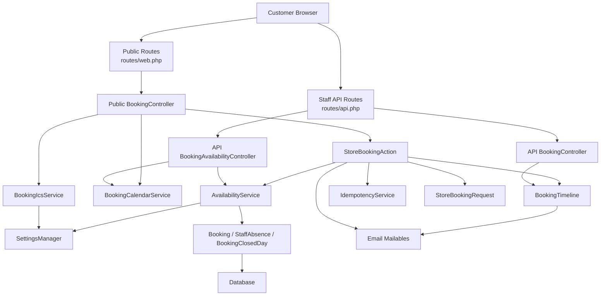
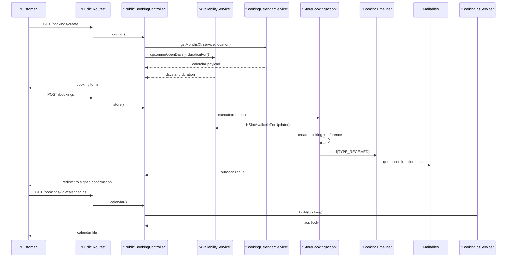
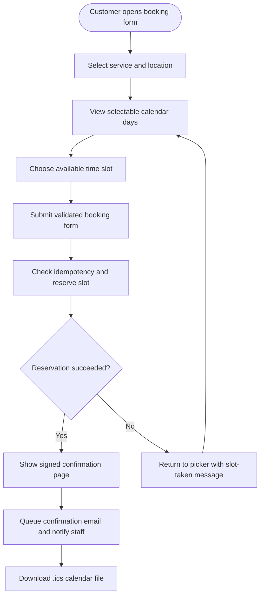
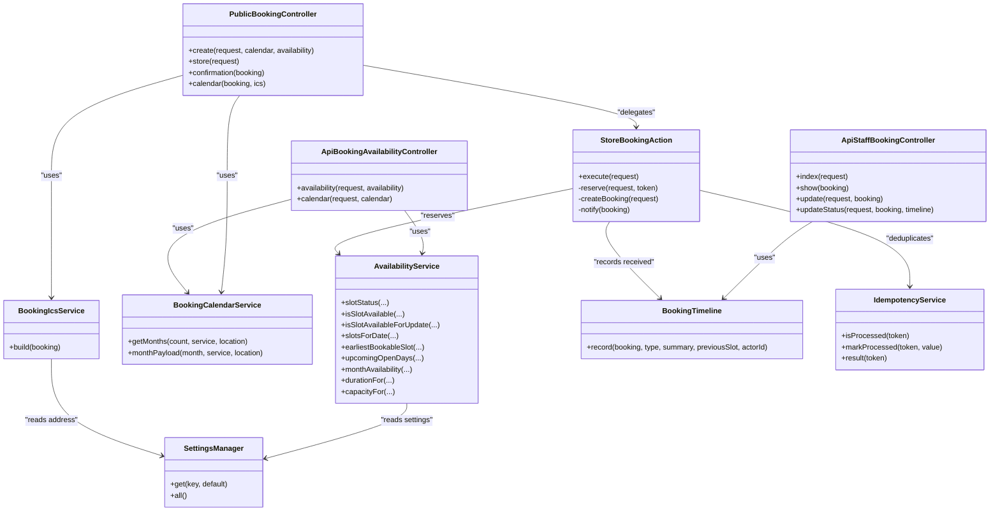
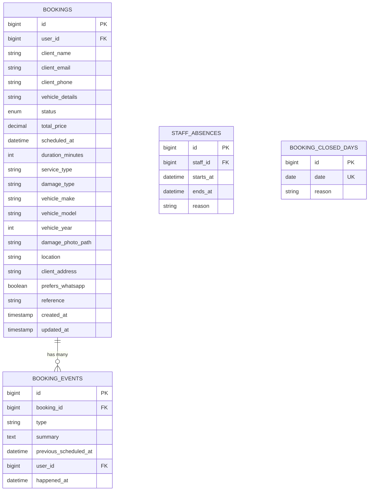

# Online Booking System

<cite>
**Referenced Files in This Document**
- [BookingController.php](file://app/Http/Controllers/BookingController.php)
- [BookingController.php](file://app/Http/Controllers/Api/BookingController.php)
- [BookingAvailabilityController.php](file://app/Http/Controllers/Api/BookingAvailabilityController.php)
- [StoreBookingAction.php](file://app/Actions/StoreBookingAction.php)
- [AvailabilityService.php](file://app/Services/AvailabilityService.php)
- [BookingCalendarService.php](file://app/Services/BookingCalendarService.php)
- [BookingIcsService.php](file://app/Services/BookingIcsService.php)
- [BookingTimeline.php](file://app/Services/BookingTimeline.php)
- [IdempotencyService.php](file://app/Services/IdempotencyService.php)
- [SettingsManager.php](file://app/Services/Settings/SettingsManager.php)
- [StoreBookingRequest.php](file://app/Http/Requests/Bookings/StoreBookingRequest.php)
- [Booking.php](file://app/Models/Booking.php)
- [StaffAbsence.php](file://app/Models/StaffAbsence.php)
- [BookingClosedDay.php](file://app/Models/BookingClosedDay.php)
- [BookingCreatedEvent.php](file://app/Events/BookingCreatedEvent.php)
- [BookingConfirmationMail.php](file://app/Mail/BookingConfirmationMail.php)
- [NewBookingStaffMail.php](file://app/Mail/NewBookingStaffMail.php)
- [web.php](file://routes/web.php)
- [api.php](file://routes/api.php)
- [2026_04_17_093356_create_bookings_table.php](file://database/migrations/2026_04_17_093356_create_bookings_table.php)
- [2026_10_18_000001_create_booking_closed_days_table.php](file://database/migrations/2026_10_18_000001_create_booking_closed_days_table.php)
- [BookingServiceType.php](file://app/Enums/BookingServiceType.php)
- [BookingDamageType.php](file://app/Enums/BookingDamageType.php)
</cite>

## Table of Contents
1. [Introduction](#introduction)
2. [Project Structure](#project-structure)
3. [Core Components](#core-components)
4. [Architecture Overview](#architecture-overview)
5. [Detailed Component Analysis](#detailed-component-analysis)
6. [Dependency Analysis](#dependency-analysis)
7. [Performance Considerations](#performance-considerations)
8. [Troubleshooting Guide](#troubleshooting-guide)
9. [Conclusion](#conclusion)
10. [Appendices](#appendices)

## Introduction
This document explains the online booking system for an automotive glass service business. It covers how customers browse available slots, submit a booking, receive confirmation and calendar files, and how staff update booking status through the mobile API. The system separates public-facing routing, validation, slot availability calculation, database persistence, timeline tracking, email notifications, and iCalendar export.

Key design goals are:
- The calendar UI cannot offer a slot that the server would reject.
- A slot is treated as a job interval, not an instant, so overlapping jobs are correctly detected.
- Concurrent submissions are retried under row locks and protected against duplicate form submissions.
- Business rules such as opening hours, lead time, capacity, service duration, staff absences, and shop closures are configurable or centralized.
- Email and notification failures do not roll back a confirmed booking.

## Project Structure
The booking subsystem spans controllers, an action class, services, models, events, mail classes, routes, migrations, enums, and request validation.

**Diagram sources**
- [web.php:39-62](file://routes/web.php#L39-L62)
- [api.php:27-56](file://routes/api.php#L27-L56)
- [BookingController.php:18-146](file://app/Http/Controllers/BookingController.php#L18-L146)
- [BookingAvailabilityController.php:18-117](file://app/Http/Controllers/Api/BookingAvailabilityController.php#L18-L117)
- [StoreBookingAction.php:18-267](file://app/Actions/StoreBookingAction.php#L18-L267)
- [AvailabilityService.php:18-748](file://app/Services/AvailabilityService.php#L18-L748)
- [BookingCalendarService.php:18-101](file://app/Services/BookingCalendarService.php#L18-L101)
- [BookingIcsService.php:18-141](file://app/Services/BookingIcsService.php#L18-L141)
- [BookingTimeline.php:18-128](file://app/Services/BookingTimeline.php#L18-L128)
- [IdempotencyService.php:18-95](file://app/Services/IdempotencyService.php#L18-L95)
- [SettingsManager.php:18-163](file://app/Services/Settings/SettingsManager.php#L18-L163)

**Section sources**
- [web.php:1-76](file://routes/web.php#L1-L76)
- [api.php:1-117](file://routes/api.php#L1-L117)

## Core Components
- Public booking controller: renders the booking wizard, stores bookings, shows confirmation, and exports iCalendar files.
- API booking availability controller: returns daily slots and monthly calendar data for real-time availability checking.
- Staff API booking controller: lists, updates editable fields, and transitions booking status with lifecycle guards.
- Store booking action: idempotent reservation, availability re-check, booking creation, reference generation, photo handling, and post-creation notifications.
- Availability service: central algorithm for open days, slot intervals, lead time, capacity, conflicts, absences, and closed days.
- Booking calendar service: builds month payloads where selectable days have at least one bookable slot.
- Booking timeline: single authority for milestone recording, status synchronization, and customer emails.
- iCalendar service: generates RFC 5545-compliant `.ics` files using floating local times.
- Request validation: enforces step-based fields, enum values, text limits, phone format, and slot bookability.

**Section sources**
- [BookingController.php:18-146](file://app/Http/Controllers/BookingController.php#L18-L146)
- [BookingAvailabilityController.php:18-117](file://app/Http/Controllers/Api/BookingAvailabilityController.php#L18-L117)
- [BookingController.php](file://app/Http/Controllers/Api/BookingController.php)
- [StoreBookingAction.php:18-267](file://app/Actions/StoreBookingAction.php#L18-L267)
- [AvailabilityService.php:18-748](file://app/Services/AvailabilityService.php#L18-L748)
- [BookingCalendarService.php:18-101](file://app/Services/BookingCalendarService.php#L18-L101)
- [BookingTimeline.php:18-128](file://app/Services/BookingTimeline.php#L18-L128)
- [BookingIcsService.php:18-141](file://app/Services/BookingIcsService.php#L18-L141)
- [StoreBookingRequest.php:18-178](file://app/Http/Requests/Bookings/StoreBookingRequest.php#L18-L178)

## Architecture Overview
The system follows a layered flow:

1. A customer opens `/bookings/create`.
2. The public controller loads three months of calendar data and upcoming open days from `BookingCalendarService` and `AvailabilityService`.
3. The frontend calls `/api/bookings/availability` and `/api/bookings/calendar` to keep the UI consistent with server-side rules.
4. On submission, the controller delegates to `StoreBookingAction`, which checks idempotency, reserves the slot under a transactional lock, creates the booking, records a received event, and notifies staff and listeners.
5. The client is redirected to a signed confirmation page and can download an iCalendar attachment.
6. Staff use the token-authenticated `/api/staff/*` endpoints to list, edit, and transition bookings.

**Diagram sources**
- [web.php:39-62](file://routes/web.php#L39-L62)
- [BookingController.php:28-146](file://app/Http/Controllers/BookingController.php#L28-L146)
- [StoreBookingAction.php:40-267](file://app/Actions/StoreBookingAction.php#L40-L267)
- [AvailabilityService.php:54-184](file://app/Services/AvailabilityService.php#L54-L184)
- [BookingCalendarService.php:33-101](file://app/Services/BookingCalendarService.php#L33-L101)
- [BookingTimeline.php:33-128](file://app/Services/BookingTimeline.php#L33-L128)
- [BookingIcsService.php:26-141](file://app/Services/BookingIcsService.php#L26-L141)

## Detailed Component Analysis

### Public Booking Controller
Responsibilities:
- Render the booking form with precomputed calendar months and quick-pick days.
- Preserve selected service and location across failed submissions.
- Delegate storage to `StoreBookingAction`.
- Show a signed confirmation page loaded with booking events.
- Export an iCalendar file when a booking has a scheduled time.

Important behaviors:
- Three months are rendered up front.
- Fourteen upcoming open days are offered as quick picks.
- Validation errors or slot loss return the user to the correct wizard step.
- Confirmation and calendar endpoints require a signed route to prevent guessing IDs.

**Section sources**
- [BookingController.php:18-146](file://app/Http/Controllers/BookingController.php#L18-L146)
- [web.php:39-62](file://routes/web.php#L39-L62)

### API Booking Availability Controller
Responsibilities:
- Validate service type, location, date, and month inputs.
- Return daily slots with start, end, label, availability, and status.
- Return earliest bookable slot metadata.
- Return a month payload where only days with at least one bookable slot are selectable.

Validation and safety:
- Dates must be within today and the configured horizon.
- Service is constrained by `BookingServiceType`.
- Location must be `mobile` or `workshop`.
- Endpoints are rate-limited at 30 requests per minute.

**Section sources**
- [BookingAvailabilityController.php:18-117](file://app/Http/Controllers/Api/BookingAvailabilityController.php#L18-L117)
- [web.php:59-62](file://routes/web.php#L59-L62)

### API Staff Booking Controller
Responsibilities:
- List bookings with optional status and search filters.
- Show a booking with inspection, notes, and timeline events.
- Update editable fields such as quoted price.
- Transition status through pending, confirmed, completed, and cancelled.

Lifecycle constraints:
- Status transitions go through `BookingTimeline`, preventing duplicate milestones and ensuring customer emails are sent exactly once.
- Reverting a cancelled booking requires an explicit move back to pending.
- Cancelled bookings return conflict responses when further progress is attempted.

Authorization:
- All staff endpoints are behind Sanctum authentication and Spatie abilities matching the web admin panel.

**Section sources**
- [BookingController.php](file://app/Http/Controllers/Api/BookingController.php)
- [api.php:27-56](file://routes/api.php#L27-L56)

### Store Booking Action
Responsibilities:
- Check idempotency tokens to avoid duplicate submissions.
- Reserve a slot inside a database transaction with a row lock.
- Handle concurrent contention by retrying once after a deadlock.
- Create the booking, set a human-readable reference, and snapshot duration.
- Optionally process a damage photo; image failures are logged but do not fail the booking.
- Record a received milestone and send staff notification and a domain event.

Concurrency model:
- The availability check and insert share one transaction.
- Deadlocks are caught and retried up to two attempts.
- A lost race condition returns “slot already taken,” allowing the UI to ask the customer to choose another slot.

Idempotency:
- Duplicate tokens return the original booking result without creating a second record.

Post-creation notifications:
- Notifications are wrapped so mail or queue failures cannot turn a booked appointment into an error response.

**Section sources**
- [StoreBookingAction.php:18-267](file://app/Actions/StoreBookingAction.php#L18-L267)
- [IdempotencyService.php:18-95](file://app/Services/IdempotencyService.php#L18-L95)

### Availability Service
Responsibilities:
- Decide whether a specific slot is closed, too late, available, or taken.
- Generate all slot starts for a day based on opening hours, interval, and service duration.
- Provide daily slots, earliest bookable slot, upcoming open days, and monthly availability surveys.
- Respect lead time, slot interval, service durations, capacity, staff absences, and shop closures.
- Load jobs and absences in one window to avoid repeated queries per slot.

Algorithm highlights:
- A slot is a start time; occupancy is tested as an interval overlap.
- Capacity is per location pool; unknown locations take the smaller pool.
- Inspections may reschedule a booking’s effective start time.
- Closed days make the entire day unavailable regardless of capacity.
- Settings guard against invalid intervals and durations.

Time zone behavior:
- Slot math uses application wall-clock time because `scheduled_at` is stored as naive local time.
- Time display formatting can switch between 12-hour and 24-hour formats.

**Section sources**
- [AvailabilityService.php:18-748](file://app/Services/AvailabilityService.php#L18-L748)
- [SettingsManager.php:18-163](file://app/Services/Settings/SettingsManager.php#L18-L163)

### Booking Calendar Service
Responsibilities:
- Build consecutive months of calendar data.
- Mark a day selectable only when it has at least one bookable slot.
- Return leading blanks, available counts, and day metadata for the frontend grid.

Design choice:
- Selectability is determined server-side so the UI cannot present a fully booked day as free.

**Section sources**
- [BookingCalendarService.php:18-101](file://app/Services/BookingCalendarService.php#L18-L101)

### Booking Timeline
Responsibilities:
- Record milestones: received, confirmed, rescheduled, completed, cancelled.
- Synchronize coarse booking status.
- Prevent duplicate milestones.
- Queue customer emails per milestone.
- Treat cancellation as terminal until explicitly reverted to pending.

Email mapping:
- Received maps to the booking confirmation mailable.
- Confirmed, rescheduled, completed, and cancelled each map to their respective customer mailable.

**Section sources**
- [BookingTimeline.php:18-128](file://app/Services/BookingTimeline.php#L18-L128)
- [BookingConfirmationMail.php:18-39](file://app/Mail/BookingConfirmationMail.php#L18-L39)
- [NewBookingStaffMail.php:18-40](file://app/Mail/NewBookingStaffMail.php#L18-L40)

### iCalendar Service
Responsibilities:
- Generate an RFC 5545 `.ics` calendar file for a booking.
- Use floating local times matching the naive `scheduled_at` column.
- Escape reserved characters and fold long lines.
- Include summary, description, location, and status.

Location logic:
- Mobile bookings use the client address when present.
- Workshop bookings use the configured company address.

**Section sources**
- [BookingIcsService.php:18-141](file://app/Services/BookingIcsService.php#L18-L141)

### Store Booking Request
Responsibilities:
- Enforce step-based field ownership.
- Validate service and damage enums.
- Validate vehicle details, contact information, and location.
- Validate that the chosen slot is still bookable using the same availability rule as the picker.
- Limit text fields to match the underlying database column width.
- Validate damage photos and idempotency tokens.

Wizard navigation:
- Failed submissions return the customer to the first step containing an error.

**Section sources**
- [StoreBookingRequest.php:18-178](file://app/Http/Requests/Bookings/StoreBookingRequest.php#L18-L178)

### Booking Model and Relationships
The `Booking` model represents a customer appointment and exposes:
- Structured vehicle fields and a legacy `vehicle_details` fallback.
- Derived end time from scheduled start and duration.
- Display reference derived from ID when missing.
- Relationships to user, inspection, and customer-visible events.
- Casts for datetime, decimal price, integer duration, boolean WhatsApp preference, and enums.

Related models:
- `StaffAbsence` defines absence ranges affecting capacity.
- `BookingClosedDay` marks shop-wide closure dates.
- Enums define service types and damage categories used throughout validation and display.

**Section sources**
- [Booking.php:18-134](file://app/Models/Booking.php#L18-L134)
- [StaffAbsence.php:18-39](file://app/Models/StaffAbsence.php#L18-L39)
- [BookingClosedDay.php:18-35](file://app/Models/BookingClosedDay.php#L18-L35)
- [BookingServiceType.php:18-64](file://app/Enums/BookingServiceType.php#L18-L64)
- [BookingDamageType.php:18-37](file://app/Enums/BookingDamageType.php#L18-L37)

### User Journey
1. **Browse**: The customer selects a service and location, then views a calendar where only days with bookable slots are selectable.
2. **Pick a slot**: Daily availability shows labels, end times, and availability status. Slots earlier than the lead time are marked too late rather than silently hidden.
3. **Submit**: The form validates structured vehicle and contact data, confirms the slot is still available, and submits an idempotent request.
4. **Reserve**: The backend locks competing rows, checks availability again, and inserts the booking.
5. **Confirm**: The customer sees a signed confirmation page and can add the appointment to a personal calendar.
6. **Notify**: Staff receive a new-booking notice, and the customer receives a queued confirmation email.
7. **Manage**: Staff can list, search, update prices, and transition booking status through the staff API.

[No sources needed since this diagram shows conceptual workflow, not actual code structure]

## Dependency Analysis

**Diagram sources**
- [BookingController.php:18-146](file://app/Http/Controllers/BookingController.php#L18-L146)
- [BookingAvailabilityController.php:18-117](file://app/Http/Controllers/Api/BookingAvailabilityController.php#L18-L117)
- [BookingController.php](file://app/Http/Controllers/Api/BookingController.php)
- [StoreBookingAction.php:18-267](file://app/Actions/StoreBookingAction.php#L18-L267)
- [AvailabilityService.php:18-748](file://app/Services/AvailabilityService.php#L18-L748)
- [BookingCalendarService.php:18-101](file://app/Services/BookingCalendarService.php#L18-L101)
- [BookingIcsService.php:18-141](file://app/Services/BookingIcsService.php#L18-L141)
- [BookingTimeline.php:18-128](file://app/Services/BookingTimeline.php#L18-L128)
- [IdempotencyService.php:18-95](file://app/Services/IdempotencyService.php#L18-L95)
- [SettingsManager.php:18-163](file://app/Services/Settings/SettingsManager.php#L18-L163)

**Section sources**
- [BookingController.php:18-146](file://app/Http/Controllers/BookingController.php#L18-L146)
- [BookingAvailabilityController.php:18-117](file://app/Http/Controllers/Api/BookingAvailabilityController.php#L18-L117)
- [StoreBookingAction.php:18-267](file://app/Actions/StoreBookingAction.php#L18-L267)
- [AvailabilityService.php:18-748](file://app/Services/AvailabilityService.php#L18-L748)

## Performance Considerations
Real-time availability and high-volume booking scenarios should account for:

- **Batched availability surveys**: `AvailabilityService` loads committed jobs and staff absences for a padded date window in one pass, avoiding thousands of per-slot database queries.
- **Interval-based conflict detection**: Overlap checks compare job spans rather than instants, reducing false positives and simplifying capacity calculations.
- **Transactionally locked reservations**: Slot checks during booking submission use row locks and retries deadlocks once, protecting against double bookings under load.
- **Idempotency cache**: Duplicate form submissions reuse cached results instead of repeating expensive work.
- **Rate limiting**: Public availability endpoints are throttled to protect real-time queries.
- **Pagination and clamped page sizes**: Staff booking listings clamp per-page values to prevent excessive payloads.
- **Settings caching**: `SettingsManager` caches per-request settings to avoid repeated configuration lookups.
- **Queued emails**: Customer confirmation mail implements queue semantics so SMTP latency does not block booking completion.
- **Image processing isolation**: Damage photo failures are logged and skipped so they do not block the booking.

Scalability recommendations:
- Keep the application timezone consistent for `scheduled_at` to avoid mixed-zone comparisons.
- Cache frequently read settings outside the request if needed, while preserving defaults and write-through consistency.
- Monitor database lock contention around booking submission and adjust retry/backoff if collisions are frequent.
- Split heavy background work such as email sending, image resizing, and external calendar sync onto dedicated workers.
- Add database indexes for frequent query patterns: booking status plus created date, client email, scheduled time ranges, and inspection associations.
- Consider horizontal scaling of the availability endpoint with stateless workers and shared cache/queue infrastructure.

**Section sources**
- [AvailabilityService.php:18-748](file://app/Services/AvailabilityService.php#L18-L748)
- [StoreBookingAction.php:40-267](file://app/Actions/StoreBookingAction.php#L40-L267)
- [IdempotencyService.php:18-95](file://app/Services/IdempotencyService.php#L18-L95)
- [BookingAvailabilityController.php:18-117](file://app/Http/Controllers/Api/BookingAvailabilityController.php#L18-L117)
- [SettingsManager.php:18-163](file://app/Services/Settings/SettingsManager.php#L18-L163)

## Troubleshooting Guide
Common issues and their likely causes:

- **Slot already taken after successful selection**: Another customer claimed the slot concurrently, or the selected time fell inside the minimum booking notice window. The controller redirects back with the wizard step preserved.
- **Form rejects a previously offered slot**: The picker and server share availability logic, but stale UI state can still occur; refresh the availability or choose another slot.
- **No selectable calendar days**: The shop may be closed, fully booked, past the horizon, or the configured lead time prevents future slots.
- **Cancellation blocks further updates**: A cancelled booking is terminal; staff must revert it to pending before confirming or completing it.
- **Duplicate confirmation email risk avoided**: `BookingTimeline` collapses duplicate milestones and queues emails only for valid transitions.
- **iCalendar file missing**: The booking has no scheduled time yet; the controller redirects to the booking creation form with an error.
- **Photo upload fails but booking succeeds**: Image decoding or resize errors are logged and ignored so the customer keeps their appointment.

Operational checks:
- Verify settings for working hours, lead time, slot interval, capacity, service durations, and timezone.
- Check for `booking_closed_days` entries covering the affected date.
- Review staff absence ranges if capacity appears artificially low.
- Inspect logs for idempotency cache misses, database deadlocks, and mail queue failures.

**Section sources**
- [BookingController.php:49-146](file://app/Http/Controllers/BookingController.php#L49-L146)
- [StoreBookingAction.php:40-267](file://app/Actions/StoreBookingAction.php#L40-L267)
- [AvailabilityService.php:54-184](file://app/Services/AvailabilityService.php#L54-L184)
- [BookingTimeline.php:33-128](file://app/Services/BookingTimeline.php#L33-L128)
- [BookingIcsService.php:26-141](file://app/Services/BookingIcsService.php#L26-L141)

## Conclusion
The booking system centralizes availability logic, protects against concurrency and duplicates, and keeps the UI consistent with server-side business rules. Customers see only truly bookable days and slots, while staff manage bookings through a secure API with clear lifecycle transitions. Configuration-driven settings allow the shop to tune working hours, capacities, durations, and display preferences without code changes. For high-volume environments, the main concerns are database locking under contention, efficient batched availability queries, reliable queuing, and careful time zone management.

## Appendices

### API Endpoints Summary

| Endpoint | Method | Purpose | Notes |
|---|---|---|---|
| `/bookings/create` | GET | Render booking form | Uses service and location context |
| `/bookings` | POST | Submit booking | Throttled; requires idempotency token |
| `/bookings/{id}/confirmation` | GET | Signed confirmation page | Requires signed route |
| `/bookings/{id}/calendar.ics` | GET | Download iCalendar file | Requires signed route |
| `/api/bookings/availability` | GET | Daily slot availability | Rate-limited |
| `/api/bookings/calendar` | GET | Monthly calendar availability | Rate-limited |
| `/api/staff/bookings` | GET | List bookings | Sanctum authenticated |
| `/api/staff/bookings/{id}` | GET | Show booking | Sanctum authenticated |
| `/api/staff/bookings/{id}` | PATCH | Update editable fields | Sanctum authenticated |
| `/api/staff/bookings/{id}/status` | PATCH | Transition status | Lifecycle-gated |

**Section sources**
- [web.php:39-62](file://routes/web.php#L39-L62)
- [api.php:27-56](file://routes/api.php#L27-L56)

### Customization Guidance

**Customizing booking forms:**
- Extend or replace the public controller view and wizard steps.
- Keep `StoreBookingRequest::STEP_FIELDS` synchronized with form fields so error redirection works.
- Ensure every new slot-bearing field participates in the availability check.

**Extending availability rules:**
- Add new service types in `BookingServiceType` with sensible default durations.
- Adjust durations through `booking_service_durations` in settings.
- Change slot intervals, lead time, and capacity through `booking_slot_interval_minutes`, `booking_lead_time_hours`, and capacity settings.
- Add shop closures through `BookingClosedDay`.
- Add staff absences through `StaffAbsence` ranges.

**Integrating with external calendar systems:**
- Use the existing iCalendar export as a template for generating remote calendar events.
- Avoid attaching a timezone identifier unless the external system expects the same naive wall-clock interpretation used by `scheduled_at`.
- Offload external API calls to background jobs so they do not delay booking confirmation.

**Section sources**
- [StoreBookingRequest.php:28-178](file://app/Http/Requests/Bookings/StoreBookingRequest.php#L28-L178)
- [BookingServiceType.php:18-64](file://app/Enums/BookingServiceType.php#L18-L64)
- [SettingsManager.php:43-163](file://app/Services/Settings/SettingsManager.php#L43-L163)
- [BookingClosedDay.php:18-35](file://app/Models/BookingClosedDay.php#L18-L35)
- [StaffAbsence.php:18-39](file://app/Models/StaffAbsence.php#L18-L39)
- [BookingIcsService.php:26-141](file://app/Services/BookingIcsService.php#L26-L141)

### Data Schema Summary

**Diagram sources**
- [2026_04_17_093356_create_bookings_table.php:10-33](file://database/migrations/2026_04_17_093356_create_bookings_table.php#L10-L33)
- [2026_10_18_000001_create_booking_closed_days_table.php:20-35](file://database/migrations/2026_10_18_000001_create_booking_closed_days_table.php#L20-L35)
- [Booking.php:18-134](file://app/Models/Booking.php#L18-L134)
- [StaffAbsence.php:18-39](file://app/Models/StaffAbsence.php#L18-L39)
- [BookingClosedDay.php:18-35](file://app/Models/BookingClosedDay.php#L18-L35)