# Public Website

<cite>
**Referenced Files in This Document**
- [web.php](file://routes/web.php)
- [seo.php](file://config/seo.php)
- [SeoServiceProvider.php](file://app/Providers/SeoServiceProvider.php)
- [SiteController.php](file://app/Http/Controllers/SiteController.php)
- [BookingController.php](file://app/Http/Controllers/BookingController.php)
- [Api BookingAvailabilityController.php](file://app/Http/Controllers/Api/BookingAvailabilityController.php)
- [BlogSearchController.php](file://app/Http/Controllers/Api/BlogSearchController.php)
- [ConsentController.php](file://app/Http/Controllers/ConsentController.php)
- [PollController.php](file://app/Http/Controllers/PollController.php)
- [SeoController.php](file://app/Http/Controllers/SeoController.php)
- [ServiceService.php](file://app/Services/ServiceService.php)
- [AvailabilityService.php](file://app/Services/AvailabilityService.php)
- [BookingCalendarService.php](file://app/Services/BookingCalendarService.php)
- [QuoteService.php](file://app/Services/QuoteService.php)
- [ContactMessageService.php](file://app/Services/ContactMessageService.php)
- [PostService.php](file://app/Services/PostService.php)
- [BlogSearchService.php](file://app/Services/BlogSearchService.php)
- [SeoInjectionService.php](file://app/Services/SeoInjectionService.php)
- [StoreBookingAction.php](file://app/app/Actions/StoreBookingAction.php)
- [StoreQuoteAction.php](file://app/app/Actions/StoreQuoteAction.php)
- [SendQuoteEmailNotificationsAction.php](file://app/app/Actions/SendQuoteEmailNotificationsAction.php)
- [SendContactMessage.php](file://app/app/Actions/SendContactMessage.php)
- [BookingConfirmationMail.php](file://app/app/Mail/BookingConfirmationMail.php)
- [QuoteSubmittedMail.php](file://app/app/Mail/QuoteSubmittedMail.php)
- [ContactMessageReceived.php](file://app/app/Events/ContactMessageReceived.php)
- [SendContactMessageEmail.php](file://app/app/Listeners/SendContactMessageEmail.php)
- [CompanySetting.php](file://app/app/Models/CompanySetting.php)
- [Service.php](file://app/app/Models/Service.php)
- [Booking.php](file://app/app/Models/Booking.php)
- [Quote.php](file://app/app/Models/Quote.php)
- [ContactMessage.php](file://app/app/Models/ContactMessage.php)
- [Post.php](file://app/app/Models/Post.php)
- [SeoStaticRoute.php](file://app/app/Models/SeoStaticRoute.php)
</cite>

## Table of Contents
1. [Introduction](#introduction)
2. [Project Structure](#project-structure)
3. [Core Components](#core-components)
4. [Architecture Overview](#architecture-overview)
5. [Detailed Component Analysis](#detailed-component-analysis)
6. [Dependency Analysis](#dependency-analysis)
7. [Performance Considerations](#performance-considerations)
8. [Troubleshooting Guide](#troubleshooting-guide)
9. [Conclusion](#conclusion)
10. [Appendices](#appendices)

## Introduction
This document explains the Highblossom public website as implemented in the repository. It covers the landing page and hero sections, service catalog, online booking with real-time availability, quote request processing, blog browsing and search, contact form handling with email notifications, and SEO management. It also documents routing, controller logic, Blade templates, Livewire components, configuration options, performance techniques, accessibility considerations, and responsive design patterns.

The site is a Laravel application with:
- Public routes for pages, bookings, quotes, blog, and SEO assets.
- Controllers that render Blade views or return JSON for APIs.
- Services encapsulating business logic for services, availability, calendar, quotes, contact messages, posts, and SEO injection.
- Actions coordinating model persistence and mail sending.
- Models representing services, bookings, quotes, contact messages, posts, company settings, and static SEO routes.

## Project Structure
The public website is primarily driven by web routes, controllers, services, models, Blade views, and Livewire components. The most important entry points are:

- Web routes define public endpoints such as home, about us, services, gallery, quote, contact, terms, privacy, blog, bookings, and SEO endpoints.
- Controllers render views or delegate to services and actions.
- Services centralize data access and domain rules.
- Models represent database entities.
- Views provide Blade templates for layout, pages, partials, and components.
- Livewire components power interactive interfaces like blog post lists and system overview content blocks.

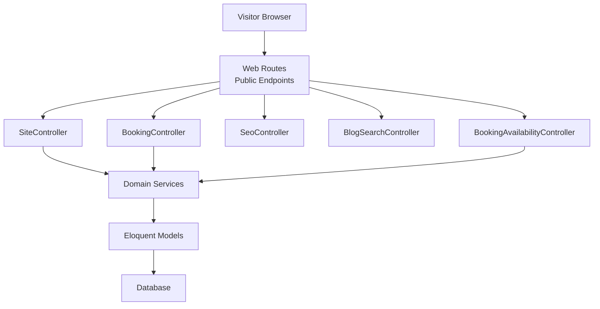

**Diagram sources**
- [web.php:1-76](file://routes/web.php#L1-L76)
- [SiteController.php](file://app/Http/Controllers/SiteController.php)
- [BookingController.php](file://app/Http/Controllers/BookingController.php)
- [SeoController.php](file://app/Http/Controllers/SeoController.php)
- [Api BookingAvailabilityController.php](file://app/Http/Controllers/Api/BookingAvailabilityController.php)
- [BlogSearchController.php](file://app/Http/Controllers/Api/BlogSearchController.php)

**Section sources**
- [web.php:1-76](file://routes/web.php#L1-L76)

## Core Components
This section summarizes the primary building blocks used across the public interface.

- Routing layer:
  - Public pages: home, about-us, services, gallery, quote, contact, terms, privacy.
  - Blog: listing and detail routes plus throttled search API.
  - Bookings: create, store, confirmation, calendar download, availability, and calendar APIs.
  - SEO: sitemap, robots, and web manifest.
  - Polls and glass type subcategories: lightweight APIs.

- Controllers:
  - SiteController handles most public page rendering and form submissions.
  - BookingController manages booking creation, confirmation, and calendar ICS downloads.
  - Api BookingAvailabilityController provides availability and calendar data.
  - BlogSearchController supports throttled client-side blog search.
  - ConsentController handles logged-in consent capture.
  - PollController exposes poll vote and results endpoints.
  - SeoController serves SEO assets.

- Services:
  - ServiceService manages service listings and details.
  - AvailabilityService and BookingCalendarService compute available slots and calendar data.
  - QuoteService orchestrates quote submission.
  - ContactMessageService persists and processes contact messages.
  - PostService and BlogSearchService manage blog posts and search.
  - SeoInjectionService injects metadata into Blade views.

- Actions:
  - StoreBookingAction persists bookings and triggers related events.
  - StoreQuoteAction persists quotes.
  - SendQuoteEmailNotificationsAction sends quote notification emails.
  - SendContactMessage sends contact message notifications.

- Models:
  - Service, Booking, Quote, ContactMessage, Post, CompanySetting, SeoStaticRoute.

- Mail:
  - BookingConfirmationMail and QuoteSubmittedMail deliver transactional emails.

- Events and Listeners:
  - ContactMessageReceived event and SendContactMessageEmail listener can extend email workflows.

**Section sources**
- [web.php:1-76](file://routes/web.php#L1-L76)
- [SiteController.php](file://app/Http/Controllers/SiteController.php)
- [BookingController.php](file://app/Http/Controllers/BookingController.php)
- [Api BookingAvailabilityController.php](file://app/Http/Controllers/Api/BookingAvailabilityController.php)
- [BlogSearchController.php](file://app/Http/Controllers/Api/BlogSearchController.php)
- [ConsentController.php](file://app/Http/Controllers/ConsentController.php)
- [PollController.php](file://app/Http/Controllers/PollController.php)
- [SeoController.php](file://app/Http/Controllers/SeoController.php)
- [ServiceService.php](file://app/Services/ServiceService.php)
- [AvailabilityService.php](file://app/Services/AvailabilityService.php)
- [BookingCalendarService.php](file://app/Services/BookingCalendarService.php)
- [QuoteService.php](file://app/Services/QuoteService.php)
- [ContactMessageService.php](file://app/Services/ContactMessageService.php)
- [PostService.php](file://app/Services/PostService.php)
- [BlogSearchService.php](file://app/Services/BlogSearchService.php)
- [SeoInjectionService.php](file://app/Services/SeoInjectionService.php)
- [StoreBookingAction.php](file://app/app/Actions/StoreBookingAction.php)
- [StoreQuoteAction.php](file://app/app/Actions/StoreQuoteAction.php)
- [SendQuoteEmailNotificationsAction.php](file://app/app/Actions/SendQuoteEmailNotificationsAction.php)
- [SendContactMessage.php](file://app/app/Actions/SendContactMessage.php)
- [BookingConfirmationMail.php](file://app/app/Mail/BookingConfirmationMail.php)
- [QuoteSubmittedMail.php](file://app/app/Mail/QuoteSubmittedMail.php)
- [ContactMessageReceived.php](file://app/app/Events/ContactMessageReceived.php)
- [SendContactMessageEmail.php](file://app/app/Listeners/SendContactMessageEmail.php)
- [CompanySetting.php](file://app/app/Models/CompanySetting.php)
- [Service.php](file://app/app/Models/Service.php)
- [Booking.php](file://app/app/Models/Booking.php)
- [Quote.php](file://app/app/Models/Quote.php)
- [ContactMessage.php](file://app/app/Models/ContactMessage.php)
- [Post.php](file://app/app/Models/Post.php)
- [SeoStaticRoute.php](file://app/app/Models/SeoStaticRoute.php)

## Architecture Overview
The public website follows a layered architecture:

- Presentation: Blade templates render HTML, with Livewire components providing interactivity.
- Controllers: Handle HTTP requests, validate input, and delegate to services or actions.
- Services: Encapsulate domain logic such as availability calculation, calendar generation, and content retrieval.
- Actions: Coordinate multi-step operations like creating bookings or sending emails.
- Models: Represent database tables and relationships.
- SEO infrastructure: Service provider registers metadata injection; config defines defaults and static routes.

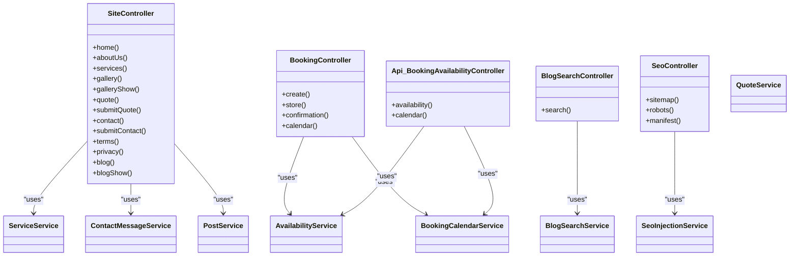

**Diagram sources**
- [SiteController.php](file://app/Http/Controllers/SiteController.php)
- [BookingController.php](file://app/Http/Controllers/BookingController.php)
- [Api BookingAvailabilityController.php](file://app/Http/Controllers/Api/BookingAvailabilityController.php)
- [BlogSearchController.php](file://app/Http/Controllers/Api/BlogSearchController.php)
- [SeoController.php](file://app/Http/Controllers/SeoController.php)
- [ServiceService.php](file://app/Services/ServiceService.php)
- [AvailabilityService.php](file://app/Services/AvailabilityService.php)
- [BookingCalendarService.php](file://app/Services/BookingCalendarService.php)
- [QuoteService.php](file://app/Services/QuoteService.php)
- [ContactMessageService.php](file://app/Services/ContactMessageService.php)
- [PostService.php](file://app/Services/PostService.php)
- [BlogSearchService.php](file://app/Services/BlogSearchService.php)
- [SeoInjectionService.php](file://app/Services/SeoInjectionService.php)

## Detailed Component Analysis

### Landing Page and Hero Sections
The landing page is served through the public home route and rendered by SiteController. Hero sections typically rely on Blade templates and supporting helpers or services for assets and slide data. Appearance and media may be influenced by company settings and hero-related support classes.

Key responsibilities:
- Rendering the homepage view.
- Passing hero variants, images, videos, and branding information to Blade.
- Integrating SEO metadata via SeoInjectionService.

Configuration and appearance:
- Site name, separator, default OG image, Twitter handle, and defaults come from the SEO configuration.
- Static SEO routes include the home route for structured indexing.

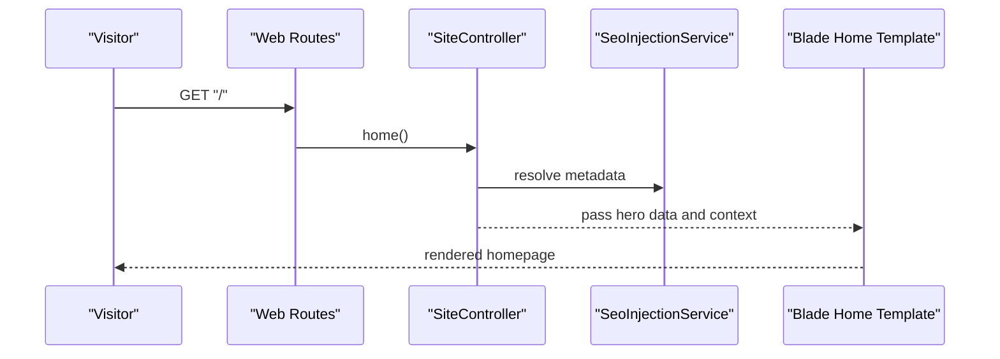

**Diagram sources**
- [web.php:1-20](file://routes/web.php#L1-L20)
- [seo.php:1-41](file://config/seo.php#L1-L41)
- [SeoServiceProvider.php:1-47](file://app/Providers/SeoServiceProvider.php#L1-L47)
- [SiteController.php](file://app/Http/Controllers/SiteController.php)

**Section sources**
- [web.php:1-20](file://routes/web.php#L1-L20)
- [seo.php:1-41](file://config/seo.php#L1-L41)
- [SeoServiceProvider.php:1-47](file://app/Providers/SeoServiceProvider.php#L1-L47)

### Service Catalog System
The services page and individual service details are handled by SiteController and backed by ServiceService. Each service includes detailed descriptions, images, and SEO metadata fields.

User journey:
- Visitor navigates to the services page.
- Controller loads services and passes them to the Blade template.
- Visitor selects a service to view its full description, pricing hints, and call-to-action links.

Data model highlights:
- Service model stores service attributes and SEO metadata.
- ServiceService provides list and detail retrieval methods.

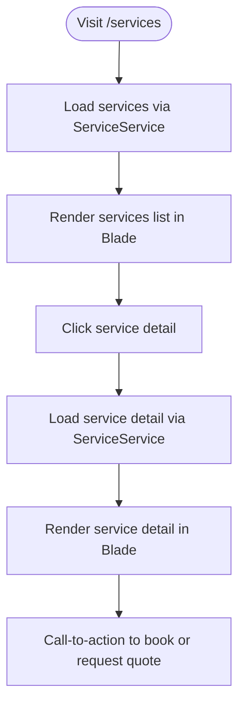

**Diagram sources**
- [web.php:1-20](file://routes/web.php#L1-L20)
- [SiteController.php](file://app/Http/Controllers/SiteController.php)
- [ServiceService.php](file://app/Services/ServiceService.php)
- [Service.php](file://app/app/Models/Service.php)

**Section sources**
- [web.php:1-20](file://routes/web.php#L1-L20)
- [SiteController.php](file://app/Http/Controllers/SiteController.php)
- [ServiceService.php](file://app/Services/ServiceService.php)
- [Service.php](file://app/app/Models/Service.php)

### Online Booking System with Real-Time Availability
The booking flow allows visitors to select a service, choose an available slot, submit a booking, receive confirmation, and optionally download an ICS calendar file.

Routing and controllers:
- Create booking form: GET /bookings/create.
- Submit booking: POST /bookings (throttled).
- Confirmation: GET /bookings/{booking}/confirmation (signed).
- Calendar ICS: GET /bookings/{booking}/calendar.ics (signed).
- Availability API: GET /api/bookings/availability (throttled).
- Calendar API: GET /api/bookings/calendar (throttled).

Processing logic:
- AvailabilityService computes available time slots based on staff schedules, closed days, and existing bookings.
- BookingCalendarService generates calendar data for both API responses and ICS downloads.
- StoreBookingAction persists the booking and may trigger related events.
- BookingConfirmationMail sends confirmation to the visitor.

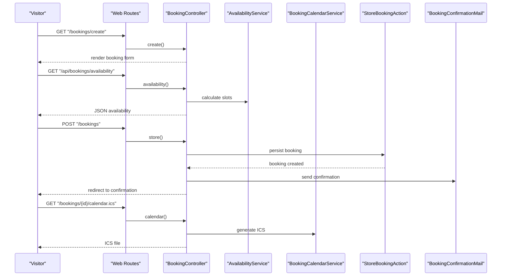

**Diagram sources**
- [web.php:40-76](file://routes/web.php#L40-L76)
- [BookingController.php](file://app/Http/Controllers/BookingController.php)
- [Api BookingAvailabilityController.php](file://app/Http/Controllers/Api/BookingAvailabilityController.php)
- [AvailabilityService.php](file://app/Services/AvailabilityService.php)
- [BookingCalendarService.php](file://app/Services/BookingCalendarService.php)
- [StoreBookingAction.php](file://app/app/Actions/StoreBookingAction.php)
- [BookingConfirmationMail.php](file://app/app/Mail/BookingConfirmationMail.php)

**Section sources**
- [web.php:40-76](file://routes/web.php#L40-L76)
- [BookingController.php](file://app/Http/Controllers/BookingController.php)
- [Api BookingAvailabilityController.php](file://app/Http/Controllers/Api/BookingAvailabilityController.php)
- [AvailabilityService.php](file://app/Services/AvailabilityService.php)
- [BookingCalendarService.php](file://app/Services/BookingCalendarService.php)
- [StoreBookingAction.php](file://app/app/Actions/StoreBookingAction.php)
- [BookingConfirmationMail.php](file://app/app/Mail/BookingConfirmationMail.php)

### Quote Request Processing Workflow
The quote workflow lets visitors describe their requirements and submit a quote request.

Flow:
- GET /quote renders the quote form.
- POST /quote submits the form (throttled).
- Controller delegates to QuoteService and StoreQuoteAction.
- SendQuoteEmailNotificationsAction sends email notifications for new quotes.
- QuoteSubmittedMail delivers the quote submission email.

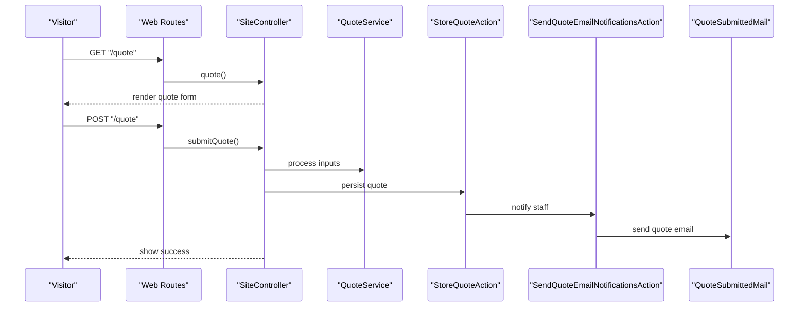

**Diagram sources**
- [web.php:12-20](file://routes/web.php#L12-L20)
- [SiteController.php](file://app/Http/Controllers/SiteController.php)
- [QuoteService.php](file://app/Services/QuoteService.php)
- [StoreQuoteAction.php](file://app/app/Actions/StoreQuoteAction.php)
- [SendQuoteEmailNotificationsAction.php](file://app/app/Actions/SendQuoteEmailNotificationsAction.php)
- [QuoteSubmittedMail.php](file://app/app/Mail/QuoteSubmittedMail.php)

**Section sources**
- [web.php:12-20](file://routes/web.php#L12-L20)
- [SiteController.php](file://app/Http/Controllers/SiteController.php)
- [QuoteService.php](file://app/Services/QuoteService.php)
- [StoreQuoteAction.php](file://app/app/Actions/StoreQuoteAction.php)
- [SendQuoteEmailNotificationsAction.php](file://app/app/Actions/SendQuoteEmailNotificationsAction.php)
- [QuoteSubmittedMail.php](file://app/app/Mail/QuoteSubmittedMail.php)

### Blog Functionality with Search Capabilities
The blog module provides post listing and detail pages, plus a throttled search API for client-side filtering.

Routing:
- Blog listing: GET /blog.
- Blog detail: GET /blog/{slug}.
- Throttled search: GET /api/blog/search.

Controllers and services:
- SiteController renders listing and detail views using PostService.
- BlogSearchController returns filtered posts via BlogSearchService.

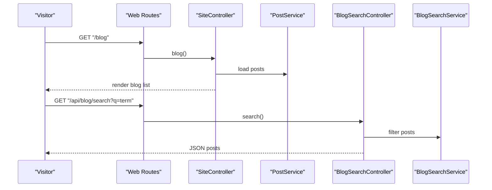

**Diagram sources**
- [web.php:28-40](file://routes/web.php#L28-L40)
- [SiteController.php](file://app/Http/Controllers/SiteController.php)
- [BlogSearchController.php](file://app/Http/Controllers/Api/BlogSearchController.php)
- [PostService.php](file://app/Services/PostService.php)
- [BlogSearchService.php](file://app/Services/BlogSearchService.php)

**Section sources**
- [web.php:28-40](file://routes/web.php#L28-L40)
- [SiteController.php](file://app/Http/Controllers/SiteController.php)
- [BlogSearchController.php](file://app/Http/Controllers/Api/BlogSearchController.php)
- [PostService.php](file://app/Services/PostService.php)
- [BlogSearchService.php](file://app/Services/BlogSearchService.php)

### Contact Form Handling with Email Notifications
The contact form allows visitors to send messages directly from the public site.

Flow:
- GET /contact renders the form.
- POST /contact validates and persists the message.
- Controller uses ContactMessageService and SendContactMessage action.
- Event ContactMessageReceived can be listened to by SendContactMessageEmail for email delivery.

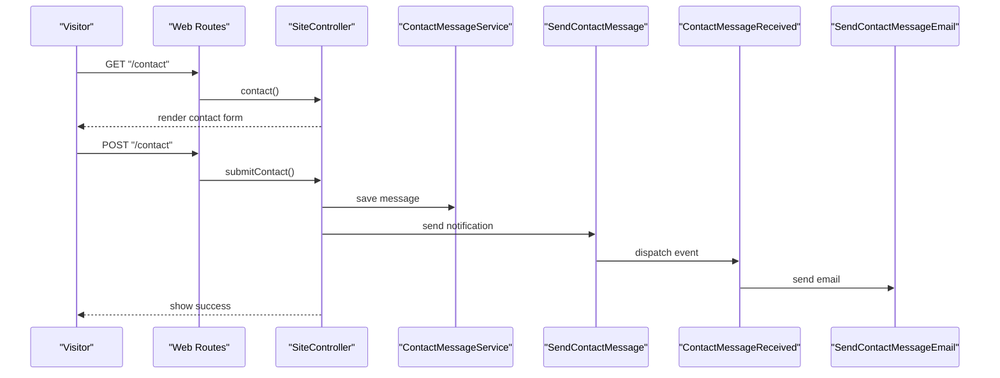

**Diagram sources**
- [web.php:16-20](file://routes/web.php#L16-L20)
- [SiteController.php](file://app/Http/Controllers/SiteController.php)
- [ContactMessageService.php](file://app/Services/ContactMessageService.php)
- [SendContactMessage.php](file://app/app/Actions/SendContactMessage.php)
- [ContactMessageReceived.php](file://app/app/Events/ContactMessageReceived.php)
- [SendContactMessageEmail.php](file://app/app/Listeners/SendContactMessageEmail.php)

**Section sources**
- [web.php:16-20](file://routes/web.php#L16-L20)
- [SiteController.php](file://app/Http/Controllers/SiteController.php)
- [ContactMessageService.php](file://app/Services/ContactMessageService.php)
- [SendContactMessage.php](file://app/app/Actions/SendContactMessage.php)
- [ContactMessageReceived.php](file://app/app/Events/ContactMessageReceived.php)
- [SendContactMessageEmail.php](file://app/app/Listeners/SendContactMessageEmail.php)

### SEO Management Features
SEO is configured centrally and applied globally through a service provider and injection service.

Capabilities:
- Global site name, separator, default OG image, and Twitter site configured in seo.php.
- Cache durations for sitemap and robots files.
- AI-assisted metadata options for future extensions.
- Static route list for structured indexing.
- ServiceProvider registers SeoInjectionService and registers a view composer to inject metadata into Blade views.
- SeoController serves sitemap.xml, robots.txt, and site.webmanifest.

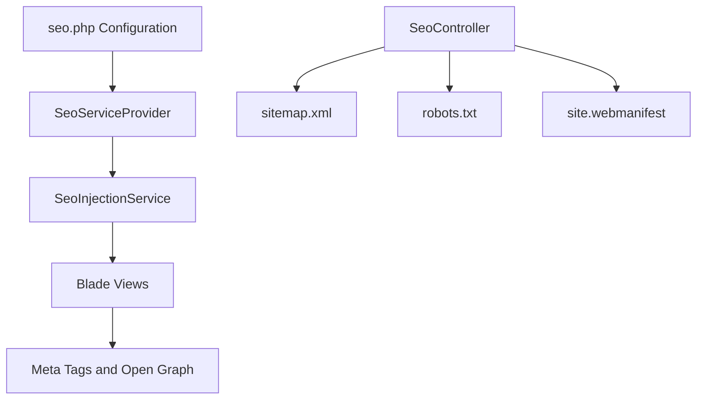

**Diagram sources**
- [seo.php:1-41](file://config/seo.php#L1-L41)
- [SeoServiceProvider.php:1-47](file://app/Providers/SeoServiceProvider.php#L1-L47)
- [SeoController.php](file://app/Http/Controllers/SeoController.php)
- [SeoInjectionService.php](file://app/Services/SeoInjectionService.php)

**Section sources**
- [seo.php:1-41](file://config/seo.php#L1-L41)
- [SeoServiceProvider.php:1-47](file://app/Providers/SeoServiceProvider.php#L1-L47)
- [SeoController.php](file://app/Http/Controllers/SeoController.php)
- [SeoInjectionService.php](file://app/Services/SeoInjectionService.php)

### User Journey Summary
A typical user journey flows as follows:
- Browsing:
  - Visit home or navigate to services.
  - Explore service details and gallery.
- Engagement:
  - Use blog listing and search to find relevant articles.
  - Submit a quote request via the quote form.
  - Fill out the contact form for general inquiries.
- Conversion:
  - Create a booking by selecting an available time slot.
  - Receive confirmation email and optional ICS calendar file.

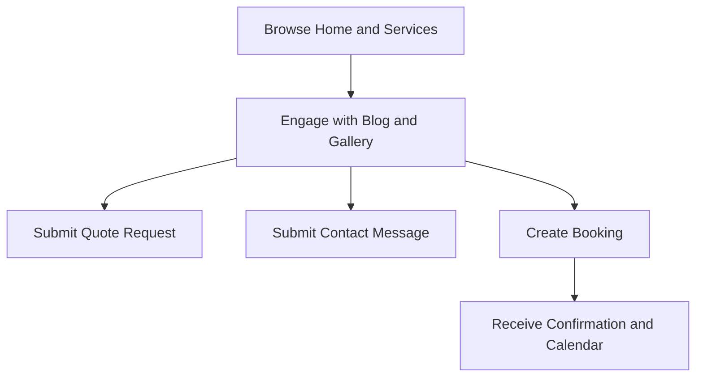

[No sources needed since this diagram shows conceptual workflow, not actual code structure]

## Dependency Analysis
This section maps how controllers depend on services, actions, models, and external concerns like mail and events.

```mermaid
graph TB
    SiteController --> ServiceService
    SiteController --> ContactMessageService
    SiteController --> PostService
    BookingController --> AvailabilityService
    BookingController --> BookingCalendarService
    BookingController --> StoreBookingAction
    BookingController --> BookingConfirmationMail
    SiteController --> StoreQuoteAction
    SiteController --> QuoteService
    SiteController --> SendQuoteEmailNotificationsAction
    SiteController --> SendContactMessage
    SiteController --> ContactMessageReceived
    SeoController --> SeoInjectionService
```

**Diagram sources**
- [SiteController.php](file://app/Http/Controllers/SiteController.php)
- [BookingController.php](file://app/Http/Controllers/BookingController.php)
- [SeoController.php](file://app/Http/Controllers/SeoController.php)
- [ServiceService.php](file://app/Services/ServiceService.php)
- [ContactMessageService.php](file://app/Services/ContactMessageService.php)
- [PostService.php](file://app/Services/PostService.php)
- [AvailabilityService.php](file://app/Services/AvailabilityService.php)
- [BookingCalendarService.php](file://app/Services/BookingCalendarService.php)
- [StoreBookingAction.php](file://app/app/Actions/StoreBookingAction.php)
- [BookingConfirmationMail.php](file://app/app/Mail/BookingConfirmationMail.php)
- [StoreQuoteAction.php](file://app/app/Actions/StoreQuoteAction.php)
- [QuoteService.php](file://app/Services/QuoteService.php)
- [SendQuoteEmailNotificationsAction.php](file://app/app/Actions/SendQuoteEmailNotificationsAction.php)
- [SendContactMessage.php](file://app/app/Actions/SendContactMessage.php)
- [ContactMessageReceived.php](file://app/app/Events/ContactMessageReceived.php)
- [SeoInjectionService.php](file://app/Services/SeoInjectionService.php)

**Section sources**
- [web.php:1-76](file://routes/web.php#L1-L76)
- [SiteController.php](file://app/Http/Controllers/SiteController.php)
- [BookingController.php](file://app/Http/Controllers/BookingController.php)
- [SeoController.php](file://app/Http/Controllers/SeoController.php)

## Performance Considerations
Recommended optimization techniques aligned with the current implementation:

- Route-level throttling:
  - Quote submission, contact submission, blog search, booking availability, booking calendar, and poll voting use rate limiting to protect against abuse.
- Asynchronous email delivery:
  - Use queued jobs for confirmation and notification emails to keep request latency low.
- Data caching:
  - Cache service listings, blog indexes, and SEO assets where appropriate.
- Eager loading:
  - Avoid N+1 queries when loading related models for services, posts, and galleries.
- Image and media optimization:
  - Serve optimized images and lazy-load heavy assets in Blade templates.
- Front-end efficiency:
  - Minimize Livewire component re-renders; paginate large lists; debounce client-side search inputs.

[No sources needed since this section provides general guidance]

## Troubleshooting Guide
Common issues and diagnostics:

- Rate-limited submissions:
  - If quote or contact submissions fail due to throttling, verify client-side debouncing and server throttle windows.
- Missing SEO metadata:
  - Ensure SeoServiceProvider registers the view composer and that seo.php contains correct site_name and default_og_image.
- Availability not showing:
  - Validate staff schedules, closed days, and existing bookings; check AvailabilityService and BookingCalendarService logic.
- Emails not sent:
  - Verify mail configuration, queue worker status, and that actions and listeners are correctly wired.
- Blog search returning empty results:
  - Confirm BlogSearchService query parameters and index coverage; ensure throttling limits are not blocking frequent searches.

**Section sources**
- [web.php:12-76](file://routes/web.php#L12-L76)
- [seo.php:1-41](file://config/seo.php#L1-L41)
- [SeoServiceProvider.php:1-47](file://app/Providers/SeoServiceProvider.php#L1-L47)
- [AvailabilityService.php](file://app/Services/AvailabilityService.php)
- [BookingCalendarService.php](file://app/Services/BookingCalendarService.php)
- [BlogSearchService.php](file://app/Services/BlogSearchService.php)

## Conclusion
The Highblossom public website combines a clear routing structure, focused controllers, and well-separated services to deliver a robust visitor experience. It supports service discovery, interactive blog search, reliable booking with real-time availability, quote requests, contact messaging, and comprehensive SEO management. Proper configuration, throttling, caching, and asynchronous processing help maintain performance and reliability while keeping the codebase organized and extensible.

[No sources needed since this section summarizes without analyzing specific files]

## Appendices

### Configuration Options

- SEO configuration:
  - Site name, separator, default OG image, Twitter site.
  - Cache durations for sitemap and robots.
  - AI options for future metadata generation.
  - Static routes for structured indexing.

- Public routes summary:
  - Pages: home, about-us, services, gallery, quote, contact, terms, privacy.
  - Blog: listing, detail, throttled search API.
  - Bookings: create, store, signed confirmation, signed ICS calendar, availability API, calendar API.
  - SEO: sitemap, robots, manifest.
  - Polls and glass types: lightweight APIs.

**Section sources**
- [seo.php:1-41](file://config/seo.php#L1-L41)
- [web.php:1-76](file://routes/web.php#L1-L76)