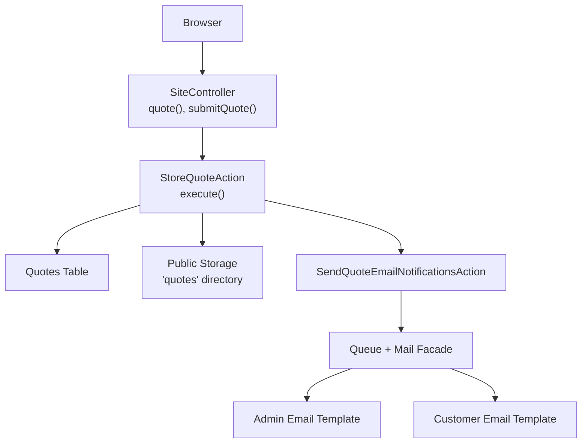
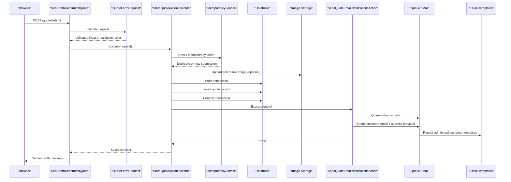
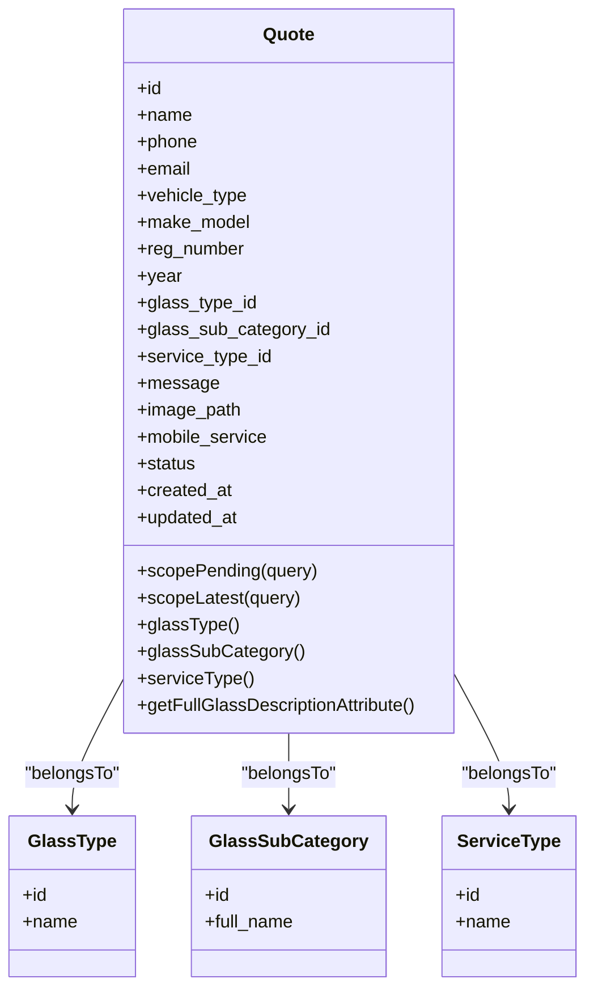
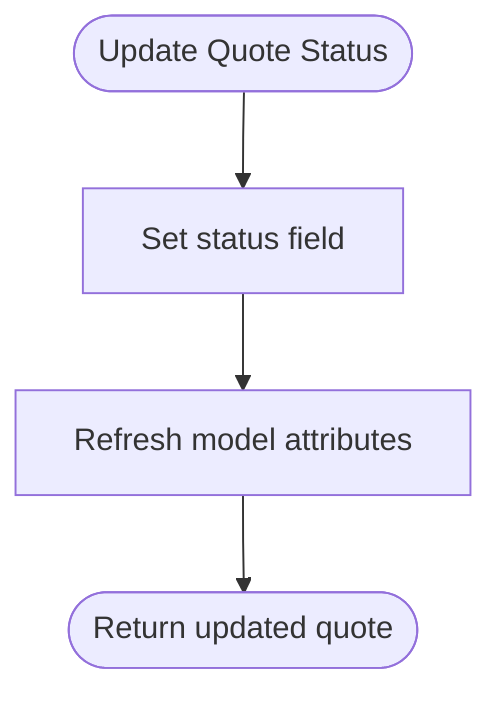
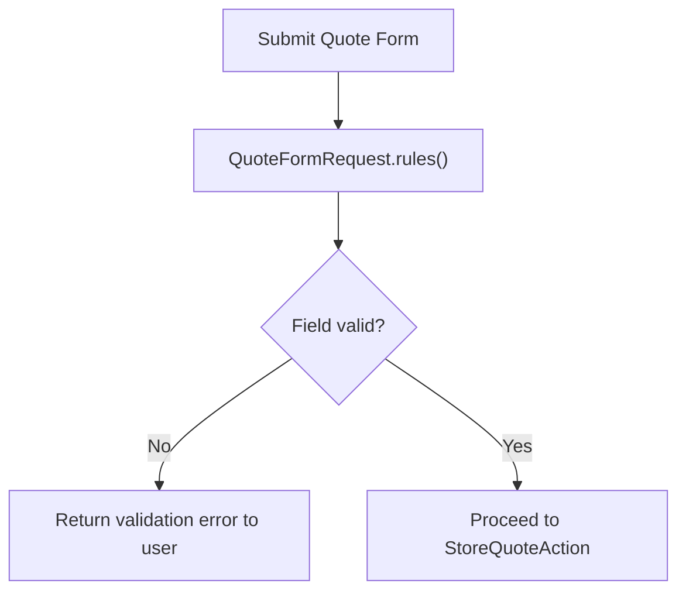
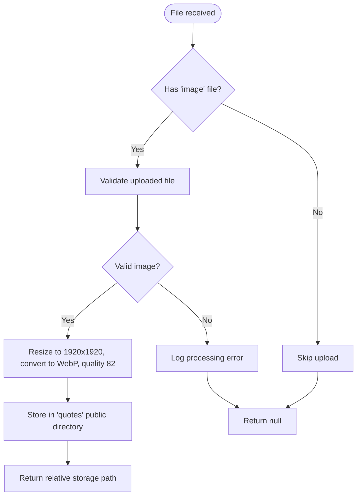
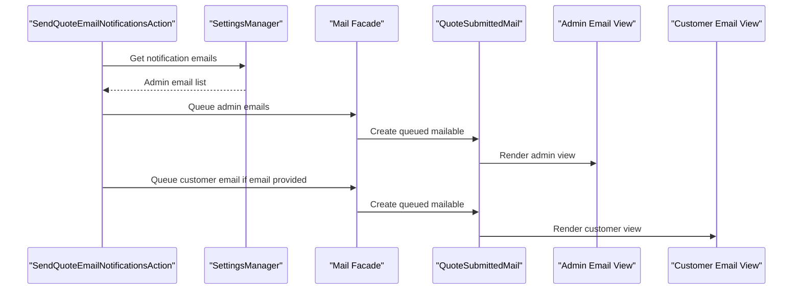
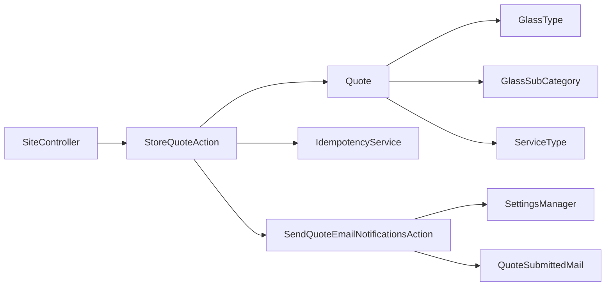

# Quote Request Processing

<cite>
**Referenced Files in This Document**   
- [SiteController.php](file://app/Http/Controllers/SiteController.php)
- [StoreQuoteAction.php](file://app/Actions/StoreQuoteAction.php)
- [SendQuoteEmailNotificationsAction.php](file://app/Actions/SendQuoteEmailNotificationsAction.php)
- [QuoteFormRequest.php](file://app/Http/Requests/QuoteFormRequest.php)
- [Quote.php](file://app/Models/Quote.php)
- [GlassType.php](file://app/Models/GlassType.php)
- [GlassSubCategory.php](file://app/Models/GlassSubCategory.php)
- [ServiceType.php](file://app/Models/ServiceType.php)
- [QuoteService.php](file://app/Services/QuoteService.php)
- [QuoteSubmittedMail.php](file://app/Mail/QuoteSubmittedMail.php)
- [quote.blade.php](file://resources/views/site/quote.blade.php)
- [submitted-admin.blade.php](file://resources/views/emails/quotes/submitted-admin.blade.php)
- [submitted-customer.blade.php](file://resources/views/emails/quotes/submitted-customer.blade.php)
- [2026_04_20_080002_create_quotes_table.php](file://database/migrations/2026_04_20_080002_create_quotes_table.php)
- [2026_04_20_090000_add_image_path_to_quotes_table.php](file://database/migrations/2026_04_20_090000_add_image_path_to_quotes_table.php)
- [2026_05_07_080001_add_glass_sub_category_id_to_quotes_table.php](file://database/migrations/2026_05_07_080001_add_glass_sub_category_id_to_quotes_table.php)
</cite>

## Table of Contents
1. [Introduction](#introduction)
2. [Project Structure](#project-structure)
3. [Core Components](#core-components)
4. [Architecture Overview](#architecture-overview)
5. [Detailed Component Analysis](#detailed-component-analysis)
6. [Dependency Analysis](#dependency-analysis)
7. [Performance Considerations](#performance-considerations)
8. [Troubleshooting Guide](#troubleshooting-guide)
9. [Security and Privacy Considerations](#security-and-privacy-considerations)
10. [Conclusion](#conclusion)

## Introduction
This document explains the quote request processing system used by the public website. It covers how a customer submits a glass service quote, how the application validates and stores it, how email notifications are sent to staff and customers, and how staff review quotes through the admin interface.

The implementation follows a layered approach:
- A public controller renders the quote form and forwards submissions to an action.
- An action performs idempotency checks, uploads images, persists the quote, and triggers email notifications.
- A model defines the quote data structure and relationships.
- A service encapsulates status updates and deletion.
- Mail classes and Blade templates render staff and customer emails.

## Project Structure
The quote subsystem spans controllers, actions, requests, models, services, mail classes, views, and database migrations. The most important files are listed below.

**Diagram sources**
- [SiteController.php:122-154](file://app/Http/Controllers/SiteController.php#L122-L154)
- [StoreQuoteAction.php:20-80](file://app/Actions/StoreQuoteAction.php#L20-L80)
- [SendQuoteEmailNotificationsAction.php:24-63](file://app/Actions/SendQuoteEmailNotificationsAction.php#L24-L63)
- [QuoteSubmittedMail.php:20-66](file://app/Mail/QuoteSubmittedMail.php#L20-L66)

**Section sources**
- [SiteController.php:1-180](file://app/Http/Controllers/SiteController.php#L1-L180)
- [StoreQuoteAction.php:1-160](file://app/Actions/StoreQuoteAction.php#L1-L160)
- [QuoteFormRequest.php:1-69](file://app/Http/Requests/QuoteFormRequest.php#L1-L69)
- [Quote.php:1-76](file://app/Models/Quote.php#L1-L76)

## Core Components
- **SiteController**: Renders the quote page and handles the public submission endpoint.
- **StoreQuoteAction**: Orchestrates quote submission, image upload, persistence, and notification dispatch.
- **QuoteFormRequest**: Validates incoming quote fields before the action runs.
- **Quote model**: Defines stored fields, casts, scopes, and relationships to glass types, sub-categories, and service types.
- **QuoteService**: Provides status update and delete operations for quotes.
- **SendQuoteEmailNotificationsAction**: Queues admin and customer emails based on configuration.
- **QuoteSubmittedMail**: Defines queued mailables with admin and customer views.
- **Blade templates**: Render the public quote form and email layouts.

**Section sources**
- [SiteController.php:122-154](file://app/Http/Controllers/SiteController.php#L122-L154)
- [StoreQuoteAction.php:20-160](file://app/Actions/StoreQuoteAction.php#L20-L160)
- [QuoteFormRequest.php:13-69](file://app/Http/Requests/QuoteFormRequest.php#L13-L69)
- [Quote.php:10-76](file://app/Models/Quote.php#L10-L76)
- [QuoteService.php:10-22](file://app/Services/QuoteService.php#L10-L22)
- [SendQuoteEmailNotificationsAction.php:14-113](file://app/Actions/SendQuoteEmailNotificationsAction.php#L14-L113)
- [QuoteSubmittedMail.php:18-66](file://app/Mail/QuoteSubmittedMail.php#L18-L66)

## Architecture Overview
The quote workflow is request-driven and transactional where persistence occurs. Notifications are intentionally sent outside the database transaction so that transient mail failures do not roll back saved quotes.

**Diagram sources**
- [SiteController.php:144-154](file://app/Http/Controllers/SiteController.php#L144-L154)
- [StoreQuoteAction.php:28-80](file://app/Actions/StoreQuoteAction.php#L28-L80)
- [SendQuoteEmailNotificationsAction.php:24-63](file://app/Actions/SendQuoteEmailNotificationsAction.php#L24-L63)
- [QuoteSubmittedMail.php:32-66](file://app/Mail/QuoteSubmittedMail.php#L32-L66)

## Detailed Component Analysis

### SiteController Quote Methods
The controller exposes two relevant endpoints:
- `quote`: Renders the quote form and passes preloaded page data from `SiteService`.
- `submitQuote`: Accepts validated form data and delegates persistence to `StoreQuoteAction`.

Key responsibilities:
- Rendering the public quote view.
- Receiving the submitted form.
- Returning a redirect with success or error messages.

Customization guidance:
- To change the route response behavior, override or extend `submitQuote`.
- To add additional preloading logic for the quote page, extend `getQuotePageData` in `SiteService`.

**Section sources**
- [SiteController.php:122-154](file://app/Http/Controllers/SiteController.php#L122-L154)

### Quote Model Structure and Relationships
The `Quote` model represents a customer’s glass service quote request.

Important attributes:
- Personal information: `name`, `phone`, `email`.
- Vehicle details: `vehicle_type`, `make_model`, `reg_number`, `year`.
- Glass selection: `glass_type_id`, `glass_sub_category_id`.
- Service selection: `service_type_id`.
- Optional content: `message`, `image_path`.
- Preferences and lifecycle: `mobile_service`, `status`.

Relationships:
- `glassType`: belongs to `GlassType`.
- `glassSubCategory`: belongs to `GlassSubCategory`.
- `serviceType`: belongs to `ServiceType`.

Computed attribute:
- `full_glass_description`: prefers the sub-category full name; otherwise falls back to the glass type name.

Scopes:
- `pending`: filters quotes with status `pending`.
- `latest`: orders quotes by newest first.

Casts:
- `mobile_service` is cast to boolean.
- `year` is cast to integer.

**Diagram sources**
- [Quote.php:10-76](file://app/Models/Quote.php#L10-L76)

**Section sources**
- [Quote.php:1-76](file://app/Models/Quote.php#L1-L76)
- [2026_04_20_080002_create_quotes_table.php:1-33](file://database/migrations/2026_04_20_080002_create_quotes_table.php#L1-L33)
- [2026_04_20_090000_add_image_path_to_quotes_table.php:1-22](file://database/migrations/2026_04_20_090000_add_image_path_to_quotes_table.php#L1-L22)
- [2026_05_07_080001_add_glass_sub_category_id_to_quotes_table.php:1-27](file://database/migrations/2026_05_07_080001_add_glass_sub_category_id_to_quotes_table.php#L1-L27)

### QuoteService Business Logic
`QuoteService` is a small domain service focused on quote state management:
- `updateStatus(Quote $quote, string $status)`: Updates the quote status and returns a fresh instance.
- `delete(Quote $quote)`: Deletes the quote record.

Use this service when admin workflows need to change status or remove quotes.

**Diagram sources**
- [QuoteService.php:10-22](file://app/Services/QuoteService.php#L10-L22)

**Section sources**
- [QuoteService.php:1-22](file://app/Services/QuoteService.php#L1-L22)

### Form Validation Rules
`QuoteFormRequest` enforces business rules before any quote is persisted.

Validation highlights:
- Required text fields: `name`, `phone`.
- Optional email with format validation.
- Allowed vehicle types: sedan, suv, truck, van, heavy, fleet, other.
- Optional vehicle details: make/model, registration number, year.
- Required dropdowns: `glass_type_id` and `service_type_id`, both validated against database existence.
- Optional `glass_sub_category_id`, validated against the sub-category table.
- Optional file upload: image only, allowed formats `jpg`, `jpeg`, `png`, `webp`, maximum 10MB.
- Optional boolean preference: `mobile_service`.

Text length ceiling:
- A shared constant caps text fields at 191 characters to match the underlying `varchar(191)` column size and avoid truncation errors in MySQL.

Custom messages clarify invalid selections for glass type, sub-category, service type, and vehicle type.

**Diagram sources**
- [QuoteFormRequest.php:13-69](file://app/Http/Requests/QuoteFormRequest.php#L13-L69)

**Section sources**
- [QuoteFormRequest.php:1-69](file://app/Http/Requests/QuoteFormRequest.php#L1-L69)

### Glass Type and Sub-Category Selection Process
The quote form captures:
- A required `glass_type_id`.
- An optional `glass_sub_category_id`.

At storage time, the action saves both identifiers. When rendering emails or admin interfaces, the model resolves the display name through:
- Sub-category full name when present.
- Glass type name as fallback.

Customization guidance:
- To introduce pricing tiers by glass type or sub-category, extend the model or create a dedicated pricing service.
- To require a sub-category, make `glass_sub_category_id` required in `QuoteFormRequest` and the form.

**Section sources**
- [Quote.php:33-76](file://app/Models/Quote.php#L33-L76)
- [StoreQuoteAction.php:105-143](file://app/Actions/StoreQuoteAction.php#L105-L143)
- [quote.blade.php](file://resources/views/site/quote.blade.php)

### Pricing Calculation Logic
There is no built-in pricing calculation in the current implementation. Quotes store selected glass types, sub-categories, and service types, but no numeric price or computed total exists in the `Quote` model or related services.

Recommended extension points:
- Add a pricing service that accepts `glass_type_id`, `glass_sub_category_id`, `service_type_id`, and optional mobile service flag.
- Persist calculated estimates separately if needed, or compute them during admin review.
- Expose estimates through admin views without changing the public quote submission flow.

[No sources needed since this section describes missing functionality and recommended extensions]

### File Upload Handling for Project Specifications
The public form supports an optional image attachment named `image`.

Processing steps:
1. The form includes multipart encoding and an idempotency token.
2. Validation allows only image MIME types: jpg, jpeg, png, webp, up to 10MB.
3. `StoreQuoteAction.handleImageUpload` processes a valid uploaded file:
   - Resizes to 1920x1920 pixels.
   - Converts to WebP.
   - Sets quality to 82.
   - Stores under the `quotes` disk path in the public filesystem.
4. The resulting relative path is saved to `quotes.image_path`.
5. Admin and customer emails can link to the uploaded image when present.

**Diagram sources**
- [StoreQuoteAction.php:82-103](file://app/Actions/StoreQuoteAction.php#L82-L103)

**Section sources**
- [StoreQuoteAction.php:82-103](file://app/Actions/StoreQuoteAction.php#L82-L103)
- [submitted-admin.blade.php:1-39](file://resources/views/emails/quotes/submitted-admin.blade.php#L1-L39)

### Email Notification System
When a quote is successfully saved, `StoreQuoteAction` invokes `SendQuoteEmailNotificationsAction`.

Behavior:
- Retrieves configured admin notification addresses.
- Queues one email per admin address.
- Queues a customer confirmation email if the customer provided an email address.
- Uses `QuoteSubmittedMail`, which selects either the admin or customer template.
- Fails silently for queueing exceptions and logs the failure.

Templates:
- Admin template shows customer details, vehicle specifications, glass description, service type, mobile service preference, optional message, admin portal link, and reference image link.
- Customer template confirms receipt, summarizes vehicle and service, displays the glass specification, shows the quote reference, and optionally includes contact phone support.

**Diagram sources**
- [SendQuoteEmailNotificationsAction.php:24-113](file://app/Actions/SendQuoteEmailNotificationsAction.php#L24-L113)
- [QuoteSubmittedMail.php:18-66](file://app/Mail/QuoteSubmittedMail.php#L18-L66)

**Section sources**
- [SendQuoteEmailNotificationsAction.php:1-113](file://app/Actions/SendQuoteEmailNotificationsAction.php#L1-L113)
- [QuoteSubmittedMail.php:1-66](file://app/Mail/QuoteSubmittedMail.php#L1-L66)
- [submitted-admin.blade.php:1-39](file://resources/views/emails/quotes/submitted-admin.blade.php#L1-L39)
- [submitted-customer.blade.php:1-34](file://resources/views/emails/quotes/submitted-customer.blade.php#L1-L34)

### Customizing Quote Forms
To customize the public quote form:
- Edit the Blade view at `resources/views/site/quote.blade.php`.
- Keep hidden fields such as `_idempotency_token` intact to preserve duplicate protection.
- Ensure every added field has a matching rule in `QuoteFormRequest`.
- If persisting new data, update `StoreQuoteAction.createQuote` and the `Quote` model fillable/cast configuration.
- Extend database schema through a migration if adding columns.

Example customization scenarios:
- Add a project reference code: add a form field, validate it, persist it in the action, and display it in email templates.
- Add conditional sections for commercial vehicles: use Alpine.js in the Blade view to show/hide fields based on `vehicle_type`.
- Add custom labels and help text through language files rather than hardcoding strings.

**Section sources**
- [quote.blade.php](file://resources/views/site/quote.blade.php)
- [QuoteFormRequest.php:27-69](file://app/Http/Requests/QuoteFormRequest.php#L27-L69)
- [StoreQuoteAction.php:105-143](file://app/Actions/StoreQuoteAction.php#L105-L143)
- [Quote.php:10-23](file://app/Models/Quote.php#L10-L23)

### Extending Quote Fields
Recommended process:
1. Create a migration to add the desired column to the `quotes` table.
2. Add the column to `$fillable` in `Quote`.
3. Add casting if needed.
4. Add server-side validation in `QuoteFormRequest`.
5. Persist the value in `StoreQuoteAction.createQuote`.
6. Display the field in admin views and email templates.
7. Seed default values if the column is not nullable.

**Section sources**
- [Quote.php:10-23](file://app/Models/Quote.php#L10-L23)
- [StoreQuoteAction.php:105-143](file://app/Actions/StoreQuoteAction.php#L105-L143)
- [QuoteFormRequest.php:27-69](file://app/Http/Requests/QuoteFormRequest.php#L27-L69)

### Modifying Email Templates
To modify emails:
- Admin notifications: edit `resources/views/emails/quotes/submitted-admin.blade.php`.
- Customer confirmations: edit `resources/views/emails/quotes/submitted-customer.blade.php`.
- Change subjects or routing through `QuoteSubmittedMail`.
- For dynamic company branding, read values from settings instead of hardcoding names.

Best practices:
- Keep sensitive data out of email attachments.
- Avoid including unnecessary personal information.
- Provide clear calls to action, such as accessing the admin portal or calling the primary phone number.

**Section sources**
- [submitted-admin.blade.php:1-39](file://resources/views/emails/quotes/submitted-admin.blade.php#L1-L39)
- [submitted-customer.blade.php:1-34](file://resources/views/emails/quotes/submitted-customer.blade.php#L1-L34)
- [QuoteSubmittedMail.php:32-66](file://app/Mail/QuoteSubmittedMail.php#L32-L66)

## Dependency Analysis
The following diagram shows runtime dependencies between quote-related components.

**Diagram sources**
- [SiteController.php:8-26](file://app/Http/Controllers/SiteController.php#L8-L26)
- [StoreQuoteAction.php:16-24](file://app/Actions/StoreQuoteAction.php#L16-L24)
- [SendQuoteEmailNotificationsAction.php:16-22](file://app/Actions/SendQuoteEmailNotificationsAction.php#L16-L22)
- [Quote.php:33-76](file://app/Models/Quote.php#L33-L76)

Coupling observations:
- `SiteController` depends on the action layer, keeping HTTP concerns separate from business logic.
- `StoreQuoteAction` coordinates multiple collaborators, making it the central orchestration point.
- Email sending is isolated behind `SendQuoteEmailNotificationsAction`, allowing configuration-based recipients.
- Model relationships keep presentation logic flexible by resolving descriptions at query/render time.

Potential circular dependencies:
- None are evident within the quote subsystem itself. External dependencies such as `IdempotencyService` and `SettingsManager` should be registered normally through the container.

**Section sources**
- [SiteController.php:8-26](file://app/Http/Controllers/SiteController.php#L8-L26)
- [StoreQuoteAction.php:16-24](file://app/Actions/StoreQuoteAction.php#L16-L24)
- [SendQuoteEmailNotificationsAction.php:16-22](file://app/Actions/SendQuoteEmailNotificationsAction.php#L16-L22)
- [Quote.php:33-76](file://app/Models/Quote.php#L33-L76)

## Performance Considerations
- Image resizing and conversion occur synchronously during request processing. Large or many attachments can increase latency.
- Email delivery is queued, preventing slow mail servers from blocking quote submission.
- The quote query path benefits from the index added on `glass_sub_category_id`.
- Idempotency prevents duplicate database writes from accidental double submissions.

Recommendations:
- Offload image processing to a job queue if traffic increases significantly.
- Use background workers tuned for image transformations.
- Monitor queue depth and retry policies for email jobs.
- Cache frequently accessed dropdown options like glass types and service types if they change infrequently.

[No sources needed since this section provides general guidance]

## Troubleshooting Guide
Common issues and diagnostics:

- Validation fails immediately:
  - Check `QuoteFormRequest.rules()` and custom messages.
  - Confirm frontend inputs send expected values and IDs.

- Duplicate quote submission detected:
  - The system returns a duplicate result when the same idempotency token is reused.
  - Verify that the form generates a new token per page load.

- Image upload fails:
  - Check file size limit, MIME type, and storage permissions.
  - Review logged image processing errors.

- Emails not received:
  - Confirm queue workers are running.
  - Check configured notification email addresses.
  - Inspect logs for failed queueing attempts.

- Quote appears but relationships are empty in emails:
  - Ensure the action loads `glassType`, `glassSubCategory`, and `serviceType` before sending emails.

**Section sources**
- [StoreQuoteAction.php:28-80](file://app/Actions/StoreQuoteAction.php#L28-L80)
- [StoreQuoteAction.php:82-103](file://app/Actions/StoreQuoteAction.php#L82-L103)
- [SendQuoteEmailNotificationsAction.php:24-63](file://app/Actions/SendQuoteEmailNotificationsAction.php#L24-L63)
- [submitted-admin.blade.php:1-39](file://resources/views/emails/quotes/submitted-admin.blade.php#L1-L39)

## Security and Privacy Considerations

### File Upload Security
Current protections:
- Only image MIME types are accepted.
- Maximum file size is limited to 10MB.
- Uploaded images are resized, converted to WebP, and compressed.
- Images are stored under a controlled directory path.

Additional recommendations:
- Validate MIME types server-side even if client-side validation is present.
- Reject SVG or executable-like filenames.
- Restrict storage permissions so only the application can write to the `quotes` directory.
- Serve uploaded images through a secure path or signed URL mechanism.
- Scan large-scale deployments for malware in uploaded assets.
- Implement rate limiting at the HTTP layer to reduce abuse.

[No sources needed since this section provides general guidance]

### Rate Limiting
The current quote submission flow does not define its own rate limiter. Consider adding:
- IP-based or account-based rate limiting around the `/quote/submit` endpoint.
- Sliding window limits to prevent rapid repeated submissions.
- Token-based throttling using the existing idempotency token as part of broader abuse protection.

[No sources needed since this section provides general guidance]

### Data Privacy Compliance
Personal data handled by quotes includes:
- Name, phone, email.
- Vehicle details and registration number.
- Optional notes and uploaded images.

Compliance recommendations:
- Retain quotes according to a documented retention policy.
- Provide mechanisms to export or delete customer data upon request.
- Avoid storing unnecessary sensitive data in emails.
- Encrypt or restrict access to uploaded images containing personal information.
- Log minimal operational data and exclude sensitive payloads.
- Clearly inform users about data collection through privacy notices and consent flows.

[No sources needed since this section provides general guidance]

## Conclusion
The quote request system separates presentation, validation, persistence, and notification into distinct layers. Public users submit structured forms, the application protects against duplicates, resizes attachments, persists quotes, and queues notifications. Staff receive detailed emails and can manage quotes through the admin interface.

For future enhancements, consider:
- Adding explicit pricing calculations.
- Introducing a quote status workflow beyond basic updates.
- Moving image processing and heavy workloads to queues.
- Strengthening upload security and rate limiting.
- Extending the form while maintaining consistent validation and database schema changes.