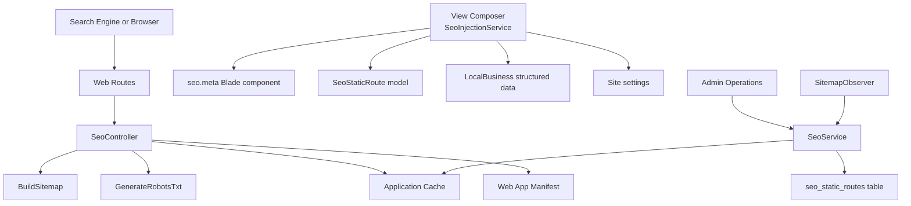
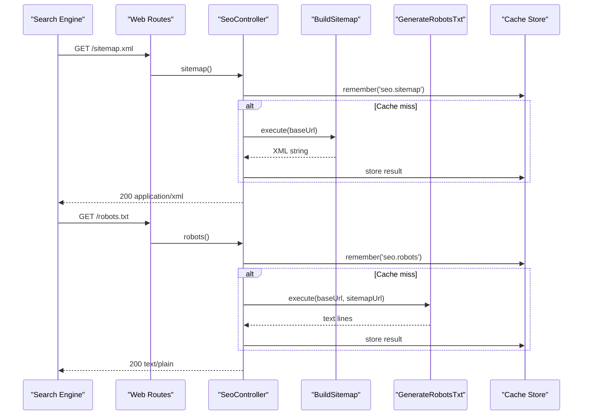
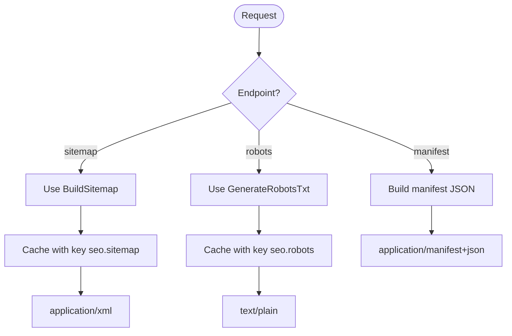
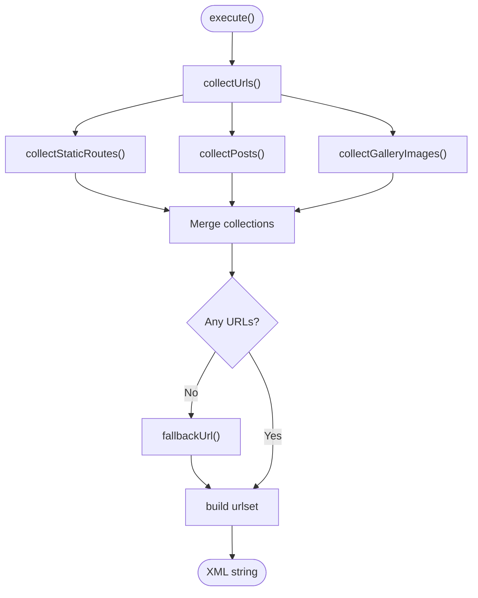
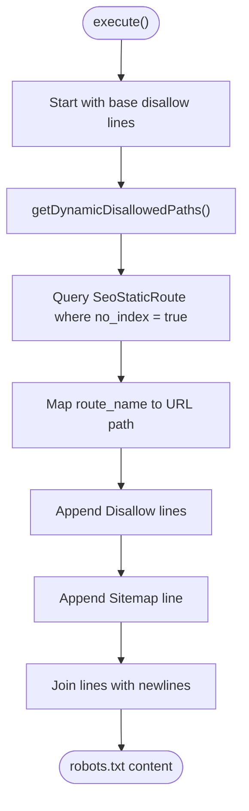
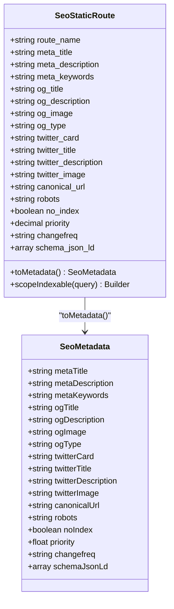
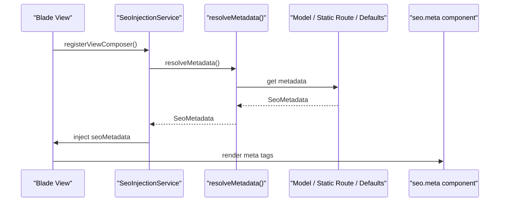
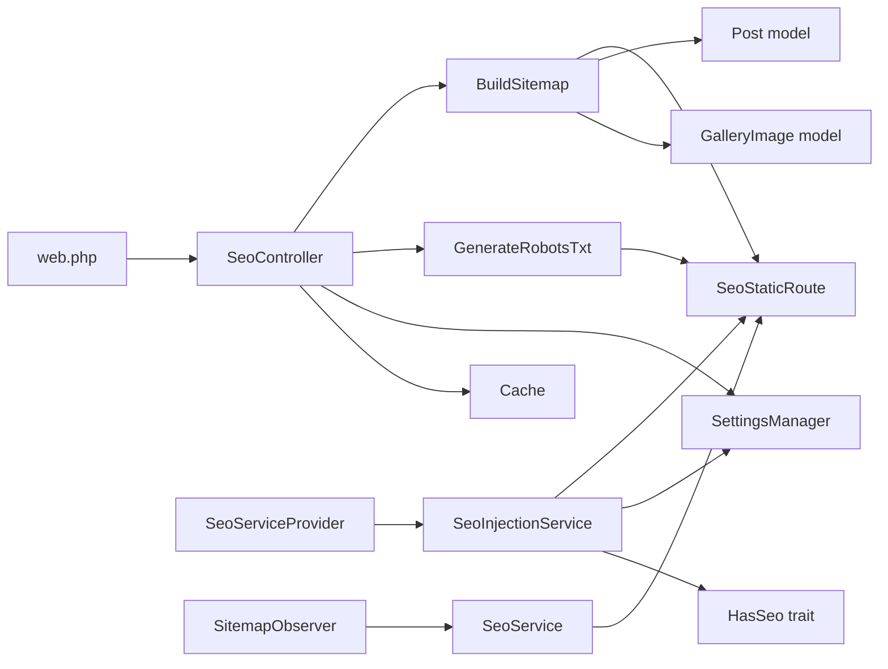

# SEO and Metadata Management

<cite>
**Referenced Files in This Document**
- [SeoController.php](file://app/Http/Controllers/SeoController.php)
- [BuildSitemap.php](file://app/Actions/Seo/BuildSitemap.php)
- [GenerateRobotsTxt.php](file://app/Actions/Seo/GenerateRobotsTxt.php)
- [SeoStaticRoute.php](file://app/Models/SeoStaticRoute.php)
- [seo.php](file://config/seo.php)
- [SeoService.php](file://app/Services/SeoService.php)
- [SeoInjectionService.php](file://app/Services/SeoInjectionService.php)
- [meta.blade.php](file://resources/views/components/seo/meta.blade.php)
- [web.php](file://routes/web.php)
- [SeoServiceProvider.php](file://app/Providers/SeoServiceProvider.php)
- [SeoMetadata.php](file://app/Services/DataTransferObjects/SeoMetadata.php)
- [HasSeo.php](file://app/Models/Concerns/HasSeo.php)
- [2026_04_17_150001_create_seo_static_routes_table.php](file://database/migrations/2026_04_17_150001_create_seo_static_routes_table.php)
- [SeoStaticRouteSeeder.php](file://database/seeders/SeoStaticRouteSeeder.php)
- [SitemapObserver.php](file://app/Observers/SitemapObserver.php)
</cite>

## Table of Contents
1. [Introduction](#introduction)
2. [Project Structure](#project-structure)
3. [Core Components](#core-components)
4. [Architecture Overview](#architecture-overview)
5. [Detailed Component Analysis](#detailed-component-analysis)
6. [Dependency Analysis](#dependency-analysis)
7. [Performance Considerations](#performance-considerations)
8. [Troubleshooting Guide](#troubleshooting-guide)
9. [Conclusion](#conclusion)
10. [Appendices](#appendices)

## Introduction
This document explains the SEO and metadata management system used by the application. It covers how sitemaps, robots.txt files, and web manifests are generated; how page-level and site-wide SEO metadata is resolved and injected into views; how structured data is attached; and how to configure and extend SEO behavior for static routes and dynamic content.

The system separates concerns across:
- HTTP endpoints that serve SEO assets.
- Actions that generate XML sitemap and robots.txt content.
- A service layer for managing static route SEO records and site-wide settings.
- An injection service that resolves metadata per request and attaches it to Blade views.
- Configuration, database schema, seeders, and observers for cache invalidation.

## Project Structure
The SEO subsystem spans controllers, actions, services, models, configuration, routing, view components, and observers:

**Diagram sources**
- [SeoController.php:15-87](file://app/Http/Controllers/SeoController.php#L15-L87)
- [BuildSitemap.php:1-166](file://app/Actions/Seo/BuildSitemap.php#L1-L166)
- [GenerateRobotsTxt.php:1-70](file://app/Actions/Seo/GenerateRobotsTxt.php#L1-L70)
- [SeoInjectionService.php:1-209](file://app/Services/SeoInjectionService.php#L1-L209)
- [meta.blade.php:1-57](file://resources/views/components/seo/meta.blade.php#L1-L57)
- [SeoService.php:1-218](file://app/Services/SeoService.php#L1-L218)
- [SitemapObserver.php:1-44](file://app/Observers/SitemapObserver.php#L1-L44)

**Section sources**
- [SeoController.php:15-87](file://app/Http/Controllers/SeoController.php#L15-L87)
- [web.php:11-17](file://routes/web.php#L11-L17)

## Core Components
- **SeoController**: Exposes public endpoints for `/sitemap.xml`, `/robots.txt`, and `/site.webmanifest`. It delegates generation to dedicated actions and caches results.
- **BuildSitemap**: Builds a valid XML sitemap from indexable static routes, published blog posts, and active gallery images.
- **GenerateRobotsTxt**: Generates robots.txt with standard disallow rules and dynamic no-index paths.
- **SeoStaticRoute**: Eloquent model representing per-route SEO metadata, including Open Graph, Twitter Card, canonical URL, robots directives, priority, changefreq, and JSON-LD.
- **SeoService**: Manages site-wide SEO settings, static route CRUD operations, labels, and cache clearing.
- **SeoInjectionService**: Resolves per-request metadata using bound models, static route records, or defaults, then injects it into every Blade view through a composer.
- **SeoMetadata**: Immutable DTO carrying validated SEO fields such as title, description, OG/Twitter values, canonical URL, robots/noindex, sitemap priority/frequency, and structured data.
- **HasSeo**: Trait providing shared SEO helpers for domain models, including canonical URLs, indexing decisions, and sitemap values.
- **SeoServiceProvider**: Registers and boots the SEO injection service.
- **SitemapObserver**: Invalidates cached SEO outputs when indexed content changes.

**Section sources**
- [SeoController.php:15-87](file://app/Http/Controllers/SeoController.php#L15-L87)
- [BuildSitemap.php:1-166](file://app/Actions/Seo/BuildSitemap.php#L1-L166)
- [GenerateRobotsTxt.php:1-70](file://app/Actions/Seo/GenerateRobotsTxt.php#L1-L70)
- [SeoStaticRoute.php:1-58](file://app/Models/SeoStaticRoute.php#L1-L58)
- [SeoService.php:1-218](file://app/Services/SeoService.php#L1-L218)
- [SeoInjectionService.php:1-209](file://app/Services/SeoInjectionService.php#L1-L209)
- [SeoMetadata.php:1-140](file://app/Services/DataTransferObjects/SeoMetadata.php#L1-L140)
- [HasSeo.php:1-110](file://app/Models/Concerns/HasSeo.php#L1-L110)
- [SeoServiceProvider.php:1-47](file://app/Providers/SeoServiceProvider.php#L1-L47)
- [SitemapObserver.php:1-44](file://app/Observers/SitemapObserver.php#L1-L44)

## Architecture Overview
The SEO system has two primary flows:

1. **Public asset generation flow**: Request → Route → Controller → Action → Database/Content → XML/Text/JSON response (cached).
2. **Page metadata resolution flow**: View rendering → View composer → Metadata resolver → Blade meta component.

**Diagram sources**
- [SeoController.php:21-66](file://app/Http/Controllers/SeoController.php#L21-L66)
- [BuildSitemap.php:25-52](file://app/Actions/Seo/BuildSitemap.php#L25-L52)
- [GenerateRobotsTxt.php:20-45](file://app/Actions/Seo/GenerateRobotsTxt.php#L20-L45)
- [web.php:11-17](file://routes/web.php#L11-L17)

**Section sources**
- [SeoController.php:21-66](file://app/Http/Controllers/SeoController.php#L21-L66)
- [web.php:11-17](file://routes/web.php#L11-L17)

## Detailed Component Analysis

### SeoController: Sitemap, Robots, and Manifest Endpoints
`SeoController` exposes three public routes:
- `sitemap()` returns an XML sitemap generated by `BuildSitemap`, cached under `seo.sitemap` for one day.
- `robots()` returns robots.txt content generated by `GenerateRobotsTxt`, cached under `seo.robots` for one hour.
- `manifest()` serves a PWA-style web manifest with icon URLs, theme color, background color, display mode, and start URL. The manifest version is derived from the active favicon set if available, otherwise falls back to a config value.

**Diagram sources**
- [SeoController.php:21-87](file://app/Http/Controllers/SeoController.php#L21-L87)

Key behaviors:
- Sitemap and robots responses are wrapped in Laravel responses with explicit MIME types.
- Both use application cache with fixed TTLs matching configuration defaults.
- The manifest uses a version hash for cache busting icons when an admin-generated favicon set exists.

**Section sources**
- [SeoController.php:21-87](file://app/Http/Controllers/SeoController.php#L21-L87)

### BuildSitemap: Sitemap Generation Process
`BuildSitemap` composes a sitemap from three sources:
1. Indexable static routes via `SeoStaticRoute::indexable()`.
2. Published blog posts filtered by their indexing decision and sitemap helpers.
3. Active gallery images marked as belonging to galleries.

Each URL entry includes location, last modified date, change frequency, and numeric priority. If no URLs are found, a fallback home URL is included so the XML remains valid.

**Diagram sources**
- [BuildSitemap.php:25-166](file://app/Actions/Seo/BuildSitemap.php#L25-L166)

URL source details:
- **Static routes**: Uses the `route_name` column to resolve URLs. Falls back to a path-based URL when a named route does not exist. Priority is formatted to one decimal place; changefreq defaults to monthly.
- **Blog posts**: Filters by `published()` and `shouldIndex()`, uses slug-based route, and delegates priority and changefreq to the post model.
- **Gallery images**: Uses gallery show routes and assigns a default priority.

Last-modified dates are taken from updated timestamps where available.

**Section sources**
- [BuildSitemap.php:25-166](file://app/Actions/Seo/BuildSitemap.php#L25-L166)

### GenerateRobotsTxt: Robots Rules and Dynamic Disallows
`GenerateRobotsTxt` starts with a fixed list of disallowed paths for administrative, authentication, booking, and API areas. It then appends dynamic disallow entries for any static route marked as `no_index`. Finally, it adds the sitemap URL.

**Diagram sources**
- [GenerateRobotsTxt.php:20-70](file://app/Actions/Seo/GenerateRobotsTxt.php#L20-L70)

Important notes:
- Dynamic paths are resolved using named routes and parsed to paths.
- Exceptions during route resolution are ignored so malformed configurations do not break robots.txt generation.

**Section sources**
- [GenerateRobotsTxt.php:20-70](file://app/Actions/Seo/GenerateRobotsTxt.php#L20-L70)

### SeoStaticRoute Model and Schema
`SeoStaticRoute` represents per-route SEO configuration stored in the `seo_static_routes` table. It supports:
- Title, description, and keywords.
- Open Graph title, description, image, and type.
- Twitter card, title, description, and image.
- Canonical URL and robots directive.
- `no_index` flag.
- Sitemap `priority` and `changefreq`.
- Structured data in JSON-LD format.

**Diagram sources**
- [SeoStaticRoute.php:14-58](file://app/Models/SeoStaticRoute.php#L14-L58)
- [SeoMetadata.php:12-140](file://app/Services/DataTransferObjects/SeoMetadata.php#L12-L140)

Database schema highlights:
- Unique `route_name`.
- Nullable metadata columns with sensible defaults for `og_type` and `twitter_card`.
- Indexed `route_name` and `no_index` columns.
- Timestamps for last modification tracking.

**Section sources**
- [SeoStaticRoute.php:14-58](file://app/Models/SeoStaticRoute.php#L14-L58)
- [2026_04_17_150001_create_seo_static_routes_table.php:9-39](file://database/migrations/2026_04_17_150001_create_seo_static_routes_table.php#L9-L39)

### SEO Configuration Options
The `config/seo.php` file defines global SEO options:
- Site name and separator used when composing titles.
- Default Open Graph image.
- Twitter site handle.
- Cache durations for sitemap and robots output.
- AI-assisted metadata generation parameters.
- Default sitemap priority and changefreq.
- List of known static routes.

Configuration values are consumed by:
- `SeoInjectionService` for site name, separator, and default OG image.
- `SeoController` for cache behavior and route lists.
- Seeders and admin UI for populating static route metadata.

**Section sources**
- [seo.php:1-41](file://config/seo.php#L1-L41)

### Automatic Meta Tag Generation and Structured Data
Automatic meta tag generation happens through a view composer registered by `SeoServiceProvider`. For each rendered view:
1. `SeoInjectionService.resolveMetadata()` determines the best metadata source.
2. The resolved `SeoMetadata` is attached to the view as `seoMetadata`.
3. The `seo.meta` Blade component renders basic tags, robots directives, canonical links, Open Graph properties, and Twitter Card tags.

Resolution order:
1. Bound view model implementing the SEO interface.
2. Static route record matched by current route name.
3. Site-wide defaults from settings and configuration.

Enhancements applied automatically:
- Title is appended with the configured separator and site name.
- Canonical URL is set when provided by the source.
- Default OG image is applied when missing.
- OG and Twitter fields are synchronized when only partial data is present.
- LocalBusiness structured data is attached when no custom JSON-LD is present.

**Diagram sources**
- [SeoServiceProvider.php:23-47](file://app/Providers/SeoServiceProvider.php#L23-L47)
- [SeoInjectionService.php:34-112](file://app/Services/SeoInjectionService.php#L34-L112)
- [meta.blade.php:1-57](file://resources/views/components/seo/meta.blade.php#L1-L57)

**Section sources**
- [SeoInjectionService.php:34-209](file://app/Services/SeoInjectionService.php#L34-L209)
- [SeoServiceProvider.php:23-47](file://app/Providers/SeoServiceProvider.php#L23-L47)
- [meta.blade.php:1-57](file://resources/views/components/seo/meta.blade.php#L1-L57)

### Open Graph Protocol Support
Open Graph metadata is supported at multiple levels:
- **Global default**: `seo.default_og_image` provides a fallback social image.
- **Per-page override**: Static route records or bound models can supply OG title, description, image, and type.
- **Automatic propagation**: If OG fields are absent, the injector copies meta title/description/image into OG fields, then copies OG fields into Twitter fields.
- **Rendering**: The Blade component outputs `og:site_name`, `og:title`, `og:description`, `og:image`, `og:type`, and `og:url`.

Best practices enforced by the system:
- Prefer explicit OG values for social sharing.
- Keep OG image URLs absolute.
- Use appropriate OG types, typically `website` for pages and article-specific types for content.

**Section sources**
- [SeoInjectionService.php:114-194](file://app/Services/SeoInjectionService.php#L114-L194)
- [meta.blade.php:27-57](file://resources/views/components/seo/meta.blade.php#L27-L57)
- [seo.php:6-10](file://config/seo.php#L6-L10)

### Sitemap Priority and Changelog Tracking
Priority and changelog behavior:
- **Static routes**: Priority defaults to `0.5`; changefreq defaults to `monthly`. These values come from the `seo_static_routes` table and are formatted for XML.
- **Blog posts**: Priority and changefreq are delegated to the post model via helpers defined by the `HasSeo` trait.
- **Gallery images**: Assigned a fixed priority and monthly changefreq.
- **Fallback**: When no indexable URLs are found, the home URL is included with high priority and weekly frequency.

Changelog tracking relies on timestamp columns:
- Static route entries use `updated_at`.
- Blog posts and gallery images use their own update timestamps.
- Observers invalidate cached sitemap output when relevant models are saved or deleted.

**Section sources**
- [BuildSitemap.php:77-166](file://app/Actions/Seo/BuildSitemap.php#L77-L166)
- [HasSeo.php:63-110](file://app/Models/Concerns/HasSeo.php#L63-L110)
- [SitemapObserver.php:20-44](file://app/Observers/SitemapObserver.php#L20-L44)

### Adding Custom SEO Routes
To add a new static SEO route:
1. Add the route name to `config('seo.static_routes')`.
2. Create or update a `SeoStaticRoute` record for that route name.
3. Optionally seed the record using a seeder similar to the existing static route seeder.
4. Clear SEO caches so sitemap and robots output include the new route.

Example approach:
- Register the route in the web routes file.
- Add the route name to the static routes configuration.
- Insert a row into `seo_static_routes` with metadata such as title, description, priority, changefreq, and optional OG/Twitter values.
- Run the static route seeder or insert the record through the admin interface.

**Section sources**
- [seo.php:29-41](file://config/seo.php#L29-L41)
- [SeoStaticRouteSeeder.php:9-98](file://database/seeders/SeoStaticRouteSeeder.php#L9-L98)
- [web.php:11-17](file://routes/web.php#L11-L17)

### Configuring Meta Tags for Specific Pages
There are three main ways to configure page metadata:

1. **Bound model with SEO support**: Implement the SEO interface and return a `SeoMetadata` object plus canonical URL. This takes highest precedence.
2. **Static route metadata**: Configure `SeoStaticRoute` for the route name. This applies when no bound SEO model is found.
3. **Site-wide defaults**: Configure global meta title, description, keywords, and default OG image. These are used when neither a bound model nor a static route record is present.

For domain models, the `HasSeo` trait provides helpers for canonical URLs, indexing decisions, sitemap priority, changefreq, and last-modified timestamps.

**Section sources**
- [SeoInjectionService.php:114-194](file://app/Services/SeoInjectionService.php#L114-L194)
- [HasSeo.php:12-110](file://app/Models/Concerns/HasSeo.php#L12-L110)
- [SeoService.php:97-194](file://app/Services/SeoService.php#L97-L194)

### Optimizing Site Performance for Search Engines
Recommended practices aligned with this system:
- Use meaningful, unique meta titles and descriptions for each important page.
- Provide explicit Open Graph images and descriptions for better social sharing.
- Set appropriate sitemap priorities and changefreq values based on content stability.
- Avoid indexing private or personal-data pages by enabling `no_index`.
- Ensure canonical URLs prevent duplicate content issues.
- Keep robots.txt accurate and up to date.
- Monitor search engine tools for indexing status and crawl errors.
- Leverage caching for SEO endpoints while invalidating caches after content changes.

**Section sources**
- [GenerateRobotsTxt.php:20-70](file://app/Actions/Seo/GenerateRobotsTxt.php#L20-L70)
- [SeoInjectionService.php:57-112](file://app/Services/SeoInjectionService.php#L57-L112)
- [BuildSitemap.php:77-166](file://app/Actions/Seo/BuildSitemap.php#L77-L166)

## Dependency Analysis
The SEO subsystem has clear separation between HTTP serving, data generation, metadata resolution, and persistence:

**Diagram sources**
- [web.php:11-17](file://routes/web.php#L11-L17)
- [SeoController.php:21-87](file://app/Http/Controllers/SeoController.php#L21-L87)
- [BuildSitemap.php:77-166](file://app/Actions/Seo/BuildSitemap.php#L77-L166)
- [GenerateRobotsTxt.php:20-70](file://app/Actions/Seo/GenerateRobotsTxt.php#L20-L70)
- [SeoServiceProvider.php:23-47](file://app/Providers/SeoServiceProvider.php#L23-L47)
- [SeoInjectionService.php:34-112](file://app/Services/SeoInjectionService.php#L34-L112)
- [SeoService.php:97-194](file://app/Services/SeoService.php#L97-L194)
- [SitemapObserver.php:20-44](file://app/Observers/SitemapObserver.php#L20-L44)

Coupling and cohesion observations:
- Controllers depend only on actions and cache, keeping HTTP logic thin.
- Metadata resolution is centralized in `SeoInjectionService`, reducing duplication across views.
- Static route metadata is isolated in its own model and table, making SEO configuration declarative.
- Observers decouple cache invalidation from business logic.

Potential circular dependencies:
- None detected among the core SEO components. Observers call services; services do not call observers directly.

External integration points:
- Application cache for SEO endpoint responses.
- Image processing and storage for site-wide meta images.
- Media URL utilities for resolving OG images.
- Named routes for sitemap and robots generation.

**Section sources**
- [SeoController.php:21-87](file://app/Http/Controllers/SeoController.php#L21-L87)
- [SeoInjectionService.php:34-209](file://app/Services/SeoInjectionService.php#L34-L209)
- [SitemapObserver.php:20-44](file://app/Observers/SitemapObserver.php#L20-L44)

## Performance Considerations
- **Caching SEO endpoints**: Sitemap and robots.txt are cached to avoid repeated XML/text generation on every request.
- **TTL alignment**: Cache durations match configuration defaults and controller usage.
- **Cache invalidation**: Observers clear SEO cache when posts or gallery images change.
- **Metadata resolution**: The injector computes metadata once per request and reuses it across views.
- **Image processing**: Site-wide meta images are processed into efficient formats and resized to recommended dimensions.
- **Sitemap validation**: A fallback URL ensures valid XML even when no content is available.

Recommendations:
- Tune cache TTLs based on content update frequency.
- Avoid heavy computation inside view composers; rely on the singleton injector.
- Monitor cache hit rates and response sizes for sitemap and robots endpoints.
- Validate OG image sizes and hosting performance.

[No sources needed since this section provides general guidance]

## Troubleshooting Guide
Common issues and resolutions:

- **Sitemap is empty or rejected by search engines**:
  - Verify that at least one indexable URL exists. The system includes a fallback home URL, but ensure the route resolves correctly.
  - Check static route names and whether they exist in `web.php`.
  - Confirm that dynamic content such as posts and gallery images is published and active.

- **robots.txt does not block expected routes**:
  - Ensure the route is added to the static route list and marked `no_index`.
  - Verify that the route name resolves to a valid path.

- **OG image not appearing in social previews**:
  - Confirm the OG image URL is absolute and publicly accessible.
  - Check whether a site-wide meta image is configured and properly stored.
  - Verify that OG overrides are not being cleared by later processing steps.

- **Canonical URL incorrect**:
  - If using bound models, ensure `getCanonicalUrl()` returns the intended URL.
  - For static routes, verify `canonical_url` is set explicitly.

- **Cached SEO content is stale**:
  - Clear the application cache keys used by the SEO controller.
  - Trigger cache invalidation by saving or deleting indexed content so observers run.

- **Structured data not rendered**:
  - Confirm the view includes the SEO meta component.
  - Verify that no custom JSON-LD is overridden unexpectedly.
  - Check that the local business structured data builder receives valid settings.

**Section sources**
- [BuildSitemap.php:77-166](file://app/Actions/Seo/BuildSitemap.php#L77-L166)
- [GenerateRobotsTxt.php:47-70](file://app/Actions/Seo/GenerateRobotsTxt.php#L47-L70)
- [SeoInjectionService.php:114-209](file://app/Services/SeoInjectionService.php#L114-L209)
- [SitemapObserver.php:20-44](file://app/Observers/SitemapObserver.php#L20-L44)

## Conclusion
The SEO and metadata system provides a robust, layered approach to search engine optimization. Public endpoints generate standardized SEO assets with caching, while per-request metadata resolution ensures consistent meta tags, Open Graph data, Twitter Cards, canonical URLs, and structured data across all views. Static route configuration offers declarative SEO control, and the service layer ties together site-wide settings, persistence, and cache management. By following the recommended practices, developers can maintain strong technical SEO, improve crawlability, and optimize site performance for search engines.

[No sources needed since this section summarizes without analyzing specific files]

## Appendices

### Technical SEO Best Practices Checklist
- Provide unique titles and descriptions for important pages.
- Use canonical URLs to prevent duplicate content.
- Set appropriate robots directives and no-index flags.
- Include Open Graph and Twitter Card metadata.
- Maintain a valid sitemap with realistic priority and changefreq values.
- Keep robots.txt accurate and up to date.
- Monitor indexing status in search console tools.
- Avoid indexing personal or private data pages.

[No sources needed since this section provides general guidance]

### Monitoring Search Engine Indexing Status
- Use search engine webmaster tools to review indexing coverage.
- Test sitemap validity and submission status.
- Inspect robots.txt for unintended disallow rules.
- Review canonical tag correctness for key pages.
- Track crawl errors and fix broken or redirected URLs.

[No sources needed since this section provides general guidance]