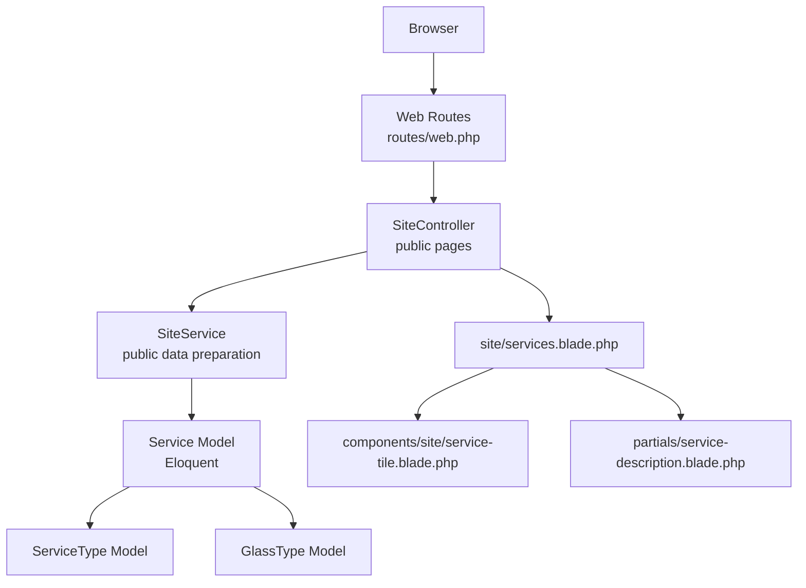
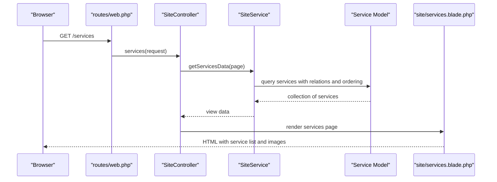
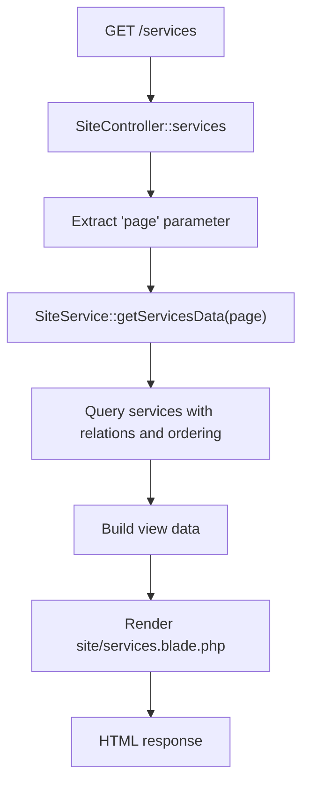
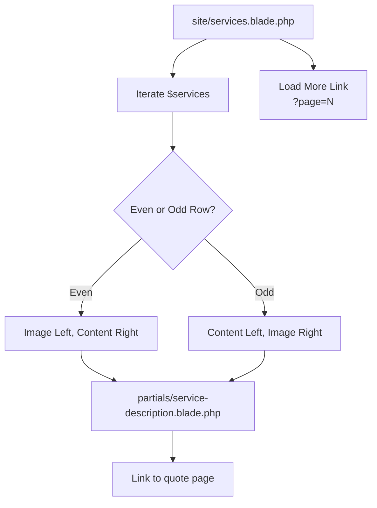
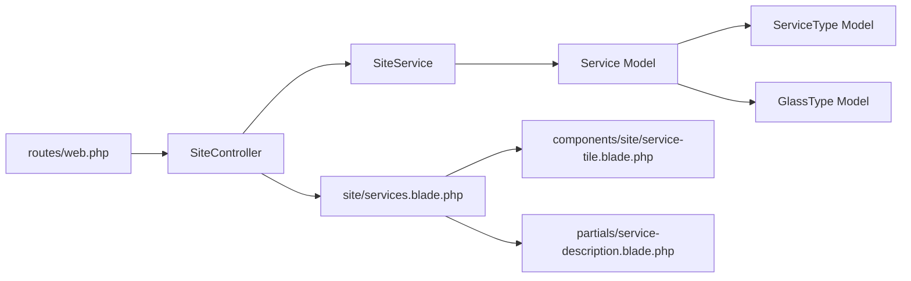

# Service Catalog System

<cite>
**Referenced Files in This Document**
- [Service.php](file://app/app/Models/Service.php)
- [ServiceType.php](file://app/app/Models/ServiceType.php)
- [GlassType.php](file://app/app/Models/GlassType.php)
- [SiteController.php](file://app/app/Http/Controllers/SiteController.php)
- [ServiceController.php](file://app/app/Http/Controllers/Admin/ServiceController.php)
- [ServiceService.php](file://app/app/Services/ServiceService.php)
- [SiteService.php](file://app/app/Services/SiteService.php)
- [services.blade.php](file://resources/views/site/services.blade.php)
- [service-tile.blade.php](file://resources/views/components/site/service-tile.blade.php)
- [service-description.blade.php](file://resources/views/partials/service-description.blade.php)
- [2026_04_17_110002_create_services_table.php](file://database/database/migrations/2026_04_17_110002_create_services_table.php)
- [2026_04_17_150000_add_seo_metadata_to_services_table.php](file://database/database/migrations/2026_04_17_150000_add_seo_metadata_to_services_table.php)
- [2026_04_17_150001_create_seo_static_routes_table.php](file://database/database/migrations/2026_04_17_150001_create_seo_static_routes_table.php)
- [web.php](file://routes/web.php)
</cite>

## Table of Contents
1. [Introduction](#introduction)
2. [Project Structure](#project-structure)
3. [Core Components](#core-components)
4. [Architecture Overview](#architecture-overview)
5. [Detailed Component Analysis](#detailed-component-analysis)
6. [Dependency Analysis](#dependency-analysis)
7. [Performance Considerations](#performance-considerations)
8. [Troubleshooting Guide](#troubleshooting-guide)
9. [Conclusion](#conclusion)

## Introduction
This document explains the service catalog system used to publish, organize, and display services on the public site. It covers:
- The `Service` model and its relationships with `ServiceType` and `GlassType`.
- Public listing behavior through the site controller and service service.
- Blade templates for the services page, service tiles, and expandable service descriptions.
- Image handling for service visuals.
- Categorization through service types and glass types.
- SEO metadata on services and static SEO routes.
- Integration points with quotes and bookings.
- Guidance for adding new service types, customizing displays, managing metadata, optimizing large catalogs, and extending search.

The service catalog is primarily a presentation and content layer around an Eloquent `Service` entity. Public visitors see paginated services with alternating image layouts, while administrators manage services through the admin controller and related views.

## Project Structure
The service catalog spans models, controllers, services, Blade templates, migrations, and route definitions.

**Diagram sources**
- [web.php:22-22](file://routes/web.php#L22-L22)
- [SiteController.php:79-84](file://app/app/Http/Controllers/SiteController.php#L79-L84)
- [SiteService.php](file://app/app/Services/SiteService.php)
- [Service.php](file://app/app/Models/Service.php)
- [ServiceType.php](file://app/app/Models/ServiceType.php)
- [GlassType.php](file://app/app/Models/GlassType.php)
- [services.blade.php](file://resources/views/site/services.blade.php)
- [service-tile.blade.php](file://resources/views/components/site/service-tile.blade.php)
- [service-description.blade.php](file://resources/views/partials/service-description.blade.php)

**Section sources**
- [web.php:22-22](file://routes/web.php#L22-L22)
- [SiteController.php:79-84](file://app/app/Http/Controllers/SiteController.php#L79-L84)

## Core Components
- **Service model**: Represents a published service, including title, slug, images, short and full descriptions, features, SEO fields, categorization, ordering, and status flags.
- **ServiceType model**: Represents a service category or type used to group services.
- **GlassType model**: Represents glass-related classification used by quotes and related entities; it is also relevant to how services can be associated with glass characteristics.
- **SiteController**: Public controller that loads the services page from `SiteService`.
- **ServiceService**: Admin-side service for creating, updating, and deleting services, including image upload logic.
- **Blade templates**:
  - `site/services.blade.php`: Main services listing page with hero facts, alternating service rows, load-more pagination, process section, and call-to-action.
  - `components/site/service-tile.blade.php`: Reusable service card tile showing image, title, short description, and link to the services page anchor.
  - `partials/service-description.blade.php`: Expandable short/detailed description helper.

Key responsibilities:
- Controllers expose endpoints and pass view data.
- Services encapsulate business logic such as queries, image handling, and data preparation.
- Models define database-backed attributes and relationships.
- Views render user-facing content and interactive UI.

**Section sources**
- [Service.php](file://app/app/Models/Service.php)
- [ServiceType.php](file://app/app/Models/ServiceType.php)
- [GlassType.php](file://app/app/Models/GlassType.php)
- [SiteController.php:79-84](file://app/app/Http/Controllers/SiteController.php#L79-L84)
- [ServiceController.php](file://app/app/Http/Controllers/Admin/ServiceController.php)
- [ServiceService.php](file://app/app/Services/ServiceService.php)
- [services.blade.php](file://resources/views/site/services.blade.php)
- [service-tile.blade.php](file://resources/views/components/site/service-tile.blade.php)
- [service-description.blade.php](file://resources/views/partials/service-description.blade.php)

## Architecture Overview
The public services flow starts at the web route, goes through `SiteController`, delegates data loading to `SiteService`, and renders the services Blade template. Images are resolved via model accessors or service helpers, and links point to the same services page using fragment anchors based on service slugs.

**Diagram sources**
- [web.php:22-22](file://routes/web.php#L22-L22)
- [SiteController.php:79-84](file://app/app/Http/Controllers/SiteController.php#L79-L84)
- [SiteService.php](file://app/app/Services/SiteService.php)
- [Service.php](file://app/app/Models/Service.php)
- [services.blade.php](file://resources/views/site/services.blade.php)

## Detailed Component Analysis

### Service Model Relationships and Fields
The service catalog centers on the `Service` model. Based on the templates and migrations referenced here, the model exposes:
- Identifiers and metadata: `id`, `title`, `slug`, `short_description`, `full_description`, `features`, `sortOrder`, `isActive`, `isFeatured`.
- Visual assets: `imageUrl`, `imagePath`, and likely an accessor such as `full_image_url` used by templates.
- Categorization: foreign keys or relations to `ServiceType` and possibly to `GlassType` depending on implementation.
- SEO fields: `seoTitle`, `seoDescription`, and related metadata columns added by migration.

Relationships:
- `Service` relates to `ServiceType` for categorization.
- `Service` may relate to `GlassType` where glass classification is part of service metadata or downstream quote context.

Complexity considerations:
- Listing uses pagination and ordered output, so efficient querying with eager loading of relations avoids N+1 issues when rendering tiles and descriptions.
- Image resolution should avoid repeated filesystem calls per row; accessors or service-level normalization are preferred.

**Section sources**
- [Service.php](file://app/app/Models/Service.php)
- [2026_04_17_110002_create_services_table.php](file://database/database/migrations/2026_04_17_110002_create_services_table.php)
- [2026_04_17_150000_add_seo_metadata_to_services_table.php](file://database/database/migrations/2026_04_17_150000_add_seo_metadata_to_services_table.php)

### ServiceType and GlassType Models
- `ServiceType` represents service categories. Administrators create and edit service types to group services.
- `GlassType` represents glass classifications used across quotes and related entities. While not directly required for every service, it provides shared taxonomy for glass-related services and quotes.

Design guidance:
- Keep service types stable and descriptive to support consistent filtering and navigation.
- Use glass types where service offerings explicitly involve glass materials or processes.

**Section sources**
- [ServiceType.php](file://app/app/Models/ServiceType.php)
- [GlassType.php](file://app/app/Models/GlassType.php)

### Public Listing Controller and Data Flow
`SiteController::services` handles `/services`. It receives the page number from the request and delegates data preparation to `SiteService::getServicesData`. The controller then renders `site/services.blade.php`.

**Diagram sources**
- [SiteController.php:79-84](file://app/app/Http/Controllers/SiteController.php#L79-L84)
- [SiteService.php](file://app/app/Services/SiteService.php)
- [web.php:22-22](file://routes/web.php#L22-L22)

**Section sources**
- [SiteController.php:79-84](file://app/app/Http/Controllers/SiteController.php#L79-L84)
- [web.php:22-22](file://routes/web.php#L22-L22)

### Blade Templates: Services Page, Tiles, and Descriptions
- `site/services.blade.php`
  - Renders a hero section with facts and labels.
  - Iterates over `$services`, alternating image-left/content-right and content-left/image-right layouts.
  - Uses `$service->slug` to build anchor IDs like `service-{slug}`.
  - Uses `$service->full_image_url` with a placeholder fallback.
  - Includes `partials/service-description.blade.php`.
  - Provides a “Load more” link to `/services?page=N`.
  - Ends with a process explanation and call-to-action pointing to the quote page.
- `components/site/service-tile.blade.php`
  - Accepts a `service` prop and optional `featured` flag.
  - Builds an image URL from `$service->full_image_url` with a placeholder.
  - Links to `#service-{slug}` on the services page.
  - Displays title, optional short description, and an accessible “Learn more” link.
- `partials/service-description.blade.php`
  - Shows `$service->short_description` always.
  - Conditionally expands `$service->full_description` using Alpine.js toggle controls.

**Diagram sources**
- [services.blade.php](file://resources/views/site/services.blade.php)
- [service-tile.blade.php](file://resources/views/components/site/service-tile.blade.php)
- [service-description.blade.php](file://resources/views/partials/service-description.blade.php)

**Section sources**
- [services.blade.php](file://resources/views/site/services.blade.php)
- [service-tile.blade.php](file://resources/views/components/site/service-tile.blade.php)
- [service-description.blade.php](file://resources/views/partials/service-description.blade.php)

### Image Handling for Service Visuals
Templates resolve images using `$service->full_image_url`, falling back to a placeholder asset. The admin `ServiceService` handles uploading and storing service images, including placeholder sentinel values and storage path management.

Recommendations:
- Ensure accessors return absolute or correctly prefixed URLs.
- Avoid repeated file lookups; cache image paths where appropriate.
- Validate uploaded files and store them under a controlled directory.
- Provide responsive images if performance becomes critical for large catalogs.

**Section sources**
- [ServiceService.php](file://app/app/Services/ServiceService.php)
- [services.blade.php](file://resources/views/site/services.blade.php)
- [service-tile.blade.php](file://resources/views/components/site/service-tile.blade.php)

### Service Categorization and Filtering
Categorization is primarily driven by `ServiceType`. The current public services page renders all services without explicit type filters in the Blade template. Filtering can be extended by:
- Adding a `type_id` or relationship filter in `SiteService::getServicesData`.
- Exposing query parameters like `?type=...` in the services route.
- Updating the Blade template to show type-based tabs or filters.

Glass-type integration is most visible in quotes and related entities; for services, include glass-related metadata only when semantically meaningful.

**Section sources**
- [ServiceType.php](file://app/app/Models/ServiceType.php)
- [GlassType.php](file://app/app/Models/GlassType.php)
- [SiteService.php](file://app/app/Services/SiteService.php)
- [services.blade.php](file://resources/views/site/services.blade.php)

### SEO Optimization for Service Pages
SEO metadata is supported at the service level through migration-added columns and at the route level through static SEO routes.

- Service-level SEO: Columns such as `seoTitle`, `seoDescription`, and related fields allow per-service optimization.
- Static SEO routes: A separate table defines static SEO mappings that can augment page-level SEO.

Best practices:
- Populate service SEO fields consistently.
- Generate unique titles and descriptions per service.
- Use canonical tags and meta descriptions in layout components.
- If per-service detail pages are introduced later, ensure structured data and Open Graph tags.

**Section sources**
- [2026_04_17_150000_add_seo_metadata_to_services_table.php](file://database/database/migrations/2026_04_17_150000_add_seo_metadata_to_services_table.php)
- [2026_04_17_150001_create_seo_static_routes_table.php](file://database/database/migrations/2026_04_17_150001_create_seo_static_routes_table.php)

### Integration with Booking and Quote Systems
The services page includes a prominent call-to-action linking to the quote route. Service tiles also link to the services page anchors rather than individual service detail pages.

Integration notes:
- Quotes reference glass types and subcategories; services can provide contextual information guiding users toward relevant quote options.
- Bookings are managed separately but can reference services indirectly through quotes or selected options.
- When adding new service types, ensure quote forms and booking flows can accommodate relevant selections.

**Section sources**
- [services.blade.php](file://resources/views/site/services.blade.php)
- [service-tile.blade.php](file://resources/views/components/site/service-tile.blade.php)

### Admin Management of Services
The admin `ServiceController` and `ServiceService` handle CRUD operations for services. Responsibilities include:
- Validating input.
- Persisting service records.
- Managing image uploads and paths.
- Providing form views for creation and editing.

When adding or editing services:
- Set slug, title, short and full descriptions.
- Upload or assign images.
- Choose service type and any relevant glass-related metadata.
- Configure SEO fields and visibility flags.

**Section sources**
- [ServiceController.php](file://app/app/Http/Controllers/Admin/ServiceController.php)
- [ServiceService.php](file://app/app/Services/ServiceService.php)

### Examples: Extending and Customizing the Catalog

#### Adding a New Service Type
Steps:
1. Create a new `ServiceType` record via the admin interface or seeder.
2. Assign services to this type using the service edit form.
3. If needed, extend the public listing to filter by type:
   - Add a type parameter to `SiteService::getServicesData`.
   - Update the Blade template to show type filters or tabs.

Validation:
- Ensure type slugs and names are consistent.
- Avoid overly granular types that fragment the catalog.

**Section sources**
- [ServiceType.php](file://app/app/Models/ServiceType.php)
- [SiteService.php](file://app/app/Services/SiteService.php)
- [services.blade.php](file://resources/views/site/services.blade.php)

#### Customizing Service Displays
Options:
- Modify `site/services.blade.php` to change layout order, add badges, or highlight featured services.
- Customize `components/site/service-tile.blade.php` to adjust aspect ratios, hover effects, or accessibility attributes.
- Extend `partials/service-description.blade.php` to show additional fields like price ranges, durations, or glass type labels.

Accessibility:
- Maintain descriptive alt text for images.
- Ensure keyboard navigation works for toggles and links.

**Section sources**
- [services.blade.php](file://resources/views/site/services.blade.php)
- [service-tile.blade.php](file://resources/views/components/site/service-tile.blade.php)
- [service-description.blade.php](file://resources/views/partials/service-description.blade.php)

#### Managing Service Metadata
Metadata includes:
- Title, slug, short description, full description.
- Features array for bullet lists.
- Image URL/path.
- SEO title and description.
- Ordering and active/featured flags.

Guidance:
- Keep short descriptions concise for tiles.
- Use full descriptions for detailed explanations.
- Fill SEO fields to improve search engine visibility.
- Use slugs that are readable and stable.

**Section sources**
- [Service.php](file://app/app/Models/Service.php)
- [2026_04_17_150000_add_seo_metadata_to_services_table.php](file://database/database/migrations/2026_04_17_150000_add_seo_metadata_to_services_table.php)

## Dependency Analysis
The public services dependency chain is intentionally shallow to keep the user experience fast.

**Diagram sources**
- [web.php:22-22](file://routes/web.php#L22-L22)
- [SiteController.php:79-84](file://app/app/Http/Controllers/SiteController.php#L79-L84)
- [SiteService.php](file://app/app/Services/SiteService.php)
- [Service.php](file://app/app/Models/Service.php)
- [ServiceType.php](file://app/app/Models/ServiceType.php)
- [GlassType.php](file://app/app/Models/GlassType.php)
- [services.blade.php](file://resources/views/site/services.blade.php)
- [service-tile.blade.php](file://resources/views/components/site/service-tile.blade.php)
- [service-description.blade.php](file://resources/views/partials/service-description.blade.php)

Potential coupling concerns:
- If `SiteService` performs heavy queries per request, caching or query optimization is necessary.
- If templates depend on many model properties, consider DTOs or view composers to centralize formatting.

**Section sources**
- [web.php:22-22](file://routes/web.php#L22-L22)
- [SiteController.php:79-84](file://app/app/Http/Controllers/SiteController.php#L79-L84)
- [SiteService.php](file://app/app/Services/SiteService.php)

## Performance Considerations
For large service catalogs:
- Paginate services server-side instead of loading all records into memory.
- Eager-load relationships (`ServiceType`, `GlassType`) to prevent N+1 queries.
- Cache expensive computations such as feature lists, image URL generation, or formatted SEO fields.
- Use lazy-loading for images and consider responsive image formats.
- Index frequently filtered columns such as `slug`, `type_id`, `is_active`, and `sort_order`.
- Avoid per-row filesystem lookups; normalize image paths in accessors or service layers.
- Precompute or memoize counts used in hero facts.
- If search is introduced, prefer database-level full-text indexes over client-side filtering.

[No sources needed since this section provides general guidance]

## Troubleshooting Guide
Common issues and resolutions:
- Missing images: Verify that `$service->full_image_url` resolves correctly and that the placeholder fallback exists. Check admin image uploads and storage configuration.
- Blank or truncated descriptions: Ensure both `short_description` and `full_description` are populated. The description partial expands only when the detailed text differs from the summary.
- Incorrect service ordering: Confirm `sortOrder` and `isFeatured` flags are set as intended.
- SEO not appearing: Verify that SEO fields exist and are rendered by layout or meta components.
- Load-more pagination broken: Ensure the services route supports the `page` parameter and that the template generates correct URLs.

Operational checks:
- Confirm the `/services` route maps to `SiteController::services`.
- Validate that `SiteService::getServicesData` returns a paginated collection.
- Review admin service edits for missing metadata.

**Section sources**
- [SiteController.php:79-84](file://app/app/Http/Controllers/SiteController.php#L79-L84)
- [services.blade.php](file://resources/views/site/services.blade.php)
- [service-description.blade.php](file://resources/views/partials/service-description.blade.php)

## Conclusion
The service catalog system provides a clear separation between public presentation and administrative management. The `Service` model anchors the catalog, with `ServiceType` and `GlassType` supporting categorization. Public listings are rendered by Blade templates that emphasize visual alternation, accessible anchors, and a direct path to quotes. SEO metadata and static route configuration enable discoverability. For growth, prioritize efficient queries, image optimization, and scalable filtering and search extensions.

[No sources needed since this section summarizes without analyzing specific files]