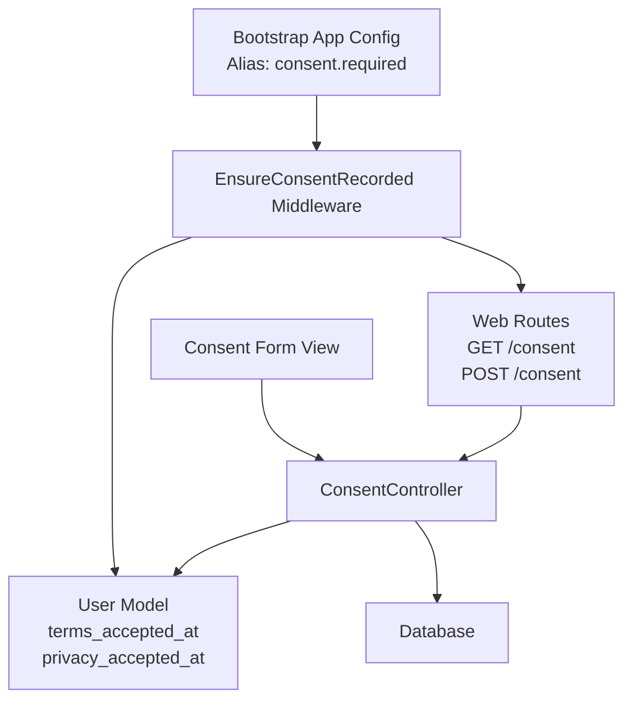
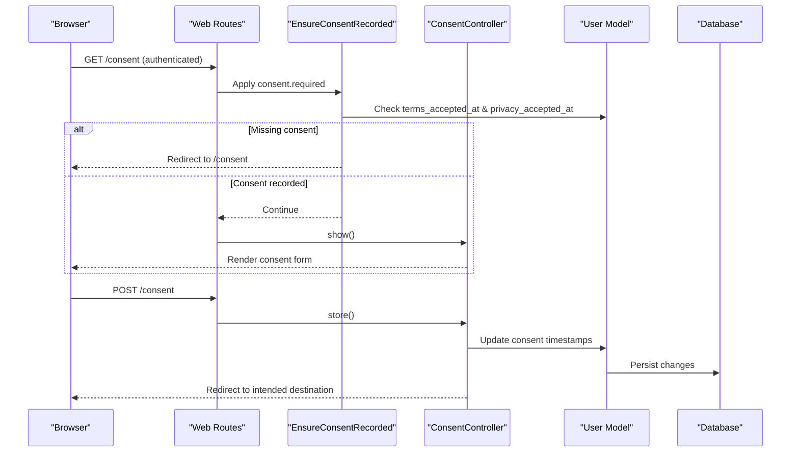
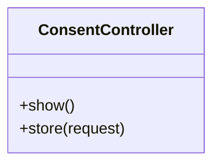
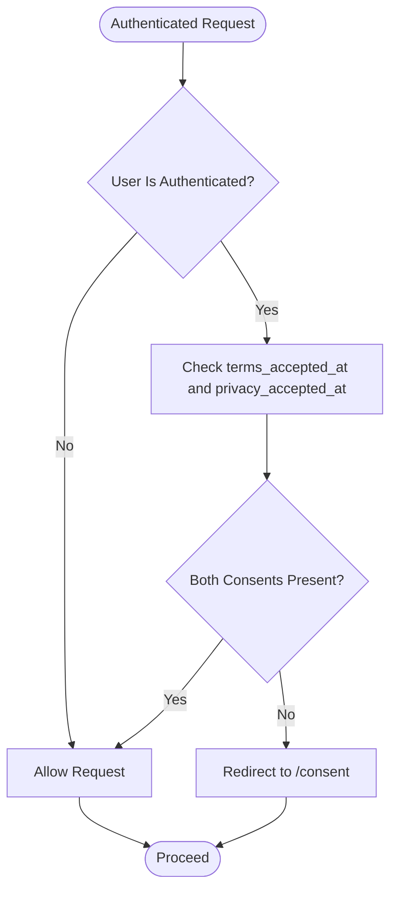
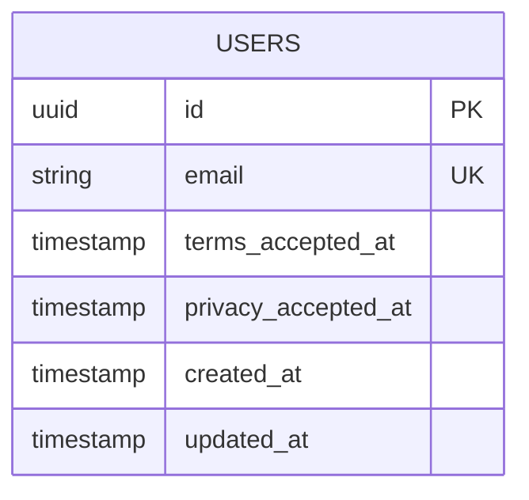
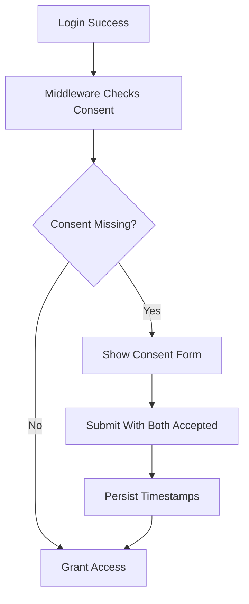
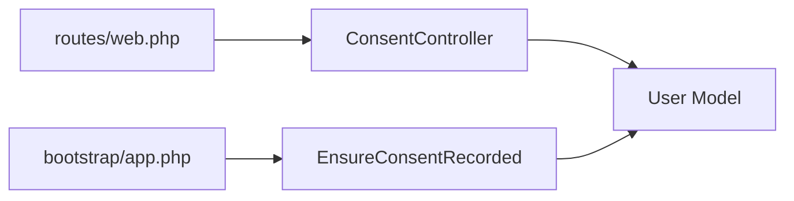

# User Consent Management

<cite>
**Referenced Files in This Document**   
- [ConsentController.php](file://app/app/Http/Controllers/ConsentController.php)
- [EnsureConsentRecorded.php](file://app/app/Http/Middleware/EnsureConsentRecorded.php)
- [User.php](file://app/app/Models/User.php)
- [2026_06_02_191250_add_consent_columns_to_users_table.php](file://database/migrations/2026_06_02_191250_add_consent_columns_to_users_table.php)
- [consent.blade.php](file://resources/views/auth/consent.blade.php)
- [web.php](file://routes/web.php)
- [bootstrap/app.php](file://bootstrap/app.php)
</cite>

## Table of Contents
1. [Introduction](#introduction)
2. [Project Structure](#project-structure)
3. [Core Components](#core-components)
4. [Architecture Overview](#architecture-overview)
5. [Detailed Component Analysis](#detailed-component-analysis)
6. [Dependency Analysis](#dependency-analysis)
7. [Performance Considerations](#performance-considerations)
8. [Troubleshooting Guide](#troubleshooting-guide)
9. [Conclusion](#conclusion)

## Introduction
This document explains the user consent management system implemented in this application. It covers how consent is captured, validated, persisted, and enforced through middleware. It also documents GDPR-related compliance characteristics, form customization points, preference persistence, audit considerations, and guidance for extending categories or gating features based on consent.

The current implementation focuses on two explicit consent items:
- Terms acceptance
- Privacy policy acceptance

These are captured after login and enforced by a dedicated middleware before users can proceed into authenticated areas.

## Project Structure
The consent feature spans controllers, middleware, models, routes, views, and database migrations:

- Controller: handles showing and storing consent preferences.
- Middleware: enforces that consent has been recorded for authenticated users.
- Model: represents the authenticated user and their consent timestamps.
- Migration: adds consent timestamp columns to the users table.
- View: renders the post-login consent capture form.
- Routes: expose GET and POST endpoints under `/consent`.
- Bootstrap configuration: registers the `consent.required` alias.

**Diagram sources**
- [web.php:28-36](file://routes/web.php#L28-L36)
- [ConsentController.php:16-80](file://app/app/Http/Controllers/ConsentController.php#L16-L80)
- [EnsureConsentRecorded.php:17-60](file://app/app/Http/Middleware/EnsureConsentRecorded.php#L17-L60)
- [User.php:33-120](file://app/app/Models/User.php#L33-L120)
- [consent.blade.php:1-49](file://resources/views/auth/consent.blade.php#L1-L49)
- [bootstrap/app.php:1-60](file://bootstrap/app.php#L1-L60)

**Section sources**
- [web.php:1-76](file://routes/web.php#L1-L76)
- [bootstrap/app.php:1-60](file://bootstrap/app.php#L1-L60)

## Core Components
- ConsentController: exposes methods to display the consent page and persist accepted terms and privacy preferences.
- EnsureConsentRecorded: middleware that blocks access for authenticated users who have not recorded both required consent flags.
- User model: carries the consent timestamp fields used to determine whether consent has been provided.
- Database migration: adds `terms_accepted_at` and `privacy_accepted_at` to the `users` table.
- Consent view: presents checkboxes for terms and privacy, validates presence, and provides logout as the only refusal path.

Key responsibilities:
- Controller: render consent UI, validate inputs, update user record.
- Middleware: check consent status, redirect to `/consent` if missing.
- Model: store and expose consent timestamps.
- Migration: ensure schema supports consent tracking.

**Section sources**
- [ConsentController.php:16-80](file://app/app/Http/Controllers/ConsentController.php#L16-L80)
- [EnsureConsentRecorded.php:17-60](file://app/app/Http/Middleware/EnsureConsentRecorded.php#L17-L60)
- [User.php:33-120](file://app/app/Models/User.php#L33-L120)
- [2026_06_02_191250_add_consent_columns_to_users_table.php:1-29](file://database/migrations/2026_06_02_191250_add_consent_columns_to_users_table.php#L1-L29)
- [consent.blade.php:1-49](file://resources/views/auth/consent.blade.php#L1-L49)

## Architecture Overview
The consent workflow integrates with authentication and routing:

**Diagram sources**
- [web.php:28-36](file://routes/web.php#L28-L36)
- [ConsentController.php:16-80](file://app/app/Http/Controllers/ConsentController.php#L16-L80)
- [EnsureConsentRecorded.php:17-60](file://app/app/Http/Middleware/EnsureConsentRecorded.php#L17-L60)
- [User.php:33-120](file://app/app/Models/User.php#L33-L120)

## Detailed Component Analysis

### ConsentController
Responsibilities:
- Show the consent capture page for authenticated users.
- Store accepted terms and privacy preferences.
- Validate input to require both checkboxes.
- Persist timestamps and redirect appropriately.

Behavioral notes:
- The controller is final and tightly scoped to consent operations.
- Input validation ensures both terms and privacy must be accepted; partial acceptance is rejected.
- Successful storage updates the authenticated user’s consent timestamps.

Customization hooks:
- Validation rules can be extended to add new consent categories.
- Redirect behavior can be adjusted to route users to specific dashboards or pages after consent.

**Section sources**
- [ConsentController.php:16-80](file://app/app/Http/Controllers/ConsentController.php#L16-L80)

#### Class Diagram: ConsentController

**Diagram sources**
- [ConsentController.php:16-80](file://app/app/Http/Controllers/ConsentController.php#L16-L80)

### EnsureConsentRecorded Middleware
Responsibilities:
- Intercept authenticated requests.
- Inspect the current user’s consent timestamps.
- Redirect to the consent capture page when either required consent is missing.
- Allow the request to continue when both consents are present.

Compliance enforcement:
- Enforces that users cannot proceed without explicitly accepting both terms and privacy policies.
- Provides a consistent pre-access gate for all authenticated routes protected by the `consent.required` middleware alias.

Configuration:
- Registered as `consent.required` in bootstrap configuration, enabling reuse across route groups.

**Section sources**
- [EnsureConsentRecorded.php:17-60](file://app/app/Http/Middleware/EnsureConsentRecorded.php#L17-L60)
- [bootstrap/app.php:40-50](file://bootstrap/app.php#L40-L50)

#### Flowchart: Consent Enforcement Logic

**Diagram sources**
- [EnsureConsentRecorded.php:17-60](file://app/app/Http/Middleware/EnsureConsentRecorded.php#L17-L60)

### User Model Consent Fields
Persistence structure:
- `terms_accepted_at`: Timestamp when the user accepted the terms.
- `privacy_accepted_at`: Timestamp when the user accepted the privacy policy.

Access pattern:
- The middleware reads these fields to decide whether to allow access.
- The controller writes these fields upon successful consent submission.

Auditability:
- Timestamps provide an auditable trail of when consent was recorded.
- These values can be included in audit logs or export reports if needed.

**Section sources**
- [User.php:33-120](file://app/app/Models/User.php#L33-L120)
- [2026_06_02_191250_add_consent_columns_to_users_table.php:8-22](file://database/migrations/2026_06_02_191250_add_consent_columns_to_users_table.php#L8-L22)

#### Data Model: Consent Columns on Users

**Diagram sources**
- [2026_06_02_191250_add_consent_columns_to_users_table.php:8-22](file://database/migrations/2026_06_02_191250_add_consent_columns_to_users_table.php#L8-L22)

### Consent Capture Workflow
End-to-end flow:
1. After login, the middleware checks consent timestamps.
2. If missing, the user is redirected to `/consent`.
3. The consent view renders a form requiring both terms and privacy acceptance.
4. Submitting the form validates input and persists timestamps.
5. The user is redirected to the originally requested page or default destination.

Refusal path:
- The consent form does not provide a “skip” option.
- The only refusal path is to log out, which prevents access until consent is recorded.

**Diagram sources**
- [EnsureConsentRecorded.php:17-60](file://app/app/Http/Middleware/EnsureConsentRecorded.php#L17-L60)
- [consent.blade.php:1-49](file://resources/views/auth/consent.blade.php#L1-L49)
- [ConsentController.php:16-80](file://app/app/Http/Controllers/ConsentController.php#L16-L80)

**Section sources**
- [consent.blade.php:1-49](file://resources/views/auth/consent.blade.php#L1-L49)
- [web.php:28-36](file://routes/web.php#L28-L36)

### Routes and Entry Points
Exposed endpoints:
- GET `/consent`: Displays the consent capture form.
- POST `/consent`: Stores consent preferences.

Route group:
- Both routes are protected by `auth`, ensuring only logged-in users see or submit consent.

**Section sources**
- [web.php:28-36](file://routes/web.php#L28-L36)

### Consent View Customization
The consent view is a Blade template that:
- Renders terms and privacy checkboxes.
- Links to terms and privacy pages.
- Requires both fields to be checked.
- Offers logout as the only decline action.

Customization examples:
- Update labels, headings, and links via localization keys.
- Extend the form by adding additional consent categories and corresponding validations.
- Add explanatory text about data processing disclosures between the checkbox section and submit button.

**Section sources**
- [consent.blade.php:1-49](file://resources/views/auth/consent.blade.php#L1-L49)

## Dependency Analysis
High-level dependencies:
- Routes depend on the controller for handling consent requests.
- Controller depends on the User model to read and write consent timestamps.
- Middleware depends on the User model to enforce consent requirements.
- Bootstrap config maps the `consent.required` alias to the middleware.

**Diagram sources**
- [web.php:28-36](file://routes/web.php#L28-L36)
- [ConsentController.php:16-80](file://app/app/Http/Controllers/ConsentController.php#L16-L80)
- [EnsureConsentRecorded.php:17-60](file://app/app/Http/Middleware/EnsureConsentRecorded.php#L17-L60)
- [User.php:33-120](file://app/app/Models/User.php#L33-L120)
- [bootstrap/app.php:40-50](file://bootstrap/app.php#L40-L50)

**Section sources**
- [web.php:28-36](file://routes/web.php#L28-L36)
- [bootstrap/app.php:40-50](file://bootstrap/app.php#L40-L50)

## Performance Considerations
- Consent checks are lightweight timestamp comparisons on the User model; overhead is minimal.
- The middleware runs per authenticated request; consider caching consent status if you introduce more complex logic later.
- Avoid heavy operations inside the middleware to keep request latency low.

[No sources needed since this section provides general guidance]

## Troubleshooting Guide
Common issues and resolutions:
- Users are repeatedly redirected to `/consent`:
  - Verify that both `terms_accepted_at` and `privacy_accepted_at` are set for the user.
  - Confirm the consent form is submitted with both checkboxes checked.
- Consent is not being saved:
  - Check controller validation rules and ensure both terms and privacy are accepted.
  - Verify database migration applied successfully and the columns exist.
- Consent page not accessible:
  - Ensure the user is authenticated because the consent routes are under the `auth` middleware group.

Operational checks:
- Inspect the `users` table for consent timestamps.
- Review the middleware registration in bootstrap configuration.
- Confirm routes `/consent` and `/consent.store` are registered.

**Section sources**
- [2026_06_02_191250_add_consent_columns_to_users_table.php:8-22](file://database/migrations/2026_06_02_191250_add_consent_columns_to_users_table.php#L8-L22)
- [web.php:28-36](file://routes/web.php#L28-L36)
- [EnsureConsentRecorded.php:17-60](file://app/app/Http/Middleware/EnsureConsentRecorded.php#L17-L60)

## Conclusion
The consent management system enforces clear, auditable consent collection for terms and privacy. The middleware guarantees that authenticated users cannot proceed without explicit acceptance, while the controller and view provide a straightforward capture experience. For extended compliance needs, the design allows adding new consent categories through validation, model attributes, and form extensions. Timestamp-based persistence supports legal audits and reporting.

[No sources needed since this section summarizes without analyzing specific files]