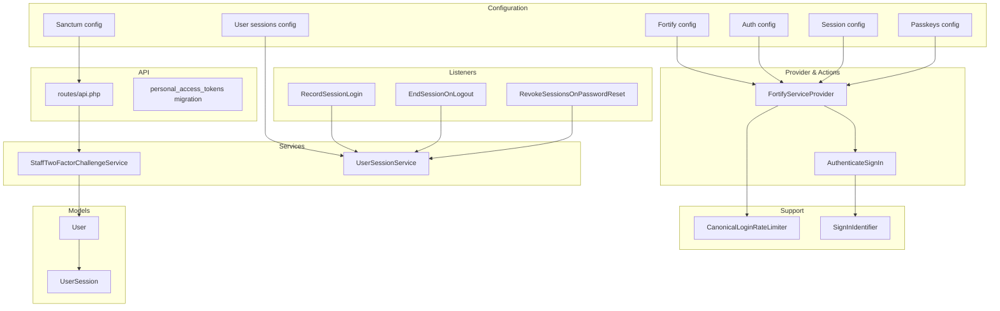
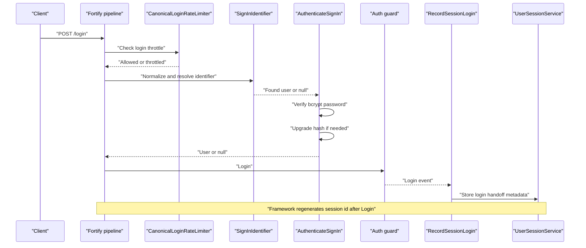
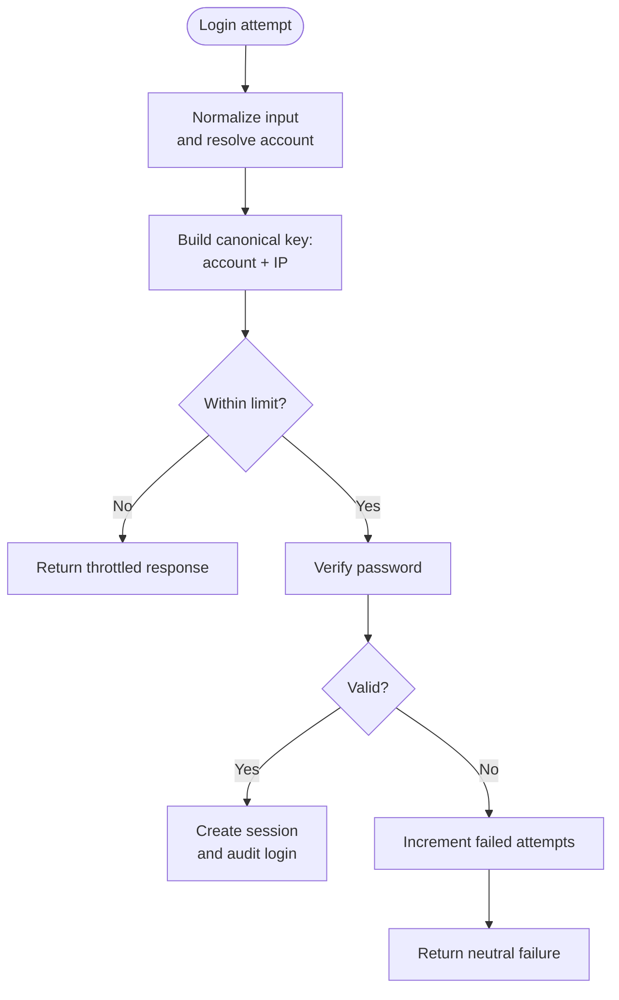
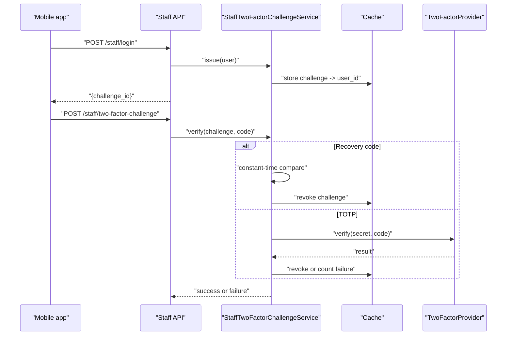
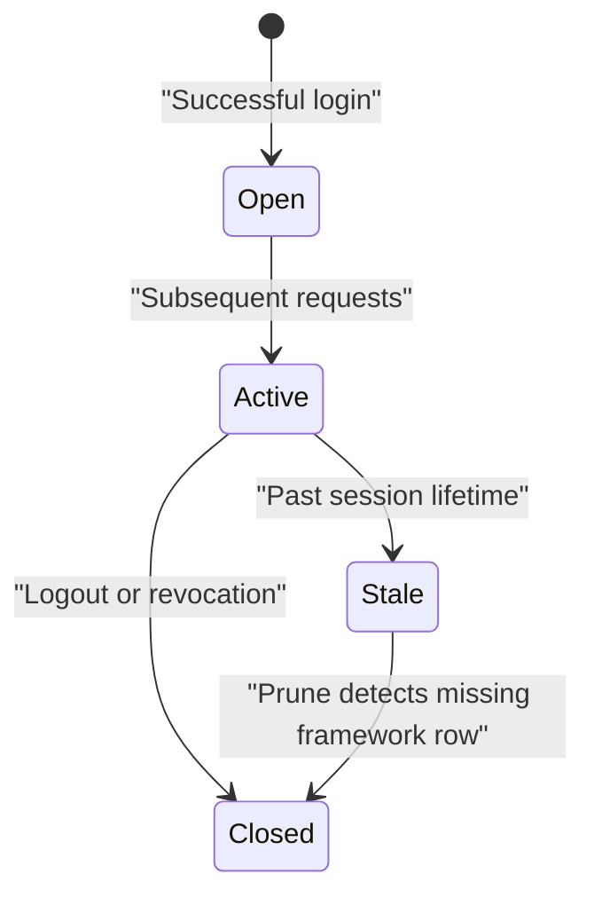
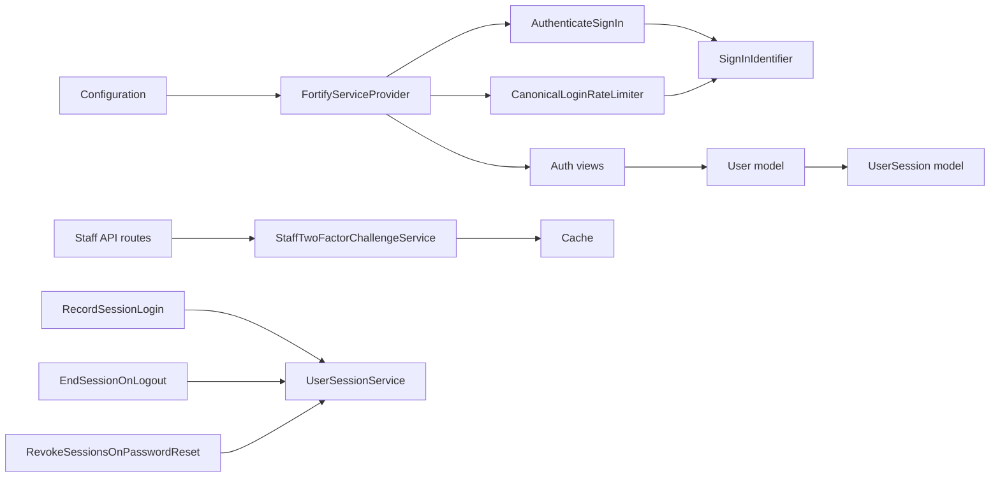

# Authentication Security

<cite>
**Referenced Files in This Document**   
- [config/fortify.php](file://config/fortify.php)
- [app/Providers/FortifyServiceProvider.php](file://app/Providers/FortifyServiceProvider.php)
- [app/Support/CanonicalLoginRateLimiter.php](file://app/Support/CanonicalLoginRateLimiter.php)
- [app/Support/SignInIdentifier.php](file://app/Support/SignInIdentifier.php)
- [app/Actions/Fortify/AuthenticateSignIn.php](file://app/Actions/Fortify/AuthenticateSignIn.php)
- [app/Http/Requests/Auth/LoginRequest.php](file://app/Http/Requests/Auth/LoginRequest.php)
- [app/Http/Responses/FailedPasswordConfirmationResponse.php](file://app/Http/Responses/FailedPasswordConfirmationResponse.php)
- [app/Http/Responses/NeutralPasswordResetLinkRequestResponse.php](file://app/Http/Responses/NeutralPasswordResetLinkRequestResponse.php)
- [config/auth.php](file://config/auth.php)
- [config/session.php](file://config/session.php)
- [config/passkeys.php](file://config/passkeys.php)
- [config/sanctum.php](file://config/sanctum.php)
- [routes/api.php](file://routes/api.php)
- [database/migrations/2026_10_22_103941_create_personal_access_tokens_table.php](file://database/migrations/2026_10_22_103941_create_personal_access_tokens_table.php)
- [app/Services/StaffTwoFactorChallengeService.php](file://app/Services/StaffTwoFactorChallengeService.php)
- [app/Models/User.php](file://app/Models/User.php)
- [database/migrations/2025_08_14_170933_add_two_factor_columns_to_users_table.php](file://database/migrations/2025_08_14_170933_add_two_factor_columns_to_users_table.php)
- [app/Listeners/RecordSessionLogin.php](file://app/Listeners/RecordSessionLogin.php)
- [app/Listeners/EndSessionOnLogout.php](file://app/Listeners/EndSessionOnLogout.php)
- [app/Listeners/RevokeSessionsOnPasswordReset.php](file://app/Listeners/RevokeSessionsOnPasswordReset.php)
- [config/user-sessions.php](file://config/user-sessions.php)
- [app/Services/UserSessionService.php](file://app/Services/UserSessionService.php)
- [app/Models/UserSession.php](file://app/Models/UserSession.php)
- [config/logging.php](file://config/logging.php)
</cite>

## Table of Contents
1. [Introduction](#introduction)
2. [Project Structure](#project-structure)
3. [Core Components](#core-components)
4. [Architecture Overview](#architecture-overview)
5. [Detailed Component Analysis](#detailed-component-analysis)
6. [Dependency Analysis](#dependency-analysis)
7. [Performance Considerations](#performance-considerations)
8. [Troubleshooting Guide](#troubleshooting-guide)
9. [Conclusion](#conclusion)

## Introduction
This document explains the Highblossom application’s authentication security model. It covers how Laravel Fortify is integrated, how passwords are hashed and upgraded with bcrypt, how sessions are secured, how passkey (WebAuthn) authentication works, how rate limiting prevents brute force attacks, how two-factor authentication is enforced across web and API flows, and how session management protects against credential stuffing and session hijacking. It also summarizes audit logging for authentication events and recommends operational best practices.

## Project Structure
Authentication-related code is concentrated around several layers:

- Configuration: Fortify, authentication guards, sessions, passkeys, Sanctum, and user-session ledger settings.
- Providers and actions: Fortify service provider wiring and sign-in action.
- Support utilities: canonical login rate limiter and single sign-in identifier handling.
- Models: `User` and `UserSession`.
- Listeners: login, logout, and password-reset event handlers.
- Services: staff two-factor challenge service and session ledger service.
- API routes: token-authenticated staff endpoints.

**Diagram sources**
- [config/fortify.php:1-162](file://config/fortify.php#L1-L162)
- [config/auth.php:1-117](file://config/auth.php#L1-L117)
- [config/session.php:1-233](file://config/session.php#L1-L233)
- [config/passkeys.php:1-117](file://config/passkeys.php#L1-L117)
- [config/sanctum.php:1-87](file://config/sanctum.php#L1-L87)
- [config/user-sessions.php:1-42](file://config/user-sessions.php#L1-L42)
- [app/Providers/FortifyServiceProvider.php:1-118](file://app/Providers/FortifyServiceProvider.php#L1-L118)
- [app/Actions/Fortify/AuthenticateSignIn.php:1-76](file://app/Actions/Fortify/AuthenticateSignIn.php#L1-L76)
- [app/Support/CanonicalLoginRateLimiter.php:1-37](file://app/Support/CanonicalLoginRateLimiter.php#L1-L37)
- [app/Support/SignInIdentifier.php:1-150](file://app/Support/SignInIdentifier.php#L1-L150)
- [app/Listeners/RecordSessionLogin.php:1-56](file://app/Listeners/RecordSessionLogin.php#L1-L56)
- [app/Listeners/EndSessionOnLogout.php:1-30](file://app/Listeners/EndSessionOnLogout.php#L1-L30)
- [app/Listeners/RevokeSessionsOnPasswordReset.php:1-40](file://app/Listeners/RevokeSessionsOnPasswordReset.php#L1-L40)
- [app/Services/StaffTwoFactorChallengeService.php:1-197](file://app/Services/StaffTwoFactorChallengeService.php#L1-L197)
- [app/Services/UserSessionService.php:1-272](file://app/Services/UserSessionService.php#L1-L272)
- [app/Models/User.php:1-141](file://app/Models/User.php#L1-L141)
- [app/Models/UserSession.php:1-257](file://app/Models/UserSession.php#L1-L257)
- [routes/api.php:1-117](file://routes/api.php#L1-L117)
- [database/migrations/2026_10_22_103941_create_personal_access_tokens_table.php:1-33](file://database/migrations/2026_10_22_103941_create_personal_access_tokens_table.php#L1-L33)

**Section sources**
- [config/fortify.php:1-162](file://config/fortify.php#L1-L162)
- [app/Providers/FortifyServiceProvider.php:1-118](file://app/Providers/FortifyServiceProvider.php#L1-L118)

## Core Components
The authentication system is built around these components:

- **Fortify integration**: Guards, features, views, custom requests, and rate limiters are registered by the Fortify service provider. Features include registration, password reset, email verification, two-factor authentication, and passkeys.
- **Password hashing**: The application uses bcrypt through Laravel’s default hasher. Sign-in verifies credentials via the custom sign-in action and upgrades stale hashes on successful logins.
- **Sign-in identifier normalization**: A single field accepts either username or email. Validation and lookup are designed to avoid information leakage about account existence.
- **Rate limiting**: Canonical login throttling groups attempts by resolved account and IP. Two-factor challenges have their own limiter keyed by session identity.
- **Two-factor authentication**: Web flow uses Fortify’s built-in two-factor flow; stateless mobile API flow uses a short-lived, single-use challenge stored in cache.
- **Passkeys**: WebAuthn configuration binds passkeys to the application’s relying party ID and allowed origins, with optional password confirmation disabled for passkey authentication.
- **API tokens**: Sanctum provides personal access tokens for the staff mobile API, guarded by `auth:sanctum`.
- **Session management**: Database-backed sessions are used, with an additional `user_sessions` ledger recording device, IP, login method, activity, and lifecycle.
- **Audit logging**: Logging channels include file, Slack, Papertrail, syslog, and stderr. Authentication-specific logs are written where applicable, and session metadata is recorded per login.

**Section sources**
- [config/fortify.php:1-162](file://config/fortify.php#L1-L162)
- [app/Providers/FortifyServiceProvider.php:1-118](file://app/Providers/FortifyServiceProvider.php#L1-L118)
- [app/Actions/Fortify/AuthenticateSignIn.php:1-76](file://app/Actions/Fortify/AuthenticateSignIn.php#L1-L76)
- [app/Support/SignInIdentifier.php:1-150](file://app/Support/SignInIdentifier.php#L1-L150)
- [app/Support/CanonicalLoginRateLimiter.php:1-37](file://app/Support/CanonicalLoginRateLimiter.php#L1-L37)
- [config/passkeys.php:1-117](file://config/passkeys.php#L1-L117)
- [config/sanctum.php:1-87](file://config/sanctum.php#L1-L87)
- [routes/api.php:1-117](file://routes/api.php#L1-L117)
- [config/session.php:1-233](file://config/session.php#L1-L233)
- [config/user-sessions.php:1-42](file://config/user-sessions.php#L1-L42)
- [app/Services/UserSessionService.php:1-272](file://app/Services/UserSessionService.php#L1-L272)
- [config/logging.php:1-132](file://config/logging.php#L1-L132)

## Architecture Overview
The following diagram shows the request path from client to database for web authentication, including rate limiting, canonical sign-in resolution, password verification, rehashing, and session auditing.

**Diagram sources**
- [app/Providers/FortifyServiceProvider.php:62-118](file://app/Providers/FortifyServiceProvider.php#L62-L118)
- [app/Support/CanonicalLoginRateLimiter.php:1-37](file://app/Support/CanonicalLoginRateLimiter.php#L1-L37)
- [app/Support/SignInIdentifier.php:1-150](file://app/Support/SignInIdentifier.php#L1-L150)
- [app/Actions/Fortify/AuthenticateSignIn.php:1-76](file://app/Actions/Fortify/AuthenticateSignIn.php#L1-L76)
- [app/Listeners/RecordSessionLogin.php:1-56](file://app/Listeners/RecordSessionLogin.php#L1-L56)
- [app/Services/UserSessionService.php:1-272](file://app/Services/UserSessionService.php#L1-L272)

## Detailed Component Analysis

### Fortify Integration and Feature Flags
- Guard and broker: Fortify uses the `web` guard and the `users` password broker.
- Username field: The wire field name remains `email`, but the application treats it as a combined username/email identifier.
- Features enabled:
  - Registration
  - Password reset
  - Email verification
  - Two-factor authentication with confirm and password confirmation
  - Passkeys with password confirmation disabled
- Views are mapped to application Blade templates.
- Custom request bindings replace Fortify’s generic request classes with application-specific validation and messages.

Security implications:
- Enabling two-factor and passkeys expands secure login options.
- Disabling password confirmation for passkeys assumes the browser and device already provide strong assurance.
- Custom view mapping keeps UI behavior consistent while centralizing security logic.

**Section sources**
- [config/fortify.php:1-162](file://config/fortify.php#L1-L162)
- [app/Providers/FortifyServiceProvider.php:1-118](file://app/Providers/FortifyServiceProvider.php#L1-L118)

### Password Hashing and Rehash-on-Login
- Password storage uses Laravel’s default hasher, which defaults to bcrypt.
- The custom sign-in action performs explicit password verification because the custom callback bypasses the default guard attempt path.
- On successful sign-in, the application checks whether the stored hash needs upgrading and updates it using the current bcrypt cost.
- If rehashing fails, the login still succeeds, but the failure is logged rather than thrown.

Best practices reflected here:
- Never store plain-text passwords.
- Keep bcrypt cost aligned with server performance.
- Upgrade legacy hashes proactively at login time.
- Fail open for write failures during upgrade only when safe; log clearly.

**Section sources**
- [app/Actions/Fortify/AuthenticateSignIn.php:1-76](file://app/Actions/Fortify/AuthenticateSignIn.php#L1-L76)
- [app/Models/User.php:1-141](file://app/Models/User.php#L1-L141)

### Single Identifier Login and Timing-Safe Behavior
- The login form has one field that accepts either a normalized username or an email address.
- Normalization lowercases and trims values consistently.
- Lookup branches based on whether the value looks like an email; both branches execute comparable work so timing does not reveal whether the identifier exists.
- Unknown identifiers trigger a throwaway bcrypt check against a fixed dummy hash to mimic real password-check latency.
- Rate-limit keys are canonicalized by resolved account plus IP, preventing an attacker from splitting attempts across multiple strings that map to the same account.

Threats mitigated:
- Account enumeration through response differences.
- Timing side channels indicating whether a user exists.
- Double-throttling caused by typing an email versus its username.

**Section sources**
- [app/Support/SignInIdentifier.php:1-150](file://app/Support/SignInIdentifier.php#L1-L150)
- [app/Http/Requests/Auth/LoginRequest.php:1-74](file://app/Http/Requests/Auth/LoginRequest.php#L1-L74)

### Rate Limiting and Brute Force Protection
- Login attempts are limited through a custom `CanonicalLoginRateLimiter` bound to Fortify’s `LoginRateLimiter`.
- The limiter key combines the canonical account identifier and remote IP.
- The named `login` limiter allows five attempts per minute per canonical key.
- The named `two-factor` limiter allows five attempts per minute per authenticated login session.
- API login and two-factor endpoints are additionally protected by middleware-based throttling.

Operational guidance:
- Monitor throttle hits for signs of credential stuffing.
- Adjust limits according to expected traffic and threat model.
- Combine rate limiting with account lockout policies if required by policy.

**Diagram sources**
- [app/Support/CanonicalLoginRateLimiter.php:1-37](file://app/Support/CanonicalLoginRateLimiter.php#L1-L37)
- [app/Support/SignInIdentifier.php:1-150](file://app/Support/SignInIdentifier.php#L1-L150)
- [app/Providers/FortifyServiceProvider.php:88-118](file://app/Providers/FortifyServiceProvider.php#L88-L118)
- [routes/api.php:24-35](file://routes/api.php#L24-L35)

**Section sources**
- [app/Support/CanonicalLoginRateLimiter.php:1-37](file://app/Support/CanonicalLoginRateLimiter.php#L1-L37)
- [app/Providers/FortifyServiceProvider.php:88-118](file://app/Providers/FortifyServiceProvider.php#L88-L118)
- [routes/api.php:24-35](file://routes/api.php#L24-L35)

### Two-Factor Authentication
- Web flow: Fortify’s two-factor feature is enabled with confirmation and password confirmation. Views are provided by the application.
- Database schema includes columns for the encrypted two-factor secret, recovery codes, and confirmation timestamp.
- Mobile API flow uses `StaffTwoFactorChallengeService`:
  - Issues a short-lived, single-use challenge ID tied to a user ID.
  - Verifies TOTP codes or one-time recovery codes.
  - Limits wrong attempts and revokes the challenge after a threshold.
  - Uses constant-time comparison for recovery codes.
  - Stores no secrets, codes, or submitted codes in cache.

Security properties:
- Stateless second factor for APIs avoids accidentally issuing tokens after only password verification.
- Challenge expiration reduces replay risk.
- Attempt caps prevent offline guessing against a stolen challenge.

**Diagram sources**
- [app/Services/StaffTwoFactorChallengeService.php:1-197](file://app/Services/StaffTwoFactorChallengeService.php#L1-L197)
- [routes/api.php:24-35](file://routes/api.php#L24-L35)
- [database/migrations/2025_08_14_170933_add_two_factor_columns_to_users_table.php:1-34](file://database/migrations/2025_08_14_170933_add_two_factor_columns_to_users_table.php#L1-L34)

**Section sources**
- [config/fortify.php:109-162](file://config/fortify.php#L109-L162)
- [database/migrations/2025_08_14_170933_add_two_factor_columns_to_users_table.php:1-34](file://database/migrations/2025_08_14_170933_add_two_factor_columns_to_users_table.php#L1-L34)
- [app/Services/StaffTwoFactorChallengeService.php:1-197](file://app/Services/StaffTwoFactorChallengeService.php#L1-L197)
- [routes/api.php:24-35](file://routes/api.php#L24-L35)

### Passkey Authentication
- Passkeys are configured through the passkeys package.
- Relying party ID is derived from the application URL host.
- Allowed origins default to the application URL.
- User handle derivation uses a stable secret, allowing rotation safety.
- Timeout is configurable.
- Authentication guard matches the primary web guard.
- Routes use the web middleware group.
- Management routes can require password confirmation depending on configuration.
- Fortify enables passkeys with password confirmation disabled for this feature.

Protection notes:
- Binding to relying party ID and allowed origins prevents cross-origin passkey misuse.
- Stable user handles reduce dependency on app key rotations.
- Disabled password confirmation assumes device-bound passkey strength.

**Section sources**
- [config/passkeys.php:1-117](file://config/passkeys.php#L1-L117)
- [config/fortify.php:138-162](file://config/fortify.php#L138-L162)

### Session Security Configuration
- Default guard uses the session driver backed by Eloquent users.
- Session driver defaults to database.
- Session lifetime defaults to 120 minutes.
- Cookie security flags include HTTP-only and configurable SameSite behavior.
- Encryption can be enabled for sensitive session data.
- Redis or other drivers can be selected through configuration.

Recommendations:
- Enable HTTPS-only cookies in production.
- Set SameSite to strict or lax as appropriate.
- Encrypt sessions if storing sensitive data.
- Use a centralized session backend such as Redis for distributed applications.
- Rotate session encryption keys as part of secret rotation procedures.

**Section sources**
- [config/auth.php:1-117](file://config/auth.php#L1-L117)
- [config/session.php:1-233](file://config/session.php#L1-L233)

### Token-Based API Authentication
- Sanctum is configured for the `web` guard.
- Stateful domains include common local development hosts and the running application URL.
- Expiration is not forced globally; tokens may carry their own expiry.
- Token prefix can be configured for secret scanning.
- Sanctum middleware encrypts cookies and validates CSRF for first-party stateful requests.
- Staff API routes under `/api/staff` are protected by `auth:sanctum` and Spatie abilities.
- Personal access tokens are stored in a dedicated table with unique token strings, names, abilities, last-used timestamps, and optional expiry.

Best practices:
- Restrict token scopes to minimum necessary abilities.
- Set short lifetimes for long-lived tokens.
- Monitor `last_used_at` and revoke unused tokens.
- Treat tokens as secrets; do not log them.

**Section sources**
- [config/sanctum.php:1-87](file://config/sanctum.php#L1-L87)
- [routes/api.php:1-117](file://routes/api.php#L1-L117)
- [database/migrations/2026_10_22_103941_create_personal_access_tokens_table.php:1-33](file://database/migrations/2026_10_22_103941_create_personal_access_tokens_table.php#L1-L33)

### Session Lifecycle and Anti-Hijacking Controls
- On successful login, a listener records login method and remember flag into a session handoff key.
- After framework session regeneration, the session ledger service opens or refreshes a `user_sessions` row.
- Logout closes the ledger row.
- Password reset revokes other sessions for the affected user.
- Revocation deletes the underlying framework session row, invalidating the session immediately.
- The ledger tracks IP, user agent, device type, platform, browser, login method, and timestamps.

These controls mitigate:
- Session hijacking after password changes.
- Persistent unauthorized access across devices.
- Incomplete visibility into active sessions.

**Diagram sources**
- [app/Listeners/RecordSessionLogin.php:1-56](file://app/Listeners/RecordSessionLogin.php#L1-L56)
- [app/Listeners/EndSessionOnLogout.php:1-30](file://app/Listeners/EndSessionOnLogout.php#L1-L30)
- [app/Listeners/RevokeSessionsOnPasswordReset.php:1-40](file://app/Listeners/RevokeSessionsOnPasswordReset.php#L1-L40)
- [app/Services/UserSessionService.php:1-272](file://app/Services/UserSessionService.php#L1-L272)
- [app/Models/UserSession.php:1-257](file://app/Models/UserSession.php#L1-L257)

**Section sources**
- [app/Listeners/RecordSessionLogin.php:1-56](file://app/Listeners/RecordSessionLogin.php#L1-L56)
- [app/Listeners/EndSessionOnLogout.php:1-30](file://app/Listeners/EndSessionOnLogout.php#L1-L30)
- [app/Listeners/RevokeSessionsOnPasswordReset.php:1-40](file://app/Listeners/RevokeSessionsOnPasswordReset.php#L1-L40)
- [config/user-sessions.php:1-42](file://config/user-sessions.php#L1-L42)
- [app/Services/UserSessionService.php:1-272](file://app/Services/UserSessionService.php#L1-L272)
- [app/Models/UserSession.php:1-257](file://app/Models/UserSession.php#L1-L257)

### Audit Logging for Authentication Events
- Application logging supports multiple channels: stack, single file, daily files, Slack, Papertrail, stderr, syslog, and null.
- Authentication-relevant logs include:
  - Password rehash failures during login.
  - Session lifecycle events recorded in the user session ledger.
  - Admin actions that revoke sessions.
- Sensitive fields such as passwords, secrets, and tokens are hidden on the `User` model.

Recommended additions:
- Add structured audit entries for successful and failed logins.
- Include non-sensitive context such as user identifier, route, IP, user agent, and outcome.
- Avoid logging raw credentials, secrets, tokens, or full headers.
- Route security events to a centralized SIEM or audit sink.

**Section sources**
- [config/logging.php:1-132](file://config/logging.php#L1-L132)
- [app/Actions/Fortify/AuthenticateSignIn.php:43-76](file://app/Actions/Fortify/AuthenticateSignIn.php#L43-L76)
- [app/Models/User.php:1-141](file://app/Models/User.php#L1-L141)

## Dependency Analysis
The authentication subsystem has clear boundaries:

- Configuration drives runtime behavior for guards, providers, features, rate limiters, sessions, passkeys, and Sanctum.
- The Fortify provider wires custom requests, responses, actions, views, and rate limiters.
- Sign-in logic depends on `SignInIdentifier` for safe, normalized lookups.
- Two-factor support spans Fortify features, database schema, and the staff challenge service.
- Session auditing depends on framework auth events and the session ledger service.

**Diagram sources**
- [app/Providers/FortifyServiceProvider.php:1-118](file://app/Providers/FortifyServiceProvider.php#L1-L118)
- [app/Actions/Fortify/AuthenticateSignIn.php:1-76](file://app/Actions/Fortify/AuthenticateSignIn.php#L1-L76)
- [app/Support/SignInIdentifier.php:1-150](file://app/Support/SignInIdentifier.php#L1-L150)
- [app/Support/CanonicalLoginRateLimiter.php:1-37](file://app/Support/CanonicalLoginRateLimiter.php#L1-L37)
- [app/Services/StaffTwoFactorChallengeService.php:1-197](file://app/Services/StaffTwoFactorChallengeService.php#L1-L197)
- [app/Listeners/RecordSessionLogin.php:1-56](file://app/Listeners/RecordSessionLogin.php#L1-L56)
- [app/Listeners/EndSessionOnLogout.php:1-30](file://app/Listeners/EndSessionOnLogout.php#L1-L30)
- [app/Listeners/RevokeSessionsOnPasswordReset.php:1-40](file://app/Listeners/RevokeSessionsOnPasswordReset.php#L1-L40)
- [app/Services/UserSessionService.php:1-272](file://app/Services/UserSessionService.php#L1-L272)
- [app/Models/User.php:1-141](file://app/Models/User.php#L1-L141)
- [app/Models/UserSession.php:1-257](file://app/Models/UserSession.php#L1-L257)
- [routes/api.php:1-117](file://routes/api.php#L1-L117)

**Section sources**
- [app/Providers/FortifyServiceProvider.php:1-118](file://app/Providers/FortifyServiceProvider.php#L1-L118)
- [app/Services/StaffTwoFactorChallengeService.php:1-197](file://app/Services/StaffTwoFactorChallengeService.php#L1-L197)
- [app/Services/UserSessionService.php:1-272](file://app/Services/UserSessionService.php#L1-L272)

## Performance Considerations
- Bcrypt cost should balance security and login latency. The sign-in path deliberately performs equivalent work for unknown identifiers to avoid timing leaks.
- Rehash-on-login runs only when needed and fails gracefully without denying login.
- Session ledger writes are throttled to avoid a database update on every request.
- Two-factor challenge attempts are capped and cached with short TTLs.
- Rate limiting is per canonical account plus IP, reducing unnecessary lockouts while preserving protection.

[No sources needed since this section provides general guidance]

## Troubleshooting Guide
Common issues and diagnostics:

- Login always fails despite correct credentials:
  - Check whether the custom sign-in action resolves the identifier correctly.
  - Verify bcrypt cost and whether legacy hashes need rehashing.
  - Review authentication logs for rehash failures.

- Throttling blocks legitimate users:
  - Confirm that the canonical login limiter is in effect.
  - Ensure attempts are not split between email and username variants.
  - Inspect API-level throttling for mobile clients.

- Two-factor code rejected:
  - Verify challenge validity and expiration.
  - Check attempt counters and whether the challenge was burned.
  - Confirm recovery codes were rotated after use.

- Sessions remain active after password reset:
  - Ensure the password reset listener revokes other sessions.
  - Verify the session ledger service deletes framework session rows.

- Passkeys fail on certain domains:
  - Validate relying party ID and allowed origins.
  - Confirm the browser origin matches configured URLs.

- Session ledger inconsistencies:
  - Review orphan grace window and prune behavior.
  - Check whether the session driver is database-backed and table names match.

**Section sources**
- [app/Actions/Fortify/AuthenticateSignIn.php:43-76](file://app/Actions/Fortify/AuthenticateSignIn.php#L43-L76)
- [app/Support/CanonicalLoginRateLimiter.php:1-37](file://app/Support/CanonicalLoginRateLimiter.php#L1-L37)
- [app/Services/StaffTwoFactorChallengeService.php:1-197](file://app/Services/StaffTwoFactorChallengeService.php#L1-L197)
- [app/Listeners/RevokeSessionsOnPasswordReset.php:1-40](file://app/Listeners/RevokeSessionsOnPasswordReset.php#L1-L40)
- [config/passkeys.php:1-117](file://config/passkeys.php#L1-L117)
- [config/user-sessions.php:1-42](file://config/user-sessions.php#L1-L42)

## Conclusion
Highblossom implements a layered authentication strategy centered on Laravel Fortify, bcrypt password hashing, robust session auditing, two-factor authentication, passkeys, and Sanctum API tokens. The most important security properties are:

- Canonicalized sign-in identifiers prevent enumeration and timing leaks.
- Rate limiting protects against brute force and credential stuffing.
- Two-factor authentication is enforced for both web and API clients.
- Passkeys are bound to trusted origins and relying party identifiers.
- Session management records device and IP context and revokes sessions after password changes.
- Auditable logging supports incident response and compliance.

Operational recommendations:
- Keep bcrypt costs aligned with performance budgets.
- Enforce HTTPS-only cookies and secure session configuration.
- Require two-factor authentication for privileged accounts.
- Monitor rate limiters, session anomalies, and authentication logs.
- Rotate secrets carefully and validate passkey relying party configurations.
- Regularly review active sessions and revoke suspicious ones.

[No sources needed since this section summarizes without analyzing specific files]