# Authorization & Access Control

<cite>
**Referenced Files in This Document**
- [User.php](file://app/Models/User.php)
- [RoleService.php](file://app/Services/RoleService.php)
- [AppServiceProvider.php](file://app/Providers/AppServiceProvider.php)
- [permission.php](file://config/permission.php)
- [auth.php](file://config/auth.php)
- [sanctum.php](file://config/sanctum.php)
- [RolesAndPermissionsSeeder.php](file://database/seeders/RolesAndPermissionsSeeder.php)
- [2026_04_18_163436_create_permission_tables.php](file://database/migrations/2026_04_18_163436_create_permission_tables.php)
- [2026_05_05_091031_seed_roles_permissions_and_admin_user.php](file://database/migrations/2026_05_05_091031_seed_roles_permissions_and_admin_user.php)
- [2026_10_03_140000_add_manage_user_sessions_permission.php](file://database/migrations/2026_10_03_140000_add_manage_user_sessions_permission.php)
- [2026_10_15_120000_add_view_system_overview_permission.php](file://database/migrations/2026_10_15_120000_add_view_system_overview_permission.php)
- [2026_10_15_190000_add_export_system_overview_permission.php](file://database/migrations/2026_10_15_190000_add_export_system_overview_permission.php)
- [2026_10_23_215000_add_manage_settings_permission.php](file://database/migrations/2026_10_23_215000_add_manage_settings_permission.php)
- [admin.php](file://routes/admin.php)
- [api.php](file://routes/api.php)
- [web.php](file://routes/web.php)
</cite>

## Table of Contents
1. [Introduction](#introduction)
2. [Project Structure](#project-structure)
3. [Core Components](#core-components)
4. [Architecture Overview](#architecture-overview)
5. [Detailed Component Analysis](#detailed-component-analysis)
6. [Dependency Analysis](#dependency-analysis)
7. [Performance Considerations](#performance-considerations)
8. [Troubleshooting Guide](#troubleshooting-guide)
9. [Conclusion](#conclusion)

## Introduction
This document explains how the Highblossom application implements authorization and access control. It covers:
- Role-based access control using Spatie Permissions.
- Permission definitions, role hierarchy, and permission migrations.
- Middleware-based route protection for both web admin and API endpoints.
- Policy-style ability checks via Spatie’s `can:` middleware.
- Resource-level controls through explicit permission gates.
- Admin panel security, privilege escalation prevention, and audit integration.
- Security considerations for multi-tenant and cross-resource scenarios.

The system uses a layered approach: authentication is enforced first, then global abilities, then route-scoped permissions, and finally controller/service logic where needed.

## Project Structure
Authorization-related code is spread across models, services, providers, configuration, database schema, and routing layers:

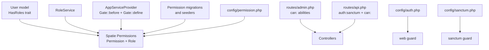

**Diagram sources**
- [User.php:1-141](file://app/Models/User.php#L1-L141)
- [RoleService.php:1-43](file://app/Services/RoleService.php#L1-L43)
- [AppServiceProvider.php:73-86](file://app/Providers/AppServiceProvider.php#L73-L86)
- [permission.php:1-206](file://config/permission.php#L1-L206)
- [auth.php:1-117](file://config/auth.php#L1-L117)
- [sanctum.php:1-87](file://config/sanctum.php#L1-L87)
- [admin.php:1-291](file://routes/admin.php#L1-L291)
- [api.php:1-117](file://routes/api.php#L1-L117)

**Section sources**
- [User.php:1-141](file://app/Models/User.php#L1-L141)
- [permission.php:1-206](file://config/permission.php#L1-L206)
- [auth.php:1-117](file://config/auth.php#L1-L117)
- [sanctum.php:1-87](file://config/sanctum.php#L1-L87)
- [admin.php:1-291](file://routes/admin.php#L1-L291)
- [api.php:1-117](file://routes/api.php#L1-L117)

## Core Components

### User Model and Role Integration
The `User` model integrates Spatie Permissions by using the `HasRoles` trait alongside Laravel’s built-in authenticatable features, Sanctum tokens, passkeys, and two-factor authentication. This means every authenticated user instance can directly check roles and permissions at runtime.

Key responsibilities:
- Exposes role and permission checking through Spatie’s trait methods.
- Provides relationships to business entities such as bookings, posts, inspection notes, and sessions.
- Works with session and token guards for web and API access.

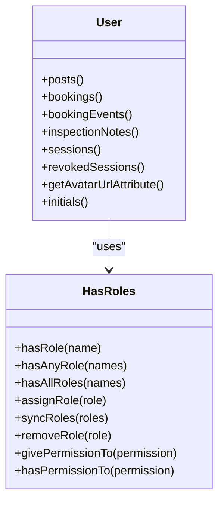

**Diagram sources**
- [User.php:1-141](file://app/Models/User.php#L1-L141)

**Section sources**
- [User.php:1-141](file://app/Models/User.php#L1-L141)

### Spatie Permissions Configuration
The package configuration defines:
- Eloquent models for permissions and roles.
- Database table names for roles, permissions, and pivot tables.
- Column names including team foreign keys when teams are enabled.
- Cache behavior, event flags, wildcard support, and exception visibility settings.

Important current settings:
- Teams are disabled, so permissions and roles are not scoped by a team identifier.
- Wildcard permissions are disabled.
- Permission exceptions do not expose required role or permission names by default, reducing information leakage.
- The package registers its own permission-check method with the gate.

**Section sources**
- [permission.php:1-206](file://config/permission.php#L1-L206)

### Authentication Guards
- Web authentication uses the session-based `web` guard backed by the `users` provider and the `User` model.
- API authentication for the staff mobile app uses Sanctum under the same `web` guard context. Token-based requests must carry a valid personal access token unless stateful domains are used.

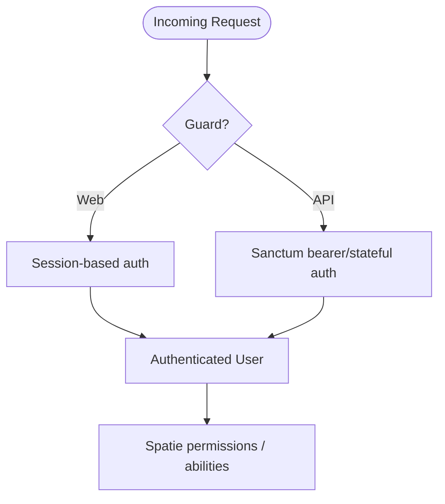

**Diagram sources**
- [auth.php:1-117](file://config/auth.php#L1-L117)
- [sanctum.php:1-87](file://config/sanctum.php#L1-L87)

**Section sources**
- [auth.php:1-117](file://config/auth.php#L1-L117)
- [sanctum.php:1-87](file://config/sanctum.php#L1-L87)

## Architecture Overview
Highblossom’s authorization architecture combines several layers:

1. **Authentication Layer**
   - Web routes use session authentication.
   - Staff API routes use Sanctum token authentication.

2. **Global Gate Overrides**
   - Super Admin users bypass normal permission checks through a gate hook.
   - Additional abilities like `manage environment` and scheduler viewing are explicitly defined.

3. **Route-Level Protection**
   - Admin routes require authentication, consent, verification where applicable, and the `access admin panel` permission.
   - Each route also applies a specific `can:` ability.

4. **API-Level Protection**
   - All data routes under `/api/staff/*` require Sanctum authentication.
   - Route-level `can:` abilities mirror the web admin permissions.

5. **Service and Model Enforcement**
   - Services enforce additional constraints, such as preventing deletion of the Super Admin role.
   - Business logic may perform resource-level authorization beyond simple route abilities.

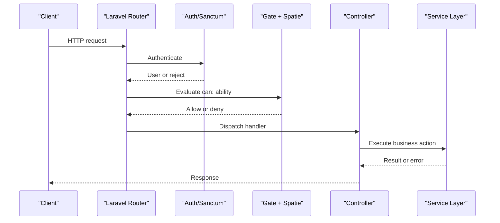

**Diagram sources**
- [admin.php:1-291](file://routes/admin.php#L1-L291)
- [api.php:1-117](file://routes/api.php#L1-L117)
- [AppServiceProvider.php:73-86](file://app/Providers/AppServiceProvider.php#L73-L86)

## Detailed Component Analysis

### Permission Definitions and Role Hierarchy
The application defines permissions centrally through database seeders and migration seeders. Two primary sources exist:

- Migration seeder for initial setup and an administrative user.
- Dedicated `RolesAndPermissionsSeeder` for broader permission coverage and richer role assignments.

#### Permissions
Representative permission groups include:
- Blog content: view, create, update, delete, publish, manage revisions.
- Bookings: view, create, update, delete.
- Inspections: view, create, update, delete.
- Gallery: view, manage.
- Services: view, manage.
- Settings: view, update, manage.
- SEO: manage.
- Content: manage pages, categories, tags, testimonials.
- Communication: view contact messages, manage contact numbers.
- HR: manage absences.
- Access control: manage users, manage roles, access admin panel.
- System administration: manage versions, manage cache, view system overview, export system overview.
- Dashboard: view dashboard.
- Sessions: manage user sessions.

These permissions are created idempotently, meaning repeated seeding does not duplicate them.

#### Roles
The role hierarchy is intentionally narrow rather than deeply nested:

- **Super Admin**: effectively unrestricted.
  - Receives all permissions.
  - Bypasses normal permission checks via `Gate::before`.
  - Owns sensitive system capabilities such as exporting system overview data.
- **Admin**: broad operational access but deliberately excluded from some high-risk capabilities.
  - Can manage most content, settings, versions, and admin panel areas.
  - Does not receive `export system overview`, keeping export privileges separate from read-only dashboard access.
- **Staff**: operational front-line access.
  - Can view and create most operational resources.
  - Cannot delete blog posts, delete bookings, or manage gallery items.
- **User**: minimal baseline role.
  - Can view the dashboard and limited public-facing resources.

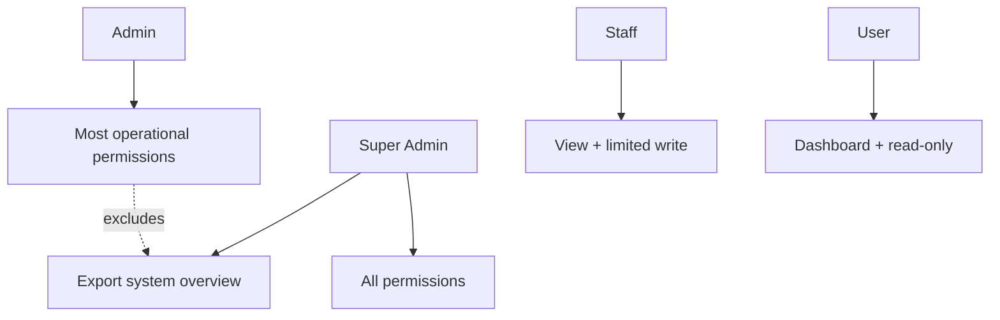

**Diagram sources**
- [RolesAndPermissionsSeeder.php:1-161](file://database/seeders/RolesAndPermissionsSeeder.php#L1-L161)
- [AppServiceProvider.php:73-86](file://app/Providers/AppServiceProvider.php#L73-L86)

**Section sources**
- [RolesAndPermissionsSeeder.php:1-161](file://database/seeders/RolesAndPermissionsSeeder.php#L1-L161)
- [2026_05_05_091031_seed_roles_permissions_and_admin_user.php:1-154](file://database/migrations/2026_05_05_091031_seed_roles_permissions_and_admin_user.php#L1-L154)

### Database Schema for Authorization
The Spatie Permissions package creates the following core tables:
- `permissions`: stores permission names and guard names.
- `roles`: stores role names and guard names.
- `model_has_permissions`: maps users to permissions.
- `model_has_roles`: maps users to roles.
- `role_has_permissions`: maps roles to permissions.

When teams are enabled, additional team-scoped columns are added; currently, teams are disabled.

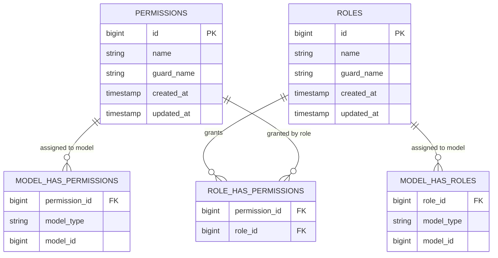

**Diagram sources**
- [2026_04_18_163436_create_permission_tables.php:1-137](file://database/migrations/2026_04_18_163436_create_permission_tables.php#L1-L137)

**Section sources**
- [2026_04_18_163436_create_permission_tables.php:1-137](file://database/migrations/2026_04_18_163436_create_permission_tables.php#L1-L137)
- [permission.php:1-206](file://config/permission.php#L1-L206)

### Middleware-Based Route Protection

#### Admin Panel Protection
The entire admin panel is protected by:
- Authentication.
- Consent requirement.
- Conditional email verification.
- The `access admin panel` permission.

Within that group, individual routes add finer-grained abilities:
- Bookings: `view bookings`, `update bookings`.
- Closures: `update bookings`.
- Inspections: `view inspections`, `update inspections`.
- Absences: `manage absences`.
- Settings: `view settings`, `update settings`.
- Versions: `manage versions`.
- Pages: `manage pages`.
- Testimonials: `manage testimonials`.
- Services: `view services`, `manage services`.
- Blog: `view blog`, `create blog`, `update blog`, `delete blog`.
- Categories and tags: view and CRUD permissions.
- Staff directory and partners: `manage settings`.
- Gallery: `view gallery`, `manage gallery`.
- Glass types and subcategories: `view services`, `manage services`.
- Contact messages: `view contact messages`.
- SEO: `manage seo`.
- Cache management: `manage cache`.
- System overview: `view system overview`, `export system overview`.
- Users: `manage users`.
- Sessions: `manage user sessions`.
- Roles: `manage roles`.

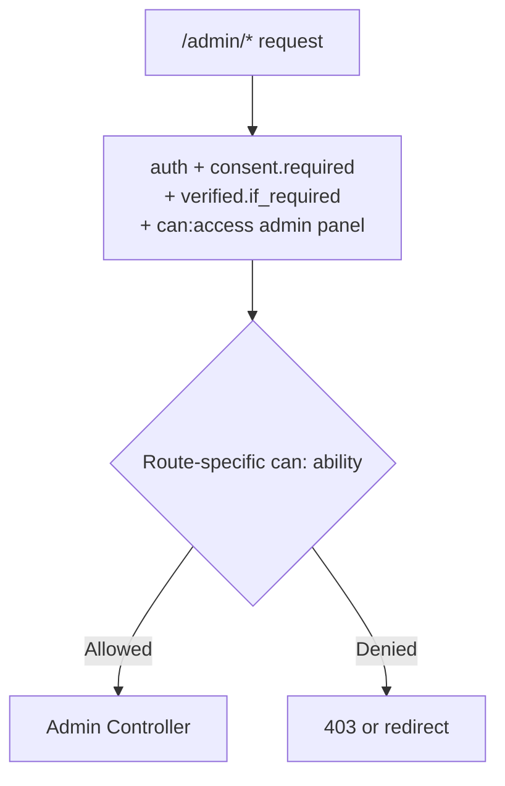

**Diagram sources**
- [admin.php:1-291](file://routes/admin.php#L1-L291)

**Section sources**
- [admin.php:1-291](file://routes/admin.php#L1-L291)

#### API Endpoint Protection
The staff API under `/api/staff/*` uses Sanctum authentication and mirrors the same permission model as the web admin panel:
- Login and two-factor challenge endpoints are throttled.
- Profile endpoints require `auth:sanctum`.
- Dashboard requires `view dashboard`.
- Bookings, inspections, quotes, contact messages, testimonials, blog moderation, staff directory, partners, and gallery use the same `can:` abilities as their web counterparts.

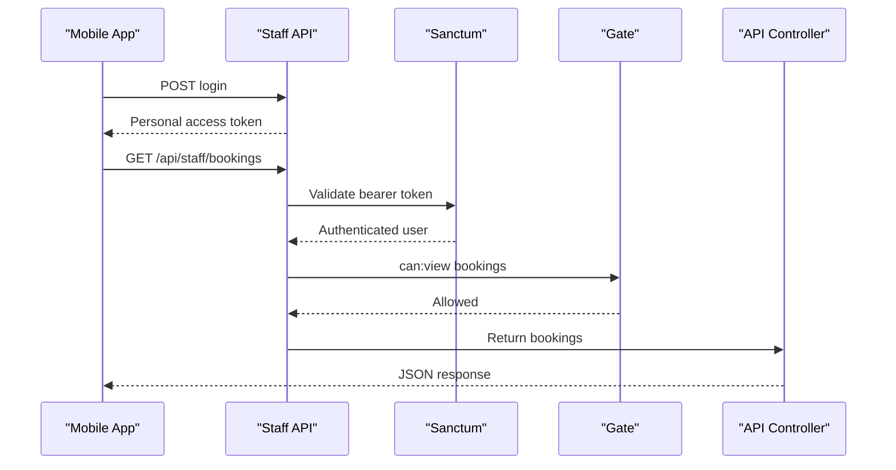

**Diagram sources**
- [api.php:1-117](file://routes/api.php#L1-L117)

**Section sources**
- [api.php:1-117](file://routes/api.php#L1-L117)

### Policy-Based Authorization Patterns
Highblossom primarily uses Spatie’s `can:` middleware instead of traditional Laravel policy classes. This pattern treats each permission as an ability checked against the authenticated user’s roles.

Where policies could be introduced later, they should align with existing permission names rather than introducing parallel authorization concepts. For example:
- A booking policy should evaluate the same `view bookings` and `update bookings` permissions already used on routes.
- A post policy should reuse `view blog`, `update blog`, and `delete blog`.

This keeps UI gating, route protection, and service-layer decisions consistent.

**Section sources**
- [admin.php:1-291](file://routes/admin.php#L1-L291)
- [api.php:1-117](file://routes/api.php#L1-L117)

### Resource-Level Access Controls
While route-level permissions provide coarse control, resource-level authorization is important when multiple resources share similar routes or when ownership matters.

Current patterns:
- Many controllers rely on route abilities for coarse authorization.
- Some actions are guarded inside controllers, especially where read capability is split into nuanced checks, such as the search endpoint.
- Services protect sensitive operations, such as preventing deletion of the Super Admin role.

For new features, prefer this order:
1. Route-level `can:` for coarse permissions.
2. Resource ownership or tenant scoping inside the controller or service.
3. Final service-layer validation before persistence.

**Section sources**
- [RoleService.php:1-43](file://app/Services/RoleService.php#L1-L43)
- [admin.php:1-291](file://routes/admin.php#L1-L291)

### Admin Panel Security
Admin panel security combines several controls:
- Global ability: `access admin panel`.
- Module-specific abilities for every feature area.
- Throttling on risky actions such as cache clearing and system overview refresh/export.
- Password confirmation for two-factor changes.
- Session revocation flows for both administrators and end users.

Privilege escalation prevention includes:
- Super Admin bypass only through a deliberate gate hook.
- Protected role management routes gated by `manage roles`.
- `RoleService` rejecting deletion of the Super Admin role.
- Separate permissions for reading versus exporting system overview data.

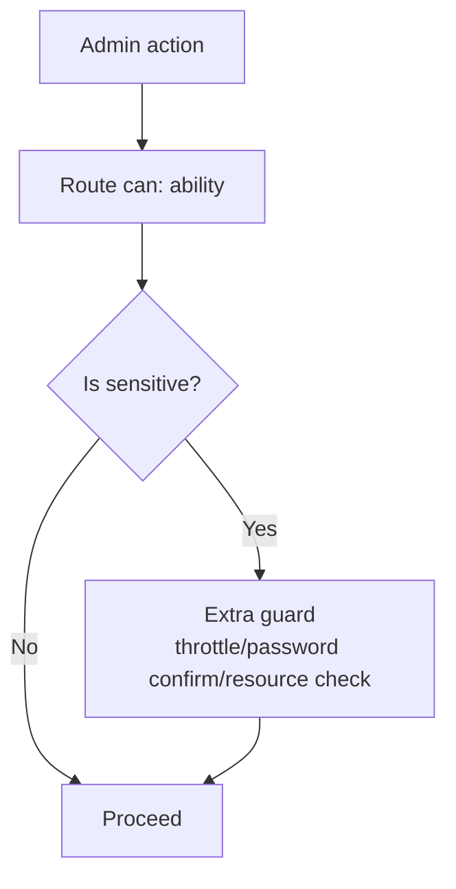

**Diagram sources**
- [admin.php:1-291](file://routes/admin.php#L1-L291)
- [RoleService.php:1-43](file://app/Services/RoleService.php#L1-L43)

**Section sources**
- [admin.php:1-291](file://routes/admin.php#L1-L291)
- [RoleService.php:1-43](file://app/Services/RoleService.php#L1-L43)

### API Endpoint Protection
API protection follows the same permission vocabulary as the web admin panel, ensuring consistency between interfaces:
- Authentication is mandatory for all data endpoints.
- Rate limiting protects login and two-factor challenge endpoints.
- Numeric route constraints reduce parameter ambiguity.
- Abilities mirror web routes: bookings, inspections, quotes, contact messages, testimonials, blog moderation, staff directory, partners, and gallery.

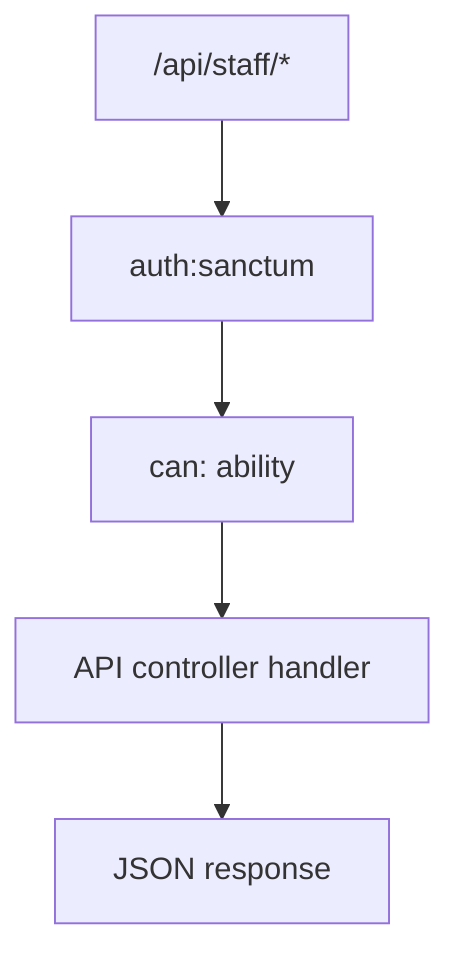

**Diagram sources**
- [api.php:1-117](file://routes/api.php#L1-L117)

**Section sources**
- [api.php:1-117](file://routes/api.php#L1-L117)

### Privilege Escalation Prevention
Highblossom prevents privilege escalation through several mechanisms:
- Super Admin bypass is centralized in the service provider gate hook.
- Only users with `manage roles` can assign or change roles.
- Only users with `manage users` can create, edit, or delete users.
- The Super Admin role cannot be deleted through `RoleService`.
- Sensitive system capabilities are separated into distinct permissions, such as `view system overview` versus `export system overview`.
- Missing permissions result in denied access rather than fallback grants, except for Super Admin.

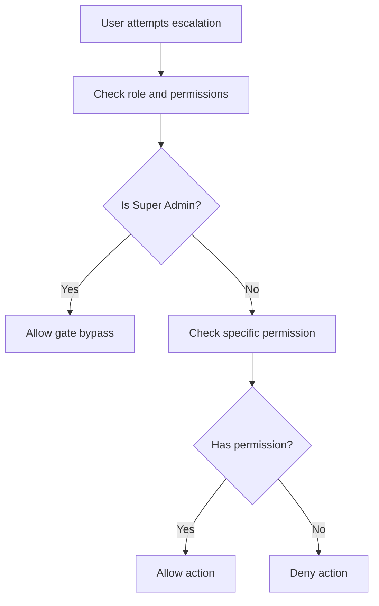

**Diagram sources**
- [AppServiceProvider.php:73-86](file://app/Providers/AppServiceProvider.php#L73-L86)
- [RoleService.php:1-43](file://app/Services/RoleService.php#L1-L43)
- [admin.php:1-291](file://routes/admin.php#L1-L291)

**Section sources**
- [AppServiceProvider.php:73-86](file://app/Providers/AppServiceProvider.php#L73-L86)
- [RoleService.php:1-43](file://app/Services/RoleService.php#L1-L43)

### Audit Trails for Access Control Decisions
Audit integration is configured through Auditify:
- The service provider configures Auditify’s authentication callback to identify Super Admin users for auditing purposes.
- This enables auditing of privileged administrative actions when audit logging is enabled.

Recommended audit trail additions:
- Log role assignment and removal events.
- Log permission changes during role updates.
- Log session revocations and password policy changes.
- Log system overview exports separately from reads due to higher risk.

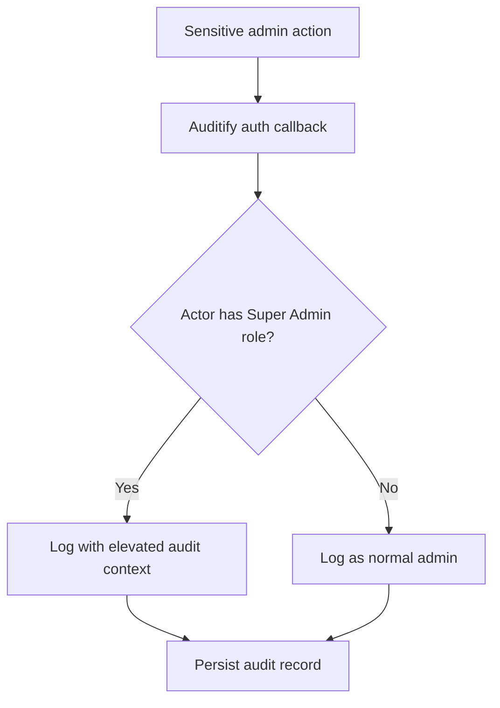

**Diagram sources**
- [AppServiceProvider.php:73-86](file://app/Providers/AppServiceProvider.php#L73-L86)

**Section sources**
- [AppServiceProvider.php:73-86](file://app/Providers/AppServiceProvider.php#L73-L86)

### Multi-Tenant and Cross-Resource Authorization Considerations
Currently, Spatie Permissions teams are disabled, meaning permissions and roles are global rather than tenant-scoped. If Highblossom supports multiple tenants:
- Enable the teams feature and configure `team_foreign_key`.
- Scope permissions and roles by tenant.
- Add tenant resolution logic if tenants are resolved per request.
- Ensure resource queries enforce tenant isolation before applying permissions.
- Avoid granting tenant-scoped permissions globally.
- Treat cross-resource authorization carefully: owning one resource should not imply access to unrelated resources, even within the same tenant.

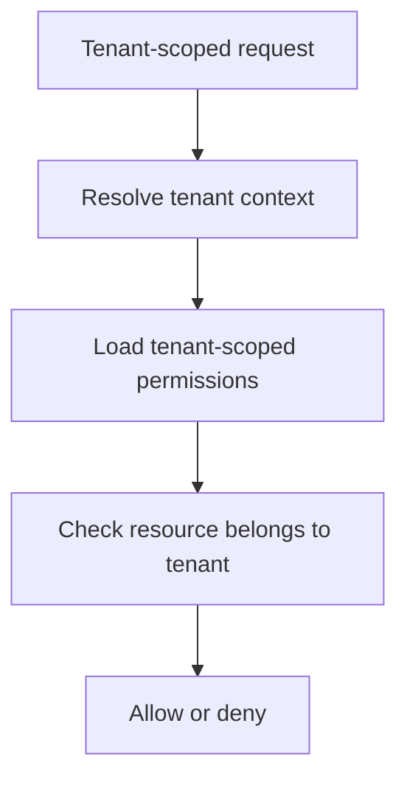

[No sources needed since this section provides general guidance]

## Dependency Analysis

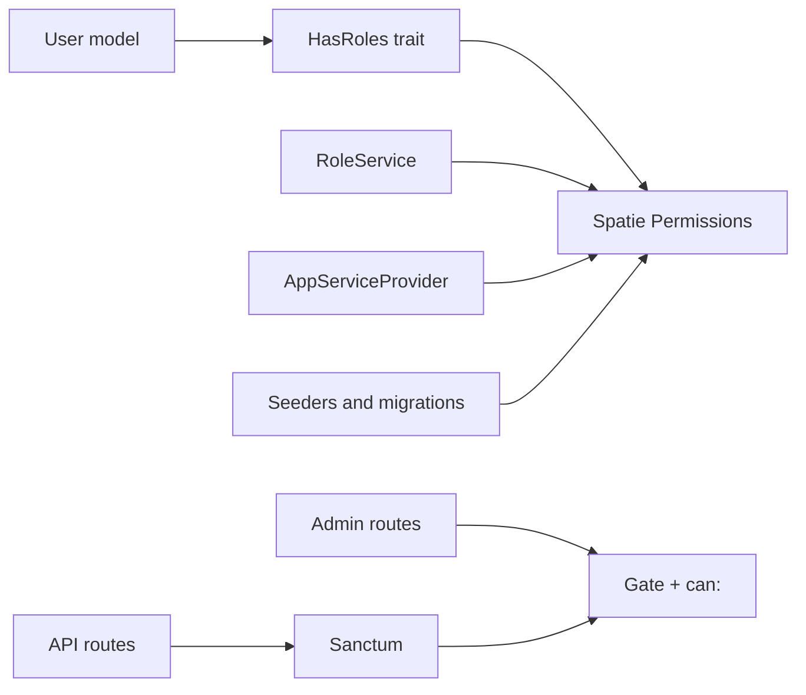

**Diagram sources**
- [User.php:1-141](file://app/Models/User.php#L1-L141)
- [RoleService.php:1-43](file://app/Services/RoleService.php#L1-L43)
- [AppServiceProvider.php:73-86](file://app/Providers/AppServiceProvider.php#L73-L86)
- [admin.php:1-291](file://routes/admin.php#L1-L291)
- [api.php:1-117](file://routes/api.php#L1-L117)
- [RolesAndPermissionsSeeder.php:1-161](file://database/seeders/RolesAndPermissionsSeeder.php#L1-L161)

**Section sources**
- [User.php:1-141](file://app/Models/User.php#L1-L141)
- [RoleService.php:1-43](file://app/Services/RoleService.php#L1-L43)
- [AppServiceProvider.php:73-86](file://app/Providers/AppServiceProvider.php#L73-L86)
- [admin.php:1-291](file://routes/admin.php#L1-L291)
- [api.php:1-117](file://routes/api.php#L1-L117)
- [RolesAndPermissionsSeeder.php:1-161](file://database/seeders/RolesAndPermissionsSeeder.php#L1-L161)

## Performance Considerations
- Spatie Permissions caches permissions for 24 hours by default. This reduces repeated database lookups for role and permission checks.
- Permission and role updates clear the cache automatically.
- Wildcard permissions are disabled, which avoids expensive wildcard matching.
- Admin and API routes apply abilities at the middleware level, allowing early rejection without executing controller logic.
- Throttling protects sensitive endpoints such as login, two-factor challenges, cache operations, and system overview refresh/export.

Recommendations:
- Keep permission names stable to avoid frequent cache invalidation.
- Prefer coarse route-level abilities before adding fine-grained checks.
- Avoid dynamic permission evaluation inside hot loops.
- Monitor cache driver performance in production.

**Section sources**
- [permission.php:1-206](file://config/permission.php#L1-L206)
- [admin.php:1-291](file://routes/admin.php#L1-L291)
- [api.php:1-117](file://routes/api.php#L1-L117)

## Troubleshooting Guide

### Common Issues

#### Missing Permission Errors
Symptoms:
- Admin routes return 403 even though the user appears to have administrative intent.
- API endpoints return 403 for staff app users.

Likely causes:
- The permission was not seeded or migrated.
- The role was not granted the permission.
- The permission exists only in one seeder but the database was seeded differently.

Resolution steps:
- Verify the permission exists in the `permissions` table.
- Confirm the role has the permission in `role_has_permissions`.
- Clear configuration cache and permission cache after changes.
- Use dedicated migrations for permissions that were added after initial seeding.

Relevant files:
- [2026_10_03_140000_add_manage_user_sessions_permission.php:1-43](file://database/migrations/2026_10_03_140000_add_manage_user_sessions_permission.php#L1-L43)
- [2026_10_15_120000_add_view_system_overview_permission.php:1-43](file://database/migrations/2026_10_15_120000_add_view_system_overview_permission.php#L1-L43)
- [2026_10_15_190000_add_export_system_overview_permission.php:1-44](file://database/migrations/2026_10_15_190000_add_export_system_overview_permission.php#L1-L44)
- [2026_10_23_215000_add_manage_settings_permission.php:1-51](file://database/migrations/2026_10_23_215000_add_manage_settings_permission.php#L1-L51)

#### Unexpected Super Admin Bypass
Symptoms:
- Super Admin can access routes or abilities that appear restricted.

Explanation:
- `Gate::before` returns true for Super Admin, allowing it to bypass normal permission checks.

Resolution:
- Do not assume route abilities alone prevent Super Admin access.
- Add explicit resource-level checks if Super Admin should not perform certain actions.

**Section sources**
- [AppServiceProvider.php:73-86](file://app/Providers/AppServiceProvider.php#L73-L86)

#### Role Deletion Failing Silently
Symptoms:
- Attempting to delete Super Admin returns a generic unauthorized message or fails silently.

Explanation:
- `RoleService::delete` rejects deletion of the Super Admin role.

Resolution:
- Remove Super Admin from users first, then handle role lifecycle through controlled administrative workflows.
- Avoid direct database manipulation of roles.

**Section sources**
- [RoleService.php:1-43](file://app/Services/RoleService.php#L1-L43)

#### API Tokens Not Working
Symptoms:
- Staff API returns authentication failures.

Likely causes:
- Missing or expired personal access token.
- Incorrect guard configuration.
- Stateful domain mismatch for SPA cookies.

Resolution:
- Verify Sanctum configuration.
- Confirm tokens are issued to the correct guard.
- Check stateful domains and CORS behavior if using SPAs.

**Section sources**
- [sanctum.php:1-87](file://config/sanctum.php#L1-L87)

### Diagnostic Checklist
- Is the user authenticated?
- Which guard is active: web or sanctum?
- Does the user have the required role or permission?
- Is the permission present in the database?
- Is the role granted the permission?
- Is the request reaching the correct route group?
- Are throttles blocking the request?
- Is audit logging capturing the decision path?

## Conclusion
Highblossom’s authorization system centers on Spatie Permissions, explicit route abilities, and a small but powerful role hierarchy. Super Admin acts as a trusted bypass, while Admin, Staff, and User roles follow least-privilege principles for day-to-day operations. Admin panel and API endpoints use consistent permission names, making cross-interface authorization easier to reason about.

For future improvements:
- Introduce tenant scoping when multi-tenancy becomes a requirement.
- Add detailed audit trails for permission and role changes.
- Consider policies for complex resource ownership scenarios while keeping them aligned with existing permission names.
- Continue separating high-risk capabilities, such as exports and cache operations, behind explicit permissions.